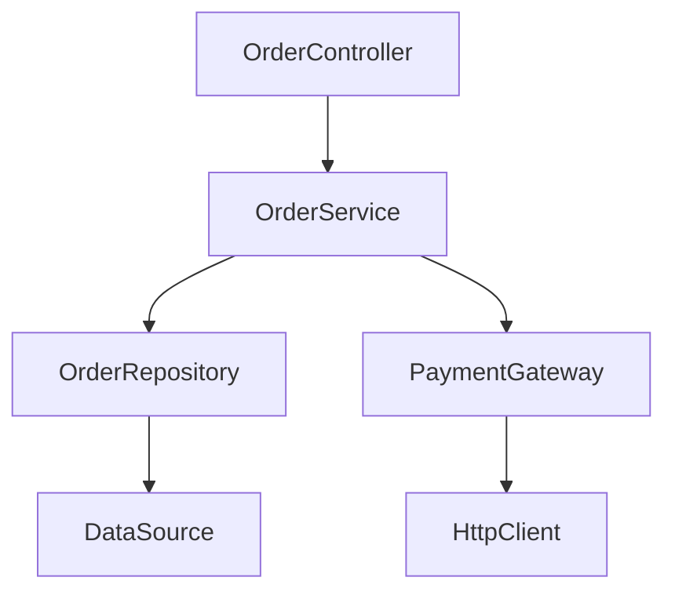
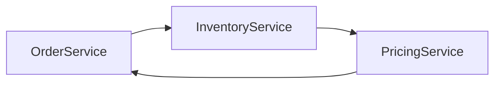
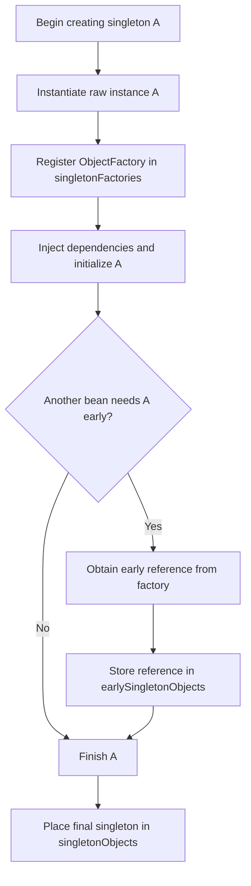
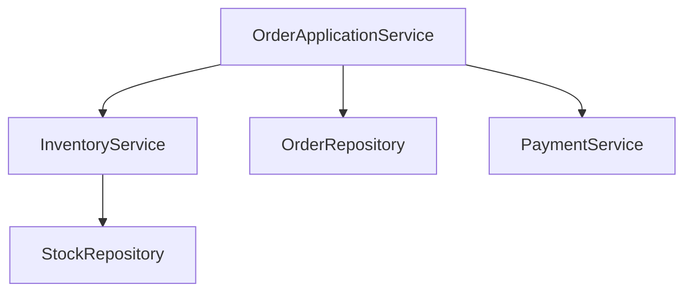
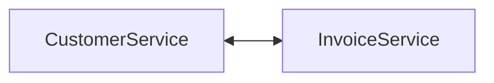
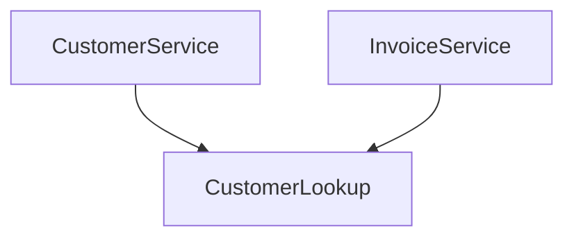
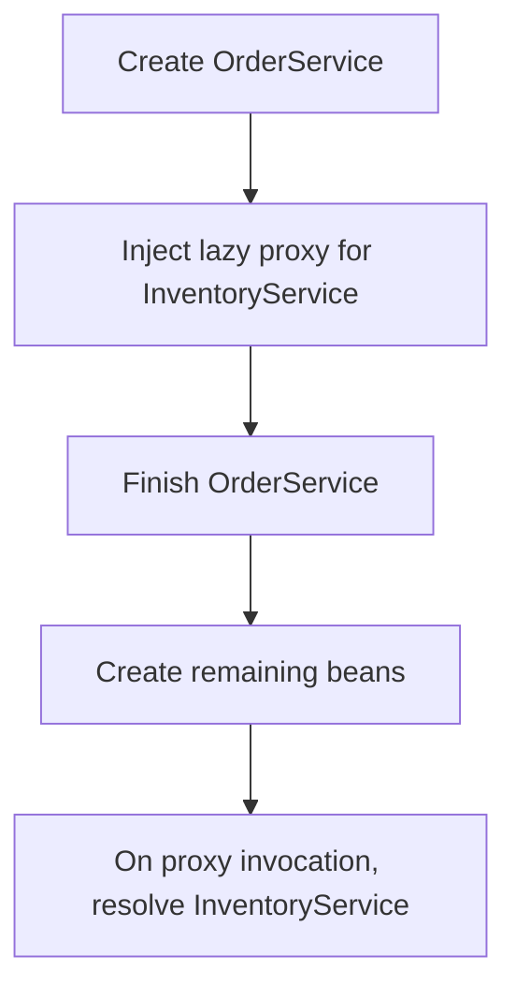
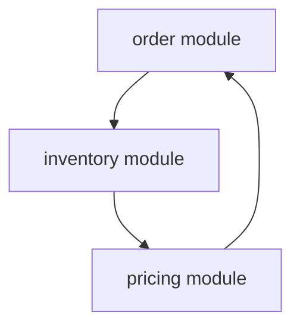
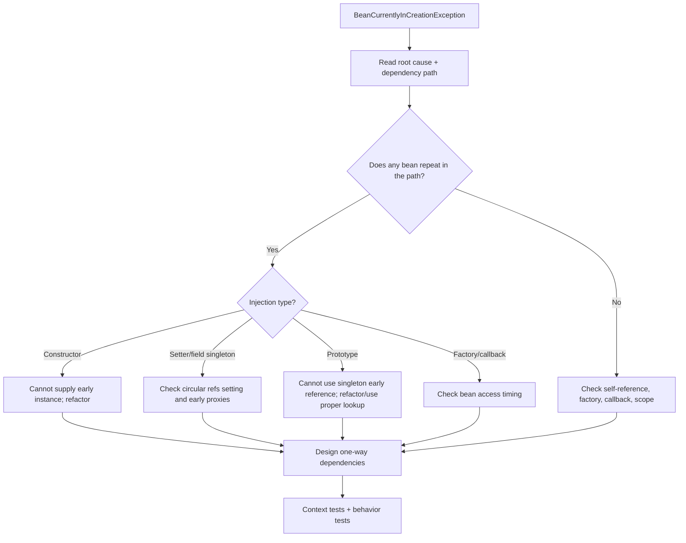

# BeanCurrentlyInCreationException and Circular Dependencies

When Spring creates beans at startup, the container must know which bean needs to be created first to inject dependencies into another bean. If dependencies form a closed loop—for example `A` needs `B` and `B` also needs `A`—Spring may not find a valid initialization order.

A common error in this scenario is:

```text
org.springframework.beans.factory.BeanCurrentlyInCreationException:
Error creating bean with name 'orderService':
Requested bean is currently in creation: Is there an unresolvable circular reference?
```

This message indicates Spring needs a bean that is still in the middle of being created. In certain configurations, the container can use an early reference to resolve a circular dependency between singletons. In other cases—especially with constructor injection, prototype scope, or when circular references are disabled—the cycle cannot be resolved and ApplicationContext creation fails.

The right response is to find the **actual dependency cycle**, understand why the two beans depend on each other, and redesign responsibility boundaries. Simply allowing circular references may let the application start in some cases, yet often masks a hard-to-maintain architecture.

## 1. What Is BeanCurrentlyInCreationException?

`BeanCurrentlyInCreationException` is a Spring BeanFactory exception in the bean creation error family. It is thrown when a bean is requested while that very bean is still under creation and the container cannot supply a valid reference at that moment.

A common scenario is a circular dependency:

```text
Bean A ───── needs Bean B
  ▲              │
  └──────────────┘
        B needs A
```

Spring cannot finish creating A without B, nor finish creating B without A.

However, do not assume every `BeanCurrentlyInCreationException` is caused by two classes constructor-injecting each other. It can also occur when:

- A bean directly or indirectly requests itself during initialization.
- A `FactoryBean`, factory method, or initialization callback accesses a bean too early.
- A prototype bean is involved in a dependency cycle.
- `@DependsOn` configuration creates a circular ordering requirement.
- A bean is accessed inside `@PostConstruct`, `InitializingBean.afterPropertiesSet()`, or a custom initialization callback while the object graph is incomplete.
- Proxy/AOP mechanisms and early references are incompatible with how the bean is injected.

Therefore, the exception is **a signal to investigate**, while the stack trace and dependency graph reveal the specific cause.

## 2. Dependency Graphs and Closed Cycles

Spring manages beans as a directed dependency graph. If `A` needs `B`, we have an edge `A → B`.

An acyclic graph can typically be initialized in topological order:



In this example, foundational dependencies are created first, followed by higher-level beans.

When a cycle exists:



The cycle is:

`OrderService → InventoryService → PricingService → OrderService`.

Whether the cycle spans two beans or five beans makes no difference. As soon as a path leads from a bean back to itself, the dependency graph contains a cycle.

### Direct vs. Indirect Cycles

Direct cycle:

```java
@Component
public class ReportService {
    public ReportService(ReportService self) {
    }
}
```

Indirect cycle:

```java
@Service
public class OrderService {
    public OrderService(InventoryService inventoryService) {
    }
}

@Service
public class InventoryService {
    public InventoryService(OrderService orderService) {
    }
}
```

Indirect cycles are often harder to spot because each individual class appears to depend on a reasonable service. In larger systems, cycles can span multiple modules or business layers.

### Dependency Graphs Reflect Design

If service A must call service B and service B must call back into service A, the two services may hold poorly divided responsibilities. You may need to:

- Extract shared logic into a third service.
- Move orchestration up into an application service.
- Use an interface or port to invert a dependency.
- Switch one-way communication to events/messages where appropriate for the domain.

Not every cycle can be fixed simply by switching constructors to setters. Identify why the dependency exists before choosing a fix.

## 3. Constructor Injection Creates Unresolvable Cycles

Constructor injection is the standard way to express mandatory dependencies:

```java
@Service
public class OrderService {
    private final InventoryService inventoryService;

    public OrderService(InventoryService inventoryService) {
        this.inventoryService = inventoryService;
    }
}
```

Yet if `InventoryService` also requires `OrderService`:

```java
@Service
public class InventoryService {
    private final OrderService orderService;

    public InventoryService(OrderService orderService) {
        this.orderService = orderService;
    }
}
```

Spring must construct two objects:

1. Creating `OrderService` requires `InventoryService`.
2. Creating `InventoryService` requires `OrderService`.
3. However, `OrderService`'s constructor has not completed, so no finished instance exists to pass into `InventoryService`.
4. The container cannot complete either constructor.

Diagram:

```mermaid
sequenceDiagram
    participant C as Spring Container
    participant O as OrderService
    participant I as InventoryService
    C->>O: Create OrderService
    O->>C: Request InventoryService
    C->>I: Create InventoryService
    I->>C: Request OrderService
    C-->>I: OrderService is still being created; no complete instance
    C-->>O: Cannot complete dependency graph
```

This is why constructor cycles typically trigger `BeanCurrentlyInCreationException`. The container cannot construct an unfinished object and pass it into another constructor as a valid reference.

### Why Is Constructor Injection Still Recommended?

Constructor injection offers key benefits:

- Mandatory dependencies are explicit.
- Fields can be declared `final`.
- Objects cannot be instantiated missing required dependencies.
- Unit tests can instantiate classes easily with test doubles.
- Dependency cycles are caught early at context startup.

When constructor injection exposes a dependency cycle, that is usually a good signal: the design needs review before reaching runtime.

## 4. Setter/Field Injection and Singleton Early References

Unlike constructor injection, setter/field injection lets Spring instantiate an object first and populate dependencies afterward:

```java
@Service
public class OrderService {
    private InventoryService inventoryService;

    @Autowired
    public void setInventoryService(InventoryService inventoryService) {
        this.inventoryService = inventoryService;
    }
}

@Service
public class InventoryService {
    private OrderService orderService;

    @Autowired
    public void setOrderService(OrderService orderService) {
        this.orderService = orderService;
    }
}
```

With singleton beans and circular references allowed, Spring can:

1. Create instance A via its no-arg constructor.
2. Put a factory producing an early reference of A into an internal cache.
3. Begin creating B.
4. When B requests A, supply A's early reference.
5. Finish injecting dependencies into B.
6. Return and finish injecting dependencies into A.

This can resolve some setter/field injection cycles between singleton beans.

### Why Can't Every Cycle Be Resolved This Way?

An early reference can only be supplied once an object instance exists. It cannot resolve constructor cycles because constructors have not yet finished creating the object.

Furthermore:

- Prototype beans are not managed through the same singleton cache lifecycle.
- Certain factory/lifecycle callbacks may request a bean before a reference can be exposed.
- AOP proxies can create mismatches between raw objects and wrapped objects.
- Modern Spring Boot disallows circular references by default in standard setups.

Thus, converting constructor injection to field injection may make a cycle "work" in older setups, yet is not a reliable design fix.

## 5. How Does Spring's Three-Level Singleton Cache Work?

To understand why setter cycles can sometimes be resolved, it helps to know Spring Framework's singleton caching mechanism.

Conceptually, `DefaultSingletonBeanRegistry` uses three storage maps:

| Cache | Role |
|---|---|
| `singletonObjects` | Completed singleton beans, ready for use |
| `earlySingletonObjects` | Early references already created and available to satisfy pending dependencies |
| `singletonFactories` | Factories capable of producing early references on demand, notably supporting `getEarlyBeanReference` and AOP |

General flow:



These three caches are not three duplicate beans created at once. They represent different stages of creating a singleton.

### Why Use a Factory Instead of Storing the Raw Object Directly?

Spring needs a hook to produce an **early bean reference** that mechanisms like `SmartInstantiationAwareBeanPostProcessor` can customize. Auto-proxy creators use this hook to expose an appropriate proxy early, avoiding a situation where another bean receives a raw object while the container later exposes a proxy.

If an early reference differs from the final object after BeanPostProcessors run, the application can suffer identity or AOP behavior mismatches. This is one reason handling circular references is not as simple as "put the object into a map before injecting."

### Early Reference Does Not Mean the Bean Is Ready

An early reference may be injected while the bean is still incomplete:

- Setter/field dependencies may not all be populated yet.
- `@PostConstruct` may not have run yet.
- `InitializingBean.afterPropertiesSet()` has not completed yet.
- BeanPostProcessors may still need to process the object.
- Proxies/wrappers may not be in their final state.

If Bean B calls a method on A during initialization, A may be in an unready state. This is a runtime risk even when the context manages to start.

**Early references are a container compatibility mechanism, not a guarantee that beans in a cycle can safely call each other during startup.**

## 6. Spring Boot 2.6+ and Default Circular Reference Handling

Since Spring Boot 2.6, circular references between beans are disallowed by default in standard configurations. This catches hard-to-maintain dependency cycles early rather than silently trying to patch around them with early references.

A configuration may encounter:

```text
The dependencies of some of the beans in the application context form a cycle:

┌─────┐
| orderService
↑     ↓
| inventoryService
└─────┘
```

Spring Boot provides a compatibility property to re-enable circular references:

```properties
spring.main.allow-circular-references=true
```

Or YAML:

```yaml
spring:
  main:
    allow-circular-references: true
```

When enabled, Boot allows the container to resolve certain resolvable circular references, such as setter/field injection cycles among singleton beans.

**That does not mean every circular dependency will work.** Constructor cycles still lack an instance to inject; prototype cycles and certain factory/proxy scenarios also remain unresolvable.

### Should You Enable This Property?

In general, do not use `spring.main.allow-circular-references=true` as the default fix for new applications.

Consider it only temporarily when:

- Upgrading a legacy application with pre-existing setter/field injection cycles.
- Restoring service quickly before refactoring.
- You have verified which cycles are resolved and tested the lifecycles of involved beans.
- A concrete plan exists to remove the dependency cycle rather than leaving the property enabled indefinitely.

If an application needs this property to start, record it as design debt and identify which modules/beans need refactoring.

## 7. Reading Stack Traces and Identifying the Cycle

When context startup fails, the outermost error might be:

```text
org.springframework.beans.factory.UnsatisfiedDependencyException:
Error creating bean with name 'orderController'
```

While the deeper root cause is:

```text
org.springframework.beans.factory.BeanCurrentlyInCreationException:
Error creating bean with name 'orderService':
Requested bean is currently in creation
```

Do not look only at the first line. Trace the chain:

```text
OrderController
  constructor parameter 0
    OrderService
      constructor parameter 1
        InventoryService
          constructor parameter 0
            OrderService
              currently in creation
```

This shows:

1. Controller needs `OrderService`.
2. `OrderService` needs `InventoryService`.
3. `InventoryService` needs `OrderService`.
4. `OrderService` is currently mid-creation and cannot be supplied as requested.

### How to Read the Dependency Path

When reading the stack trace:

- Look for bean names in `Error creating bean with name`.
- Read `Unsatisfied dependency expressed through constructor parameter`, field, or method entries.
- Record each bean appearing in the chain.
- Find the first bean that repeats.
- Read the final exception cause to distinguish circular dependencies from missing beans, constructor errors, or binding errors.

If the output includes a dependency cycle diagram, use it as a starting point while still verifying actual injection points in source. A bean may depend indirectly through `@Bean` factory methods, configuration properties, or `@DependsOn`.

### When No Clear Cycle Diagram Appears

Some versions or error shapes do not print a neat cycle diagram. You can:

- Enable bean creation logs appropriately in development.
- Set debugger breakpoints in constructors/factory methods.
- Inspect dependencies declared via constructors, fields, and methods.
- Search for `@Bean` methods returning services or factories.
- Use IDE call hierarchies or bean/type searches to reconstruct the path.

Do not enable root TRACE across the entire application immediately. Narrow down the beans appearing in the error chain first.

## 8. Business Example of a Circular Dependency

Suppose an ordering application has two services:

```java
@Service
public class OrderService {
    private final InventoryService inventoryService;

    public OrderService(InventoryService inventoryService) {
        this.inventoryService = inventoryService;
    }

    public void placeOrder(String sku, int quantity) {
        inventoryService.reserve(sku, quantity);
        // Create order and persist data.
    }
}
```

The inventory service needs the order service to verify status:

```java
@Service
public class InventoryService {
    private final OrderService orderService;

    public InventoryService(OrderService orderService) {
        this.orderService = orderService;
    }

    public void reserve(String sku, int quantity) {
        // Need to call orderService to verify order status.
    }
}
```

This design raises an important question: why does reserving stock need direct knowledge of `OrderService`? `InventoryService` may know too much about the ordering workflow.

Instead of allowing the cycle, extract orchestration:



`OrderApplicationService` coordinates the use case. `InventoryService` only checks and reserves stock; it does not call back into the orchestrating service.

Example:

```java
@Service
public class OrderApplicationService {
    private final InventoryService inventoryService;
    private final PaymentService paymentService;
    private final OrderRepository orderRepository;

    public OrderApplicationService(
            InventoryService inventoryService,
            PaymentService paymentService,
            OrderRepository orderRepository) {
        this.inventoryService = inventoryService;
        this.paymentService = paymentService;
        this.orderRepository = orderRepository;
    }

    public Order placeOrder(CreateOrderCommand command) {
        inventoryService.reserve(
                command.sku(), command.quantity());

        Order order = orderRepository.save(
                Order.create(command));

        paymentService.authorize(order);
        return order;
    }
}
```

InventoryService:

```java
@Service
public class InventoryService {
    private final StockRepository stockRepository;

    public InventoryService(StockRepository stockRepository) {
        this.stockRepository = stockRepository;
    }

    public void reserve(String sku, int quantity) {
        Stock stock = stockRepository.findBySku(sku)
                .orElseThrow(() ->
                        new IllegalArgumentException("Unknown SKU"));

        stock.reserve(quantity);
        stockRepository.save(stock);
    }
}
```

This condensed example assumes `Order`, `CreateOrderCommand`, `Stock`, `OrderRepository`, `StockRepository`, and `PaymentService` are already defined. The key point is that dependencies flow downward from the application service to specialized services, with no backward edges.

## 9. Best Fix: Separate Responsibilities and Make Dependencies One-Way

A cycle usually signals two modules mutually depend on each other at the domain level. Common refactoring approaches:

### Extract Shared Logic

If both A and B need a piece of logic, do not let A call B and B call A. Move that logic into a third component with a focused responsibility.

Before:



After:



### Use an Application Service as an Orchestration Layer

A use-case coordinator calls specialized services sequentially. Specialized services never call back up into the orchestration layer.

```text
Controller
   ↓
Application Service
   ├── Customer Service
   ├── Inventory Service
   ├── Payment Service
   └── Notification Service
```

### Invert Dependencies with Interfaces/Ports

If a domain module needs behavior without depending on an infrastructure module, define an interface on the contract-owning side. The implementation in the other module depends on that interface.

Example:

```java
public interface CustomerStatusReader {
    CustomerStatus findStatus(CustomerId customerId);
}
```

Service using the interface:

```java
@Service
public class InvoiceService {
    private final CustomerStatusReader customerStatusReader;

    public InvoiceService(CustomerStatusReader customerStatusReader) {
        this.customerStatusReader = customerStatusReader;
    }
}
```

Adapter implementing the interface in the appropriate module:

```java
@Component
public class CustomerStatusAdapter implements CustomerStatusReader {
    private final CustomerRepository customerRepository;

    public CustomerStatusAdapter(CustomerRepository customerRepository) {
        this.customerRepository = customerRepository;
    }

    @Override
    public CustomerStatus findStatus(CustomerId customerId) {
        return customerRepository.findStatus(customerId);
    }
}
```

Dependency inversion keeps business modules from importing implementation modules. It does not automatically eliminate runtime cycles if the implementation still injects the original service back, yet it establishes clean boundaries for a one-way graph.

### Extracting an Interface Alone Does Not Break a Cycle

If `A` injects interface `BPort`, yet implementation `BAdapter` still injects `A`, the runtime dependency remains:

`A → BAdapter → A`.

Interfaces only help when they genuinely invert dependencies or separate modules. Do not simply rename a type into an interface and assume the cycle disappeared.

## 10. Using Events to Decouple One-Way Communication

Some interactions do not require synchronous callbacks. For example, after creating an order, the system sends a notification. Rather than `OrderService` calling `NotificationService` and the notification service calling back into `OrderService` to read status, publish a domain/application event.

Publisher:

```java
@Service
public class OrderApplicationService {
    private final OrderRepository orderRepository;
    private final ApplicationEventPublisher events;

    public OrderApplicationService(
            OrderRepository orderRepository,
            ApplicationEventPublisher events) {
        this.orderRepository = orderRepository;
        this.events = events;
    }

    public Order placeOrder(CreateOrderCommand command) {
        Order order = orderRepository.save(Order.create(command));
        events.publishEvent(new OrderPlacedEvent(order.getId()));
        return order;
    }
}
```

Listener:

```java
@Component
public class OrderNotificationListener {
    private final NotificationService notificationService;

    public OrderNotificationListener(
            NotificationService notificationService) {
        this.notificationService = notificationService;
    }

    @EventListener
    public void onOrderPlaced(OrderPlacedEvent event) {
        notificationService.notifyOrderPlaced(event.orderId());
    }
}
```

Event type:

```java
public record OrderPlacedEvent(Long orderId) {}
```

Here the publisher depends on the `ApplicationEventPublisher` abstraction; the listener depends on `NotificationService`. The notification service no longer injects `OrderApplicationService`.

### Events Are Not Always the Answer

Spring application events run synchronously by default unless configured with a custom executor. If a listener calls back into the publisher or triggers an event loop, logic remains tangled.

Moreover, in-process events do not guarantee durable delivery. If notification reliability after process crashes is required, consider a transactional outbox or message broker instead of relying solely on in-memory events.

## 11. Using ObjectProvider When Dependency Resolution Must Be Deferred

Sometimes a bean needs a dependency only after the context has finished initializing. Spring offers `ObjectProvider<T>` to defer bean retrieval:

```java
@Service
public class ReportService {
    private final ObjectProvider<ExportService> exportServiceProvider;

    public ReportService(
            ObjectProvider<ExportService> exportServiceProvider) {
        this.exportServiceProvider = exportServiceProvider;
    }

    public void exportReport(Report report) {
        ExportService exportService =
                exportServiceProvider.getObject();
        exportService.export(report);
    }
}
```

`ObjectProvider` is injected when `ReportService` is created, while the `ExportService` bean is resolved only when `getObject()` is called.

This can break an initialization cycle if the dependency is used only after context readiness. However, it changes semantics:

- Missing bean errors surface later.
- Calling the provider inside a constructor or initialization callback can still trigger the cycle.
- Each provider call may yield the same singleton or a new instance depending on scope.
- The architectural coupling still exists, only resolution is deferred.

### getIfAvailable and getIfUnique

When a dependency is genuinely optional:

```java
Optional<ExportService> exportService =
        exportServiceProvider.getIfAvailable();
```

Or use `getIfUnique()` to avoid choosing arbitrarily among multiple candidates. Never use optional APIs to hide a genuinely mandatory dependency; if a service cannot function without it, declare it explicitly.

### ObjectProvider Is Not a Default Refactoring Tool

If A and B depend on each other in every business operation, `ObjectProvider` merely hides the cycle. Use it when deferred lookup mirrors actual usage timing, such as optional plugins or post-startup callbacks.

## 12. Using @Lazy to Defer Initialization or Inject Proxies

Spring supports `@Lazy` at the bean definition level and at injection points.

Example:

```java
@Service
public class OrderService {
    private final InventoryService inventoryService;

    public OrderService(@Lazy InventoryService inventoryService) {
        this.inventoryService = inventoryService;
    }
}
```

At an injection point, `@Lazy` injects a lazy-resolution proxy immediately, resolving the target bean only when a method is invoked.

This can allow some constructor cycles to initialize:



### Risks of @Lazy

- Dependency errors may be delayed until the first runtime request.
- Proxies can mask cycles instead of removing coupling.
- Invoking the target during initialization can still re-trigger the cycle early.
- Final classes/methods or proxy strategies may restrict proxy generation.
- When targets have different scopes/lifecycles, proxy semantics must be understood carefully.

`@Lazy` fits when a dependency is genuinely unnecessary at startup or when an optional integration should only be instantiated when used. Never sprinkle `@Lazy` across beans in a cycle just to get startup passing without reviewing the design.

### @Lazy on a Bean vs. @Lazy on an Injection Point

Placing `@Lazy` on a class/configuration defers instantiating that bean until requested. Placing it on a constructor parameter or field creates a lazy-resolution proxy for that specific dependency. The two are related yet do not configure identical behavior.

## 13. @DependsOn Does Not Fix Circular Dependencies

`@DependsOn` instructs Spring to initialize one bean before another:

```java
@Component
@DependsOn("databaseInitializer")
public class OrderService {
}
```

This helps when one bean performs initialization side effects needed before another bean starts, without a direct constructor dependency expressing that order.

However, if you configure:

```java
@Component
@DependsOn("inventoryService")
public class OrderService {
}

@Component
@DependsOn("orderService")
public class InventoryService {
}
```

you have declared a circular creation order. `@DependsOn` does not provide early objects and does not break cycles; it either surfaces the dependency error more clearly or reproduces the same problem.

Use `@DependsOn` for intentional one-way initialization order, never as a cycle workaround.

## 14. @PostConstruct and Premature Bean Calls

A dependency cycle sometimes hides not in constructors, but inside callbacks:

```java
@Component
public class StartupCoordinator {
    private final OrderService orderService;

    public StartupCoordinator(OrderService orderService) {
        this.orderService = orderService;
    }

    @PostConstruct
    void initialize() {
        orderService.loadInitialData();
    }
}
```

If `loadInitialData()` invokes another bean still under creation or accesses an incomplete object graph, startup can fail or behave unpredictably.

`@PostConstruct` runs after the current bean's dependencies are injected, yet does not mean **the entire ApplicationContext has finished initializing**. Other beans may still be in flight.

### Work That Should Run After Context Readiness

If logic is a startup task meant to execute after context refresh, consider:

- `ApplicationRunner` or `CommandLineRunner` for work after the application prepares the context.
- `ApplicationReadyEvent` for a milestone after runners.
- `SmartLifecycle` for resources needing structured lifecycle start/stop.
- An explicit workflow invoked by an application service.

Example:

```java
@Component
public class InitialDataLoader implements ApplicationRunner {
    private final OrderService orderService;

    public InitialDataLoader(OrderService orderService) {
        this.orderService = orderService;
    }

    @Override
    public void run(ApplicationArguments args) {
        orderService.loadInitialData();
    }
}
```

Moving from `@PostConstruct` to a runner solves **calling too early**, yet will not fix an actual dependency cycle in the constructor graph. If A constructor-injects B and B constructor-injects A, a runner still cannot get both beans constructed.

## 15. Circular Dependencies via @Configuration and @Bean Methods

Not every bean comes from `@Component`. `@Configuration` can declare factory methods:

```java
@Configuration
public class ServiceConfiguration {

    @Bean
    OrderService orderService(InventoryService inventoryService) {
        return new OrderService(inventoryService);
    }

    @Bean
    InventoryService inventoryService(OrderService orderService) {
        return new InventoryService(orderService);
    }
}
```

This is still a constructor-style dependency graph at the factory-method level:

`orderService → inventoryService → orderService`.

Toggling `@Configuration(proxyBeanMethods = true/false)` does not eliminate `@Bean` parameter cycles. `proxyBeanMethods` primarily controls intercepting direct Java calls between `@Bean` methods within the configuration class; dependencies declared as method parameters are still resolved by the container.

### Calling @Bean Methods Directly in Lite Configuration

With:

```java
@Configuration(proxyBeanMethods = false)
class AppConfiguration {
    @Bean
    ServiceA serviceA() {
        return new ServiceA(serviceB());
    }

    @Bean
    ServiceB serviceB() {
        return new ServiceB();
    }
}
```

When `proxyBeanMethods=false`, calling `serviceB()` is a plain Java call—not intercepted to return the container-managed singleton. This can instantiate a separate object distinct from the container's bean. Passing via method parameter:

```java
@Bean
ServiceA serviceA(ServiceB serviceB) {
    return new ServiceA(serviceB);
}
```

is clearer and respects container lifecycle.

When `@Bean` methods inject each other via parameters, map the dependency graph just like constructor injection and break the cycle. Do not confuse direct method call mistakes with container circular dependencies.

## 16. Circular Dependencies and AOP Proxies

Spring can wrap beans in proxies for features such as:

- `@Transactional`
- `@Async`
- `@Cacheable`
- Method security
- Custom aspects

When a circular reference exists, the container must ensure other beans receive a reference compatible with the final proxy. `SmartInstantiationAwareBeanPostProcessor.getEarlyBeanReference(...)` is part of the mechanism supporting early proxy references.

Some scenarios trigger messages like:

```text
Bean with name '...' has been injected into other beans
in its raw version as part of a circular reference,
but has eventually been wrapped
```

This means another bean received the raw target object while the bean was ultimately wrapped in a proxy. As a result, certain call paths may bypass advice like transactions, security, or caching.

### Why Raw/Proxy Mismatches Are Dangerous

Suppose `PaymentService` is wrapped by a transaction proxy. If another bean holds the raw target reference via early exposure, calls through that reference can skip the transaction interceptor entirely.

This leaves the application appearing to run while runtime semantics diverge:

- Some calls pass through the proxy.
- Other calls invoke the raw target directly.
- `@Transactional` or other advice silently fails to apply on one call path.

This is a compelling reason to eliminate circular references instead of relying on early singleton exposure.

### When Seeing Proxy Errors Tied to Circular References

Do not immediately add `@Lazy` or enable `allow-circular-references`. Instead:

1. Identify which bean is wrapped and by which post-processor.
2. Identify which bean received the raw reference.
3. Check whether call paths depend on `@Transactional`, `@Async`, security, or cache advice.
4. Refactor so the dependency graph has no cycles.
5. Reverify proxy behavior with integration tests.

## 17. Prototype Scope and Circular Dependencies

Singleton beans are cached by the container and have early-reference support for certain circular references. Prototype beans follow a different lifecycle: every request instantiates a fresh object without singleton cache management.

Example:

```java
@Component
@Scope(ConfigurableBeanFactory.SCOPE_PROTOTYPE)
public class TaskA {
    public TaskA(TaskB taskB) {
    }
}

@Component
@Scope(ConfigurableBeanFactory.SCOPE_PROTOTYPE)
public class TaskB {
    public TaskB(TaskA taskA) {
    }
}
```

Such prototype cycles cannot rely on singleton early-reference mechanisms. They recurse until failure.

A singleton injecting a prototype also has distinct semantics: the prototype is resolved at injection time, so only one instance is typically retained inside the singleton unless a provider/proxy is used to fetch fresh instances on demand.

If a fresh prototype is needed per task, use `ObjectProvider<Task>`:

```java
@Component
public class TaskLauncher {
    private final ObjectProvider<ExpensiveTask> taskProvider;

    public TaskLauncher(ObjectProvider<ExpensiveTask> taskProvider) {
        this.taskProvider = taskProvider;
    }

    public void launch() {
        ExpensiveTask task = taskProvider.getObject();
        task.execute();
    }
}
```

This defers on-demand instance creation—it is not a way to legitimize an illogical dependency cycle.

## 18. Using @Lazy or ObjectProvider: When Is It Acceptable?

Both mechanisms are helpful when **the moment a dependency is actually needed comes later than bean creation**:

| Scenario | Potentially Suitable Mechanism | Why |
|---|---|---|
| Optional plugin used only when a feature is invoked | `ObjectProvider<T>` | Resolves only when the feature runs |
| Heavy bean unnecessary at startup | `@Lazy` on bean or injection point | Defers initialization |
| Fresh prototype needed per operation | `ObjectProvider<T>` | Resolves a new scoped instance |
| Optional dependency that may not exist | `getIfAvailable()` | Expresses optionality |
| Two mandatory services calling each other on every workflow | Refactor | Deferred lookup merely hides coupling |
| Constructor cycle between two core services | Refactor | Never rely on proxies to bypass core cycles |

Ask: **if the dependency is deferred, does the system have a clear, valid call flow once the context is ready?** If not, the flaw lies in responsibility design, not bean instantiation timing.

## 19. Circular Dependencies Across Modules

In multi-module projects, cycles can also exist at the build module level:

```text
module-order  → module-inventory
module-inventory → module-pricing
module-pricing → module-order
```

This is not merely a Spring bean cycle. Build tools also reject dependency cycles between Gradle/Maven modules before the application even runs.

A module cycle usually signals misplaced package/module boundaries. Example:



Options to resolve it:

- Move shared contracts into a smaller, low-dependency module.
- Create an application/orchestration module depending downward on domain modules.
- Place interfaces in the abstraction-owning module.
- Separate integration adapters from domain modules.
- Prevent shared modules from depending back on the application.

Example structure:

```text
application
  ├── order-domain
  ├── inventory-domain
  ├── pricing-domain
  └── infrastructure

order-domain      → shared-kernel
inventory-domain  → shared-kernel
pricing-domain    → shared-kernel
infrastructure   → contracts/domains to implement
```

Clean module boundaries help keep Spring bean graphs one-way, though they do not automatically guarantee zero bean cycles. You must still inspect dependency injection within each module.

## 20. Testing and Confirming the Cycle Is Eliminated

After refactoring, verify that ApplicationContext starts with real configuration:

```java
@SpringBootTest
class ApplicationContextStartupTest {

    @Test
    void contextStartsSuccessfully() {
        // Spring Boot creates the context before running the test.
    }
}
```

This test verifies beans are created under the loaded test configuration. If the application has multiple profiles, run context tests for key profiles since each profile may register a different bean set.

### Testing a Bean Group with ApplicationContextRunner

For a small configuration group:

```java
class OrderConfigurationTest {
    private final ApplicationContextRunner contextRunner =
            new ApplicationContextRunner()
                    .withUserConfiguration(OrderConfiguration.class);

    @Test
    void contextCanCreateOrderServices() {
        contextRunner.run(context -> {
            assertThat(context).hasNotFailed();
            assertThat(context).hasSingleBean(OrderService.class);
            assertThat(context).hasSingleBean(InventoryService.class);
        });
    }
}
```

This example uses Spring Boot test and AssertJ; `OrderConfiguration` must register the relevant beans. `ApplicationContextRunner` is great for isolating configurations, though it does not replace full integration tests when the dependency graph relies heavily on auto-configuration.

### Test Behavior, Not Only Startup

A context starting cleanly does not guarantee refactoring preserved business behavior. Verify:

- Use cases invoke services in the intended sequence.
- Transaction boundaries remain accurate.
- AOP proxies such as `@Transactional` still apply.
- Event listeners do not form callback loops.
- Lazy/provider dependencies resolve at the right time.
- Profiles/conditions do not introduce new cycles in other environments.

Especially if a bean previously relied on early references, verify critical call paths still pass through expected proxies.

## 21. Common Symptoms and Investigation Paths

| Symptom | Likely Cause | Where to Investigate |
|---|---|---|
| `BeanCurrentlyInCreationException` on constructor | Constructor cycle | Trace dependency path and refactor |
| Boot reports a circular reference between two beans | Setter/field cycles disallowed by default | Identify the cycle; do not leave property enabled long-term |
| Enabling `allow-circular-references` still fails | Constructor cycle, prototype cycle, or un-exposable early reference | Check injection style, scope, and factories |
| Context starts yet method calls throw NPE | Bean called prematurely before dependencies populated | Check early references and init callbacks |
| `@Transactional` ignored on one call path | Raw reference/proxy mismatch or self-invocation | Check proxies and dependency cycles |
| Cycle appears after adding `@PostConstruct` | Callback calls another bean before context finishes | Move work to runner/events or refactor |
| Error appears only under one profile | Profile registers implementations creating a different cycle | Inspect that profile's bean graph |
| Error appears only when enabling a feature | Conditional bean or optional integration introduces a path | Check conditions and feature config |
| Gradle/Maven reports module dependency cycle | Cycle in build graph before Spring runs | Extract contracts/modules and invert dependencies |
| App boots with `@Lazy` yet fails on first request | Cycle was deferred rather than eliminated | Check resolution timing and redesign |

### When Should You Consider @Primary or @Qualifier?

`@Primary` and `@Qualifier` resolve ambiguity when multiple beans share a type. They do not resolve circular dependencies.

For example, if `OrderService` sees `LocalInventoryService` and `RemoteInventoryService`, picking one resolves `NoUniqueBeanDefinitionException`. Yet if the chosen implementation still injects `OrderService`, the cycle remains.

Distinguish:

- **Ambiguous dependency:** multiple candidates exist; Spring does not know which to choose.
- **Circular dependency:** the dependency path loops back to a bean currently under creation.
- **Missing dependency:** no matching bean exists to inject.

Each requires a different fix despite all appearing under bean creation failures.

## 22. Temporary Workarounds to Weigh Carefully

Some changes get the context starting without improving the design:

### Re-enabling Circular References

```properties
spring.main.allow-circular-references=true
```

Consider only for legacy systems with resolvable setter/field cycles needing time to refactor. Cannot resolve constructor cycles or all cycle types.

### Changing Constructor Injection to Setter Injection

This lets the container instantiate raw objects first and use singleton early references, yet leaves mandatory dependencies potentially unset. It also obscures the dependency graph and risks proxy issues.

### Adding @Lazy

Defers dependency resolution, yet errors can surface at runtime. Use only when lazy resolution is a genuine requirement, never solely to hide cycles.

### Using ApplicationContext.getBean()

Manually fetching beans from `ApplicationContext` defers dependencies until runtime, turning the service into a service locator and hiding constructor dependencies. It does not remove coupling; it hides it in code.

### Reordering with @DependsOn

Cannot break a true cycle. Ordering A before B and B before A cannot simultaneously hold.

### Disabling Validation or AOP

Unrelated to dependency cycle causes unless a specific post-processor introduces extra dependencies. Disabling infrastructure just to start the context strips away transaction, security, or cache semantics.

## 23. Systematic Diagnostic Workflow

When facing `BeanCurrentlyInCreationException`, follow these steps:

1. **Find the root cause.** Read down to the deepest exception, not just the first `UnsatisfiedDependencyException` line.
2. **Trace the dependency path.** List each bean and constructor parameter/field/method leading to the next bean.
3. **Locate the repeating bean.** A bean appearing twice on the same path forms the cycle.
4. **Classify injection styles.** Constructor, field, setter, `@Bean` factory method, `@DependsOn`, or callback.
5. **Check scopes.** Singleton vs. prototype; any custom scopes or scoped proxies?
6. **Check Boot configuration.** Specifically `spring.main.allow-circular-references` and Spring Boot version.
7. **Check AOP.** Do involved beans use `@Transactional`, `@Async`, caching, security, or custom proxies?
8. **Identify the domain reason.** Why does service A need service B and B need A?
9. **Pick a refactoring strategy.** Extract shared logic, add an orchestration service, invert dependencies, or decouple via events where appropriate.
10. **Start the context and test behavior.** Verify both startup and transaction/proxy/business flows.

Diagram:



## 24. Practice Exercise

Create two services with a circular constructor dependency:

```java
@Service
class AService {
    AService(BService bService) {
    }
}

@Service
class BService {
    BService(AService aService) {
    }
}
```

Then perform:

1. Start the application with default settings and read the dependency cycle report.
2. Change both constructors to setter injection and test in a modern Spring Boot environment.
3. Temporarily enable `spring.main.allow-circular-references=true` and observe which cases resolve.
4. Change one bean to prototype scope and observe the difference.
5. Add `@Lazy` on one injection point, call a method via the proxy after startup, and observe when the target resolves.
6. Replace one dependency with `ObjectProvider<BService>` and call `getObject()` inside a business method.
7. Refactor both services so an application service orchestrates them with no backward call.
8. Add `@Transactional` at a service boundary and verify calls pass through the proxy after refactoring.
9. Write a `@SpringBootTest` confirming context startup and a business test verifying execution order.

When finished, explain why setter injection or `@Lazy` can make some setups run without necessarily being the best design.

## 25. Takeaways

`BeanCurrentlyInCreationException` typically occurs when Spring needs a bean while that bean is still under creation. Circular dependencies are a common cause: a dependency chain loops back to the starting bean.

- Constructor cycles cannot be resolved via early references because instances are not yet completely constructed.
- Setter/field cycles between singletons can be handled via early singleton references when configuration permits.
- Spring Boot 2.6+ disallows circular references by default in standard setups; `spring.main.allow-circular-references=true` should only be viewed as a controlled compatibility measure.
- The three-level singleton cache supports early references, yet an early-injected bean may not have finished its lifecycle or proxy wrapping.
- `@Lazy` and `ObjectProvider` defer dependency resolution; they fit when mirroring true usage timing, though they can hide coupling.
- `@DependsOn`, `@Primary`, and `@Qualifier` do not eliminate dependency cycles on their own.
- Sustainable fixes usually involve separating responsibilities, adding an orchestration application service, inverting dependencies via contracts, or decoupling with events/messages where domain-appropriate.

When an error occurs, map the dependency path and find the repeating bean before changing annotations. A directed acyclic bean graph makes Spring startup predictable, keeps transaction/proxy behavior consistent, and clarifies boundaries between services.
