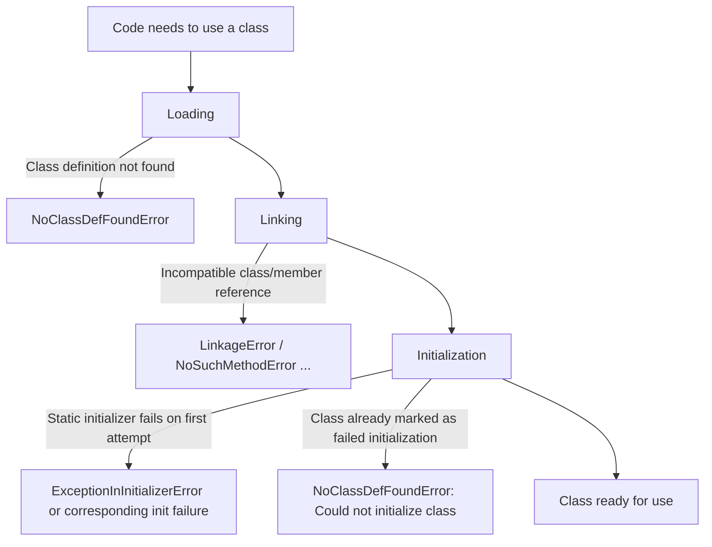

# NoClassDefFoundError, NoSuchMethodError, and Incompatible Dependencies

A Spring Boot application may compile cleanly yet fail immediately at startup, or fail only when a user invokes a specific feature. Stack traces may contain lines such as:

```text
java.lang.NoClassDefFoundError: com/example/library/Client

java.lang.NoSuchMethodError:
  'void com.example.library.Client.connect(java.lang.String)'
```

These are two common errors when **the runtime classpath does not match what the code was compiled against**, or when libraries are binary-incompatible with one another. They can appear after upgrading Spring Boot, adding a starter, changing a library version, excluding a transitive dependency, or packaging the application.

Within the **Troubleshooting** chapter of *Spring Boot Fundamentals*, this lesson explains how to distinguish both errors, trace conflicting dependencies, identify which JAR/location the JVM loads classes/methods from, and restore a consistent dependency set.

Key takeaways:

- **`NoClassDefFoundError`** usually means the JVM needs a class yet cannot define or locate it during linking or execution.
- **`NoSuchMethodError`** means the JVM found the class, yet the method requested by bytecode is absent from the loaded class version.
- Both are **linkage errors**, not request validation errors or normal business exceptions.
- A successful build does not guarantee a valid runtime classpath; IDEs, tests, `bootRun`, and executable JARs can use different classpaths.
- Spring Boot dependency management/BOM keeps Spring and related libraries aligned; pinning individual modules separately can introduce version skew.
- Troubleshooting should start with the actual classpath and dependency graph before changing versions or exclusions.

## 1. Why Does an Application Compile Yet Fail at Runtime?

During Java compilation, the compiler must see the classes and methods referenced by source code. At runtime, the JVM loads the corresponding classes from the runtime classpath/module path.

Those two dependency sets are related yet **not necessarily identical**:

```text
Compile time
  Source code
      |
      v
  Compile classpath
      |
      v
  .class bytecode

Runtime
  .class bytecode
      |
      v
  Runtime classpath / module path
      |
      v
  JVM class loading + linking + initialization
      |
      v
  Application behavior
```

For example, code is compiled against library version 2:

```java
public class ReportService {
    public void generate() {
        ReportClient client = new ReportClient();
        client.exportAsPdf();
    }
}
```

Version 2 of `ReportClient` provides `exportAsPdf()`. Yet when packaged or deployed, runtime loads version 1, which lacks this method. The compiler behaved correctly because it saw version 2 at compile time; the JVM still fails at runtime because the actual class is version 1.

In another scenario, the compiler finds `com.example.library.Client` in a compile dependency, yet that dependency is omitted at runtime due to scope/configuration settings. When the JVM needs the class, it cannot find it.

### 1.1. Different Classpaths in a Spring Boot Project

A project typically has multiple classpaths:

| Classpath | Purpose |
| --- | --- |
| Compile classpath | Dependencies required to compile main sources |
| Runtime classpath | Dependencies required when running the application |
| Test compile classpath | Dependencies required to compile test sources |
| Test runtime classpath | Dependencies required when running tests |
| Annotation processor path | Tools run at compile time to generate code/metadata |
| Build plugin classpath | Dependencies used by Maven/Gradle plugins, not automatically runtime dependencies of the app |

A library can appear on test runtime without appearing on the application's runtime classpath. Passing tests do not prove an executable JAR contains all needed libraries.

### 1.2. Executable JARs Can Differ from IDE Environments

Spring Boot executable JARs package runtime dependencies into:

```text
BOOT-INF/classes/
BOOT-INF/lib/
```

IDEs may run applications directly from compiled output directories and IDE dependency caches. An IDE run configuration can accidentally see libraries absent from the packaged artifact.

Therefore, if an error appears only after building/deploying, inspect **the actual runtime artifact**, not only whether it runs from the IDE Run button.

## 2. How the JVM Performs Loading, Linking, and Initialization

To understand both errors, distinguish the main phases of a class's lifecycle:

1. **Loading:** locates bytecode and creates the JVM representation of the class.
2. **Linking:** verifies bytecode, prepares class data, and resolves required references.
3. **Initialization:** executes static initializers and initializes static fields per JVM rules.

Conceptually:



This is a conceptual diagram. The JVM may defer resolving some symbolic references until actual use, so linkage errors do not always appear on the very first line of the program.

## 3. What Is NoClassDefFoundError?

`NoClassDefFoundError` belongs to `java.lang.LinkageError`. The JVM throws it when code needs a class definition yet cannot proceed because the class is unavailable for linking/initialization.

Common message:

```text
java.lang.NoClassDefFoundError: com/example/library/Client
```

Class names in the message typically use slashes instead of dots. That does not mean package names in source files should be written with slashes.

### 3.1. Common Cause: Missing Class at Runtime

Code:

```java
import com.example.library.Client;

public class CatalogService {
    public void load() {
        Client client = new Client();
        client.connect();
    }
}
```

Suppose the dependency containing `Client.class` is on the compile classpath yet absent from the runtime classpath. When the JVM needs the class, `NoClassDefFoundError` occurs.

Common causes:

- Dependency declared with a scope/configuration not packaged into runtime.
- A transitive dependency was excluded while code still uses its classes.
- A library is marked optional in an intermediate module while the final application does not declare it directly.
- A JAR lacks the class file or was packaged incorrectly.
- Runtime artifact differs from the tested artifact.
- Dependency was replaced by a version or module that no longer contains the required class.

### 3.2. Missing Transitive Dependencies

Library A may use classes from Library B:

```text
Application
   |
   v
Library A
   |
   v
Library B
```

When A's dependency metadata pulls B normally, the build tool resolves B automatically. However, if B is optional, excluded, or omitted at runtime by metadata, the application may need to declare B explicitly.

Do not add missing dependencies blindly. First check:

- Which artifact owns the missing class?
- Is that artifact in the runtime dependency graph?
- If not, why was it omitted?
- Does Library A require a specific version of B?

### 3.3. Class Missing Because Version/Module Lacks It

The JAR is not always completely absent. The loaded JAR may simply be a version lacking a newer class referenced by compiled code.

Example:

```text
Compile:
  library-api-2.0.jar
  -> contains com.example.ClientOptions

Runtime:
  library-api-1.4.jar
  -> lacks com.example.ClientOptions
```

The JVM finds an artifact of the same name, yet the class definition does not exist in that version. The symptom can be `NoClassDefFoundError`.

### 3.4. NoClassDefFoundError Can Also Follow Static Initialization Failures

This is a frequent source of confusion. A class has a static initializer:

```java
public final class CryptoSupport {

    static {
        String required = System.getenv("CRYPTO_PROVIDER");
        if (required == null) {
            throw new IllegalStateException(
                    "CRYPTO_PROVIDER is required"
            );
        }
    }

    private CryptoSupport() {
    }
}
```

If initialization fails, the first attempt to initialize the class typically throws `ExceptionInInitializerError` (or the corresponding initialization error/exception). The JVM marks that class as erroneous in the current classloader.

Subsequent code attempting to use that class sees:

```text
java.lang.NoClassDefFoundError: Could not initialize class
  com.example.CryptoSupport
```

Here, the class file exists and the JVM loaded it. The root problem is **the earlier static initialization failure**.

Whenever the message says `Could not initialize class`, search for an exception appearing **before the current NoClassDefFoundError** in the same startup/test log. Do not rush to add dependencies merely upon seeing "NoClassDefFoundError".

### 3.5. Classloaders Are Part of the Problem

The JVM does not identify classes by name alone; class identity is tied to the defining classloader. Two classes with the same name loaded by different classloaders are not the same type.

Complex scenarios may involve:

- Application servers or plugin runtimes with multiple classloaders.
- DevTools restart classloaders in development.
- Threads or static singletons holding references from an old classloader.
- Libraries packaged redundantly in multiple locations.
- Parent/child delegation and module boundaries.

If errors appear after DevTools restarts or only inside containers/application servers, inspect class origins and classloader identity rather than only Maven/Gradle versions.

## 4. Distinguishing NoClassDefFoundError from ClassNotFoundException

The names look alike, yet the error types and contexts differ.

| Feature | `ClassNotFoundException` | `NoClassDefFoundError` |
| --- | --- | --- |
| Kind | Checked exception | Error, specifically a LinkageError |
| Typical scenario | Code explicitly requests a class via reflection/classloader and cannot find it | JVM needs a class definition during linking or execution yet cannot find/initialize it |
| Example | `Class.forName("com.example.Plugin")` fails to locate the class | Bytecode references a class absent from the runtime classpath |
| Handling | Catch/propagate per reflection API contract | Fix classpath, binary compatibility, or initialization cause |

`ClassNotFoundException` example:

```java
try {
    Class<?> plugin = Class.forName("com.example.Plugin");
} catch (ClassNotFoundException ex) {
    // Plugin is not on the classpath or not found by the loader.
}
```

`NoClassDefFoundError` can occur when code calls directly:

```java
PluginRegistry registry = new PluginRegistry();
```

while the dependency containing `PluginRegistry` or a class it requires is absent at runtime.

**Do not catch `NoClassDefFoundError` like a normal request error.** It usually signals a deployment/classpath bug or an unrecoverable JVM state.

## 5. What Is NoSuchMethodError?

`NoSuchMethodError` also extends `java.lang.LinkageError`. It occurs when the JVM resolves a method reference in bytecode yet the loaded class lacks a method matching the name and descriptor requested by the bytecode.

Example:

```text
java.lang.NoSuchMethodError:
  'void com.example.library.Client.connect(java.lang.String)'
```

The message reveals:

- Class: `com.example.library.Client`.
- Method: `connect`.
- Parameter type: `java.lang.String`.
- Return type: `void`.

The JVM found no matching method for that symbolic reference in the class hierarchy per method resolution rules.

### 5.1. Binary Incompatibility Example

Library version 1:

```java
package com.example.library;

public class Client {
    public void connect() {
        // Connect.
    }
}
```

Version 2:

```java
package com.example.library;

public class Client {
    public void connect(String endpoint) {
        // Connect to endpoint.
    }
}
```

A new application compiles against version 2:

```java
Client client = new Client();
client.connect("https://service.example.invalid");
```

Bytecode references `connect(String)`. Yet if runtime loads version 1—having only no-arg `connect()`—the JVM cannot resolve the requested method and throws `NoSuchMethodError`.

### 5.2. Compile-Time API and Runtime Implementation Mismatch

In short:

```text
Compile-time:
  Client.connect(String) exists

Runtime:
  Client.connect(String) missing

Result:
  NoSuchMethodError
```

The code has no syntax error. It compiled cleanly against the API seen by the compiler. Failure arises because the runtime implementation class is no longer compatible with the bytecode.

### 5.3. Method Descriptors Include the Return Type

In JVM bytecode, a method descriptor encodes both parameter types and the return type. Thus checking only the method name is insufficient to tell if two methods share the same binary signature.

For example:

```java
public String getValue() { ... }
```

and:

```java
public Object getValue() { ... }
```

share the same name and zero parameters yet differ in return-type descriptor. Changing return types can break binary compatibility even when source call sites appear similar.

In cases involving static/instance changes or class hierarchy shifts, `IncompatibleClassChangeError` or related linkage errors can occur. Do not assume every API mismatch manifests as `NoSuchMethodError`.

### 5.4. Transitive Dependencies Are Often the Culprit

Suppose an application directly uses Library A:

```text
Application
   |
   v
Library A 2.x
   |
   v
Library B 2.x
```

Library A 2.x was compiled against `B.Client.connect(String)`. Yet another dependency pulls Library B 1.x onto the runtime classpath:

```text
Application
   |                     Other Library
   v                          |
Library A 2.x                  v
   |                       Library B 1.x
   v                          |
Library B 2.x  <--- version conflict / resolution
```

The build tool picks a single version of the artifact per dependency resolution rules. If the chosen version is incompatible with Library A, runtime throws `NoSuchMethodError`.

## 6. How Does NoSuchMethodError Differ from NoClassDefFoundError?

| Question | NoClassDefFoundError | NoSuchMethodError |
| --- | --- | --- |
| Did the JVM find the target class? | Maybe not; or the class was loaded yet initialization failed | Usually found the class |
| Missing/incompatible element | Class definition or initialization state | Method matching the bytecode's requested descriptor |
| Common cause | Missing runtime dependency, class absent in version, init failure | Compiled against new API while runtime loads old/different implementation |
| First investigation step | Identify artifact owning the class, classpath, and static initializers | Identify which JAR loaded the class and whether the method descriptor exists in that version |

Both can stem from **dependency version mismatches**. The difference lies in which symbolic reference the JVM failed to resolve.

## 7. Related Linkage Errors to Recognize

When investigating incompatible dependencies, you may encounter sibling errors:

| Error | General Meaning |
| --- | --- |
| `NoSuchFieldError` | Loaded class lacks a field requested by bytecode |
| `AbstractMethodError` | Runtime invokes an abstract method whose implementation object provides no implementation |
| `IncompatibleClassChangeError` | Class/member structure is incompatible with bytecode usage, e.g., static/instance or class/interface changes |
| `IllegalAccessError` | Bytecode attempts to access a member/class no longer accessible under runtime rules |
| `UnsupportedClassVersionError` | JVM does not support the compiled class-file version; usually runtime JDK is too old |
| `ExceptionInInitializerError` | Error occurred during static initializer or static field initialization |

These errors do not share one single fix. For instance, `UnsupportedClassVersionError` usually requires aligning build/runtime JDKs; downgrading a dependency is not a general cure.

### 7.1. Why Read the Exact Error Type?

Suppose you see:

```text
java.lang.UnsupportedClassVersionError:
  ... has been compiled by a more recent version of the Java Runtime
```

This is neither a missing class nor a missing method. The class file is present, yet the JVM cannot read its bytecode version. Check `java -version` in the runtime environment and the JDK used for building.

### 7.2. ClassCastException Can Also Involve Classloaders

Two identically named classes defined by two different classloaders can cause type errors:

```text
ClassCastException:
  com.example.Plugin cannot be cast to com.example.Plugin
```

The message looks paradoxical, yet two classes with the same name lack identical identity across distinct classloaders. This usually requires inspecting classloader topology and JAR loading locations.

## 8. How Do Incompatible Dependencies Happen?

A Spring Boot application rarely contains only directly declared dependencies. Starters pull in a graph of transitive libraries.

Conceptual example:

```text
catalog-service
  +-- spring-boot-starter-web
  |     +-- spring-boot-starter
  |     +-- Spring MVC / web infrastructure
  |     +-- JSON library
  |
  +-- spring-boot-starter-data-jpa
  |     +-- Spring Data
  |     +-- Hibernate
  |     +-- JDBC dependencies
  |
  +-- partner-sdk
        +-- http-client
        +-- commons-library
```

When two branches request different versions of the same artifact, Maven or Gradle must choose one version for the classpath.

### 8.1. Direct vs. Transitive Dependencies

- **Direct dependency:** declared explicitly in the project.
- **Transitive dependency:** pulled in by another dependency.

Example:

```text
Application
  +-- partner-sdk
  |     +-- commons-codec 1.x
  |
  +-- reporting-sdk
        +-- commons-codec 2.x
```

The application might never declare `commons-codec` directly, yet runtime must select one version. If that version is incompatible with one of the SDKs, errors surface only when that code path executes.

### 8.2. Version Mediation Does Not Prove Binary Compatibility

A build tool resolving the dependency graph and producing an artifact proves only that a version was picked per resolution rules—**not that every dependent library is binary-compatible with that version**.

A "resolved" graph can still contain an unsupported library combination.

### 8.3. Same JAR Name Does Not Mean Same API

Two JARs sharing the same group/artifact at different versions may:

- Add methods.
- Remove methods.
- Change parameter/return types.
- Move classes to different packages.
- Change a class into an interface or vice versa.
- Change constructors.
- Alter generic bridge methods or visibility.
- Migrate namespaces from `javax.*` to `jakarta.*`.

Therefore, debugging requires inspecting **actual artifact versions and class contents**, not merely dependency names.

## 9. How Does Maven Resolve Dependency Versions?

Maven builds a dependency tree from declared dependencies and their metadata. When multiple versions of an artifact appear in the graph, Maven applies dependency mediation, commonly described as **nearest definition**: the dependency closest to the project wins; at equal depth, declaration order can decide.

Example:

```text
Application
  +-- library-a
  |     +-- commons-x:1.0
  |
  +-- library-b
        +-- commons-x:2.0
```

When two versions sit at equal depth, the one encountered first in declaration order may be chosen. However, dependency management, exclusions, scopes, and explicit direct dependencies also affect the final graph.

**Do not rely on memory of nearest-wins to guess runtime versions. Run the dependency tree.**

### 9.1. Inspecting the Dependency Tree

Linux/macOS:

```bash
./mvnw dependency:tree
```

Windows:

```powershell
.\mvnw.cmd dependency:tree
```

Filter to a specific artifact:

```bash
./mvnw dependency:tree -Dincludes=com.example:commons-x
```

Output may show:

```text
com.example:catalog-service
  \- com.vendor:library-a:jar:2.0
     \- com.example:commons-x:jar:1.0
  \- com.vendor:library-b:jar:3.0
     \- com.example:commons-x:jar:2.0
```

This is an illustrative graph. Identify the actual selected version, omitted/conflicting nodes, and which dependency path pulled each version in.

### 9.2. Using -Dverbose

```bash
./mvnw dependency:tree -Dverbose
```

Verbose output reveals dependencies omitted due to conflicts or mediation, pinpointing which branch requested another version.

### 9.3. Viewing the Effective POM

```bash
./mvnw help:effective-pom
```

Effective POM helps when a project inherits a parent POM, imports a BOM, or declares multi-level dependency management. It shows Maven configuration after inheritance and interpolation.

### 9.4. Dependency Scopes Affect Runtime

Common scopes:

| Scope | On Compile? | On Runtime? | Notes |
| --- | --- | --- | --- |
| `compile` | Yes | Yes | Default when no scope is specified |
| `runtime` | Not for normal main compilation | Yes | Fits dependencies needed only at execution |
| `provided` | Yes | Usually not packaged into runtime like compile dependencies | Deployment environment expected to supply it |
| `test` | For tests | For tests | Not a production runtime dependency |
| `optional` | Depends on current module declaration | Not transitively propagated like normal dependencies | Consumers must declare explicitly if used |

If main source imports a class whose dependency is `test` scoped, normal compilation fails. Yet sometimes IDEs/containers supply dependencies outside the build, hiding mismatches until packaging.

### 9.5. Inspecting the Concrete Runtime Classpath

You can ask Maven to generate the runtime classpath:

```bash
./mvnw dependency:build-classpath -Dmdep.outputFile=runtime-classpath.txt
```

Note this command requires the corresponding plugin and outputs per active project/module. Do not commit temporary classpath files into your repository without clear purpose.

## 10. How Does Gradle Resolve Dependencies?

Gradle also constructs a dependency graph and selects versions per resolution rules. By default, when versions conflict for the same module, Gradle selects the higher version; however, constraints, platforms/BOMs, rich version constraints, resolution rules, and dependency substitution can alter results.

**Do not assume Gradle always picks the highest version in every configuration.** Inspect the actual resolution output.

### 10.1. Inspecting runtimeClasspath

```bash
./gradlew dependencies --configuration runtimeClasspath
```

Windows:

```powershell
.\gradlew.bat dependencies --configuration runtimeClasspath
```

Locate the suspect artifact in the output and trace which branch brings it in.

### 10.2. Using dependencyInsight

This is often the most helpful command when you need to know **why a specific version was selected**:

```bash
./gradlew dependencyInsight \
  --dependency commons-x \
  --configuration runtimeClasspath
```

Output explains:

- The chosen version.
- Versions requested by other dependencies.
- Selection reason.
- Constraints or platforms influencing the choice.

### 10.3. Distinguishing Configurations

Do not inspect only `compileClasspath` and assume runtime is complete. Check:

```bash
./gradlew dependencies --configuration compileClasspath
./gradlew dependencies --configuration runtimeClasspath
./gradlew dependencies --configuration testRuntimeClasspath
```

If tests pass yet the app fails at runtime, comparing `testRuntimeClasspath` with `runtimeClasspath` is a useful diagnostic step.

### 10.4. Dependency Constraints and Platforms

Gradle can use Spring Boot dependency management or native platform support:

```groovy
dependencies {
    implementation platform(
        "org.springframework.boot:spring-boot-dependencies:${springBootVersion}"
    )
    implementation "org.springframework.boot:spring-boot-starter-web"
}
```

This illustrates importing a BOM via a Gradle platform. In projects using the Spring Boot Gradle plugin, dependency management may already be handled by the plugin; avoid duplicate platform declarations if already configured.

### 10.5. Do Not Force Versions with resolutionStrategy Prematurely

Example:

```groovy
configurations.configureEach {
    resolutionStrategy.force "com.example:commons-x:2.0"
}
```

`force` can resolve a specific conflict, yet it can also push a library onto an unsupported version. Use it only after verifying compatibility and impact scope.

Prefer dependency constraints/platforms and upgrading the dependency causing version skew when appropriate.

## 11. Spring Boot BOM and Dependency Management

Spring Boot curates a broad set of library versions tested together. A **BOM (Bill of Materials)** lets projects adopt a compatible version set without specifying versions on every dependency.

Maven project using parent:

```xml
<parent>
    <groupId>org.springframework.boot</groupId>
    <artifactId>spring-boot-starter-parent</artifactId>
    <version>${spring-boot.version}</version>
    <relativePath/>
</parent>
```

Or importing the BOM:

```xml
<dependencyManagement>
    <dependencies>
        <dependency>
            <groupId>org.springframework.boot</groupId>
            <artifactId>spring-boot-dependencies</artifactId>
            <version>${spring-boot.version}</version>
            <type>pom</type>
            <scope>import</scope>
        </dependency>
    </dependencies>
</dependencyManagement>
```

Dependencies then usually omit explicit versions:

```xml
<dependency>
    <groupId>org.springframework.boot</groupId>
    <artifactId>spring-boot-starter-web</artifactId>
</dependency>
```

### 11.1. Why Not Pin Individual Spring Modules Separately?

Risky example:

```xml
<dependency>
    <groupId>org.springframework</groupId>
    <artifactId>spring-core</artifactId>
    <version>...</version>
</dependency>
<dependency>
    <groupId>org.springframework</groupId>
    <artifactId>spring-context</artifactId>
    <version>...</version>
</dependency>
```

If `spring-core` and `spring-context` come from mismatched releases, one module may invoke a method present only in a newer release of the other. The outcome is `NoSuchMethodError`, `NoClassDefFoundError`, or another linkage error.

Usually let the Boot BOM manage **Spring Framework modules and aligned dependencies**. Override only for specific reasons after checking compatibility and running tests.

### 11.2. The BOM Does Not Guarantee All External Libraries Are Compatible

A BOM manages only dependencies within its scope. A third-party SDK may demand a different version of Jackson, Netty, an HTTP client, or a logging library.

When adding an SDK, check:

- Dependency versions required by the SDK.
- Versions managed by the Boot BOM.
- Whether the vendor publishes a Boot/Spring/JDK compatibility matrix.
- Whether a newer SDK release aligns with the current BOM.

### 11.3. Do Not Upgrade Spring Framework Independently to Arbitrary Versions

Each Spring Boot release train selects a matching Spring Framework line. Upgrading a single Spring Framework module separately can skew the remaining modules.

If you need a new feature or bug fix, first check whether an appropriate Spring Boot release already manages that version. If overriding is unavoidable, do so deliberately and test both startup and code paths exercising changed APIs.

## 12. Dependency Compatibility When Upgrading Spring Boot

Upgrading Boot updates more than one library. Synchronized changes occur across:

- Spring Framework.
- Spring Data.
- Spring Security.
- Jackson.
- Hibernate.
- Tomcat/Jetty/Undertow.
- Micrometer.
- Logging APIs/backends.
- Jakarta APIs.
- Starters and auto-configurations.

### 12.1. Do Not Mix Starters from Multiple Boot Lines

A project should stay on one consistent Spring Boot line. Avoid mixing:

```text
spring-boot-starter-web      version family A
spring-boot-starter-data-jpa version family B
spring-boot-autoconfigure    version family C
```

These modules are built to work together per release train. Mixing versions leads to missing methods/classes or unpredictable behavior.

### 12.2. Check the Spring Cloud Release Train

Spring Cloud also maintains a compatibility matrix against Spring Boot lines. Never pick the latest Spring Cloud version arbitrarily and pair it with just any Boot version.

If the application uses Spring Cloud, consult the compatibility matrix for your version. The Spring Cloud BOM manages its own dependency set and must be coordinated with the Spring Boot BOM per release train guidance.

### 12.3. Upgrade in Controlled Steps

A safe workflow:

1. Select the target Spring Boot version.
2. Check Java baseline and build plugin compatibility.
3. Select the matching Spring Cloud release train if applicable.
4. Remove unnecessary version overrides.
5. Update dependency management/BOM.
6. Run dependency reports to detect version skew.
7. Build/test and run the executable artifact.
8. Test code paths using libraries that underwent major version bumps.

Do not fix `NoSuchMethodError` one by one by pinning random JARs without reviewing the overall release train.

## 13. javax and jakarta: A Common Pitfall When Moving to Spring Boot 3+

A major shift in the Jakarta EE ecosystem moved many API package namespaces from `javax.*` to `jakarta.*`.

Examples:

| Before | After |
| --- | --- |
| `javax.servlet.*` | `jakarta.servlet.*` |
| `javax.persistence.*` | `jakarta.persistence.*` |
| `javax.validation.*` | `jakarta.validation.*` |

Spring Boot 3.x targets the corresponding Jakarta baseline. Consequently, an older library compiled against `javax.servlet.Filter` is not compatible with code expecting `jakarta.servlet.Filter` simply because both define an interface named Filter.

### 13.1. Two Different Packages Are Two Different Types

For example:

```java
javax.servlet.Filter
```

and:

```java
jakarta.servlet.Filter
```

are distinct class names. They are not interchangeable in method signatures.

### 13.2. Symptoms Can Be Missing Classes or Method Mismatches

An older library may reference `javax.servlet.ServletRequest` while runtime provides only Jakarta APIs, triggering `NoClassDefFoundError`.

A newer module invoking methods whose signatures use Jakarta types while runtime loads an older implementation lacking those methods triggers `NoSuchMethodError` or related linkage errors.

### 13.3. Do Not Add Both Namespaces as a Blanket Fix

Adding both javax and jakarta APIs simultaneously does not automatically adapt an old library to the new API. It may let part of class loading succeed while method signatures or behavior remain incompatible.

Usual solutions:

- Use library versions supporting Jakarta.
- Replace old starters/plugins with compatible releases.
- Update source imports and related configurations.
- Remove legacy dependencies pulling obsolete API namespaces.

### 13.4. Check JPA, Validation, and Servlet Libraries

When upgrading Boot 2 to Boot 3, inspect:

- Persistence providers and JPA APIs.
- Validation providers and annotations.
- Servlet filters, listeners, and container integrations.
- Security adapters.
- Third-party starters.

Update both source imports and runtime dependencies to the same namespace.

## 14. Common Spring Boot Scenarios

### 14.1. NoSuchMethodError in Spring Framework

Suppose startup logs show:

```text
java.lang.NoSuchMethodError:
  org.springframework.core.SomeType.someMethod(...)
```

One possibility is that `spring-core` and another Spring module come from incompatible versions. Check the dependency tree for:

```text
org.springframework:spring-core
org.springframework:spring-context
org.springframework:spring-beans
org.springframework:spring-web
```

All Spring Framework modules should come from the release set matching your Spring Boot version.

### 14.2. NoClassDefFoundError When Adding a New Starter

A starter may auto-configure a feature based on an optional class. If the provider library is missing or excluded, invoking that code path hits a missing class.

Check:

- Does the starter pull in the required provider module?
- Is the dependency optional?
- Was an exclusion added on a parent starter?
- Does code call APIs of the optional module directly?
- Did classloader/runtime packaging omit the module?

### 14.3. Error Appears Only When Calling an Endpoint

Some classes load lazily. An application may start cleanly and only trigger `NoSuchMethodError` when a request hits a PDF export endpoint invoking a PDF SDK.

Therefore:

**A successful context startup does not prove all dependency paths are compatible.**

Tests must exercise features relying on libraries prone to version skew.

### 14.4. Error Appears Only in Tests

Test runtimes pull in test frameworks, mocking libraries, or test fixtures. If a test-only version alters dependency resolution, the test classpath can diverge from the application runtime.

Compare `testRuntimeClasspath` against `runtimeClasspath` or Maven test/runtime dependency trees. Do not blindly "fix production dependencies" if the issue exists solely in tests.

### 14.5. Error Appears Only in the Executable JAR

If IDE/`bootRun` passes yet `java -jar` fails, check:

- Are runtime dependencies packaged inside?
- Is the artifact the latest build?
- Is a stale JAR sitting in the deploy directory?
- Does the container mount extra libraries or use an external classpath?
- Did a build profile alter the dependency graph?

## 15. General Investigation Flow: Read the Stack Trace Before Fixing

When encountering `NoClassDefFoundError` or `NoSuchMethodError`, **do not start by adding new dependencies**. Record:

1. What is the exact error?
2. Which class or method is named?
3. Did the error occur at startup, in tests, or on a specific request?
4. Is there an earlier root cause?
5. From which JAR was the class loaded?
6. Which version was selected in the runtime graph?
7. Does the runtime classpath differ from compile/test classpaths?

### 15.1. Find the First Frame in Application or Relevant Library Code

Example:

```text
java.lang.NoSuchMethodError: ...
    at com.vendor.sdk.ReportClient.export(ReportClient.java:42)
    at com.example.catalog.ReportService.generate(ReportService.java:81)
    ...
```

The `ReportClient.export` frame is where bytecode invoked the missing method. `ReportService.generate` shows which application code triggered that path.

The first frame is not always the ultimate root cause, yet it is the right starting point to trace backward.

### 15.2. Read the Full Cause Chain

Spring may wrap the error:

```text
BeanCreationException
  -> UnsatisfiedDependencyException
      -> NoClassDefFoundError
```

Look deeper for the linkage error. Outer errors describe bean/context failure; inner causes pinpoint the missing class.

### 15.3. Distinguish Initial Errors from Cascading Errors

With static initialization:

```text
First attempt:
  ExceptionInInitializerError
    -> IllegalStateException: required setting missing

Later attempt:
  NoClassDefFoundError: Could not initialize class ...
```

Reading only the last exception misses the actual configuration failure.

### 15.4. Record the Reproduction Environment

At minimum capture:

```text
Spring Boot version:
Java build version:
Java runtime version:
Build tool and version:
Execution mode (IDE / bootRun / mvn / java -jar / container):
Active profiles:
Failing class:
Failing method (if any):
First relevant application/library frame:
Root cause:
```

These facts let you compare two environments that look similar yet use different classpaths.

## 16. Identifying Which JAR Loaded a Class

Knowing the dependency graph is one thing; knowing **which file the JVM actually loaded the class from** matters even more when multiple JARs or classloaders exist.

### 16.1. Printing a Class's CodeSource

For a loadable class:

```java
public final class ClassOrigin {

    public static void printOrigin(Class<?> type) {
        var protectionDomain = type.getProtectionDomain();
        var codeSource = protectionDomain == null
                ? null
                : protectionDomain.getCodeSource();

        System.out.println("Class: " + type.getName());
        System.out.println("ClassLoader: " + type.getClassLoader());
        System.out.println(
                "Origin: " + (codeSource == null
                        ? "<unknown>"
                        : codeSource.getLocation())
        );
    }
}
```

Call:

```java
ClassOrigin.printOrigin(Client.class);
```

This is a diagnostic technique. `CodeSource` can be null depending on classloader/class origin; not every runtime exposes locations.

### 16.2. JVM Class Loading Logs

On many JDKs, you can enable:

```bash
java -verbose:class -jar app.jar
```

JDK 9+ also supports unified logging:

```bash
java -Xlog:class+load=info -jar app.jar
```

Output can be large. Filter for suspect classes or run in a controlled reproduction environment. Syntax and log details can differ across JDKs.

### 16.3. Inspecting Classes Inside a JAR

List JAR contents:

```bash
jar tf library.jar
```

Search for a class:

```bash
jar tf library.jar | grep 'com/example/library/Client.class'
```

On PowerShell:

```powershell
jar tf library.jar | Select-String 'com/example/library/Client.class'
```

If the class lives inside an executable Spring Boot JAR, it usually sits in a nested dependency under `BOOT-INF/lib`. Identify the specific nested JAR and inspect its contents.

### 16.4. Checking Method Signatures with javap

When suspecting `NoSuchMethodError`, run `javap` on the exact JAR:

```bash
javap -classpath library.jar -p com.example.library.Client
```

`-p` shows non-public members in appropriate output. To inspect descriptors in more detail:

```bash
javap -classpath library.jar -p -s com.example.library.Client
```

Compare outputs between the compile-time version and runtime version. Ensure `-classpath` points to the exact JAR under investigation.

## 17. Inspecting an Executable Spring Boot JAR

A Spring Boot executable JAR typically contains:

```text
catalog-service.jar
├── META-INF/
├── org/springframework/boot/loader/...
└── BOOT-INF/
    ├── classes/
    └── lib/
        ├── spring-core-....jar
        ├── spring-context-....jar
        └── partner-sdk-....jar
```

### 17.1. Listing Packaged Dependencies

```bash
jar tf target/catalog-service.jar
```

Or:

```bash
jar tf target/catalog-service.jar | grep 'BOOT-INF/lib/'
```

On PowerShell:

```powershell
jar tf target/catalog-service.jar |
    Select-String 'BOOT-INF/lib/'
```

Check:

- Is the JAR containing the suspect class present in the artifact?
- Are multiple versions of the same library present?
- Do versions match the dependency tree?
- Was a library excluded or omitted during packaging?

### 17.2. Nested JARs Are Not a Flat Classpath

Spring Boot's loader supports executing nested JARs. Avoid simply unzipping and running an arbitrary flat classpath assuming it behaves identically.

To reproduce failures, prefer running:

```bash
java -jar target/catalog-service.jar
```

using the exact inspected artifact.

### 17.3. Comparing Artifacts Between CI and Local

Compare checksums:

```bash
sha256sum target/catalog-service.jar
```

On Windows:

```powershell
Get-FileHash .\target\catalog-service.jar -Algorithm SHA256
```

Checksums confirm two files are identical rather than explaining why the dependency graph is wrong, yet they rule out deploying the wrong artifact.

## 18. Fixing NoClassDefFoundError

Once the missing class is identified, address its specific cause.

### 18.1. Required Dependency Missing from Runtime

If application code directly uses a dependency's class yet the dependency is absent at runtime, declare it with the proper scope/configuration.

Maven:

```xml
<dependency>
    <groupId>com.example</groupId>
    <artifactId>client-api</artifactId>
</dependency>
```

Gradle:

```groovy
dependencies {
    implementation 'com.example:client-api'
}
```

Versions should be managed by a compatible BOM/constraint where available.

### 18.2. Dependency Excluded by Mistake

Example:

```xml
<dependency>
    <groupId>com.vendor</groupId>
    <artifactId>partner-sdk</artifactId>
    <exclusions>
        <exclusion>
            <groupId>com.example</groupId>
            <artifactId>client-api</artifactId>
        </exclusion>
    </exclusions>
</dependency>
```

If the SDK genuinely requires `client-api` at runtime, this exclusion breaks the application. Remove the exclusion if no longer justified, or declare an alternative dependency version supported by the SDK.

### 18.3. Optional Dependencies

If a library declares a dependency optional, the end application is responsible for declaring that module if code paths use it. Check the library's POM/metadata to see which dependencies are optional.

### 18.4. Static Initializer Failed

If the message is `Could not initialize class`, find the first class-initialization exception. Fix the configuration, resource, native library, or dependency needed by the initializer. Adjusting the classpath will not fix a missing required environment variable.

### 18.5. Classloader Mismatch

If a class exists across multiple JARs/classloaders, determine which source loaded the class and inspect loader topology. Remove duplicate copies, fix plugin/container classloader settings, or ensure modules share APIs through the appropriate loader.

Never catch `NoClassDefFoundError` and attempt to keep running half an application when essential dependencies are missing.

## 19. Fixing NoSuchMethodError

`NoSuchMethodError` usually requires **aligning the version of the class providing the method with the compiled code invoking it**.

### 19.1. Identify the Artifact Owning the Class

Example:

```text
NoSuchMethodError:
  com.vendor.http.ClientBuilder.timeout(Duration)
```

Locate which artifact owns `com.vendor.http.ClientBuilder`. Then check which runtime version was selected and which version carries that method descriptor.

### 19.2. Identify What Pulled in the Older Version

Maven:

```bash
./mvnw dependency:tree -Dverbose -Dincludes=com.vendor:http-client
```

Gradle:

```bash
./gradlew dependencyInsight \
  --dependency http-client \
  --configuration runtimeClasspath
```

If another dependency pulls in the older version, check whether that dependency can be upgraded or paired with a compatible release.

### 19.3. Align Versions via Vendor/BOM

If the vendor publishes a BOM, import it to keep modules from the same release aligned:

```xml
<dependencyManagement>
    <dependencies>
        <dependency>
            <groupId>com.vendor</groupId>
            <artifactId>vendor-bom</artifactId>
            <version>${vendor.version}</version>
            <type>pom</type>
            <scope>import</scope>
        </dependency>
    </dependencies>
</dependencyManagement>
```

An SDK may consist of `client-core`, `client-http`, and `client-json`. Pinning one module to a newer version while leaving siblings older triggers method mismatches.

### 19.4. Upgrade the Caller or Downgrade/Adjust the Provider?

Two options exist:

- **Upgrade the calling dependency** to a version compatible with the chosen runtime API.
- **Adjust the provider version** to one providing the methods/behavior expected by the caller.

Choose based on vendor compatibility matrices and the full dependency graph. Never assume higher version numbers alone guarantee safety.

### 19.5. Do Not Copy New JARs into a lib Directory Manually

If the application uses Maven/Gradle and executable JARs, never drop a new JAR manually into a local `lib` folder hoping the classloader picks it up. That produces unreproducible runtimes and diverges local runs from CI.

Fix dependency declarations/constraints, rebuild the artifact, and deploy the new artifact.

## 20. Spring Boot BOM and Keeping Dependency Sets Consistent

A Boot project should have one clear version management authority.

### 20.1. Maven with Spring Boot Parent

Example:

```xml
<parent>
    <groupId>org.springframework.boot</groupId>
    <artifactId>spring-boot-starter-parent</artifactId>
    <version>${spring-boot.version}</version>
    <relativePath/>
</parent>
```

Afterward, avoid manually pinning versions on starters belonging to the same release train.

### 20.2. Maven Importing BOM Without Parent

```xml
<dependencyManagement>
    <dependencies>
        <dependency>
            <groupId>org.springframework.boot</groupId>
            <artifactId>spring-boot-dependencies</artifactId>
            <version>${spring-boot.version}</version>
            <type>pom</type>
            <scope>import</scope>
        </dependency>
    </dependencies>
</dependencyManagement>
```

Build plugins still require explicit configuration; importing the BOM manages only dependency versions rather than applying full Maven parent configuration.

### 20.3. Gradle Using Boot Plugin/BOM

Projects can use the Spring Boot Gradle plugin and dependency management integration, or declare a native platform:

```groovy
dependencies {
    implementation platform(
        "org.springframework.boot:spring-boot-dependencies:${springBootVersion}"
    )
    implementation 'org.springframework.boot:spring-boot-starter-web'
    implementation 'org.springframework.boot:spring-boot-starter-data-jpa'
}
```

Pick one consistent management style. Avoid mixing global forced versions with multiple conflicting BOMs unless you understand the resolution result.

### 20.4. Do Not Expect Boot BOM to Manage Every External Library

If a vendor provides its own BOM, you may need to import it too. When multiple BOMs manage the same artifact, ordering and dependency management rules determine the final version. Run dependency tree/insight after changes instead of guessing.

## 21. Checking Dependency Convergence and Version Drift

Large projects benefit from automated checks detecting abnormal dependency graphs.

### 21.1. Maven Enforcer

The Maven Enforcer plugin offers rules like `dependencyConvergence` to flag when a dependency is requested at multiple different versions across the graph.

Conceptual configuration:

```xml
<plugin>
    <groupId>org.apache.maven.plugins</groupId>
    <artifactId>maven-enforcer-plugin</artifactId>
    <executions>
        <execution>
            <id>enforce-dependency-convergence</id>
            <goals>
                <goal>enforce</goal>
            </goals>
            <configuration>
                <rules>
                    <dependencyConvergence/>
                </rules>
            </configuration>
        </execution>
    </executions>
</plugin>
```

Real configuration needs project-appropriate plugin versions and executions. This rule forces intentional conflict resolution; do not disable it immediately on build failure without inspecting dependency paths.

### 21.2. Gradle Dependency Locking

Gradle dependency locking pins resolved versions so subsequent builds remain consistent. Locking **does not itself guarantee locked versions are compatible**, yet prevents unexpected dependency drift.

You can combine:

- Dependency constraints.
- Platforms/BOMs.
- Dependency locking.
- Dependency verification/checksums.
- CI inspection of dependency reports.

### 21.3. Do Not Force Convergence by Unconditionally Picking the Highest Version

A higher version may break an older caller. The goal is **a compatible dependency set**, not simply maximizing version numbers across all modules.

## 22. Errors from Duplicate Classes and Shaded Dependencies

Sometimes the classpath holds multiple JARs containing the same class name. The JVM classloader picks one definition per loading rules, leaving the other unused.

Example:

```text
library-old.jar:
  com/example/Client.class

library-new.jar:
  com/example/Client.class
```

If the older version loads first, the application can hit `NoSuchMethodError` even though the newer JAR is also present.

### 22.1. Finding Duplicate Classes

Archive inspection tools/scripts can detect identical entry paths across multiple JARs. Dependency trees show artifact versions, yet shaded/relocated JARs may embed copied classes inside another artifact.

For executable JARs, inspect nested libraries in `BOOT-INF/lib` and their class contents.

### 22.2. Shading and Relocation

Some libraries bundle dependencies inside their own JARs (shading). Without package relocation, shaded classes conflict with standalone dependencies.

When vendors relocate packages, distinct class names avoid collisions, though APIs may still interact incompatibly in other ways.

### 22.3. Do Not Fix by Arbitrarily Reordering JARs

Classpath order can determine which class loads first in certain runtimes, yet relying on incidental ordering to select the right version is fragile. Eliminate duplicate/conflicting class sources or use a vendor-supported dependency set.

## 23. Classpaths Across IDE, Maven, Gradle, and Containers

When identical source code behaves differently across environments, compare how it runs.

| Execution Mode | Things to Check |
| --- | --- |
| IDE Run | Run configuration, module classpath, profiles, and cached dependencies |
| Maven `spring-boot:run` | Maven runtime dependency graph and active profiles |
| Gradle `bootRun` | `runtimeClasspath` and task configuration |
| `java -jar` | Nested library contents in executable artifact |
| Docker | Image layers, artifact copies, base JRE/JDK, mounted libraries, and environment |
| Kubernetes | Actual image digest, config/secret mounts, init containers, and runtime args |
| Test runner | Test runtime classpath, test fixtures, mocks, and test-specific dependency overrides |

### 23.1. Does Cleaning Build Output Help?

Clean/rebuilds help when stale output or incremental builds are corrupted:

```bash
./mvnw clean package
./gradlew clean bootJar
```

Yet clean **does not fix a broken dependency graph**. If dependency resolution still picks an incompatible version, a clean build reproduces the exact same failure.

### 23.2. IDE Cache Is Not Dependency Management

Invalidating caches or refreshing Gradle/Maven projects fixes stale IDE state. Do not rely on it as a final solution if runtime JARs still carry wrong dependencies.

### 23.3. Check Build and Runtime JDKs

Run:

```bash
java -version
javac -version
```

In CI/containers, these two commands may report different versions than local machines. If the error is `UnsupportedClassVersionError`, align Java toolchains/runtimes. If it is `NoSuchMethodError`, continue inspecting API/provider versions.

## 24. Inspecting Spring Boot Dependency Graphs in Maven

Concrete workflow:

**Step 1:** Confirm Boot version in the POM or parent.

**Step 2:** Print the runtime dependency tree:

```bash
./mvnw dependency:tree -Dscope=runtime
```

**Step 3:** Filter artifacts related to the failing class/method:

```bash
./mvnw dependency:tree -Dverbose -Dincludes=org.springframework:spring-core
```

**Step 4:** View the effective POM if using parent/BOM:

```bash
./mvnw help:effective-pom
```

**Step 5:** Inspect packaged output:

```bash
./mvnw clean package
jar tf target/catalog-service.jar
```

**Step 6:** Run the exact artifact:

```bash
java -jar target/catalog-service.jar
```

If the dependency tree chose the right version yet the JAR holds another version, inspect build plugin/repackage configs, stale artifacts, or manual copy steps.

## 25. Inspecting Spring Boot Dependency Graphs in Gradle

Workflow:

**Step 1:** Confirm plugin and Boot versions.

**Step 2:** View runtime graph:

```bash
./gradlew dependencies --configuration runtimeClasspath
```

**Step 3:** Check why a module version was chosen:

```bash
./gradlew dependencyInsight --dependency spring-core --configuration runtimeClasspath
```

**Step 4:** Compare test runtime:

```bash
./gradlew dependencies --configuration testRuntimeClasspath
```

**Step 5:** Build the executable JAR:

```bash
./gradlew clean bootJar
```

**Step 6:** Inspect and run the artifact:

```bash
jar tf build/libs/catalog-service.jar
java -jar build/libs/catalog-service.jar
```

In multi-project builds, run reports on the specific module producing the executable application; the root project's dependency graph may not match that module's runtime graph.

## 26. Reading NoSuchMethodError at the Bytecode Level

When a library spans multiple versions, comparing source APIs may not suffice. Use `javap`:

```bash
javap -classpath client-v1.jar -p -s com.example.Client
javap -classpath client-v2.jar -p -s com.example.Client
```

Conceptual output example:

```text
public void connect(java.lang.String);
  descriptor: (Ljava/lang/String;)V
```

If the runtime JAR shows only:

```text
public void connect();
  descriptor: ()V
```

then the method descriptor does not match bytecode calling `connect(String)`.

### 26.1. Generic Methods and Bridge Methods

Compilers generate bridge methods to support type erasure and polymorphism. Changing generic signatures or inheritance hierarchies sometimes creates bytecode differences invisible in casual source inspection.

When errors involve generic APIs, inspect `javap -p -s` and actual versions of both superclasses/interfaces, not just concrete classes.

### 26.2. Interface Default Methods

A library may add or modify default methods on an interface. Consumers compiled against one API set yet loading a different interface/implementation at runtime can hit linkage errors such as `NoSuchMethodError` or `AbstractMethodError` depending on the change and call site.

Do not assume every interface error is `NoSuchMethodError`; read the exact exception type.

## 27. Real-World Example: Mismatched SDK Dependencies

Suppose the project has:

```text
catalog-service
  +-- reporting-sdk 3.0
  |     +-- document-core 3.0
  |
  +-- storage-sdk 1.8
        +-- document-core 2.4
```

`reporting-sdk 3.0` invokes a new method in `document-core 3.0`. The build tool selects `document-core 2.4` due to graph/version constraints. When users call the export endpoint, runtime throws `NoSuchMethodError`.

### 27.1. Investigation

1. Read the stack trace and identify the class belonging to `document-core`.
2. Run dependency tree/insight.
3. Confirm the actual selected version.
4. Consult compatibility matrices for the reporting and storage SDKs.
5. Pick a compatible pair of SDK releases.

### 27.2. Fixing with Vendor Release Trains

Upgrade `storage-sdk` to a release supporting `document-core 3.x`, or pick a `reporting-sdk` compatible with core 2.4. If the vendor provides a BOM, use it to align modules.

Do not simply force `document-core 3.0` if `storage-sdk 1.8` relies on old APIs that were removed.

### 27.3. Testing the Failing Code Path

A context startup test may pass because `reporting-sdk` was never invoked. Add an integration test executing the real export path (with external services mocked/isolated) to confirm method linkage along that route.

## 28. Real-World Example: Missing Integration Dependency

Suppose an application adds an SDK for PDF export, yet runtime lacks the provider class:

```text
java.lang.NoClassDefFoundError:
  com/vendor/pdf/FontRegistry
```

### 28.1. Investigation

1. Find which artifact contains `FontRegistry.class`.
2. Check whether the SDK marks that dependency as optional.
3. Inspect dependency tree/`runtimeClasspath`.
4. Check whether the executable JAR includes the provider JAR.
5. Check whether the SDK requires native libraries or external resources outside the classpath.

### 28.2. Fix

If the provider is mandatory for that code path, add the dependency at the version recommended by the SDK. If PDF support is optional, isolate module/configuration so the path activates only when the provider is present rather than letting production endpoints fail silently when called.

### 28.3. Testing

- Test context when PDF support is enabled.
- Test behavior when the provider is present.
- If toggleable, test conditions preventing PDF bean registration when the provider is absent.
- Test the export endpoint or service to confirm the class loads in the runtime artifact.

## 29. Avoid "Add Every JAR" Fixes

When facing `NoClassDefFoundError`, adding dependencies looks tempting. Yet adding arbitrary JARs can:

- Introduce new version conflicts.
- Pull in multiple SLF4J providers.
- Inject both javax and jakarta namespaces into an incompatible context.
- Create duplicate classes.
- Expand attack surface and artifact size.
- Mask an underlying wrong SDK version selection.

**Add dependencies only after knowing which artifact owns the class and whether runtime actually requires it.**

Similarly, when facing `NoSuchMethodError`, do not downgrade the whole dependency graph. Identify the specific caller and provider.

## 30. Dependency Convergence Does Not Replace Integration Tests

A graph with only one version per artifact can still be wrong:

```text
Library A 2.0
Library B 4.0
```

There are no duplicate versions, yet A 2.0 may still be incompatible with B 4.0. Dependency convergence catches one class of conflicts without proving every library pair works together.

Combine:

- BOMs/vendor compatibility matrices.
- Dependency convergence/version constraints.
- Unit and integration tests.
- Startup tests of the executable artifact.
- Tests covering code paths exercising critical SDK/framework APIs.

## 31. An Ordered Investigation Checklist

When encountering a runtime linkage issue, follow this sequence:

**1. Capture the exact error.** Record full class name, method descriptor, exception type, and cause chain.

**2. Identify timing.** Startup, bean creation, tests, specific requests, or only after deployment.

**3. Locate the owning artifact.** Use dependency metadata, JAR listings, or `javap`.

**4. Inspect the runtime dependency graph.** Maven dependency tree or Gradle `runtimeClasspath`/`dependencyInsight`.

**5. Compare compile vs. runtime.** Check scopes/configurations, test runtime, IDE, and executable JARs.

**6. Check version alignment.** Cross-reference Spring Boot BOM, Spring Cloud train, and vendor BOMs.

**7. Check namespace/API shifts.** Especially javax/jakarta, major library upgrades, and method signature changes.

**8. Verify class origin.** Use CodeSource, JVM class loading logs, or nested JAR inspection.

**9. Fix the root cause.** Align compatible releases, remove stale dependencies, fix scopes/exclusions, or fix static initializers.

**10. Clean build and test the artifact.** Run the exact executable JAR/container image being deployed.

**11. Exercise the failing code path.** Do not stop at context startup if the error triggers only when a feature is invoked.

**12. Record dependency changes.** Keep the dependency graph reproducible in CI with proper lock/version management.

## 32. Practice Exercises

### Exercise 1 — Distinguishing ClassNotFoundException and NoClassDefFoundError

Create a small Java project:

1. Call `Class.forName("com.example.MissingPlugin")` inside try/catch.
2. Create a class directly referencing a class from a separate library.
3. Compile with the library present, then run with a runtime classpath missing the library.

Record exception types and explain the difference between reflective lookup and bytecode linkage.

### Exercise 2 — Reproducing NoSuchMethodError

Create two versions of a `demo-api` library:

- Version 1 has `Client.connect()`.
- Version 2 has `Client.connect(String endpoint)`.

Compile the application with version 2, then run against version 1. Observe `NoSuchMethodError` and use `javap -p -s` to compare method descriptors.

### Exercise 3 — Maven Dependency Tree

Create a Maven project with two libraries requesting different versions of a shared artifact. Run:

```bash
./mvnw dependency:tree -Dverbose
```

Identify the selected version, dependency paths, and how to add dependency management to achieve the desired graph.

### Exercise 4 — Gradle dependencyInsight

In a Gradle project, pick a module with multiple requested versions:

```bash
./gradlew dependencyInsight --dependency jackson-databind --configuration runtimeClasspath
```

Explain the selection reason. Compare with `testRuntimeClasspath` if tests and the application behave differently.

### Exercise 5 — Spring Boot BOM

Create a Spring Boot project with a parent/BOM. Add an unmanaged Spring Framework dependency or intentionally override a module.

Inspect effective POM / dependency insight, then restore version alignment. Explain why Spring modules should come from a compatible release set.

### Exercise 6 — Missing Transitive Dependency

Create an SDK using a class from another dependency. Exclude that dependency and invoke the corresponding code path.

Identify the missing class, owning artifact, and how to declare the required dependency at a compatible version.

### Exercise 7 — Failing Static Initializer

Create a class with a static initializer requiring an environment variable. Run once with the variable missing, then attempt to reuse the class in the same classloader.

Observe the initial exception and the subsequent `Could not initialize class` message. Explain why this is not simply a missing class file.

### Exercise 8 — Inspecting an Executable JAR

Build a Spring Boot executable JAR, list `BOOT-INF/lib`, and confirm runtime dependencies are packaged. Exclude a required dependency in a test setup, rebuild, and observe the error.

Compare running from the IDE against `java -jar`.

### Exercise 9 — javax/jakarta Namespaces

In a trial migration project, identify one library using `javax.servlet` and one using `jakarta.servlet`. Inspect the dependency graph and class names.

Explain why adding both APIs does not automatically make an older library compatible with Spring Boot 3+.

### Exercise 10 — Finding Class Origin

Use `Class.getProtectionDomain().getCodeSource()` to print a library class's location. Then enable `-verbose:class` or `-Xlog:class+load=info` and compare.

Explain cases where `CodeSource` may not return a location.

### Exercise 11 — Duplicate Classes

Create two JARs containing the same class name with different implementations. Run with different classpath orders and observe which class loads.

Explain why relying on classpath ordering is fragile.

### Exercise 12 — Testing an Endpoint-Only Failure

Create a service using a library with an API mismatch invoked only when an export endpoint receives a request. Confirm the context starts, while an integration test calling the endpoint catches the failure.

Design tests so this code path always runs in CI.

### Exercise 13 — Planning a Dependency Fix

A project has:

- Spring Boot BOM managing Spring Framework.
- A third-party SDK pulling a different Jackson version.
- A legacy module using javax validation.
- A `NoSuchMethodError` on an export request.

Write an ordered investigation plan covering: stack trace, dependency graph, class origin, compatibility matrix, dependency changes, and artifact testing.

## 33. Common Misconceptions

| Misconception | Accurate Understanding |
| --- | --- |
| "If the build passes, runtime definitely has all dependencies." | Compile and runtime classpaths differ; packaging can exclude dependencies |
| "NoClassDefFoundError always means a missing JAR." | The class may exist yet have failed initialization |
| "ClassNotFoundException and NoClassDefFoundError are the same." | One is usually a checked lookup exception; the other is a linkage Error |
| "NoSuchMethodError means a typo in source method names." | Usually source compiled fine; runtime class lacks the descriptor expected by bytecode |
| "Just add the latest version." | A newer version may break other callers |
| "Maven/Gradle resolving cleanly means dependencies are compatible." | Resolution merely picks versions per rules without proving binary compatibility |
| "@SpringBootTest context loads means all features work." | Lazy code paths may not load classes until a request hits them |
| "Adding both javax and jakarta fixes migration." | The two namespaces are distinct types; compatible libraries are required |
| "Clearing IDE caches fixes dependency conflicts." | It refreshes IDE state without fixing a broken dependency graph |
| "Dependency convergence guarantees system compatibility." | Even a single version can be incompatible with a library calling it |
| "With two JARs containing the same class, the JVM picks the right one." | Classloaders load one definition per rules; the other is shadowed |
| "Catching LinkageError and continuing requests is fine." | It usually marks a serious deployment error requiring a runtime environment fix |

## 34. Summary

**`NoClassDefFoundError` and `NoSuchMethodError` are critical signs that the JVM cannot link bytecode with the classes or methods supplied at runtime.** They typically point to missing dependencies, version skew, binary incompatibility, classloader issues, or static initialization failures.

Remember how to distinguish them:

- **`NoClassDefFoundError`:** a required class definition is unavailable, or the class entered an initialization failure state. If `Could not initialize class` appears, find the first initialization error.
- **`NoSuchMethodError`:** the class loaded, yet lacks a method matching the descriptor requested by bytecode. Compare compile-time APIs and runtime JARs with dependency reports/`javap`.
- **`ClassNotFoundException`:** usually occurs when code requests a class via reflection or classloader APIs and lookup fails.
- **Other linkage errors:** `NoSuchFieldError`, `AbstractMethodError`, `IncompatibleClassChangeError`, and `IllegalAccessError` also reflect binary incompatibility; `UnsupportedClassVersionError` usually indicates an outdated runtime JDK.

With Spring Boot, keep dependency sets aligned via the Boot BOM and matching release trains, check Spring Cloud/vendor compatibility, avoid pinning individual Spring modules unnecessarily, and pay attention to the `javax.*` to `jakarta.*` migration.

A reliable diagnostic workflow is **read the exception and cause chain → identify the class/method → find the owning artifact → inspect the runtime dependency graph → verify JAR/class origin → fix version/scope/exclusion/initialization → build and run the exact executable artifact → test the failing code path**.

A passing build is only one step. A stable Spring Boot application requires **a consistent runtime classpath and binary-compatible libraries** in the actual deployment environment.
