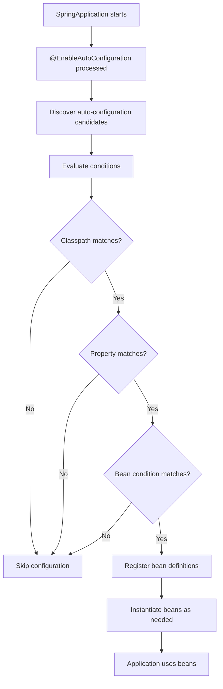
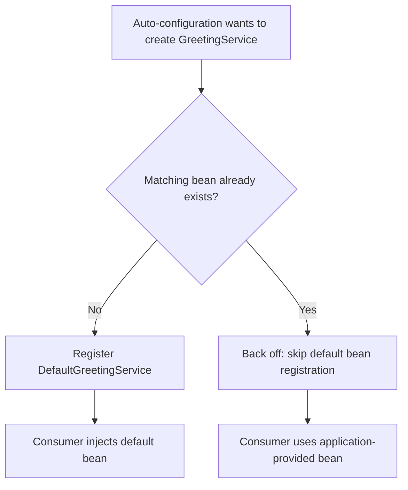
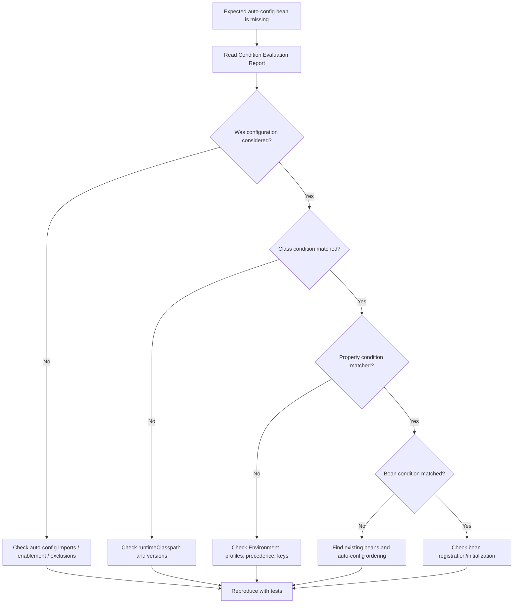

# Auto-Configuration Not Running Due to Classpath, Property, or Existing Beans

Spring Boot can create many beans automatically without developers writing every line of configuration. Simply adding a starter can auto-configure components like `DataSource`, `JdbcTemplate`, web infrastructure, or Actuator endpoints. Yet sometimes you add a dependency and the expected bean still does not appear—or a previously active auto-configuration vanishes once you declare a bean yourself.

These situations almost always involve **conditional auto-configuration**: Spring Boot applies a configuration only when its conditions hold. The three most important condition groups to inspect are:

1. **Classpath:** is the class or library required by the configuration actually on the runtime classpath?
2. **Property:** does the configuration value exist and satisfy the condition?
3. **Existing beans:** has the application already registered a bean causing auto-configuration to back off intentionally?

Understanding these three groups helps you locate the cause instead of adding annotations or dependencies by trial and error. This lesson from the **Troubleshooting** chapter of *Spring Boot Fundamentals* focuses on recognizing when auto-configuration did not run, reading the Condition Evaluation Report, inspecting classpaths and property sources, understanding `@ConditionalOnMissingBean`, and reproducing conditions with tests.

Examples use Java 21 and Spring Boot 3.x. Some auto-configuration names and condition details vary across versions; inspect your running application's report to confirm.

## 1. Auto-Configuration Does Not Mean Always Configuring

Auto-configuration is Spring Boot's mechanism for registering configuration based on what is present in the application. A configuration class may be discovered yet create beans only when associated conditions pass.

Conceptual example:

```java
@Configuration(proxyBeanMethods = false)
@ConditionalOnClass(SomeClient.class)
@ConditionalOnProperty(
        prefix = "app.client",
        name = "enabled",
        havingValue = "true")
class ClientAutoConfiguration {

    @Bean
    @ConditionalOnMissingBean
    SomeClient someClient() {
        return new SomeClient();
    }
}
```

This illustrates condition types rather than a built-in Spring Boot auto-configuration. The bean is created only when:

- `SomeClient` is on the classpath.
- Property `app.client.enabled` equals `true`.
- No matching bean is already registered that invalidates `@ConditionalOnMissingBean`.

If even a single condition fails, the configuration depending on it is skipped.

### 1.1. Three Layers of Questions When Investigating

| Question | What to Verify |
|---|---|
| Was the configuration considered by Spring Boot? | Is the auto-configuration class listed in imports and enabled by `@EnableAutoConfiguration`? |
| Did the configuration's conditions match? | Do classpath, property, bean, web application type, and other conditions hold? |
| Was the bean created and used? | Does the bean definition exist, did instantiation succeed, and did consumers inject the right bean? |

Do not lump all three questions into one. For example, auto-configuration may match while bean creation fails because a constructor needs another dependency. That is a bean instantiation failure, not an unmatched condition.

## 2. Auto-Configuration Evaluation Flow

When an application enables auto-configuration, Spring Boot locates registered configurations and evaluates their conditions while processing configuration classes and bean definitions.



This diagram simplifies the three condition groups covered here. Real auto-configurations can carry additional conditions, applied at class level, method level, or on nested configurations.

### 2.1. Auto-Configuration Classes Must Be Registered to Be Considered

In Spring Boot, `@SpringBootApplication` includes `@EnableAutoConfiguration`. This mechanism discovers auto-configuration candidates published by modules on the classpath.

In Spring Boot 3, auto-configurations are registered through imports metadata, usually located at:

```text
META-INF/spring/org.springframework.boot.autoconfigure.AutoConfiguration.imports
```

Older Spring Boot versions used `spring.factories` for auto-configuration registration. Always match documentation or library source against your Boot version.

If a custom configuration class is missing from imports or not imported/scanned appropriately, Boot will not consider it merely because the class is named `SomethingAutoConfiguration`.

### 2.2. Auto-Configurations Have Ordering

One auto-configuration may need to be evaluated after another. Spring Boot provides metadata/annotations to express order, such as `@AutoConfiguration(after = ...)` or corresponding before/after rules.

This matters for bean conditions: `@ConditionalOnBean` and `@ConditionalOnMissingBean` inspect bean definitions already processed at the moment the condition is evaluated. If a custom configuration is processed later, results can differ from assuming "the bean will exist somewhere eventually."

## 3. Cause Group 1: Classpath Does Not Meet Conditions

The classpath is the set of classes and libraries available to the JVM at runtime. An auto-configuration often checks for a specific class or group of classes before applying.

Example:

```java
@Configuration(proxyBeanMethods = false)
@ConditionalOnClass(name = "com.example.payment.PaymentClient")
class PaymentAutoConfiguration {
    // Configuration related to PaymentClient.
}
```

If `PaymentClient` is absent from the classpath, the condition does not match and this configuration is skipped. That is how Spring Boot avoids configuring features the application does not use.

### 3.1. Adding a Starter in the Wrong Configuration Scope

In Gradle, dependencies can be declared in different scopes:

```groovy
dependencies {
    implementation 'org.springframework.boot:spring-boot-starter-actuator'
    testImplementation 'org.springframework.boot:spring-boot-starter-test'
}
```

If a library is added only via `testImplementation`, it appears on the test classpath yet is absent from the packaged application's runtime classpath. Consequently:

- Tests see the class and its auto-configuration.
- The actual running application cannot see that class.

Likewise, `compileOnly`, `developmentOnly`, or custom configurations may exclude a dependency from the runtime artifact.

### 3.2. Checking the Runtime Dependency Tree

With Gradle:

```bash
./gradlew dependencies --configuration runtimeClasspath
```

Finding a specific dependency:

```bash
./gradlew dependencyInsight --dependency spring-boot-starter-actuator --configuration runtimeClasspath
```

With Maven:

```bash
./mvnw dependency:tree
```

The dependency tree answers:

- Was the starter actually included in the build?
- Did a dependency transitively provide the needed class?
- Is there a version conflict or excluded dependency?
- Which compile/test/runtime scope holds the dependency?

Do not just glance at `build.gradle` and assume the class is present. The resolved runtime classpath and final artifact are the proof closest to runtime.

### 3.3. Excluded or Optional Dependencies

A starter pulls in multiple modules. If the project removes one via `exclude`, or a library marks a dependency optional, the class needed by auto-configuration may be missing.

Gradle example:

```groovy
dependencies {
    implementation('com.example:payment-integration:1.2.0') {
        exclude group: 'com.example', module: 'payment-client'
    }
}
```

If auto-configuration depends on `payment-client`, excluding it prevents `@ConditionalOnClass` from matching.

Check the dependency tree to see why the library is absent, then restore the dependency or remove unneeded configuration. Never add random dependencies merely because a class name in logs looks similar.

### 3.4. Version Conflicts and Incompatible Classes

The classpath may hold the class at an incompatible version. `@ConditionalOnClass` then matches, yet bean creation still fails with errors like:

```text
NoSuchMethodError
NoClassDefFoundError
ClassNotFoundException
```

These differ from "condition did not match":

- `ClassNotFoundException` or `NoClassDefFoundError` indicates the class failed to load along that execution path.
- `NoSuchMethodError` usually points to a binary version mismatch.
- The condition report may show the class condition matched while bean initialization failed later.

Check dependency alignment and use Spring Boot dependency management appropriately to avoid mixing incompatible versions.

### 3.5. Checking the Right Classloader

Some environments use multiple classloaders, plugins, or DevTools restart classloaders. Seeing a class in a test classloader does not guarantee it exists in another runtime classloader.

If the report and dependency tree do not explain it, inspect where the class loads from:

```java
Class<?> type = com.example.payment.PaymentClient.class;
System.out.println(type.getClassLoader());
System.out.println(type.getProtectionDomain()
        .getCodeSource()
        .getLocation());
```

This applies only when the class exists and `CodeSource` is populated. For classes loaded by the bootstrap loader or specialized environments, `CodeSource` may be null.

## 4. Reading @ConditionalOnClass

`@ConditionalOnClass` is one of the most common conditions in auto-configuration.

Example:

```java
@AutoConfiguration
@ConditionalOnClass(name = "com.example.search.SearchClient")
public class SearchAutoConfiguration {

    @Bean
    @ConditionalOnMissingBean
    SearchService searchService(SearchClient client) {
        return new SearchService(client);
    }
}
```

If `SearchClient` is absent from the classpath, this configuration is skipped by the condition.

### 4.1. Using Name vs. Class Literal?

You can write:

```java
@ConditionalOnClass(SearchClient.class)
```

or pass the class name as a string:

```java
@ConditionalOnClass(name = "com.example.search.SearchClient")
```

In auto-configurations, using the class name string or placing conditions on nested configurations helps prevent the JVM from resolving optional types too early in certain situations. Follow the pattern used by Spring Boot and corresponding libraries.

### 4.2. Why Do Classpath Conditions Support Optional Libraries?

A library may integrate with multiple backends:

- JDBC if JDBC APIs exist.
- Redis if a Redis client exists.
- Kafka if a Kafka client exists.
- Prometheus if the corresponding registry exists.

Users do not have to pull all dependencies into their application. Auto-configuration activates integrations only when corresponding classes exist.

### 4.3. Class Is Present Yet Bean Is Still Missing

`@ConditionalOnClass` checks only the classpath condition. The configuration may also have:

- `@ConditionalOnProperty`.
- `@ConditionalOnBean`.
- `@ConditionalOnMissingBean`.
- `@ConditionalOnWebApplication`.
- Other custom conditions.

Therefore, a positive match for the classpath condition does not prove the entire auto-configuration created the bean.

## 5. Cause Group 2: Property Does Not Satisfy Conditions

An auto-configuration can toggle features based on properties.

Example:

```java
@Configuration(proxyBeanMethods = false)
@ConditionalOnProperty(
        prefix = "app.mail",
        name = "enabled",
        havingValue = "true")
class MailAutoConfiguration {

    @Bean
    MailSender mailSender() {
        return new MailSender();
    }
}
```

Under this condition, `MailSender` is created only when `app.mail.enabled` has the matching value `true`.

### 5.1. Missing Property and matchIfMissing

By default, `@ConditionalOnProperty` requires the property to be declared. If absent, the condition does not match.

You can alter this behavior:

```java
@ConditionalOnProperty(
        prefix = "app.mail",
        name = "enabled",
        havingValue = "true",
        matchIfMissing = true)
```

When the property is missing, the condition evaluates as matching. Yet if the property is explicitly `false`, the condition still fails because `havingValue="true"`.

Do not confuse `matchIfMissing=true` with "any value is accepted." It governs only behavior when **the property is absent**.

### 5.2. havingValue and Default Matching

Some declarations omit `havingValue`:

```java
@ConditionalOnProperty(
        prefix = "app.feature",
        name = "enabled")
```

Without `havingValue`, a present property whose value is anything other than the string `false` matches.

More explicit:

```java
@ConditionalOnProperty(
        prefix = "app.feature",
        name = "enabled",
        havingValue = "true")
```

For feature flags, specifying `havingValue="true"` clarifies intent and avoids matching unexpected values.

### 5.3. Checking the Effective Property Value

Suppose `application.yml` specifies:

```yaml
app:
  mail:
    enabled: false
```

Yet the command line passes:

```bash
java -jar app.jar --app.mail.enabled=true
```

In normal Spring Boot setups, command-line properties override file values. Thus the condition matches even though the YAML file still says `false`.

Check via:

```java
String enabled = environment.getProperty("app.mail.enabled");
```

Inspect actual runtime values, not just a single file in your repository.

## 6. Properties Can Come from Many Sources

Spring Boot merges multiple property sources. A key may appear in:

- Default properties.
- `application.properties` or `application.yml`.
- Profile-specific files.
- Config Data imports or external files.
- Environment variables.
- Java system properties.
- Command-line arguments.
- Programmatic or test-registered PropertySources.

Example:

```text
application.yml:                 app.mail.enabled=false
application-prod.yml:            app.mail.enabled=true
Environment:                     APP_MAIL_ENABLED=false
Command line:                    --app.mail.enabled=true
```

You cannot determine the condition outcome by inspecting just one of those lines. You must account for active profiles and source precedence.

### 6.1. Inspecting via Environment

A small runner can print non-sensitive values:

```java
@Component
class MailConfigurationReporter implements ApplicationRunner {

    private final Environment environment;

    MailConfigurationReporter(Environment environment) {
        this.environment = environment;
    }

    @Override
    public void run(ApplicationArguments args) {
        System.out.println("app.mail.enabled = "
                + environment.getProperty("app.mail.enabled", "<missing>"));
    }
}
```

This shows the effective value returned by Environment, though it does not by itself tell you which source won.

### 6.2. Inspecting PropertySources

With `ConfigurableEnvironment`, you can list sources declaring the key:

```java
ConfigurableEnvironment environment = ...;
String key = "app.mail.enabled";

for (PropertySource<?> source : environment.getPropertySources()) {
    if (source.containsProperty(key)) {
        System.out.println(source.getName());
    }
}
```

`PropertySource` order determines precedence. Some sources use wrappers or relaxed name mapping, so `containsProperty` is only a basic diagnostic tool. Actuator `env` provides richer origin details when properly configured and secured.

### 6.3. Environment Variables Can Override Files

Property:

```text
app.mail.enabled
```

typically maps to:

```text
APP_MAIL_ENABLED
```

If local runs work yet containers omit the bean, check environment variables in the container or deployment manifest. Values on a developer's laptop need not match deployment values.

### 6.4. Misspelled Property Names

A common mistake is writing:

```yaml
app:
  mail:
    enable: true
```

while the condition checks `app.mail.enabled`. Those two names differ. Properties are not automatically validated just because YAML syntax is valid; the condition simply treats the expected property as missing.

When a condition fails to match, copy the exact prefix and name from the annotation or report.

## 7. Limitations of @ConditionalOnProperty

`@ConditionalOnProperty` fits simple scalar properties, not arbitrary complex structures.

Example:

```yaml
app:
  mail:
    servers:
      - smtp-a.example.test
```

Do not assume `@ConditionalOnProperty(prefix="app.mail", name="servers")` inspects list elements the way you expect. For collections or nested structures, consider a custom condition or bind `@ConfigurationProperties` and check via an appropriate mechanism.

### 7.1. Checking Complex Properties with Configuration Properties

Example:

```java
@ConfigurationProperties(prefix = "app.mail")
public record MailProperties(
        boolean enabled,
        List<String> servers) {
}
```

When multi-property logic is needed, a configuration class or bean factory can use bound properties with explicit validation. Be careful about bean creation timing and avoid cycles between conditions and the beans being decided.

## 8. Cause Group 3: Existing Beans Cause Auto-Configuration to Back Off

Many auto-configurations are designed not to override application choices. The standard annotation is:

```java
@ConditionalOnMissingBean
```

Example:

```java
@AutoConfiguration
public class GreetingAutoConfiguration {

    @Bean
    @ConditionalOnMissingBean(GreetingService.class)
    GreetingService greetingService() {
        return new DefaultGreetingService();
    }
}
```

If the context already holds a bean of type `GreetingService`, `DefaultGreetingService` is not registered by this method.

This is usually **intentional design**, not an auto-configuration bug.

### 8.1. Why Does Spring Boot Allow Back-Off?

The aim is offering convenient defaults while letting applications customize behavior.



Without back-off, a library would create a default bean colliding with the application's own bean, causing ambiguity or forcing users to disable the whole auto-configuration.

### 8.2. Where Can Existing Beans Come From?

A bean causing auto-configuration to back off may be registered by:

- `@Component`, `@Service`, `@Repository` found by component scanning.
- `@Bean` methods in application configuration.
- Another auto-configuration.
- Test configuration.
- Imported library configuration.

So if you do not remember declaring that bean, inspect the bean definitions list and related configuration sources.

### 8.3. Same Type with a Different Name Still Fails the Condition

Example:

```java
@Bean
GreetingService customGreetingService() {
    return new CustomGreetingService();
}
```

Auto-configuration uses:

```java
@ConditionalOnMissingBean(GreetingService.class)
```

The condition typically checks by bean type; `customGreetingService` still causes the condition not to match even though its name differs from `greetingService`.

Do not look only for a bean matching the default name. Inspect the **type, annotations, qualifiers, and exact condition** used by the auto-configuration.

## 9. @ConditionalOnMissingBean Is Not @Primary

These two mechanisms solve different problems:

| Mechanism | Role |
|---|---|
| `@ConditionalOnMissingBean` | Decides whether to register a default bean based on existing matching beans. |
| `@Primary` | Selects the preferred bean when Spring resolves a single dependency with multiple candidates. |
| `@Qualifier` | Specifies which candidate to inject at an injection point. |

Example with two beans:

```java
@Bean
@Primary
GreetingService primaryGreetingService() {
    return new PrimaryGreetingService();
}

@Bean
GreetingService secondaryGreetingService() {
    return new SecondaryGreetingService();
}
```

If an auto-configuration then declares:

```java
@Bean
@ConditionalOnMissingBean(GreetingService.class)
GreetingService defaultGreetingService() {
    return new DefaultGreetingService();
}
```

the presence of `GreetingService` beans causes the default method to back off. `@Primary` is not the direct cause; **an existing bean of that type** decides this case.

### 9.1. @Primary Does Not Remove Other Beans

`@Primary` does not remove other beans from ApplicationContext. It simply prioritizes one candidate at matching injection points.

If a consumer needs a specific bean, `@Qualifier` clarifies intent. Never add `@Primary` hoping to re-enable an auto-configuration blocked by `@ConditionalOnMissingBean`.

## 10. Checking Which Beans Exist

A direct check injects `ApplicationContext` and lists bean names by type:

```java
@Component
class GreetingBeanReporter implements ApplicationRunner {

    private final ApplicationContext context;

    GreetingBeanReporter(ApplicationContext context) {
        this.context = context;
    }

    @Override
    public void run(ApplicationArguments args) {
        String[] names =
                context.getBeanNamesForType(GreetingService.class);

        System.out.println(Arrays.toString(names));
    }
}
```

If output includes `customGreetingService`, you have evidence that an application-defined bean is present.

### 10.1. Checking the Actual Implementation

```java
GreetingService service = context.getBean(GreetingService.class);
System.out.println(service.getClass().getName());
```

When a single candidate exists or resolves under current rules, this prints the retrieved object's class. If multiple beans exist with no tie-breaker, `getBean(GreetingService.class)` throws `NoUniqueBeanDefinitionException`.

### 10.2. Bean Definitions Differ from Instantiated Objects

Conditions generally evaluate bean definitions without requiring every singleton to be instantiated yet. Inspecting runtime objects is only part of the picture; the condition report and bean definition metadata explain why configuration backed off.

## 11. @ConditionalOnBean and Configuration Ordering

`@ConditionalOnBean` requires a matching bean to already be registered in the context at the time the condition is evaluated.

Example:

```java
@Configuration(proxyBeanMethods = false)
@ConditionalOnBean(PaymentGateway.class)
class PaymentAuditAutoConfiguration {

    @Bean
    PaymentAuditService paymentAuditService(PaymentGateway gateway) {
        return new PaymentAuditService(gateway);
    }
}
```

If no `PaymentGateway` bean definition exists when the condition runs, `PaymentAuditService` is not registered.

### 11.1. Why Does Order Matter?

Auto-configurations are ordered via before/after relations and configuration processing rules. If one configuration wants to use a bean provided by another auto-configuration, processing order must align.

Spring Boot recommends using `@ConditionalOnBean` and `@ConditionalOnMissingBean` primarily inside auto-configurations, where processing order is controlled so conditions see the right bean definitions.

Do not scatter these conditions across ordinary component configurations to orchestrate complex dependency chains. Mutually dependent configuration classes can produce confusing results or evaluate conditions before target beans are registered.

### 11.2. @AutoConfiguration(after = ...)

For custom auto-configurations, specify order:

```java
@AutoConfiguration(after = DataSourceAutoConfiguration.class)
class ReportingAutoConfiguration {
    // Configuration requiring DataSource to be processed first.
}
```

This is an ordering hint among auto-configuration classes, not a guarantee that an arbitrary bean has finished instantiating. When conditions depend on beans, verify the exact bean types and definition processing order.

## 12. Reading the Condition Evaluation Report

When a bean or auto-configuration fails to appear, the primary starting tool is the **Condition Evaluation Report**.

In development, run:

```bash
./gradlew bootRun --args='--debug'
```

Or with an executable JAR:

```bash
java -jar app.jar --debug
```

Spring Boot prints a report of auto-configuration conditions that matched or did not match, typically grouped into positive matches and negative matches.

### 12.1. What Does a Positive Match Tell You?

A positive match shows a specific configuration or condition passed. It does not by itself prove every bean inside instantiated successfully.

For example:

- Classpath condition matched.
- Property condition matched.
- A nested configuration matched.
- A bean method may still fail during creation due to another dependency.

Read the configuration name and each individual condition instead of seeing the auto-configuration in the positive list and assuming the whole feature works.

### 12.2. What Does a Negative Match Tell You?

A negative match usually explains why the configuration was skipped. Illustrative snippet:

```text
MailAutoConfiguration:
   Did not match:
      - @ConditionalOnProperty (app.mail.enabled=true) did not find property 'enabled'
```

This points to a missing property for the evaluated condition. Next check:

- Is the property name spelled right?
- Is the required profile active?
- Was the config file loaded?
- Are environment variables mapped properly?
- Did a higher-precedence source alter the value?

### 12.3. Reports Can Show Multiple Conditions per Configuration

Example:

```text
PaymentAutoConfiguration:
   matched:
      - @ConditionalOnClass found required class
   did not match:
      - @ConditionalOnProperty did not find property
```

This is an illustrative example. It means the classpath condition matched while the property condition failed. There is no contradiction: each condition checks a separate requirement.

### 12.4. --debug Is Not a System-Wide Logging Level

Spring Boot's `--debug` flag enables Boot's debug/condition report mechanism. It does not switch every logger to TRACE, nor does it replace setting `logging.level` for specific packages.

## 13. Using the /actuator/conditions Endpoint

If the project includes `spring-boot-starter-actuator`, the `conditions` endpoint serves the Condition Evaluation Report via the management API when permitted and exposed.

Example config for a protected local environment:

```yaml
management:
  endpoints:
    web:
      exposure:
        include: health,conditions
```

Request:

```text
curl http://localhost:8080/actuator/conditions
```

This endpoint inspects positive/negative matches in a running context. Exact paths vary with management base path or port.

### 13.1. If conditions Returns 404

Do not immediately conclude Actuator lacks the condition report. Check:

- Is the Actuator dependency on the runtime classpath?
- Is the endpoint available in your version/setup?
- Does web exposure include `conditions`?
- Are management base path or port customized?
- Is endpoint access/security blocking the request?

### 13.2. Securing the conditions Endpoint

The condition report exposes internal classes, packages, dependencies, and configuration structure. Expose it only in appropriate environments with authentication/authorization and network controls. Never open this diagnostic endpoint publicly just for debugging convenience.

## 14. Distinguishing Unmatched Conditions from Bean Creation Failures

Two error categories are often confused:

### Case A: Condition Did Not Match

```text
@ConditionalOnProperty did not find property 'enabled'
```

No bean definition was registered by that configuration method. This is an intentional conditional skip.

### Case B: Bean Was Registered Yet Initialization Failed

```text
Error creating bean with name 'paymentClient'
Caused by: java.lang.IllegalStateException: Missing endpoint URL
```

This is a bean creation failure after configuration applied, or a dependency failure during initialization.

### Case C: Bean Exists Yet Injection Fails

```text
NoUniqueBeanDefinitionException:
expected single matching bean but found 2
```

This is a dependency resolution failure due to multiple candidates—not necessarily an auto-configuration failing to run.

### 14.1. Classification Table

| Symptom | Issue Group | Where to Check |
|---|---|---|
| `Did not match` | Unmet condition | Condition report, classpath, property, bean |
| `NoClassDefFoundError` | Class loading/classpath | Runtime dependency tree, version alignment |
| `Error creating bean` | Bean initialization | Root cause, constructor, dependencies, config |
| `NoSuchBeanDefinitionException` | No matching bean | Condition report, component scan, imports |
| `NoUniqueBeanDefinitionException` | Multiple bean candidates | Bean names/types, qualifiers, primary |
| `BeanCurrentlyInCreationException` | Bean creation cycle | Dependency graph, circular references |

Reading only the first exception is insufficient. Find the root cause and pinpoint whether failure happened at condition evaluation, registration, initialization, or injection.

## 15. End-to-End Example: A Client Not Auto-Configured

Suppose a project expects `CatalogSearchClient` when the search client library is present and enabled via property, unless the application supplies its own client.

### 15.1. Illustrative Auto-Configuration

```java
@AutoConfiguration
@ConditionalOnClass(CatalogSearchClient.class)
@ConditionalOnProperty(
        prefix = "catalog.search",
        name = "enabled",
        havingValue = "true")
public class CatalogSearchAutoConfiguration {

    @Bean
    @ConditionalOnMissingBean(CatalogSearchClient.class)
    CatalogSearchClient catalogSearchClient(
            CatalogSearchProperties properties) {
        return new DefaultCatalogSearchClient(properties.endpoint());
    }
}
```

This illustrates a hypothetical library's auto-configuration. To be discovered, it must also be registered in the imports metadata matching your Spring Boot version.

### 15.2. Application Configuration

```yaml
catalog:
  search:
    enabled: true
    endpoint: https://search.example.test
```

### 15.3. Three Ways the Default Bean Fails to Appear

**A — Missing Classpath**

If the library providing `CatalogSearchClient` is absent from the runtime classpath, `@ConditionalOnClass` does not match.

**B — Wrong Property**

If config sets `catalog.search.enabled: false`, or another source overrides the effective value to false, the property condition fails.

**C — Application Supplied Its Own Bean**

If the application declares:

```java
@Configuration(proxyBeanMethods = false)
class CustomSearchConfiguration {

    @Bean
    CatalogSearchClient customCatalogSearchClient() {
        return new CustomCatalogSearchClient();
    }
}
```

then the default bean backs off because a matching `CatalogSearchClient` bean already exists.

### 15.4. Layer-by-Layer Diagnosis

| Check | Hypothetical Result | Conclusion |
|---|---|---|
| Runtime dependency tree | Search library present | Classpath looks valid. |
| Condition report | Class condition matched | Not a missing class for this condition. |
| Environment | `catalog.search.enabled=false` | Property condition failed to match. |
| Bean lookup | No client bean yet | No evidence bean condition caused it. |

After fixing the property, if the bean is still missing, reread the report. A bean condition or another condition may be the next reason.

## 16. Writing Custom Conditions: When Are They Needed?

Spring Boot includes many built-in conditions. When complex logic or checks cannot be expressed cleanly with standard annotations, write a custom `Condition`.

Illustrative example:

```java
public class SupportedRegionCondition implements Condition {

    @Override
    public boolean matches(
            ConditionContext context,
            AnnotatedTypeMetadata metadata) {

        String region = context.getEnvironment()
                .getProperty("app.region");

        return "apac".equalsIgnoreCase(region);
    }
}
```

Usage:

```java
@Configuration(proxyBeanMethods = false)
@Conditional(SupportedRegionCondition.class)
class ApacConfiguration {
    // Beans for the APAC region.
}
```

When the custom condition returns `false`, the configuration is skipped. Depending on implementation and version, the condition report may show evaluation details; write conditions so they are easy to explain and observe.

### 16.1. Do Not Write Custom Conditions When Property Conditions Suffice

For a simple boolean feature flag, `@ConditionalOnProperty` is easier to read. Custom conditions are worthwhile only for multi-property logic or specialized context checks.

### 16.2. Conditions Should Have No Side Effects

`matches(...)` may be called during configuration processing. Never make network calls, open database connections, or run business logic inside a custom condition. Conditions should inspect metadata/configuration that evaluates deterministically.

## 17. Disabling or Excluding Auto-Configuration

Sometimes the opposite issue occurs: an auto-configuration runs and you want to disable it because the application provides its own implementation.

### 17.1. Exclude via @SpringBootApplication

Example:

```java
@SpringBootApplication(exclude = {
        SomeAutoConfiguration.class
})
public class CatalogApplication {
}
```

Or by class name:

```java
@SpringBootApplication(
        excludeName = "com.example.SomeAutoConfiguration")
```

Class and package names must match the actual auto-configuration. Never guess names from starter names.

### 17.2. Exclude via Property

Spring Boot supports `spring.autoconfigure.exclude` to exclude auto-configurations by class name:

```yaml
spring:
  autoconfigure:
    exclude:
      - com.example.SomeAutoConfiguration
```

This disables a specific auto-configuration explicitly, unlike conditions failing to match due to missing classes, properties, or beans.

### 17.3. Excluding Is Not the First Fix for Every Problem

If auto-configuration did not create a bean due to a missing property, excluding it solves nothing. If a default bean backed off because a custom bean exists, excluding may drop other helpful beans from that configuration.

Exclude only when you genuinely do not want that configuration participating and understand all related beans/behaviors.

## 18. Testing Conditions with ApplicationContextRunner

Spring Boot provides `ApplicationContextRunner` to test auto-configurations in a lightweight context. This lets you reproduce classpath/property/bean conditions without booting the whole application.

Property condition test example:

```java
class MailAutoConfigurationTests {

    private final ApplicationContextRunner runner =
            new ApplicationContextRunner()
                    .withConfiguration(AutoConfigurations.of(
                            MailAutoConfiguration.class));

    @Test
    void createsMailSenderWhenEnabled() {
        runner.withPropertyValues("app.mail.enabled=true")
                .run(context -> {
                    assertThat(context).hasSingleBean(MailSender.class);
                });
    }

    @Test
    void backsOffWhenDisabled() {
        runner.withPropertyValues("app.mail.enabled=false")
                .run(context -> {
                    assertThat(context).doesNotHaveBean(MailSender.class);
                });
    }
}
```

This assumes `MailAutoConfiguration` is defined with the corresponding condition and Spring Boot test dependencies are present. `ApplicationContextRunner` runs each test with an isolated context.

### 18.1. Testing matchIfMissing

When an auto-configuration uses `matchIfMissing=true`, add a dedicated test when the property is omitted:

```java
@Test
void createsDefaultWhenPropertyIsMissing() {
    runner.run(context -> {
        assertThat(context).hasSingleBean(MailSender.class);
    });
}
```

Do not test only `true`. Test `false`, missing, and invalid values per the condition's contract.

### 18.2. Testing Back-Off When the Application Supplies a Bean

```java
@Test
void backsOffWhenUserDefinesMailSender() {
    runner.withUserConfiguration(CustomMailConfiguration.class)
            .run(context -> {
                assertThat(context).hasSingleBean(MailSender.class);
                assertThat(context.getBean(MailSender.class))
                        .isInstanceOf(CustomMailSender.class);
            });
}
```

This proves auto-configuration respects custom beans under `@ConditionalOnMissingBean`.

### 18.3. Testing Classpath Conditions

`ApplicationContextRunner` supports configuring a class loader for classpath condition tests. You can supply a filtering class loader to simulate absent optional classes, or separate test fixtures to verify configurations with and without classes.

Never assume `@ConditionalOnClass` works simply because tests compile. Compile classpaths and test runtime class loaders are distinct scopes.

### 18.4. Checking Condition Reports When the Context Lacks a Bean

Inside `run(context -> ...)`, you can verify the bean is absent and inspect failure analysis/reports. Aim to prove **the specific condition** produced the outcome rather than merely asserting a bean is missing.

## 19. Using /actuator/conditions to Verify in a Running Context

If the application includes Actuator, the `conditions` endpoint helps investigate a running instance. In a protected local environment:

```yaml
management:
  endpoints:
    web:
      exposure:
        include: health,conditions
```

Then request:

```text
GET /actuator/conditions
```

Locate the auto-configuration name and check positive/negative matches.

If the endpoint is unexposed or blocked by security, use `--debug` in an appropriate run. Both tools answer similar questions through different observation channels:

| Tool | Best When |
|---|---|
| `--debug` / Condition Evaluation Report | Viewing the report in startup logs. |
| `/actuator/conditions` | Viewing the condition report of a running context via management API. |
| Dependency tree | Verifying whether a library actually exists on the classpath. |
| Environment / `/actuator/env` | Checking effective property values and sources. |
| ApplicationContext / `/actuator/beans` | Checking registered beans. |

No single tool replaces all the others.

## 20. Ordered Diagnostic Workflow

When auto-configuration fails to create an expected bean, proceed as follows:

1. **Identify the exact bean and auto-configuration.** Note the expected type, bean name, and configuration class.
2. **Check whether the candidate was considered.** Read the Condition Evaluation Report.
3. **Check the classpath.** Run the runtime dependency tree and verify class conditions.
4. **Check properties.** Verify exact key names, effective values, profiles, and PropertySources.
5. **Check existing beans.** Search for beans of matching type/name/annotations triggering back-off.
6. **Check auto-configuration ordering.** Especially when using `@ConditionalOnBean` or `@ConditionalOnMissingBean`.
7. **Classify the failure stage.** Unmet condition, unregistered bean definition, failed bean initialization, or ambiguous injection?
8. **Check application type.** Are web/servlet/reactive conditions or profiles involved?
9. **Reproduce in a small test.** Use `ApplicationContextRunner` or targeted integration tests.
10. **Fix the root cause.** Add the right dependency, fix the property, remove unneeded beans, or keep intentional custom beans.



This sequence narrows investigation from metadata down to runtime rather than changing multiple layers at once.

## 21. Common Symptoms and How to Read Them

| Symptom | Possible Cause | What to Check |
|---|---|---|
| `Did not match` | Unmet condition | Condition report, classpath, property, bean |
| `NoClassDefFoundError` | Class loading/classpath | Runtime dependency tree, version alignment |
| `Error creating bean` | Bean initialization | Root cause, constructor, dependencies, config |
| `NoSuchBeanDefinitionException` | No matching bean | Condition report, component scan, imports |
| `NoUniqueBeanDefinitionException` | Multiple bean candidates | Bean names/types, qualifiers, primary |
| `BeanCurrentlyInCreationException` | Bean creation cycle | Dependency graph, circular references |

## 22. Common Misconceptions

### "Adding a starter guarantees auto-configuration creates the bean"

No. A starter only supplies a set of dependencies. Auto-configuration still evaluates classpath, property, bean, and other conditions.

### "Configuration missing from condition report means a missing property"

Not necessarily. The configuration may be unregistered, excluded, absent from imports, or missing from the classpath.

### "Having a class on compile classpath means runtime has it too"

No. Dependency scopes, packaging, and runtime classloaders can differ.

### "@ConditionalOnMissingBean checks only the default bean name"

Not necessarily. Conditions can match by type, name, annotation, or declared criteria. Inspect the actual annotation.

### "@Primary makes auto-configuration continue creating the default bean"

No. `@Primary` breaks ties during injection; it does not remove existing beans or make `@ConditionalOnMissingBean` match.

### "Property in application.yml guarantees condition sees true"

No. Higher-precedence sources can override it; the key may be misspelled or the profile file may not be loaded.

### "Positive match means the bean initialized successfully"

No. Condition matching is only one stage. Bean instantiation or dependency injection can still fail.

### "Disabling auto-configuration fixes missing beans"

No. Excluding only removes configuration. If configuration skipped due to property or classpath, excluding does not solve the cause.

## 23. Comprehensive Practice Exercise

Create a hypothetical auto-configuration for `MailSender` with three conditions: the mail client library is on the classpath, property `app.mail.enabled=true`, and no application-supplied `MailSender` bean exists.

**Step A — Classpath.** Add the mail client library as a runtime dependency. Inspect the dependency tree and identify the class checked by `@ConditionalOnClass`.

**Step B — Property.** Set `app.mail.enabled=true` in `application.yml`, then switch it to `false` and inspect the Condition Evaluation Report.

**Step C — Missing property.** Remove the property, rerun, and verify `matchIfMissing` default behavior.

**Step D — Override.** Keep YAML at `false`, yet pass `--app.mail.enabled=true`. Check Environment and the condition report.

**Step E — Custom bean.** Register a `MailSender` via `@Bean`. Observe whether the default auto-configuration backs off.

**Step F — Primary.** Create two beans of the same type and mark one `@Primary`. Distinguish candidate selection from whether auto-configuration creates the default bean.

**Step G — Scope.** Move the mail client library from runtime dependency to test-only dependency. Compare test outcomes against running the application.

**Step H — Report.** Run with `--debug` and locate positive/negative matches for the auto-configuration.

**Step I — Isolated test.** Use `ApplicationContextRunner` to test property true, false, missing, and custom bean scenarios.

**Step J — Error classification.** Intentionally create one unmet-condition case and one bean-initialization-failure case. Record the differences in logs.

**Step K — Summary.** Each time the bean appears or disappears, document: classpath, effective property, existing bean definitions, and the specific condition.

## 24. Self-Assessment Questions

1. Does auto-configuration always create beans when a starter is added?
2. What does `@ConditionalOnClass` check?
3. Why can a `testImplementation` dependency let tests see a class while the packaged app misses it?
4. Which errors does the runtime dependency tree help detect?
5. How does `@ConditionalOnProperty` handle missing properties by default?
6. How do `havingValue="true"` and `matchIfMissing=true` play different roles?
7. Why might a property in YAML not be the value seen by a condition?
8. How does `@ConditionalOnMissingBean` let auto-configuration respect custom beans?
9. Do conditions check beans by name or type? How do you know for sure?
10. How does `@Primary` differ from `@ConditionalOnMissingBean`?
11. How does `@ConditionalOnBean` depend on configuration ordering?
12. What information can the Condition Evaluation Report reveal?
13. Does a positive match prove a bean initialized successfully?
14. Distinguish an unmet condition from `Error creating bean`.
15. Why doesn't `NoUniqueBeanDefinitionException` imply auto-configuration failed to run?
16. How can you inspect which property source supplied the effective value?
17. When should you inspect `spring.autoconfigure.exclude`?
18. Why should custom `Condition` implementations avoid network or database calls?
19. How does `ApplicationContextRunner` help test auto-configuration?
20. When must you combine dependency trees, Condition Report, Environment, and bean inspection?

### Complete Sample Explanation

> Spring Boot auto-configuration is conditional, so adding a starter does not guarantee all default beans are created. `@ConditionalOnClass` applies configuration only when required classes exist on the runtime classpath; wrong dependency scopes, exclusions, or version conflicts can prevent matching. `@ConditionalOnProperty` inspects Environment properties, so key spelling, active profiles, environment variables, external files, and command-line overrides can all alter outcomes. `@ConditionalOnMissingBean` lets applications supply their own implementations; once a matching bean exists, auto-configuration backs off intentionally. `@Primary` and `@Qualifier` resolve selection among existing beans rather than replacing back-off logic. To diagnose, read the Condition Evaluation Report, inspect the runtime dependency tree, check Environment values and PropertySources, then inspect bean definitions and separate unmatched conditions from bean initialization failures. Individual conditions can be reproduced using `ApplicationContextRunner`.

Once you determine **whether auto-configuration was considered**, which condition failed, and which existing bean caused it to back off, you have a systematic diagnostic method for **auto-configuration not running due to classpath, properties, or existing beans**.
