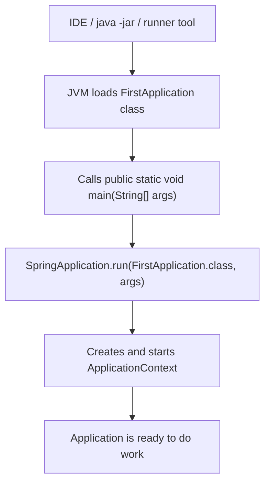
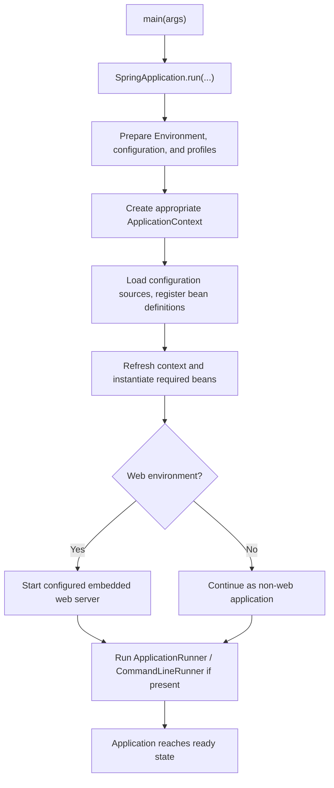
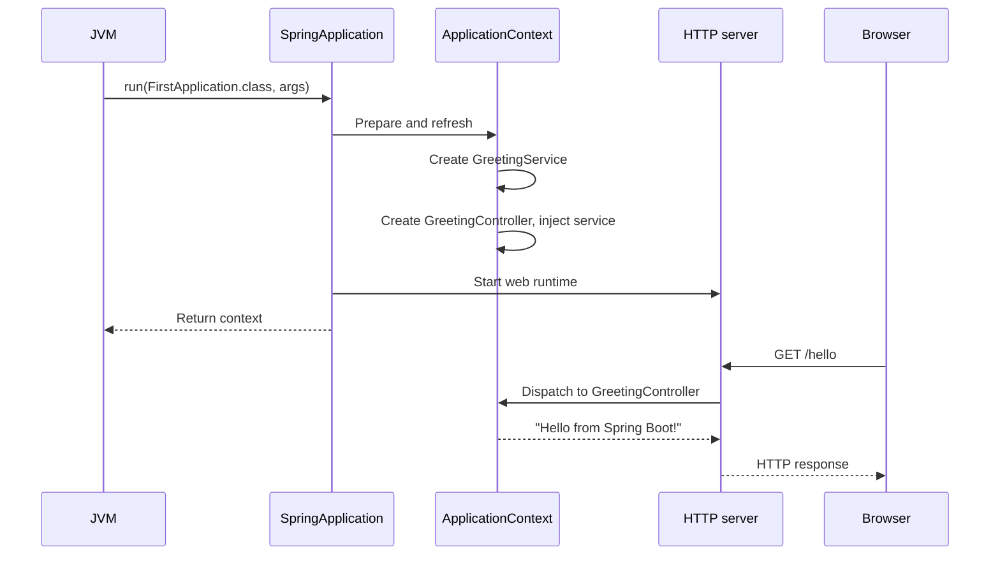
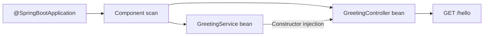

# The Main Class and the SpringApplication.run Call

In your first Spring Boot project, the shortest yet most important Java file is usually the class containing the `main` method. This is the starting point of the program when the JVM launches the application. From this method, calling `SpringApplication.run(...)` hands over to Spring Boot the responsibility of preparing configuration, creating the Spring container, instantiating beans, and, if the application has suitable web components, starting an HTTP server.

What you need to understand is that **`main` belongs to Java's program-launch mechanism**, whereas **`SpringApplication.run` belongs to Spring Boot's application-bootstrap mechanism**. The two parts have different responsibilities but connect together to form a working application.

This lesson focuses on reading, writing, running, and explaining the main class of a first project, including package structure, how Spring discovers beans, startup arguments, application lifecycle, and common startup errors.

## 1. The main class in a first Spring Boot project

A typical startup class:

```java
package com.example.firstapp;

import org.springframework.boot.SpringApplication;
import org.springframework.boot.autoconfigure.SpringBootApplication;

@SpringBootApplication
public class FirstApplication {

    public static void main(String[] args) {
        SpringApplication.run(FirstApplication.class, args);
    }
}
```

The `FirstApplication` class is usually placed in the root package of the application, such as `com.example.firstapp`. The class name does not have to be `Application` or `FirstApplication`; what matters is that the program has a valid entry point and the class passed to `SpringApplication.run` provides appropriate startup configuration.

When a user clicks **Run** in an IDE or runs a Spring Boot executable JAR, execution flows from the JVM to `main` and then into Spring Boot:



The main class usually needs only a few lines. Classes handling HTTP, business logic, and data access are managed by Spring in separate places. Avoid putting all application logic into `main` just because that is where the program starts.

### 1.1. File paths and package names

In a Gradle or Maven project following standard Java structure, the layout might be:

```text
firstapp/
├── src/
│   ├── main/
│   │   ├── java/
│   │   │   └── com/
│   │   │       └── example/
│   │   │           └── firstapp/
│   │   │               └── FirstApplication.java
│   │   └── resources/
│   │       └── application.yml
│   └── test/
│       └── java/
│           └── com/
│               └── example/
│                   └── firstapp/
│                       └── FirstApplicationTests.java
├── build.gradle       (if using Gradle)
└── pom.xml            (if using Maven; usually one build tool is chosen)
```

The line `package com.example.firstapp;` declares the class's package name. The source folder structure must reflect the package name. The `resources` directory contains configuration such as `application.yml` or `application.properties`; those files do not need a `package` declaration.

If your project has a different name, use an appropriate package name consistently from the main class down to sub-classes. You do not have to name your package literally `firstapp` as in the example.

## 2. The main method is the entry point of a Java program

Let's isolate the plain Java part:

```java
public class PlainJavaApp {
    public static void main(String[] args) {
        System.out.println("Java application started");
    }
}
```

When running `PlainJavaApp` as a standard Java application, the Java launcher invokes `main` according to the entry-point convention. Spring Boot uses that exact same convention; there is no special `main` type reserved for Spring.

| Part | Meaning |
| --- | --- |
| `public` | The method is accessible from outside the class per the standard entry-point convention. |
| `static` | The JVM invokes the method without needing to instantiate the class first. |
| `void` | The method does not return a result via a return value. |
| `main` | Standard Java entry-point method name. |
| `String[] args` | Array of command-line arguments passed when the program starts. |

The `args` parameter can be renamed, for instance to `arguments`; that is just a variable name. Declaring `String... args` is also equivalent in array parameter type in Java, though `String[] args` is the easiest for beginners to recognize.

Example:

```java
public class PlainJavaApp {
    public static void main(String[] args) {
        for (String arg : args) {
            System.out.println(arg);
        }
    }
}
```

If you run the program with two arguments `hello` and `world`, they appear in `args` in the order received. In Spring Boot, forwarding `args` into `SpringApplication.run` allows Spring Boot to process matching options and makes them available to startup components.

**An easily confused distinction:** `main` is a `static` method invoked by the JVM; this call itself is not an HTTP request, a controller callback, or a Spring-injected method. Spring-managed objects are only created and managed after the container startup process begins.

## 3. What does @SpringBootApplication do?

The `@SpringBootApplication` annotation declares that this class is the primary startup configuration for the Spring Boot application. It combines the foundational capabilities of three annotations:

| Component | Primary Role |
| --- | --- |
| `@SpringBootConfiguration` | Marks the class as a Spring configuration source; a specialized form of `@Configuration`. |
| `@EnableAutoConfiguration` | Enables auto-configuration based on conditions, dependencies, and present settings. |
| `@ComponentScan` | Scans for Spring component classes starting from the configuration class's package and its subpackages by default. |

Thus, a single annotation covers many needs of a new application:

```java
@SpringBootApplication
public class FirstApplication {
    public static void main(String[] args) {
        SpringApplication.run(FirstApplication.class, args);
    }
}
```

### 3.1. Component scanning: where does Spring look for beans?

Suppose the package structure is:

```text
com.example.firstapp
├── FirstApplication.java          // @SpringBootApplication
├── greeting
│   └── GreetingService.java       // @Service
└── web
    └── GreetingController.java    // @RestController
```

When `FirstApplication` is in `com.example.firstapp`, default component scanning finds eligible components in that package itself and in subpackages like `greeting` and `web`.

Example service:

```java
package com.example.firstapp.greeting;

import org.springframework.stereotype.Service;

@Service
public class GreetingService {

    public String message() {
        return "Hello from Spring Boot!";
    }
}
```

And a controller using the service via constructor:

```java
package com.example.firstapp.web;

import com.example.firstapp.greeting.GreetingService;
import org.springframework.web.bind.annotation.GetMapping;
import org.springframework.web.bind.annotation.RestController;

@RestController
public class GreetingController {

    private final GreetingService greetingService;

    public GreetingController(GreetingService greetingService) {
        this.greetingService = greetingService;
    }

    @GetMapping("/hello")
    public String hello() {
        return greetingService.message();
    }
}
```

If the project has an appropriate web dependency, such as `spring-boot-starter-web`, the application can accept `GET /hello` and return:

```text
Hello from Spring Boot!
```

There is no `new GreetingService()` or `new GreetingController()` in `main`. Spring creates those beans and injects `GreetingService` into the controller's constructor.

**Essential condition to remember:** merely annotating `@Service` is not enough if the class sits outside the scan scope or Spring has no other mechanism to register it. Placing the main class in the root package of your application code is usually the simplest choice.

### 3.2. When the main class is placed too deep in the package tree

Consider this layout:

```text
com.example.firstapp
├── service
│   └── GreetingService.java
└── web
    └── FirstApplication.java  // @SpringBootApplication
```

If the main class is in `com.example.firstapp.web`, default scanning starts from the `web` package. `GreetingService` in the sibling package `service` may not be found.

When the controller requires `GreetingService`, the application may fail to start because the corresponding bean is missing.

A more natural design:

```text
com.example.firstapp
├── FirstApplication.java      // @SpringBootApplication
├── service
│   └── GreetingService.java
└── web
    └── GreetingController.java
```

You can customize scanning with `@ComponentScan` or `@SpringBootApplication(scanBasePackages = ...)` when the architecture truly requires it. However, `scanBasePackages` adjusts component scanning; it does not automatically replace all scanning rules for JPA entities and Spring Data repositories. For a first project, prefer a clear root package.

### 3.3. Auto-configuration does not create everything unconditionally

`@EnableAutoConfiguration` does not mean Spring Boot invents missing dependencies. Auto-configuration inspects what is present and evaluates corresponding conditions.

For example:

- Appropriate Spring MVC/web dependencies present: Spring Boot can configure a servlet web application and embedded server.
- No appropriate web dependencies present: the application can still start as a program without an HTTP server.
- A bean already declared by the developer: certain auto-configurations back off according to their conditions.

Thus, `@SpringBootApplication` is the starting point for configuration mechanisms, not a command guaranteeing every feature exists.

## 4. Explaining the SpringApplication.run call accurately

The core line of the main class:

```java
SpringApplication.run(FirstApplication.class, args);
```

This call has two key inputs:

1. `FirstApplication.class`: the `Class` object describing the primary configuration class used as the bootstrap source.
2. `args`: the application's command-line arguments, forwarded to the startup process.

### 4.1. FirstApplication.class is not an object created with new

The expression `FirstApplication.class` is a **class literal** in Java. It represents metadata about the class, not an instance of `FirstApplication`.

Compare:

```java
FirstApplication.class      // Class<FirstApplication> object
new FirstApplication()      // Instance of FirstApplication
```

`SpringApplication.run` needs information about the configuration class. It uses configuration and annotations from this class to set up the Spring container. Application authors do not need to instantiate the main class manually.

Pass the class holding your application's Spring Boot configuration, rather than accidentally passing a service or a plain Java class not designed as a configuration source:

```java
// Common pattern
SpringApplication.run(FirstApplication.class, args);
```

There is no mandatory rule that the class name must end with `Application`; for example, `DemoServer.class` is equally valid if it is the appropriate startup configuration class.

### 4.2. What does SpringApplication.run initialize?

Here is a high-level model of the startup process (omitting many internal details):



The main steps can be understood as:

**Environment preparation:** Spring Boot gathers relevant configuration sources such as application properties/YAML, environment variables, system properties, command-line arguments, and profiles. Each source follows precedence rules; do not assume there is only one configuration file.

**ApplicationContext creation:** this is the Spring container managing beans, dependencies, scopes, and their lifecycles. The context type chosen depends on the application type and libraries on the classpath.

**Bean registration and creation:** Spring processes configuration sources, component scanning, and auto-configuration. When the context is refreshed, non-lazy singletons and other required components are typically instantiated. Constructor injection lets Spring wire dependencies.

**Starting a web server when appropriate:** if this is a web application, Spring Boot can start a configured embedded server. With common servlet web dependencies, Tomcat is the default choice of `spring-boot-starter-web` unless changed.

**Running startup runners and finishing:** beans implementing `ApplicationRunner` or `CommandLineRunner` are invoked near the end of startup. Once the process finishes, the application signals readiness.

These steps do not imply that every bean is created eagerly in every configuration. Lazy initialization, bean scopes, and configuration conditions can alter when objects are instantiated.

### 4.3. What does run return?

`SpringApplication.run` returns a `ConfigurableApplicationContext` if startup succeeds:

```java
package com.example.firstapp;

import org.springframework.boot.SpringApplication;
import org.springframework.boot.autoconfigure.SpringBootApplication;
import org.springframework.context.ConfigurableApplicationContext;

@SpringBootApplication
public class FirstApplication {

    public static void main(String[] args) {
        ConfigurableApplicationContext context =
                SpringApplication.run(FirstApplication.class, args);

        System.out.println("Context ID: " + context.getId());
    }
}
```

The `context` variable represents the active Spring container. In most web applications, you only need:

```java
SpringApplication.run(FirstApplication.class, args);
```

There is no need to keep a global static variable holding the context so services can call `getBean(...)`. Beans should receive dependencies via constructors; the container is responsible for supplying them.

If startup fails, `run` can throw an exception rather than returning a healthy context. Never assume the `run` call always succeeds.

### 4.4. Why does the web server stay running after main returns?

`main` calls `run`, and `run` can return after initialization finishes. For an active web application, the server components and corresponding threads keep the JVM process alive to accept requests. The `main` method itself does not need an infinite loop.

For applications **without a web server** or background resources keeping the JVM alive, the process may exit right after startup work finishes. Therefore, you cannot conclude “Spring Boot is not running” merely because a non-web application starts and exits.

## 5. Build a simple HTTP application to observe the result

To understand both `main` and the container, use a project with the `spring-boot-starter-web` dependency and these three classes.

**Main class:**

```java
package com.example.firstapp;

import org.springframework.boot.SpringApplication;
import org.springframework.boot.autoconfigure.SpringBootApplication;

@SpringBootApplication
public class FirstApplication {

    public static void main(String[] args) {
        SpringApplication.run(FirstApplication.class, args);
    }
}
```

**Service:**

```java
package com.example.firstapp.greeting;

import org.springframework.stereotype.Service;

@Service
public class GreetingService {

    public String message() {
        return "Hello from Spring Boot!";
    }
}
```

**Controller:**

```java
package com.example.firstapp.web;

import com.example.firstapp.greeting.GreetingService;
import org.springframework.web.bind.annotation.GetMapping;
import org.springframework.web.bind.annotation.RestController;

@RestController
public class GreetingController {

    private final GreetingService greetingService;

    public GreetingController(GreetingService greetingService) {
        this.greetingService = greetingService;
    }

    @GetMapping("/hello")
    public String hello() {
        return greetingService.message();
    }
}
```

When the JVM calls `main`, Spring Boot builds the context, finds the service/controller in subpackages, and instantiates the controller with its dependency. Once the web server is ready, a browser sends requests to the controller.



The diagram sequence aims to illustrate **relationships among parts**, not exact internal framework callbacks.

### 5.1. Running with an IDE, Gradle, or Maven

In IDEs like IntelliJ IDEA or Eclipse, you can run `FirstApplication`'s `main` method as a Java/Spring Boot run configuration. The IDE uses the project's classpath and run settings.

For a **Gradle** project using the Spring Boot Gradle plugin:

```bash
./gradlew bootRun
```

On Windows PowerShell:

```powershell
.\gradlew.bat bootRun
```

For a **Maven** project configured with the Spring Boot Maven plugin:

```bash
./mvnw spring-boot:run
```

These are alternative commands depending on the project's build system; you do not need to use both Maven and Gradle at the same time. The commands above are examples for learners to practice in projects with the corresponding wrapper, not commands required while reading.

For an application packaged as a Spring Boot executable JAR:

```bash
java -jar path/to/firstapp.jar
```

The actual JAR name and location depend on build configuration. When running with `java -jar`, the manifest and executable JAR structure created by Spring Boot load the application and reach the corresponding entry point.

### 5.2. Sending a request to the application

When using Spring MVC with an embedded web server and no custom port configured, the common default HTTP port is `8080`. After successful startup, try:

```bash
curl http://localhost:8080/hello
```

Expected output:

```text
Hello from Spring Boot!
```

If configuration changes the port or the default port is occupied, use the actual port reported in the logs.

### 5.3. Identifying important log lines

During startup, logs typically show activities like loading configuration, creating the context, starting the web server, and finally reporting that the application has started. Exact log text and ordering vary by version, application type, and logging configuration.

Two useful pieces of information to watch for:

- **Application started:** an indicator that the startup process completed its necessary stages.
- **Port the web server is listening on:** tells you the address where clients will send requests.

A “started” log line alone does not prove every business API works properly; likewise, seeing a main class does not prove the application has a web server. Cross-check dependencies, actual logs, and test the endpoint.

## 6. Passing args to SpringApplication.run

Correct declaration:

```java
public static void main(String[] args) {
    SpringApplication.run(FirstApplication.class, args);
}
```

If you omit `args`, the application can still start using another overload of `run` in some cases, but it will not forward command-line arguments received by the JVM that way. For a new application, keep `args` intact.

### 6.1. Passing startup options

For example, running an executable JAR on a different port:

```bash
java -jar path/to/firstapp.jar --server.port=9090
```

Or requesting activation of the `dev` profile:

```bash
java -jar path/to/firstapp.jar --spring.profiles.active=dev
```

The `--key=value` syntax is supported by Spring Boot for application option arguments. These arguments participate in the property system when Spring Boot enables adding command-line properties to the environment by default.

In other cases, configuration values may come from `application.yml`, environment variables, or JVM system properties. Avoid hard-coding every parameter directly in the main class.

Example basic configuration:

```yaml
spring:
  application:
    name: firstapp

server:
  port: 8080
```

If you do not need to change the port, you can omit `server.port` and use the default for typical web applications.

### 6.2. Distinguishing JVM arguments from application arguments

Example:

```bash
java -Dserver.port=9090 -jar path/to/firstapp.jar --spring.profiles.active=dev
```

In this command:

- `-Dserver.port=9090` before `-jar` is a **JVM system property**.
- `--spring.profiles.active=dev` after the JAR name is an **application argument** passed to `main(String[] args)`.

These are two different ways of feeding configuration into the environment. Putting `-D...` after the JAR name does not make the JVM parse it automatically as a system property before launch; instead, it becomes an argument passed to the program.

### 6.3. Reading arguments with ApplicationArguments

Spring Boot provides the `ApplicationArguments` abstraction for beans that need to work with startup arguments. Example:

```java
package com.example.firstapp.startup;

import org.slf4j.Logger;
import org.slf4j.LoggerFactory;
import org.springframework.boot.ApplicationArguments;
import org.springframework.boot.ApplicationRunner;
import org.springframework.stereotype.Component;

@Component
public class StartupArgumentsReporter implements ApplicationRunner {

    private static final Logger log =
            LoggerFactory.getLogger(StartupArgumentsReporter.class);

    @Override
    public void run(ApplicationArguments args) {
        boolean previewMode = args.containsOption("preview");

        log.info("Preview mode: {}", previewMode);
        log.info("Non-option arguments: {}", args.getNonOptionArgs());
    }
}
```

When running:

```bash
java -jar path/to/firstapp.jar --preview sample-input
```

In this example, `args.containsOption("preview")` returns `true`, while `sample-input` is a non-option argument. `ApplicationRunner` runs once during startup; it does not run per HTTP request.

You do not need to inspect `ApplicationArguments` directly inside `main`. Placing argument-dependent logic in a dedicated bean usually keeps the code cleaner and easier to test.

## 7. ApplicationContext and application lifecycle

**ApplicationContext** is the Spring container holding beans and managing coordination among them. Receiving a context from `SpringApplication.run` highlights that starting Spring Boot is more than “calling a method in the main class.”

### 7.1. How are beans created?

In the `GreetingController` example:

1. Spring finds `@Service` on `GreetingService` and `@RestController` on `GreetingController` via component scanning.
2. Spring registers bean definitions for those components.
3. When creating the controller, Spring sees that the constructor requires `GreetingService`.
4. The container supplies an appropriate `GreetingService` bean.
5. The controller can receive requests once the web runtime is set up.



If no bean satisfies a required dependency, Spring can report an error during bean creation and cause startup to fail. If multiple beans of the same type exist without disambiguation, the application can also fail due to an ambiguous dependency.

### 7.2. Startup events and ready state

Spring Boot publishes lifecycle events, including:

| Event | General Meaning |
| --- | --- |
| `ApplicationStartingEvent` | Startup has just begun, before environment and context are fully prepared. |
| `ApplicationEnvironmentPreparedEvent` | Environment is prepared, but context has not yet been fully created. |
| `ApplicationPreparedEvent` | Context is prepared prior to refresh. |
| `ApplicationStartedEvent` | Context has been refreshed; runners have not run yet. |
| `ApplicationReadyEvent` | Runners have finished; the application is considered ready per startup lifecycle. |
| `ApplicationFailedEvent` | An error occurred during startup. |

Early events fire before the context is ready; do not assume every bean can be used to listen for them. When you need to act after the application finishes starting up, `ApplicationReadyEvent` usually makes much clearer sense.

Example listening to the ready event:

```java
package com.example.firstapp.startup;

import org.slf4j.Logger;
import org.slf4j.LoggerFactory;
import org.springframework.boot.context.event.ApplicationReadyEvent;
import org.springframework.context.event.EventListener;
import org.springframework.stereotype.Component;

@Component
public class ReadyLogger {

    private static final Logger log = LoggerFactory.getLogger(ReadyLogger.class);

    @EventListener(ApplicationReadyEvent.class)
    public void onReady() {
        log.info("Application startup lifecycle completed");
    }
}
```

Here `@EventListener` is placed on a Spring-managed bean, unlike the JVM-invoked `main` method. Avoid using this listener for long-running heavy work without considering its impact on when the application reaches ready state.

### 7.3. ApplicationRunner and CommandLineRunner

Two common interfaces for startup work:

| Interface | Method Signature | Characteristic |
| --- | --- | --- |
| `CommandLineRunner` | `run(String... args)` | Receives the raw command-line string array. |
| `ApplicationRunner` | `run(ApplicationArguments args)` | Provides an API to inspect option and non-option arguments. |

Example using `CommandLineRunner`:

```java
package com.example.firstapp.startup;

import org.slf4j.Logger;
import org.slf4j.LoggerFactory;
import org.springframework.boot.CommandLineRunner;
import org.springframework.stereotype.Component;

@Component
public class StartupReporter implements CommandLineRunner {

    private static final Logger log =
            LoggerFactory.getLogger(StartupReporter.class);

    @Override
    public void run(String... args) {
        log.info("Startup runner executed");
    }
}
```

Runners are invoked after context refresh and before `ApplicationReadyEvent`. If a runner throws an unhandled exception, startup can fail. Therefore, put only necessary startup logic in a runner; do not turn every business task into startup work.

When multiple runners exist and order matters, Spring supports `@Order` or `Ordered`. For a first project, keep few runners so startup remains easy to trace.

### 7.4. Closing ApplicationContext when appropriate

For web applications, stopping the app is usually handled by the process/runtime shutdown sequence, allowing Spring to close the context and invoke resource-destruction callbacks.

For a non-web program using Spring as a container to run a short task, you can explicitly close the context:

```java
package com.example.firstapp;

import org.springframework.boot.SpringApplication;
import org.springframework.boot.WebApplicationType;
import org.springframework.context.ConfigurableApplicationContext;

public class OneShotApplication {

    public static void main(String[] args) {
        SpringApplication app = new SpringApplication(OneShotApplication.class);
        app.setWebApplicationType(WebApplicationType.NONE);

        try (ConfigurableApplicationContext context = app.run(args)) {
            // Work with beans or run an intentional short task.
        }
    }
}
```

The snippet above illustrates the context lifecycle API; to use it as a real application, the startup source class also needs appropriate Spring annotations/configuration. With a running web server, do not call `context.close()` right after `run`, as that will shut down the application almost immediately.

## 8. Customizing SpringApplication when needed

The standard approach for a first project remains:

```java
SpringApplication.run(FirstApplication.class, args);
```

If you need explicit configuration before running, you can instantiate `SpringApplication`:

```java
package com.example.firstapp;

import org.springframework.boot.SpringApplication;
import org.springframework.boot.autoconfigure.SpringBootApplication;

@SpringBootApplication
public class FirstApplication {

    public static void main(String[] args) {
        SpringApplication application =
                new SpringApplication(FirstApplication.class);

        application.setAdditionalProfiles("local");
        application.run(args);
    }
}
```

This example programmatically enables an additional `local` profile. Even though the API supports it, consider flexibility: if profiles only vary by runtime environment, externalizing configuration is usually better than hard-coding it in `main`.

Another way to configure the startup chain is `SpringApplicationBuilder`, though it is not required for a first project.

### 8.1. Do not call run multiple times

An architectural mistake is calling `SpringApplication.run(...)` inside a controller or service as if it were a utility function:

```java
// Do not call SpringApplication.run on every HTTP request.
// Doing so attempts to create a new Spring context instead of executing business logic.
```

`run` is a **bootstrap** API used to initialize the application/container. Once the application is running, endpoints and beans operate inside the existing context.

### 8.2. Do not use the context as a global service locator

While you can look up a bean via `context.getBean(SomeService.class)`, you should not pass the context everywhere or store it in a static variable so every class fetches its own dependencies.

Instead:

```java
import org.springframework.stereotype.Service;

@Service
public class OrderCoordinator {

    private final OrderRepository repository;

    public OrderCoordinator(OrderRepository repository) {
        this.repository = repository;
    }

    // Business methods using repository go here.
}
```

`OrderRepository` here is an illustrative application interface/bean. The constructor makes required dependencies explicit and allows writing unit tests without starting all of Spring Boot.

## 9. Testing the main class of your first application

A minimal Spring Boot test can verify that the context initializes:

```java
package com.example.firstapp;

import org.junit.jupiter.api.Test;
import org.springframework.boot.test.context.SpringBootTest;

@SpringBootTest
class FirstApplicationTests {

    @Test
    void contextLoads() {
    }
}
```

This test requires the appropriate testing dependency, typically from `spring-boot-starter-test`. With standard package layout, Spring Boot can locate the main configuration class in a suitable parent package. `@SpringBootTest` starts a Spring application context for testing; its scope is broader than a plain Java unit test.

Things to keep in mind:

- The `contextLoads` test helps catch configuration errors and missing dependencies that prevent the context from building.
- When using Spring MVC, `@SpringBootTest`'s default web environment is an appropriate mock environment, which usually does not start an HTTP server on a real port.
- This test does not replace business logic tests or endpoint tests.
- For pure Java logic, testing the class directly is usually faster and simpler.

You do not need to call `SpringApplication.run` manually inside every test: Spring Boot's testing framework handles context creation through its own mechanism.

## 10. Common errors when running the application

### 10.1. “Main method not found”

**Symptom:** the Java runner cannot locate an entry point.

**Check:** the `main` method signature, the target class selected to run, the classpath/module path, and IDE/JAR configuration. Standard example:

```java
public static void main(String[] args) {
    SpringApplication.run(FirstApplication.class, args);
}
```

If you accidentally run a class containing only a service or controller without an entry point, the JVM cannot launch it as a standard Java application.

### 10.2. “No qualifying bean” or “Unsatisfied dependency”

**Symptom:** Spring cannot find a matching bean for a constructor parameter or field injection.

Common causes:

- The bean is missing an annotation or was not registered with `@Bean`.
- The class lies outside the component scan scope.
- The dependency is an interface with no registered implementation.
- A configuration condition or profile prevented the bean from being created.
- Multiple competing beans exist without specifying which one to choose.

For a first project, check the **package location of the main class** and component classes first. Do not fix it by scattering `@ComponentScan` everywhere before understanding how scanning works.

### 10.3. Cannot open http://localhost:8080

It is possible both `main` and `SpringApplication.run` ran, yet the project has no matching web dependency. Spring Boot does not automatically start an HTTP server in every application.

If a web starter is present, also verify:

- Whether the application finished starting successfully.
- Whether the port is `8080` or configured differently.
- Whether another application is occupying the port.
- Whether the controller was component-scanned and mapped to the right path.

For instance, if launched with `--server.port=9090`, visit `http://localhost:9090/hello` instead of port `8080`.

### 10.4. “Port already in use”

**Symptom:** the embedded web server fails to bind the port because another process is using it.

One way to change the port at startup:

```bash
java -jar path/to/firstapp.jar --server.port=9090
```

You can stop the older process or pick another port according to environment needs. Do not try to solve this by calling `SpringApplication.run` again.

### 10.5. “Application failed to start”

This generic message only tells you startup did not complete. Read the specific exception and the `Caused by` section in the logs to find the root cause: missing bean, invalid configuration, failed required connection, port conflict, or other issues.

When you need to inspect why auto-configurations were selected or excluded, the `--debug` option makes Spring Boot print an auto-configuration condition report. It does not fix errors by itself; you still need to cross-check the cause against configuration and dependencies.

### 10.6. Putting business logic directly in main

Hard-to-scale pattern:

```java
public static void main(String[] args) {
    SpringApplication.run(FirstApplication.class, args);

    // Do not put database, payment, email-sending logic...
    // here just because this is the program entry point.
}
```

Place business behavior in services and invoke them from endpoints, runners, schedulers, or clearly designed workflows. The main class should stay small and recognizable as the startup point.

## 11. Self-check questions

1. **If `public static void main(String[] args)` is removed, what will start the application?**  
   With the standard Java application launch used in this lesson, the JVM needs a valid entry point. Spring Boot does not replace the JVM's initial launch responsibility.

2. **Is `FirstApplication.class` an instance of the main class?**  
   No. It is a class literal representing metadata about the class; the application passes the configuration class to Spring Boot.

3. **Does `SpringApplication.run` only create a web server?**  
   No. Its primary job is to bootstrap the Spring application context, including environment, beans, and lifecycle. A web server only appears when the application and classpath call for it.

4. **Why might a `@RestController` not be found?**  
   A common cause is placing the controller outside the component-scanned package. Annotations have no effect if the class is not registered into the context.

5. **Why should you keep `args` when calling `run`?**  
   To forward startup arguments from the JVM to Spring Boot's property processing and to beans that need to inspect arguments.

6. **When `main` returns, does a web application necessarily stop?**  
   No. The web server and active runtime threads can keep the JVM running.

7. **When should you use `ApplicationRunner` instead of adding code after `run`?**  
   When you need a Spring-managed startup task that can cleanly receive beans and arguments, rather than placing business logic directly inside the main class.

## 12. Hands-on exercises

### Exercise 1 — Identify the startup point

Create a Spring Boot project with a `FirstApplication` class and the method:

```java
public static void main(String[] args) {
    SpringApplication.run(FirstApplication.class, args);
}
```

Note down the role of each piece: `static`, `String[] args`, `@SpringBootApplication`, `FirstApplication.class`, and `run`. Open your IDE's Run Configuration to see which class is actually being launched.

### Exercise 2 — Discover beans via package scan

Create `GreetingService` in `com.example.firstapp.greeting` and `GreetingController` in `com.example.firstapp.web` as in the example. Run the application with a web starter and call `GET /hello`.

Next, try moving the service to a sibling package outside `com.example.firstapp` and observe what changes without adding extra scan configuration. Restore the proper root package structure so the application works again.

### Exercise 3 — Change port via argument

Run the application with `--server.port=9090`, inspect the log confirming the port, and call `http://localhost:9090/hello`. Compare with a run without passing that option. Trace how this argument reaches `SpringApplication.run`.

### Exercise 4 — Observe a startup runner

Add an `ApplicationRunner` that uses `ApplicationArguments` to log whether the `--preview` option is present. Run the application with and without the option; determine how many times the runner is invoked during one startup and whether it runs again when sending HTTP requests.

### Exercise 5 — Explain a startup error

Intentionally set the application's port to one already in use, or create a bean whose constructor requires an unregistered dependency. Read the error message and locate the root cause rather than stopping at “Application failed to start”. Then restore the configuration so the application runs normally.

## 13. Connecting the concepts together

| Concept | Provided By / Mechanism | Question It Answers |
| --- | --- | --- |
| `main(String[] args)` | Java/JVM | Where does the program start? |
| `@SpringBootApplication` | Spring Boot | What is the primary configuration class and scan/auto-config setup? |
| `FirstApplication.class` | Java class literal | Which configuration source is passed into bootstrap? |
| `SpringApplication.run` | Spring Boot | How are the environment and Spring context started? |
| `ApplicationContext` | Spring Framework | Where are beans registered, created, and coordinated? |
| `@Service` / `@RestController` | Spring stereotype annotations | Which classes are registered as beans when in scan scope? |
| `ApplicationRunner` / `CommandLineRunner` | Spring Boot | What work should run once on startup? |
| Embedded web server | Spring Boot and web dependency | When can HTTP requests be accepted? |

When opening an unfamiliar Spring Boot project, look for the class with `@SpringBootApplication` and `main` first. From `SpringApplication.run`, check the configuration class's package, starter dependencies, configuration sources, and related beans. That is the shortest path to understanding why the application builds a Spring container, why a controller is discovered, and why the application does or does not have an HTTP server.

A good main class stays very small: it gives the JVM a clear entry point and delegates lifecycle management to Spring Boot. Request-handling and business logic belong in beans managed inside the context; as a result, your first project has a foundation that is easy to extend, configure, and test.
