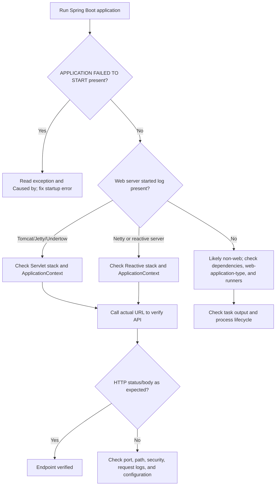

# Reading Startup Logs and Verifying the Application Started as the Right Type

When building your **first Spring Boot project**, successfully running `bootRun` or seeing `BUILD SUCCESSFUL` is not enough to know the application is working properly. You need to read the **logs emitted by Spring Boot**, determine how far startup progressed, identify **which application type** is running, and verify behavior appropriate for that type.

A Spring Boot project can be:

- **Servlet web application**: a Servlet-based web app, typically using Spring MVC with embedded Tomcat.
- **Reactive web application**: a reactive web app, typically using Spring WebFlux with Reactor Netty.
- **Non-web application**: a task runner, background processor, or command-line program that does not open an HTTP server by default.

This lesson guides you through reading real logs by group of signals, verifying with simple commands, and handling situations that are easy to confuse when starting out.

## 1. Distinguish four milestones: build, startup, listening on a port, and working behavior

Treat these four milestones as four separate questions:

| Milestone | Common Signal | Conclusion You Can Draw | What You **Cannot** Conclude Yet |
|---|---|---|---|
| **Build succeeded** | Gradle prints `BUILD SUCCESSFUL` | The Gradle task just executed completed successfully | The web application is listening or APIs respond properly |
| **Spring Boot started** | Log `Started ... in ... seconds` | Spring's startup process reached its recorded completion milestone | Specific HTTP endpoints respond properly; all external dependencies are healthy |
| **Web server opened port** | Log `Tomcat started on port ...` or `Netty started on port ...` | A web server started on the reported port | Clients on external networks can reach it; specific API routes exist |
| **Feature verified** | Calling the endpoint returns the expected HTTP status and body | The tested feature works from the client's perspective | The entire system is bug-free or ready for production |

For a **non-web application**, having no “opened HTTP port” milestone is normal. In that case, inspect startup completion logs, program output logs, and the process exit or running state according to the application's purpose.

Another important point: Spring Boot publishes `ApplicationStartedEvent` before running `ApplicationRunner`/`CommandLineRunner` beans; `ApplicationReadyEvent` appears after runners finish. Therefore, the `Started ...` line is not a guarantee that all post-initialization startup logic has finished. When you need to assess traffic readiness, inspect readiness checks and appropriate endpoints.

## 2. Run the right process and know whose logs you are reading

In a project with the Gradle Wrapper, the typical command is:

**Windows PowerShell:**

```powershell
.\gradlew.bat bootRun
```

**macOS/Linux:**

```bash
./gradlew bootRun
```

These two commands only illustrate running **a project configured with the `bootRun` task**. If working in a Gradle multi-project build, target the right project path or run in the right module; the exact command depends on the project structure.

If you already packaged an executable JAR:

```bash
java -jar build/libs/<application-name>.jar
```

When using `bootRun`, the terminal window may display two sources of information:

1. **Gradle output**, such as `:compileJava`, `:processResources`, `:bootRun`, or build status lines.
2. **Spring Boot runtime logs**, including logger timestamps, INFO/WARN/ERROR levels, logging class, and startup messages.

When running directly with `java -jar`, you normally see runtime logs without Gradle task progress lines.

Abbreviated, illustrative log example:

```text
> Task :bootRun

  .   ____          _            __ _ _
 /\\ / ___'_ __ _ _(_)_ __  __ _ \ \ \ \
( ( )\___ | '_ | '_| | '_ \/ _` | \ \ \ \
 \\/  ___)| |_)| | | | | || (_| |  ) ) ) )
  '  |____| .__|_| |_|_| |_\__, | / / / /
 =========|_|==============|___/=/_/_/_/

2026-11-13 09:15:20.101  INFO  ... DemoApplication : Starting DemoApplication using Java 21
2026-11-13 09:15:20.104  INFO  ... DemoApplication : No active profile set, falling back to 1 default profile: "default"
2026-11-13 09:15:20.815  INFO  ... TomcatWebServer : Tomcat initialized with port 8080 (http)
2026-11-13 09:15:21.213  INFO  ... TomcatWebServer : Tomcat started on port 8080 (http) with context path ''
2026-11-13 09:15:21.230  INFO  ... DemoApplication : Started DemoApplication in 1.735 seconds (process running for 2.104)
```

Timestamps, class/logger names, banner, exact wording, and ordering of some messages **vary by Spring Boot version, libraries, logging configuration, and environment**. Do not write checks assuming every run outputs the exact same characters as this example.

In the log above, different signals carry different meanings:

- `Starting DemoApplication using Java 21`: the JVM entered application startup and logged the Java version.
- `No active profile set ... default`: the application is currently using the default profile; this is not an error.
- `Tomcat initialized with port 8080`: server configuration and initialization began; **not yet** proof that it bound the port successfully.
- `Tomcat started on port 8080`: embedded Tomcat started on the stated port.
- `Started DemoApplication in ... seconds`: Spring Boot reports completing the corresponding startup stage.

When reading logs, look for **meaning and keywords** rather than memorizing timestamps or long package names.

## 3. How to read a Spring Boot log line

A typical log line might look like:

```text
2026-11-13 09:15:21.230  INFO  18240 --- [main] com.example.DemoApplication : Started DemoApplication in 1.735 seconds
```

| Part | Meaning | How to Use During Analysis |
|---|---|---|
| `2026-11-13 09:15:21.230` | Log timestamp | Order events chronologically, pinpoint when an error occurred |
| `INFO` | Log level | Normal operational information |
| `18240` | Process ID if shown by the logging pattern | Distinguish running processes |
| `[main]` | Thread name | Know which thread emitted the log |
| `com.example.DemoApplication` | Logger, usually class/package name | Identify the component emitting the log |
| `Started DemoApplication ...` | Event message | Most important part for understanding state |

Common log levels:

- **TRACE/DEBUG**: detailed information for investigation, usually not enabled broadly in daily work.
- **INFO**: startup milestones and normal operation.
- **WARN**: something noteworthy happened; does not mean the application failed.
- **ERROR**: an operation failed; read both cause and impact. An ERROR in one task does not always mean the entire process stopped.

Do not stop at red text or the word `WARN`. Read the **first meaningful exception**, the `Caused by:` chain, and trailing lines indicating whether the application kept running or stopped.

## 4. Identifying the right application type: Servlet, Reactive, or non-web

Spring Boot infers the web application type from classes present on the classpath and startup configuration. The three corresponding `WebApplicationType` values are `SERVLET`, `REACTIVE`, and `NONE`.

This is the **runtime application type**; folder or module names do not determine it automatically. The goal is to confirm the framework started the exact stack you intended to use.

| Application Type | Common Libraries | Typical Log Signals | What to Verify |
|---|---|---|---|
| **Servlet** | `spring-boot-starter-web` / Spring MVC | `Tomcat initialized...` then `Tomcat started on port...` when using default Tomcat | Servlet web server; HTTP endpoints or servlet mappings |
| **Reactive** | `spring-boot-starter-webflux` | `Netty started on port...` when using default Reactor Netty | Reactive web server; WebFlux handlers/routers |
| **Non-web** | No web starter or explicitly set to `NONE` | `Started ...` present, but no web server port-opening logs | Runners, jobs, business processing, or process lifecycle |
 
**Do not infer absolutely from server names alone:** a Servlet app can use Jetty or Undertow instead of Tomcat. WebFlux can also run on other supported environments/servers, not necessarily Reactor Netty. Therefore, server logs are a **strong signal**, while a full conclusion also considers dependencies, configuration, and the `ApplicationContext` type.

### 4.1. Case A: Servlet application with Spring MVC

A basic Spring Boot project typically has the dependency:

```groovy
dependencies {
    implementation 'org.springframework.boot:spring-boot-starter-web'
}
```

When the embedded server is unchanged, the web starter uses Tomcat. You typically see logs such as:

```text
... TomcatWebServer : Tomcat initialized with port 8080 (http)
... TomcatWebServer : Tomcat started on port 8080 (http) with context path ''
... DemoApplication : Started DemoApplication in ... seconds
```

Combining **the right Spring MVC dependency**, **the right Servlet server**, and **a working HTTP endpoint** gives you solid grounds to confirm the application is running in Servlet mode as intended.

You can create a tiny endpoint to verify:

```java
package com.example.demo;

import org.springframework.web.bind.annotation.GetMapping;
import org.springframework.web.bind.annotation.RestController;

@RestController
class HelloController {

    @GetMapping("/hello")
    String hello() {
        return "Hello from Spring Boot";
    }
}
```

Assuming the `@SpringBootApplication` class is in `com.example.demo` or a parent package so component scanning finds the controller, after successful startup open:

```text
http://localhost:8080/hello
```

Or in the terminal:

```bash
curl -i http://localhost:8080/hello
```

Expected response, when no extra security or route-blocking rules are active:

```http
HTTP/1.1 200
Content-Type: text/plain;charset=UTF-8

Hello from Spring Boot
```

Successfully connecting and receiving the **expected status and body** confirms the endpoint works. The `Started` log only proves the application reached a startup milestone.

### 4.2. Case B: Reactive application with Spring WebFlux

A typical reactive application uses:

```groovy
dependencies {
    implementation 'org.springframework.boot:spring-boot-starter-webflux'
}
```

With default Reactor Netty, logs typically contain:

```text
... NettyWebServer : Netty started on port 8080 (http)
... DemoApplication : Started DemoApplication in ... seconds
```

Example reactive-style controller:

```java
package com.example.demo;

import org.springframework.web.bind.annotation.GetMapping;
import org.springframework.web.bind.annotation.RestController;
import reactor.core.publisher.Mono;

@RestController
class ReactiveHelloController {

    @GetMapping("/hello")
    Mono<String> hello() {
        return Mono.just("Hello from WebFlux");
    }
}
```

Just like Servlet, you can call `GET /hello` to test the route. From an HTTP client's perspective, both applications can return the exact same kind of response; **seeing a 200 response alone does not tell you whether the server is MVC or WebFlux**. Cross-check dependencies, `ApplicationContext` type, and server logs.

One common source of confusion: if a project places both `spring-boot-starter-web` and `spring-boot-starter-webflux` on the classpath, Spring Boot **typically prioritizes Servlet/MVC by default** because many MVC projects include WebFlux's `WebClient`. Simply adding `Mono` or `WebClient` does not switch the entire application to Reactive.

### 4.3. Case C: Non-web application

A project without a Spring MVC/WebFlux web stack, or explicitly configured with `spring.main.web-application-type=none`, can start the Spring context **without opening an HTTP server**.

Example program printing a message on run:

```java
package com.example.demo;

import org.springframework.boot.CommandLineRunner;
import org.springframework.boot.SpringApplication;
import org.springframework.boot.autoconfigure.SpringBootApplication;
import org.springframework.context.annotation.Bean;

@SpringBootApplication
public class ConsoleApplication {

    public static void main(String[] args) {
        SpringApplication.run(ConsoleApplication.class, args);
    }

    @Bean
    CommandLineRunner sayHello() {
        return args -> System.out.println("Job executed successfully");
    }
}
```

Illustrative log:

```text
... ConsoleApplication : Starting ConsoleApplication using Java 21
... ConsoleApplication : No active profile set, falling back to 1 default profile: "default"
... ConsoleApplication : Started ConsoleApplication in 0.9 seconds
Job executed successfully
```

Not seeing `Tomcat started` or `Netty started` is normal for this application. If no non-daemon threads keep the JVM alive, the program can **exit right after completing its task**. For CLIs/jobs, check the task output and exit code; do not use “is `localhost:8080` reachable?” as a success check.

Conversely, if you intended to build a REST API yet the logs only show `Started ...` with no web server and the process exits immediately, check your web dependencies and `spring.main.web-application-type`.

## 5. Verifying via runtime info: ApplicationContext

When server logs are not clear enough, you can inspect which Spring context type was created. To observe it in an exercise, add the following `ApplicationRunner` bean:

```java
package com.example.demo;

import org.springframework.boot.ApplicationRunner;
import org.springframework.context.ApplicationContext;
import org.springframework.context.annotation.Bean;
import org.springframework.context.annotation.Configuration;

@Configuration
class ContextInspectionConfiguration {

    @Bean
    ApplicationRunner printApplicationContext(ApplicationContext context) {
        return args -> System.out.println(
                "ApplicationContext type: " + context.getClass().getName()
        );
    }
}
```

When this bean is scanned and initialized, you may see classes such as:

| Common Actual Type | Meaning |
|---|---|
| `AnnotationConfigServletWebServerApplicationContext` | Spring Boot web application with a Servlet web server |
| `AnnotationConfigReactiveWebServerApplicationContext` | Spring Boot reactive web application with a reactive web server |
| `AnnotationConfigApplicationContext` | Standard Spring application context without an embedded web server |

The exact class name depends on how the context is created and configured. This is a **learning observation technique**, not something requiring `System.out.println` in every production application; in real applications, use structured logging or appropriate operational tooling.

Also distinguish: a **bean using Reactor `Mono` or `Flux`** does not prove the whole application runs WebFlux. What we are confirming is **which Spring application/web stack was actually selected**.

## 6. Checking port, paths, and profiles

### 6.1. Do not assume port 8080 is always used

By default, a Spring Boot web app usually uses HTTP port **8080** if unconfigured. However, the port can be changed via `application.yml`, environment variables, or startup arguments.

Example **Servlet** configuration:

```yaml
server:
  port: 9090
  servlet:
    context-path: /demo
```

Then a controller mapped to `/hello` will have the URL:

```text
http://localhost:9090/demo/hello
```

In startup logs, look for the **actual** port and context path applied; continuing to test `http://localhost:8080/hello` will lead to the wrong conclusion.

In WebFlux, `server.port` also configures the HTTP port, whereas **`server.servlet.context-path` is a Servlet-specific setting**, not the general way to configure a base path for a Reactive app; use WebFlux's appropriate base path/routing configuration instead.

Some applications also expose a separate **management port** for Actuator. In that case, `/actuator/health` may use a different port from the main API, depending on configuration.

### 6.2. Reading the active profile

Spring Boot can load profile-specific configuration: `dev`, `test`, `prod`, etc. Example configuration:

```yaml
spring:
  profiles:
    active: dev
```

Logs may state:

```text
The following 1 profile is active: "dev"
```

Profiles affect databases, log levels, endpoints, ports, and conditional beans. If you expect `dev` configuration to run yet the log reports the default profile, check configuration sources and startup arguments.

**Clarify clearly:**

- `No active profile set ... "default"` is a normal informational line when no specific profile is active.
- `The following ... profile is active` indicates which profile is selected.
- A loaded profile **does not automatically guarantee** every property in that profile is correct; still verify the actual port and runtime behavior.

### 6.3. Testing endpoints with the right tool

In Windows PowerShell, `curl` may be an alias for `Invoke-WebRequest` in some environments. To invoke the real `curl` program, use:

```powershell
curl.exe -i http://localhost:8080/hello
```

On macOS/Linux:

```bash
curl -i http://localhost:8080/hello
```

If you do not have a `/hello` endpoint, replace the path with a route that actually exists. Inspect the **status**, **necessary headers**, and **response body**; do not just check whether the terminal printed something.

If the app includes **Spring Security**, `401 Unauthorized` or `403 Forbidden` indicates the web server is indeed accepting requests, while security policy denied access. Do not interpret these two statuses as “Spring Boot has not started.”

## 7. Actuator: checking health when supported by the project

A web application can enable Spring Boot Actuator to expose operational information. Example dependency:

```groovy
dependencies {
    implementation 'org.springframework.boot:spring-boot-starter-actuator'
}
```

With appropriate default configuration, the health endpoint is usually at:

```text
GET /actuator/health
```

An illustrative response:

```json
{
  "status": "UP"
}
```

The health endpoint is useful for checking application status or configured health indicators. Still, understand its limits:

- **`UP` does not mean every business feature has been tested and passed.** It reflects only the indicators evaluated by the health endpoint.
- If Actuator has not been added, the endpoint is not exposed, or it is secured, you may receive `404`, `401`, or `403`; inspect configuration rather than concluding the app is dead.
- **Liveness** indicates whether the process should keep running or be restarted; **readiness** indicates whether the process is ready to accept traffic. These two purposes should not be conflated.
- Probe endpoints like `/actuator/health/liveness` and `/actuator/health/readiness` depend on probe configuration and runtime environment; do not assume they always exist in every project.

For example, in Spring Boot with Actuator, when enabling health probes in a practice environment outside Kubernetes:

```yaml
management:
  endpoint:
    health:
      probes:
        enabled: true
```

In a first-project lesson, calling a custom endpoint like `/hello` remains very valuable: it confirms **your controller and HTTP routing actually work**, alongside health status.

## 8. When startup logs look like errors: how to read the message

Sometimes the console prints lots of red lines, making it hard for beginners to find the cause. Effective way to read them:

1. Find **`APPLICATION FAILED TO START`** or the exception line showing startup halted.
2. Identify which component failed: web server, dependency injection, datasource, property configuration, initializing bean...
3. Read **`Caused by:`** and specific root-cause messages; many stack traces are just consequences of the underlying error.
4. Distinguish **startup** errors from **per-request** errors occurring after the application is already running.
5. After fixing, restart the application and verify **both startup signals and actual runtime behavior**.

### 8.1. Port already used by another process

Illustrative log:

```text
APPLICATION FAILED TO START

Description:
Web server failed to start. Port 8080 was already in use.
```

Meaning: the application tried to bind port 8080 but could not. This **does not mean** controller code is wrong; another process may be holding the port, including a previously started copy of your app.

How to resolve: identify the process using the port, stop any unneeded process, or change `server.port` for the new instance. Do not arbitrarily kill every running Java process on sight, as they may serve other projects.

### 8.2. Missing bean or unsatisfied dependency injection

Logs may contain:

```text
APPLICATION FAILED TO START

Parameter 0 of constructor in ... required a bean of type ...
that could not be found.
```

Meaning: Spring could not find a required bean to construct a component. Check annotations, component scanning, `@Bean` configuration, and bean creation conditions. The server may not have opened a port yet; calling a URL at this stage will not help pinpoint the root cause.

### 8.3. Invalid datasource configuration

Example:

```text
Failed to configure a DataSource: 'url' attribute is not specified
```

When a project includes data starters and Spring attempts to configure a DataSource, a missing driver, URL, or configuration can cause startup to fail. Do not ignore this error just because the lesson focuses on REST APIs; the application must initialize required beans before serving requests.

### 8.4. Application reports Started, yet HTTP returns 404

`404 Not Found` normally indicates **the request reached an HTTP server, but no matching handler/resource was found**. Common causes:

- Calling the wrong path, wrong HTTP method, or wrong context path.
- `@RestController` lies outside component scanning scope.
- Running **a different application** on the port you are calling.
- Expecting `/` to work when only `/api/hello` was defined.

If the request cannot connect at all, the error is usually **connection refused**, **timeout**, or a network error, not `404`. Distinguish **HTTP routing** errors from **connection** errors.

### 8.5. Seeing Netty logs when you expected MVC

Check dependencies: did the project add `spring-boot-starter-webflux` and omit `spring-boot-starter-web`? Did it set `spring.main.web-application-type` or configure another server? Is another application's process writing to the same terminal/container log?

The goal is not “swap Netty for Tomcat at all costs,” but to confirm the application is running the **intended stack**.

## 9. Distinguish started, ready, and externally reachable

An application may report:

```text
Tomcat started on port 8080
Started DemoApplication in 2.1 seconds
```

yet a client on another machine cannot reach it. This can stem from:

- The server only bound to a loopback address or an interface different from the one the client used.
- Firewalls, container port mappings, Kubernetes Services/Ingress, or proxies not configured properly.
- Client using the wrong host/port, HTTP instead of HTTPS, or the wrong context path.
- Endpoint requiring authentication, or a business dependency failing even while the server keeps listening.
- An `ApplicationRunner`/`CommandLineRunner` performing slow work or failing after the `Started` log milestone.

Thus, there are three practical verification layers:

**Layer 1 — Inside the process:** Appropriate startup logs, no errors stopping the app, right context type.

**Layer 2 — On the host running the app:** The HTTP server opens a port and `curl` on that machine reaches the expected endpoint (or the non-web task executes properly).

**Layer 3 — From a real client:** Traffic flows across network, gateway, container mapping, and security as designed.

The first-project lesson primarily completes **Layer 1 and Layer 2**. When deploying to servers/containers/cloud, Layer 3 is also required.

## 10. A log-based reasoning flowchart



This diagram is an **approach**, not an absolute set of rules. With non-default embedded servers or customized logging, use dependencies and context type to confirm.

## 11. Practice: verifying your first project end to end

Suppose your goal is a **Spring MVC REST API**.

### Step 1. Define the target before running

Specific target:

- Uses Spring Boot with `spring-boot-starter-web`.
- Runs Servlet/MVC.
- HTTP server listens on `localhost:8080`, unless configured otherwise.
- `GET /hello` returns the string `Hello from Spring Boot`.

If your goal is WebFlux or a console job, substitute the corresponding criteria from Section 4.

### Step 2. Run the project and inspect startup signals

Use `bootRun` or an appropriate executable JAR. Read messages about Java version, active profile, server, and the `Started` line. If `APPLICATION FAILED TO START` appears, resolve the error before checking HTTP.

### Step 3. Confirm the web stack type

For Servlet/MVC using default Tomcat, `Tomcat started on port...` is a positive signal. If logs show Netty or no web server, check dependencies and `spring.main.web-application-type`. When you need certainty, print the `ApplicationContext` class as shown in Section 5.

### Step 4. Call the endpoint with an HTTP client

In a second terminal, run:

```powershell
curl.exe -i http://localhost:8080/hello
```

Verify status `200` and the returned string. If incorrect, check URL, HTTP method, security, and request logs.

### Step 5. Understand the shutdown lifecycle

When running `bootRun`, a web application usually stays alive to serve requests until stopped. Press `Ctrl+C` in the running terminal to request shutdown. If a non-web application exits right away, that may be valid behavior. Distinguish **intentional stop** from **exception crash** via logs and exit status.

### Step 6. Re-verify after changing configuration

Change the port from `8080` to `9090` in configuration, restart, observe the logs, and test:

```powershell
curl.exe -i http://localhost:9090/hello
```

This exercise demonstrates that logs reflect the **applied runtime configuration**, helping avoid relying on the default port out of habit.

## 12. Three scenarios to explain on your own

**Scenario A**

```text
... Tomcat started on port 8080 (http) with context path ''
... Started CatalogApplication in 1.8 seconds
GET /products/123 -> HTTP 200
```

Explanation: the application started successfully and an HTTP endpoint is responding. With matching MVC/Servlet dependencies, this is strong evidence that the Servlet web app runs as expected. You still cannot conclude from this alone that every endpoint or dependency is healthy.

**Scenario B**

```text
... Started BatchApplication in 0.8 seconds
Processed 250 records
[process exited with code 0]
```

Explanation: if the project is intentionally a non-web batch job, having no Tomcat/Netty is completely normal. Success here means completing the task and exiting with the expected code; there is no HTTP endpoint to call.

**Scenario C**

```text
... Tomcat initialized with port 8080 (http)
... Web server failed to start. Port 8080 was already in use.
... APPLICATION FAILED TO START
```

Explanation: `initialized` is not `started`. The application failed while opening the port; resolve the port conflict before drawing conclusions about controller functionality.

### Questions you should be able to answer after this lesson

1. How do `BUILD SUCCESSFUL` and `Started MyApplication` describe different phases?
2. Why does `Tomcat initialized` not yet prove the HTTP server is listening?
3. When does `Netty started` indicate WebFlux, and why should you cross-check dependencies and `ApplicationContext`?
4. Why can a non-web application starting and exiting immediately be completely valid?
5. For HTTP `404`, `401`, `connection refused`, and `timeout`, which groups of causes would you investigate?
6. If an application uses port `9090` and context path `/demo`, which URL would you check for a `/hello` controller?
7. Why do `Started` and health `UP` not replace verifying specific business behavior?

## 13. Practical conclusion

Reading Spring Boot startup logs means reading **state milestone by milestone**, not searching for a single line containing the word “success.”

- For **Servlet/MVC**, check classpath/configuration, Servlet server port-opening logs, and correct HTTP endpoint responses.
- For **Reactive/WebFlux**, cross-check the reactive stack, reactive server logs, and HTTP results.
- For **non-web**, check the Spring context, runners, task results, and process lifecycle; do not wait for port-opening logs.
- When errors appear, find what stopped startup first; when the server is running yet APIs fail, focus on port, routing, security, and request handling.

The most important habit in your first project is: **know which application type is expected, read logs to identify the actual runtime type, and verify with observable behavior**.
