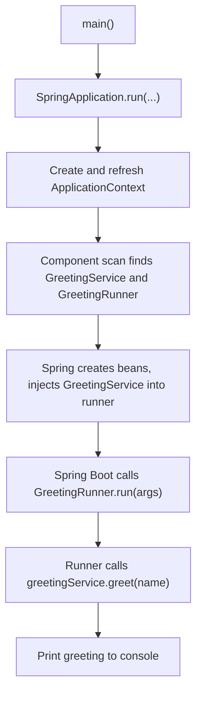
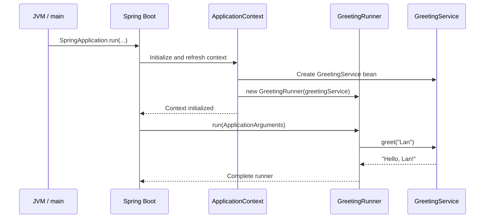

# Registering a Service and Calling It from ApplicationRunner

In your first Spring Boot project, you can verify that **Spring manages an object and automatically passes it to where it is needed** without setting up a REST API, database, or UI yet. This hands-on lesson creates a `GreetingService` containing greeting logic, registers it as a Spring *bean*, and invokes it from an `ApplicationRunner` when the application starts.

After this lesson, you will be able to:

- Write a simple service annotated with `@Service` and explain why Spring can create the bean.
- Use **constructor injection** to pass a service into another class without calling `new`.
- Explain when `ApplicationRunner.run(...)` executes and how it receives command-line arguments.
- Recognize errors caused by an unregistered bean, a package outside the scan scope, or an unsatisfied dependency.
- Distinguish registering a bean with `@Service` from explicitly registering one via `@Bean`.

Examples use Java 21, Spring Boot 3.x, Gradle, and the root package `com.example.demo`. If you already have a Spring Boot project with a different package, update the package name consistently across all code snippets.

## 1. The big picture: three distinct roles

The application will have exactly three main components:

| Component | Role | Who Calls or Creates It? |
|---|---|---|
| `DemoApplication` | Program entry point, bootstraps Spring Boot | JVM calls `main`; `SpringApplication` creates the context |
| `GreetingService` | Contains greeting creation logic | Spring detects `@Service` and manages the bean |
| `GreetingRunner` | Runs a small task after context initialization | Spring Boot calls `run(...)` per the `ApplicationRunner` contract |

Basic execution flow:



Key distinction: **the service holds business logic; the runner only triggers that logic at startup**. This separation lets you call the same service later from a controller, scheduler, or another component without moving logic out of the runner.

## 2. Preparing a project without a web server

Create a project using Spring Initializr or reuse a newly created Spring Boot project with:

- Project: Gradle (Groovy DSL).
- Language: Java; JDK 21.
- Spring Boot: a 3.x branch suited to your study environment.
- Group: `com.example`; Artifact: `demo`.
- Base dependency: `spring-boot-starter`. You can also include `spring-boot-starter-test` if you want to run the test at the end of the lesson.

In the `build.gradle` generated by Initializr, the dependencies block for this lesson can look like:

```groovy
dependencies {
    implementation 'org.springframework.boot:spring-boot-starter'
    testImplementation 'org.springframework.boot:spring-boot-starter-test'
}
```

This is the **dependencies snippet**, not the full Gradle file; keep the Spring Boot plugin, dependency management, repositories, toolchain, and other settings generated by Initializr. The core starter is enough for component scanning, dependency injection, and `ApplicationRunner`. This lesson does not need `spring-boot-starter-web`, so no HTTP server will start.

File structure we will create:

```text
demo/
├── build.gradle
├── settings.gradle
├── gradlew
├── gradlew.bat
└── src/
    ├── main/
    │   ├── java/com/example/demo/
    │   │   ├── DemoApplication.java
    │   │   ├── GreetingService.java
    │   │   └── GreetingRunner.java
    │   └── resources/
    │       └── application.properties
    └── test/
        └── java/com/example/demo/
            └── GreetingServiceIntegrationTest.java  (optional)
```

`application.properties` can remain empty in this lesson. The main Java files should stay in the same `com.example.demo` package so default component scanning works predictably.

## 3. Creating the entry point: `DemoApplication`

File `src/main/java/com/example/demo/DemoApplication.java`:

```java
package com.example.demo;

import org.springframework.boot.SpringApplication;
import org.springframework.boot.autoconfigure.SpringBootApplication;

@SpringBootApplication
public class DemoApplication {

    public static void main(String[] args) {
        SpringApplication.run(DemoApplication.class, args);
    }
}
```

`main(String[] args)` is a standard Java method. `SpringApplication.run(...)` launches Spring Boot and creates an `ApplicationContext`, which stores bean metadata and manages bean creation, dependency wiring, and lifecycles.

`@SpringBootApplication` includes **component scanning**: by default, Spring scans the package containing `DemoApplication` and all of its subpackages. Therefore, classes annotated with `@Service` or `@Component` placed under `com.example.demo` are discovered when the application starts.

You do not need to call `new GreetingService()` inside `main`. Spring handles creating and supplying the service.

## 4. Writing a service and registering it with `@Service`

File `src/main/java/com/example/demo/GreetingService.java`:

```java
package com.example.demo;

import org.springframework.stereotype.Service;

@Service
public class GreetingService {

    public String greet(String name) {
        String recipient = (name == null || name.isBlank())
                ? "friend"
                : name.trim();

        return "Hello, " + recipient + "!";
    }
}
```

Read each part:

1. `GreetingService` is a **plain Java class**; the `greet` method takes a name and returns a string. This processing logic does not depend on Spring itself.
2. `@Service` is a specialization of `@Component`, indicating that this class belongs to the business/service layer and is a candidate for component scanning.
3. When the scan scope covers this class, Spring registers a bean definition for `GreetingService` and creates the bean during normal context initialization.
4. By default, beans of this kind have **singleton** scope within an `ApplicationContext`, meaning components requesting the bean normally receive the same context-managed instance.

What matters is not the greeting string inside `greet`, but **who manages the instance of `GreetingService`**. If you write `new GreetingService()`, you have an isolated Java object; when registered as a Spring bean, the framework can find and inject it wherever needed.

The class name and annotation also have two distinct roles: a class can be named `GreetingService` without `@Service`, yet without the annotation (or another bean registration), Spring will not know what instance to supply to the runner.

## 5. Creating `ApplicationRunner` and injecting the service via constructor

File `src/main/java/com/example/demo/GreetingRunner.java`:

```java
package com.example.demo;

import java.util.List;

import org.springframework.boot.ApplicationArguments;
import org.springframework.boot.ApplicationRunner;
import org.springframework.stereotype.Component;

@Component
public class GreetingRunner implements ApplicationRunner {

    private final GreetingService greetingService;

    public GreetingRunner(GreetingService greetingService) {
        this.greetingService = greetingService;
    }

    @Override
    public void run(ApplicationArguments args) {
        List<String> names = args.getOptionValues("name");
        String name = (names == null || names.isEmpty())
                ? "Spring Boot"
                : names.get(0);

        String message = greetingService.greet(name);
        System.out.println(message);
    }
}
```

This class participates in two mechanisms:

**First, it is a Spring bean.** The `@Component` annotation puts `GreetingRunner` into component scanning. When instantiating the runner, Spring sees the constructor needs a `GreetingService`, finds the matching bean, and passes it in. This is **constructor injection**, a form of *dependency injection (DI)*.

**Second, it implements `ApplicationRunner`.** This is a Spring Boot interface with the method:

```java
void run(ApplicationArguments args) throws Exception;
```

After the context is initialized and the application completes its startup setup, Spring Boot calls `run(...)` on `ApplicationRunner` beans. Thus we do not call `run` manually in `main`.

The single constructor of `GreetingRunner` does not require `@Autowired`. In modern Spring, when a bean has only one constructor, Spring automatically uses that constructor for dependency injection without needing the annotation.

### Why is the field `private final`?

`private final GreetingService greetingService` expresses that the dependency is mandatory when constructing the runner and will not be reassigned afterward. It makes the class's contract explicit: **the runner cannot operate validly without the service**.

If no matching `GreetingService` bean exists, creating the runner fails immediately at startup rather than failing later when `run(...)` dereferences a `null` field.

### What does `ApplicationArguments` contain?

`ApplicationArguments` is created by Boot from the program's command-line arguments. It distinguishes:

| Command Received by App | How Accessed in Runner | Illustrative Result |
|---|---|---|
| No arguments | `getOptionValues("name")` | `null`, falls back to default name |
| `--name=Lan` | `getOptionValues("name")` | List containing `Lan` |
| `--name=Lan --name=Minh` | `getOptionValues("name")` | List containing two values; example uses the first |
| `Lan` (without `--` prefix) | `getNonOptionArgs()` | List containing `Lan` |

The current code reads **the option named `name`**, so a non-option argument `Lan` will not be used as the greeting recipient. `getOptionValues` can return `null` when the option is absent; checking `null` and emptiness avoids errors when running with no arguments. `GreetingService` also handles blank names, so `--name=` produces a greeting addressed to “friend”.

## 6. First run and verifying the call flow

Open a terminal in the project root directory where the Gradle Wrapper is located.

On Linux or macOS:

```bash
./gradlew bootRun
```

On Windows PowerShell:

```powershell
.\gradlew.bat bootRun
```

Among the startup logs, look for the line printed by the runner itself:

```text
Hello, Spring Boot!
```

With a command-line argument:

```bash
# Linux/macOS
./gradlew bootRun --args='--name=Lan'
```

```powershell
# Windows PowerShell
.\gradlew.bat bootRun --args="--name=Lan"
```

Line printed by the application:

```text
Hello, Lan!
```

In the terminal, you will also see framework and Gradle logs. What needs to be verified here is **the greeting line printed because `GreetingRunner.run(...)` called `GreetingService.greet(...)`**, rather than a built-in Spring Boot message.

Because this lesson only uses `spring-boot-starter` and has no web server or long-running task keeping the process alive, the application exits normally right after running the runner. That is expected behavior for a program running a short startup task, not a server error.

## 7. Tracing exactly who creates and who calls

You wrote no code like:

```java
GreetingService service = new GreetingService();
GreetingRunner runner = new GreetingRunner(service);
runner.run(...);
```

Yet the greeting still appeared. The causal chain is:

1. The JVM calls `DemoApplication.main(...)`.
2. `SpringApplication.run(...)` initializes the Spring context.
3. Component scanning finds `GreetingService` via `@Service` and `GreetingRunner` via `@Component` within package scope.
4. Spring registers and instantiates the required beans; `GreetingRunner`'s constructor receives the `GreetingService` bean.
5. After context refresh, Boot identifies the runner as an `ApplicationRunner` bean and calls `run(...)`.
6. `GreetingRunner` reads the `name` argument, calls the service, and prints the returned string.

Corresponding sequence diagram:



The exact order in which Spring creates **all** beans in an application is not necessarily identical to the diagram above. The diagram focuses on the required dependency: to construct and use `GreetingRunner`, Spring must supply `GreetingService`. `ApplicationRunner` is invoked after the context is ready according to Boot's startup phases.

### How do Bean, IoC, and DI relate?

| Concept | Explained Using Current Example |
|---|---|
| **Bean** | An instance like `GreetingService` registered and managed by the Spring context. |
| **IoC (Inversion of Control)** | Application code delegates object creation/management and dependency wiring to the container. |
| **DI (Dependency Injection)** | The container passes `GreetingService` into `GreetingRunner`'s constructor. |
| **Component scanning** | Mechanism that discovers classes carrying eligible annotations in scanned packages. |
| **ApplicationRunner** | Contract for a bean that executes logic after context initialization. |

`@Service` **does not call `greet` by itself**; it only declares the bean's role. `ApplicationRunner` **does not instantiate the service**; the runner receives the service supplied by Spring. That is the core separation of responsibilities in this lesson.

## 8. Making intentional changes to understand the mechanics

### Experiment A: remove `@Service`

Temporarily remove `@Service` from `GreetingService` while keeping `GreetingRunner` unchanged. When re-running, Spring no longer has a `GreetingService` bean created by component scanning. The runner is still discovered, yet Spring cannot satisfy its constructor parameter:

```text
Parameter 0 of constructor in ...GreetingRunner
required a bean of type '...GreetingService'
that could not be found.
```

This is a **typical error illustration**; exact log wording may differ across versions. Root cause: the service is not registered as a bean. Restore `@Service` and run again to see the error disappear.

Key takeaway: a class existing in source code does not mean Spring has a bean for that class.

### Experiment B: remove `@Component` from the runner

Keep `@Service` but remove `@Component` from `GreetingRunner`. Without another way to register the runner, Spring does not create a runner bean, so Boot has no `ApplicationRunner` bean to invoke. The application starts and exits **without printing any greeting**.

Restore `@Component`. This experiment shows that implementing `ApplicationRunner` only defines how to run; **the implementing object must be a bean** for Boot to invoke it.

### Experiment C: move the service outside the component scan scope

Suppose `DemoApplication` lives in `com.example.demo`, and you move `GreetingService` to `com.example.other` and update the import in the runner. Because `com.example.other` is not under `com.example.demo`, default component scanning does not find the service. You will get an injection failure similar to Experiment A.

Recommended layout for small projects:

```text
com.example.demo
├── DemoApplication
├── service
│   └── GreetingService
└── runner
    └── GreetingRunner
```

When organizing into `com.example.demo.service` and `com.example.demo.runner`, remember to update `package` and `import` statements accordingly. Placing the main class in a **top-level root package above** application components is simpler than arbitrarily expanding `@ComponentScan`.

### Experiment D: change data without editing the runner

Modify `greet` in the service to:

```java
public String greet(String name) {
    String recipient = (name == null || name.isBlank())
            ? "friend"
            : name.trim();
    return "Nice to meet you, " + recipient + "!";
}
```

Run with `--name=Lan` again; the runner prints `Nice to meet you, Lan!` without changing a single line in the runner. That demonstrates **successful separation of concerns**: the runner handles timing and input, while the service handles business logic.

## 9. Second registration approach: using `@Bean`

`@Service` works very well for business classes you own. However, Spring also lets you register beans via `@Bean` methods inside a configuration class. To see the difference, try this as an **alternative variation**, not alongside the existing `@Service` annotation.

Step 1: remove `@Service` and its import from `GreetingService`, keeping the class and `greet` method intact.

Step 2: create `src/main/java/com/example/demo/GreetingConfiguration.java`:

```java
package com.example.demo;

import org.springframework.context.annotation.Bean;
import org.springframework.context.annotation.Configuration;

@Configuration(proxyBeanMethods = false)
public class GreetingConfiguration {

    @Bean
    public GreetingService greetingService() {
        return new GreetingService();
    }
}
```

Step 3: keep `GreetingRunner` unchanged and run again. The greeting is still printed.

Explanation:

- Spring detects `GreetingConfiguration` via component scanning because the class has `@Configuration`.
- The `greetingService()` method is treated by Spring as a factory method: **the returned object is registered as a `GreetingService` bean**.
- When creating `GreetingRunner`, Spring still finds the bean by type `GreetingService` and injects it via the constructor.
- Calling `new GreetingService()` **inside a `@Bean` method** is valid because the resulting instance is handed to the container to manage; unlike instantiating an object outside the context for local use only.

Comparing the two approaches:

| `@Service` | `@Bean` |
|---|---|
| Annotation placed on the business class. | Annotation placed on a factory method in configuration. |
| Bean discovered via component scanning. | Bean registered from the configuration method's return value. |
| Convenient for services you write yourself; easy package layering. | Useful when integrating third-party library classes or controlling instantiation. |
| No separate factory method needed. | Can accept dependencies as parameters to the factory method if needed. |

In this example, do not keep both `@Service` and `@Bean` creating the same service type without reason. Two beans of the same type can make type-based injection ambiguous or dependent on bean names/qualifiers. Use **one** approach for the basic exercise; if returning to the initial version, restore `@Service` and delete `GreetingConfiguration`.

## 10. How does `ApplicationRunner` differ from `CommandLineRunner`?

Spring Boot provides two familiar interfaces for running logic after context initialization:

| | `ApplicationRunner` | `CommandLineRunner` |
|---|---|---|
| Method | `run(ApplicationArguments args)` | `run(String... args)` |
| How arguments are received | Already parsed into option and non-option args. | Receives raw string array. |
| Best suited when | You want `--name=Lan` by key `name`. | You only need to iterate or process raw argument strings directly. |
| Prerequisite for Boot to call it | Implementation must be registered as a Spring bean. | Same. |

Conceptually equivalent `CommandLineRunner` example:

```java
@Component
public class RawArgsRunner implements CommandLineRunner {

    private final GreetingService greetingService;

    public RawArgsRunner(GreetingService greetingService) {
        this.greetingService = greetingService;
    }

    @Override
    public void run(String... args) {
        System.out.println(greetingService.greet("Spring Boot"));
    }
}
```

To compile this variation, import `org.springframework.boot.CommandLineRunner` and `org.springframework.stereotype.Component`; place the class in `RawArgsRunner.java`. If you keep `GreetingRunner` as well, **both runners may be invoked** and print two greeting lines. When comparing them individually, register only one runner temporarily.

When multiple runners exist, Spring Boot supports ordering them with `@Order` or the `Ordered` interface. If one runner depends on another runner's output, design explicit dependencies or coordination rather than assuming Spring invokes runners by file order, class name, or the order you wrote them.

## 11. What should a runner do, and what should it not do?

`ApplicationRunner` fits tasks with a **clear start and finish** right after application startup, such as:

- Printing startup details for learning or diagnostics.
- Validating a critical configuration condition.
- Running a small, safe initialization task with clear error handling.
- Executing a command-line operation in a simple batch-style app.

Conversely, do not put entire business workflows into `run` or use a runner as an infinite loop to “keep the application alive.” In web applications, request handlers belong in controllers and business logic belongs in services. For complex batch jobs needing workflow state, retries, and checkpoints, consider a dedicated batch framework.

**Error handling:** an unhandled exception thrown from a runner can cause Spring Boot startup to fail. If a runner calls a database, network, or external service, decide explicitly whether a failure there should block startup. For this first lesson, keep the runner simple with no side effects beyond console output.

**Startup performance:** runners execute during the startup phase. Long-running work here delays when the application becomes ready. That is why long background jobs should not be casually placed inside `ApplicationRunner.run`.

## 12. A small test confirming Spring manages the service

You can add an integration test to verify the `GreetingService` bean actually exists in the context. File `src/test/java/com/example/demo/GreetingServiceIntegrationTest.java`:

```java
package com.example.demo;

import static org.assertj.core.api.Assertions.assertThat;

import org.junit.jupiter.api.Test;
import org.springframework.beans.factory.annotation.Autowired;
import org.springframework.boot.test.context.SpringBootTest;

@SpringBootTest
class GreetingServiceIntegrationTest {

    @Autowired
    private GreetingService greetingService;

    @Test
    void springShouldInjectGreetingService() {
        assertThat(greetingService).isNotNull();
        assertThat(greetingService.greet("Lan"))
                .isEqualTo("Hello, Lan!");
    }
}
```

With the `spring-boot-starter-test` dependency declared, you can run:

```bash
./gradlew test
```

What the test proves:

1. `@SpringBootTest` loads the application context for the test.
2. The `@Autowired` field receives the `GreetingService` bean from the context.
3. Calling the service method returns the greeting matching the initial version's logic.

Note: because the test boots the context, `GreetingRunner` may also run and print a greeting in the test logs; that does not mean the test invoked the runner manually. If you are still on Experiment D or another variation that changed the greeting message, adjust the expected string to match your active code.

This test verifies **Spring wiring**. If you only want to test the `greet` algorithm without Spring, you can simply instantiate `new GreetingService()` in a standalone unit test; that unit test would not prove bean registration.

## 13. Common mistakes in a first project

| Symptom | Common Cause | What to Check |
|---|---|---|
| Missing `GreetingService` bean error at startup | Missing `@Service`/`@Bean`, or service outside component scan scope | Check annotations, root package, and bean registration |
| Application starts but prints no greeting | Runner is not a bean, so Boot does not invoke `run(...)` | Check `@Component` and `implements ApplicationRunner` |
| Java reports `ApplicationRunner` not found | Missing Spring Boot dependency or wrong import | Check `spring-boot-starter` and import `org.springframework.boot.ApplicationRunner` |
| Ran with `--name=Lan` yet still greets default | Argument not forwarded to the app or wrong option name read | Check `bootRun`'s `--args` and the `name` option key |
| Greeting printed twice | Two runners registered or two places calling the service | List beans implementing runner and trace call sites |
| Error: multiple matching `GreetingService` beans | Service registered twice via different mechanisms or configs | Keep one registration method, or use `@Qualifier` when multiple beans are genuinely needed |
| `localhost:8080` does not respond | This lesson has no web starter, so there is no HTTP server | Run from terminal and observe stdout; no HTTP call needed |
| Application exits immediately after printing greeting | No long-running work or web server keeping the process alive | Normal behavior for a startup runner example |

An effective troubleshooting habit is identifying **which phase failed**: failed to compile, Spring failed to create beans, Boot did not invoke the runner, or the runner ran yet produced unexpected output. Each phase has different causes.

## 14. Extended practice exercises

Continue working with the same three initial classes. Progressive tasks:

**Exercise A — Vary message via argument.** Pass `--name=Mai`; confirm the runner still contains no string-concatenation logic for greetings. Greeting formatting belongs entirely in `GreetingService`.

**Exercise B — Call the service twice.** Inside `GreetingRunner.run`, call `greet("Lan")` and `greet("Minh")` sequentially. Explain why you do not need two separate `GreetingService` instances to call it twice.

**Exercise C — Split into subpackages.** Move the service into `com.example.demo.service` and the runner into `com.example.demo.runner`; update imports. Observe that component scanning still works because both packages are under `com.example.demo`.

**Exercise D — Switch registration mechanism.** Remove `@Service`, and use `@Configuration` + `@Bean` to register the service. Keep the runner's constructor unchanged. Explain why the consumer does not need to know whether the bean came from component scanning or a factory method.

**Exercise E — Accept both argument styles.** Add a fallback: if `--name` is absent, try reading the first element of `args.getNonOptionArgs()`; if still empty, fall back to `Spring Boot`. Then both `--name=Lan` and `Lan` produce the same greeting. Do not modify `greet` logic.

Hint for Exercise E inside `run`:

```java
List<String> names = args.getOptionValues("name");
String name;

if (names != null && !names.isEmpty()) {
    name = names.get(0);
} else if (!args.getNonOptionArgs().isEmpty()) {
    name = args.getNonOptionArgs().get(0);
} else {
    name = "Spring Boot";
}

System.out.println(greetingService.greet(name));
```

## 15. Explain the exercise from start to finish on your own

Before moving on, answer these questions aloud:

1. Why is `GreetingService` a bean when annotated with `@Service`, yet not guaranteed to be a bean as a plain Java class?
2. Where does Spring discover `GreetingService` and `GreetingRunner`?
3. When the constructor `GreetingRunner(GreetingService greetingService)` runs, who supplies the service object?
4. Why is `@Autowired` unnecessary on a single constructor?
5. Who invokes `GreetingRunner.run(...)`, and why is implementing `ApplicationRunner` alone insufficient if the runner is not a bean?
6. Why is `ApplicationArguments.getOptionValues("name")` better suited here than manually iterating raw arguments?
7. If switching from `@Service` to `@Bean` leaves the runner working unchanged, what independence does that show between bean **provider** and bean **consumer**?
8. Why is an application that only prints a greeting and exits still a valid Spring Boot application?

You have achieved this lesson's goal when you can trace the full chain **`main` → context → service bean → constructor injection → runner → service method → console**, run the example with your own arguments, and explain at least one missing-bean error by its specific cause. From this foundation, you can reuse the exact service you wrote as the project advances to REST controllers, property configuration, and other application components.
