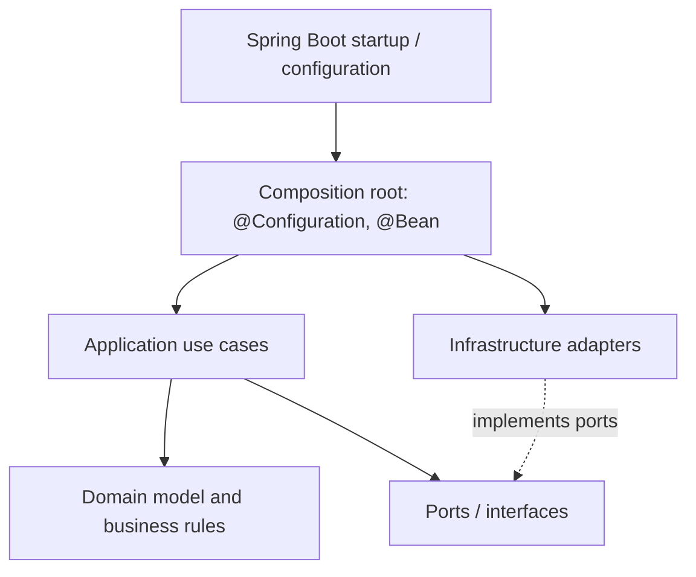
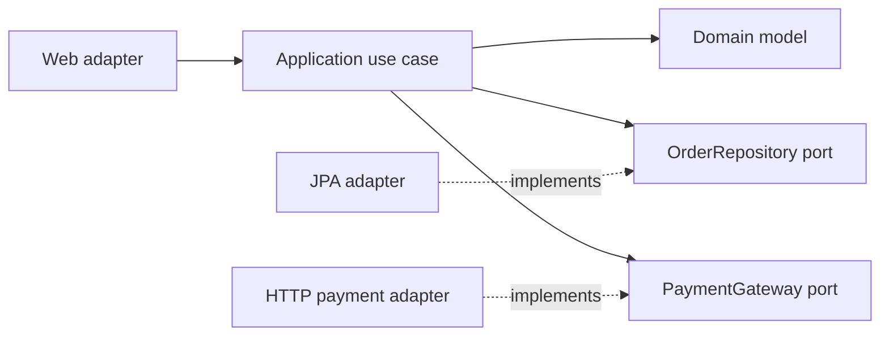
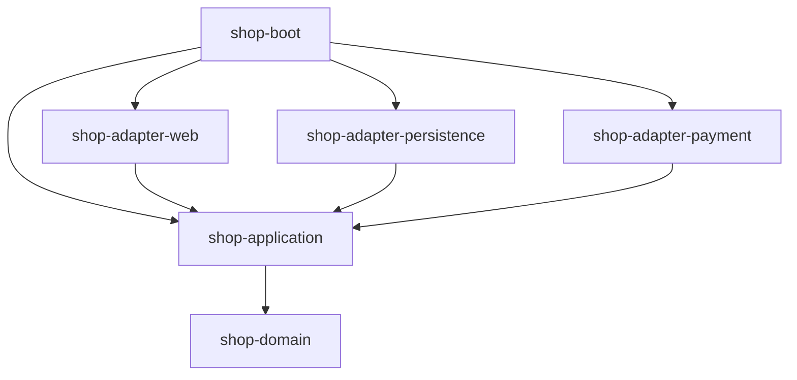

# Separating Business Rules from Spring Initialization and Configuration Mechanisms

> **Spring Boot Fundamentals · Application Design**  
> Spring Boot provides dependency injection, component scanning, auto-configuration, transaction management, and many mechanisms that help an application start up quickly. However, those conveniences should not dictate how a business rule operates. A pricing policy, order acceptance condition, or quantity limit should be understandable, testable, and reusable without starting a Spring ApplicationContext. **Separating business rules from Spring initialization and configuration mechanisms** keeps domain logic stable, easy to test, and less coupled to the framework; Spring still excels at wiring objects together and providing adapters at the application boundary.

## 1. The Problem: Business Rules Mixed with Spring Infrastructure

Consider an order processing service:

```java
@Service
public class OrderService {

    @Autowired
    private OrderRepository repository;

    @Value("\${app.order.max-items:20}")
    private int maxItems;

    public Order place(OrderRequest request) {
        if (request.items().size() > maxItems) {
            throw new IllegalArgumentException(
                    "Too many items");
        }

        Order order = new Order(request.items());
        return repository.save(order);
    }
}
```

This code works, but multiple responsibilities are mixed inside a single class:

- The maximum item count rule.
- Reading configuration from the Spring Environment.
- Dependency injection.
- Creating the domain object.
- Calling the persistence repository.
- Potentially adding transactions, logging, or event publishing in future versions.

When a business rule directly depends on `@Value`, `@Autowired`, or the Spring context, even testing a simple condition may require starting Spring. When switching frameworks or reusing the same logic in a batch job or CLI, the business code drags along the application's initialization mechanism.

A clearer design is:



Spring creates and wires objects at the composition root. Business rules live in the domain/application model and are invoked through explicit dependencies.

### 1.1. Distinguishing Business Rules from Framework Concerns

| Responsibility Type | Example | Appropriate Place |
| --- | --- | --- |
| Business rule | An order must have at least one order line | Domain model |
| Business policy | VIP customers receive conditional discounts | Domain policy/service |
| Use case orchestration | Load order, apply policy, save result | Application service |
| Object graph initialization | Choose the repository implementation | Spring configuration |
| Reading deployment configuration | Database URL, endpoint, timeout | Configuration/properties |
| Database communication | SQL, JPA, persistence mapping | Infrastructure adapter |
| HTTP request mapping | URL, query parameter, response | Web adapter/controller |
| Transaction management | Begin/commit/rollback | Application boundary/infrastructure |

Not every class with a Spring annotation is wrong. An application service using `@Service` or `@Transactional` can be a pragmatic choice. The goal is to ensure **core business rules do not need Spring to exist and be tested**.

## 2. Separating by Responsibility, Not Just by Package

A reference structure:

```text
src/main/java/com/example/shop/
├── domain/
│   ├── order/
│   │   ├── Order.java
│   │   ├── OrderLine.java
│   │   ├── OrderId.java
│   │   └── OrderPricingPolicy.java
│   └── customer/
│       └── Customer.java
├── application/
│   ├── order/
│   │   ├── PlaceOrderUseCase.java
│   │   ├── PlaceOrderService.java
│   │   └── PlaceOrderCommand.java
│   └── port/
│       ├── OrderRepository.java
│       └── PaymentGateway.java
├── adapter/
│   ├── in/
│   │   └── web/OrderController.java
│   └── out/
│       ├── persistence/JpaOrderRepository.java
│       └── payment/HttpPaymentGateway.java
└── config/
    ├── OrderConfiguration.java
    └── PaymentProperties.java
```

This is one way to organize by domain/application/adapter/configuration. Smaller projects can use fewer package layers; larger projects can organize by feature/module. What matters is **dependency direction**: the domain does not call back into Spring, controllers, or database adapters.

### 2.1. Domain Layer

The domain contains the model and rules expressing business logic:

- Entities and value objects.
- Object invariants.
- Domain services/policies when a rule does not naturally belong to a single entity.
- Domain events if the business needs to describe events that have occurred.

The domain should not read Environment, open database connections, handle HTTP requests, or create Spring beans.

### 2.2. Application Layer

The application layer expresses use cases: who calls it, what data is needed, which domain objects are coordinated, and which ports need to be saved or invoked.

For example, the "place order" use case may:

1. Receive a normalized command.
2. Load customer information.
3. Create the order aggregate.
4. Apply the pricing policy.
5. Save the order.
6. Call the payment port if required by the business flow.
7. Return the result to the calling adapter.

The application layer orchestrates, while important business decisions should be placed in the appropriate domain object/policy.

### 2.3. Adapter/Infrastructure Layer

Adapters translate between the application's contract and external systems:

- A REST controller converts an HTTP request into a command.
- A JPA adapter implements a repository port.
- An HTTP client adapter implements a payment port.
- A message listener converts a message into a use case command.
- Spring configuration creates adapters and wires them together.

Adapters may depend on Spring, Jackson, JPA, an HTTP client, or a message broker. The domain does not need to know those details.

### 2.4. Composition Root

The composition root is where the object graph is assembled. In Spring Boot, this is typically the application configuration, component scanning, and `@Bean` methods.

The composition root decides:

- Which implementation to use for each interface.
- Where to read configuration from.
- Which adapter is enabled by profile/condition.
- Which beans have lifecycles managed by Spring.
- Which dependencies are injected into application services.

This is where the framework should primarily appear.

## 3. Writing Business Rules as Independent Java Code

Example: an order has multiple order lines, each with a unit price and quantity. The rules are:

- Quantity must be positive.
- Unit price must be non-negative.
- An order must have at least one line.
- Total amount is calculated from the order lines.
- An order cannot be confirmed if the total amount is zero.

### 3.1. Value Object Money

```java
package com.example.shop.domain.order;

import java.math.BigDecimal;
import java.math.RoundingMode;
import java.util.Objects;

public record Money(BigDecimal amount) {

    public Money {
        Objects.requireNonNull(amount, "amount must not be null");

        amount = amount.setScale(2, RoundingMode.HALF_UP);

        if (amount.signum() < 0) {
            throw new IllegalArgumentException(
                    "Money must not be negative");
        }
    }

    public static Money zero() {
        return new Money(BigDecimal.ZERO);
    }

    public Money add(Money other) {
        return new Money(amount.add(other.amount));
    }

    public Money multiply(int quantity) {
        if (quantity < 0) {
            throw new IllegalArgumentException(
                    "Quantity must not be negative");
        }

        return new Money(
                amount.multiply(BigDecimal.valueOf(quantity)));
    }

    public boolean isPositive() {
        return amount.signum() > 0;
    }
}
```

`Money` has no `@Component`, `@ConfigurationProperties`, or `@Autowired`. It is a plain Java value object that protects its own invariants.

In a multi-currency system, a value object typically also needs a currency code and rules allowing addition/subtraction only with the same currency. This simplified example assumes a single currency and a two-digit scale.

### 3.2. OrderLine

```java
package com.example.shop.domain.order;

import java.util.Objects;

public record OrderLine(
        String productId,
        Money unitPrice,
        int quantity) {

    public OrderLine {
        if (productId == null || productId.isBlank()) {
            throw new IllegalArgumentException(
                    "productId is required");
        }

        Objects.requireNonNull(unitPrice, "unitPrice");

        if (quantity <= 0) {
            throw new IllegalArgumentException(
                    "quantity must be positive");
        }
    }

    public Money subtotal() {
        return unitPrice.multiply(quantity);
    }
}
```

The positive-quantity rule is enforced as soon as `OrderLine` is created. Neither a controller, batch job, nor message consumer can create an invalid order line through this constructor.

### 3.3. Order Aggregate

```java
package com.example.shop.domain.order;

import java.util.List;
import java.util.Objects;

public final class Order {

    private final String id;
    private final List<OrderLine> lines;
    private final Money total;

    private Order(
            String id,
            List<OrderLine> lines,
            Money total) {
        this.id = id;
        this.lines = List.copyOf(lines);
        this.total = total;
    }

    public static Order create(
            String id,
            List<OrderLine> lines) {

        if (id == null || id.isBlank()) {
            throw new IllegalArgumentException(
                    "Order id is required");
        }

        Objects.requireNonNull(lines, "lines");

        if (lines.isEmpty()) {
            throw new IllegalArgumentException(
                    "Order must contain at least one line");
        }

        Money total = lines.stream()
                .map(OrderLine::subtotal)
                .reduce(Money.zero(), Money::add);

        if (!total.isPositive()) {
            throw new IllegalArgumentException(
                    "Order total must be positive");
        }

        return new Order(id, lines, total);
    }

    public String id() {
        return id;
    }

    public List<OrderLine> lines() {
        return lines;
    }

    public Money total() {
        return total;
    }
}
```

The aggregate enforces its own invariants. No repository, transaction, or Spring bean is called inside `Order.create`.

### 3.4. Why Not Put Rules in the Controller?

If a controller checks `quantity > 0` and then calls a service, a batch job or message consumer could call the service directly and bypass that validation.

Core rules must be enforced at the domain boundary, which every adapter must go through. The controller can still validate request format and return a friendly HTTP 400, but it is not the sole place protecting invariants.

## 4. Domain Policies and Application Services Are Different

Some rules can belong to an entity or value object. Other rules coordinate multiple domain objects or depend on policies that change according to business needs.

Example of tier-based customer discounts:

```java
package com.example.shop.domain.order;

public interface DiscountPolicy {

    Money discountFor(
            CustomerTier tier,
            Money subtotal);
}
```

Plain Java implementation:

```java
package com.example.shop.domain.order;

public final class StandardDiscountPolicy
        implements DiscountPolicy {

    @Override
    public Money discountFor(
            CustomerTier tier,
            Money subtotal) {

        return switch (tier) {
            case REGULAR -> Money.zero();
            case SILVER -> new Money(
                    subtotal.amount().multiply(
                            new java.math.BigDecimal("0.05")));
            case GOLD -> new Money(
                    subtotal.amount().multiply(
                            new java.math.BigDecimal("0.10")));
        };
    }
}
```

Enum:

```java
public enum CustomerTier {
    REGULAR,
    SILVER,
    GOLD
}
```

The policy expresses the discount rule without knowing about Spring, databases, or HTTP. If discount rates vary by customer contract or effective time, the policy can be represented by another domain object or explicit input data.

### 4.1. An Application Service Should Not Become the Container for All Domain Logic

Example application service:

```java
public final class PlaceOrderService
        implements PlaceOrderUseCase {

    private final OrderRepository orders;
    private final CustomerRepository customers;
    private final DiscountPolicy discountPolicy;
    private final OrderIdGenerator ids;

    public PlaceOrderService(
            OrderRepository orders,
            CustomerRepository customers,
            DiscountPolicy discountPolicy,
            OrderIdGenerator ids) {
        this.orders = orders;
        this.customers = customers;
        this.discountPolicy = discountPolicy;
        this.ids = ids;
    }

    @Override
    public OrderResult place(PlaceOrderCommand command) {
        Customer customer = customers
                .findById(command.customerId())
                .orElseThrow(CustomerNotFoundException::new);

        List<OrderLine> lines = command.items().stream()
                .map(item -> new OrderLine(
                        item.productId(),
                        item.unitPrice(),
                        item.quantity()))
                .toList();

        Order order = Order.create(ids.nextId(), lines);

        Money discount = discountPolicy.discountFor(
                customer.tier(),
                order.total());

        OrderResult result = OrderResult.from(
                order,
                discount);

        orders.save(order);

        return result;
    }
}
```

This is an illustrative example of orchestration. A real system might calculate the discount inside the aggregate or create a domain service returning an order that already includes the discounted total. The key point is that the application service coordinates dependencies rather than embedding all invariants and business formulas into one long method.

### 4.2. Rules in Domain, Workflow in Application

| Question | Where to Answer |
| --- | --- |
| Can an order line quantity be negative? | OrderLine/domain |
| Is an empty order valid? | Order/domain |
| How much discount does a Gold customer receive? | DiscountPolicy/domain |
| Does the customer need to be loaded before creating the order? | Application use case |
| Where is the order result stored? | Repository port + adapter |
| Should PostgreSQL or an in-memory repository be used? | Spring configuration |
| Which HTTP request invokes the use case? | Web adapter |

There is no rigid boundary for every project. Place a rule where it can be expressed most clearly and protects invariants for all callers.

## 5. Defining Ports So Domain/Application Do Not Depend on Adapters

An application service needs to save an order. If it imports a Spring Data JPA repository or directly calls a JDBC class, the application layer depends on persistence technology.

Instead, define an interface on the application/domain side:

```java
package com.example.shop.application.port;

import java.util.Optional;
import com.example.shop.domain.order.Order;

public interface OrderRepository {

    Order save(Order order);

    Optional<Order> findById(String id);
}
```

Payment gateway:

```java
package com.example.shop.application.port;

public interface PaymentGateway {

    PaymentResult charge(PaymentCommand command);
}
```

These are **outbound ports**. They describe the capability the application needs from the outside, not how an adapter implements it.

### 5.1. Dependency Direction



Adapters depend on ports to implement them. The application does not import concrete implementations.

### 5.2. Why Is It Called Ports and Adapters?

A port is the contract that the core application requires or provides. An adapter translates external protocols into that contract.

For example:

- An HTTP controller is an inbound adapter for a use case.
- A CLI command is another inbound adapter.
- A JPA repository implementation is an outbound adapter.
- An HTTP payment client is an outbound adapter.
- A message listener is an inbound adapter.

The same use case can be invoked from REST, a scheduler, or a message consumer without rewriting domain rules.

### 5.3. A Port Is Not an Interface for Every Class

You do not need to create an interface for every object or every method just because you are using hexagonal architecture. Create ports at boundaries that are likely to change or need to be decoupled from technology:

- Persistence.
- Payment provider.
- Clock/time source if logic depends on time and needs testing.
- File storage.
- Message publisher.
- External identity/authorization provider.

A plain Java helper with no independent reason to change can remain a concrete class.

## 6. Spring as the Composition Root via Constructor Injection

Once core/application classes have explicit constructors, Spring can wire them together at the configuration layer.

### 6.1. Creating an Adapter

Example JPA adapter:

```java
@Repository
public class JpaOrderRepositoryAdapter
        implements OrderRepository {

    private final SpringDataOrderJpaRepository jpa;

    public JpaOrderRepositoryAdapter(
            SpringDataOrderJpaRepository jpa) {
        this.jpa = jpa;
    }

    @Override
    public Order save(Order order) {
        OrderEntity entity = OrderEntity.fromDomain(order);
        OrderEntity saved = jpa.save(entity);
        return saved.toDomain();
    }

    @Override
    public Optional<Order> findById(String id) {
        return jpa.findById(id).map(OrderEntity::toDomain);
    }
}
```

`SpringDataOrderJpaRepository` and `OrderEntity` are persistence-specific and belong to the adapter/infrastructure layer. Domain `Order` does not need to implement `JpaRepository` or contain JPA annotations in this example.

### 6.2. Wiring the Application Service

You can use component scanning:

```java
@Service
public class PlaceOrderService
        implements PlaceOrderUseCase {
    // Constructor injection as in the previous example.
}
```

Spring discovers the class and injects the beans implementing the ports. This is pragmatic; the application service still depends on a Spring annotation, but **the class does not need Spring to execute business rules when instantiated via its constructor**.

If you want the application module to be completely independent of Spring, omit `@Service` and register it with `@Bean`:

```java
@Configuration(proxyBeanMethods = false)
public class OrderApplicationConfiguration {

    @Bean
    PlaceOrderUseCase placeOrderUseCase(
            OrderRepository orders,
            CustomerRepository customers,
            DiscountPolicy discountPolicy,
            OrderIdGenerator ids) {

        return new PlaceOrderService(
                orders,
                customers,
                discountPolicy,
                ids);
    }
}
```

Both approaches are valid. The difference is whether the Spring dependency lives directly on the application class or only at the composition root.

### 6.3. Choosing One Consistent Approach

- For typical Spring Boot applications, `@Service` + constructor injection is readable and common.
- For core/application modules that must be reused outside Spring, use plain Java classes and wire them with `@Configuration`/`@Bean`.
- For multiple conditional implementations, configuration can select adapters by profile/property.
- Avoid both scanning a class and declaring an `@Bean` that creates another instance of the same type unless intentional.

## 7. Constructor Injection Makes Dependencies Explicit

Field injection:

```java
@Service
public class CheckoutService {

    @Autowired
    private OrderRepository orders;

    @Autowired
    private PaymentGateway payments;
}
```

Constructor injection:

```java
public final class CheckoutService {

    private final OrderRepository orders;
    private final PaymentGateway payments;

    public CheckoutService(
            OrderRepository orders,
            PaymentGateway payments) {
        this.orders = orders;
        this.payments = payments;
    }
}
```

Constructor injection has several benefits:

1. Dependencies are clearly visible in the object creation API.
2. Fields can be `final`.
3. Unit tests can instantiate the class directly.
4. The object cannot exist in a state missing required dependencies.
5. No Spring reflection is needed to set fields in unit tests.
6. Circular dependencies are usually detected earlier.

### 7.1. Creating Plain Java Objects in Unit Tests

```java
OrderRepository repository = new InMemoryOrderRepository();
CustomerRepository customers = new InMemoryCustomerRepository();
DiscountPolicy discounts = new StandardDiscountPolicy();
OrderIdGenerator ids = new FixedOrderIdGenerator("O-100");

PlaceOrderService service = new PlaceOrderService(
        repository,
        customers,
        discounts,
        ids);
```

The test needs no `@SpringBootTest`, no ApplicationContext, and no server startup. This is strong evidence that the application service has clear dependencies and core behavior can run independently.

### 7.2. Required vs. Optional Dependencies

The constructor should express required dependencies. If a collaborator is genuinely optional, express that through an explicit type/API such as `Optional<T>` or a default policy object, rather than leaving fields null and checking for null everywhere.

Do not use `@Autowired(required=false)` to hide missing required dependencies.

## 8. Spring Configuration Is Not a Business Rule

An application may require properties:

```yaml
shop:
  order:
    max-lines: 20
    cancellation-window: 24h
  payment:
    endpoint: https://payments.example.test
    connect-timeout: 2s
```

These values belong to different categories:

- `payment.endpoint` and `connect-timeout` are primarily operational/integration configuration.
- `order.max-lines` can be a business policy if the business decides that limit.
- `order.cancellation-window` is usually a business policy, even though its value may be managed per environment.

Not every value in YAML is a business rule. Identify **who owns the decision** and whether it varies by environment or by business logic.

### 8.1. Properties Objects at the Spring Boundary

```java
@ConfigurationProperties(prefix = "shop.payment")
@Validated
public record PaymentProperties(
        @NotNull URI endpoint,
        @NotNull Duration connectTimeout) {
}
```

This properties object describes the payment adapter configuration. It can use the Spring Boot Binder and Bean Validation. The domain does not need to receive `PaymentProperties` directly; an adapter or configuration can convert it into an appropriate plain configuration object.

For example:

```java
public record PaymentClientSettings(
        URI endpoint,
        Duration connectTimeout) {
}
```

Mapper:

```java
static PaymentClientSettings toSettings(
        PaymentProperties properties) {

    return new PaymentClientSettings(
            properties.endpoint(),
            properties.connectTimeout());
}
```

This separation is useful if you want the infrastructure core not to depend on Boot annotations. For small applications, using the properties object directly in the adapter is fine; do not create a translation layer if it does not establish a real boundary.

### 8.2. Do Not Inject Environment into the Domain

What not to do:

```java
public final class Order {

    public Money total() {
        String discount =
                System.getenv("ORDER_DISCOUNT");
        // Business rule reads directly from process environment.
    }
}
```

The business outcome now depends on a global environment variable and is hard to reproduce in unit tests. Instead, pass an explicit policy/value:

```java
public Money total(DiscountPolicy policy, CustomerTier tier) {
    // Use the policy provided from outside.
}
```

Or keep the policy in a domain service constructed with explicit dependencies. The domain should not look up configuration sources itself.

### 8.3. Do Not Use Profiles to Silently Define Core Business Rules

For example, using `@Profile("premium")` to swap a pricing calculation can cause business behavior to change depending on the active profile without the caller knowing. Profiles are usually appropriate for selecting infrastructure adapters or operational implementations.

If a pricing policy genuinely differs by customer segment, product, contract, or effective date, model those factors explicitly in domain inputs/policies and test them clearly.

## 9. Separating Operational Configuration from Business Policy

Some configuration can be tuned per environment, while some represents business decisions.

| Value | Question to Ask | Design Direction |
| --- | --- | --- |
| Database URL | Where is the environment running? | External configuration |
| HTTP connect timeout | How long does the adapter wait? | Infrastructure properties |
| Retry count for payment calls | Reliability policy or business contract? | Clarify ownership; usually adapter/application policy |
| Maximum items in an order | Product rule or technical limit? | Domain policy if it is a business limit |
| VAT/tax rate | Determined by law/policy at which point in time? | Domain policy/data with version and effective date |
| Context path | How is the app routed? | Web/deployment configuration |
| Discount for VIP customers | Business decision | Domain policy |
| Batch page size | Operational tuning | Infrastructure/application configuration |
| Unpaid order retention time | Order lifecycle rule | Domain/application policy with a clock |
| Feature flag rollout | Rollout policy or business eligibility? | Separate rollout mechanism from eligibility rules |

### 9.1. When Business Policy Needs Dynamic Configuration

Sometimes the business wants to manage thresholds or pricing tables from external config or a database. That does not mean the domain should read Spring Environment directly.

One design approach:

1. Adapter/configuration reads and validates the data source.
2. Converts it into a typed policy object.
3. Application service or domain service receives the policy via constructor/parameter.
4. Domain enforces rules from that policy.
5. Tests pass specific policy fixtures to reproduce behavior.

Example:

```java
public record OrderPolicy(
        int maximumLines,
        Duration cancellationWindow) {

    public OrderPolicy {
        if (maximumLines < 1) {
            throw new IllegalArgumentException(
                    "maximumLines must be positive");
        }
        if (cancellationWindow.isNegative()
                || cancellationWindow.isZero()) {
            throw new IllegalArgumentException(
                    "cancellationWindow must be positive");
        }
    }
}
```

The policy is a plain Java object. It can be constructed from YAML, a database, or remote configuration, while the domain only sees a validated contract.

### 9.2. Policies That Change Over Time

For rules like VAT or contract pricing, passing only a current number may not be enough. You may need:

- Effective-from/effective-to.
- Version or policy ID.
- Region/currency/customer segment.
- Audit trail.
- Rules for handling orders created before the policy changed.

This is a business modeling problem. Do not let a Spring property refresh silently alter calculations for historical data when business requirements demand reproducibility.

## 10. Transaction Boundaries and Degree of Spring Coupling

Transactions are an example requiring balance. You can use `@Transactional` on an application service, while keeping the domain model unaware of the transaction manager.

### 10.1. Pragmatic Approach: Annotation on the Application Service

```java
@Service
public class PlaceOrderService
        implements PlaceOrderUseCase {

    @Transactional
    public OrderResult place(PlaceOrderCommand command) {
        // Load, apply domain rules, save.
    }
}
```

This approach is simple and fits many Spring applications. The application service depends on Spring via the annotation, while domain objects remain plain Java.

### 10.2. Completely Decoupling the Framework from the Application Core

If the application module must be framework-independent, you can define a transaction/unit-of-work port or use a decorator at the adapter/composition layer.

Example simple contract:

```java
public interface UnitOfWork {

    <T> T execute(Supplier<T> work);
}
```

Application service:

```java
public final class TransactionalPlaceOrderUseCase
        implements PlaceOrderUseCase {

    private final PlaceOrderUseCase delegate;
    private final UnitOfWork unitOfWork;

    public TransactionalPlaceOrderUseCase(
            PlaceOrderUseCase delegate,
            UnitOfWork unitOfWork) {
        this.delegate = delegate;
        this.unitOfWork = unitOfWork;
    }

    @Override
    public OrderResult place(PlaceOrderCommand command) {
        return unitOfWork.execute(
                () -> delegate.place(command));
    }
}
```

Spring adapter:

```java
@Component
public class SpringUnitOfWork implements UnitOfWork {

    @Override
    @Transactional
    public <T> T execute(Supplier<T> work) {
        return work.get();
    }
}
```

This example illustrates the boundary; in a real system you must decide transaction semantics, rollback rules, checked exception handling, propagation, isolation, and how the decorator is proxied. Do not introduce a `UnitOfWork` abstraction just to avoid one annotation if the project does not need that independence.

### 10.3. Do Not Put Transactions in Domain Entities

Domain entities should not inject a transaction manager or start transactions when methods are called. Entities describe business state and behavior; the application/infrastructure layer controls persistence lifecycles.

## 11. Events: Domain Events and Spring Application Events

When an order is placed successfully, the application may need to send a notification or create a shipment.

You can represent domain events in plain Java:

```java
public record OrderPlaced(
        String orderId,
        Instant occurredAt) {
}
```

The domain/application records the event:

```java
public final class Order {

    private final List<OrderPlaced> events =
            new ArrayList<>();

    public void markPlaced(Clock clock) {
        // Check state transition first.
        events.add(new OrderPlaced(id, clock.instant()));
    }
}
```

Domain events do not need to implement a Spring interface or use `ApplicationEventPublisher`. Adapter/application infrastructure can forward the event to a Spring event, message broker, or outbox record.

### 11.1. Spring Events Are an Adapter Mechanism

Example publisher:

```java
@Component
public class SpringOrderEventPublisher {

    private final ApplicationEventPublisher publisher;

    public SpringOrderEventPublisher(
            ApplicationEventPublisher publisher) {
        this.publisher = publisher;
    }

    public void publish(OrderPlaced event) {
        publisher.publishEvent(event);
    }
}
```

Spring events are useful within the same ApplicationContext. If you need to guarantee that an event is published after a transaction commits, you can use `@TransactionalEventListener` in the adapter. If you need durable delivery across process restarts, consider an outbox/message broker rather than relying solely on in-memory application events.

### 11.2. Do Not Let the Domain Call the Spring Event Publisher Directly

If an entity calls `ApplicationEventPublisher`, the domain depends on the Spring context and becomes harder to test independently. Instead, the domain emits event objects or returns a result containing events; the application layer/adapter decides how to publish them.

## 12. Clock and Time Sources: Dependencies Must Also Be Explicit

A rule such as "an order can be canceled within 24 hours" depends on the current time. If the domain calls `Instant.now()` directly, tests must rely on the real clock and become flaky.

You can pass a `Clock`:

```java
public final class OrderCancellationPolicy {

    private final Clock clock;
    private final Duration cancellationWindow;

    public OrderCancellationPolicy(
            Clock clock,
            Duration cancellationWindow) {
        this.clock = clock;
        this.cancellationWindow = cancellationWindow;
    }

    public boolean canCancel(OrderPlacedAt placedAt) {
        Instant deadline = placedAt.value()
                .plus(cancellationWindow);

        return clock.instant().isBefore(deadline);
    }
}
```

In Spring configuration:

```java
@Configuration(proxyBeanMethods = false)
public class TimeConfiguration {

    @Bean
    Clock applicationClock() {
        return Clock.systemUTC();
    }
}
```

Unit tests can use a fixed clock:

```java
Clock fixedClock = Clock.fixed(
        Instant.parse("2026-11-13T10:00:00Z"),
        ZoneOffset.UTC);
```

That way the rule stays plain Java, while the current time is supplied through a replaceable dependency.

## 13. Validation at the HTTP Boundary vs. Domain Invariants

An application can use Jakarta Bean Validation:

```java
public record CreateOrderRequest(
        @NotBlank String customerId,
        @NotEmpty List<@Valid OrderItemRequest> items) {
}
```

Controller:

```java
@PostMapping
public ResponseEntity<OrderResponse> create(
        @Valid @RequestBody CreateOrderRequest request) {
    // Convert request into command and invoke use case.
}
```

This is HTTP input validation: requests missing `customerId` or with an empty list can be rejected before the use case runs.

However, the domain still needs its own invariants. A batch job or message listener does not go through the controller, so you cannot rely on HTTP `@Valid` to protect the domain.

### 13.1. Two Complementary Validation Layers

| Boundary Validation | Domain Invariant |
| --- | --- |
| Checks that request has required fields | Checks that aggregate is in a valid state |
| Checks email/JSON format | Checks business rules for email/customer |
| Checks payload size | Checks quantity/total value against policy |
| Returns clear HTTP 400 errors | Protects every path calling the use case |
| May use adapter/framework dependencies | Plain Java and always enforced when creating objects via the proper API |

You do not need to duplicate every validation twice. Distinguish transport/format errors from invariants that the domain must preserve.

## 14. Configuring Multiple Implementations with Spring

One advantage of a composition root is being able to swap adapters without changing the domain.

### 14.1. Using Profiles to Select Adapters

```java
@Configuration(proxyBeanMethods = false)
@Profile("dev")
public class DevelopmentPaymentConfiguration {

    @Bean
    PaymentGateway paymentGateway() {
        return new FakePaymentGateway();
    }
}
```

```java
@Configuration(proxyBeanMethods = false)
@Profile("prod")
public class ProductionPaymentConfiguration {

    @Bean
    PaymentGateway paymentGateway(
            PaymentProperties properties,
            HttpClient httpClient) {

        return new HttpPaymentGateway(
                httpClient,
                properties.endpoint());
    }
}
```

The use case depends only on `PaymentGateway`. The `dev` profile uses a fake, while the `prod` profile uses the HTTP adapter.

### 14.2. Avoid Mixing Profiles with Customer Entitlements

Do not write:

```java
@Profile("gold")
@Service
class GoldCustomerDiscountService {
}
```

if "Gold" is a customer segment in the domain rather than a deployment environment. Spring profiles usually describe deployment/runtime configurations such as `dev`/`test`/`prod`; customer segments should be domain data or policy inputs.

### 14.3. Conditions for Optional Infrastructure

You can use `@ConditionalOnProperty` to enable an adapter or integration:

```java
@Configuration(proxyBeanMethods = false)
@ConditionalOnProperty(
        prefix = "shop.notifications",
        name = "enabled",
        havingValue = "true")
class NotificationAdapterConfiguration {

    @Bean
    NotificationGateway notificationGateway(
            NotificationProperties properties) {
        return new HttpNotificationGateway(properties.endpoint());
    }
}
```

The condition belongs to Spring configuration. The domain should not check `shop.notifications.enabled` via Environment on every send; the application should be given a dependency or policy with explicit behavior.

## 15. Testing Business Rules Without Spring

This is the direct benefit of separating the domain.

### 15.1. Unit Testing Value Objects

```java
class OrderLineTest {

    @Test
    void rejectsZeroQuantity() {
        assertThatThrownBy(() ->
                new OrderLine(
                        "P-1",
                        new Money(new BigDecimal("10.00")),
                        0))
                .isInstanceOf(IllegalArgumentException.class);
    }

    @Test
    void calculatesSubtotal() {
        OrderLine line = new OrderLine(
                "P-1",
                new Money(new BigDecimal("12.50")),
                3);

        assertThat(line.subtotal().amount())
                .isEqualByComparingTo("37.50");
    }
}
```

No `@SpringBootTest`, database, or mock ApplicationContext is needed.

### 15.2. Unit Testing Aggregate Invariants

```java
class OrderTest {

    @Test
    void rejectsEmptyOrder() {
        assertThatThrownBy(() ->
                Order.create("O-1", List.of()))
                .isInstanceOf(IllegalArgumentException.class);
    }

    @Test
    void calculatesOrderTotal() {
        List<OrderLine> lines = List.of(
                new OrderLine(
                        "P-1",
                        new Money(new BigDecimal("10.00")),
                        2),
                new OrderLine(
                        "P-2",
                        new Money(new BigDecimal("5.50")),
                        1));

        Order order = Order.create("O-1", lines);

        assertThat(order.total().amount())
                .isEqualByComparingTo("25.50");
    }
}
```

The test simply creates objects and asserts rules. If a test needs to start Spring to verify a total calculation, either the business logic is too coupled to the framework or the test is targeting the wrong layer.

### 15.3. Unit Testing an Application Service with Fakes

```java
final class InMemoryOrderRepository
        implements OrderRepository {

    private final Map<String, Order> data =
            new HashMap<>();

    @Override
    public Order save(Order order) {
        data.put(order.id(), order);
        return order;
    }

    @Override
    public Optional<Order> findById(String id) {
        return Optional.ofNullable(data.get(id));
    }
}
```

Test:

```java
class PlaceOrderServiceTest {

    @Test
    void savesCreatedOrder() {
        OrderRepository orders =
                new InMemoryOrderRepository();

        CustomerRepository customers =
                new InMemoryCustomerRepository(
                        Customer.regular("C-1"));

        PlaceOrderService service =
                new PlaceOrderService(
                        orders,
                        customers,
                        new StandardDiscountPolicy(),
                        () -> "O-100");

        OrderResult result = service.place(
                new PlaceOrderCommand(
                        "C-1",
                        List.of(new OrderItemCommand(
                                "P-1",
                                new Money(new BigDecimal("20.00")),
                                2))));

        assertThat(result.orderId()).isEqualTo("O-100");
        assertThat(orders.findById("O-100")).isPresent();
    }
}
```

The domain commands/results in the example need to match the application's API. The key idea is that the application service can be instantiated via its constructor with fake dependencies.

### 15.4. Mock Only When a Fake Is Unnecessary

Mockito can be helpful when verifying that a collaborator was called with a specific command. However, a stateful fake repository is often easier to understand when asserting stored data.

Do not mock every object just because you are writing a unit test. Choose the simplest test double that clearly expresses the expected behavior.

## 16. Testing Spring Configuration Separately from Business Rules

Separating the domain does not mean skipping integration tests. Spring configuration still needs verification.

### 16.1. Context Tests Verifying the Composition Root

```java
@SpringBootTest
class OrderConfigurationTest {

    @Autowired
    PlaceOrderUseCase placeOrderUseCase;

    @Autowired
    PaymentGateway paymentGateway;

    @Test
    void createsApplicationAndPaymentBeans() {
        assertThat(placeOrderUseCase).isNotNull();
        assertThat(paymentGateway).isNotNull();
    }
}
```

This test verifies that Spring wires the beans together. It does not need to re-test all pricing rules already verified in the domain tests.

### 16.2. Testing Profiles/Conditions

```java
@SpringBootTest(properties = {
        "shop.notifications.enabled=false"
})
class NotificationDisabledConfigurationTest {

    @Autowired
    ApplicationContext context;

    @Test
    void notificationAdapterIsNotCreated() {
        assertThat(context.getBeansOfType(
                NotificationGateway.class))
                .isEmpty();
    }
}
```

This example assumes the condition actually excludes the bean in configuration. This is a test for Spring configuration, not a test of notification business logic.

### 16.3. Integration Testing Real Adapters with a Test Database

Use Testcontainers or an appropriate test database to verify JPA adapter mapping and persistence. This test confirms that the port implementation interacts properly with the database engine; domain unit tests do not replace it.

Divide tests by the question each answers:

- Domain: are the rules correct?
- Application: does the use case coordinate properly?
- Configuration: does Spring wire things properly?
- Adapter: does technology communication work properly?
- End-to-end: do deployment and integrated systems work together?

## 17. Avoid Passing Configuration into Domain Constructors as a Property Bag

An anti-pattern is passing `Environment` or all properties into the domain:

```java
public class OrderPolicy {

    private final Environment environment;

    public OrderPolicy(Environment environment) {
        this.environment = environment;
    }

    public boolean canPlace(Order order) {
        int max = environment.getProperty(
                "shop.order.max-lines",
                Integer.class,
                20);

        return order.lines().size() <= max;
    }
}
```

The domain now knows about Spring and decides how to fetch configuration itself. It is also harder to test because it depends on a broader abstraction than it actually needs.

Replace it with a policy object:

```java
public final class OrderPolicy {

    private final int maximumLines;

    public OrderPolicy(int maximumLines) {
        if (maximumLines < 1) {
            throw new IllegalArgumentException(
                    "maximumLines must be positive");
        }
        this.maximumLines = maximumLines;
    }

    public boolean canPlace(Order order) {
        return order.lines().size() <= maximumLines;
    }
}
```

Spring configuration reads the value and constructs the object:

```java
@Bean
OrderPolicy orderPolicy(OrderProperties properties) {
    return new OrderPolicy(properties.maximumLines());
}
```

The domain receives the exact dependency it needs: a validated maximum line count. It does not know whether the value came from YAML, an environment variable, a database, or a test fixture.

### 17.1. Do Not Pass a Monolithic Properties Object

If `ApplicationProperties` contains hundreds of fields for database, email, HTTP, feature flags, order policy, and UI, passing the entire object into services/domain creates unnecessary coupling.

Create small objects scoped by responsibility:

- `OrderPolicy` for the domain.
- `PaymentClientSettings` for the payment adapter.
- `DatabaseProperties` for persistence.
- `NotificationSettings` for the notification adapter.

Do not create a new class for every single property; split when there are distinct boundaries and lifecycles.

## 18. Avoid Static Access and Service Locator

Another way to mix Spring into business logic is holding a static ApplicationContext:

```java
@Component
public class SpringContextHolder
        implements ApplicationContextAware {

    private static ApplicationContext context;

    @Override
    public void setApplicationContext(
            ApplicationContext applicationContext) {
        context = applicationContext;
    }

    public static <T> T getBean(Class<T> type) {
        return context.getBean(type);
    }
}
```

Then the domain/service calls:

```java
public void placeOrder() {
    PaymentGateway gateway =
            SpringContextHolder.getBean(PaymentGateway.class);
}
```

This hides dependencies, ties the object to global state, and makes parallel tests or multiple application contexts difficult.

Constructor injection exposes dependencies directly at object creation time, making the object graph observable and controllable.

### 18.1. When Is Dynamic Lookup Reasonable?

Some plugin systems or runtime strategies genuinely need a registry/factory to choose an implementation by key. In those cases, define a registry/factory interface at the application boundary and inject it explicitly.

For example:

```java
public interface PaymentGatewayRegistry {
    PaymentGateway forProvider(PaymentProvider provider);
}
```

The application still depends on an explicit contract; the registry implementation can use Spring map injection in the adapter layer.

Do not use Service Locator as a way to dodge constructor injection for every dependency.

## 19. Do Not Turn Every Class into a Spring Bean

A class that does not need lifecycle management, injection, or AOP can be created directly by the object that owns it.

Example value object:

```java
Money total = new Money(new BigDecimal("99.00"));
```

There is no need for:

```java
@Component
public class MoneyFactory {
    // ...
}
```

for every simple value object creation.

Use Spring beans for objects that have lifecycles/collaborators or need to be managed by the container. Domain entities and value objects are typically data/behavior objects whose lifecycle is tied to an aggregate, not ApplicationContext singletons.

### 19.1. Bean Scope Is Not Business Lifecycle Either

`@Singleton` (the default Spring bean scope) refers to one instance within a bean factory/context. It does not mean the object is a system-wide business singleton or persists across processes.

An `Order` is typically an instance per aggregate/load/create operation, not a singleton Spring bean.

### 19.2. Do Not Store Mutable Entities Inside a Singleton Service

Service beans are normally singletons. Therefore, do not store order-specific or request-specific state in a mutable field on a singleton service:

```java
@Service
public class BadOrderService {

    private Order currentOrder; // Not thread-safe across requests.

    public void process(Order order) {
        this.currentOrder = order;
    }
}
```

Per-request/per-use-case data should live in local variables, commands, domain objects, or persistence. Singleton services should hold immutable dependencies and remain stateless whenever possible.

## 20. Organizing Modules to Preserve Dependency Direction

As a project grows, you can split it into modules:

```text
shop/
├── shop-domain/
├── shop-application/
├── shop-adapter-web/
├── shop-adapter-persistence/
├── shop-adapter-payment/
└── shop-boot/
```

A reference dependency direction:



The `shop-domain` module does not depend on Spring Boot, Spring Data, a web framework, or a database driver. The `shop-application` module can depend on the domain and declare ports. Adapters implement ports. The `shop-boot` module assembles everything.

### 20.1. Do Not Split Modules Too Early

A small project can keep packages inside a single Maven/Gradle module. Separate packages and dependency direction first; only split into separate artifacts when there is a real need for independent builds, versioning, or reuse.

Splitting modules increases:

- Build configuration.
- Dependency management.
- Publication/version coordination.
- Test setup.
- The number of modules to understand.

Do not create six modules for a small CRUD app if there is no practical benefit.

### 20.2. Enforcing Dependency Rules

Once modules are split, the build tool can prevent the domain from depending on Spring:

```groovy
// shop-domain/build.gradle
plugins {
    id 'java-library'
}

dependencies {
    // Only plain Java dependencies required for the domain.
}
```

If the domain module declares no Spring dependency and still compiles, that is a simple check for independence. You can add architecture tests or module dependency rules when the project needs long-term enforcement.

### 20.3. Avoid Circular Dependencies Between Modules

Avoid:

```text
domain -> application -> adapter -> domain
```

The domain should be the core with the fewest dependencies. If the domain seems to need data access, review the contract: does the domain really need to call a repository, or should the application service orchestrate loading the aggregate before invoking domain behavior?

## 21. A Complete Use Case with Spring Configuration

Combined structure example:

### 21.1. Inbound Port

```java
public interface PlaceOrderUseCase {
    OrderResult place(PlaceOrderCommand command);
}
```

### 21.2. Application Service

```java
public final class PlaceOrderService
        implements PlaceOrderUseCase {

    private final OrderRepository orders;
    private final CustomerRepository customers;
    private final OrderPolicy policy;
    private final OrderIdGenerator ids;

    public PlaceOrderService(
            OrderRepository orders,
            CustomerRepository customers,
            OrderPolicy policy,
            OrderIdGenerator ids) {
        this.orders = orders;
        this.customers = customers;
        this.policy = policy;
        this.ids = ids;
    }

    @Override
    public OrderResult place(PlaceOrderCommand command) {
        Customer customer = customers.findById(
                command.customerId())
                .orElseThrow(CustomerNotFoundException::new);

        List<OrderLine> lines = command.items().stream()
                .map(item -> new OrderLine(
                        item.productId(),
                        item.unitPrice(),
                        item.quantity()))
                .toList();

        Order order = Order.create(ids.nextId(), lines);
        policy.validate(order, customer);

        orders.save(order);

        return OrderResult.from(order);
    }
}
```

### 21.3. Spring Configuration

```java
@Configuration(proxyBeanMethods = false)
@EnableConfigurationProperties(OrderProperties.class)
public class OrderModuleConfiguration {

    @Bean
    OrderPolicy orderPolicy(OrderProperties properties) {
        return new OrderPolicy(properties.maximumLines());
    }

    @Bean
    PlaceOrderUseCase placeOrderUseCase(
            OrderRepository orders,
            CustomerRepository customers,
            OrderPolicy policy,
            OrderIdGenerator ids) {

        return new PlaceOrderService(
                orders,
                customers,
                policy,
                ids);
    }
}
```

### 21.4. Web Adapter

```java
@RestController
@RequestMapping("/api/orders")
public class OrderController {

    private final PlaceOrderUseCase placeOrder;

    public OrderController(PlaceOrderUseCase placeOrder) {
        this.placeOrder = placeOrder;
    }

    @PostMapping
    public OrderResponse place(
            @Valid @RequestBody CreateOrderRequest request) {

        OrderResult result = placeOrder.place(
                CreateOrderCommand.from(request));

        return OrderResponse.from(result);
    }
}
```

The controller knows HTTP and request/response mapping. The application use case knows commands/results and ports. The domain knows invariants. Spring configuration wires the implementations together. The domain does not need to import `@RestController`, `@Bean`, or `Environment`.

## 22. Design Trade-offs to Consider

### 22.1. Should `@Transactional` Be Placed on the Application Service?

It can be. If the project accepts a Spring dependency at the application layer, this is clear and pragmatic. If the application core must be framework-independent, use a transaction decorator/port.

There is no mandatory rule to strip every Spring annotation from every class. Keep the **domain model** independent and make deliberate decisions about the level of coupling in the application layer.

### 22.2. Should Spring Data Repositories Be Used Directly in Services?

For simple CRUD apps, injecting a Spring Data repository into a service can be completely reasonable. When the domain/application needs independence from persistence technology, creating a separate repository port and adapter is clearer.

Choose based on change requirements, domain complexity, reusability, and testing needs. Do not add abstractions just to match a pretty architecture diagram.

### 22.3. Should JPA Annotations Be Used in Domain Entities?

There are two approaches:

- **Separate persistence model and domain model:** domain is plain Java; adapter maps to JPA entities.
- **Domain entity is also the JPA entity:** reduces mapping boilerplate, fitting many moderate CRUD/domain applications.

The second approach introduces coupling to Jakarta Persistence, though not necessarily to Spring. Distinguish the Spring framework from the persistence specification. If the requirement is that the domain must not depend on any persistence technology, use separate mapping.

### 22.4. Should Validation Annotations Be Placed in the Domain?

Bean Validation annotations can be useful on DTOs or properties. However, critical invariants must be enforced by the API that creates/mutates domain object state, not solely by a framework validator invoked at one entry point.

You can use annotations on DTOs for early input error reporting while using constructors/factories/domain methods to guarantee domain state is always valid.

### 22.5. Should Feature Flags Be Read in the Domain?

The domain should not call a global feature flag client directly. The application/configuration layer can resolve the flag and pass the required policy/capability into the use case.

If a flag changes business eligibility, clarify its semantics: is the flag truly a business rule, who is allowed to change it, and should changes affect in-flight transactions?

## 23. Anti-patterns to Avoid

| Anti-pattern | Consequence | Remedy |
| --- | --- | --- |
| Domain calls `Environment.getProperty` | Business behavior depends on Spring/global config | Pass typed policy/values |
| Entity fetches beans from ApplicationContext | Hides dependencies, hard to test | Constructor/method parameters |
| Field injection in core services | Hard to instantiate with plain Java | Constructor injection |
| Controller contains all business rules | Other adapters can bypass rules | Move invariants into the domain |
| Application service contains all calculations | Service bloats, domain model becomes anemic | Extract entities/value objects/policies |
| Domain imports JPA repositories directly | Domain depends on persistence | Port in core, implemented by adapter |
| Static SpringContextHolder | Global state, lifecycle hard to control | Explicit dependency injection |
| Profiles used to distinguish VIP customers | Mixes deployment environment and business state | Domain types/policies |
| All config crammed into one properties object | Broad coupling, unclear ownership | Config models by responsibility |
| Every class is a `@Component` | Container becomes the only way to create objects | Beans for collaborators/resources needing lifecycle management |
| Mocking every dependency in full-context tests | Heavy test context without verifying real wiring | Plain unit tests or mock at true boundaries |
| Business rules checked only by HTTP Bean Validation | Batch/message paths can bypass them | Domain invariants |
| Transactions inside entities | Domain depends on persistence lifecycle | Transactions at the application boundary |
| Domain publishes Spring events directly | Domain depends on ApplicationContext | Domain events + adapter publisher |
| Using `@Lazy` to hide every dependency cycle | Cycle still exists, errors are delayed | Redesign the dependency graph |
| Creating an interface for every class | Abstraction adds no value | Create ports only at meaningful boundaries |
| Splitting too many modules too early | Complex build/maintenance | Start with package boundaries |

## 24. Refactoring Process When Business Rules Live in a Spring Service

Suppose an existing service reads properties, accesses a repository, calculates prices, and sends payments.

### Step 1 — List Business Decisions

Find the conditions and calculations:

- Maximum quantity.
- Valid order value.
- Tier-based discount.
- State transition conditions.
- Cancellation deadline.
- Refund rules.

Document the inputs/outputs and invariants of each decision.

### Step 2 — Identify Data Sources

Distinguish domain inputs from infrastructure data:

- Customer tier is domain data.
- Current time can be passed via a Clock.
- Pricing policy can be loaded from config/repository.
- Database connection URL is infrastructure config.
- Payment endpoint is adapter config.

### Step 3 — Create Domain Types

Create plain Java value objects/entities/policies. Move invariants into constructors/factories/domain methods.

### Step 4 — Define Use Cases and Ports

The application service orchestrates. Define repository/external gateway interfaces on the application core side when technology decoupling is needed.

### Step 5 — Move Adapters

Move JPA, HTTP clients, messaging, filesystem, or framework-specific code out to the adapter layer.

### Step 6 — Wire in Spring Configuration

Use component scanning or `@Bean` methods. Convert properties into typed objects and inject them into the appropriate adapters/policies.

### Step 7 — Write Unit Tests for the Domain

Test invariants and policies with plain Java without starting an ApplicationContext.

### Step 8 — Write Application Service Tests

Use fake repositories/gateways to verify orchestration and use case outcomes.

### Step 9 — Write Spring Integration Tests

Use `@SpringBootTest` at key points to verify the composition root, profiles, adapters, and transaction infrastructure.

### Step 10 — Remove Redundant Dependencies

Once migrated, remove Spring annotations/imports from domain packages if no longer needed. Check the module dependency graph and avoid keeping an old service alongside the new use case.

Refactor one small boundary at a time and keep behavior verified by tests. There is no need to rewrite the entire application in one pass.

## 25. Practice Exercise: Separating Business Rules from Spring

### Objective

Take an `OrderService` with `@Autowired`, `@Value`, a repository, and pricing formulas, and separate it into domain/application/adapter/configuration layers.

### Step 1 — Record Current Behavior

List:

- Request inputs.
- Validations.
- Subtotal/discount/total calculation logic.
- Database reads.
- External calls.
- Returned results and errors.

Write baseline tests for key business outcomes before refactoring.

### Step 2 — Create Money and OrderLine

Write plain Java value objects `Money` and `OrderLine`. Enforce non-negative prices and positive quantities.

### Step 3 — Create the Order Aggregate

Move non-empty order, total calculation, and state transition rules into the aggregate. The controller is no longer the only place checking these conditions.

### Step 4 — Create OrderPolicy

Create a policy accepting the maximum limit or discount rule via its constructor. Test the policy with boundary inputs.

### Step 5 — Define Ports

Create `OrderRepository` and `PaymentGateway` in the application layer. Do not import Spring Data/JPA into these interfaces.

### Step 6 — Write PlaceOrderUseCase

The application service receives dependencies via its constructor, loads the customer, creates domain objects, invokes the policy, and saves the order.

### Step 7 — Write Adapters

Create a JPA adapter implementing `OrderRepository` and a fake/HTTP adapter implementing `PaymentGateway`.

### Step 8 — Write Spring Configuration

Create `@ConfigurationProperties` for operational values, then use `@Bean`/component scanning to create the policy, use case, and adapters.

### Step 9 — Test Without Spring

Write unit tests for `Money`, `OrderLine`, `Order`, and `OrderPolicy`. Test the application service using fake repositories/gateways.

### Step 10 — Test the Spring Context

Use `@SpringBootTest` to verify:

- The use case bean is created.
- The repository port has an implementation.
- The payment port has an implementation per profile.
- Configuration is bound.
- Conditional adapters are enabled/disabled properly.

### Step 11 — Test the Persistence Adapter

Use a database test to verify mapping between the domain order and JPA entity, save/find operations, and transaction behavior.

### Step 12 — Review Dependency Direction

Verify that the domain package does not import `org.springframework.*`, `org.springframework.boot.*`, `org.springframework.data.*`, or web controller packages if the goal is a plain Java domain. Verify that the application core depends only on the domain and required ports.

### Self-Check Questions

1. Why should business rules not depend directly on `Environment`?
2. What is the difference between the domain layer and the application layer?
3. What role does the composition root play in Spring Boot?
4. How does constructor injection help test the domain/application layers?
5. When should you create a repository port instead of injecting a Spring Data repository directly?
6. How does controller validation differ from domain invariants?
7. Why should `prod`/`dev` profiles not represent customer tiers?
8. When a business policy is stored in YAML, through what mechanism should the domain receive it?
9. Does `@Transactional` on an application service necessarily make the domain depend on Spring?
10. How do domain events differ from Spring application events?
11. Why should `Clock` be injected when a rule depends on time?
12. When can JPA annotations in the domain be acceptable?
13. Why does Service Locator make dependencies hard to observe?
14. When is a fake repository more suitable than a Mockito mock?
15. What should a `@SpringBootTest` verify once the domain already has unit tests?
16. When does splitting into separate modules deliver practical value?
17. Why should you not create an interface for every class?
18. If a business rule only runs when a request passes through a controller, what is wrong with the architecture?
19. How can you configure a fake payment gateway in test/dev and a real gateway in production?
20. If a policy changes over time, how should versions and effective dates be managed?

## 26. Quick Reference Table

| Component | Responsibility |
| --- | --- |
| Domain entity/value object | Protects invariants and business behavior |
| Domain policy/service | Rules coordinating multiple domain concepts |
| Application use case | Orchestrates workflow, invokes domain and ports |
| Port | Contract that the application requires or provides |
| Adapter | Translates between a port and external technology |
| Spring configuration | Builds the object graph and selects implementations |
| `@ConfigurationProperties` | Binds operational/config values into typed objects |
| Constructor injection | Expresses required dependencies |
| `@Bean` | Registers objects created by configuration |
| `@Service` | Registers application/service objects via component scanning |
| `@Transactional` | Places transaction boundaries at the appropriate layer |
| Domain event | Describes a business event using framework-independent types |
| Spring application event | Mechanism for publishing events inside an ApplicationContext |
| Plain Java unit test | Tests business rules quickly and independently |
| `@SpringBootTest` | Verifies Spring wiring/configuration/integration |
| Testcontainers | Tests adapters against near-real infrastructure |
| Profile/condition | Selects implementations based on deployment configuration |
| Clock | Provides replaceable time for testing |
| Dependency direction | Adapters/framework depend on core contracts; core does not depend on adapters |

**Key Takeaway:** Spring Boot should handle initializing, configuring, and wiring objects together. The domain model and business rules should be able to exist independently of the ApplicationContext. The application layer orchestrates use cases through explicit dependencies; adapters handle HTTP, databases, messaging, and external services; and Spring configuration assembles those components. When boundaries are properly separated, you can **test rules with plain Java, verify wiring with Spring tests, and swap boundary technologies without rewriting business behavior**.
