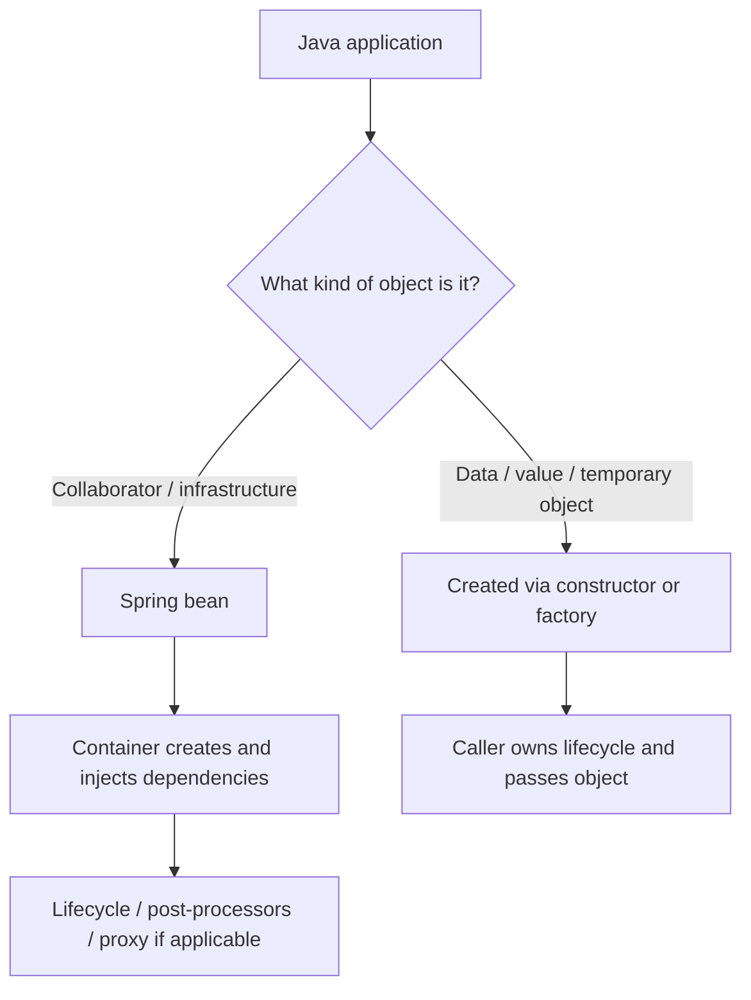

# Choosing Between Container-Managed Beans and Directly Created Data Objects

In Java, you can create an object with the `new` operator anywhere appropriate. In Spring, you can also let the container create and manage objects through component scanning, constructor injection, or `@Bean` factory methods. Both approaches are valid, but they serve different purposes.

An important design decision is **which objects should become Spring beans and which should simply be Java objects created on demand**.

If you put every object into the Spring container, the application easily accumulates too many beans, dependencies become hard to trace, and state gets shared unintentionally. Conversely, if you instantiate services or infrastructure dependencies manually with `new`, you may bypass dependency injection, configuration, lifecycle callbacks, and AOP that Spring needs to apply.

Practical guideline:

- Use **Spring-managed beans** for application-level collaborators: services, repositories, gateways, adapters, schedulers, handlers, configuration, and resources requiring lifecycle management.
- Use **directly created Java objects** for data or behavior whose lifecycle is tied to a single operation: DTOs, commands, value objects, calculation results, temporary objects, and plain Java components that do not need the container.
- Do not decide based solely on whether a class has annotations. Check whether the object needs Spring-provided dependencies, container-managed lifecycle, or cross-cutting behaviors like transactions, caching, security, and async execution.

This lesson also distinguishes Spring beans from JPA-managed entities, because those two "managed" concepts belong to different mechanisms.

## 1. How Do Java Objects and Spring Beans Differ?

Every Spring bean is a Java object, but not every Java object is a Spring bean.

Directly created object:

```java
Money price = new Money(new BigDecimal("125.00"), "VND");
```

This is an ordinary Java object. The JVM manages the object's memory; the code calling the constructor decides when it is created. Spring does not know this object exists, does not inject dependencies into it, and does not apply bean lifecycle hooks or AOP proxies to it.

Spring-managed bean:

```java
@Service
public class PricingService {
    public Money calculatePrice(Product product) {
        return new Money(product.basePrice(), "VND");
    }
}
```

When Spring builds the ApplicationContext and detects `PricingService`, the container registers a bean definition, creates an instance according to its lifecycle, and supplies a reference to other beans. If matching infrastructure and advisors exist, the supplied reference can even be an AOP proxy.



The difference lies in **who is responsible for creating, wiring, and managing the object's lifecycle**, not in whether the object is written in Java or can have methods called on it.

### 1.1. What the Container Can Do with a Bean

Depending on scope and configuration, the Spring container can:

- Create the bean from a constructor or factory method.
- Resolve dependencies and inject them into constructors, setters, or fields.
- Apply `BeanPostProcessor`s.
- Create proxies for matching AOP advisors.
- Invoke initialization callbacks such as `@PostConstruct` or `InitializingBean`.
- Manage destruction callbacks for beans whose lifecycle is owned by the container.
- Manage scopes such as singleton, prototype, request, or session.
- Provide the bean via injection or container APIs.

An object created with `new` inside a business method does not automatically receive these behaviors simply because its class has Spring annotations.

### 1.2. What Directly Created Objects Still Have

A directly created object is still a full-featured Java object:

- It can have constructors, methods, fields, and interfaces.
- It can be immutable or mutable by design.
- It can be passed across multiple layers.
- It can be unit tested without Spring.
- It can hold pure business logic.
- It can be serialized or persisted if configured appropriately.

You do not need the Spring container for every object. Many objects are easier to reuse and test the more independent they are from the framework.

## 2. Distinguishing Three "Managed" Concepts

In a Spring Boot application, the word "managed" can refer to several different mechanisms.

| Concept | Managed By | Examples |
|---|---|---|
| Spring-managed bean | Spring IoC container | `OrderService`, `DataSource`, `RestClient` |
| JPA-managed entity | JPA persistence context / EntityManager | `Order` after being `persist`ed or loaded |
| Ordinary Java object | Calling code creates it; JVM manages memory | `Money`, `CreateOrderCommand`, `List<OrderItem>` |

An object can be a JPA-managed entity without being a Spring bean. Conversely, a service or repository is a Spring bean but not a JPA entity.

Example:

```java
Order order = new Order(customerId, items);
entityManager.persist(order);
```

`order` is created with `new`. After being `persist`ed in the persistence context, it becomes a JPA-managed entity. That **does not turn `Order` into a Spring bean**.

This distinction is essential when designing domain models, persistence, and dependency injection.

## 3. Which Objects Are Good Fits for Spring Beans?

An object is usually a good candidate for a bean when it has one or more of the following characteristics.

### 3.1. It Is a Collaborator Used by Multiple Components

Examples:

- `OrderService` orchestrating a use case.
- `PaymentGateway` calling a payment provider.
- `CustomerRepository` accessing data.
- `NotificationSender` sending emails or messages.
- `TaxPolicy` providing tax rules with dependencies.
- `ReportGenerator` coordinating multiple data sources.

These objects are typically injected into other components instead of being created anew on every method call.

```java
@Service
public class OrderService {

    private final OrderRepository orderRepository;
    private final PaymentGateway paymentGateway;

    public OrderService(
            OrderRepository orderRepository,
            PaymentGateway paymentGateway
    ) {
        this.orderRepository = orderRepository;
        this.paymentGateway = paymentGateway;
    }

    public void placeOrder(Order order) {
        paymentGateway.charge(order.total());
        orderRepository.save(order);
    }
}
```

`OrderService` needs two collaborators supplied by the container. If it instantiated the repository and gateway itself with `new`, the code would have to know implementation details, connection settings, and how to initialize each dependency.

### 3.2. It Needs Configuration from the Application Environment

An HTTP client may need a base URL, timeout, authentication, and connection pooling. Making the client a bean lets Spring inject the configured builder/settings.

```java
@Component
public class CatalogClient {

    private final RestClient restClient;

    public CatalogClient(RestClient.Builder builder) {
        this.restClient = builder
                .baseUrl("https://catalog.example.test")
                .build();
    }
}
```

In a real application, the base URL and timeout should be bound from configuration properties. If every request created its own client with `new`, you could bypass connection pooling, shared configuration, or customizers configured by the application.

### 3.3. It Needs Lifecycle or Resource Management

An object owning an executor, scheduler, connection pool, or listener should usually be container-managed so it has clear initialization and shutdown points.

```java
@Component
public class ReportScheduler {

    private final ScheduledExecutorService executor =
            Executors.newSingleThreadScheduledExecutor();

    @PreDestroy
    public void shutdown() {
        executor.shutdown();
    }
}
```

When the context closes normally, Spring can invoke the bean's destruction callback so resources are cleaned up. If this object were created with `new` inside a method and nobody took responsibility for closing it, threads or resources could outlive their intended lifetime.

Spring manages the lifecycle of objects owned by the container according to their scope and configuration. For prototype beans, the container creates the object but does not manage the full destruction lifecycle the way it does for singleton beans.

### 3.4. It Needs Spring Cross-Cutting Behavior

The following features usually rely on proxies or Spring-managed infrastructure:

- `@Transactional`.
- `@Cacheable`.
- `@Async`.
- Method validation via `@Validated`.
- Custom AOP aspects.
- Method security.

Example:

```java
@Service
public class InvoiceService {

    @Transactional
    public void issueInvoice(Invoice invoice) {
        // Persist invoice and related data.
    }
}
```

When calling the service through the bean reference supplied by Spring, the transaction interceptor can apply. If you manually create `new InvoiceService()` and call the method, that object does not pass through the Spring transaction proxy.

Annotations do not alter JVM methods by themselves. Infrastructure must be configured, and calls must pass through the proper interception boundary.

## 4. Which Objects Should Be Created Directly?

Directly created objects are appropriate when they represent data or small processing units whose lifecycle is tied to an operation and do not need the Spring container.

### 4.1. Request and Response DTOs

```java
public record CreateOrderRequest(
        String customerId,
        List<CreateOrderItemRequest> items
) {
}

public record CreateOrderItemRequest(
        String productCode,
        int quantity
) {
}
```

DTOs represent data crossing a boundary. The framework may create them during request binding, or code may create them in tests/mappers.

There is no reason to register every request DTO as a singleton bean. A DTO is data for a single request, not a shared application collaborator.

### 4.2. Value Objects

```java
public record Money(BigDecimal amount, Currency currency) {

    public Money {
        Objects.requireNonNull(amount);
        Objects.requireNonNull(currency);

        if (amount.signum() < 0) {
            throw new IllegalArgumentException(
                    "Amount cannot be negative"
            );
        }
    }

    public Money add(Money other) {
        if (!currency.equals(other.currency)) {
            throw new IllegalArgumentException(
                    "Currency must match"
            );
        }

        return new Money(amount.add(other.amount), currency);
    }
}
```

`Money` represents a value with clear invariants. Creating it via constructor or factory method ensures the object is valid as soon as it is instantiated.

`Money` does not need to be a Spring bean just to be usable in a service. A service can instantiate value objects during processing:

```java
Money total = new Money(
        new BigDecimal("250.00"),
        Currency.getInstance("VND")
);
```

### 4.3. Command, Query, and Result Objects

```java
public record PlaceOrderCommand(
        String customerId,
        List<OrderLine> lines
) {
}

public record OrderSummary(
        String orderId,
        Money total,
        int itemCount
) {
}
```

Commands describe a request to perform an action; queries/results describe input/output data. They are typically created fresh per invocation.

Do not place command state onto a singleton service and overwrite it on every request. Each invocation should have its own data object.

### 4.4. Pure Calculation Objects

A calculator with no external dependencies can simply be a Java object:

```java
public class DiscountCalculator {

    public Money apply(Money original, BigDecimal rate) {
        BigDecimal discounted = original.amount()
                .multiply(BigDecimal.ONE.subtract(rate));

        return new Money(discounted, original.currency());
    }
}
```

It can be instantiated when needed:

```java
DiscountCalculator calculator = new DiscountCalculator();
Money finalPrice = calculator.apply(price, discountRate);
```

If the calculator has no state, needs no configuration, needs no proxy/lifecycle, and only performs pure calculations, turning it into a Spring bean may provide little meaningful benefit.

If the calculator has a configurable policy, depends on a repository, or is used by many services as a collaborator, a Spring bean may be more appropriate. Decide based on actual responsibilities and dependencies.

### 4.5. Collections and Builders

Objects such as `ArrayList`, `HashMap`, builders, iterators, or temporary objects are usually created directly:

```java
List<OrderLine> lines = new ArrayList<>();
Map<String, Integer> quantities = new HashMap<>();
```

They are local state for an operation, not application dependencies requiring container management.

## 5. Do Not Instantiate Services with new Inside Other Services

This is a common anti-pattern:

```java
@Service
public class CheckoutService {

    public void checkout(Order order) {
        PaymentService paymentService = new PaymentService();
        paymentService.pay(order);
    }
}
```

If `PaymentService` is an application collaborator, creating it manually with `new` causes problems:

- Spring does not inject dependencies into that instance.
- Configuration bound to another bean is not used.
- AOP proxies do not apply to the manually created instance.
- Transaction, cache, async, or security advice may be bypassed.
- Tests cannot easily swap dependencies with mocks/fakes via the constructor.
- Calling code becomes coupled to the concrete implementation.
- Dependency lifecycle is decided ad hoc inside each method.

Appropriate approach:

```java
@Service
public class CheckoutService {

    private final PaymentService paymentService;

    public CheckoutService(PaymentService paymentService) {
        this.paymentService = paymentService;
    }

    public void checkout(Order order) {
        paymentService.pay(order);
    }
}
```

Now Spring manages both beans and injects dependencies according to configuration.

### 5.1. Can a Directly Created Object Have Dependencies?

Yes, Java does not forbid it:

```java
PaymentService service =
        new PaymentService(paymentGateway, auditPublisher);
```

However, if `PaymentService` is meant to be a Spring component needing transactions/AOP/configuration, manual instantiation still bypasses the container-provided bean reference. Passing all constructor arguments only handles object construction; it does not create proxies or bean lifecycles.

You can instantiate plain objects with dependencies when that is the intentional design of a factory or domain model, but do not use it to replace Spring wiring for application services.

## 6. new Inside @Bean Still Creates a Spring-Managed Bean

Seeing the `new` keyword does not automatically mean an object is unmanaged by Spring.

```java
@Configuration(proxyBeanMethods = false)
public class PaymentConfiguration {

    @Bean
    public PaymentGateway paymentGateway(
            PaymentGatewayProperties properties
    ) {
        return new HttpPaymentGateway(
                properties.baseUrl(),
                properties.apiKey()
        );
    }
}
```

Here, the factory method creates the object with `new`, but the object returned from the `@Bean` method is registered in the ApplicationContext. The container manages the bean definition and can apply post-processing/proxies according to infrastructure.

| Creation Style | Does Spring Manage the Used Object? |
|---|---|
| `new HttpPaymentGateway(...)` inside a business method and used directly | No |
| `@Bean` method returning `new HttpPaymentGateway(...)` | Yes |
| Class annotated with `@Component` picked up by component scan | Yes |
| `new Money(...)` inside a service | No, and usually unnecessary |
| `new ArrayList<>()` inside a method | No, and usually unnecessary |

**The deciding factor is whether the object is registered with and exposed through the container**, not whether a constructor is called directly.

## 7. Spring Bean Does Not Automatically Mean Singleton

By default, a Spring bean's scope is `singleton` within one ApplicationContext. The container normally holds a single instance per bean definition in that context.

Spring also supports other scopes:

| Scope | General Meaning | Example |
|---|---|---|
| `singleton` | One instance per bean definition in the context | Stateless service, repository |
| `prototype` | New instance created each time the container resolves the bean | Stateful object created by the container |
| `request` | One instance within an HTTP request lifecycle | Request-scoped context |
| `session` | One instance within an HTTP session lifecycle | Session-specific state |
| Custom scope | Lifecycle defined by an application/platform mechanism | Specialized integration |

A DTO created with `new` does not need to become a prototype bean just because it is short-lived. Prototype is useful when an object still needs container creation/dependency injection but each use requires a separate instance.

### 7.1. Singleton Beans Should Be Stateless or Thread-Safe

Because multiple requests may call the same singleton service concurrently, avoid storing per-request data in mutable fields:

```java
@Service
public class BadOrderService {

    private Order currentOrder;

    public void place(Order order) {
        this.currentOrder = order;
        // Processing...
    }
}
```

Two concurrent requests can overwrite each other's `currentOrder`.

Keep per-invocation state in local variables or command objects:

```java
@Service
public class OrderService {

    public void place(Order order) {
        String customerId = order.customerId();
        // Local state for this invocation.
    }
}
```

Freshly created data objects per request are usually far better than turning request data into singleton bean state.

## 8. When to Use a Prototype Bean Instead of new

Some objects are not singletons but still require Spring dependency injection or post-processing.

For example, a job processor needing injected collaborators and maintaining separate state per job:

```java
@Component
@Scope(ConfigurableBeanFactory.SCOPE_PROTOTYPE)
public class ImportJob {

    private final ImportRepository repository;

    public ImportJob(ImportRepository repository) {
        this.repository = repository;
    }

    public void execute(ImportCommand command) {
        // State and processing specific to this job.
    }
}
```

If a singleton service injects the prototype directly into its constructor:

```java
@Service
public class ImportCoordinator {

    private final ImportJob importJob;

    public ImportCoordinator(ImportJob importJob) {
        this.importJob = importJob;
    }
}
```

the prototype is normally resolved when the singleton `ImportCoordinator` is created, so the singleton holds that single injected instance. It does not automatically receive a new prototype on every method call.

If you need a new instance per execution, use `ObjectProvider`:

```java
@Service
public class ImportCoordinator {

    private final ObjectProvider<ImportJob> jobProvider;

    public ImportCoordinator(ObjectProvider<ImportJob> jobProvider) {
        this.jobProvider = jobProvider;
    }

    public void run(ImportCommand command) {
        ImportJob job = jobProvider.getObject();
        job.execute(command);
    }
}
```

Or use `Provider` from Jakarta Inject depending on your stack.

### 8.1. Prototype Beans and Destruction Lifecycle

Spring creates prototype beans and performs certain initialization/post-processing steps, but once the object is handed to the caller, the container normally does not retain responsibility for calling destruction callbacks on prototype instances as it does for singletons.

Callers need a cleanup plan if a prototype object owns resources. If the object has a complex lifecycle, consider a factory with explicit create/close APIs or an appropriate resource-management abstraction.

### 8.2. Do Not Use Prototype Just to Avoid Thinking About State

If an object is just `Money`, a DTO, or a command, a prototype bean is unnecessary. Direct instantiation is simpler because the object does not need the container.

Use prototype when you need **both a fresh instance and Spring's creation/injection mechanism**, not merely because you want a new object.

## 9. The Factory Pattern Bridges the Container and Data Objects

A factory can be a Spring bean while the objects it creates are plain Java objects.

```java
@Component
public class OrderFactory {

    public Order create(CreateOrderCommand command) {
        List<OrderLine> lines = command.items().stream()
                .map(item -> new OrderLine(
                        item.productCode(),
                        item.quantity()
                ))
                .toList();

        return new Order(
                command.customerId(),
                lines
        );
    }
}
```

`OrderFactory` is a bean because it is an application collaborator. `Order` and `OrderLine` are domain objects created fresh for the use case.

This combination has several benefits:

- Spring manages the factory and its dependencies.
- The factory creates domain objects with invariants.
- Domain objects do not need to know about the Spring container.
- Unit tests can test the factory/domain model without starting the entire application context.

### 9.1. Factories with External Dependencies

If object creation requires a repository, configuration, or clock, the factory can inject those collaborators:

```java
@Component
public class SubscriptionFactory {

    private final Clock clock;
    private final PlanCatalog planCatalog;

    public SubscriptionFactory(Clock clock, PlanCatalog planCatalog) {
        this.clock = clock;
        this.planCatalog = planCatalog;
    }

    public Subscription create(CreateSubscriptionCommand command) {
        Plan plan = planCatalog.getRequired(command.planId());

        return new Subscription(
                command.customerId(),
                plan,
                clock.instant()
        );
    }
}
```

`Subscription` remains a directly created domain object. `SubscriptionFactory` is a bean because it depends on Spring-managed collaborators.

## 10. Domain Entities Should Not Automatically Become Spring Beans

A domain entity typically represents a business entity with identity and state:

```java
public class Order {

    private final OrderId id;
    private final List<OrderLine> lines;
    private OrderStatus status;

    public Order(OrderId id, List<OrderLine> lines) {
        this.id = Objects.requireNonNull(id);
        this.lines = new ArrayList<>(lines);
        this.status = OrderStatus.DRAFT;
    }

    public void confirm() {
        if (lines.isEmpty()) {
            throw new IllegalStateException(
                    "Cannot confirm an empty order"
            );
        }

        status = OrderStatus.CONFIRMED;
    }
}
```

`Order` is an object with domain identity and invariants. Each order needs its own instance. If `Order` were registered as a singleton Spring bean, multiple requests could accidentally mutate the same order.

Create entities/domain aggregates via constructors or factories:

```java
Order order = orderFactory.create(command);
```

Then the repository saves it:

```java
orderRepository.save(order);
```

In DDD, aggregate roots are typically created through controlled constructors/factories to enforce invariants, without Spring injecting dependencies into entities.

### 10.1. JPA Entities and the Persistence Context

With JPA, entities have their own lifecycle:

- **New/transient:** object created with `new`, not yet managed by a persistence context.
- **Managed:** entity loaded or persisted within a persistence context.
- **Detached:** entity previously managed but no longer attached to a persistence context.
- **Removed:** entity marked for deletion within the persistence context.

Example:

```java
OrderEntity entity = new OrderEntity();
entity.setCustomerId(customerId);

entityManager.persist(entity);
```

Before `persist`, the entity is just a Java object. After entering the persistence context, it is a JPA-managed entity. It is still not a Spring bean simply because JPA manages it.

`@Entity` is not a stereotype annotation for component scanning to register an entity as a Spring bean.

### 10.2. Do Not Inject Spring Services into JPA Entities

Avoid this design:

```java
@Entity
public class OrderEntity {

    @Autowired
    private PaymentService paymentService;
}
```

The JPA provider instantiates and manages entities according to its own lifecycle; entities should not depend on Spring application services. Doing so mixes the persistence model with application orchestration.

Instead:

```java
@Service
public class OrderApplicationService {

    private final OrderRepository repository;
    private final PaymentService paymentService;

    public OrderApplicationService(
            OrderRepository repository,
            PaymentService paymentService
    ) {
        this.repository = repository;
        this.paymentService = paymentService;
    }

    public void pay(String orderId) {
        OrderEntity order = repository.findById(orderId)
                .orElseThrow();

        paymentService.pay(order.total());
    }
}
```

The service orchestrates business workflows and calls collaborators. The entity holds state and appropriate domain behavior.

## 11. DTOs, Entities, and Services Have Different Lifecycles

| Object Type | Purpose | Common Creation Method | Should It Be a Spring Bean? |
|---|---|---|---|
| Controller | HTTP boundary | Spring container | Yes |
| Application service | Use case orchestration | Spring container | Yes |
| Repository | Persistence abstraction | Spring Data/container | Yes |
| External client/gateway | External system integration | Spring container/factory | Usually yes |
| Request DTO | Data from request | Framework/constructor | No |
| Response DTO | Returned data | Mapper/constructor | No |
| Command/query | Describes an operation | Constructor/record | No |
| Value object | Immutable value with invariants | Constructor/factory | Usually no |
| Domain entity | Business object with identity | Constructor/domain factory/JPA | Not a Spring bean |
| Collection/builder | Local/temporary state | `new` | No |
| Stateless calculator | Pure Java logic | `new` or static depending on design | Depends on need |
| Stateful job with Spring dependencies | Single run needing injection | Prototype/provider/factory | Can be a prototype bean |

This table is a guide, not an absolute rule. A calculator with configuration or collaborators can be a bean; a freshly constructed object can be Spring-managed if returned from an `@Bean` factory.

## 12. Choose Based on Responsibility, Not Class Size

A class with only a few lines can still be a bean if it represents an application dependency:

```java
@Component
public class UtcClock {

    public Instant now() {
        return Instant.now();
    }
}
```

However, do not turn every utility class into a bean. If the logic has no dependencies, does not need swapping in tests, has no configuration/lifecycle, and is purely a transformation, an ordinary Java object or a method on a value/domain type may be more fitting.

Ask yourself:

1. Does the object need to collaborate with other dependencies?
2. Does it need Spring to inject configuration or resources?
3. Does it need AOP, transactions, caching, async, or method validation?
4. Does it have an initialize/destroy lifecycle?
5. Does the object hold per-request or per-job state?
6. Who is responsible for creating and ending its lifecycle?
7. If created directly, would important Spring behavior be bypassed?

There is no rule like "classes over N lines must be beans" or "every class in the `service` package must be a bean."

## 13. Complete Example: A Service Bean Creating Domain Objects Directly

Let's build an order creation use case.

### 13.1. Commands as Input Data

```java
public record CreateOrderCommand(
        String customerId,
        List<CreateOrderLineCommand> lines
) {
}

public record CreateOrderLineCommand(
        String productCode,
        int quantity
) {
}
```

Command objects are created per invocation. They do not need to be registered in the ApplicationContext.

### 13.2. Domain Objects

```java
public record OrderLine(String productCode, int quantity) {

    public OrderLine {
        Objects.requireNonNull(productCode);

        if (productCode.isBlank()) {
            throw new IllegalArgumentException(
                    "Product code is required"
            );
        }

        if (quantity <= 0) {
            throw new IllegalArgumentException(
                    "Quantity must be positive"
            );
        }
    }
}
```

```java
public class Order {

    private final String customerId;
    private final List<OrderLine> lines;

    public Order(String customerId, List<OrderLine> lines) {
        this.customerId = Objects.requireNonNull(customerId);
        this.lines = List.copyOf(lines);

        if (this.lines.isEmpty()) {
            throw new IllegalArgumentException(
                    "An order needs at least one line"
            );
        }
    }

    public String customerId() {
        return customerId;
    }

    public List<OrderLine> lines() {
        return lines;
    }
}
```

Domain objects enforce invariants and do not depend on Spring.

### 13.3. Repository Is a Bean

```java
public interface OrderRepository {
    void save(Order order);
}
```

Its implementation can be generated by Spring Data or registered via an appropriate component/configuration. The service does not instantiate the repository itself with `new`.

### 13.4. Application Service Is a Bean

```java
@Service
public class CreateOrderService {

    private final OrderRepository repository;

    public CreateOrderService(OrderRepository repository) {
        this.repository = repository;
    }

    @Transactional
    public void execute(CreateOrderCommand command) {
        List<OrderLine> lines = command.lines().stream()
                .map(line -> new OrderLine(
                        line.productCode(),
                        line.quantity()
                ))
                .toList();

        Order order = new Order(command.customerId(), lines);

        repository.save(order);
    }
}
```

Here:

- Spring manages `CreateOrderService` and `OrderRepository`.
- Each execution creates a new list and new domain objects.
- `@Transactional` can apply when the method is called through the transaction proxy.
- Domain objects do not need the Spring container.

This combines both kinds of objects according to their proper responsibilities.

## 14. Factory Methods and @Bean for Infrastructure

Some objects cannot be annotated with `@Component` because the class comes from an external library or needs complex constructor arguments. You can create them with `@Bean`:

```java
@Configuration(proxyBeanMethods = false)
public class ClientConfiguration {

    @Bean
    public Clock applicationClock() {
        return Clock.systemUTC();
    }

    @Bean
    public ObjectMapper objectMapper() {
        return new ObjectMapper()
                .findAndRegisterModules();
    }
}
```

`Clock` and `ObjectMapper` here are Spring beans. Even though the factory methods use `new`, the container manages the returned objects.

Benefits:

- A single shared configuration for the entire application.
- Easy bean replacement in tests.
- Services inject the same preconfigured dependencies.
- Customizers or post-processing can be applied appropriately.

### 14.1. When Not to Register Library Objects as Beans

If an object is used once, needs no shared configuration, is not shared, and has no container-managed lifecycle, direct instantiation can be simpler.

For example, a `StringBuilder` used inside a single method does not need to be a bean:

```java
StringBuilder builder = new StringBuilder();
builder.append("Order: ").append(orderId);
String message = builder.toString();
```

Making `StringBuilder` a singleton bean would introduce unnecessary shared mutable state.

## 15. Beans Can Create Data Objects Without Owning All of Them

A service bean can create many temporary objects on each invocation:

```java
@Service
public class InvoiceFormatter {

    public String format(Invoice invoice) {
        List<String> lines = new ArrayList<>();

        for (InvoiceLine line : invoice.lines()) {
            lines.add(formatLine(line));
        }

        return String.join(System.lineSeparator(), lines);
    }

    private String formatLine(InvoiceLine line) {
        return line.description() + ": " + line.amount();
    }
}
```

`InvoiceFormatter` is a singleton bean; `lines` is a fresh local object per call. There is no reason to register individual lists or strings as Spring beans.

A good rule of thumb: **the container manages application-level collaborators; business code manages operation-local data objects**.

## 16. When Do Data Objects Need Dependencies?

A domain/value object should usually stay independent, though that does not mean every object with methods is forbidden from using dependencies. Some objects operate using strategies or policies.

Distinguish between:

- Pure data with invariants: usually created directly.
- Services/policies depending on infrastructure or configuration: usually beans.
- Objects needing swappable strategy behavior: strategy beans can be injected into services or factories.
- Temporary objects needing dependencies while requiring multiple instances: consider factories/prototypes.

For example, do not let a value object call the database:

```java
public class CustomerId {
    private final String value;

    // Identity value; do not inject CustomerRepository here.
}
```

Instead, the service resolves the data:

```java
@Service
public class CustomerService {

    private final CustomerRepository repository;

    public CustomerService(CustomerRepository repository) {
        this.repository = repository;
    }

    public Customer load(CustomerId id) {
        return repository.findById(id.value())
                .orElseThrow();
    }
}
```

`CustomerId` represents identity; `CustomerService` coordinates the repository.

## 17. When to Use ObjectProvider, Provider, or a Factory

Use deliberate lazy lookup when a dependency is only needed in one logic branch, when a fresh prototype is required, or when an integration is optional.

Example:

```java
@Service
public class ExportCoordinator {

    private final ObjectProvider<ExportJob> jobProvider;

    public ExportCoordinator(ObjectProvider<ExportJob> jobProvider) {
        this.jobProvider = jobProvider;
    }

    public void export(ExportCommand command) {
        ExportJob job = jobProvider.getObject();
        job.execute(command);
    }
}
```

`ObjectProvider` keeps the dependency explicit in the constructor while deferring instance resolution until `getObject()` is called.

If object creation requires no Spring dependencies, a simple Java factory can be better:

```java
public class CsvRowFactory {

    public CsvRow create(List<String> columns) {
        return new CsvRow(columns);
    }
}
```

Do not call `ApplicationContext.getBean()` in every method as a way to avoid constructor injection. That creates a service locator, hides dependencies, and makes testing harder.

## 18. Directly Created Objects Can Still Be Processed by Spring at a Boundary

Non-bean objects can still be passed into Spring APIs. Examples:

- `Validator.validate(dto)` validates a DTO created with `new`.
- `ObjectMapper.writeValueAsString(dto)` serializes a data object.
- `EntityManager.persist(entity)` places an entity into the persistence context.
- `RestClient` sends an object as a request body.
- `ApplicationEventPublisher.publishEvent(event)` publishes an event object.

This does not turn the DTO/entity/event into a Spring bean. Spring merely processes the object within a specific API call.

Validation example:

```java
CreateOrderRequest request =
        new CreateOrderRequest(null, List.of());

Set<ConstraintViolation<CreateOrderRequest>> violations =
        validator.validate(request);
```

The DTO has validation annotations yet is created with `new`; the validator still checks it when explicitly invoked.

## 19. Testing: When Is a Spring Context Needed?

Choosing between beans and directly created objects affects your testing strategy.

### 19.1. Unit Testing Plain Objects

Value objects or calculators with no Spring dependencies can be tested directly:

```java
@Test
void addsMoneyWithSameCurrency() {
    Money left = new Money(
            new BigDecimal("10.00"),
            Currency.getInstance("VND")
    );

    Money right = new Money(
            new BigDecimal("5.00"),
            Currency.getInstance("VND")
    );

    assertThat(left.add(right).amount())
            .isEqualByComparingTo("15.00");
}
```

No `@SpringBootTest` is needed just to test addition.

### 19.2. Unit Testing Services via Constructor Injection

```java
@Test
void savesCreatedOrder() {
    OrderRepository repository = mock(OrderRepository.class);
    CreateOrderService service = new CreateOrderService(repository);

    CreateOrderCommand command = new CreateOrderCommand(
            "customer-1",
            List.of(new CreateOrderLineCommand("SKU-1", 2))
    );

    service.execute(command);

    verify(repository).save(any(Order.class));
}
```

Here, the service can be created with `new` in a unit test because the goal is checking orchestration logic with a mock dependency. This test does **not** verify transaction proxies.

### 19.3. Integration Testing Spring-Managed Behavior

When you need to test bean registration, constructor injection, configuration binding, transactions, caching, async execution, or AOP advice, test through a Spring-managed bean in an appropriate context.

```java
@SpringBootTest
class CreateOrderIntegrationTest {

    @Autowired
    CreateOrderService service;

    @Test
    void serviceIsProvidedBySpring() {
        assertThat(service).isNotNull();
        service.execute(sampleCommand());
        // Assert behavior that needs verification at the integration layer.
    }
}
```

Do not call `new CreateOrderService(...)` in a test and conclude that `@Transactional` works; a directly created instance does not go through the container's proxy.

### 19.4. Slice Tests and Mock Beans

A controller test using a mock service is suitable for verifying HTTP mapping and delegation. However, a mock does not prove the real service is configured properly by Spring for transactions, caching, or AOP.

Choose the test type based on the behavior you need to verify, rather than defaulting to one test type out of habit.

## 20. Common Anti-patterns

### 20.1. Turning DTOs into Singleton Beans

DTOs hold per-request data. Registering a DTO as a singleton can leak one request's data into another and cause race conditions.

### 20.2. Creating a New Service with new on Every Request

If a service needs dependencies, configuration, or AOP, manual instantiation bypasses the container. If you genuinely need fresh instances, consider deliberate prototype/provider/factory designs.

### 20.3. Injecting ApplicationContext Everywhere

`ApplicationContext.getBean()` hides dependencies and turns classes into service locators. Constructor injection is usually clearer and easier to test.

### 20.4. Storing Business State in Singleton Beans

Singleton beans are shared across many requests. Do not store request-specific mutable state in fields without an appropriate concurrency mechanism.

### 20.5. Registering Every Utility Class as a Bean

A utility class with no dependencies, no lifecycle, and no need to be swapped in tests may not need to be a bean. Too many beans clutter the context and increase Spring coupling.

### 20.6. Injecting Services into Entities

Entities should hold domain state/invariants; service orchestration and infrastructure belong to the application layer. Injecting services into JPA entities mixes lifecycles and responsibilities.

### 20.7. Assuming @Component Turns Every Instance of a Class into a Bean

`@Component` is only metadata allowing component scanning to register a bean definition. Calling `new SomeComponent()` still creates an unmanaged standalone object.

## 21. Quick Decision Table

| Question | If Yes | Usually Appropriate Choice |
|---|---|---|
| Does the object need repositories/clients/configuration injected? | Yes | Spring bean or Spring-managed factory |
| Does the object need transaction/cache/async/security advice? | Yes | Spring-managed bean invoked through the appropriate proxy |
| Does the object need init/destroy lifecycle or own resources? | Yes | Spring bean with explicit cleanup |
| Is the object request/response data? | Yes | DTO created per request |
| Is the object a value/domain object with invariants? | Yes | Constructor/factory direct creation |
| Does the object exist only within a single method invocation? | Yes | Local object or command/result |
| Does the object need dependencies yet require a new instance per job? | Yes | Prototype via `ObjectProvider` or factory |
| Is the object a JPA entity? | Yes | Entity lifecycle managed by persistence context, not a Spring bean |
| Is the object a pure utility with no state/dependencies? | Yes | Plain Java method/object; bean only if clearly beneficial |

There is no single answer for every class. You can start with a simple Java object and promote it into the container only when a real need for dependencies, configuration, lifecycle, or framework integration arises.

## 22. Workflow for Designing a New Class

When creating a class in Spring Boot, walk through these questions:

### Step 1. Identify the Role

Is this class an application service, infrastructure adapter, repository, domain entity, value object, DTO, or helper?

### Step 2. Identify Dependencies

Does it need a database, HTTP client, configuration, clock, executor, or other collaborators?

If yes, consider constructor injection and a Spring bean. If not, a plain object may be sufficient.

### Step 3. Identify Lifecycle and State

Does the object live for the entire application context, a single request, a single job, or a single calculation?

If singleton, ensure it does not store per-request mutable state. If a separate instance with Spring dependencies is needed, consider prototype/provider.

### Step 4. Identify Framework Behavior

Does it need transactions, AOP, caching, async execution, method validation, or security proxies?

If yes, callers must use the appropriate Spring-supplied reference.

### Step 5. Identify Who Creates the Object

- The container creates beans via component scanning or `@Bean`.
- Factories create domain/value objects.
- The framework creates DTOs during binding.
- The persistence context manages JPA entities.
- Methods create temporary objects during processing.

An object can be created with `new` and still be a Spring bean if a factory method registers it in the context.

### Step 6. Choose How to Test

- Plain objects: direct unit tests.
- Service logic: unit tests with fake/mock dependencies.
- Container/AOP/lifecycle: integration tests with a Spring context.

### Step 7. Check Dependency Direction

Domain objects should not depend back on Spring services. Application services coordinate domain objects and infrastructure through abstractions.

## 23. Comparing Two Designs Side by Side

### Design A: Everything Is a Bean

```java
@Component
public class MoneyFactory {
    public Money create(BigDecimal amount) {
        return new Money(amount, Currency.getInstance("VND"));
    }
}

@Component
public class OrderDataHolder {
    // Data state for an order.
}
```

If these objects have no dependencies or lifecycles needing Spring, registering everything as beans bloats the container and obscures data lifetimes.

In particular, `OrderDataHolder` as a singleton is dangerous if it stores per-order state.

### Design B: Beans for Collaborators, Plain Objects for Data

```java
@Service
public class OrderApplicationService {

    private final OrderRepository repository;

    public OrderApplicationService(OrderRepository repository) {
        this.repository = repository;
    }

    public void create(CreateOrderCommand command) {
        Money total = calculateTotal(command);
        Order order = new Order(command.customerId(), total);
        repository.save(order);
    }

    private Money calculateTotal(CreateOrderCommand command) {
        return new Money(
                new BigDecimal("100.00"),
                Currency.getInstance("VND")
        );
    }
}
```

Here, the service is a bean; the command, money, and order are data/domain objects. The container manages collaborators; business code manages use case objects.

## 24. Self-Check Questions

**Question 1.** Does every Java object in a Spring Boot application automatically become a Spring bean?

**Answer:** No. Only objects registered through component scanning, `@Bean`, programmatic registration, or equivalent mechanisms belong to the container.

**Question 2.** Does an `@Service` created with `new` inside a method receive a transaction proxy?

**Answer:** No. Annotations do not automatically apply proxies to objects instantiated manually outside the container.

**Question 3.** Does an `@Bean` method returning `new HttpClientWrapper()` create a Spring-managed bean?

**Answer:** Yes. The returned object is registered in the ApplicationContext and passes through the appropriate bean lifecycle/post-processing.

**Question 4.** Should a request DTO be a singleton bean?

**Answer:** No. A DTO holds request-specific data; a mutable singleton could share state across requests.

**Question 5.** Is a JPA entity after `persist()` a Spring bean?

**Answer:** No. It is a JPA-managed entity in the persistence context, which is a separate mechanism from the Spring IoC container.

**Question 6.** When is a prototype bean more appropriate than `new`?

**Answer:** When you need a fresh instance yet still need Spring to inject dependencies, apply post-processing, or manage creation via a bean definition.

**Question 7.** Should a singleton service keep `currentOrder` in a field?

**Answer:** Usually no. Multiple requests may share the instance; per-invocation state should reside in local variables or dedicated data objects.

**Question 8.** Can you instantiate `Money` with `new` inside a Spring service?

**Answer:** Yes. Plain value objects are normally created directly to represent data and invariants.

**Question 9.** Should you inject `ApplicationContext` into every service to call `getBean()`?

**Answer:** No. That creates a service locator and hides dependencies. Constructor injection is clearer; `ObjectProvider`/factories are for intentional lazy or dynamic lookup.

**Question 10.** Can a unit test creating a service with `new` verify `@Transactional`?

**Answer:** No. That test checks plain Java logic; verifying transactions requires calling through a Spring-managed proxy in an integration context with transaction infrastructure.

## 25. Key Takeaways

- Every Spring bean is a Java object, but objects created with `new` are not automatically Spring beans.
- Spring beans fit application-level collaborators, configured dependencies, lifecycle-managed resources, and components needing AOP/infrastructure.
- DTOs, commands, results, collections, value objects, and domain objects are normally created directly per operation.
- `new` inside an `@Bean` factory method can still produce a Spring-managed bean; the deciding factor is whether the object is registered with the container.
- Spring's default singleton scope does not mean request data should be stored on beans. Singleton services should be stateless or thread-safe.
- Prototype beans are useful when you need fresh instances with Spring dependencies; `ObjectProvider` resolves instances per use.
- JPA-managed entities differ from Spring-managed beans. `@Entity` does not turn an entity into an ApplicationContext component.
- Do not instantiate services, repositories, or clients with `new` if you need dependency injection, configuration, transactions, caching, async execution, or security proxies.
- A factory can be a Spring bean while the objects it creates are plain Java/domain objects.
- Unit testing plain objects does not require Spring; testing lifecycle/AOP/transactions must use an appropriate Spring context.
- Avoid service locators, mutable singleton data holders, and putting every utility/data object into the container.

When deciding how to create a class, ask yourself: **"Is this a collaborator the application needs to manage, or is it data/a temporary object for a single operation? Does it need Spring's dependencies, lifecycle, or proxies? Who should own its lifecycle?"** Answering these questions clearly helps your application leverage Spring IoC while keeping your domain model and data simple and framework-independent.
