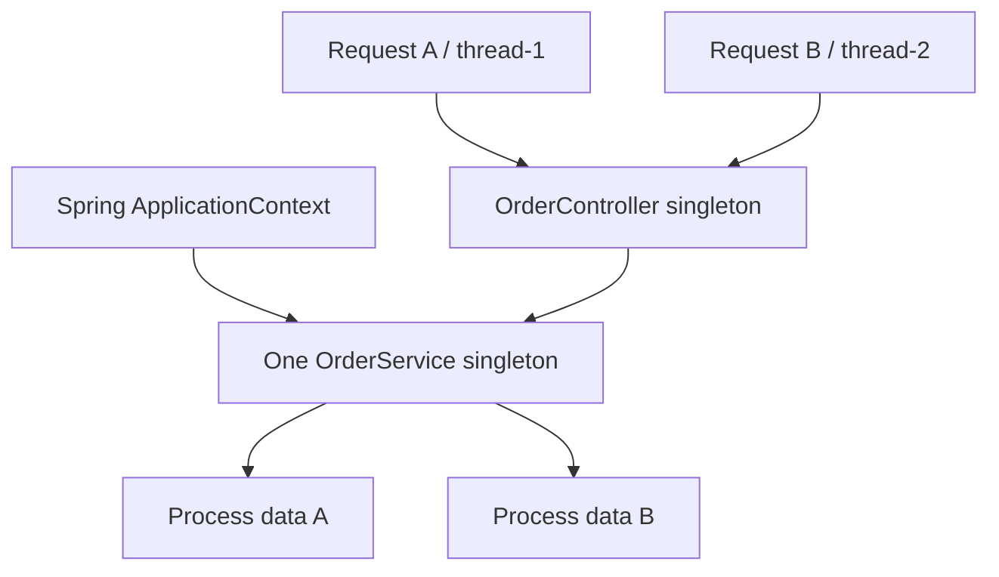
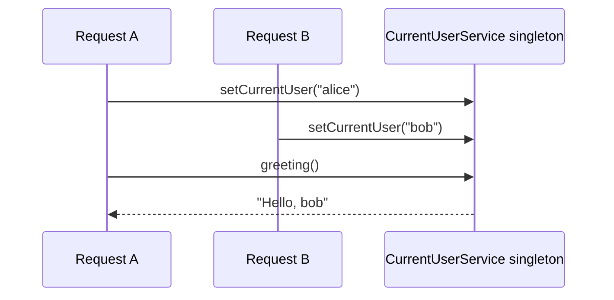
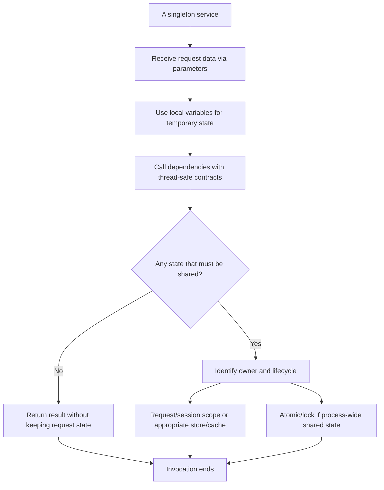

# Singleton Beans Do Not Store Per-Request State

In Spring Boot, a bean's default scope is **singleton**. That means Spring creates and manages a single instance for the corresponding bean definition within an ApplicationContext. In a web application, many requests may call the same service bean concurrently over overlapping time intervals. Consequently, a singleton service is routinely accessed by multiple threads at once.

This leads to a crucial design rule: **singleton services should be stateless with respect to individual requests**. A bean may hold shared dependencies and configuration, but it should not store data belonging to the current request in shared mutable fields such as `currentUser`, `currentOrderId`, `currentRequest`, or a `StringBuilder` reused across calls.

If request state is stored in a singleton field, two concurrent requests can overwrite each other's data. The outcome can be miscalculations, logging the wrong user, returning someone else's data, or producing bugs that appear only under concurrent load. This is not unique to Spring; it is the direct consequence of multiple invocations accessing the same mutable object.

This lesson belongs to the **Application Design** chapter of *Spring Boot Fundamentals*. We will distinguish singleton scope from a JVM-wide single instance, understand why requests can run concurrently on the same bean, distinguish shared state from local state, design stateless services, choose request/prototype scopes when genuinely needed, and test common race-condition bugs.

Examples use Java 21, Spring Boot 3.x, and Spring MVC. The principles around sharing objects apply across servlet, reactive, and other Spring application types; how request context is propagated can differ by execution model.

## 1. What Does Singleton Mean in Spring?

The default scope of a Spring-managed bean is `singleton`. For a bean definition within an ApplicationContext, Spring normally creates one instance and returns that same instance for subsequent bean lookups.

Example:

```java
@Service
public class PriceCalculator {

    public BigDecimal total(BigDecimal unitPrice, int quantity) {
        return unitPrice.multiply(BigDecimal.valueOf(quantity));
    }
}
```

When `PriceCalculator` is injected into multiple components, those components normally receive the same bean instance managed by the ApplicationContext.

### 1.1. Singleton Is Not a Single Object Across the Entire JVM

The exact definition is **one instance per bean definition within a single container**, according to its scope and registration. If an application has two independent ApplicationContexts, each context can have its own singleton instance.

Therefore, do not interpret a Spring singleton as:

- A single object across the entire JVM.
- A single object across all applications running on a machine.
- A single object across all pods/containers in a system.

For a typical Spring Boot application with one primary ApplicationContext, describing it as "a singleton bean shared across the application" is a practical and accurate mental model.

### 1.2. Singleton Beans Are Usually Created Once and Reused Many Times

Example:

```java
@Service
public class OrderService {
}

@RestController
@RequestMapping("/orders")
public class OrderController {

    private final OrderService orderService;

    public OrderController(OrderService orderService) {
        this.orderService = orderService;
    }
}
```

Both the controller and service are managed by Spring. When a request reaches the controller, it calls the service bean. The next request can also call that very same service instance.

### 1.3. Controllers Are Also Usually Singletons

`@Controller` and `@RestController` are component stereotypes. Unless another scope is specified, they also default to singleton. Thus, the same stateless rule applies to:

- Controllers.
- Services.
- Repositories.
- Components holding business policies.
- Supporting beans injected into those components.

Services are not the only components that cause bugs when storing request state in fields.

## 2. A Single Singleton Can Serve Many Concurrent Requests

In a Spring MVC application running on a servlet container, the server typically uses a thread pool to process multiple requests. Two requests can enter the same controller and call the same service instance over overlapping intervals.

Illustration:



Both invocations can execute on the same `OrderService` object simultaneously. Spring does not automatically create a new service instance per request just because a new request arrives.

### 2.1. Singleton Scope Does Not Automatically Synchronize Methods

Spring manages lifecycle and shares the bean instance. That **does not mean Spring automatically locks every method** or provides thread safety for mutable fields.

If two threads call the same method:

```java
public void process(String requestId) {
    // Method code executes for each invocation.
}
```

both invocations can run concurrently. The JVM gives each method invocation its own stack frame, yet both share visibility of the singleton object's fields.

### 2.2. Thread Pools Reuse Threads

In a servlet container, a worker thread named `http-nio-8080-exec-1` can be reused across different requests. That does not make request state safe if you store it in a singleton field.

One request may finish on `thread-1`, and another request may subsequently run on `thread-1`. Thread names are not a durable place to store per-request business state.

### 2.3. Reactive and Asynchronous Execution Do Not Make Fields Safer

In WebFlux or asynchronous pipelines, the same bean can be invoked from multiple execution paths, and a single operation can continue on a different thread. Never rely on the assumption that "each request stays on one dedicated thread from start to finish."

The safer rule is never to put mutable request data into singleton fields. Pass data via parameters, local variables, or a context mechanism matching the execution model.

## 3. What Does Stateless Mean in a Service?

A request-stateless service does not hold per-invocation mutable data in instance fields. Each invocation receives needed data through parameters, processes within the scope of that call, and returns a result.

Example:

```java
@Service
public class GreetingService {

    public String greeting(String name) {
        String normalizedName = name.trim();
        return "Hello, " + normalizedName;
    }
}
```

`normalizedName` is a local variable scoped to the method invocation. Two requests can call the method concurrently, each with its own variable.

### 3.1. Stateless Does Not Mean a Bean Has No Fields

A service can have immutable fields holding dependencies or configuration:

```java
@Service
public class InvoiceService {

    private final InvoiceRepository repository;
    private final TaxPolicy taxPolicy;

    public InvoiceService(
            InvoiceRepository repository,
            TaxPolicy taxPolicy) {
        this.repository = repository;
        this.taxPolicy = taxPolicy;
    }

    public InvoiceSummary summarize(long invoiceId) {
        Invoice invoice = repository.findById(invoiceId)
                .orElseThrow();
        return taxPolicy.summarize(invoice);
    }
}
```

The fields `repository` and `taxPolicy` are shared dependencies. They are assigned once via the constructor and never mutated per request. The service does not store `invoiceId` or the current `Invoice` in a field.

**Stateless here means not holding request-specific mutable state inside the singleton**, not that the object has zero fields.

### 3.2. Local Variables Are Generally Safer Than Mutable Fields

```java
@Service
public class ReportService {

    public Report create(ReportRequest request) {
        List<Row> rows = new ArrayList<>();
        rows.addAll(loadRows(request));

        return new Report(request.reportId(), rows);
    }
}
```

`rows` is a local variable created per invocation. Two normal calls create two distinct lists.

However, a local variable is only safe if the mutable object it references is not unexpectedly shared. If `loadRows(...)` returns a shared list or stores that reference elsewhere, analyze object ownership and mutation carefully.

### 3.3. Method Parameters Are Not Automatically Immutable Either

Parameters are references passed into the method. If both caller and service retain a reference to a mutable object and modify it concurrently, race conditions can still happen.

Example:

```java
public void process(List<String> values) {
    values.add("processed");
}
```

The method has no mutable fields, yet if `values` is shared across multiple requests, concurrent calls can still contend on the same list.

A stateless service is part of a safe design; ownership of input/output objects must also be clear.

## 4. Common Bug: Storing Request Data in a Singleton Field

Consider this service:

```java
@Service
public class CurrentUserService {

    private String currentUser;

    public void setCurrentUser(String username) {
        this.currentUser = username;
    }

    public String greeting() {
        return "Hello, " + currentUser;
    }
}
```

This service appears to work when only one request runs. With two concurrent requests:

1. Request A calls `setCurrentUser("alice")`.
2. Request B calls `setCurrentUser("bob")`.
3. Request A calls `greeting()`.
4. Request A can receive `"Hello, bob"` instead of `"Hello, alice"`.



This is an example of a **data race / shared mutable state** at the application level. The bug does not necessarily throw an exception; worse, the system returns type-valid data belonging to another request.

### 4.1. Do Not Use Fields to Store the Current Request's ID

Fields like the following are warning signs worth reviewing in a singleton:

```java
private String currentRequestId;
private Long currentUserId;
private HttpServletRequest request;
private Order currentOrder;
private List<String> currentItems = new ArrayList<>();
private StringBuilder responseBuffer = new StringBuilder();
```

They represent data whose lifecycle belongs to a request or invocation. If mutated per request and shared through a singleton instance, another request can observe or overwrite them.

### 4.2. Not All Fields Are Dangerous

Fields like these are normally appropriate in a singleton when the objects are designed properly:

```java
private final OrderRepository repository;
private final Clock clock;
private final TaxPolicy taxPolicy;
private final BigDecimal defaultTaxRate;
```

They are stable dependencies or configuration. Still, `final` only prevents reassigning the reference; it **does not make the referenced object immutable or thread-safe**.

For example, `private final List<String> rules` can still be modified if the list is mutable and exposed to mutation.

## 5. Another Bug: Sharing a Mutable StringBuilder or Collection

`StringBuilder` is not thread-safe. If a singleton reuses one builder across multiple requests:

```java
@Service
public class MessageService {

    private final StringBuilder builder = new StringBuilder();

    public String buildMessage(String name) {
        builder.setLength(0);
        builder.append("Hello, ");
        builder.append(name);
        return builder.toString();
    }
}
```

Two requests can interleave `setLength`, `append`, and `toString` calls. The output can be scrambled or corrupted.

### 5.1. Fix with a Local Variable

```java
@Service
public class MessageService {

    public String buildMessage(String name) {
        StringBuilder builder = new StringBuilder();
        builder.append("Hello, ");
        builder.append(name);
        return builder.toString();
    }
}
```

Each invocation creates its own builder without sharing fields across requests.

### 5.2. Fix with Immutable Strings for Simple Concatenation

```java
public String buildMessage(String name) {
    return "Hello, " + name;
}
```

For simple cases, no builder is needed. Choose data structures based on actual requirements; do not optimize by reusing a shared mutable object if doing so sacrifices thread safety.

### 5.3. Thread-Safe Collections Do Not Solve Every Business Problem

Replacing `ArrayList` with `CopyOnWriteArrayList` or `ConcurrentHashMap` does not automatically make request-state design valid.

Example:

```java
private final Map<Long, Order> currentOrders =
        new ConcurrentHashMap<>();
```

The map may support concurrent access, but if the intent is storing "the current order of the running request" without clear keys and cleanup policies, data can still leak or never be evicted. Thread-safe collections only protect individual structural operations; they do not replace ownership models and business transactions.

## 6. Constructor Injection and final Fields Make Designs Clearer

A stateless singleton typically uses constructor injection:

```java
@Service
public class CheckoutService {

    private final CartRepository cartRepository;
    private final PricingService pricingService;
    private final PaymentGateway paymentGateway;

    public CheckoutService(
            CartRepository cartRepository,
            PricingService pricingService,
            PaymentGateway paymentGateway) {
        this.cartRepository = cartRepository;
        this.pricingService = pricingService;
        this.paymentGateway = paymentGateway;
    }

    public CheckoutResult checkout(CheckoutCommand command) {
        Cart cart = cartRepository.findById(command.cartId())
                .orElseThrow();

        BigDecimal total = pricingService.calculate(cart);
        PaymentReceipt receipt =
                paymentGateway.charge(command.paymentMethod(), total);

        return new CheckoutResult(cart.getId(), receipt.id(), total);
    }
}
```

Dependencies are assigned via the constructor and stored in `final` fields. Per-request data such as `command`, `cart`, `total`, and `receipt` stay scoped to the method invocation.

### 6.1. Why Is Constructor Injection Helpful?

- Required dependencies are visible right in the constructor.
- Fields can be declared `final`.
- Beans are easier to test because dependencies are supplied explicitly.
- Reduces the risk of swapping dependency references at runtime.
- Avoids certain partially initialized states encountered with field injection.

Constructor injection **does not automatically make dependencies thread-safe**. If `PaymentGateway` holds unsafe mutable fields, keeping a `final` reference to that gateway does not eliminate race conditions inside the gateway.

### 6.2. Evaluate Injected Dependencies Too

When a stateless service still suffers concurrency bugs, inspect its collaborators:

- Does the repository implementation use shared mutable state?
- Is the HTTP client designed for concurrent use?
- Does a formatter or parser retain a mutable buffer?
- Does the cache support concurrent access and proper invalidation?
- Does a singleton helper store data from the previous call?

Thread safety is a property of the **entire call path**, not just the class at the start of the request.

## 7. Thread Safety and Statelessness Are Related but Distinct Concepts

A stateless bean is usually easy to use concurrently, yet the two concepts are not strictly synonymous.

| Concept | Meaning |
|---|---|
| Request-stateless | Does not store per-invocation/per-request data in shared bean state. |
| Thread-safe | Can be accessed by multiple threads concurrently while preserving invariants and contract correctness. |
| Immutable | Object state cannot change after creation according to its contract. |
| Singleton | One instance per bean definition in the ApplicationContext. |

An immutable object is usually easy to share safely. A mutable singleton can be thread-safe if all mutations are properly synchronized, though that is typically more complex and requires strong justification.

### 7.1. A Stateless Bean Can Still Call a Non-Thread-Safe Collaborator

```java
@Service
public class ExportService {

    private final LegacyFormatter formatter;

    public ExportService(LegacyFormatter formatter) {
        this.formatter = formatter;
    }

    public byte[] export(ExportRequest request) {
        return formatter.format(request);
    }
}
```

`ExportService` holds no per-request state. However, if `LegacyFormatter` uses an unsynchronized instance-level buffer, concurrent requests calling `format(...)` can still corrupt results.

Verify the concurrency contract of injected libraries or components. If not thread-safe, instantiate per invocation, use a thread-safe API, or synchronize at the right scope after evaluating performance impact.

### 7.2. Immutable Configuration Is a Good Fit

An object holding only immutable configuration values can be shared safely:

```java
public record PaymentLimits(
        BigDecimal maximumAmount,
        int maximumAttempts) {
}
```

This record is well suited as shared configuration if its components are also immutable. `BigDecimal` and primitive values are suitable choices in this example.

## 8. When Is Request Scope Needed?

If an object genuinely needs state lasting across **one HTTP request**, Spring supports request scope in appropriate web applications.

Example:

```java
@Component
@RequestScope
public class RequestContext {

    private String correlationId;

    public String getCorrelationId() {
        return correlationId;
    }

    public void setCorrelationId(String correlationId) {
        this.correlationId = correlationId;
    }
}
```

Each HTTP request can receive its own `RequestContext` instance under request scope. Beans participating in the same request can use that context to share request-scoped metadata.

### 8.1. Injecting a Request-Scoped Bean into a Singleton

A singleton service may need a request-scoped dependency:

```java
@Service
public class AuditService {

    private final RequestContext requestContext;

    public AuditService(RequestContext requestContext) {
        this.requestContext = requestContext;
    }

    public void record(String action) {
        String correlationId = requestContext.getCorrelationId();
        // Record audit entry for the current request.
    }
}
```

Spring uses a scoped proxy in appropriate cases when `@RequestScope` is declared with its default proxy mode. The singleton holds a reference to the proxy; when a method is invoked during an active request, the proxy resolves the corresponding request-scoped target.

### 8.2. Request Scope Is Not the Default Solution for All Request Data

Before creating a request-scoped bean, ask:

- Can the data simply be passed via method parameters?
- Does only one method need the data, or do many beans across the request need it?
- Does the data need to persist across multiple stages of the same request?
- Could this code run outside an HTTP request?

If only one service method needs `userId`, passing `userId` in a command or context object is usually clearer than introducing a global request-scoped dependency.

### 8.3. Request Scope Requires an Active Request Context

When calling a request-scoped bean outside an active HTTP request—such as from a scheduled job or a test without a request context—the proxy may fail to find a target and throw an error indicating the scope is not active.

Request scope is tied to the request lifecycle. Never assume it exists in background threads or message consumers.

## 9. Does Prototype Scope Create a New Object on Every Service Call?

`@Scope("prototype")` instructs Spring to create a new instance each time the bean is requested from the container. However, there is an important trap:

**If a prototype bean is injected directly into a singleton, Spring normally resolves the prototype only once when the singleton is created.** The singleton then holds that single reference and reuses it.

Misleading example:

```java
@Component
@Scope(ConfigurableBeanFactory.SCOPE_PROTOTYPE)
public class RequestWorkState {
}

@Service
public class WorkService {

    private final RequestWorkState state;

    public WorkService(RequestWorkState state) {
        this.state = state;
    }
}
```

`WorkService` is a singleton. `RequestWorkState` is injected when the singleton is created; a new prototype is not automatically created for every call to `WorkService.process()`.

### 9.1. Use ObjectProvider When You Truly Need Per-Call Prototype Lookup

```java
@Service
public class WorkService {

    private final ObjectProvider<RequestWorkState> stateProvider;

    public WorkService(ObjectProvider<RequestWorkState> stateProvider) {
        this.stateProvider = stateProvider;
    }

    public void process() {
        RequestWorkState state = stateProvider.getObject();
        // Use state within the current invocation.
    }
}
```

Each call to `getObject()` asks the container to resolve a fresh prototype instance according to its scope and configuration.

### 9.2. Prototypes Are Not Automatically Destroyed by Spring

Spring manages prototype bean initialization, but prototype destruction callbacks are not fully managed by the container as they are for singletons. If a prototype holds closeable resources, the caller must take explicit responsibility for cleanup.

### 9.3. Prototype Is Not Equivalent to Request Scope

Prototype means a fresh instance on every container lookup. Request scope means a single target bound to the current request and shareable across that request.

Choose according to the desired lifecycle, not just by the phrase "each time it's used."

## 10. Comparing Related Scopes

| Scope | Lifecycle | Common Use Cases |
|---|---|---|
| `singleton` | One instance per bean definition in the ApplicationContext | Stateless services, repositories, shared infrastructure |
| `prototype` | New instance on each container lookup | Short-lived objects created via the container when needed |
| `request` | One target per HTTP request | Request metadata/state needed across multiple beans |
| `session` | One target per HTTP session | Session-lived state, if genuinely needed |
| `application` | One target per ServletContext in a web app | State tied to the servlet application context |

### 10.1. Session Scope Also Requires Concurrency Awareness

A user can open multiple tabs or send parallel requests within the same session. Therefore, a session-scoped bean can be accessed concurrently by multiple requests.

**Session scope does not mean one instance per request.** If a session bean contains mutable state, concurrency and consistency still require careful design.

### 10.2. Scopes Do Not Replace Data Design

Changing a singleton service to request scope just to dodge a race condition can mask a design flaw and increase object allocations. First check whether the state truly needs to exist outside a method invocation.

Typically:

- Input data: passed via parameters.
- Temporary data: local variables.
- Shared dependencies/configuration: immutable or thread-safe singletons.
- Metadata shared within one request: request scope or an appropriate context mechanism.
- Persistent state: repository/database/cache with an explicit consistency policy.

## 11. Why ThreadLocal Should Not Be Used as Default Request Storage

`ThreadLocal` provides a separate value per thread. It can be useful for certain libraries or context mechanisms, but **thread-local is not synonymous with request-local**.

In a servlet thread pool:

- Threads can be reused for subsequent requests.
- If a value is not removed, the next request can read data from the previous request.
- Async execution can continue on another thread.
- A single request can hop across multiple executors or event loops.

Dangerous example:

```java
public class CurrentUserHolder {

    private static final ThreadLocal<String> CURRENT_USER =
            new ThreadLocal<>();

    public static void set(String username) {
        CURRENT_USER.set(username);
    }

    public static String get() {
        return CURRENT_USER.get();
    }
}
```

If code calls `set(...)` without `remove()` along every exit path, the thread pool can retain stale values.

### 11.1. If You Must Use ThreadLocal, Always Clean Up

```java
try {
    CurrentUserHolder.set(username);
    handleRequest();
} finally {
    CurrentUserHolder.clear();
}
```

Here `clear()` should call `ThreadLocal.remove()`. Ensure cleanup runs even when exceptions are thrown.

### 11.2. MDC Shares the Same Context Propagation Concerns

Logging MDC typically uses thread-local semantics in common backends. It is helpful for correlation IDs in synchronous requests, yet context does not automatically propagate across all async boundaries. Use the framework's context propagation mechanisms and clean up according to lifecycle.

### 11.3. In Reactive Code, Reactor Context Is More Appropriate

Reactor pipelines can switch threads during execution. Relying on `ThreadLocal` to hold request context across a reactive chain can break. Reactor Context attaches data to the subscription context; appropriate observability/security integrations help propagate context under the reactive model.

## 12. Do Not Store HttpServletRequest in a Singleton Field

This is an error-prone example:

```java
@Service
public class RequestReader {

    private HttpServletRequest currentRequest;

    public void setRequest(HttpServletRequest request) {
        this.currentRequest = request;
    }

    public String currentPath() {
        return currentRequest.getRequestURI();
    }
}
```

Two requests can overwrite each other's `currentRequest`. Beyond concurrency issues, request objects have a lifecycle tied to the servlet request; retaining references past that lifecycle is risky design.

### 12.1. Pass Required Data via Parameters

```java
@Service
public class RequestAuditService {

    public void record(String requestId, String path) {
        // Write audit entry using extracted data.
    }
}
```

The controller or filter extracts the needed data within the request scope and passes the values. The service does not need to hold the entire servlet request object.

### 12.2. Use a Request-Scoped Abstraction When Sharing Is Needed

If multiple components need the same request metadata, use a request-scoped bean or framework-supported request context mechanism. Keep the API small, containing only essential data, and avoid using it to store arbitrary business state.

## 13. Thread Safety When a Singleton Holds a Cache or Counter

Not all mutable state inside a singleton is wrong. A shared cache or counter can be a legitimate requirement. However, it must have an explicit concurrency contract.

Counter example:

```java
@Component
public class RequestCounter {

    private final AtomicLong count = new AtomicLong();

    public long incrementAndGet() {
        return count.incrementAndGet();
    }
}
```

`AtomicLong` provides atomic updates for a simple counter.

### 13.1. Atomicity Does Not Make Every Sequence of Operations Atomic

Example:

```java
if (count.get() < limit) {
    count.incrementAndGet();
}
```

The two operations `get()` and `incrementAndGet()` do not form an atomic transaction. Multiple threads can read a value below `limit` simultaneously and all increment past the cap.

When an invariant like "never exceed limit" is required, use an appropriate atomic operation, lock, or synchronization construct designed for that rule.

### 13.2. ConcurrentHashMap Protects Map Operations, Not Business Workflows

`ConcurrentHashMap` supports thread-safe map operations under concurrent access. However, if a business operation reads, checks, calls an external service, and updates multiple keys, the overall workflow is not automatically atomic.

Distinguish collection thread safety from business-level consistency.

### 13.3. Caches Should Use an Appropriate Abstraction

If the goal is caching shared data, consider Spring Cache and a cache provider with proper concurrency semantics instead of rolling a mutable `HashMap` field inside a singleton.

A cache needs policies for:

- Keys and values.
- TTL/expiration.
- Invalidation.
- Concurrent loading.
- Size bounds.
- Consistency across instances.

Swapping a collection to a concurrent map solves only a small slice of caching.

## 14. Where Can Request Data Hide in Shared Objects?

When debugging mixed-up request data, do not check only service fields. Inspect:

1. Mutable fields in singleton controllers/services/components.
2. Static mutable fields.
3. Mutable objects stored in a singleton cache or registry.
4. DTOs or collections reused across multiple requests.
5. Callbacks/lambdas capturing a shared mutable reference.
6. `ThreadLocal`/MDC not cleared or improperly propagated.
7. Session-scoped objects accessed concurrently.
8. Underlying singleton collaborators with non-thread-safe mutable state.

### 14.1. Static Fields Have an Even Wider Scope Than Singleton Beans

Example:

```java
public class GlobalRequestState {
    public static String currentUser;
}
```

Static fields are shared at the classloader scope, not tied to a bean instance. Using them to hold request-specific state is even riskier because separate ApplicationContexts in the same classloader can also touch the same state.

### 14.2. Lambdas Can Capture State

Example:

```java
private final List<String> sharedMessages = new ArrayList<>();

public Runnable createTask(String message) {
    return () -> sharedMessages.add(message);
}
```

The lambda captures `this` and mutates the shared field. If multiple tasks run concurrently, the non-thread-safe collection can fail. Moving code into a lambda does not make state local.

## 15. Redesigning a Service: From Stateful to Stateless

Suppose a legacy service looks like this:

```java
@Service
public class InvoiceService {

    private Long currentInvoiceId;
    private BigDecimal currentTotal;

    public void prepare(Long invoiceId) {
        currentInvoiceId = invoiceId;
        currentTotal = loadTotal(invoiceId);
    }

    public InvoiceResult finish() {
        return new InvoiceResult(currentInvoiceId, currentTotal);
    }
}
```

The service requires callers to call `prepare()` and then `finish()`. If two requests interleave, data can be overwritten.

### 15.1. Move State into the Invocation

```java
@Service
public class InvoiceService {

    public InvoiceResult create(Long invoiceId) {
        BigDecimal total = loadTotal(invoiceId);
        return new InvoiceResult(invoiceId, total);
    }
}
```

The method takes all inputs and returns the result within a single invocation. Requests A and B have separate local variables.

### 15.2. For Multi-Step Workflows, Use a Local Command/Context Object

```java
public record InvoiceCommand(Long invoiceId, String requestedBy) {
}

public record InvoiceCalculation(
        Long invoiceId,
        String requestedBy,
        BigDecimal total) {
}
```

Service:

```java
@Service
public class InvoiceService {

    public InvoiceResult create(InvoiceCommand command) {
        InvoiceCalculation calculation = calculate(command);
        return persist(calculation);
    }

    private InvoiceCalculation calculate(InvoiceCommand command) {
        BigDecimal total = loadTotal(command.invoiceId());
        return new InvoiceCalculation(
                command.invoiceId(),
                command.requestedBy(),
                total);
    }

    private InvoiceResult persist(InvoiceCalculation calculation) {
        // Persist data and build result.
        return new InvoiceResult(
                calculation.invoiceId(),
                calculation.total());
    }
}
```

The context object models data for a single workflow. It is created and passed through methods rather than stored in a singleton field awaiting a follow-up call.

### 15.3. If a Workflow Spans Multiple Requests

If a business process must resume on a later request, do not hold temporary objects in a singleton field. Persist state durably in a database, a cache with explicit keys and lifecycle, a workflow engine, or an appropriate store. Subsequent requests retrieve state by ID and verify access permissions.

## 16. Testing Race Conditions

A sequential unit test may fail to expose shared mutable state bugs. For example, `CurrentUserService` above can pass if tests call its methods one after another in simple order.

To reproduce the issue, create overlapping invocations or control interleaving order.

### 16.1. Illustrating the Bug with CountDownLatch

```java
@Service
public class UnsafeGreetingService {

    private String currentUser;

    public void setCurrentUser(String user) {
        this.currentUser = user;
    }

    public String greeting() {
        return "Hello, " + currentUser;
    }
}
```

A conceptual test can coordinate two threads:

```java
CountDownLatch userAStored = new CountDownLatch(1);
CountDownLatch userBStored = new CountDownLatch(1);

Future<String> requestA = executor.submit(() -> {
    service.setCurrentUser("alice");
    userAStored.countDown();
    userBStored.await();
    return service.greeting();
});

Future<?> requestB = executor.submit(() -> {
    userAStored.await();
    service.setCurrentUser("bob");
    userBStored.countDown();
    return null;
});

assertThat(requestA.get()).isEqualTo("Hello, bob");
```

This snippet illustrates the test body; a real project should create and close the `ExecutorService`, apply timeouts, and clean up latches properly. The assertion demonstrates how a flawed design can return Request B's data to Request A.

### 16.2. Testing a Stateless Service

With a stateless service:

```java
@Service
public class SafeGreetingService {

    public String greeting(String user) {
        return "Hello, " + user;
    }
}
```

Two tasks can call:

```java
Future<String> a = executor.submit(
        () -> service.greeting("alice"));
Future<String> b = executor.submit(
        () -> service.greeting("bob"));

assertThat(a.get()).isEqualTo("Hello, alice");
assertThat(b.get()).isEqualTo("Hello, bob");
```

Each invocation receives data via parameters and writes to no shared fields. Real tests should apply timeouts to avoid hanging indefinitely and always shut down the executor in `finally` or try-with-resources depending on your Java version.

### 16.3. Why Concurrency Tests Should Not Rely on Random Timing

Tests that merely spawn many threads hoping a bug surfaces can be flaky: race conditions do not trigger on every run. Using latches/barriers to control interleaving reproduces bugs deterministically.

You do not need stress tests for every service. Focus on areas with shared mutable state or contracts requiring concurrent behavior.

## 17. Testing Spring Singleton Scope

You can verify that a default bean returns the same instance within a context:

```java
@SpringBootTest
class SingletonScopeTest {

    @Autowired
    ApplicationContext context;

    @Autowired
    OrderService injectedService;

    @Test
    void singletonBeanUsesSameInstanceWithinContext() {
        OrderService first = context.getBean(OrderService.class);
        OrderService second = context.getBean(OrderService.class);

        assertThat(first).isSameAs(second);
        assertThat(injectedService).isSameAs(first);
    }
}
```

This test assumes `OrderService` is a default singleton bean and the application context starts successfully.

### 17.1. What Does This Test Prove?

It proves the same bean definition in that context returns the same object reference across the checked lookups.

It does **not** prove:

- The bean's methods are thread-safe.
- The bean has no mutable state.
- All ApplicationContexts share the same object.
- Request scope or prototype behaves the same way.

### 17.2. Checking Scope Metadata

For normally registered bean definitions, you can inspect scope in the bean factory. An empty scope in metadata usually represents the default singleton; distinguish this from scoped proxies and internal bean definitions.

In application tests, asserting same-instance behavior is usually clearer than relying on bean definition implementation details.

## 18. Pitfalls Involving Transactions and Request State

A singleton service can execute multiple concurrent transactions. Never store a transaction-specific entity or transaction status in a field for reuse on a subsequent call.

What not to do:

```java
private Order currentOrder;

@Transactional
public void update(long orderId) {
    currentOrder = repository.findById(orderId).orElseThrow();
    currentOrder.confirm();
}
```

If two invocations run concurrently, `currentOrder` can be overwritten. `@Transactional` does not create a separate service instance per transaction.

### 18.1. Transaction Context Is Not a Service State Field

Spring transaction management typically uses infrastructure/context bound to the thread or reactive context depending on the transaction model. Services should invoke methods inside the transaction boundary and let transaction infrastructure manage context.

Never manually store an `EntityManager`, transaction handle, or transaction-specific object in a mutable singleton field.

### 18.2. Entities Loaded for a Request Also Need Clear Ownership

A JPA entity is normally managed within the persistence context of its transaction. Do not hold that entity in a singleton field and reuse it on another request. Persistence context and transaction lifecycles are not designed for a mutable entity object to become global request state.

## 19. A Stateless Controller

Example controller:

```java
@RestController
@RequestMapping("/greetings")
public class GreetingController {

    private final GreetingService greetingService;

    public GreetingController(GreetingService greetingService) {
        this.greetingService = greetingService;
    }

    @GetMapping("/{name}")
    public GreetingResponse greet(@PathVariable String name) {
        return new GreetingResponse(greetingService.greeting(name));
    }
}

public record GreetingResponse(String message) {
}
```

The controller holds a reference to a shared service. The `name` data is a request handler parameter passed to the service. The controller needs no `currentName` field.

### 19.1. Do Not Keep Request DTOs in Controller Fields

An anti-pattern:

```java
private GreetingRequest currentRequest;
```

A singleton controller can handle many requests. Keep the DTO as a method parameter:

```java
@PostMapping
public GreetingResponse greet(@RequestBody GreetingRequest request) {
    return new GreetingResponse(
            greetingService.greeting(request.name()));
}
```

### 19.2. No Need to Create a New Controller per Request

Having a singleton controller and keeping it stateless is the standard Spring MVC usage. Do not switch controllers to prototype/request scope just to give each request its own controller instance without a specific lifecycle requirement.

## 20. Session State and User Data

Some applications need to retain data across multiple requests from the same user, such as a shopping cart. You can use session scope or a persistence layer, while keeping in mind:

- Request A and Request B in the same session can run concurrently.
- Multiple browser tabs can update the cart at the same time.
- Session replication or multiple instances can change where state is stored.

### 20.1. Do Not Use Singleton Fields as Session Storage

If you store `currentCart` in a singleton, every user sees that same field. User A's data can be overwritten by User B.

### 20.2. Choose Storage Based on Lifecycle

| Data | Common Appropriate Storage |
|---|---|
| Current request's username | Method parameter, authenticated principal, or request context |
| Request correlation ID | Logging/tracing context |
| Shopping cart in a short session | Session or cart service backed by storage keyed by session/user |
| Created order | Database |
| Shared tax configuration | Immutable configuration bean |
| System-wide counter | Atomic/concurrent primitive or suitable storage |

Never use mutable singleton fields to store state whose lifecycle outlives a single invocation.

## 21. When Is Synchronizing a Singleton Appropriate?

There are cases where a singleton genuinely requires shared state, such as:

- An application-wide counter.
- A cache.
- A registry of active resources.
- In-process quotas or rate limits.

In those cases, `synchronized`, locks, atomic types, or concurrent data structures may be appropriate.

Example:

```java
@Component
public class InMemorySequence {

    private long value;

    public synchronized long next() {
        return ++value;
    }
}
```

`next()` is synchronized on the instance so two threads cannot update `value` with lost updates.

### 21.1. Synchronized Is Not the Fix for Every Shared State

If `currentUser` is per-request data, locking the method merely forces two requests to wait for each other while preserving an unnecessary shared-state model. Per-request data should be passed per invocation.

### 21.2. Locking Can Affect Throughput

A long `synchronized` method performing I/O or external calls can make requests queue up on the same monitor. Lock the smallest scope necessary, choose appropriate structures, and measure performance when required.

### 21.3. Synchronization Within One JVM Does Not Span Multiple Instances

If the application runs across multiple pods, `synchronized` only coordinates threads within a single object/process. It does not provide a distributed lock or cluster-wide atomic counter. Use storage or coordination mechanisms matching the system scope.

## 22. Code Review Signals to Watch For

When reviewing a singleton service/controller, watch for:

| Signal | Question |
|---|---|
| Mutable field that is not a dependency | Does its value vary per request? |
| Setter updating a "current" field | Can multiple requests call the setter in parallel? |
| `HttpServletRequest` stored in a field | Does the reference outlive the request lifecycle? |
| `StringBuilder`, `ArrayList`, `HashMap` as fields | Can they be mutated concurrently? |
| `prepare()` followed by `finish()` methods | Where is state stored between the two calls? |
| Static mutable fields | Is state shared across multiple contexts/requests? |
| `ThreadLocal` | Are cleanup and context propagation handled? |
| `@SessionScope` | Can multiple requests in the same session run concurrently? |
| Mutable dependency injected | What is the collaborator's thread-safety contract? |
| Async callbacks/lambdas | Do they capture shared mutable objects? |

Not every mutable field is a bug. A properly synchronized cache with a clear lifecycle can be valid. What matters is **who owns that state, how long it lives, and who can mutate it concurrently**.

## 23. A Workflow for Designing a Singleton Service

When writing a new service, follow these steps:

1. **Identify invocation inputs.** Put request data into commands/DTOs/parameters.
2. **Keep temporary data inside methods.** Use local variables and fresh objects per workflow.
3. **Inject dependencies via constructors.** Mark references `final` where appropriate.
4. **Inspect collaborators.** Ensure repositories/clients/helpers have appropriate concurrency contracts.
5. **Do not store request-specific data in fields.** If sharing within one request is needed, consider context/request scope.
6. **Choose storage by lifecycle.** Use session, database, or explicitly keyed caches for state outliving an invocation.
7. **Synchronize shared state deliberately.** Pick atomics, locks, or concurrent structures matching invariants.
8. **Check async boundaries.** Never rely on thread identity to carry request state.
9. **Write tests for critical concurrency.** Control interleaving instead of running only sequential tests.



## 24. Common Misconceptions

### "Singleton Means Spring Processes One Request at a Time"

No. Singleton describes the bean instance's lifecycle, not a request serialization mechanism. Many threads can call the same bean concurrently.

### "Spring Automatically Creates a New Service per HTTP Request"

Not with the default scope. `@Service` is normally singleton. Request scope must be declared explicitly when genuinely required.

### "Stateless Means the Class Has No Fields"

No. Fields holding dependencies or immutable/thread-safe configuration are completely normal. The issue is mutable per-request state stored on a shared object.

### "Using a final Field Makes It Thread-Safe"

No. `final` prevents reassigning the reference; the referenced object can still be mutable and non-thread-safe.

### "Local Variables Are Always Safe"

Not unconditionally. A local variable can reference a mutable object shared with another thread. Check object ownership.

### "Using ConcurrentHashMap Eliminates Race Conditions"

No. The collection can protect individual operations without automatically making a multi-step business workflow atomic.

### "A Prototype Bean Injected into a Singleton Is Fresh on Every Method Call"

No. Prototype dependencies are normally resolved when the singleton is created. To look up on each call, use `ObjectProvider` or an appropriate provider mechanism.

### "Request Scope Means One Instance per User"

No. Request scope is per HTTP request. Session scope is bound to an HTTP session, though multiple requests in the same session can still run concurrently.

### "ThreadLocal Is Request Scope"

No. Thread pools reuse workers, and async/reactive flows can switch threads. `ThreadLocal` requires explicit cleanup and propagation.

### "@Transactional Creates a Separate Service Instance per Transaction"

No. Transaction boundaries and bean scopes are separate mechanisms. A singleton service can still participate in multiple concurrent transactions.

## 25. Hands-On Exercise

Build a small Spring Boot web application with `GreetingController` and `GreetingService`.

**Step A — Verify singleton.** Inject the same `GreetingService` into two components or look it up twice from the ApplicationContext; compare object identity within the same context.

**Step B — Write a stateless service.** Create a method taking `name` via parameter and returning a greeting without storing the name in a field.

**Step C — Create the anti-pattern.** Write an experimental service with a `currentUser` field and set/read methods to simulate an overwrite bug.

**Step D — Control concurrency.** Use two executor tasks and `CountDownLatch` to force Request A to write its name, Request B to overwrite it, and then A to read the result.

**Step E — Fix the design.** Pass the username as a parameter to a single method and rerun the concurrent test.

**Step F — Test a mutable collaborator.** Inject a formatter holding a `StringBuilder` field; invoke concurrently to see how a stateless singleton can still be broken by a non-thread-safe dependency.

**Step G — Use local objects.** Convert the builder into a local variable and compare results.

**Step H — Try request scope.** Create a `@RequestScope` context bean, inject it via proxy into a singleton service, and invoke from two HTTP requests. Verify each request gets its own target.

**Step I — Test outside a request.** Invoke the request-scoped proxy from a runner or test with no request context; observe the inactive scope error and explain why it occurs.

**Step J — Try prototype injection.** Inject a prototype bean directly into a singleton and observe identity across multiple method calls.

**Step K — Try ObjectProvider.** Use the provider to look up a prototype per invocation and compare identity.

**Step L — Verify ThreadLocal cleanup.** Write a test using a thread pool that reuses workers; test forgetting `remove()`, then add `try/finally` to clear state.

**Step M — Review dependencies.** Check whether injected collaborators hold mutable state and review their thread-safety contracts.

**Step N — Summarize.** For each piece of state, document its owner, lifecycle, storage location, and which threads/requests can access it.

## 26. Self-Assessment Questions

1. Within what scope is Spring's singleton scope defined?
2. Why can a single singleton service be called concurrently by multiple HTTP requests?
3. Does singleton automatically mean Spring synchronizes every method?
4. How does a stateless service differ from a class with no fields?
5. Why is `private final Repository repository` usually appropriate in a singleton?
6. Does `final` make a mutable object thread-safe?
7. Under what circumstances can a local variable still cause a shared-state bug?
8. What can happen if a singleton stores `currentUser` in a field?
9. Why can a shared `StringBuilder` field produce corrupted results?
10. Does `ConcurrentHashMap` make a multi-step business workflow atomic?
11. Why do default controllers also need to be designed statelessly?
12. How does request scope differ from prototype scope?
13. Why does injecting a prototype directly into a singleton not produce a new prototype on each method call?
14. Which scenario does `ObjectProvider` solve?
15. Why can a request-scoped proxy fail when invoked from a scheduled job?
16. Can a session-scoped bean be accessed concurrently by multiple requests?
17. Why is `ThreadLocal` not equivalent to request scope?
18. What must be done to prevent a thread pool from retaining `ThreadLocal` data from a previous request?
19. Why can a stateless singleton still fail to be thread-safe because of a collaborator?
20. Does `@Transactional` switch a service bean to request scope?
21. Is `synchronized` an appropriate way to fix a `currentUser` field?
22. Why do locks in one JVM not solve shared state across multiple pods?
23. How can sequential tests miss race conditions?
24. How do you use latches/barriers to control interleaving in concurrency tests?

### Model Complete Explanation

> A Spring singleton is one instance per bean definition within an ApplicationContext. In a web application, multiple requests can invoke the same singleton controller and service concurrently, because singleton scope does not automatically synchronize methods. Therefore, services should be stateless with respect to individual requests: accept data via parameters, use local variables for temporary state, keep shared dependencies/configuration in appropriate fields, and never write `currentUser`, `currentRequest`, or mutable per-request objects into singleton fields. `final` prevents reassigning references but does not automatically make dependencies thread-safe. If per-HTTP-request state is genuinely required, use request scope/scoped proxies; prototype scope creates an instance per container lookup, so injecting one directly into a singleton normally resolves only once. `ThreadLocal` is not request scope because thread pools reuse workers and async/reactive flows can switch threads. When legitimate shared state exists—such as a counter or cache—choose atomic/concurrent mechanisms and protect business invariants properly. Finally, testing concurrency requires controlled interleaving and evaluating injected collaborators as well.

When you can point out **which state belongs to a request, which state is shared, each object's lifecycle, and which threads can access it**, you have mastered the principle that **singleton beans do not store per-request state** in Spring Boot.
