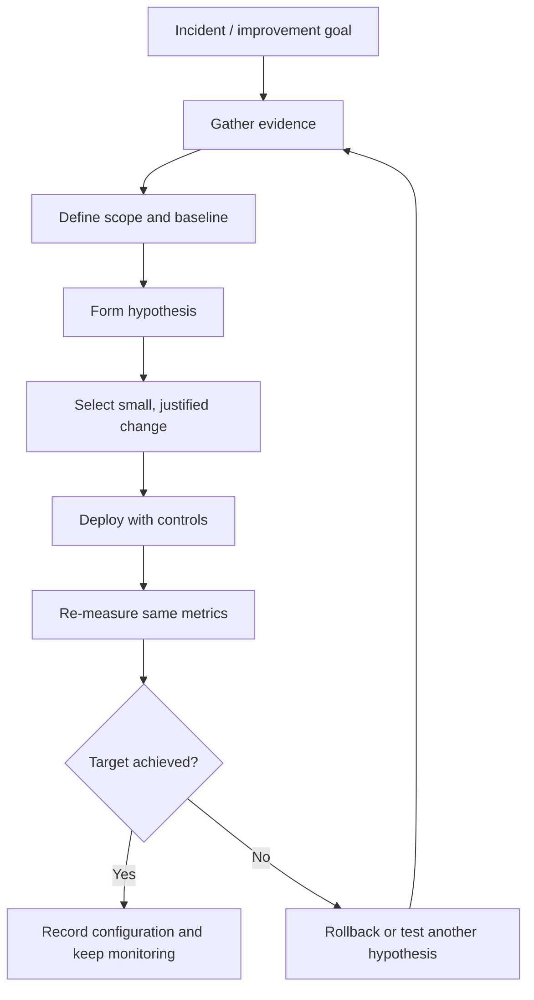
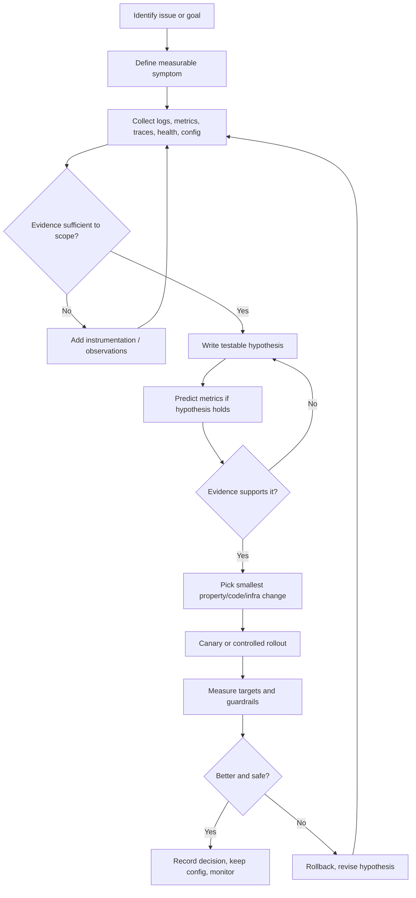

# From Observable Evidence to Configuration Decisions

A Spring Boot application runs slowly, frequently times out, or occasionally fails to start. A familiar suggestion surfaces right away: increase the connection pool, add more threads, raise timeouts, turn on more logging, or add a new profile. Those changes can help, yet without understanding the symptom and root cause, they can also consume more resources, hide real errors, or amplify an outage.

In application design and operations, configuration decisions should begin with **observable evidence**: logs, metrics, traces, health indicators, runtime details, and deployment conditions. From there, form a hypothesis, identify the relevant properties, make a controlled change, and measure the outcome again.

This workflow distinguishes whether:

- The application is genuinely starved for resources or simply waiting on an external dependency.
- A timeout is too short or a downstream system is responding slowly.
- A thread pool lacks workers or workers are blocked on I/O.
- An auto-configuration is not applied or a bean is overridden by another configuration.
- A property change is sufficient, or code, architecture, or infrastructure must change.

This lesson focuses on moving from observable signals to reasoned, verifiable, and reversible configuration decisions in Spring Boot.

## 1. Why Should You Not Change Configuration by Intuition?

Suppose an API intermittently returns HTTP 503. One quick reaction is increasing:

```properties
spring.datasource.hikari.maximum-pool-size=50
```

However, if the true cause is that the database has already hit its connection limit, raising each instance's pool size pushes total connections past the limit even faster.

Or suppose the application times out calling a payment service. Increasing the HTTP client timeout from 2 seconds to 30 seconds may reduce observed timeout errors, yet cause requests to hold threads longer, grow queues, and trigger a larger bottleneck.

A configuration change can:

- Fix the actual problem.
- Temporarily mask symptoms only.
- Shift the bottleneck to another component.
- Increase CPU, memory, connection, or network costs.
- Reduce visibility into real failures.
- Create drift across local, test, staging, and production.

Therefore, before editing a property, answer three questions:

1. **What is observed?** Which specific logs, metrics, traces, timestamps, or errors exist?
2. **Which hypothesis explains the evidence?** What measurements can test that hypothesis?
3. **Which change targets the real cause, and how will we confirm the outcome?**



This is an investigative feedback loop. The goal is not changing as many properties as possible, but finding a change with a clear causal link to the desired outcome.

## 2. What Constitutes Observable Evidence?

No single signal explains everything. Each data source answers a different set of questions.

| Source | What It Tells You | Example Question |
|---|---|---|
| Logs | Events, exceptions, messages over time | At which step did the failure occur? |
| Metrics | Aggregated measurements over time | How did latency, throughput, error rate, and queue depth change? |
| Distributed traces | Path of a single request across services | Which service consumed the time? |
| Health indicators | Status of components the app checks | Are the database and cache reachable? |
| JVM/runtime data | Heap, GC, threads, classloading, CPU | Is there memory pressure or thread contention? |
| Configuration evidence | Effective property values and property sources | Which property value is actually active? |
| Deployment evidence | Image version, profile, replicas, resource limits | Which instances or versions are affected? |

A timeout log shows a request did not finish on time, not necessarily why. Rising latency metrics show a systemic pattern, whereas traces pinpoint waiting time on a downstream call. A `DOWN` health indicator shows a component failed its health check, not whether to raise a timeout or fix networking.

### Evidence Needs Context

Two log lines:

```text
2026-11-13 10:21:04.110 WARN  PaymentClient - Request timed out
2026-11-13 10:21:04.115 INFO  OrderService - Order processing completed
```

These two lines are not enough to conclude the timeout had no business impact. The second log may belong to a different request. You need a correlation ID, trace ID, or request ID to correlate events accurately.

Contextualized log example:

```text
traceId=8f21... spanId=31ab...
orderId=ORD-1042 operation=authorize
downstream=payment-provider duration=2000ms outcome=timeout
```

In practice, use structured logging and tracing context rather than ad-hoc string concatenation. Never log tokens, passwords, card numbers, or sensitive personal data just for observability.

## 3. Establish a Baseline Before Making Changes

A baseline is the measured state prior to a change. Without a baseline, you cannot tell whether new settings improved performance or simply coincided with lower traffic.

A minimal baseline should capture:

- Observation window and time zone.
- Application version, active profile, and environment.
- Instance/replica count and CPU/memory limits.
- Traffic: requests per second, request mix, payload sizes.
- Latency p50/p95/p99 if available.
- Error rates and exception types.
- Metrics related to the suspect area (e.g., active/pending connections, busy/queued threads, heap/GC).
- Status of external dependencies such as databases, caches, and payment providers.

Example baseline table:

| Metric | Before Change | Window | Scope |
|---|---:|---|---|
| Request rate | 180 req/s | 15 minutes | 3 replicas |
| p95 latency | 1.4 s | 15 minutes | POST /orders |
| Error rate | 2.1% | 15 minutes | HTTP 5xx + timeouts |
| Hikari active | 20/20 | 15 minutes | Per instance |
| Hikari pending | p95 = 8 | 15 minutes | Per instance |
| CPU | 45% | 15 minutes | Container |

These numbers are examples. When measuring for real, compare similar traffic profiles, code versions, and environmental conditions.

### Do Not Compare Only Averages

Average latency can look healthy even while a subset of requests suffers severe slowdowns. `p95`/`p99` exposes tail latency. Likewise, low average CPU does not rule out brief spikes causing request timeouts.

Do not pick metrics merely because they are easy to view. Pick metrics directly tied to the hypothesis under test.

## 4. Distinguish Symptoms, Proximate Causes, and Root Causes

An incident usually has multiple layers:

```text
Symptom:
  POST /orders returns 503

Proximate cause:
  Failed to acquire a database connection within the wait timeout

Deeper causes may include:
  - Queries holding connections too long
  - Database overloaded
  - Pool too small for actual load
  - Too many replicas opening large pools
  - Connection leaks
  - Intermittent database networking
```

Seeing 503 and immediately increasing the pool jumps from a symptom to an unproven remedy. Gather further evidence to distinguish the causes.

### A Good Hypothesis Can Be Falsified

Example:

**Hypothesis:** requests are waiting because the Hikari pool is exhausting connections.

**Supporting evidence to look for:**

- Active connections stay near `maximumPoolSize`.
- Pending threads rise alongside p95 latency.
- Traces show significant time waiting to borrow connections.
- The database still has capacity and is not hitting server-side connection limits.

**Refuting evidence:**

- The pool has plenty of idle connections.
- Pending count is 0 during request timeouts.
- Traces show most duration spent in an HTTP call to the payment provider.

If refuting evidence appears, do not increase the pool simply because an error message somewhere mentions "connection."

## 5. Using Spring Boot Actuator to Observe Runtime

Actuator exposes endpoints to inspect health, metrics, environment/configuration, and other operational data. Example dependency:

```groovy
dependencies {
    implementation 'org.springframework.boot:spring-boot-starter-actuator'
}
```

Commonly used endpoints:

| Endpoint ID | Purpose |
|---|---|
| `health` | Application health status |
| `metrics` | List and read Micrometer metrics |
| `prometheus` | Export metrics for Prometheus when a matching registry is present |
| `env` | Inspect Environment and property sources per security policy |
| `configprops` | View bound `@ConfigurationProperties` |
| `loggers` | Inspect or adjust log levels when permitted |
| `threaddump` | Investigate thread states |
| `heapdump` | Analyze heap; contains in-memory data and is highly sensitive |

Not every endpoint is exposed by default. In modern Spring Boot, default HTTP exposure typically includes only `health`. To expose more endpoints, configure an allowlist:

```properties
management.endpoints.web.exposure.include=health,metrics,configprops
```

Or YAML:

```yaml
management:
  endpoints:
    web:
      exposure:
        include: health,metrics,configprops
```

Expose only needed endpoints, protect them with authentication/authorization, and restrict network access. Endpoints like `env`, `heapdump`, `configprops`, or `loggers` can reveal sensitive data or alter runtime behavior.

### Health Answers a Narrow Question

Example:

```bash
curl http://localhost:8080/actuator/health
```

Health `UP` indicates aggregated health indicators report `UP` per configuration. It does not prove every business use case works, nor does it show per-endpoint latency.

A database health indicator reporting `DOWN` is evidence of a failed database check, yet you must inspect which component failed, which exception occurred, and when. Do not raise timeouts just to flip health to `UP` when the true cause is invalid credentials or an unreachable database.

## 6. Metrics Help Distinguish Resource Bottlenecks

Metrics are numerical measurements tracked over time. Micrometer is the instrumentation facade integrated with Spring Boot.

Listing available metrics:

```text
GET /actuator/metrics
```

Inspecting a specific metric:

```text
GET /actuator/metrics/jvm.memory.used
GET /actuator/metrics/http.server.requests
```

Exact metric names and tags depend on registries, instrumentation, framework versions, and configuration. Never assume every application has every metric or identical names across versions.

Useful metric groups:

| Group | Questions Answered |
|---|---|
| HTTP server | Request rate, latency, status codes by route/method |
| Database pool | Active, idle, pending connections, timeouts |
| JVM memory | Heap usage, non-heap, allocation |
| Garbage collection | Pause duration, frequency, allocation pressure |
| Threads/executors | Active threads, queue size, rejected tasks |
| Cache | Hit/miss, evictions, size if instrumented |
| HTTP client | Request duration, errors, connection pool if instrumented |

### Read Metrics in Context Together

Example:

```text
Hikari active connections ↑
Hikari pending threads ↑
Request p95 latency ↑
Database CPU ↑
```

This combination suggests connection contention or database saturation. Conversely, if:

```text
Hikari active connections steady
Hikari pending = 0
HTTP client latency to payment provider ↑
Request p95 latency ↑
```

there is no evidence for increasing the database pool. Investigate the downstream HTTP call instead.

### Watch Out for Metric Cardinality

Do not create metric tags from near-unique values such as user IDs, order IDs, or raw URLs containing path parameters. Time series counts can explode, driving up memory usage and monitoring costs. Use route templates, operation names, and bounded tag sets.

## 7. Logs and Traces Pinpoint Where Time Is Spent

Logs record events; traces show a request spanning multiple spans. With distributed tracing, a trace might look like:

```text
POST /orders                       2.4 s
├── validate request               4 ms
├── reserve inventory             80 ms
│   └── database query            65 ms
├── authorize payment           2.1 s
│   └── HTTP payment provider    2.0 s
└── persist order                 90 ms
```

If most of the time sits in the payment provider, tuning the Hikari pool addresses the wrong bottleneck. You may instead need to:

- Check provider latency and error rates.
- Check current HTTP client timeouts.
- Check whether retries are extending requests or multiplying load.
- Evaluate whether asynchronous processing fits business requirements.
- Review the overall request deadline.

Traces may be sampled; not every request produces a trace. Always factor in sampling policies and combine traces with logs and metrics when drawing conclusions.

### Log Levels Also Require Justification

When extra logs are needed for investigation, enable `DEBUG` on a narrow package:

```properties
logging.level.com.example.shop.payment=DEBUG
```

Avoid defaulting to:

```properties
logging.level.root=DEBUG
```

because root `DEBUG` generates massive log volume from frameworks and dependencies. Once sufficient evidence is collected, restore normal operational log levels. Never log credentials, tokens, sensitive payloads, or personal data.

## 8. Determine Which Configuration Is Actually Effective

In Spring Boot, property values can come from many sources:

- `application.properties` or `application.yml`.
- Profile-specific files such as `application-prod.yml`.
- Environment variables.
- JVM system properties.
- Command-line arguments.
- Config data imports or external config sources.
- Test property sources and custom application sources.

When the same key appears in multiple sources, precedence rules decide the effective value. Simply reading one config file does not prove the runtime uses that value.

Example:

```properties
# application.properties
server.port=8080
```

At deployment, a command-line argument can override it:

```bash
java -jar app.jar --server.port=8181
```

Or a matching environment variable can supply a different value. Inspect the running process's configuration and actual property sources.

### Use configprops and env Carefully

The `/actuator/configprops` endpoint helps inspect bound configuration properties. `/actuator/env` helps inspect `Environment` and property sources. Because these endpoints can expose settings, never expose them publicly and verify how sanitization is configured.

In a secured development environment, you might inspect:

```text
GET /actuator/configprops
GET /actuator/env/spring.datasource.hikari.maximum-pool-size
```

Exact URLs and response payloads depend on Boot version, exposure settings, and security. If endpoints are locked down, inspect startup logs or use debuggers/tests to verify bound properties rather than relaxing production access just to read one value.

### @ConfigurationProperties Groups Typed Settings

Instead of scattering `@Value` annotations, group related properties:

```java
@ConfigurationProperties(prefix = "app.payment")
public record PaymentClientProperties(
        URI baseUrl,
        Duration connectTimeout,
        Duration readTimeout,
        int maxAttempts
) {}
```

Register via `@ConfigurationPropertiesScan` or `@EnableConfigurationProperties`. Add validation to catch missing or invalid configuration:

```java
@Validated
@ConfigurationProperties(prefix = "app.payment")
public record PaymentClientProperties(
        @NotNull URI baseUrl,
        @NotNull Duration connectTimeout,
        @NotNull Duration readTimeout,
        @Min(1) @Max(5) int maxAttempts
) {}
```

This example assumes `jakarta.validation.constraints.*` imports and a validation provider. Typed configuration makes it clear which properties belong to a feature, simplifying code review and testing.

## 9. Condition Evaluation Report: Evidence for Auto-Configuration Decisions

When an auto-configured bean does not appear, find out whether auto-configuration applied and which conditions failed to match.

Run:

```bash
java -jar app.jar --debug
```

Spring Boot prints a Condition Evaluation Report grouping positive and negative matches. Illustrative snippet:

```text
Positive matches:
  DataSourceAutoConfiguration:
    - Required classes found

Negative matches:
  SomeCacheAutoConfiguration:
    - Did not find required class '...CacheClient'
```

This answers:

- Was the auto-configuration evaluated?
- Are required classes on the classpath?
- Did an application-declared bean cause `@ConditionalOnMissingBean` to back off?
- Were conditional properties set properly?
- Is the application running in the web environment type required by the auto-configuration?

Spring Boot debug mode is not the same as `logging.level.root=DEBUG`. It enables Boot diagnostics and the condition report; business loggers still require their own log levels to emit `log.debug`.

If evidence shows a required class is missing from the classpath, changing timeouts or ports will not help. If a custom bean disabled a condition, decide whether to keep the custom bean or let Boot create the default bean.

## 10. Process for Turning Evidence into a Configuration Decision

A practical workflow breaks down into seven steps:

### Step 1 — Describe the Symptom Measurably

Avoid vague statements like "the app is slow." Be specific:

> Over a 15-minute window under normal traffic, p95 for `POST /orders` rose from 450 ms to 2.3 s, and timeout error rate climbed from 0.2% to 3%.

This defines a clear time window, endpoint, metric, and scope.

### Step 2 — Narrow the Scope

Determine:

- All instances or just one instance?
- All endpoints or a single route?
- Started after a specific deployment version?
- Only one profile, region, or tenant?
- Did traffic, database, network, or downstream systems change at the same time?

A narrow scope reduces the number of hypotheses.

### Step 3 — Gather Relevant Evidence

Combine logs, metrics, traces, health, and runtime configuration. Ensure everything aligns on the same time window and version.

### Step 4 — State a Hypothesis and Prediction

Example:

**Hypothesis:** the database pool is too small for current concurrency.

**Prediction if true:** Hikari pending rises while active hits max; traces show connection wait time; database still has spare capacity.

A good hypothesis generates testable predictions.

### Step 5 — Pick the Smallest Change Targeting the Cause

If evidence confirms the pool hits its cap while the database has spare capacity and query times remain steady, try a modest pool increase on a subset of instances. If the database is already saturated, the right change may be lowering concurrency, tuning queries, or rate-limiting requests.

### Step 6 — Deploy Controlled Changes and Re-Measure

Keep other variables constant whenever possible. Compare the same metrics under comparable traffic and duration. Watch both target metrics and guardrails that might suffer side effects.

### Step 7 — Keep, Adjust, or Rollback

If goals are met with no unacceptable side effects, document the configuration, rationale, scope, and owner. Otherwise, rollback and revisit the hypothesis. Never keep a change merely because effort went into deploying it.

## 11. Investigation Example: Should You Increase the Hikari Connection Pool?

Spring Boot typically uses HikariCP when a JDBC datasource is configured. Key properties include:

```properties
spring.datasource.hikari.maximum-pool-size=20
spring.datasource.hikari.minimum-idle=5
spring.datasource.hikari.connection-timeout=30000
```

Meaning:

- `maximum-pool-size`: maximum connections in the pool.
- `minimum-idle`: minimum target idle connections.
- `connection-timeout`: maximum milliseconds to wait for a connection before failing.

Suppose request timeouts occur and pool exhaustion is suspected.

### Evidence to Inspect

- `hikaricp.connections.active`.
- `hikaricp.connections.idle`.
- `hikaricp.connections.pending`.
- `hikaricp.connections.max`.
- Connection timeout logs.
- Query latency and database CPU/connection counts.

Exact metric names vary by Micrometer/registry and version. Check the actual metrics emitted by your application.

### Case A — Evidence Supports Increasing the Pool

Suppose:

| Metric | Observation |
|---|---|
| Active | Hits 20 for most of peak load |
| Idle | Frequently 0 |
| Pending | Rises simultaneously with request latency |
| Database CPU | Has headroom |
| Query duration | Stable |
| DB connection limit | Significant spare headroom |

This is evidence the pool may be the bottleneck. You can test a modest bump from 20 to, say, 24 on a canary instance first.

```properties
spring.datasource.hikari.maximum-pool-size=24
```

Then re-measure pending, latency, DB CPU, connection counts, and error rates. If pending drops yet DB CPU/latency spikes, a larger pool may have shifted the bottleneck to the database.

### Case B — Do Not Increase the Pool

Suppose:

| Metric | Observation |
|---|---|
| Active | 12/20 |
| Idle | 8 |
| Pending | 0 |
| Database CPU | 95% |
| Query duration | Up 4x |

The pool is not exhausted. Raising `maximum-pool-size` pushes even more concurrency onto an already overloaded database. Better investigation paths are query plans, indexes, lock contention, database capacity, and workload shape.

### Calculate Total Connections Across All Replicas

Do not look at one instance's pool size in isolation. If:

- 6 replicas.
- Each replica has `maximum-pool-size=24`.
- Each instance can open up to 24 connections.

then potential total connections are:

```text
6 × 24 = 144 connections
```

This does not yet count other services, migration jobs, admin tools, and monitoring. Compare totals against the database's connection limit and allocate budgets system-wide.

**Pool sizing is a system-wide decision**, not just one property inside a single JVM.

## 12. Investigation Example: Raise HTTP Client Timeout or Fix Downstream?

Suppose a payment provider occasionally responds in 2.5 seconds while the client timeout is 2 seconds.

An illustrative custom client property:

```yaml
app:
  payment:
    connect-timeout: 500ms
    read-timeout: 2s
```

This is an application-specific property that must be bound into a concrete client; it is not a universal Spring Boot built-in HTTP client property.

### Evidence Needed to Distinguish Causes

- Connect time: how long does establishing the connection take?
- Response/read time: after connecting, how long does receiving the response take?
- DNS/TLS: is latency occurring in resolution or handshakes?
- Retries: how many attempts are made per operation?
- Overall deadline: how long is the entire request allowed to run?
- Downstream latency/errors: is the provider degraded?

If connect time is low while response time climbs, raising `connect-timeout` misses the target. If the provider's p99 exceeds the current timeout, coordinate with the provider and design deadlines/retries deliberately.

### Timeouts Must Be Consistent Across the Call Chain

Example:

```text
Client → API Gateway → Spring Boot → Payment Provider

Gateway timeout:        5 s
Application deadline:  4 s
Payment client timeout: 3 s
```

If the payment client timeout exceeds the gateway timeout, the service keeps waiting after the gateway has already returned an error to the caller. If retries are unbounded, a single request can trigger multiple downstream calls and amplify load.

Choose timeouts based on latency distributions, SLAs, caller deadlines, and remaining budget for downstream steps. Do not raise every timeout blindly just to reduce exceptions.

### Retries and Idempotency

Retries are only appropriate for transient failures on operations designed to be retried safely. For payments or order creation, require idempotency keys/guarantees against double-charging. Raising retry counts without verifying idempotency can create duplicate transactions.

If a provider is chronically slow, circuit breakers, bulkheads, queues, or asynchronous processing may fit better than holding request threads longer. Every mechanism needs explicit metrics and limits.

## 13. Investigation Example: Increase Thread Pool or Address Blocking?

Servlet applications normally use the embedded server's request threads. If the thread pool saturates, new requests queue or get rejected depending on server/configuration.

Server-specific properties example:

```properties
server.tomcat.threads.max=200
server.tomcat.threads.min-spare=10
```

These apply when using embedded Tomcat in a matching Boot version. They do not apply identically to Jetty, Undertow, or WebFlux/Netty.

### Evidence to Collect

- Thread dumps: are threads `RUNNABLE`, `BLOCKED`, or `WAITING`?
- Busy/active thread counts and queue depth.
- Request latency per route.
- CPU and memory.
- Downstream latency.
- Concurrent request count.

If threads are mostly waiting on JDBC or HTTP responses, raising max threads simply lets more requests wait simultaneously. That can worsen connection contention, memory pressure, and downstream load.

If CPU has headroom, tasks are short, and queues fill because of a low concurrency cap, a modest increase may help. If CPU is already saturated, adding threads mainly increases context switching.

### Distinguish Tomcat Threads from Task Executors

`server.tomcat.threads.max` tunes embedded Tomcat worker threads. It does not automatically tune `@Async`, scheduler, or message listener executors in the application.

Each executor has its own configuration. Before changing properties, identify which thread pool is actually saturated and which metrics or thread dumps prove it.

## 14. Investigation Example: Should More Actuator Endpoints Be Exposed?

Operations teams want to know whether the app is serving requests and whether the database is reachable. A reasonable decision is exposing `health` and required `metrics`:

```properties
management.endpoints.web.exposure.include=health,metrics
```

If Prometheus scraping is needed, add the matching registry and expose `prometheus`:

```groovy
dependencies {
    implementation 'org.springframework.boot:spring-boot-starter-actuator'
    runtimeOnly 'io.micrometer:micrometer-registry-prometheus'
}
```

```properties
management.endpoints.web.exposure.include=health,prometheus
```

Do not expose every endpoint just to inspect one metric:

```properties
management.endpoints.web.exposure.include=*
```

That expands the attack surface and can leak runtime internals. Expose only needed metrics/endpoints, secure the management server, and restrict network access.

If `health` simply returns `UP`, that is an aggregate signal. To diagnose DB pools or latency, use metrics/traces rather than stuffing dashboard data into health responses.

## 15. Investigation Example: Why Did a Configuration Setting Not Take Effect?

Suppose you edited:

```yaml
spring:
  datasource:
    hikari:
      maximum-pool-size: 24
```

yet at runtime the max pool size still reports 10.

Several possibilities exist:

- The YAML file was not loaded.
- Another active profile overrides the property.
- An environment variable or command-line argument takes higher precedence.
- The app uses a different prefix/property due to custom datasource configuration.
- The `DataSource` bean was constructed manually and does not bind `spring.datasource.hikari.*`.
- The app is running an older artifact/ConfigMap.
- You are inspecting the wrong instance or environment.

Workflow:

1. Verify the running process/instance and version.
2. Check active profiles and config locations/imports.
3. Inspect property sources and effective values with safe tooling.
4. Inspect the actual `DataSource` and created Hikari pool.
5. Determine whether the bean uses Boot auto-configuration or manual declaration.
6. Confirm deployment manifests/ConfigMaps/secrets updated and rolled out cleanly.

Do not edit additional config files until you know which source is winning. When multiple sources set the same property, establish a clear source of truth to prevent drift.

## 16. Profile-Based Configuration: Different Environments, Same Contract

Profiles fit when environments need different configuration values or implementations:

```yaml
# application.yml
app:
  payment:
    connect-timeout: 500ms
    read-timeout: 2s
```

```yaml
# application-dev.yml
app:
  payment:
    base-url: http://localhost:9091
```

```yaml
# application-prod.yml
app:
  payment:
    base-url: https://payments.internal.example
```

Activate the profile via deployment configuration:

```bash
java -jar app.jar --spring.profiles.active=prod
```

Never hardcode the production profile in source code. The same artifact should run across environments with settings supplied by deployment configuration.

### Do Not Use Profiles for Every Feature Toggle

If you only need to toggle an independent feature:

```properties
app.invoice-export.enabled=true
```

then `@ConditionalOnProperty` or a feature-flag mechanism is clearer than inventing new profiles. Profiles should represent meaningful environment/configuration sets, not turn into hundreds of unrelated switches.

## 17. Distinguishing Configuration Changes from Code Changes

Not every problem can be solved with properties.

| Evidence | Possible Appropriate Config Change | When Code / Architecture Change Is Needed |
|---|---|---|
| Pool hits max, DB has spare capacity | Controlled pool adjustment | Queries hold connections too long or connections leak |
| Downstream p99 rises, timeout shorter than SLA | Adjust timeout/deadline | Need async workflow, bulkhead, or different error handling |
| Thread pool lacks workers, CPU has headroom | Bounded concurrency adjustment | Blocking calls or tasks holding threads too long |
| Auto-config bean mismatches property | Fix property/classpath/condition | Need custom implementation or dependency restructuring |
| Logs lack detail in a specific package | Temporarily enable narrow logger | Need structured logging/instrumentation added |
| Health endpoint unreachable from monitor | Fix path/port/network/security | Management access or probe design needs rework |
| Memory grows steadily over time | Adjust heap only with justified sizing | Object retention/memory leak or unbounded cache |

A property can adjust limits, yet it cannot fix resource-wasting logic. For instance, increasing heap size may delay an OOM from a memory leak, without eliminating the leak.

## 18. Change One Variable at a Time

Whenever possible, change only one related group of settings per experiment. If you simultaneously raise pool size, timeouts, thread counts, and retry counts, neither improvements nor regressions can be attributed cleanly.

An experiment can be written down as:

| Element | Content |
|---|---|
| Symptom | p95 of `POST /orders` increased |
| Evidence | Hikari pending rising, active hitting max, DB still has capacity |
| Hypothesis | Current pool size caps service concurrency |
| Change | Raise `maximum-pool-size` from 20 to 24 on one canary |
| Success metric | Pending drops, p95 drops |
| Guardrails | DB CPU, DB connections, error rate, memory |
| Observation window | 15–30 minutes of comparable traffic |
| Rollback | Revert pool size to 20 if guardrails breach thresholds |

Durations here are examples. The observation window must be long enough to cover traffic patterns, warm-up, batch jobs, and periodic tasks.

### Exceptions Requiring Linked Property Changes

Some settings form a coupled unit, such as changing server port alongside updating Service/Ingress target ports. Multiple settings may have to change in the same release; treat them as a single linked change with coordinated rollout order and synchronized rollback.

## 19. Canary Rollout and Rollback

Production configuration changes should have an explicit blast radius:

- Local: verify syntax and basic behavior.
- Test: verify binding, startup, and integration.
- Staging: verify under production-like topology and traffic.
- Canary: apply to a subset of instances or traffic.
- Rollout: expand only while guardrails remain healthy.

A canary needs:

1. Defined code and configuration versions.
2. Percentage of traffic or number of instances tested.
3. Target metrics and rollback thresholds.
4. Observation window.
5. Assigned owner and response channel.
6. Prior configuration ready for rollback.

If error rates climb or a dependency becomes overloaded, rollback early. Do not wait for system-wide degradation just to collect extra data.

### Config Rollout Is Still a Deployment

Changing a property may require restarting processes or rolling Pods. Account for:

- Readiness/liveness probes.
- Graceful shutdown.
- Remaining replicas serving traffic during restarts.
- Compatibility of new config with older code.
- Update order across Secrets/ConfigMaps and Deployments.
- Whether rolling back config restores prior behavior.

Never treat editing a ConfigMap or environment variable as a harmless no-op; depending on how the app reads config, a restart may be required to take effect.

## 20. Dynamic Config vs. Startup-Only Config

Not every property can change while an application is running.

Examples:

- Changing logger levels via Actuator `loggers` can take effect at runtime if the endpoint is enabled and secured.
- Changing `server.port` typically requires restarting the server.
- Changing `management.server.port` typically requires reinitializing the management server/context.
- Changing pool size depends on the datasource/pool implementation and reconfiguration mechanism; never assume editing a config file automatically resizes the pool.
- Changing a `@ConfigurationProperties` value in `Environment` does not mean beans that already injected the old value automatically recreate themselves.

### Environment Does Not Automatically Refresh Every Bean

A bean can receive a property in its constructor:

```java
@Component
public class PaymentClient {
    private final Duration timeout;

    public PaymentClient(
            @Value("${app.payment.read-timeout}") Duration timeout) {
        this.timeout = timeout;
    }
}
```

The value is injected when the bean is created. If the underlying configuration source changes later, `timeout` does not automatically update. You need an explicit refresh/rebind mechanism or bean/context recreation by design.

Before choosing an operational workflow, classify whether a property is:

- Startup-only.
- Read per operation.
- Bound into a long-lived bean.
- Backed by a supported refresh mechanism.
- Mutated through a dedicated management endpoint.

Avoid using "dynamic config" loosely without knowing which components actually observe updates.

## 21. Managing Configuration as a Source of Truth

For decisions to be auditable and repeatable, know where settings originate and who owns them:

- Shared defaults in the repository.
- Profile-specific overrides.
- Secrets from a secret manager.
- Runtime overrides from environment/deployment.
- Feature flags from a flag management system.

Avoid scattering definitions of the same property across files, manifests, and CLI flags without conventions. When overrides are necessary, document why and where they apply.

### Meaningful Property Names

Application properties should be grouped by feature:

```yaml
app:
  payment:
    base-url: https://payments.internal.example
    connect-timeout: 500ms
    read-timeout: 2s
    max-attempts: 2
  inventory:
    reservation-timeout: 1s
```

Clear names help reviewers understand impact. Never invent vague keys like `app.fast=true` or `app.performance=high` that fail to explain which components they alter.

### Never Commit Secrets

Never put passwords, API tokens, private keys, or real credentials in `application-prod.yml`. Use a secret manager, environment injection, or an appropriate security mechanism. When inspecting properties via Actuator or logs, verify sensitive values are sanitized and endpoints are protected.

## 22. Recording Configuration Decisions

A good decision record captures:

- Observed problem.
- Evidence and measurement window.
- Chosen hypothesis.
- Rejected hypotheses and refuting evidence.
- Before and after property values.
- Target environment/scope.
- Target metrics and guardrails.
- Post-change observations.
- Decision to keep, tune, or rollback.

Example:

```markdown
### Decision: Adjust Hikari pool for the orders service

**Symptom:** p95 of POST /orders rose during peak traffic.

**Evidence:** Hikari active hit max=20, pending rose; DB CPU retained headroom and query duration stayed steady.

**Hypothesis:** pool size is constraining service concurrency.

**Change:** canary increase of maximum-pool-size from 20 to 24.

**Guardrails:** DB CPU, total connections, p95, error rate.

**Outcome:** recorded after observation window.

**Decision:** keep or rollback based on observed numbers.
```

This template does not need to be long. What matters is that teammates can understand why a property changed and verify the decision later.

## 23. Common Decision-Making Mistakes

| Mistake | Consequence | Better Approach |
|---|---|---|
| Raising timeouts without checking traces | Requests hold resources longer while the cause persists | Identify time spent per dependency |
| Raising pool size on generic timeouts | Can overload the database | Inspect active/idle/pending and DB capacity |
| Raising thread counts when CPU is saturated | Higher context switching and contention | Read thread dumps, CPU, and downstream latency |
| Enabling root `DEBUG` in production | Huge logs, risk of leaking data | Enable narrow loggers temporarily |
| Exposing all Actuator endpoints for convenience | Expands attack surface | Allowlist endpoints, secure network/access |
| Editing multiple properties at once | Cannot tell which change had an effect | Run controlled experiments |
| Looking only at averages | Misses tail latency | Track `p95`/`p99` and relevant percentiles |
| Looking at only one instance | Misses load skew or config drift | Compare across instances, versions, and zones |
| Not verifying effective values | Wrong file edited or overridden elsewhere | Verify Environment and deployment sources |
| Keeping new config despite worse metrics | Increases operational debt | Define rollback thresholds before deploying |
| Confusing health `UP` with healthy business flows | Misses failures in other routes/dependencies | Combine health, metrics, traces, and synthetic checks |
| Using profiles for every feature toggle | Explosion of config combinations | Use properties, conditions, or feature flags |

## 24. Practice Exercise: Investigating a Slow API

Suppose a Spring Boot service exposes:

```text
POST /orders
```

After a traffic increase, p95 jumps from 500 ms to 2 seconds. Walk through these steps:

1. Identify the start timestamp and deployed version.
2. Compare request rate, p50/p95/p99, and error rate before vs. after.
3. Inspect traces of slow requests; identify the span consuming the most time.
4. If suspecting the database, check Hikari active/idle/pending and database CPU/connections.
5. If suspecting the payment provider, check downstream latency, timeouts, and retry counts.
6. Write at least two hypotheses and state evidence that would refute each.
7. Choose the smallest change supported by evidence.
8. Test locally, in staging, or on a canary.
9. Re-measure the same metrics and watch guardrails.
10. Decide whether to keep or rollback, and document the reasoning.

Recording template:

| Question | Finding |
|---|---|
| Measured symptom | ... |
| Version/profile/replicas | ... |
| Which span does the trace show is slow? | ... |
| What signals do pools/threads/downstream show? | ... |
| Primary hypothesis | ... |
| Supporting evidence | ... |
| Refuting evidence | ... |
| Proposed property change | ... |
| Success metric | ... |
| Guardrails | ... |
| Post-experiment outcome | ... |
| Final decision | ... |

There is no fixed answer saying to raise the pool or raise the timeout. The purpose of the exercise is reaching a decision justified by collected data.

## 25. Overall Decision Flowchart



## 26. Key Takeaways

A high-quality configuration decision starts from a measurable symptom, not a familiar property.

- Use **logs** to understand events and exceptions.
- Use **metrics** to spot trends, saturation, and tail latency.
- Use **traces** to pinpoint which component consumes request time.
- Use **health** to observe status across defined indicators.
- Use **runtime/configuration evidence** to know which values are effective and which beans are actually registered.
- Use **deployment evidence** to understand running versions, profiles, replicas, and resource limits.

From that evidence, write a falsifiable hypothesis, pick the smallest change addressing the cause, roll it out under controlled scope, and re-measure with the same metrics. Always evaluate side effects across CPU, memory, connections, queues, security, and operational cost. If goals are missed or guardrails degrade, rollback and resume investigation.

**Configuration is a verifiable engineering decision.** When rationale, scope, results, and rollback paths are recorded clearly, teams understand why the system runs with its current values and can adjust them confidently as new evidence emerges.
