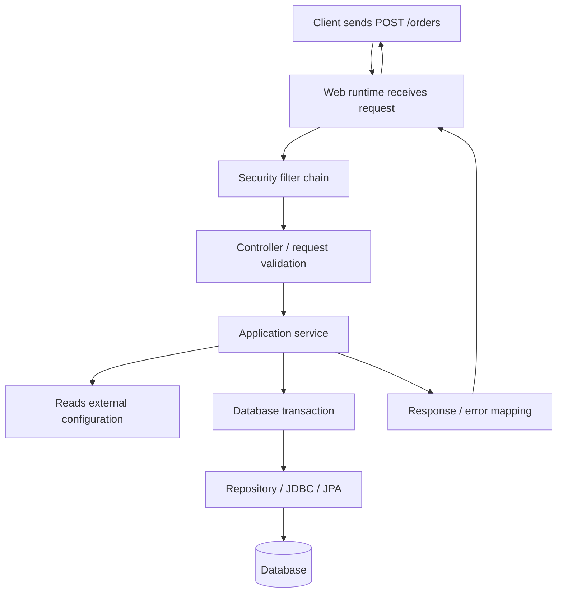
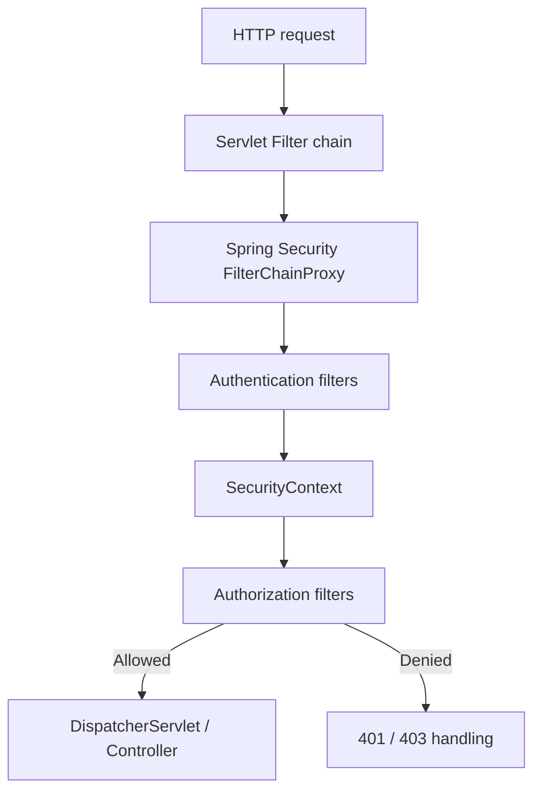
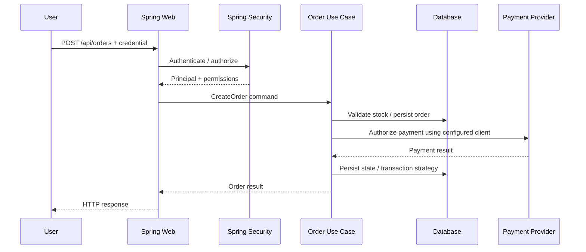

# Next-Step Learning Boundaries: Web Runtime, External Configuration, Data, and Security

Completing Spring Boot Fundamentals gives you an understanding of how a Spring Boot application boots, creates beans, reads configuration, serves requests, writes logs, and exposes operational state. However, merely getting an application to start is not enough to operate a secure, reliable web system. When stepping into real-world problems, four knowledge areas deserve deeper study: **web runtime**, **external configuration**, **data management**, and **security**.

These are your next-step learning boundaries: each area has its own concepts, APIs, and design decisions, yet they connect inside every live request. A single request passes through the web runtime, is authenticated by the security filter chain, relies on external configuration to pick endpoints and datasources, executes transactions on data, and returns a response through the server runtime.

This lesson clarifies:

- What Spring Boot Fundamentals has already provided and what needs deeper study.
- The core concepts in web runtime, external configuration, data, and security.
- How these areas cooperate within an application.
- A recommended sequence for further study along with hands-on exercises to validate your understanding.
- How to choose documentation and Spring Boot versions accurately so you avoid learning deprecated APIs.

The goal is not to memorize every framework or extension library. The goal is to recognize **responsibility boundaries**, understand which question belongs to which area, and know when a problem requires deeper domain expertise.

## 1. Where Does Spring Boot Fundamentals Stop?

Foundational topics normally enable you to:

- Create a project, configure dependencies, and run the application.
- Understand auto-configuration, component scanning, and dependency injection.
- Build controllers, services, repositories, and bean configurations.
- Read properties from application files, profiles, and command-line arguments.
- Use validation, exception handling, and logging.
- Connect to a basic database and observe the application with Actuator.
- Diagnose common startup and dependency errors.

That is the foundation for building applications, though it does not cover every question that arises when a system faces real traffic, multiple environments, multiple services, and critical data:

| Development/Operational Question | Area for Deeper Study |
|---|---|
| Through which layers is a request processed? How are threads managed? | Web runtime |
| When should you use Servlet/MVC, and when consider reactive? | Web runtime |
| Where does production configuration come from, and which source takes precedence? | External configuration |
| How are secrets managed and configuration changes rolled out safely? | External configuration |
| Which operations does a transaction span? How do isolation and locking behave? | Data management |
| How does the database schema evolve across multi-version deployments? | Data management |
| Who is the user? What are they permitted to do? | Security |
| What problems do sessions, CSRF, CORS, OAuth2, and JWT solve? | Security |

A quick boundary heuristic: if a question relates to **request lifecycle and server resources**, start in web runtime; if it relates to **environment-specific config values and secrets**, start in external configuration; if it relates to **data consistency and lifecycle**, start in data management; if it relates to **identity, permissions, and trust boundaries**, start in security.

## 2. Viewing the Application as an End-to-End Flow

Picture a request creating an order:



This is a conceptual diagram. At actual runtime, configuration has usually already been loaded during startup; requests do not necessarily re-read config files from scratch. The security filter chain runs before the controller in most Servlet apps; transactions typically open at the service boundary via a proxy or transaction manager; responses also pass through message converters and server connectors.

Each area has a primary guiding question:

- **Web runtime:** which components does a request traverse, how are threads/resources used, and how is the response written back?
- **External configuration:** which values does the app receive, from what source, at what lifecycle stage, and how are sensitive values protected?
- **Data:** across what boundaries are data changes committed or rolled back, and how are schema evolution and concurrent access managed?
- **Security:** on what identity is the request trusted, where are permissions enforced, and what data may be accessed?

Do not fix a problem in one area by randomly tweaking configuration in another. Increasing the server thread pool will not cure transactions held too long; loosening CORS will not grant API authorization; changing a datasource URL will not fix a broken schema migration.

## 3. Area 1 — Web Runtime

The web runtime is the environment that accepts, dispatches, and completes application requests and responses. In Spring Boot, choosing a web stack shapes server type, programming model, lifecycle, and resource usage.

### 3.1. Servlet and Spring MVC

A Spring MVC application typically builds on the Servlet API and runs on an embedded Servlet container such as Tomcat, Jetty, or Undertow depending on dependencies and configuration.

Simplified flow:

```text
TCP connection
    ↓
HTTP connector
    ↓
Servlet container
    ↓
Filter chain
    ↓
DispatcherServlet
    ↓
HandlerMapping / HandlerAdapter
    ↓
Controller
    ↓
Service
    ↓
Response conversion
```

Concepts to study next:

- Servlet containers and embedded servers.
- Connectors, ports, context paths, and request mappings.
- Servlet `Filter` and Spring MVC `HandlerInterceptor`.
- `DispatcherServlet`, `HandlerMapping`, and `HandlerAdapter`.
- Controller argument resolution and HTTP message converters.
- Multipart uploads, request size limits, and timeouts.
- Error dispatch, exception resolvers, and response status handling.
- The thread-per-request/blocking model of the Servlet stack.

**Filters and interceptors do not sit in the same layer.** Filters belong to the Servlet layer and wrap broader request processing; interceptors belong to Spring MVC handler execution and typically operate once a handler/controller is resolved. Servlet security commonly integrates via the filter chain.

Filter example:

```java
@Component
public class RequestTimingFilter extends OncePerRequestFilter {
    private static final Logger log =
            LoggerFactory.getLogger(RequestTimingFilter.class);

    @Override
    protected void doFilterInternal(
            HttpServletRequest request,
            HttpServletResponse response,
            FilterChain filterChain)
            throws ServletException, IOException {

        long start = System.nanoTime();
        try {
            filterChain.doFilter(request, response);
        } finally {
            long elapsed = System.nanoTime() - start;
            log.info("method={} uri={} status={} elapsedMs={}",
                    request.getMethod(),
                    request.getRequestURI(),
                    response.getStatus(),
                    elapsed / 1_000_000);
        }
    }
}
```

This compact example illustrates where a Filter sits; in production apps, prefer proper tracing/metrics instrumentation, avoid logging URIs that may contain sensitive data, and avoid casually logging request/response bodies.

### 3.2. Threading, Blocking, and Async

In traditional Servlet MVC, a request typically executes on a single worker thread for most of its synchronous work. If the controller invokes blocking JDBC or a blocking HTTP client, that thread can be held while waiting on I/O.

Points to understand:

- Embedded server thread pools are bounded.
- A blocked thread still holds resources even when CPU is idle.
- Raising thread counts can boost concurrency, yet also increases memory usage, context switching, and pressure on downstream dependencies.
- Async requests do not automatically make internal code non-blocking.
- `@Async` uses a separate executor; it is not a switch turning all of MVC reactive.

If a service runs a long blocking query, the request worker thread may stay tied up until the query completes. Before changing concurrency settings, measure latency, thread utilization, and database wait time.

### 3.3. Spring WebFlux and Reactive Runtime

Spring WebFlux is a reactive web stack, typically paired with Project Reactor and a server like Reactor Netty. It supports asynchronous/non-blocking processing and backpressure across reactive pipelines.

Example:

```java
@RestController
@RequestMapping("/catalog")
public class CatalogController {
    private final CatalogService catalogService;

    public CatalogController(CatalogService catalogService) {
        this.catalogService = catalogService;
    }

    @GetMapping("/{id}")
    public Mono<CatalogItem> get(@PathVariable String id) {
        return catalogService.findById(id);
    }
}
```

`Mono<T>` represents at most one result; `Flux<T>` represents a sequence of 0..N items. Reactive programming is far more than changing a return type from `T` to `Mono<T>`.

Topics requiring deeper study:

- `Publisher`, `Subscriber`, `Subscription`, and demand.
- `Mono`, `Flux`, and operator composition.
- Backpressure and buffering.
- Schedulers and switching execution contexts.
- Error signals, retries, and cancellation.
- Context propagation and tracing.
- Reactive database and HTTP clients.
- How to avoid calling blocking APIs on event-loop threads.

A common mistake is calling blocking JDBC directly on the WebFlux event loop. That degrades concurrency because event-loop threads get stalled. If your workload relies predominantly on blocking JDBC/JPA and the team does not require end-to-end reactive flows, Spring MVC is usually simpler.

### 3.4. Choosing MVC or WebFlux?

| Characteristic | Spring MVC / Servlet | Spring WebFlux |
|---|---|---|
| Programming model | Imperative, typically blocking | Reactive, non-blocking when stack supports it |
| Thread model | Worker thread processes request | Event loop and schedulers |
| Data access | Natural fit for JDBC/JPA | Reactive data access requires matching drivers/clients |
| Complexity | Accessible for traditional CRUD apps | Requires understanding Reactor, backpressure, and cancellation |
| Best fit | Business apps with blocking dependencies | High I/O concurrency, streaming, or end-to-end reactive |

Do not choose WebFlux merely because you heard it is faster. Real performance depends on workload, downstream latency, pools, CPU, serialization, and blocking usage. Benchmark against realistic workloads.

### 3.5. Server Lifecycle and Graceful Shutdown

Web runtimes do more than open a listening socket. When stopping an application, the server needs to stop accepting new requests, allow in-flight requests a grace period to finish, and close resources cleanly in lifecycle order.

Topics to study next:

- Startup phases and application context refresh.
- Embedded server initialization.
- Graceful shutdown.
- Readiness and liveness probes.
- Shutdown timeouts.
- Signal handling inside containers.
- Connection draining at load balancers.

Even when the JVM performs graceful shutdown, errors still happen if the load balancer continues routing traffic to a terminating instance. Coordinate readiness probes, deployment strategy, and server lifecycle together.

## 4. Area 2 — External Configuration

External configuration supplies values to the application from outside the build artifact: files, environment variables, system properties, command-line arguments, config servers, or secret managers.

The goal is allowing the exact same binary to run across multiple environments with appropriate values, without modifying source code or repackaging per environment.

### 4.1. Property Sources and Precedence

Spring Boot constructs `Environment` from multiple property sources. Common sources include:

- Default properties set by the application.
- Config data files such as `application.properties`/`application.yml`.
- Profile-specific configuration files.
- Environment variables.
- JVM system properties.
- Command-line arguments.
- Test property sources.
- Config data imports and additional configuration sources.

When the same key exists in multiple sources, precedence order determines the effective value. For example:

```properties
# application.properties
server.port=8080
```

Running:

```bash
java -jar app.jar --server.port=8181
```

normally lets the command-line property override the value in the application file under Boot's default precedence.

Never conclude which port a server uses just by reading a YAML file. Check active profiles, config locations/imports, environment variables, and command-line arguments on the live process.

### 4.2. Profiles and Configuration Groups

Profiles let you organize configuration sets by environment or deployment condition:

```yaml
# application.yml
server:
  port: 8080
app:
  payment:
    connect-timeout: 500ms
    read-timeout: 2s
```

```yaml
# application-dev.yml
app:
  payment:
    base-url: http://localhost:9091
```

```yaml
# application-prod.yml
app:
  payment:
    base-url: https://payments.internal.example
```

Activating a profile:

```bash
java -jar app.jar --spring.profiles.active=prod
```

Profiles should represent meaningful configuration groupings. Avoid creating dozens of profiles for every small feature toggle, as combinations rapidly become unmanageable.

### 4.3. @ConfigurationProperties and Type-Safe Configuration

For settings belonging to a cohesive feature, bind them into a strongly typed object:

```java
@ConfigurationProperties(prefix = "app.payment")
public record PaymentProperties(
        URI baseUrl,
        Duration connectTimeout,
        Duration readTimeout,
        int maxAttempts
) {}
```

Register with `@ConfigurationPropertiesScan` or `@EnableConfigurationProperties`.

You can add validation:

```java
@Validated
@ConfigurationProperties(prefix = "app.payment")
public record PaymentProperties(
        @NotNull URI baseUrl,
        @NotNull Duration connectTimeout,
        @NotNull Duration readTimeout,
        @Min(1) @Max(5) int maxAttempts
) {}
```

This example requires a validation provider and matching imports. Type-safe configuration helps:

- Group related properties.
- Use expressive types such as `Duration`, `URI`, and `DataSize`.
- Validate at startup.
- Simplify unit testing.
- Reduce scattered string property keys throughout code.

### 4.4. External Config Does Not Mean Dynamic Refresh

Externalizing a property to the environment does not mean every value can change while the application is running.

For example:

- `server.port` is normally read when the server binds at startup.
- `DataSource`/connection pools are typically built during context initialization.
- A bean holding a constructor-injected value does not automatically update when `Environment` changes.
- Certain components expose dedicated runtime APIs for state changes, such as logger levels.

Identify when a property is read and which component consumes it. If dynamic refresh is truly needed, adopt an explicit refresh/rebind mechanism and understand its impact on bean lifecycles rather than just editing a config file.

### 4.5. Secret Management

Credentials, passwords, API tokens, private keys, and certificate passphrases are sensitive data. Never commit them to Git or write them to logs.

Concepts to study next:

- Secret managers and secret rotation.
- Environment injection vs. mounted secret files.
- Least privilege for application identities.
- Encryption at rest and in transit.
- Redaction in logs and telemetry.
- Sanitization when exposing Actuator `env`/`configprops`.
- Differences in provisioning secrets across local, CI, and production.

A practical principle: an application should receive only the secrets it needs, for only as long as needed, from a controlled source. Never share a single admin database account across all services simply out of configuration convenience.

### 4.6. Config Server and Distributed Configuration

When operating many applications or instances, teams may need centralized configuration management. Spring Cloud Config is one option in the Spring Cloud ecosystem.

This is an extension topic, not a mandatory requirement for every Spring Boot app. When exploring it, study:

- Config Server and Config Client.
- Repository backends and versioning.
- Profiles/labels and config resolution.
- Authentication, authorization, and TLS.
- Refresh semantics and event propagation.
- Behavior when the config server is unavailable.

Do not introduce a Config Server just because an app has a couple of YAML files. For a single simple service, Spring Boot's standard externalized configuration is often sufficient.

## 5. Area 3 — Data Management

Data management spans how applications connect, read/write, preserve consistency, manage schema evolution, and operate data stores. Repository abstractions are only one piece of this area.

### 5.1. JDBC, Spring Data JDBC, and JPA

Common choices:

| Technology | Model | Best Fit |
|---|---|---|
| JDBC / JdbcTemplate | Explicit SQL, manual mapping or row mappers | Direct control over SQL and transactions |
| Spring Data JDBC | Aggregate-oriented persistence, lighter abstraction than JPA | Relatively straightforward domain models wanting predictable SQL |
| Spring Data JPA / Hibernate | ORM, entity lifecycle, persistence context | Domains needing relationship mapping and identity lifecycles |
| R2DBC | Reactive relational data access | Reactive apps with supported drivers/databases needing non-blocking I/O |

No single choice wins for every system. JPA simplifies entity and relationship persistence, yet brings persistence context, lazy loading, dirty checking, and query pitfalls you must master. JDBC offers direct SQL control while leaving more mapping responsibility to the application.

### 5.2. Entities, DTOs, and Domain Models

Never assume objects exposed in your HTTP API should be the same classes as JPA entities.

- **Request/response DTOs:** represent the HTTP contract.
- **Domain models:** express business rules and behavior.
- **Persistence entities:** describe how data is persisted/loaded via ORM.
- **Projections/read models:** optimize data shapes for read queries.

DTO example:

```java
public record CreateOrderRequest(
        @NotBlank String customerId,
        @NotEmpty List<OrderLineRequest> lines
) {}
```

Illustrative entity example:

```java
@Entity
@Table(name = "orders")
public class OrderEntity {
    @Id
    @GeneratedValue(strategy = GenerationType.IDENTITY)
    private Long id;

    @Column(nullable = false)
    private String customerId;

    @Enumerated(EnumType.STRING)
    @Column(nullable = false)
    private OrderStatus status;
}
```

These models serve different boundaries. Do not return entities straight over HTTP if doing so exposes internal fields, triggers lazy relations, or couples persistence schemas to your public API.

### 5.3. Transaction Boundaries

Transactions group data operations that must commit or roll back as a single unit.

Example:

```java
@Service
public class TransferService {
    private final AccountRepository accountRepository;

    public TransferService(AccountRepository accountRepository) {
        this.accountRepository = accountRepository;
    }

    @Transactional
    public void transfer(long fromId, long toId, BigDecimal amount) {
        Account from = accountRepository.findById(fromId).orElseThrow();
        Account to = accountRepository.findById(toId).orElseThrow();

        from.withdraw(amount);
        to.deposit(amount);
    }
}
```

Within a transaction, both updates must succeed or roll back together according to transaction manager and database semantics.

Topics for deeper study:

- `@Transactional` and proxy-based interception.
- Propagation: `REQUIRED`, `REQUIRES_NEW`, `MANDATORY`, etc.
- Isolation levels and dirty/non-repeatable/phantom reads.
- Rollback rules and checked vs. unchecked exceptions.
- Read-only transactions and provider-specific semantics.
- Transaction managers and multiple datasources.
- Self-invocation bypassing the proxy.
- Why transactions do not automatically wrap external HTTP calls.

Avoid holding broad transactions open across long-running work such as waiting on user input or slow external API calls. Database connections and locks can stay held throughout that wait.

### 5.4. Concurrency, Locking, and Consistency

Two requests can update the same record simultaneously. Without an explicit concurrency strategy, data can suffer lost updates or invariant violations.

Key concepts:

- Optimistic locking via `@Version`.
- Pessimistic locking and database locks.
- Unique constraints and foreign keys.
- Isolation levels.
- Atomic updates and conditional SQL.
- Idempotency for retryable operations.
- Deadlock detection and retry policies.

Optimistic locking example:

```java
@Entity
public class InventoryItem {
    @Id
    private Long id;

    private int availableQuantity;

    @Version
    private long version;
}
```

ORMs can use the version column to detect conflicting updates. When concurrent modification occurs, the application must decide whether to fail, retry, or reconcile per business rules. `@Version` does not automatically resolve conflicts on your behalf.

### 5.5. Schema Migrations

As applications release new versions, database schemas evolve as well. Using versioned migrations such as Flyway or Liquibase keeps schema changes repeatable and reviewable.

Example SQL migration:

```sql
ALTER TABLE orders
    ADD COLUMN fulfillment_status VARCHAR(32);
```

Important topics:

- Versioned migrations vs. repeatable migrations.
- Migration checksums and execution history.
- Expand-and-contract migrations.
- Compatibility between older/newer app code and the schema.
- Large-scale data backfills.
- Table locks and downtime during DDL changes.
- Roll-forward vs. rollback strategies.

Adding a nullable column is often backward-compatible with older code; immediately renaming or dropping a column can break live instances. In multi-replica deployments, sequence schema changes alongside code rollouts.

### 5.6. Query Performance and Persistence Behavior

When using JPA/Hibernate, understand:

- Lazy vs. eager fetching.
- The N+1 query problem.
- Fetch joins and entity graphs.
- Pagination and sorting.
- Batch inserts and updates.
- Persistence context and dirty checking.
- First-level and second-level caching.
- SQL logging and query execution plans.
- Indexes and selectivity.

Do not inspect only repository method duration. Inspect the actual SQL emitted, query counts, row counts, lock waits, and execution plans. A short Java method can fire hundreds of queries via lazy graph traversal.

### 5.7. Cross-System Transactions

A database transaction does not automatically cover an HTTP request to a payment provider or message broker. When a use case coordinates multiple systems, study:

- Transactional outbox.
- Sagas and compensating actions.
- Idempotent consumers.
- Retries and dead-letter queues.
- Eventual consistency.
- Exactly-once claims and practical limitations.

Do not hold a database transaction open while waiting on an external service expecting both systems to roll back together. Each system owns its own transaction boundary; design explicit recovery flows.

## 6. Area 4 — Security

Security is far more than adding the Spring Security dependency. It is designing trust boundaries: who is calling, what they are allowed to do, how credentials are verified, and which data is protected.

### 6.1. Authentication and Authorization

Two core concepts:

- **Authentication:** verifying identity — who is the caller?
- **Authorization:** deciding permissions — what can that identity do on which resource?

Examples:

| Request | Authentication | Authorization |
|---|---|---|
| User views their own profile | Verify session/token | Can only read the profile belonging to that user |
| Admin views system-wide report | Verify identity | Requires appropriate admin role/authority |
| Service calls another service | Verify workload/client identity | Permitted only for granted scopes/APIs |

An authenticated user does not gain access to every order. Authorization must account for resource ownership, tenant boundaries, and business policies.

### 6.2. Security Filter Chain

In Servlet applications, Spring Security typically operates through the Servlet Filter chain. Requests pass through security filters before reaching `DispatcherServlet` or controllers.



This diagram is simplified; exact filter ordering depends on configuration and authentication mechanisms. The key takeaway is that security enforces checks before business controllers and can reject requests before controller execution begins.

### 6.3. SecurityFilterChain and Request Authorization

In modern Spring Security, configuration typically declares a `SecurityFilterChain` bean:

```java
@Configuration
@EnableWebSecurity
public class SecurityConfiguration {

    @Bean
    SecurityFilterChain applicationSecurity(HttpSecurity http)
            throws Exception {
        return http
                .authorizeHttpRequests(authorize -> authorize
                        .requestMatchers("/public/**").permitAll()
                        .requestMatchers("/admin/**").hasRole("ADMIN")
                        .anyRequest().authenticated()
                )
                .formLogin(Customizer.withDefaults())
                .build();
    }
}
```

This example illustrates session/form login for a web application. Stateless APIs using bearer tokens use different configuration. Pick the mechanism matching your clients and threat model.

Do not copy outdated `WebSecurityConfigurerAdapter` snippets into modern Spring Security versions; that adapter was removed from the modern configuration model. Follow documentation matching your version.

### 6.4. Password Storage

If the application manages passwords itself, never store plaintext passwords or reversible encryption. Use proper password hashing with salt and an adaptive cost factor via `PasswordEncoder`.

Example:

```java
@Bean
PasswordEncoder passwordEncoder() {
    return new BCryptPasswordEncoder();
}
```

BCrypt is a common choice. Depending on threat model and framework version, consider other adaptive encoders. Plan for cost upgrades and rehashing on user sign-in.

Never invent your own password hashing scheme. Password hashing differs from plain SHA-256 digests; password storage algorithms intentionally resist brute-force attacks through computational cost.

### 6.5. Sessions, CSRF, and CORS

**Sessions** persist authentication state across requests. Understand session cookies, expiration, session fixation protection, logout, and distributed sessions across multiple instances.

**CSRF** is an attack tricking a logged-in user's browser into sending unintended requests to an application. With browser session/cookie authentication, CSRF protection generally must stay enabled and properly configured.

**CORS** is a browser policy controlling whether JavaScript from another origin may read responses. CORS is not authentication and does not replace authorization.

A stateless API using bearer tokens in the `Authorization` header rather than automatic browser cookies has a different CSRF risk profile; disabling CSRF must be justified by the authentication model and how credentials are transmitted.

### 6.6. OAuth2 and OpenID Connect

When authenticating via an identity provider or protecting APIs with access tokens, study OAuth2 and OpenID Connect:

- OAuth2 Authorization Code flow with PKCE for browser/mobile clients.
- OpenID Connect ID tokens and user authentication.
- Access tokens, refresh tokens, and expiration.
- Resource Servers validating JWTs or opaque tokens.
- Issuer, audience, signatures, and key rotation.
- Scope/authority mapping.
- Client Credentials for machine-to-machine communication.

Distinguish:

| Component | Responsibility |
|---|---|
| OAuth2 Client | Signs in / delegates authorization with the authorization server and obtains tokens |
| Resource Server | Accepts bearer tokens and validates API access permissions |
| Authorization Server / Identity Provider | Authenticates users/clients and issues tokens |

JWT is merely one common token format; OAuth2 does not require every access token to be a JWT. A Resource Server must verify issuer, audience, signature, and expiration against trusted configuration—never merely decode the payload.

### 6.7. Method Security and Business Authorization

Request-level authorization alone may fall short. An endpoint might confirm a user holds a general permission, while still needing to verify ownership of a specific record.

Example:

```java
@Service
public class InvoiceService {

    @PreAuthorize("hasAuthority('invoice:read')")
    public InvoiceView getInvoice(long invoiceId) {
        // Additional tenant/ownership check required per business rules.
        return loadInvoice(invoiceId);
    }
}
```

Method security must be enabled explicitly, such as with `@EnableMethodSecurity`. The expression here only checks authority; it does not replace per-invoice ownership validation.

Enforce authorization at boundaries every call path traverses. Hiding UI buttons or checking roles solely in the frontend never secures a backend.

## 7. How Do the Four Areas Connect?

A single order-creation use case can exercise all four areas:

1. The web runtime accepts the request, parses JSON, and resolves the controller.
2. Security verifies the token/session, establishes the principal, and checks order creation permissions.
3. External configuration provides payment provider URLs, timeouts, feature flags, and datasource settings.
4. The data layer checks inventory, creates the order, and commits the transaction.
5. If calling a payment provider is required, the application service coordinates a client with proper timeouts/retries; never assume the DB transaction wraps the external HTTP call.
6. The web runtime serializes the response; observability emits metrics and traces for the request.

Symptoms that look similar often originate in different areas:

| Symptom | First Area to Inspect |
|---|---|
| Connection refused on app port | Web runtime / deployment networking |
| HTTP 401 before controller executes | Security authentication |
| HTTP 403 even though user is signed in | Security authorization |
| Production property fails to take effect | External configuration |
| Wrong DB password or expired secret | External configuration / identity |
| Transaction commits, yet event is not sent | Data consistency / messaging |
| N+1 queries slow down requests | Data management |
| Event loop blocked by JDBC | Web runtime / reactive model |
| Request times out due to slow dependency | Web runtime + data/client + observability |

To investigate, determine which boundary the request reached, what evidence confirms it, and which component owns the decision you need to adjust.

## 8. A Reference Architecture for Learning Integration

Example package/module layout for a Spring Boot application:

```text
shop/
├── web/
│   ├── OrderController.java
│   ├── SecurityConfiguration.java
│   └── ApiExceptionHandler.java
├── application/
│   ├── CreateOrderUseCase.java
│   └── OrderQueryService.java
├── domain/
│   ├── Order.java
│   ├── InventoryPolicy.java
│   └── OrderRepository.java
├── infrastructure/
│   ├── persistence/
│   │   ├── JpaOrderEntity.java
│   │   └── JpaOrderRepositoryAdapter.java
│   └── payment/
│       └── PaymentHttpClient.java
└── configuration/
    ├── PaymentProperties.java
    └── RuntimeConfiguration.java
```

This is merely one reference layout. Small applications may use fewer packages; large systems may split modules by bounded context. What matters are the dependency boundaries:

- Web layer handles/serializes HTTP and applies request-level security.
- Application layer orchestrates use cases and transaction boundaries.
- Domain layer holds business rules, avoiding framework coupling where possible.
- Infrastructure layer implements databases, network clients, and message brokers.
- Configuration layer binds properties and wires integration beans.

You do not need a separate package/module for every line in a template diagram. Structure should reflect actual complexity.

## 9. Recommended Next-Step Learning Path

A logical progression moves from requests to data, then to trust boundaries and operations.

### Stage 1 — Web Runtime

Study:

1. Servlet lifecycle and embedded servers.
2. Filters, interceptors, `DispatcherServlet`, and message converters.
3. Request validation, multipart handling, and error handling.
4. Thread pools, blocking I/O, and async processing.
5. Graceful shutdown, health probes, and server tuning.
6. WebFlux/Reactor when real reactive requirements exist.

Target outcome: explain every layer a request traverses, pinpoint where latency arises, and identify the application's concurrency model.

### Stage 2 — External Configuration

Study:

1. `Environment`, property sources, and precedence rules.
2. Profiles, config data imports, and environment variables.
3. `@ConfigurationProperties` and startup validation.
4. Secret management, rotation, and least privilege.
5. External config services when centralized distribution is needed.
6. Config refresh semantics and safe rollouts.

Target outcome: run the same artifact across local, test, and production using controlled config, trace effective property values, and keep secrets out of source control.

### Stage 3 — Data Management

Study:

1. JDBC and SQL fundamentals.
2. JPA entity lifecycles, persistence context, and repository behavior.
3. Transaction propagation, isolation, and rollback rules.
4. Optimistic/pessimistic locking and concurrency.
5. Schema migrations and backward compatibility.
6. Query performance, indexes, and N+1 issues.
7. Outbox, idempotency, and eventual consistency for cross-system integration.

Target outcome: define transaction boundaries accurately, evolve schemas cleanly across releases, and explain how the app handles concurrent updates.

### Stage 4 — Security

Study:

1. Security filter chains and `SecurityContext`.
2. Authentication, authorization, and password storage.
3. Sessions/cookies, CSRF, and CORS.
4. Request-level and method-level authorization.
5. OAuth2/OIDC and JWT Resource Servers.
6. Security testing, audit logging, and foundational threat modeling.

Target outcome: protect APIs by identity and permissions, enforce resource ownership, and avoid rolling broken custom cryptography or token validation.

### Stage 5 — Integration and Operations

Study:

1. Metrics, tracing, and structured logging.
2. Health, readiness, and liveness probes.
3. Timeouts, retries, circuit breakers, and bulkheads.
4. Deployment, graceful shutdown, and config rollouts.
5. Threat modeling and incident response.

Target outcome: trace a failing request across multiple boundaries, gather concrete evidence, and fix the right component.

## 10. Integration Lab: Building an Order API

A hands-on project ties all four areas together. Build an order management API with these endpoints:

```text
POST   /api/orders
GET    /api/orders/{id}
GET    /api/orders
POST   /api/orders/{id}/cancel
```

### Web Runtime Requirements

- Use Spring MVC/Servlet.
- Validate request bodies and query parameters.
- Standardize error payloads via `@RestControllerAdvice`.
- Add request correlation IDs and timing metrics.
- Configure server port and context path.
- Practice graceful shutdown locally or in a container.

### External Configuration Requirements

- Bind `app.payment.*` using `@ConfigurationProperties`.
- Separate sandbox and production payment URLs via profiles or deployment config.
- Configure connect and read timeouts.
- Never commit secrets.
- Validate mandatory properties at startup.

### Data Requirements

- Persist orders and order lines.
- Use versioned migrations to create tables.
- Define transaction boundaries for order creation and cancellation.
- Apply optimistic locking or an appropriate concurrency strategy.
- Verify query counts and pagination.
- Design idempotency for retryable operations.

### Security Requirements

- Require authentication or public read access as specified for your lab.
- Allow only authorized users to create or cancel orders.
- Restrict reads to orders within the user's tenant/ownership scope.
- Use `PasswordEncoder` or Resource Server token validation depending on the exercise.
- Configure CSRF/CORS appropriately for your authentication model.
- Write tests for HTTP 401, 403, and cross-user resource access attempts.

### Integration Test Flow



This sequence is a learning scenario only. Production systems must explicitly design commit ordering and external payment calls; never assume a database rollback undoes a charge already settled at a payment provider. Pending states, idempotency, outbox patterns, or sagas may be required depending on business rules.

## 11. Identifying Boundaries When Troubleshooting

When hitting an error in a project, classify the failure before hunting for properties:

### Request Never Reaches the Controller

Check:

- Is the server listening on the expected port and address?
- Are reverse proxies or ingress rules routing correctly?
- Is the filter chain rejecting the request?
- Are the path and context path correct?
- Are `Content-Type` and HTTP message converters compatible?

### Request Reaches Security Checks but Is Rejected

Check:

- Did the authentication filter establish a principal?
- Is the token or session still valid?
- Are authorities/roles mapped accurately?
- Are request matchers ordered properly?
- Are method security and resource ownership enforced cleanly?

### Request Runs but Data Is Wrong

Check:

- Transaction boundaries and propagation.
- Actual SQL executed and query counts.
- Isolation, locking, and `@Version`.
- Migration and schema versions.
- DTO/entity mapping and nullability.

### Application Behaves Differently Across Environments

Check:

- Active profiles and property source precedence.
- Environment variables, command-line args, and config imports.
- Secrets and external endpoints.
- Artifact version and database schema state.
- Security issuer/audience, CORS origins, and network policies.

Accurate classification eliminates random trial-and-error across unrelated settings.

## 12. Choosing Documentation Matching Your Version

Spring Boot, Spring Framework, Spring Security, and Spring Data evolve in coordinated compatible versions. When studying:

1. Identify your project's exact Spring Boot version.
2. Inspect the dependency management/BOM in use.
3. Read Spring Boot documentation for that exact release line.
4. Verify Spring Framework, Security, and Data versions managed by the BOM.
5. Never mix configuration snippets across API generations without checking breaking changes.

For instance, modern Spring Security configures a `SecurityFilterChain` bean; older tutorials using `WebSecurityConfigurerAdapter` no longer match modern releases. Certain Actuator properties, endpoints, and defaults also vary across Boot releases.

### Avoid Upgrading Individual Dependencies Independently

The Spring Boot BOM curates compatible dependency versions. Unless you have a clear technical reason, do not override individual Spring Framework or Hibernate versions without checking compatibility.

When upgrading Boot:

- Read the release notes and migration guide.
- Check the Java baseline.
- Review deprecations and removals.
- Run startup, integration, security, and data tests.
- Verify runtime configuration and behavior.

### Distinguishing Platform Mechanics from Architectural Choices

Some decisions have no single universal answer:

- MVC vs. WebFlux depends on programming model and I/O stack.
- JPA vs. JDBC depends on domain and persistence needs.
- Sessions vs. bearer tokens depend on client types and trust boundaries.
- Config files vs. Config Server depend on operational scale.
- Monolith vs. microservices depends on domain boundaries and team structure.

Learn trade-offs and selection criteria rather than memorizing a single “standard” setup for all applications.

## 13. Misconceptions to Avoid

**“Spring Boot manages the entire web runtime, so I don't need to understand Servlets.”** False. Filters, threads, connectors, request lifecycles, and graceful shutdown still directly govern application behavior.

**“WebFlux is always faster than MVC.”** False. Reactive fits specific workloads and requires a non-blocking stack. Calling blocking JDBC on an event loop can make performance worse.

**“Moving config to the environment makes everything dynamically refreshable.”** False. Many beans read values only at creation time, and some server properties apply only at startup.

**“Profiles are a secret management system.”** False. Profiles merely select configuration groups; credentials still require secret management and least privilege.

**“JPA repositories automatically guarantee correct transactions.”** False. You still need to understand transaction boundaries, propagation, isolation, and concurrency.

**“A database transaction rolls back HTTP calls.”** False. External systems have separate transaction boundaries; use idempotency, compensation, or messaging patterns.

**“Once a user logs in, they can read any record.”** False. Authentication does not replace authorization, ownership checks, and tenant isolation.

**“CORS is an API protection mechanism.”** False. CORS is a browser cross-origin policy, not authentication or authorization.

**“Decoding a JWT is enough to trust it.”** False. You must validate signatures, issuer, audience, expiration, and trust constraints.

**“Hiding an endpoint in the UI secures the API.”** False. The backend must enforce authorization on every request.

## 14. Self-Assessment for Readiness

Use these questions to identify areas worth studying further:

| Area | What Should You Be Able to Explain? |
|---|---|
| Web runtime | How does a request travel through server, filters, `DispatcherServlet`, and controller? |
| Web runtime | How do blocking calls affect worker or event-loop threads? |
| External configuration | When a property appears in YAML, environment variables, and command-line args, how do you determine the effective value? |
| External configuration | Why shouldn't secrets live in Git, and how are secrets delivered to processes safely? |
| Data | Where do transactions start/end, and when do they roll back? |
| Data | How are two concurrent transactions updating the same row protected? |
| Data | How do you roll out schema changes compatible with multiple app versions? |
| Security | How does authentication differ from authorization? |
| Security | What do CSRF and CORS protect against, and what are their limits? |
| Security | Which claims and cryptographic checks must a Resource Server verify on a JWT? |

If you cannot explain a question clearly yet, pick a focused small lab in that area rather than trying to study everything simultaneously.

## 15. Key Takeaways

Spring Boot Fundamentals provides the foundation for bootstrapping and configuring applications. The next step is mastering four boundaries:

- **Web runtime:** request/response lifecycle, Servlet/MVC, reactive model, threads, servers, and graceful shutdown.
- **External configuration:** `Environment`, property precedence, profiles, type-safe binding, secret management, and refresh semantics.
- **Data management:** JDBC/JPA, transactions, concurrency, schema migrations, query performance, and cross-system consistency.
- **Security:** authentication, authorization, filter chains, sessions/CSRF/CORS, OAuth2/OIDC, resource ownership, and security testing.

These areas are interconnected. Every live request crosses all four, so study each boundary individually first and then integrate them inside a small project. When troubleshooting, identify which component owns the behavior, gather evidence, and verify the exact boundary before changing settings.

**The best next learning milestone is being able to explain real application behavior end to end.** Trace a request from the HTTP port to the controller, verify principal and permissions, inspect bound configuration, understand the transaction protecting data, and prove the behavior with tests and metrics. Once you can do that, you have progressed from merely using Spring Boot to designing and operating applications intentionally.
