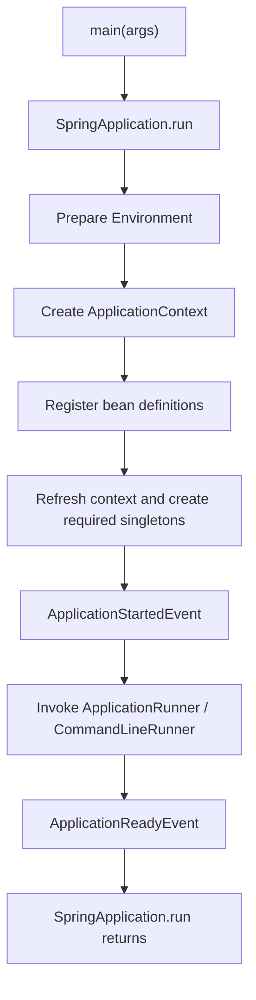
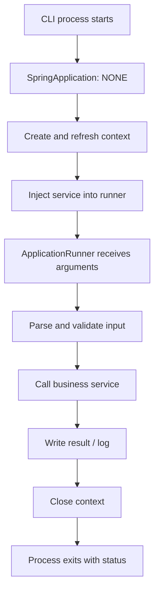

# Building a Minimal Command-Line Application with a Service and ApplicationRunner

Spring Boot is often used to build REST APIs, but a Spring application is not required to open an HTTP server. We can also use Spring Boot to create a command-line program: read arguments at startup, load configuration, inject services, perform a task, and then exit.

A simple way to run work after the Spring application context has been initialized is **`ApplicationRunner`**. The runner receives `ApplicationArguments`, so it can read command-line arguments already parsed by Spring Boot. Combining a runner with a small service gives us a CLI program that still leverages dependency injection, configuration properties, and Spring components without writing a controller.

This lesson belongs to the **Integrated Practice** chapter of *Spring Boot Fundamentals*. We will build a minimal CLI application to greet a user; separate processing logic into a service; read options from the command line; configure the application to run in non-web mode; understand when the runner is invoked; handle ordering, errors, and exit codes; and then test the service and runner.

The examples use Java 21, Spring Boot 3.x, Gradle, and JUnit Jupiter. Similar principles apply to Maven.

## 1. What Is a Spring Boot Command-Line Application?

A CLI program receives data from arguments at runtime, performs a task, and writes the output to the console or a file. For example:

```bash
java -jar greeting-cli.jar --name=Lan --times=2
```

Sample output:

```text
Hello, Lan!
Hello, Lan!
```

With Spring Boot, the application can still:

- Initialize the ApplicationContext.
- Create beans from component scanning and configuration.
- Inject services via constructor.
- Read application.yml and environment variables.
- Use logging, validation, databases, or other integrations if needed.
- Run a task after the context is ready.

The difference from a web application is that this program **does not need a servlet container or reactive web server to serve HTTP requests**. It starts Spring, runs the task, and exits according to the process lifecycle.

### 1.1. Why Use Spring Boot for a CLI?

For a small script with no dependencies, plain Java may be enough. Spring Boot is useful when a command-line program needs multiple injected services, environment-based configuration, database repositories, external API clients, logging, or modules shared with a larger Spring Boot application.

You should not add Spring just to print a single line of text if there is no need for a container or configuration. The goal of this example is to understand how to wire a service into the Spring Boot lifecycle.

## 2. Minimal Project Structure

We create a Gradle project with the structure:

```text
greeting-cli/
├── build.gradle
└── src/
    ├── main/
    │   ├── java/com/example/cli/
    │   │   ├── GreetingCliApplication.java
    │   │   ├── GreetingService.java
    │   │   └── GreetingRunner.java
    │   └── resources/
    │       └── application.yml
    └── test/
        └── java/com/example/cli/
            ├── GreetingServiceTest.java
            └── GreetingRunnerTest.java
```

In this small application, the three main classes have distinct responsibilities:

| Class | Responsibility |
|---|---|
| `GreetingCliApplication` | Program entry point and Spring Boot startup. |
| `GreetingService` | Contains the business logic for creating greetings. |
| `GreetingRunner` | Receives command-line arguments, calls the service, and presents the result. |

Separating the runner from the service keeps the service independent of the console or startup mechanism. Later, the same service can be called from a REST controller, a scheduled job, or a test.

## 3. Declaring Dependencies

In `build.gradle`, use the Spring Boot plugin and dependency management compatible with your project version:

```groovy
plugins {
    id 'java'
    id 'org.springframework.boot' version '3.3.0'
    id 'io.spring.dependency-management' version '1.1.5'
}

group = 'com.example'
version = '0.0.1-SNAPSHOT'

java {
    toolchain {
        languageVersion = JavaLanguageVersion.of(21)
    }
}

dependencies {
    implementation 'org.springframework.boot:spring-boot-starter'
    testImplementation 'org.springframework.boot:spring-boot-starter-test'
}
```

The version numbers in the example illustrate a build setup; when creating a new project, use the Spring Boot and Gradle versions appropriate for the current repository.

### 3.1. Why Only `spring-boot-starter`?

`spring-boot-starter` provides the core components needed to run a Spring Boot application. The CLI example does not need `spring-boot-starter-web` to serve HTTP, does not need a template engine, and does not need an embedded servlet container.

If the program later needs a database, message broker, or HTTP client, we add the corresponding starter/integration. There is no need to add the web starter just to use `ApplicationRunner`.

### 3.2. Corresponding Maven Dependencies

With Maven, the minimal dependencies section can be:

```xml
<dependencies>
    <dependency>
        <groupId>org.springframework.boot</groupId>
        <artifactId>spring-boot-starter</artifactId>
    </dependency>
    <dependency>
        <groupId>org.springframework.boot</groupId>
        <artifactId>spring-boot-starter-test</artifactId>
        <scope>test</scope>
    </dependency>
</dependencies>
```

The example assumes the Maven project uses the Spring Boot parent or BOM to manage dependency versions.

## 4. Creating the Application Startup Class

Create `GreetingCliApplication.java`:

```java
package com.example.cli;

import org.springframework.boot.SpringApplication;
import org.springframework.boot.WebApplicationType;
import org.springframework.boot.autoconfigure.SpringBootApplication;

@SpringBootApplication
public class GreetingCliApplication {

    public static void main(String[] args) {
        SpringApplication application =
                new SpringApplication(GreetingCliApplication.class);

        application.setWebApplicationType(WebApplicationType.NONE);
        application.run(args);
    }
}
```

`@SpringBootApplication` enables component scanning and auto-configuration. `SpringApplication` creates and refreshes the context, then runs the registered runners.

### 4.1. Why Set `WebApplicationType.NONE`?

`WebApplicationType.NONE` tells Spring Boot to start the application as non-web. For a project with only the base starter, Boot usually already infers that this is a non-web application. Explicitly setting `NONE` makes the intent of the CLI application clear and prevents unintended changes if a web dependency is later added to the classpath.

No web server means no HTTP port listening for requests; no controller is needed to start the program; service and runner beans are still initialized normally.

### 4.2. Can `SpringApplication.run` Be Used Directly?

Yes. The shorthand form:

```java
SpringApplication.run(GreetingCliApplication.class, args);
```

is suitable if the application type is inferred correctly from the classpath or already configured via a property. Use a `SpringApplication` instance when you want to explicitly set `WebApplicationType.NONE` or configure other bootstrap attributes.

## 5. Creating the Service Containing Business Logic

Create `GreetingService.java`:

```java
package com.example.cli;

import org.springframework.stereotype.Service;

@Service
public class GreetingService {

    public String greet(String name) {
        String normalizedName = name == null ? "" : name.trim();

        if (normalizedName.isEmpty()) {
            normalizedName = "Guest";
        }

        return "Hello, " + normalizedName + "!";
    }
}
```

The service takes an input value and returns a string. It does not read `System.in`, parse `args`, or call `System.exit`. Therefore, the logic can be tested independently.

### 5.1. Why Not Put Everything in `main`?

We could write the entire program in `main`, but as logic grows, the main class would have to handle reading arguments, validating input, computing business logic, printing results, and handling errors/exit codes.

Extracting a service gives each part a clear responsibility. `main` only starts Spring; the runner coordinates; the service performs the business logic.

### 5.2. Services Are Singletons by Default

`@Service` registers a bean with the default singleton scope. In the example above, the service holds no per-invocation state, so it can be called by the runner without manually creating instances.

Do not add a `currentName` field to the service for the runner to assign before each call. Pass `name` via a method parameter.

## 6. What Is `ApplicationRunner`?

`ApplicationRunner` is a Spring Boot callback interface:

```java
@FunctionalInterface
public interface ApplicationRunner {
    void run(ApplicationArguments args) throws Exception;
}
```

Beans implementing this interface are invoked by Spring Boot once the application context has been initialized and refreshed, during the completion of `SpringApplication.run(...)`.

This is an appropriate point for several startup tasks: reading command-line arguments; calling a service to process a one-time task; loading or checking initial data; printing result information; verifying required configuration before the program exits.

### 6.1. `ApplicationRunner` Receives `ApplicationArguments`

Unlike `CommandLineRunner`, `ApplicationRunner` receives an `ApplicationArguments` object. This object parses option arguments and non-option arguments, making code that reads inputs clearer.

### 6.2. A Runner Is Not a Controller

A runner does not wait for an HTTP request. It is invoked during the startup lifecycle. When `run(...)` finishes, Spring Boot proceeds to complete the `SpringApplication.run(...)` call.

If a runner performs a long-running task, the application startup time increases accordingly.

### 6.3. Runners Can Be Registered with `@Bean`

Using `@Component` is not mandatory. A configuration class can declare:

```java
@Configuration(proxyBeanMethods = false)
class CliConfiguration {

    @Bean
    ApplicationRunner greetingRunner(GreetingService service) {
        return args -> System.out.println(service.greet("Lan"));
    }
}
```

In this practice lesson, we use `@Component` so the runner class is easy to observe and kept separate from the main class.

## 7. Writing `GreetingRunner`

Create `GreetingRunner.java`:

```java
package com.example.cli;

import org.springframework.boot.ApplicationArguments;
import org.springframework.boot.ApplicationRunner;
import org.springframework.stereotype.Component;

@Component
public class GreetingRunner implements ApplicationRunner {

    private final GreetingService greetingService;

    public GreetingRunner(GreetingService greetingService) {
        this.greetingService = greetingService;
    }

    @Override
    public void run(ApplicationArguments args) {
        String name = args.containsOption("name")
                ? args.getOptionValues("name").get(0)
                : "Guest";

        System.out.println(greetingService.greet(name));
    }
}
```

When Spring creates `GreetingRunner`, constructor injection provides `GreetingService`. Once the context is ready, Boot calls `run(args)` and the runner uses the service.

### 7.1. What Happens When `--name` Is Not Passed?

If you run:

```bash
java -jar greeting-cli.jar
```

the runner chooses the default value `Guest` and prints:

```text
Hello, Guest!
```

If you pass:

```bash
java -jar greeting-cli.jar --name=Lan
```

the output is:

```text
Hello, Lan!
```

This is the minimal CLI: Spring Boot initializes the service, and the runner reads input and coordinates the call.

## 8. Reading Command-Line Arguments with `ApplicationArguments`

Spring Boot classifies arguments starting with `--` as option arguments. The remaining arguments are non-option arguments.

For example:

```bash
java -jar greeting-cli.jar --name=Lan --times=3 report.csv
```

We have:

| Input part | Parsed result |
|---|---|
| `--name=Lan` | Option `name` with value `Lan` |
| `--times=3` | Option `times` with value `3` |
| `report.csv` | Non-option argument |

### 8.1. Commonly Used Methods

`ApplicationArguments` provides important methods:

| Method | Meaning |
|---|---|
| `getSourceArgs()` | Original argument array. |
| `getOptionNames()` | Set of parsed option names. |
| `containsOption(name)` | Checks whether the option is present. |
| `getOptionValues(name)` | Gets the values of the option; there may be multiple values. |
| `getNonOptionArgs()` | Gets arguments that are not options. |

Example:

```java
private void printArguments(ApplicationArguments args) {
    System.out.println("Raw: "
            + Arrays.toString(args.getSourceArgs()));
    System.out.println("Options: " + args.getOptionNames());
    System.out.println("Name values: " + args.getOptionValues("name"));
    System.out.println("Files: " + args.getNonOptionArgs());
}
```

This snippet illustrates how to inspect input. In real applications, do not print arguments that might contain passwords, tokens, or sensitive data.

### 8.2. Options with Multiple Values

An option can be passed multiple times:

```bash
java -jar greeting-cli.jar --tag=java --tag=spring
```

`getOptionValues("tag")` can return a list containing `java` and `spring`. Do not assume every option has only one value.

### 8.3. Options Without a Value

A flag can be passed as:

```bash
java -jar greeting-cli.jar --verbose
```

In that case, `containsOption("verbose")` indicates the flag is present; the value list may have no elements. Check for option presence instead of blindly calling `get(0)`.

### 8.4. Values Containing Spaces

In a shell, quote the argument appropriately so the shell passes a single value:

```bash
java -jar greeting-cli.jar "--name=Lan Nguyen"
```

In PowerShell:

```powershell
java -jar greeting-cli.jar '--name=Lan Nguyen'
```

Specific quoting rules depend on the shell being used. After the process receives the arguments, Spring Boot parses the value from the string passed in by the shell.

## 9. Extending the CLI: Adding the `times` Option

We extend the requirement: the program greets the user multiple times according to `--times`. The service still builds only a single greeting; how many times to repeat it is the runner's coordination responsibility.

```java
@Component
public class GreetingRunner implements ApplicationRunner {

    private final GreetingService greetingService;

    public GreetingRunner(GreetingService greetingService) {
        this.greetingService = greetingService;
    }

    @Override
    public void run(ApplicationArguments args) {
        String name = firstValue(args, "name", "Guest");
        int times = parseTimes(firstValue(args, "times", "1"));

        String message = greetingService.greet(name);
        for (int i = 0; i < times; i++) {
            System.out.println(message);
        }
    }

    private String firstValue(
            ApplicationArguments args,
            String option,
            String defaultValue) {

        if (!args.containsOption(option)) {
            return defaultValue;
        }

        var values = args.getOptionValues(option);
        if (values == null || values.isEmpty()) {
            throw new IllegalArgumentException(
                    "Option --" + option + " requires a value");
        }
        return values.get(0);
    }

    private int parseTimes(String rawValue) {
        int times;
        try {
            times = Integer.parseInt(rawValue);
        } catch (NumberFormatException ex) {
            throw new IllegalArgumentException(
                    "--times must be an integer", ex);
        }

        if (times < 1 || times > 100) {
            throw new IllegalArgumentException(
                    "--times must be between 1 and 100");
        }
        return times;
    }
}
```

Run:

```bash
java -jar greeting-cli.jar --name=Lan --times=3
```

Output:

```text
Hello, Lan!
Hello, Lan!
Hello, Lan!
```

The runner is responsible for converting command-line strings into the required data types and reporting invalid input errors. The service still receives validated data types and does not have to parse the `--times` string itself.

When a CLI grows more complex, extract the parser/validator into a separate class so the runner only coordinates.

## 10. Using Non-Option Arguments

Not every program uses options for all inputs. A CLI can receive a filename positionally without `--`:

```bash
java -jar report-cli.jar report.csv
```

Reading it:

```java
List<String> files = args.getNonOptionArgs();
if (files.isEmpty()) {
    throw new IllegalArgumentException("A report file is required");
}

String inputFile = files.get(0);
```

With multiple positional arguments, define their order and meaning clearly. For larger CLIs, consider a dedicated command-line parsing library if you need subcommands, help text, type conversion, or rich validation.

### 10.1. Do Not Confuse Spring Options with Business Options

Spring Boot also uses command-line properties, for example:

```bash
java -jar app.jar --spring.profiles.active=dev --name=Lan
```

`spring.profiles.active=dev` is a Spring Boot configuration property. `name=Lan` is an option read by the application's runner. Both are passed via the command line, but they serve different purposes.

## 11. When Does `ApplicationRunner` Run?

A simplified startup flow:



This is a high-level description of the Spring Boot lifecycle. Specific events and the relative ordering of listeners/runners should be verified against the version in use, but the key point to remember is that **runners execute after the context has been refreshed and before `SpringApplication.run(...)` completes**.

### 11.1. Beans Are Ready to Inject

When the runner is invoked, its dependencies have already been injected by Spring. The runner can call services, repositories, or configuration beans that have been created.

### 11.2. Runners Do Not Execute Before Context Initialization

If a required bean fails to be created, the application can fail before the runner is invoked. Do not use a runner to replace dependency registration or fix bean creation errors.

### 11.3. Runners Execute Once per Context Startup

During a normal startup, each runner bean is invoked once in that startup lifecycle. It is not a callback per request or per service invocation. If an application has multiple ApplicationContexts, each context has its own lifecycle.

## 12. How Do `ApplicationRunner` and `CommandLineRunner` Differ?

Both interfaces allow running code after Spring Boot starts:

```java
public interface ApplicationRunner {
    void run(ApplicationArguments args) throws Exception;
}

public interface CommandLineRunner {
    void run(String... args) throws Exception;
}
```

| Criterion | ApplicationRunner | CommandLineRunner |
|---|---|---|
| Received parameter | `ApplicationArguments` | `String... args` |
| Pre-parsed option arguments | Yes | No, receives raw string array |
| Retrieving non-option arguments | Dedicated method | Parse array manually |
| Use when | You want structured access to option names/values | You want to handle simple raw args strings |
| Startup timing | Same lifecycle runner group | Same lifecycle runner group |

### 12.1. When to Choose `ApplicationRunner`?

Choose `ApplicationRunner` when you need `containsOption("name")`, `getOptionValues("tag")`, `getNonOptionArgs()`, or need to distinguish options from positional arguments. For this practice lesson, it fits because the goal is to read `--name` and `--times`.

### 12.2. When to Choose `CommandLineRunner`?

If the program only needs to receive a simple string or uses its own parser, `CommandLineRunner` can be more concise. There is no need to register both just to process the same input.

### 12.3. Can Both Be Used Together?

Yes. Spring Boot detects both types of runners. If an application has multiple runners, control their ordering with `@Order` or `Ordered` when order genuinely matters.

## 13. Controlling Runner Order

Suppose the application needs to check configuration, import data, and then generate a report. We can use `@Order`:

```java
@Component
@Order(1)
public class ConfigurationCheckRunner implements ApplicationRunner {
    @Override
    public void run(ApplicationArguments args) {
        System.out.println("Checking configuration...");
    }
}

@Component
@Order(2)
public class ImportRunner implements ApplicationRunner {
    @Override
    public void run(ApplicationArguments args) {
        System.out.println("Importing data...");
    }
}
```

A runner with a lower order value typically runs before a runner with a higher order value according to Spring's ordering rules.

### 13.1. Do Not Rely on Component Scanning Order

If ordering is not specified, do not rely on class discovery order or bean names to infer runner sequence. When ordering is a business requirement, declare it explicitly.

### 13.2. Avoid Tight Coupling Between Runners

If runner B only works properly after runner A has created data, model the workflow in an orchestrator service:

```java
@Service
public class ImportWorkflow {

    public void execute() {
        validateConfiguration();
        importData();
        generateReport();
    }
}
```

A single runner calls `importWorkflow.execute()`. This keeps the business sequence in one testable place rather than scattering dependencies across the ordering of multiple runners.

## 14. Default Configuration in `application.yml`

A CLI can use externalized configuration instead of hard-coding every value. For example:

```yaml
spring:
  application:
    name: greeting-cli

app:
  greeting:
    default-name: Guest
    max-times: 100
```

We create configuration properties:

```java
package com.example.cli;

import org.springframework.boot.context.properties.ConfigurationProperties;

@ConfigurationProperties(prefix = "app.greeting")
public record GreetingProperties(
        String defaultName,
        int maxTimes) {
}
```

Register with `@ConfigurationPropertiesScan`:

```java
@SpringBootApplication
@ConfigurationPropertiesScan
public class GreetingCliApplication {
    // main(...)
}
```

Then inject the properties into the runner:

```java
@Component
public class GreetingRunner implements ApplicationRunner {

    private final GreetingService service;
    private final GreetingProperties properties;

    public GreetingRunner(
            GreetingService service,
            GreetingProperties properties) {
        this.service = service;
        this.properties = properties;
    }
}
```

### 14.1. Command-Line Arguments Can Override Properties

Spring Boot command-line properties can override values in configuration files according to normal property precedence.

For example:

```bash
java -jar greeting-cli.jar --app.greeting.default-name=Lan
```

The runner can still read `GreetingProperties.defaultName()` to obtain the bound value. Thus, the application has defaults managed in `application.yml` and per-run overrides via command line or environment.

### 14.2. Distinguishing CLI Options from Spring Properties

You can design `--name=Lan` as a business option, or use `--app.greeting.default-name=Lan` as a Spring property. Business options are typically short and close to the CLI interface; Spring properties typically describe application configuration and can be reused across environments. Do not create two keys with the same meaning without a clear precedence rule.

## 15. Extracting the Parser from the Runner as the CLI Grows

The runner should act as an adapter: receive input, convert it into meaningful data types, call the service, and present the result.

If parsing becomes complex, create a command record:

```java
public record GreetingCommand(String name, int times) {
}
```

Parser:

```java
@Component
public class GreetingCommandParser {

    public GreetingCommand parse(ApplicationArguments args) {
        String name = firstValue(args, "name", "Guest");
        int times = parsePositiveInt(
                firstValue(args, "times", "1"));
        return new GreetingCommand(name, times);
    }

    private String firstValue(
            ApplicationArguments args,
            String option,
            String fallback) {
        if (!args.containsOption(option)) {
            return fallback;
        }
        var values = args.getOptionValues(option);
        if (values == null || values.isEmpty()) {
            throw new IllegalArgumentException(
                    "--" + option + " requires a value");
        }
        return values.get(0);
    }

    private int parsePositiveInt(String value) {
        try {
            int parsed = Integer.parseInt(value);
            if (parsed < 1 || parsed > 100) {
                throw new IllegalArgumentException(
                        "--times must be between 1 and 100");
            }
            return parsed;
        } catch (NumberFormatException ex) {
            throw new IllegalArgumentException(
                    "--times must be an integer", ex);
        }
    }
}
```

Runner:

```java
@Component
public class GreetingRunner implements ApplicationRunner {

    private final GreetingCommandParser parser;
    private final GreetingService service;

    public GreetingRunner(
            GreetingCommandParser parser,
            GreetingService service) {
        this.parser = parser;
        this.service = service;
    }

    @Override
    public void run(ApplicationArguments args) {
        GreetingCommand command = parser.parse(args);
        String message = service.greet(command.name());

        for (int i = 0; i < command.times(); i++) {
            System.out.println(message);
        }
    }
}
```

Now the parser can be unit-tested separately, the service can be unit-tested separately, and the runner only coordinates the components.

## 16. Handling Input Errors and Exit Codes

A CLI needs to inform the calling shell or script whether the task succeeded or failed. The common convention is exit code `0` for success and a non-zero code for errors or incomplete tasks.

You should not just print "Error" and always exit with code `0`, because a scheduler or automation script might misinterpret that as success.

### 16.1. `ExitCodeGenerator`

Spring Boot provides `ExitCodeGenerator` to determine the exit code when closing the application:

```java
public interface ExitCodeGenerator {
    int getExitCode();
}
```

For example, a runner can record the outcome:

```java
@Component
public class GreetingRunner
        implements ApplicationRunner, ExitCodeGenerator {

    private int exitCode = 0;

    @Override
    public void run(ApplicationArguments args) {
        try {
            // Parse input and perform the work.
        } catch (IllegalArgumentException ex) {
            System.err.println("Input error: " + ex.getMessage());
            exitCode = 2;
        }
    }

    @Override
    public int getExitCode() {
        return exitCode;
    }
}
```

This is a conceptual pattern. If an error is caught in the runner, the runner must explicitly decide whether to continue or mark failure; if an exception escapes, startup may fail and Spring Boot handles startup failure.

### 16.2. Closing the Context and Returning the Exit Code

In `main`, you can obtain the exit code from Spring Boot:

```java
public static void main(String[] args) {
    SpringApplication application =
            new SpringApplication(GreetingCliApplication.class);
    application.setWebApplicationType(WebApplicationType.NONE);

    ConfigurableApplicationContext context = application.run(args);
    int exitCode = SpringApplication.exit(context);
    System.exit(exitCode);
}
```

`SpringApplication.exit(...)` collects exit codes from matching `ExitCodeGenerator` beans and closes the context. `System.exit(...)` terminates the process with the corresponding code.

**Note:** Do not call `System.exit` in unit tests or inside services. Place process termination at the program entry point so tests do not shut down the JVM running the test suite.

### 16.3. Must Every Exception Be Caught in the Runner?

Not necessarily. If an exception represents an unrecoverable error, letting it propagate can cause application startup to fail and return a non-zero exit code via Spring Boot's mechanism. If you want to provide a friendly CLI message and a custom error code, handle it at the boundary, log appropriately, and ensure the exit code reflects the actual outcome.

### 16.4. Do Not Print Stack Traces for Ordinary Input Errors

A value like `--times=abc` is an input error that can be explained concisely. You can print usage/help and a clear message instead of printing a full stack trace. For system errors like database unavailable, log the full exception at an appropriate level and return a failure exit code.

## 17. Defining Help and Usage

As the CLI grows, users need to know which options are supported. A simple way is to add a flag:

```bash
java -jar greeting-cli.jar --help
```

The runner can check:

```java
if (args.containsOption("help")) {
    printUsage();
    return;
}
```

Usage helper:

```java
private void printUsage() {
    System.out.println("""
            Usage:
              java -jar greeting-cli.jar [options]

            Options:
              --name=<name>    Name to greet (default: Guest)
              --times=<count>  Number of greetings (1..100)
              --help           Show this message
            """);
}
```

For professional CLIs with multiple subcommands, option types, completion, and help generation, consider a dedicated parser library such as Picocli. `ApplicationRunner` can still serve as the bridge to invoke that command parser once the Spring context is ready.

## 18. How Does Reading Stdin Differ from `ApplicationArguments`?

Command-line arguments are supplied immediately when the process starts. `System.in` is an input stream that can be read afterward, for example:

```java
BufferedReader reader =
        new BufferedReader(new InputStreamReader(System.in));
String line = reader.readLine();
```

The two input mechanisms serve different purposes:

| Input method | When to use |
|---|---|
| Command-line arguments | Scripts or users pass options/values directly at launch. |
| Standard input | Users enter input interactively or data is piped from another process. |

Pipe example:

```bash
cat names.txt | java -jar greeting-cli.jar
```

The runner can read `System.in` if the application is designed to consume a stream. However, in this minimal example, we only use `ApplicationArguments` to avoid adding an unnecessary input mechanism.

### 18.1. Do Not Block Startup Unintentionally

If the runner calls `readLine()` and waits on stdin, the application will not finish startup until input or EOF arrives. That may be a valid design for an interactive CLI, but it is unsuitable for a batch job run automatically by a scheduler without an input stream.

## 19. `ApplicationRunner` Is Not a Periodic Scheduling Mechanism

A runner is called during the startup lifecycle. It does not repeat on a schedule.

If you need to run a task:

- Once per process startup: `ApplicationRunner` is suitable.
- On a schedule: consider `@Scheduled` and scheduling infrastructure.
- Per message: use a suitable message listener/container.
- Per request: use an appropriate controller or handler.
- Per user command invoked multiple times in the same process: design a command loop or CLI subcommand dispatcher.

Do not use a runner as a scheduler by writing an infinite loop or `Thread.sleep(...)` inside `run(...)` if the real goal is a periodic job.

## 20. Runners and Other Lifecycle Callbacks

Spring Boot has several startup callbacks and events. Some distinctions to keep in mind:

| Component | Purpose |
|---|---|
| `@PostConstruct` | Initialize a bean after dependency injection completes. |
| `InitializingBean.afterPropertiesSet()` | Spring bean initialization callback. |
| `ApplicationRunner` | Run a task after context refresh, with `ApplicationArguments`. |
| `CommandLineRunner` | Run a task after context refresh, receiving raw args strings. |
| `ApplicationReadyEvent` | Event signaling the application is ready after the runner phase. |
| `@Scheduled` | Run a method on a schedule when scheduling is enabled. |

### 20.1. Do Not Put the Entire Business Workflow in `@PostConstruct`

`@PostConstruct` belongs to the bean lifecycle. It is not the ideal place to execute a CLI task that needs to read all command-line arguments or orchestrate multiple services.

A runner expresses the intent "run after application initialization" more clearly.

### 20.2. Do Not Use `ApplicationReadyEvent` Just Because the Name Sounds Suitable

If you need to run a startup job and use `ApplicationArguments`, `ApplicationRunner` is the direct API. An event listener is suitable when you need to react to lifecycle events or decouple listeners from runner orchestration.

## 21. Testing `GreetingService`

The service does not depend on the Spring container to execute its logic, so it can be unit-tested simply:

```java
package com.example.cli;

import static org.assertj.core.api.Assertions.assertThat;

import org.junit.jupiter.api.Test;

class GreetingServiceTest {

    private final GreetingService service = new GreetingService();

    @Test
    void greetsProvidedName() {
        assertThat(service.greet("Lan"))
                .isEqualTo("Hello, Lan!");
    }

    @Test
    void usesGuestForBlankName() {
        assertThat(service.greet("  "))
                .isEqualTo("Hello, Guest!");
    }
}
```

This test verifies the service logic. It does not need `@SpringBootTest` because it does not test dependency injection or the runner lifecycle.

## 22. Testing `ApplicationRunner`

The runner depends on `GreetingService`, receives `ApplicationArguments`, and prints the result. We can test it by constructing arguments from the Spring Boot parser and capturing output.

Example with Spring Boot Test and JUnit:

```java
package com.example.cli;

import static org.assertj.core.api.Assertions.assertThat;

import java.io.ByteArrayOutputStream;
import java.io.PrintStream;

import org.junit.jupiter.api.AfterEach;
import org.junit.jupiter.api.Test;
import org.springframework.boot.DefaultApplicationArguments;

class GreetingRunnerTest {

    private final PrintStream originalOut = System.out;

    @AfterEach
    void restoreOutput() {
        System.setOut(originalOut);
    }

    @Test
    void printsGreetingForNameOption() throws Exception {
        ByteArrayOutputStream output = new ByteArrayOutputStream();
        System.setOut(new PrintStream(output));

        GreetingRunner runner =
                new GreetingRunner(new GreetingService());

        runner.run(new DefaultApplicationArguments("--name=Lan"));

        assertThat(output.toString())
                .contains("Hello, Lan!");
    }
}
```

The example assumes `GreetingRunner` is the version that only requires the service and reads `--name`. If the runner has been extended to require a parser/properties, provide the corresponding dependencies in the test.

### 22.1. Why Must `System.out` Be Restored?

`System.out` is a process-wide static stream. If a test replaces it without restoring it, other tests may be affected. `@AfterEach` ensures the original stream is restored after each test.

In a large test suite or parallel test runs, modifying global streams must be controlled carefully. You can design the runner to accept a `PrintStream` or output abstraction via constructor so tests do not have to mutate `System.out`.

### 22.2. Testing the Parser Separately

If you extracted `GreetingCommandParser`, test missing options, `--name=Lan`, `--times=3`, `--times=abc`, `--times=0` or out-of-range values, and options missing a value. These are unit tests for boundary parsing and do not need to boot the entire application context.

## 23. Testing the Spring Boot Context and Runner Lifecycle

If you want to verify that Spring creates the beans and invokes the runner at startup, you can use `@SpringBootTest`:

```java
@SpringBootTest(
        webEnvironment = SpringBootTest.WebEnvironment.NONE,
        args = {"--name=Lan"})
class GreetingApplicationTest {

    @Autowired
    GreetingService greetingService;

    @Test
    void loadsServiceBean() {
        assertThat(greetingService.greet("Lan"))
                .isEqualTo("Hello, Lan!");
    }
}
```

`args` supplies command-line arguments for the test application. The runner may be invoked during context startup before the test method runs. If the runner writes to the console, the output may appear in the test logs.

### 23.1. Be Careful with Side Effects from Runners in Integration Tests

If a runner sends emails, deletes data, imports files, or calls external APIs, every test that creates a context could trigger that work. Design a controlling property or test configuration so the task only runs when requested.

For example:

```yaml
app:
  cli:
    execute: true
```

The runner can check `app.cli.execute` before executing the workflow. In tests that only need to load the context, set the property to false to avoid side effects.

### 23.2. Context Caching Affects How Often Runners Run

Spring Test can cache the ApplicationContext across tests with compatible configurations. A runner executes when the context is initialized, not before each test method. If the context is reused, the runner does not automatically run again for every method.

## 24. Complete Example with Configuration and Runner

After the steps above, a concise version of the program can consist of:

**GreetingCliApplication.java**

```java
package com.example.cli;

import org.springframework.boot.SpringApplication;
import org.springframework.boot.WebApplicationType;
import org.springframework.boot.autoconfigure.SpringBootApplication;

@SpringBootApplication
public class GreetingCliApplication {

    public static void main(String[] args) {
        SpringApplication application =
                new SpringApplication(GreetingCliApplication.class);
        application.setWebApplicationType(WebApplicationType.NONE);
        application.run(args);
    }
}
```

**GreetingService.java**

```java
package com.example.cli;

import org.springframework.stereotype.Service;

@Service
public class GreetingService {

    public String greet(String name) {
        String value = name == null ? "" : name.trim();
        if (value.isEmpty()) {
            value = "Guest";
        }
        return "Hello, " + value + "!";
    }
}
```

**GreetingRunner.java**

```java
package com.example.cli;

import org.springframework.boot.ApplicationArguments;
import org.springframework.boot.ApplicationRunner;
import org.springframework.stereotype.Component;

@Component
public class GreetingRunner implements ApplicationRunner {

    private final GreetingService service;

    public GreetingRunner(GreetingService service) {
        this.service = service;
    }

    @Override
    public void run(ApplicationArguments args) {
        String name = "Guest";

        if (args.containsOption("name")) {
            var values = args.getOptionValues("name");
            if (values != null && !values.isEmpty()) {
                name = values.get(0);
            }
        }

        System.out.println(service.greet(name));
    }
}
```

**application.yml**

```yaml
spring:
  application:
    name: greeting-cli
```

This is the minimal version sufficient to start Spring Boot in non-web mode, component-scan the service and runner, inject the service into the runner, accept `--name=...`, print the greeting, and complete startup.

## 25. Running the Application

### 25.1. Running with Gradle

On macOS/Linux:

```bash
./gradlew bootRun --args='--name=Lan'
```

On Windows PowerShell:

```powershell
.\gradlew.bat bootRun --args='--name=Lan'
```

### 25.2. Building an Executable JAR

```bash
./gradlew bootJar
```

After a successful build, the JAR file is typically located in `build/libs/`:

```bash
java -jar build/libs/greeting-cli-0.0.1-SNAPSHOT.jar --name=Lan
```

The actual filename depends on `group`, `version`, archive configuration, and the project name.

### 25.3. Verifying the Application Does Not Open an HTTP Port

The application does not need the web starter and selects `WebApplicationType.NONE`. When running, you will see Spring Boot startup logs, runner logs, and the output. There is no need to call `curl localhost:8080`.

## 26. Handling Spring Configuration Parameters vs. Business Parameters

Spring Boot can read:

```bash
java -jar app.jar --spring.profiles.active=prod --app.greeting.default-name=Lan --name=Minh
```

In the example, `spring.profiles.active` selects the profile; `app.greeting.default-name` is an application property; `name` is a business option handled by the runner.

When designing a real CLI, clearly define which options belong to Spring configuration and which belong to the command contract. Avoid having the same option processed twice with different meanings.

## 27. Long-Running Tasks and Process Lifecycle

A CLI may connect to a database, read large files, or call external APIs. The runner only finishes when its synchronous work completes.

### 27.1. Synchronous Work

```java
@Override
public void run(ApplicationArguments args) {
    importService.importFile(args.getNonOptionArgs().get(0));
}
```

If `importFile(...)` executes synchronously, the runner waits for the method to finish before returning.

### 27.2. Asynchronous Work

If the runner only submits a task to an executor and returns, `SpringApplication.run(...)` may complete while background work is still running. In that case, you need to manage the executor lifecycle, wait for completion, or keep the process alive intentionally.

Do not fire-and-forget a task and assume the CLI will wait for the result. Design waiting, timeouts, cancellation, and shutdown explicitly.

### 27.3. Closing Resources

If a service opens file streams, connections, or executors, use try-with-resources or an appropriate bean lifecycle. When the context closes, Spring invokes supported destruction callbacks for the bean lifecycle.

## 28. Using Logging Instead of `System.out` in Real Applications

`System.out.println` is easy to follow in a CLI example. In real applications, you can use a logger:

```java
private static final Logger log =
        LoggerFactory.getLogger(GreetingRunner.class);

log.info("Greeting task completed for {}", name);
```

The benefits include log levels, timestamps, logger names, console/file configuration, and log aggregation integration.

However, if the program needs structured output for another script to read via stdout, reserve stdout for the primary result and use stderr/logger for diagnostics according to the chosen contract.

### 28.1. Do Not Mix Machine-Readable Output with Arbitrary Logs

For example, a CLI outputting JSON:

```json
{"status":"success","count":3}
```

If startup or debug logs are also written to stdout, the receiving script may fail to parse the output. Configure logging to stderr or a file and keep stdout clean for the designed payload.

## 29. Common Pitfalls

| Symptom | Possible cause | Resolution |
|---|---|---|
| Runner does not execute | Runner bean was not scanned/registered or context failed startup | Check package scan, bean definition, and startup exception |
| Cannot inject service | Service is not registered or lies outside component scan | Check `@Service`, package, and configuration |
| `getOptionValues("name")` returns null/empty | Option is absent or has no value | Check `containsOption` and validate before reading |
| `IndexOutOfBoundsException` | Calling `get(0)` on an empty list | Check for null/empty and report a clear input error |
| `NumberFormatException` | Invalid numeric value | Parse and handle errors at the CLI boundary |
| Program opens a port unexpectedly | Web dependency is present and application type was inferred as web | Set `WebApplicationType.NONE` if the CLI does not need web |
| Runner causes side effects in tests | Full context tests also execute startup runners | Use a controlling property/profile for the task |
| Second runner runs out of order | Ordering was not declared | Use `@Order` or consolidate the workflow into an orchestrator |
| Process does not exit | Background executor/thread or listener remains active | Manage shutdown and lifecycle |
| Script thinks task succeeded despite errors | Exit code is always 0 | Return an appropriate exit code and do not swallow errors |
| Tests corrupt other tests' output | Replaced `System.out` without restoring it | Restore the stream or inject an output abstraction |
| Business option not found | Confused option with non-option argument or property name | Inspect `ApplicationArguments` and the CLI contract |

## 30. Workflow for Building a Small Spring Boot CLI

When starting a command-line program, you can follow this sequence:

1. **Define inputs and outputs.** Use command-line options, positional arguments, stdin, stdout, or files?
2. **Create a minimal project.** Only add `spring-boot-starter` and genuinely needed dependencies.
3. **Choose non-web mode.** Use `WebApplicationType.NONE` if the program does not serve HTTP.
4. **Separate business logic.** Place it in a service with an API that takes parameters and returns results.
5. **Create an `ApplicationRunner`.** The runner receives `ApplicationArguments` and coordinates the service.
6. **Parse and validate inputs.** Check for missing options, data types, and bounds.
7. **Configure via `Environment`.** Use `application.yml`, profiles, and environment variables for environment-specific values.
8. **Clarify startup behavior.** Runners execute once when the context starts; do not confuse them with schedulers or request handlers.
9. **Manage errors and exit codes.** Ensure external scripts receive the proper status.
10. **Test by boundaries.** Unit-test the service/parser, test the runner, and integration-test the context when needed.
11. **Manage resources.** Close files, connections, executors, and the context according to lifecycle.
12. **Package and test-run.** Build the JAR and pass arguments the same way a scheduler/script will invoke it.



## 31. Extended Practice Exercises

After getting the minimal greeting working, extend it through these steps:

**Step A — Add `--name`.** Read the option using `ApplicationArguments` and use `Guest` when missing.

**Step B — Add `--times`.** Parse the integer, constrain it between 1 and 100, and print the greeting the specified number of times.

**Step C — Extract the parser.** Create `GreetingCommandParser` returning the `GreetingCommand` record.

**Step D — Add `application.yml`.** Set the default name and max run limit using `@ConfigurationProperties`.

**Step E — Override a property.** Pass `--app.greeting.default-name=...` and observe the bound value.

**Step F — Add a positional argument.** Accept a file path and handle the missing-file case.

**Step G — Add `--help`.** Print usage and exit normally without executing business logic.

**Step H — Add a second runner.** Use `@Order` to observe invocation order.

**Step I — Consolidate the workflow.** Move the multi-step sequence into an orchestrator service and have a single runner call the orchestrator.

**Step J — Test input errors.** Pass `--times=abc`, `--times=0`, and an option missing a value; verify clear error messages.

**Step K — Exit codes.** Register `ExitCodeGenerator`, close the context with `SpringApplication.exit(...)`, and verify the shell receives a failure code.

**Step L — Test the service.** Write JUnit unit tests for greetings and default behavior.

**Step M — Test the runner.** Construct `DefaultApplicationArguments`, capture output or inject an output abstraction.

**Step N — Test the context.** Use `@SpringBootTest(webEnvironment = NONE)` and `args` to verify beans are created and the runner is invoked.

**Step O — Build an executable JAR.** Run the JAR with the exact arguments an automation script would use.

**Step P — Verify lifecycle.** If you add an executor or database, verify the process only exits after required work completes and resources are closed.

## 32. Self-Assessment Questions

1. How does a Spring Boot CLI application differ from a web application?
2. Why does the minimal project not need `spring-boot-starter-web`?
3. What does `WebApplicationType.NONE` control?
4. What is the role of `@SpringBootApplication` in the program?
5. How does `@Service` help register `GreetingService`?
6. At what stage of startup is `ApplicationRunner` invoked?
7. How does `ApplicationArguments` differ from `String... args`?
8. What are `containsOption`, `getOptionValues`, and `getNonOptionArgs` used for?
9. Why should you check the option values list before calling `get(0)`?
10. How do `--name=Lan` and `--spring.profiles.active=dev` differ in purpose?
11. When should you use `CommandLineRunner` instead of `ApplicationRunner`?
12. How do you control the execution order of multiple runners?
13. Why should business logic live in a service rather than in a runner?
14. Does a runner execute again before every JUnit test method?
15. Why can startup runners cause side effects in `@SpringBootTest`?
16. How do you pass test arguments to `@SpringBootTest`?
17. When do you need `ExitCodeGenerator`?
18. Why should you not call `System.exit` inside a service or unit test?
19. Is an asynchronously submitted task guaranteed to finish before the CLI exits?
20. When should you use stdin instead of command-line arguments?
21. Why should you not write arbitrary logs to stdout if the CLI outputs JSON for a script?
22. When should you use a dedicated command-line parser library?

### Complete Model Explanation

> A Spring Boot CLI application can use `spring-boot-starter` without needing the web starter. The main class creates a `SpringApplication` and selects `WebApplicationType.NONE` to start a non-web ApplicationContext. `GreetingService` holds the business logic and is registered with `@Service`; `GreetingRunner` implements `ApplicationRunner`, receives `ApplicationArguments` after context refresh, reads options such as `--name`, and calls the service via constructor injection. This separation keeps the service independent of command-line parsing and console output. `ApplicationRunner` is suitable when you need option names/values and non-option arguments; `CommandLineRunner` receives the string array directly. Runners execute in the startup lifecycle, not per request or on a schedule. For a real CLI, you need to validate inputs, manage errors and exit codes, control side effects in tests, await asynchronous work if present, and close resources according to lifecycle.

When you can create a non-web project yourself, register a service, inject it into an `ApplicationRunner`, read arguments, and run a task until the process exits with the proper status, you have built **a minimal command-line application with a service and ApplicationRunner** in Spring Boot.
