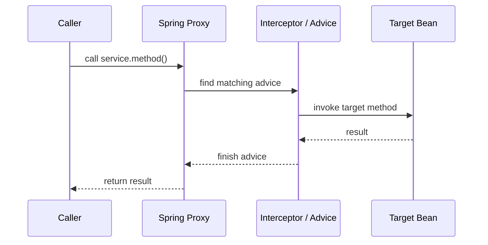
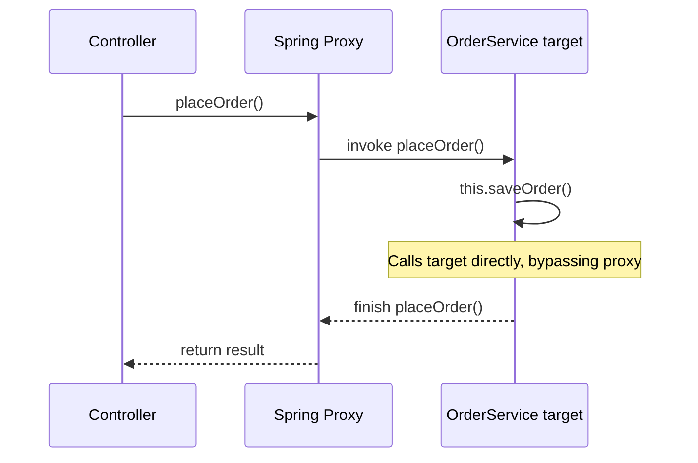

# Verifying Self-Invocation and Proxy-Based Calls

Spring provides many proxy-based features such as transactions, caching, async execution, method security, and custom aspects. Having an annotation on a method does not guarantee advice runs on every invocation. What matters is **whether the call passes through the proxy Spring created**.

The easiest situation to misunderstand is *self-invocation*: one method inside a bean calls another method on the same instance via `this` or an unqualified method call. This internal call goes directly to the target object, bypassing the proxy. Therefore, advice such as `@Transactional`, `@Async`, `@Cacheable`, or `@Retryable` may not run even though the target method carries the annotation.

This lesson walks through distinguishing and verifying both call paths:

- **Proxy-based call:** the caller holds a bean reference provided by Spring and invokes the method through that reference. The proxy has a chance to apply interceptors/advice.
- **Self-invocation:** a method already running on the target invokes another method on the same target. The call never loops back through the proxy, so proxy-based advice is not applied to the internally invoked method.

We will use `@Transactional` as a database-observable example, then extend to caching, async, retry, security, and fixes.

## 1. Where Does a Spring AOP Proxy Operate?

With proxy-based AOP, Spring creates a proxy object wrapping the target bean. Callers invoke the proxy; the proxy checks matching advisors/interceptors and applies advice before, after, or around the target invocation.



For example, when a controller injects an `OrderService` bean and calls `placeOrder()`, the injected reference may be a proxy. If the method is configured for transactions, the transaction interceptor starts a transaction before invoking the target method and commits or rolls back after the method completes.

**The proxy is the invocation boundary.** Annotations are metadata telling infrastructure which methods need handling; annotations do not rewrite bytecode for every Java call automatically.

## 2. JDK Dynamic Proxy vs. CGLIB Proxy

Spring AOP can use two main proxy types.

### 2.1. JDK Dynamic Proxy

A JDK dynamic proxy generates a proxy implementing the interfaces exposed by the target.

```java
public interface PaymentService {
    void pay(String orderId);
}

@Service
public class DefaultPaymentService implements PaymentService {

    @Override
    @Transactional
    public void pay(String orderId) {
        // Process payment.
    }
}
```

Callers typically inject and use the `PaymentService` interface. The proxy receives calls through methods declared on the interface and forwards them via interceptors to the target.

### 2.2. CGLIB Class-Based Proxy

CGLIB creates a subclass of the target class to override interceptable methods.

```java
@Service
public class ReportService {

    @Transactional
    public void generate() {
        // Generate report.
    }
}
```

If no suitable interface exists or configuration requests class-based proxies, Spring can use CGLIB. Interceptable methods must be overridable; `final` methods, `final` classes, or `private` methods cannot be overridden the way CGLIB proxies require.

### 2.3. Practical Differences

| Feature | JDK dynamic proxy | CGLIB proxy |
|---|---|---|
| Creation mechanism | Implements interface(s) | Subclasses the target class |
| Typical caller reference | Interface | Interface or class |
| Target class needs interface | Yes | No |
| Intercepted methods | Methods via proxy interface | Overridable methods |
| `final` method | Depends on interface exposure and proxy call | Cannot be overridden/intercepted |
| `private` method | Not an interface method | Cannot be overridden |
| `this.inner()` inside target | Bypasses proxy | Bypasses proxy |

Choosing between proxy types does not solve self-invocation. Both share the same limitation: when the target calls one of its own methods directly, the call does not go through the proxy.

## 3. What Is Self-Invocation?

Suppose a service has two methods:

```java
@Service
public class OrderService {

    public void placeOrder() {
        validateOrder();
        saveOrder();
    }

    @Transactional
    public void saveOrder() {
        // Persist data.
    }

    private void validateOrder() {
        // Validate data.
    }
}
```

Controller calls:

```java
orderService.placeOrder();
```

The call from the controller to `placeOrder()` goes through the Spring proxy. However, when the target's `placeOrder()` executes `saveOrder()`, Java calls the method on `this`:

```java
this.saveOrder();
```

That call never goes back out through the proxy. Thus, the transaction advice on `saveOrder()` is not triggered by this internal call.



A simple way to remember:

- `controller -> proxy -> target.methodA()` is a call through the proxy.
- `target.methodA() -> this.methodB()` is an internal call on the target.
- `target.methodA() -> injectedOtherBean.methodB()` can go through the other bean's proxy.

### 3.1. You Do Not Need to Write `this` for It to Be Self-Invocation

Both snippets below behave identically at runtime inside an instance:

```java
public void outer() {
    this.inner();
}

public void outerAgain() {
    inner();
}
```

Java treats an instance method call with no explicit receiver as a call on `this`. Both are self-invocation.

### 3.2. `private` Methods Cannot Be Intercepted by Proxies Either

A `private` method cannot be called via a JDK interface proxy and cannot be overridden by CGLIB. Do not expect `@Transactional` or other proxy advice to work on private methods in a proxy-based model.

For transaction annotations, place boundaries on appropriate methods called by external callers through the Spring bean proxy—typically public methods on application services.

## 4. Why Do Proxy Calls Trigger Advice While Self-Invocation Does Not?

A proxy does not monitor every method call inside the JVM. It can only intercept when control flow enters through the proxy object.

Target example:

```java
public class PricingService {

    public Price calculate() {
        return calculateWithAudit();
    }

    @Transactional
    public Price calculateWithAudit() {
        // Calculate price and write audit.
        return new Price();
    }
}
```

If a caller invokes `pricingService.calculateWithAudit()` via the proxy, the transaction interceptor runs.

If a caller invokes `pricingService.calculate()` via the proxy and the target calls `this.calculateWithAudit()`, the interceptor for `calculateWithAudit()` is not invoked separately. The proxy only wraps `calculate()`.

If `calculate()` is also annotated with `@Transactional`, the outer method's transaction still wraps the entire execution, including the internal call. What to distinguish is that the transaction comes from the **outer method**, not from the inner method's annotation triggered via self-invocation.

## 5. Demonstrating and Verifying with `@Transactional`

A clear way to observe self-invocation is inserting a row into a database and then throwing a runtime exception. If the transaction interceptor runs, the change rolls back. If the transactional method was called internally with no outer transaction, the statement may auto-commit on the connection.

### 5.1. Database Table

With H2 in tests, you can create the schema:

```sql
CREATE TABLE audit_record (
    id BIGINT GENERATED BY DEFAULT AS IDENTITY PRIMARY KEY,
    marker VARCHAR(100) NOT NULL
);
```

Ensure tests include H2 and `JdbcTemplate` configured with the `DataSource`/transaction manager.

### 5.2. Service with Self-Invocation

```java
@Service
public class AuditService {

    private final JdbcTemplate jdbcTemplate;

    public AuditService(JdbcTemplate jdbcTemplate) {
        this.jdbcTemplate = jdbcTemplate;
    }

    public void writeThroughSelfInvocation(String marker) {
        this.writeAndFail(marker);
    }

    @Transactional
    public void writeAndFail(String marker) {
        jdbcTemplate.update(
                "INSERT INTO audit_record(marker) VALUES (?)",
                marker
        );

        throw new IllegalStateException("Force rollback");
    }
}
```

`writeThroughSelfInvocation()` has no transaction. It calls `writeAndFail()` directly on the target. Even though the target method has `@Transactional`, the proxy never receives that call.

### 5.3. Calling the Transactional Method via Proxy

An external caller invokes the bean:

```java
auditService.writeAndFail("external-call");
```

This time `auditService` is the Spring proxy. The transaction interceptor opens a transaction before calling the target method. When `IllegalStateException` escapes the method, the transaction rolls back by default because it is an unchecked exception.

### 5.4. Comparing Outcomes

| Call path | Goes through transaction proxy for `writeAndFail`? | Typical outcome |
|---|---|---|
| `auditService.writeAndFail(...)` from an external bean | Yes | Insert rolls back when runtime exception escapes |
| `auditService.writeThroughSelfInvocation(...)`, target calls `this.writeAndFail(...)` | No | No transaction started by inner method; insert may auto-commit |
| `auditService.outerTransactional()` has a transaction, calls `this.writeAndFail(...)` | Outer transaction remains active | Insert belongs to outer transaction; rollback/commit follows outer boundary |

Exact results depend on the transaction manager and database setup. In a JDBC demo using auto-commit when no Spring transaction exists, the internal insert commits before the exception is thrown. Verify with tests rather than inferring from logs alone.

## 6. Integration Test Proving the Difference

The following test must run inside a real Spring context without `@Transactional` on the test method. If the test method itself opens a transaction, it can distort the observation.

```java
@SpringBootTest
class AuditServiceProxyTests {

    @Autowired
    private AuditService auditService;

    @Autowired
    private JdbcTemplate jdbcTemplate;

    @BeforeEach
    void cleanTable() {
        jdbcTemplate.update("DELETE FROM audit_record");
    }

    @Test
    void selfInvocationDoesNotStartTransactionForInnerMethod() {
        assertThatThrownBy(() ->
                auditService.writeThroughSelfInvocation("self")
        ).isInstanceOf(IllegalStateException.class);

        Integer count = jdbcTemplate.queryForObject(
                "SELECT COUNT(*) FROM audit_record WHERE marker = ?",
                Integer.class,
                "self"
        );

        assertThat(count).isEqualTo(1);
    }

    @Test
    void externalProxyInvocationRollsBack() {
        assertThatThrownBy(() ->
                auditService.writeAndFail("external")
        ).isInstanceOf(IllegalStateException.class);

        Integer count = jdbcTemplate.queryForObject(
                "SELECT COUNT(*) FROM audit_record WHERE marker = ?",
                Integer.class,
                "external"
        );

        assertThat(count).isZero();
    }
}
```

The first test confirms internal calls do not trigger the inner method's transaction. The second calls the same method via the proxy and confirms rollback.

Conditions for meaningful results:

- The test must not open a transaction around the method under test.
- The test database must support transactions and be properly configured.
- `JdbcTemplate` must share the same `DataSource` as the transaction manager.
- The exception must escape the transactional method; if caught without marking rollback, outcomes differ.
- No outer transaction may already be active.

If the project uses JPA, you can verify using repositories and the JPA transaction manager; the proxy boundary principle remains identical.

## 7. Checking Whether a Transaction Is Active

Besides observing database rollbacks, you can observe transaction state:

```java
@Service
public class TransactionProbeService {

    public boolean activeWhenCalledInternally() {
        return transactionalProbe();
    }

    @Transactional
    public boolean transactionalProbe() {
        return TransactionSynchronizationManager
                .isActualTransactionActive();
    }
}
```

Calling from a test:

```java
assertThat(probeService.activeWhenCalledInternally()).isFalse();
assertThat(probeService.transactionalProbe()).isTrue();
```

In the first call, `activeWhenCalledInternally()` enters via the proxy, yet `transactionalProbe()` is invoked directly on the target and starts no transaction. In the second call, the target method is called via the proxy, so a transaction opens (assuming a transaction manager is configured).

`TransactionSynchronizationManager.isActualTransactionActive()` is an observation tool for current state, not a way to create transactions.

## 8. Checking Whether a Bean Is Actually a Proxy

In tests or diagnostics, Spring provides utilities:

```java
import org.springframework.aop.support.AopUtils;

assertThat(AopUtils.isAopProxy(auditService)).isTrue();
```

You can check specifically:

```java
boolean jdkProxy = AopUtils.isJdkDynamicProxy(auditService);
boolean cglibProxy = AopUtils.isCglibProxy(auditService);
```

This reveals whether a bean reference is an AOP proxy and which kind.

However, **having a proxy does not mean every call gets intercepted**. Self-invocation still skips the proxy because the target invokes `this.method()` directly.

Also distinguish the target object from the proxy object:

- Callers normally hold a proxy reference.
- The proxy holds a reference to the target.
- When the proxy invokes, the target method executes.
- Inside the target, `this` is the target instance, never automatically the proxy.

## 9. `@Transactional` and Self-Invocation

This is the most common source of business logic bugs.

```java
@Service
public class TransferService {

    public void transfer(String from, String to, BigDecimal amount) {
        debit(from, amount);
        credit(to, amount);
    }

    @Transactional
    public void debit(String account, BigDecimal amount) {
        // Deduct funds.
    }

    @Transactional
    public void credit(String account, BigDecimal amount) {
        // Add funds.
    }
}
```

If the caller invokes `transfer()` via the proxy and `transfer()` has no transaction, both `debit()` and `credit()` are self-invocations. Neither inner `@Transactional` annotation starts a transaction on its own.

This can leave partial state: debit succeeds while credit fails.

A better design usually places the transaction boundary at the use case:

```java
@Service
public class TransferService {

    private final AccountRepository accountRepository;

    public TransferService(AccountRepository accountRepository) {
        this.accountRepository = accountRepository;
    }

    @Transactional
    public void transfer(
            String from,
            String to,
            BigDecimal amount
    ) {
        debit(from, amount);
        credit(to, amount);
    }

    private void debit(String account, BigDecimal amount) {
        // Logic inside the same transaction.
    }

    private void credit(String account, BigDecimal amount) {
        // Logic inside the same transaction.
    }
}
```

The public `transfer()` method is invoked via the proxy and the transaction wraps the entire use case. Private helpers need no separate annotations because they already execute inside the outer method's transaction boundary.

### 9.1. Propagation Is Also Affected

Suppose an inner method specifies:

```java
@Transactional(propagation = Propagation.REQUIRES_NEW)
public void writeAudit() {
    // Write independent audit.
}
```

If called via self-invocation, the interceptor never runs, so `REQUIRES_NEW` is not applied. The method executes in the existing transaction if one exists, or without a transaction if the caller did not open one.

This is a subtle bug: code displays `REQUIRES_NEW` while never actually isolating a separate transaction.

### 9.2. Rollback Rules Still Apply on Proxy Calls

By default, Spring transactions roll back on `RuntimeException` and `Error`; checked exceptions do not auto-rollback unless `rollbackFor` or matching rules are configured.

Even when a call goes through a proxy, the outcome still depends on whether the exception escapes the method and on rollback rules. If a method catches the exception and returns normally, the transaction interceptor may commit unless the transaction was marked rollback-only.

When verifying, therefore, check all of:

- Did the call go through a proxy?
- Is a transaction active?
- Which exception was thrown?
- Did the exception escape the boundary?
- What rollback rules are configured?

## 10. `@Async` Is Also Bypassed by Self-Invocation

Example:

```java
@Service
public class NotificationService {

    public void sendLater(String recipient) {
        sendAsync(recipient);
    }

    @Async
    public void sendAsync(String recipient) {
        // Send notification.
    }
}
```

If `sendLater()` calls `sendAsync()` on the same target, the call bypasses the async proxy. The method executes synchronously on the current thread instead of being submitted to a Spring-managed executor.

Simple way to verify:

```java
@Async
public void recordThreadName() {
    log.info("thread={}", Thread.currentThread().getName());
}
```

- Call the bean method directly from an external caller and observe the executor thread.
- Call this method via self-invocation and observe the caller's thread.

Do not rely solely on thread names since executors can be configured with arbitrary prefixes. In tests, use `CountDownLatch` or `CompletableFuture` to confirm the method finishes asynchronously on a different thread from the caller.

## 11. `@Cacheable` Does Not Cache Across Self-Invocation

Example:

```java
@Service
public class ProductService {

    public Product getProduct(String id) {
        return loadProduct(id);
    }

    @Cacheable("products")
    public Product loadProduct(String id) {
        return repository.findById(id).orElseThrow();
    }
}
```

The caller calls `getProduct()` through the proxy, yet the target calls `this.loadProduct()`. The cache interceptor never runs for `loadProduct()`, so the cache is neither read nor populated as expected.

How to verify:

1. Enable cache infrastructure.
2. Count how many times the repository is called.
3. Call the outer public method multiple times with the same key.
4. Compare self-invocation against calling `loadProduct()` through the proxy from an external caller.

If the repository keeps getting hit on every call, do not rush to blame the cache provider; check the proxy boundary.

## 12. Retry, Security, and Custom Aspects

Other proxy-based features share the same limitation.

### 12.1. `@Retryable`

If `@Retryable` is placed on a method called directly from another method on the same target, the retry interceptor never intercepts that internal call. The method runs only once despite the annotation.

### 12.2. Method Security

Method security interceptors such as `@PreAuthorize` operate when invocations pass through the security proxy. Self-invocation can bypass method-level security advice.

That is why access-control boundaries should never live exclusively on an internal method called from another method in the same class. Place security boundaries on proxy-invoked methods or structure bean boundaries appropriately.

### 12.3. Custom Aspects

An aspect declared with `@Aspect` also relies on Spring AOP proxies in proxy-based mode. Even when a pointcut matches the method, self-invocation never passes through the proxy to trigger advice.

If you need to intercept every method execution inside a class including internal calls, consider AspectJ weaving rather than proxy-based Spring AOP.

## 13. Preferred Fix: Split Responsibilities into Separate Beans

The clearest and usually preferred solution is moving the advised method into a separate collaborator bean.

Before:

```java
@Service
public class OrderService {

    public void placeOrder(Order order) {
        saveWithTransaction(order);
    }

    @Transactional
    public void saveWithTransaction(Order order) {
        repository.save(order);
    }
}
```

After:

```java
@Service
public class OrderService {

    private final TransactionalOrderWriter orderWriter;

    public OrderService(TransactionalOrderWriter orderWriter) {
        this.orderWriter = orderWriter;
    }

    public void placeOrder(Order order) {
        orderWriter.save(order);
    }
}

@Service
public class TransactionalOrderWriter {

    private final OrderRepository repository;

    public TransactionalOrderWriter(OrderRepository repository) {
        this.repository = repository;
    }

    @Transactional
    public void save(Order order) {
        repository.save(order);
    }
}
```

Now `OrderService` calls a different bean. The `orderWriter` reference is injected by Spring and can be proxied, so `save()` passes through the transaction interceptor.

Benefits:

- Transaction boundaries appear explicitly in the dependency graph.
- Each class has a focused responsibility.
- Unit tests can replace the writer with a mock.
- No `ApplicationContext` lookup is needed.
- No coupling to proxy implementation details.

Do not split beans purely so every method can carry its own annotation. Split when the boundary has genuine meaning for use cases, transactions, retries, or responsibilities.

## 14. Alternative: Injecting a Self-Proxy

In some cases you want to keep methods in the same class while still calling through the proxy. You can inject a proxy reference to the bean itself via a lazy/provider dependency.

One way uses `ObjectProvider`:

```java
@Service
public class BatchService {

    private final ObjectProvider<BatchService> selfProvider;

    public BatchService(ObjectProvider<BatchService> selfProvider) {
        this.selfProvider = selfProvider;
    }

    public void runBatch(List<String> ids) {
        for (String id : ids) {
            selfProvider.getObject().processOne(id);
        }
    }

    @Transactional
    public void processOne(String id) {
        // Process one item.
    }
}
```

`ObjectProvider` fetches the bean from the container; if the bean is exposed as a proxy, `processOne()` goes through that proxy.

However, self-injection makes the class depend on its own proxy and can introduce circular reference issues depending on how it is wired. This is usually a secondary option compared to extracting a collaborator.

### 14.1. Inject the Class or an Interface?

With JDK dynamic proxies, injecting the concrete class can fail because the proxy only implements the interface. Expose an interface clearly:

```java
public interface BatchOperations {
    void processOne(String id);
}

@Service
public class BatchService implements BatchOperations {
    // ...
}
```

Then inject `ObjectProvider<BatchOperations>` or a suitable abstraction. With class-based proxies, the concrete type can work when the proxy is assignable to the class, yet designs should not implicitly depend on proxy type.

### 14.2. Is Self-Injection Normal Constructor Injection?

Not quite. Directly constructor-injecting the bean into itself can create a direct circular dependency. Using `@Lazy`, `ObjectProvider`, or a lookup mechanism defers resolution, though it still adds complexity.

If you must do this, document the reason clearly and write an integration test confirming the method genuinely runs through the proxy.

## 15. Alternative: `AopContext.currentProxy()`

Spring can expose the current proxy so targets can fetch it and invoke methods through it.

Requires enabling:

```java
@EnableAspectJAutoProxy(exposeProxy = true)
@Configuration
public class AopConfiguration {
}
```

Then:

```java
@Service
public class ReportService {

    public void generateAll() {
        ((ReportService) AopContext.currentProxy()).generateOne();
    }

    @Transactional
    public void generateOne() {
        // Generate part of the report.
    }
}
```

`AopContext.currentProxy()` returns the proxy handling the current invocation if exposed. `generateAll()` must itself have been entered through the proxy for a current proxy to exist in context.

### 15.1. Drawbacks

- Couples code directly to Spring AOP.
- Callers must enter the bean via the proxy first.
- Requires enabling `exposeProxy`.
- Makes direct object testing awkward.
- Obscures control flow compared to constructor injection.
- Easily creates coupling to proxy types.

Use this only when there is a compelling technical reason and boundaries cannot be cleanly reorganized. Never make `AopContext.currentProxy()` a default pattern in business code.

## 16. Alternative: AspectJ Weaving

Proxy-based Spring AOP only intercepts invocations passing through a proxy. AspectJ weaving applies advice directly into bytecode at compile time or load time, so it can intercept self-invocation depending on configured join points and aspects.

For transaction management, Spring supports the mode:

```java
@EnableTransactionManagement(mode = AdviceMode.ASPECTJ)
```

This requires AspectJ transaction aspects and matching weaving setup, typically including `spring-aspects` along with compile-time or load-time weaving.

### 16.1. Proxy Mode vs. AspectJ Mode

| Feature | Proxy mode | AspectJ weaving |
|---|---|---|
| Mechanism | Proxy wraps the bean | Weaves advice into bytecode |
| Self-invocation | Skips advice | Can be intercepted |
| Configuration | Spring AOP proxies | AspectJ compiler/weaver or load-time weaving |
| Build/runtime requirements | Proxy infrastructure | Weaving setup and compatible agent/compiler |
| Best suited for | Most Spring applications | Cases needing internal execution interception or broader join points |

AspectJ is not a minor toggle to flip whenever self-invocation appears. It adds build/runtime complexity, debugging overhead, and operational cost. Pick it only when proxy boundaries genuinely cannot satisfy requirements.

## 17. Other Commonly Misunderstood Cases

### 17.1. Calling from a Constructor or `@PostConstruct`

While a bean is being constructed, the final proxy exposed to callers may not yet exist. Calling advised methods from constructors or initialization callbacks is not a reliable way to run transactional/cached/async workflows.

Let initialization set up only required internal state. If a use case must run once the context is ready, use an appropriate lifecycle event and call an injected collaborator bean through Spring's reference.

### 17.2. Calling Methods on Objects Created with `new`

```java
new ReportService().generate();
```

This object is not a Spring bean reference and has no Spring AOP proxy. Even if the class has `@Service` and the method has `@Transactional`, annotations do nothing on a manually instantiated object.

### 17.3. Calling Through Another Bean

```java
@Service
public class SchedulerService {

    private final ReportService reportService;

    public SchedulerService(ReportService reportService) {
        this.reportService = reportService;
    }

    public void run() {
        reportService.generate();
    }
}
```

This call can go through `ReportService`'s proxy, provided that bean is configured for advice and the method is interceptable.

### 17.4. Internal Calls Inside a Class Are Not Always Wrong

Self-invocation is not a Java error and does not always require a fix. It only becomes a problem when you **expect proxy-based advice to execute on the internally invoked method**.

If the inner method is a pure helper with no annotations/interceptors meant to fire on it, calling it directly is completely normal.

## 18. Method Visibility and Proxy Constraints

When designing methods requiring AOP, consider proxy type and method visibility.

| Method/class | JDK proxy | CGLIB proxy |
|---|---|---|
| Public method on interface | Interceptable via proxy | Interceptable if overridable |
| Public method not on interface | Not exposed via JDK interface proxy | Interceptable if overridable |
| Protected/package-visible method | Not called via standard interface proxy | May be supported depending on Spring/version and override rules |
| Private method | No | No |
| Final method | Depends on interface exposure and proxy call | Cannot be overridden/intercepted |
| Final class | JDK proxy can still implement target's interface | Cannot subclass target |

To keep behavior predictable across proxy types, place advised operations on public methods of suitable interfaces or classes, avoid `private`/`final`, and verify the actual proxy strategy.

Never conclude from source code alone that every annotated method is guaranteed to be intercepted.

## 19. Where Should Transaction Boundaries Live?

A use case should normally have one clear transaction boundary at the application service method invoked by external callers.

```java
@Service
public class PlaceOrderService {

    private final OrderRepository orders;
    private final InventoryService inventory;

    public PlaceOrderService(
            OrderRepository orders,
            InventoryService inventory
    ) {
        this.orders = orders;
        this.inventory = inventory;
    }

    @Transactional
    public void execute(PlaceOrderCommand command) {
        inventory.reserve(command.items());
        orders.save(Order.from(command));
    }
}
```

`execute()` is invoked through the proxy. The transaction wraps the use case. Private helpers inside execute within that transaction.

If a step requires an independent transaction, place that step on a separate collaborator bean with `REQUIRES_NEW` and call the collaborator through its proxy.

### 19.1. Do Not Annotate Multiple Methods Just to Make Code Smaller

Splitting methods does not create transaction boundaries by itself. When a method is only an internal helper, adding separate annotations creates confusion.

Split into a separate bean when there is a meaningful boundary: retrying an operation, independent auditing, a new transaction, an async task, or a responsibility shared by multiple callers.

## 20. A Comprehensive Proxy Testing Strategy

When verifying proxy-driven features, gather three layers of evidence.

### 20.1. Verify Bean Proxying

```java
assertThat(AopUtils.isAopProxy(service)).isTrue();
```

This confirms the injected reference is a proxy. It does not prove a specific method is intercepted.

### 20.2. Verify Advice Execution

For transactions, inspect `TransactionSynchronizationManager.isActualTransactionActive()` or assert database commit/rollback.

For async, observe thread/executor execution and synchronize tests with a latch/future.

For caching, count collaborator invocations and verify cache hits.

For retries, count invocations before success or exhaustion.

### 20.3. Compare External Invocation vs. Self-Invocation

Write two separate tests:

- An external caller invokes the advised method directly through the injected bean.
- An external caller invokes an outer method, which calls the advised method internally.

Use identical conditions, data, and exceptions for comparison. Avoid letting a test-level transaction or unrelated proxy skew results.

### 20.4. Do Not Assert Only the Exception

Seeing the same exception thrown on both paths does not prove transaction rollback. Assert database state, cache hits, thread identity, or invocation counts depending on the behavior under test.

## 21. Cache and Async Test Examples

### 21.1. Cache

Suppose a repository has:

```java
interface ProductRepository {
    Optional<Product> findById(String id);
}
```

A service using `@Cacheable`:

```java
@Service
public class CachedProductService {

    private final ProductRepository repository;

    public CachedProductService(ProductRepository repository) {
        this.repository = repository;
    }

    @Cacheable("products")
    public Product find(String id) {
        return repository.findById(id).orElseThrow();
    }
}
```

An integration test calls `find("p1")` twice via the bean proxy and confirms the repository is invoked only once under an active cache provider/config.

If a `findFromAnotherMethod()` method in the same class calls `this.find("p1")`, test that path separately to confirm cache advice is not triggered by self-invocation.

### 21.2. Async

Service:

```java
@Service
public class AsyncWorker {

    @Async
    public CompletableFuture<String> execute() {
        return CompletableFuture.completedFuture(
                Thread.currentThread().getName()
        );
    }
}
```

An external caller receives the `CompletableFuture` from the proxy and awaits it with a bounded timeout in the test. Compare the thread name against the caller thread.

If an outer method in the same class calls `this.execute()`, the async interceptor does not run. The method executes on the current thread and returns an immediately completed future per target logic.

Async tests should avoid arbitrary `Thread.sleep()`. Use `CountDownLatch`, `CompletableFuture`, or bounded synchronization to prevent flaky tests.

## 22. Impact of Self-Invocation Across Annotations

| Annotation/feature | Expected behavior via proxy | During self-invocation |
|---|---|---|
| `@Transactional` | Opens/joins/suspends transaction per propagation | Inner method's transaction metadata is ignored |
| `@Async` | Submits invocation to executor | Runs synchronously on current thread |
| `@Cacheable` | Checks cache, may skip target on hit | Cache interceptor does not run |
| `@CachePut` | Calls target then updates cache per config | Cache interceptor does not run |
| `@CacheEvict` | Evicts per condition/key | Cache interceptor does not run |
| `@Retryable` | Retries invocation per policy | No interceptor retries |
| `@PreAuthorize` | Enforces authorization before method call | Method-security interceptor does not run |
| Custom Spring AOP aspect | Runs advice if pointcut matches | Self-calls are not intercepted in proxy mode |

This table covers features implemented via proxies. Behavior differs under AspectJ weaving or alternative mechanisms.

## 23. Common Mistakes When Fixing Self-Invocation

### 23.1. Only Changing `proxyTargetClass`

Turning on CGLIB with `proxyTargetClass = true` does not fix self-invocation. CGLIB is still a proxy; the target calling `this.inner()` still bypasses the proxy.

### 23.2. Putting `@Transactional` on Both Methods

If the outer method is called via proxy and opens a transaction, the inner self-invoked method still does not trigger a separate interceptor. The desired rollback might happen thanks to the outer transaction, yet any separate propagation, timeout, isolation, or rollback rules on the inner method are ignored.

### 23.3. Catching Exceptions in Tests and Concluding Everything Ran

If code catches exceptions inside a transactional method and does not rethrow, the transaction interceptor sees normal completion and commits. When testing rollbacks, respect exception boundaries and rollback-only semantics.

### 23.4. Marking Advised Methods `private`

Private methods are not advised entry points in proxy-based AOP. Putting transaction annotations on private helpers creates no transaction boundary.

### 23.5. Instantiating Targets Directly in Tests

If a test instantiates a service with `new`, it tests the plain object, not a proxy. Use `@SpringBootTest` or an appropriate context runner and inject the bean from the context.

### 23.6. Assuming `@EnableTransactionManagement` Alone Is Enough

This annotation enables annotation-driven transaction infrastructure. You still need a transaction manager, calls passing through proxies, and valid transaction settings. Under self-invocation, existing infrastructure still cannot intercept internal calls.

## 24. Checklist When `@Transactional` Does Not Work

When data fails to roll back or no transaction opens, check in order:

1. Was the method called through a Spring bean reference?
2. Is the bean reference a proxy?
3. Was it self-invocation or an object created with `new`?
4. Do method visibility and signature fit the proxy strategy?
5. Is `@EnableTransactionManagement` or transaction auto-configuration active?
6. Is a matching `PlatformTransactionManager`/`ReactiveTransactionManager` configured?
7. Do the repository and `JdbcTemplate` use the same transaction resource?
8. Did the exception escape the transactional boundary?
9. Does the exception match default rollback rules or require `rollbackFor`?
10. Did a `@Transactional` annotation on the test method distort results?
11. Was an outer transaction already active?
12. Did propagation, read-only, timeout, or isolation settings alter behavior?

For reactive transactions, semantics are tied to the reactive pipeline/context rather than thread-bound imperative transactions. Do not use `TransactionSynchronizationManager.isActualTransactionActive()` as a universal check for all reactive flows.

## 25. Choosing the Right Fix

When you encounter self-invocation, choose the fix matching your goal:

| Need | Usually suitable approach |
|---|---|
| Inner method is a distinct transaction/use case | Extract into a collaborator bean |
| Inner method is just a helper inside same transaction | Put transaction on outer method; helpers need no annotation |
| Need a fresh instance per operation | Prototype via `ObjectProvider` or suitable factory |
| Cannot split class yet must go through proxy | Controlled self-proxy/`ObjectProvider` |
| Architecture already uses AspectJ and needs internal interception | AspectJ weaving |
| Only unit-testing plain Java logic | Call object directly without expecting proxy advice |

Favor clear boundaries and explicit dependency injection. Direct proxy-access workarounds should be treated as special cases, not first-choice patterns.

## 26. Comprehensive Practice Exercises

### Exercise 1. Proving Self-Invocation Skips Transactions

Create `AuditService` as in the example and the `audit_record` table.

1. Call `writeThroughSelfInvocation("self")`.
2. Confirm the method throws an exception.
3. Count rows for `self`.
4. Call `writeAndFail("external")` directly on the injected bean.
5. Confirm the method throws an exception.
6. Count rows for `external`.

**Expected outcome in JDBC auto-commit demo:** the row from self-invocation persists; the row from the proxy call is rolled back.

### Exercise 2. Moving the Transaction Boundary Outward

Put `@Transactional` on the proxy-invoked `transfer()` method. Remove annotations from internal helpers. Write a test where credit fails after debit.

**Acceptance criteria:** both debit and credit roll back within the same transaction.

### Exercise 3. Extracting a Writer Bean

Create `TransactionalOrderWriter` with a public `@Transactional` method. Inject it into `OrderService` and call it via that dependency.

**Acceptance criteria:** tests confirm a transaction is active inside the writer and rolls back on exception.

### Exercise 4. Testing `@Async`

Create an outer method calling an async method via self-invocation and another call via a separate bean proxy. Use `CountDownLatch` or `CompletableFuture` to inspect the executing thread.

**Question:** Why does switching to CGLIB not make self-invocation run asynchronously?

**Answer:** Because the target still invokes `this.method()` directly instead of calling through the proxy.

### Exercise 5. Testing Caching

Call a `@Cacheable` method through its proxy multiple times and count repository invocations. Then create an outer method that calls the cacheable method internally.

**Acceptance criteria:** external proxy calls hit the cache; self-invocation bypasses the cache interceptor.

### Exercise 6. Comparing Proxies and AspectJ

If the project has weaving infrastructure, configure AspectJ transaction mode in a separate sample and test self-invocation. Document the required dependencies, compiler/load-time weaver, and runtime agent.

Do not enable AspectJ in your main application just for this exercise if the project has no weaving requirement.

## 27. Self-Check Questions

**Q1.** What is self-invocation?

**Answer:** One method of an object calling another method on the same instance, typically via `this` or an unqualified instance method call.

**Q2.** Why can `@Transactional` on an internal method fail to take effect?

**Answer:** The internal call executes directly on the target and bypasses the Spring proxy, so the transaction interceptor is not triggered for that method.

**Q3.** Do JDK proxies or CGLIB solve self-invocation?

**Answer:** No. Both depend on calls passing through the proxy.

**Q4.** If the outer method already has `@Transactional`, does an internally called helper run in a transaction?

**Answer:** Possibly yes, because the outer method's transaction wraps the whole call. However, separate annotations/propagation settings on the helper are still not processed through the proxy.

**Q5.** Why shouldn't the test method itself carry `@Transactional` in a rollback demo?

**Answer:** The test's transaction would wrap the calls and skew the comparison between self-invocation and proxy invocation.

**Q6.** Does setting `proxyTargetClass` to CGLIB fix the issue?

**Answer:** No. CGLIB still does not intercept direct calls from the target to `this.method()`.

**Q7.** What is usually the preferred fix?

**Answer:** Move the method requiring an advised boundary into a separate collaborator bean and call it through the injected proxy.

**Q8.** What conditions does `AopContext.currentProxy()` require?

**Answer:** Proxy exposure must be enabled, and the current call must have entered through the proxy; this couples code to Spring AOP.

**Q9.** How does AspectJ weaving differ from proxy mode?

**Answer:** AspectJ weaves advice into bytecode, allowing interception of internal executions; it requires compiler or load-time weaving setup.

**Q10.** Does `AopUtils.isAopProxy(bean)` returning true prove every method call is intercepted?

**Answer:** No. It only confirms the bean reference is a proxy; self-invocation and ineligible methods still bypass advice.

## 28. Key Takeaways

- Spring proxies apply advice when calls pass through a proxy reference.
- Self-invocation is a call from a target to another method on the same target without re-entering the proxy.
- Both `this.method()` and `method()` inside an instance method are self-invocation.
- JDK dynamic proxies implement interfaces; CGLIB creates subclasses, yet both share the self-invocation limitation.
- `@Transactional`, `@Async`, `@Cacheable`, `@Retryable`, method security, and custom proxy-based aspects can all be bypassed by self-invocation.
- An outer method's transaction still wraps internal calls if the outer method opened a transaction through the proxy; inner method annotations are not applied independently.
- Verify with real behavior such as database rollback, active transaction state, repository invocation counts, or execution threads.
- Tests must call Spring-managed beans; never instantiate targets with `new` when verifying AOP.
- Extracting a collaborator bean is the cleanest, most testable fix in most cases.
- `ObjectProvider`/self-injection and `AopContext.currentProxy()` can re-enter the proxy, though they increase coupling.
- AspectJ weaving handles self-invocation, at the cost of dedicated build/runtime configuration.
- Methods requiring proxy advice must match the proxy strategy and visibility rules; private/final methods and final classes have restrictions.
- Do not enable CGLIB or scatter annotations blindly; first trace which boundary the call crosses.

Whenever a Spring annotation appears to have no effect, trace the call path: **"Is the caller holding the proxy or the target? Is the destination method called from another bean or from `this`? Did the advice actually fire, and which test proves that behavior?"** Checking these three points distinguishes configuration errors from proxy boundaries and puts transaction, cache, and async boundaries in the right place.

## 29. Official References

- [Spring Framework — Understanding AOP Proxies](https://docs.spring.io/spring-framework/reference/core/aop/proxying.html)
- [Spring Framework — Declarative Transaction Annotations](https://docs.spring.io/spring-framework/reference/data-access/transaction/declarative/annotations.html)
- [Spring Framework — Cache Annotation Enablement](https://docs.spring.io/spring-framework/reference/integration/cache/annotations.html)
- [Spring Framework — Task Execution and @Async](https://docs.spring.io/spring-framework/reference/integration/scheduling.html)
