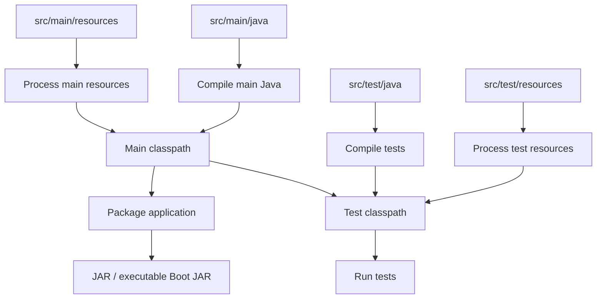
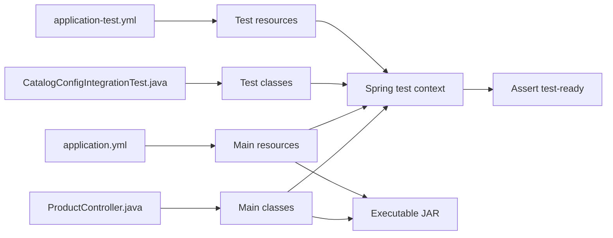

# `src/main/java`, `src/main/resources`, and Test Directories

> **Spring Boot Fundamentals · Source Organization**  
> A Spring Boot project contains more than just Java files. The build tool also needs to know which code runs in the application, which resources are packaged, which code is for testing, and which data only serves tests. This lesson explains the four standard directories and how they relate to the classpath, Spring Boot, Maven/Gradle, and JAR creation.

## 1. The Big Picture of Directory Structure

Spring Boot typically uses the **standard directory layout** of Java projects, supported by both Maven and Gradle. A typical web project:

```text
catalog-service/
├── pom.xml                            # Maven
│   # or build.gradle / build.gradle.kts if using Gradle
├── src/
│   ├── main/
│   │   ├── java/
│   │   │   └── com/example/catalog/
│   │   │       ├── CatalogApplication.java
│   │   │       ├── product/
│   │   │       │   ├── ProductController.java
│   │   │       │   ├── ProductService.java
│   │   │       │   └── ProductRepository.java
│   │   │       └── config/
│   │   │           └── CatalogConfiguration.java
│   │   └── resources/
│   │       ├── application.yml
│   │       ├── application-dev.yml
│   │       ├── static/
│   │       │   └── css/site.css
│   │       ├── templates/
│   │       │   └── products.html
│   │       └── db/migration/
│   │           └── V1__create_products.sql
│   └── test/
│       ├── java/
│       │   └── com/example/catalog/
│       │       ├── CatalogApplicationTests.java
│       │       └── product/
│       │           └── ProductServiceTest.java
│       └── resources/
│           ├── application-test.yml
│           └── fixtures/
│               └── product-valid.json
└── target/                            # Maven output; Gradle uses build/
```

This is a composite example. Not every Spring Boot application needs `templates/`, `static/`, SQL migrations, or all controller/service/repository layers. They appear depending on the project's technologies and functionality.

The four directories to remember:

| Directory | Role | When is it needed? |
| --- | --- | --- |
| `src/main/java` | Java source code running in the application | Entry-point class, controllers, services, entities, DTOs, configuration |
| `src/main/resources` | Resources used when the application runs | YAML/properties, SQL, static assets, templates, data files |
| `src/test/java` | Java source code used for testing | Unit tests, integration tests, web slice tests |
| `src/test/resources` | Resources used during testing | Test profile, JSON fixtures, sample data, test SQL |

The two axes of the structure are **main/test** (intended purpose) and **java/resources** (content type). Separating them helps the build tool know which content needs to be compiled, copied onto the classpath, used to run tests, and packaged.

## 2. From Source Files to Classpath and Artifact

In Java, `.java` files must be compiled into `.class` files before the JVM uses them. Resources are not compiled in this way; the build tool typically copies or processes resources and places them into the corresponding output/classpath.



Normally:

1. Java code in `main` is compiled; resources in `main` are placed into the main output.
2. Java code in `test` is compiled separately; resources in `test` are placed into the test output.
3. When running tests, the test classpath allows test code to access main code and testing resources.
4. When creating a production runnable artifact under standard configuration, the build uses **main** code and resources; test code and test fixtures **are not included in the application JAR**.

| Output of build step | Common Maven | Common Gradle |
| --- | --- | --- |
| Main classes + resources | `target/classes` | `build/classes/java/main` and `build/resources/main` |
| Test classes + resources | `target/test-classes` | `build/classes/java/test` and `build/resources/test` |
| Artifact | `target/*.jar` | `build/libs/*.jar` |

Paths can change when a project uses plugins or custom configurations. In particular, the `target/` and `build/` directories are **regenerable outputs**, not places to write source code manually. Do not edit Java files inside them because the next build/clean can overwrite or delete them.

## 3. `src/main/java`: Where Main Code Lives

In a Spring Boot application, `src/main/java` typically contains:

- `@SpringBootApplication` and the `main` method.
- `@RestController` or `@Controller` for API/web endpoints.
- `@Service` containing business logic.
- `@Repository` or Spring Data repositories for persistence.
- Entities, DTOs, validation, exception handlers, mappers, and Java configuration.

Example entry-point class:

```java
package com.example.catalog;

import org.springframework.boot.SpringApplication;
import org.springframework.boot.autoconfigure.SpringBootApplication;

@SpringBootApplication
public class CatalogApplication {
    public static void main(String[] args) {
        SpringApplication.run(CatalogApplication.class, args);
    }
}
```

Corresponding path:

```text
src/main/java/com/example/catalog/CatalogApplication.java
```

Controller:

```java
package com.example.catalog.product;

import java.util.Map;
import org.springframework.web.bind.annotation.GetMapping;
import org.springframework.web.bind.annotation.RestController;

@RestController
public class ProductController {

    @GetMapping("/api/products/status")
    public Map<String, String> status() {
        return Map.of("status", "ready");
    }
}
```

Placed at:

```text
src/main/java/com/example/catalog/product/ProductController.java
```

In code, `package com.example.catalog.product;` is the package name. `src/main/java` is the **source root**, while `com/example/catalog/product` is how the package is represented via directories. Keep package names and file paths consistent for easy lookup, refactoring, and Java tooling support.

### 3.1. How the Entry-Point Class Package Affects Component Scan

`@SpringBootApplication` includes the `@ComponentScan` mechanism. By default, component scan searches for components in the package of `CatalogApplication` and its subpackages:

```text
com.example.catalog
├── CatalogApplication
├── product
│   ├── ProductController
│   └── ProductService
├── order
│   └── OrderService
└── config
    └── CatalogConfiguration
```

Therefore, placing `CatalogApplication` in the application's root package usually makes sense. If `ExternalService` is placed under `com.example.shared` and this package is outside the scan scope, Spring may not create a bean from the `@Service` annotation, leading to dependency injection errors.

You can expand the scan scope when there is a clear reason, but keep in mind that mechanisms like entity scanning or repository scanning have their own rules. Do not assume changing `scanBasePackages` will automatically handle everything.

**Directory names like `service` or `controller` are not magic.** Spring recognizes components based on annotations/configuration and scan scope, not because a package has a specific name.

### 3.2. Organizing Packages by Layer or by Feature

Both approaches are common:

```text
# By layer
com/example/catalog/
├── controller/
├── service/
├── repository/
├── dto/
└── entity/
```

```text
# By feature
com/example/catalog/
├── product/
│   ├── ProductController.java
│   ├── ProductService.java
│   └── ProductRepository.java
├── order/
│   ├── OrderController.java
│   ├── OrderService.java
│   └── OrderRepository.java
└── shared/
    └── ApiError.java
```

By-layer organization is convenient for small projects or organizing by technical role; by-feature organization usually keeps classes belonging to the same business capability close together. Projects can combine them, such as `product/api`, `product/domain`, and `product/persistence`.

Whichever you choose, avoid placing classes in the **default package** (without a `package` declaration) because it can make the component scan scope overly broad and hard to control.

## 4. `src/main/resources`: Resources Included in the Application

Resources are files the application needs to read or serve at runtime that are not Java code compiled into classes. For example:

```text
src/main/resources/
├── application.yml
├── application-prod.yml
├── messages.properties
├── static/
│   ├── index.html
│   └── css/site.css
├── templates/
│   └── products.html
├── db/migration/
│   └── V1__create_products.sql
└── data/
    └── sample-products.json
```

In a standard build, these files are copied or processed into resources in the main output and reside on the runtime classpath. When packaged into a JAR, they typically live **inside the artifact**, no longer at a physical `src/main/resources` location on the deployment machine.

### 4.1. `application.yml` and `application.properties` Configuration Files

Example `application.yml`:

```yaml
spring:
  application:
    name: catalog-service

server:
  port: 8081

catalog:
  greeting: Welcome to catalog
```

Equivalent configuration using `application.properties`:

```properties
spring.application.name=catalog-service
server.port=8081
catalog.greeting=Welcome to catalog
```

Spring Boot has a mechanism to locate and load config data from supported locations, including classpath resources. Files are not recognized solely by the YAML extension; **Spring Boot** defines the rules for locating `application.yml`/`application.properties` and resolving precedence when multiple configuration sources exist.

When the application is deployed, properties can come from environment variables, command-line arguments, or external configuration files. Editing an `application.yml` file in the repository does not guarantee that the running value changes immediately.

### 4.2. Profile-Specific Files

```text
src/main/resources/
├── application.yml
├── application-dev.yml
└── application-prod.yml
```

```yaml
# application.yml
catalog:
  greeting: Hello
```

```yaml
# application-dev.yml
catalog:
  greeting: Hello developer
```

When activating the `dev` profile, Spring Boot also considers the corresponding configuration:

```bash
java -jar catalog-service.jar --spring.profiles.active=dev
```

Merely naming a file `application-dev.yml` does not automatically enable the `dev` profile. When multiple profiles or property sources exist, you need to understand Spring Boot's precedence order to know the final value.

**Do not commit real passwords, private keys, or API tokens into resources.** Packaged resources can be read from the JAR. Sensitive configuration should be supplied via a secret store or an appropriate secure configuration source.

### 4.3. `static/` and Static Web Content

If the application uses Spring MVC with standard resource mappings, Spring Boot can serve static files from classpath locations such as:

```text
classpath:/static/
classpath:/public/
classpath:/resources/
classpath:/META-INF/resources/
```

For example:

```text
src/main/resources/static/css/site.css
```

typically maps to the URL:

```http
GET /css/site.css
```

The actual access path also depends on the context path, servlet mapping, MVC configuration, and security. Do not put internal configuration or sensitive data into directories that serve public static resources.

`src/main/resources/data/sample-products.json` **does not automatically** become an HTTP endpoint: it is a classpath resource for the program to read. `src/main/resources/application.yml` is also a configuration file, not a static asset.

### 4.4. `templates/` for Server-Side Views

If you add a suitable template engine such as Thymeleaf, HTML templates typically reside under:

```text
src/main/resources/templates/
```

For example, with `templates/products.html` and appropriate Thymeleaf configuration:

```java
package com.example.catalog.product;

import org.springframework.stereotype.Controller;
import org.springframework.ui.Model;
import org.springframework.web.bind.annotation.GetMapping;

@Controller
public class ProductPageController {

    @GetMapping("/products")
    public String products(Model model) {
        model.addAttribute("title", "Product catalog");
        return "products";
    }
}
```

The view name `"products"` can be resolved to the `products.html` template. In a pure REST API, the application typically does not need view templates. **Having a `templates/` directory does not automatically install Thymeleaf**; the template engine dependency and configuration are required.

### 4.5. Other Resources

| Path example | Purpose | Condition |
| --- | --- | --- |
| `messages.properties` | Message bundle, internationalization | Message source mechanism |
| `db/migration/V1__create_products.sql` | SQL migration | Flyway present and properly configured |
| `data/sample-products.json` | Sample data read by the application | Code explicitly loads the resource |
| `templates/products.html` | HTML view template | Appropriate engine/beans |
| `static/css/site.css` | Static file that can be served over HTTP | Web resource mapping configuration |
| `application.yml` | Spring Boot config data | Boot configuration lookup mechanism |

Merely creating a directory name by convention does not make a library work automatically. For instance, SQL files under `db/migration` are only processed by Flyway if the project uses Flyway and configuration conditions are met.

## 5. Classpath Resources Are Not Source Paths on the Filesystem

This is a very common error when an application runs from the IDE but fails to read files after packaging.

Error-prone approach:

```java
Path path = Path.of("src/main/resources/data/sample-products.json");
```

This approach depends on the process's working directory and requires the source tree to exist where it runs. After deploying the JAR, the file may already be **inside the JAR**.

Using Spring's `ClassPathResource`:

```java
package com.example.catalog.product;

import java.io.IOException;
import java.io.InputStream;
import java.nio.charset.StandardCharsets;
import org.springframework.core.io.ClassPathResource;

public class SampleProductReader {

    public String readJson() throws IOException {
        ClassPathResource resource =
                new ClassPathResource("data/sample-products.json");

        try (InputStream input = resource.getInputStream()) {
            return new String(input.readAllBytes(), StandardCharsets.UTF_8);
        }
    }
}
```

Here:

1. The path is `data/sample-products.json`, relative to the **classpath root**; do not use `src/main/resources/`.
2. Reading via `InputStream` works with resources packaged inside a JAR.
3. A resource inside a JAR does not necessarily have a standalone filesystem file, so `resource.getFile()` or `new File(...)` may not be suitable.
4. For files that need modification during operations, use paths outside the artifact, object storage, or a database according to the application design.

Java also provides reading via the class loader:

```java
try (InputStream input = getClass().getClassLoader()
        .getResourceAsStream("data/sample-products.json")) {

    if (input == null) {
        throw new IllegalStateException("Resource not found");
    }

    // Use input here.
}
```

Distinguish three mechanisms:

- **Classpath resource:** Java code reads a file via the Resource API / class loader.
- **Static web resource:** an HTTP handler serves assets by URL.
- **Config data:** Spring Boot loads `application.yml` or supported configuration sources.

All three can use files located under `src/main/resources`, but they solve **three different needs**.

## 6. `src/test/java`: Where Test Code Lives

Tests are placed in a separate source root:

```text
src/main/java/com/example/catalog/product/ProductPriceCalculator.java
src/test/java/com/example/catalog/product/ProductPriceCalculatorTest.java
```

Example Java class in `main`:

```java
package com.example.catalog.product;

public class ProductPriceCalculator {

    public long discountedPrice(long originalPrice, int discountPercent) {
        if (originalPrice < 0 || discountPercent < 0 || discountPercent > 100) {
            throw new IllegalArgumentException("Invalid price or discount");
        }
        return originalPrice * (100 - discountPercent) / 100;
    }
}
```

Unit test using JUnit Jupiter in `test`:

```java
package com.example.catalog.product;

import static org.junit.jupiter.api.Assertions.assertEquals;
import static org.junit.jupiter.api.Assertions.assertThrows;
import org.junit.jupiter.api.Test;

class ProductPriceCalculatorTest {

    private final ProductPriceCalculator calculator =
            new ProductPriceCalculator();

    @Test
    void appliesDiscount() {
        assertEquals(800L, calculator.discountedPrice(1000L, 20));
    }

    @Test
    void rejectsInvalidDiscount() {
        assertThrows(IllegalArgumentException.class,
                () -> calculator.discountedPrice(1000L, 101));
    }
}
```

Classes needed in production belong in `src/main/java`. The class testing them belongs in `src/test/java` and is compiled separately when the build runs tests. Pure Java unit tests like the one above **do not need to initialize a Spring ApplicationContext**, so they are usually fast and easy to isolate.

In a Maven project, test dependencies typically have `<scope>test</scope>`. In Gradle, `testImplementation` is typically used. This is a **library declaration for tests**; it does not replace placing test code under `src/test/java`.

### 6.1. Do Test Classes Need to Be in the Same Package?

It is not mandatory, but placing tests in the same package as the code under test is a useful convention:

```text
src/main/java/com/example/catalog/product/
├── ProductService.java
└── ProductPriceCalculator.java

src/test/java/com/example/catalog/product/
├── ProductServiceTest.java
└── ProductPriceCalculatorTest.java
```

This makes navigation easier and can support testing package-private code in Java. A test's package is determined by the `package` declaration in the Java file. The IDE/build tool recognizes the test source root to compile it separately.

### 6.2. `@SpringBootTest` for Tests Needing a Spring Context

A simple integration test:

```java
package com.example.catalog;

import org.junit.jupiter.api.Test;
import org.springframework.boot.test.context.SpringBootTest;

@SpringBootTest
class CatalogApplicationTests {

    @Test
    void contextLoads() {
        // The test succeeds if the ApplicationContext starts up.
    }
}
```

Placed at:

```text
src/test/java/com/example/catalog/CatalogApplicationTests.java
```

Spring Boot Test has a mechanism to find the `@SpringBootConfiguration` class by walking up the package hierarchy. If a test is located far from the application package, it may fail to find the startup configuration. You can specify the configuration class explicitly when needed, for example `@SpringBootTest(classes = CatalogApplication.class)`.

**Not every test needs `@SpringBootTest`.** This annotation can initialize many more components than a plain unit test, making tests slower or dependent on infrastructure. Use it when the test needs a Spring context.

### 6.3. Testing a Web Layer Slice with `@WebMvcTest`

With `ProductController` having no service dependencies as in section 3:

```java
package com.example.catalog.product;

import static org.springframework.test.web.servlet.request.MockMvcRequestBuilders.get;
import static org.springframework.test.web.servlet.result.MockMvcResultMatchers.jsonPath;
import static org.springframework.test.web.servlet.result.MockMvcResultMatchers.status;
import org.junit.jupiter.api.Test;
import org.springframework.beans.factory.annotation.Autowired;
import org.springframework.boot.test.autoconfigure.web.servlet.WebMvcTest;
import org.springframework.test.web.servlet.MockMvc;

@WebMvcTest(ProductController.class)
class ProductControllerTest {

    @Autowired
    MockMvc mockMvc;

    @Test
    void statusReturnsReady() throws Exception {
        mockMvc.perform(get("/api/products/status"))
                .andExpect(status().isOk())
                .andExpect(jsonPath("$.status").value("ready"));
    }
}
```

A test slice such as `@WebMvcTest` focuses on web components; it does not necessarily load all services/repositories of the application. If the controller depends on a service, the test may need to provide a mock or appropriate bean.

## 7. `src/test/resources`: Resources Strictly for Tests

This is where files needed for testing live:

```text
src/test/resources/
├── application-test.yml
├── fixtures/
│   ├── product-valid.json
│   └── product-invalid.json
└── sql/
    └── seed-products.sql
```

Test resources participate in the **test classpath**. With standard build configuration, they are not included in the production executable JAR. Even though they are not packaged, data in the repository must still be safe: do not store real production passwords or tokens in test resources.

### 7.1. Does `application-test.yml` Take Effect Automatically?

No. This is configuration for the `test` profile, which requires activating that profile.

File:

```yaml
# src/test/resources/application-test.yml
catalog:
  greeting: Hello from tests

logging:
  level:
    com.example.catalog: DEBUG
```

Test activating the profile:

```java
package com.example.catalog;

import static org.junit.jupiter.api.Assertions.assertEquals;
import org.junit.jupiter.api.Test;
import org.springframework.beans.factory.annotation.Autowired;
import org.springframework.boot.test.context.SpringBootTest;
import org.springframework.core.env.Environment;
import org.springframework.test.context.ActiveProfiles;

@SpringBootTest
@ActiveProfiles("test")
class CatalogConfigurationTests {

    @Autowired
    Environment environment;

    @Test
    void readsTestGreeting() {
        assertEquals("Hello from tests",
                environment.getProperty("catalog.greeting"));
    }
}
```

When the `test` profile is active, Spring Boot evaluates configuration sources according to config data / property precedence rules. This is a clear way to use separate testing configuration.

If you place `application.yml` in both `src/main/resources` and `src/test/resources`, two resources with the same name can affect how the classpath/config loader finds and prioritizes files. Avoid relying on ambiguous ordering; instead use profiles, explicit property overrides, or test-specific configuration mechanisms.

### 7.2. JSON Fixtures and How to Read Them

Content:

```json
{
  "id": 101,
  "name": "Keyboard",
  "price": 250000
}
```

Saved at `src/test/resources/fixtures/product-valid.json`, read in a test via the classpath:

```java
package com.example.catalog.product;

import static org.junit.jupiter.api.Assertions.assertTrue;
import java.io.IOException;
import java.io.InputStream;
import java.nio.charset.StandardCharsets;
import org.junit.jupiter.api.Test;

class ProductFixtureTest {

    @Test
    void canLoadFixture() throws IOException {
        try (InputStream input = getClass().getResourceAsStream(
                "/fixtures/product-valid.json")) {
            if (input == null) {
                throw new IllegalStateException("Missing test fixture");
            }

            String json = new String(
                    input.readAllBytes(), StandardCharsets.UTF_8);

            assertTrue(json.contains("Keyboard"));
        }
    }
}
```

This is an example of **reading a file**; tests for real JSON data should parse and assert properties using a JSON library rather than just comparing strings.

When running tests, test code can access resources in both `src/main/resources` and `src/test/resources` via the classpath. That does not mean test resources will be packaged into the production artifact.

## 8. How Do Maven and Gradle Understand This Structure?

Both support these standard source roots, so with common Java/Spring Boot configurations, you usually do not have to specify each path again.

### 8.1. Gradle: Java Plugin, Source Sets, and Tasks

Example `build.gradle` using Groovy DSL:

```groovy
plugins {
    id 'java'
    id 'org.springframework.boot' version '3.5.0'
    id 'io.spring.dependency-management' version '1.1.7'
}

repositories {
    mavenCentral()
}

dependencies {
    implementation 'org.springframework.boot:spring-boot-starter-web'
    testImplementation 'org.springframework.boot:spring-boot-starter-test'
}

tasks.named('test') {
    useJUnitPlatform()
}
```

When using the Java plugin, Gradle has default **source sets**:

- `main` reads Java from `src/main/java` and resources from `src/main/resources`.
- `test` reads Java from `src/test/java` and resources from `src/test/resources`.

Some corresponding tasks:

| Task | Responsibility |
| --- | --- |
| `compileJava` | Compile Java in main |
| `processResources` | Process/copy main resources |
| `compileTestJava` | Compile test Java code |
| `processTestResources` | Process/copy test resources |
| `test` | Execute tests as configured |
| `bootRun` | Run the Spring Boot application during development |
| `bootJar` | Create a Spring Boot executable JAR |

The `bootRun` and `bootJar` tasks exist when the Spring Boot Gradle plugin is applied with appropriate configuration; they are not built-in tasks in every Java project.

Example commands:

```bash
./gradlew test
./gradlew bootJar
```

Windows PowerShell:

```powershell
.\gradlew.bat test
.\gradlew.bat bootJar
```

### 8.2. Maven: Standard Directory Layout and Lifecycle

`pom.xml` typically declares dependencies for the application and tests:

```xml
<dependencies>
    <dependency>
        <groupId>org.springframework.boot</groupId>
        <artifactId>spring-boot-starter-web</artifactId>
    </dependency>

    <dependency>
        <groupId>org.springframework.boot</groupId>
        <artifactId>spring-boot-starter-test</artifactId>
        <scope>test</scope>
    </dependency>
</dependencies>
```

This example assumes a Spring Boot parent/BOM already manages the required versions. Appropriate build plugins compile code in the standard source roots:

```text
src/main/java       -> main Java source
src/main/resources  -> main resources
src/test/java       -> test Java source
src/test/resources  -> test resources
```

Some commands:

```bash
./mvnw compile
./mvnw test
./mvnw package
```

On Windows:

```powershell
.\mvnw.cmd test
.\mvnw.cmd package
```

Maven typically puts main output into `target/classes` and test output into `target/test-classes`. To create a properly structured Spring Boot executable JAR, you need the Spring Boot Maven Plugin and an appropriate repackage configuration, such as the mechanism supported by `spring-boot-starter-parent`.

The versions `3.5.0`/`1.1.7` shown in the Gradle example only illustrate a Spring Boot 3.x project; in a real project, use plugin and Java versions supported by the Boot version you are using.

### 8.3. Can Source Directories Be Changed?

Yes. Gradle supports configuring `sourceSets`; Maven allows customizing source/resource directories through build and plugin configuration. Gradle example:

```groovy
sourceSets {
    main {
        java {
            srcDirs = ['src/main/java', 'generated/main/java']
        }
    }
}
```

This need can arise with generated sources. However, changing source roots affects IDEs, CI, build scripts, and readers of the repo. Unless there is a special reason, keeping the standard layout is usually simpler.

## 9. What Actually Goes into a Spring Boot JAR

A typical Spring Boot executable JAR has a simplified structure:

```text
catalog-service.jar
├── META-INF/
├── org/springframework/boot/loader/...
└── BOOT-INF/
    ├── classes/
    │   ├── com/example/catalog/
    │   │   ├── CatalogApplication.class
    │   │   └── product/ProductController.class
    │   ├── application.yml
    │   └── static/css/site.css
    └── lib/
        ├── spring-boot-...jar
        └── ...
```

Here:

- `CatalogApplication.java` from `src/main/java` is compiled into `CatalogApplication.class`.
- `application.yml` and `static/css/site.css` from `src/main/resources` reside in the classpath area of the JAR.
- Required runtime dependencies can reside as nested JARs in `BOOT-INF/lib`.
- `ProductControllerTest.class` and `application-test.yml` normally **do not appear** because they belong to the test source set.

The exact loader name and structure depend on the version and packaging method. A Java **plain JAR** has a different structure and does not include the Spring Boot launcher or all runtime dependencies in the same way.

To inspect artifact contents with the JDK:

```bash
jar tf target/catalog-service-0.0.1-SNAPSHOT.jar
```

Or with Gradle:

```bash
jar tf build/libs/catalog-service-0.0.1-SNAPSHOT.jar
```

Replace the JAR name with the actual artifact. Checking the contents reveals whether resource files made it into the package, rather than guessing from source file locations.

### 9.1. Why Does Changing a Resource in the Repository Not Update an Already Deployed JAR?

After packaging, resources have been copied into the artifact. Editing `src/main/resources/application.yml` in the source does not cause an already running JAR to change automatically. To change packaged resource contents, you must build/deploy a new artifact, unless the application is designed to read a configuration/file source **outside the JAR**.

This is also why user-uploaded files or files written at runtime should not be treated as packaged resources. They need a separate operational storage mechanism.

## 10. Output Directories, Generated Code, and Local Files

You may also encounter:

```text
catalog-service/
├── build/                    # Gradle output
├── target/                   # Maven output
├── .gradle/                  # Gradle local state
├── .idea/                    # IDE metadata
├── .vscode/                  # Editor settings
├── logs/                     # Runtime logs, if created by the application
└── uploads/                  # Runtime user data, if created by the application
```

`build/` and `target/` are outputs and should generally be excluded from version control. Java code produced by generators may also live in `build/generated/...` or `target/generated-sources/...`, configured as compilation sources in the pipeline. Do not manually mix generated code with human-written source if the project already manages automated code generation.

The `logs/` and `uploads/` directories hold runtime data and need their own storage locations and access permissions. They are not equivalent to `src/main/resources` and should not be packaged into the JAR as static data.

`.gitignore` should exclude artifacts and files that do not need to be committed, but must not accidentally exclude all of `src/main` or `src/test`. Test sources and safe fixtures are usually an important part of the repository.

### 10.1. Multi-module Projects

If the system has multiple modules:

```text
catalog-platform/
├── settings.gradle
├── catalog-api/
│   ├── build.gradle
│   └── src/
│       ├── main/java/...
│       ├── main/resources/...
│       ├── test/java/...
│       └── test/resources/...
└── catalog-core/
    ├── build.gradle
    └── src/
        ├── main/java/...
        └── test/java/...
```

The equivalent in a Maven multi-module project is a parent/aggregator POM and individual POMs in each module. Each module has its own source roots. For module B to use classes in module A, a dependency between the modules must be declared. A Java file appearing in any `src/main/java` directory of the repository is not automatically visible to every module.

Runnable Spring Boot modules and library modules can be packaged differently; only the application module needs the corresponding Boot executable JAR configuration.

## 11. Organizing a Sample Feature End to End

We want the `GET /api/products/status` endpoint to return a message from configuration, and have a test that uses a separate message.

### 11.1. Java Controller in `main/java`

```java
package com.example.catalog.product;

import java.util.Map;
import org.springframework.beans.factory.annotation.Value;
import org.springframework.web.bind.annotation.GetMapping;
import org.springframework.web.bind.annotation.RestController;

@RestController
public class ProductController {

    private final String statusMessage;

    public ProductController(
            @Value("${catalog.status-message:ready}") String statusMessage) {
        this.statusMessage = statusMessage;
    }

    @GetMapping("/api/products/status")
    public Map<String, String> status() {
        return Map.of("status", statusMessage);
    }
}
```

This file belongs in `src/main/java/com/example/catalog/product/ProductController.java` because it defines behavior the application will run.

### 11.2. Main Resource `application.yml`

```yaml
# src/main/resources/application.yml
catalog:
  status-message: ready
```

This is application configuration, loaded by Spring Boot according to externalized configuration rules.

### 11.3. Test Resource `application-test.yml`

```yaml
# src/test/resources/application-test.yml
catalog:
  status-message: test-ready
```

### 11.4. Java Test Activating a Specific Profile

```java
package com.example.catalog;

import static org.junit.jupiter.api.Assertions.assertEquals;
import org.junit.jupiter.api.Test;
import org.springframework.beans.factory.annotation.Autowired;
import org.springframework.boot.test.context.SpringBootTest;
import org.springframework.core.env.Environment;
import org.springframework.test.context.ActiveProfiles;

@SpringBootTest
@ActiveProfiles("test")
class CatalogConfigIntegrationTest {

    @Autowired
    Environment environment;

    @Test
    void statusMessageComesFromTestProfile() {
        assertEquals("test-ready",
                environment.getProperty("catalog.status-message"));
    }
}
```

This file belongs in `src/test/java/com/example/catalog/CatalogConfigIntegrationTest.java`. The test configuration is loaded when the `test` profile is active. After production packaging, the controller and main config remain in the artifact, while test code and test resources only serve the testing phase.



## 12. Common Errors When Files Are Placed in the Wrong Location

| Symptom | Common Cause | How to Handle |
| --- | --- | --- |
| Works in IDE, JSON file not found when running JAR | Code uses `src/main/resources/...` path relative to working directory | Read via classpath or configure a path outside the artifact |
| Controller does not handle requests even though code compiles | Class is outside the component scan scope | Check `@SpringBootApplication` package, annotations, and scan scope |
| `application-test.yml` has no effect | The `test` profile is not activated | Use `@ActiveProfiles("test")` or explicit profile configuration |
| CSS/JS returns HTTP 404 | File not in static resource location, wrong URL, or custom MVC/security | Check `static/`, context path, and resource mapping |
| Template does not render | Missing engine, wrong view name, or template in wrong folder | Check `templates/` and the corresponding template engine |
| Test classes appear in the released JAR | Custom build pulls test output into the artifact | Review source sets and packaging |
| Unit tests do not run | Wrong source root, missing test engine, or test task config | Check `src/test/java`, dependencies, and Maven/Gradle test config |
| Fixture readable in IDE but not in CI | Wrong classpath path or case sensitivity | Check exact filename and test resources |
| Edited `application.yml` but runtime did not change | Not rebuilt/redeployed or overridden by external config | Check the artifact and active property sources |
| Flyway does not run migrations | SQL file created without Flyway or proper config | Check dependency, Flyway conditions, and migration location |

Some operating systems are case-sensitive in file paths. For example, `product-valid.json` and `Product-valid.json` may be treated as two different files on Linux, even though working locally on Windows does not always expose that bug. Keeping paths and packages consistent makes CI more reliable.

### 12.1. What Should You Do When a Resource Is Not Found?

Trace the path of the resource:

1. Which **source root** does the file belong to? `main` or `test`?
2. Did the build copy it into the corresponding **output classpath**?
3. Is the application looking up the file via **classpath**, **filesystem**, **HTTP static**, or **template engine**?
4. Does the resource name have the exact path and capitalization?
5. Are there any resource include/exclude/filtering rules or other profiles configured?
6. Is the running artifact actually the newly built version?

Reading logs and observing outputs helps avoid blindly editing annotations or endlessly moving files around.

## 13. Hands-On Exercise: Create the Structure Yourself and Observe

Suppose you have a Java Spring Boot project with suitable web and test dependencies. Perform the following:

### Step 1 — Create the Directory Tree

```text
src/
├── main/
│   ├── java/com/example/catalog/
│   │   ├── CatalogApplication.java
│   │   └── product/ProductController.java
│   └── resources/
│       ├── application.yml
│       └── static/hello.txt
└── test/
    ├── java/com/example/catalog/
    │   └── CatalogApplicationTests.java
    └── resources/
        └── application-test.yml
```

File `hello.txt` contains:

```text
Hello from static resources
```

### Step 2 — Run the Application

Gradle:

```bash
./gradlew bootRun
```

Maven:

```bash
./mvnw spring-boot:run
```

Observe the `/api/products/status` endpoint and try accessing `/hello.txt` under a suitable default web configuration. Note that HTML/CSS files do not become controllers: the static resource handler serves them via its own mechanism.

### Step 3 — Run Tests

Gradle:

```bash
./gradlew test
```

Maven:

```bash
./mvnw test
```

If using Windows, replace the corresponding wrapper command with `.\gradlew.bat` or `.\mvnw.cmd`. Observe that tests can read the test profile and test resources.

### Step 4 — Package and Inspect the Artifact

Gradle:

```bash
./gradlew bootJar
```

Maven (when configured with an appropriate Spring Boot Maven Plugin):

```bash
./mvnw package
```

Use `jar tf` to list the JAR contents. Find `CatalogApplication.class`, `application.yml`, and `hello.txt`; determine why `CatalogApplicationTests.class` or `application-test.yml` are not in a normal executable JAR.

### Step 5 — Try Reading a Resource

Place a `data/demo.json` file in `src/main/resources`. Read the file using `ClassPathResource("data/demo.json")` and compare with `Path.of("src/main/resources/data/demo.json")` when running the packaged application. From this, explain why the source directory is not a reliable runtime path.

### Self-Check Questions

1. Why do `.java` files and `application.yml` belong in two different directories?
2. Why is test code placed under `src/test/java` rather than alongside controllers?
3. When running tests, can test code read `src/main/resources`? Are test resources included in the production JAR by default?
4. Why does `application-test.yml` not take effect automatically unless a profile is activated?
5. What error can occur if `ProductController` is placed outside the package of `CatalogApplication`?
6. Is a file in `src/main/resources` automatically downloadable over HTTP?
7. Why is code that reads `src/main/resources/data/demo.json` using a filesystem path prone to failing when running an executable JAR?
8. In a multi-module project, are classes in module A automatically visible in module B without declaring a dependency?

## 14. Key Takeaways

| | Java Code | Resources |
| --- | --- | --- |
| **`main` — application** | `src/main/java`: Java code shipped with the product | `src/main/resources`: configuration and files packaged with the application |
| **`test` — testing** | `src/test/java`: JUnit/integration tests | `src/test/resources`: fixtures and test configuration |

Separating source roots helps Maven/Gradle know **which files to compile, which files to copy, which files serve testing, and which files go into the artifact**. Understanding the classpath mechanism, package scanning, and how Spring Boot loads resources will help you explain common errors when moving from IDE to JAR, from local machine to CI, and from development to production.
