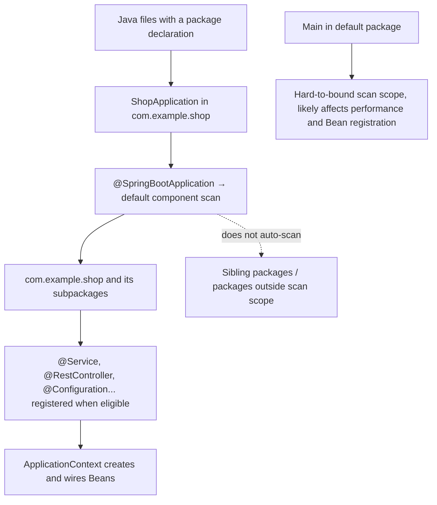

# Root Packages, Subpackages, and the Risks of Using the Default Package

A Spring Boot application can have all the right dependencies, a class annotated with `@Service`, and a controller declaring `@GetMapping` properly, yet still fail at runtime with a missing Bean error or return HTTP 404. A very common cause is **classes being placed in packages that Spring does not scan**. This issue starts with how Java organizes packages, and then ties directly into Spring Boot's component scanning mechanism.

This lesson helps you read a package tree, understand where to place the `@SpringBootApplication` class, distinguish root packages from subpackages, recognize the consequences of omitting the `package` declaration, and choose how to organize source code as the application grows.

## 1. What Is a Package, and Why Does Spring Boot Care?

In Java, a **package** is a namespace used to group related types (classes, interfaces, enums, records, annotations). It helps avoid class name collisions, partially controls access scope, and creates a manageable structure.

For example, the following two types can share the name `Customer` while belonging to two different packages:

```java
package com.example.shop.sales;

public class Customer {
    // Customer for sales business logic.
}
```

```java
package com.example.shop.support;

public class Customer {
    // Customer representation in support operations.
}
```

Their *fully qualified names* are `com.example.shop.sales.Customer` and `com.example.shop.support.Customer`, respectively. These are two distinct types even though their final name segment matches.

When a class needs to use a type from another package, it can `import` it:

```java
package com.example.shop.order;

import com.example.shop.sales.Customer;

public class Order {
    private Customer customer;
}
```

Or use the fully qualified name, such as `com.example.shop.sales.Customer`. **`import` only helps the compiler resolve type names; it does not tell Spring to create a Bean or scan a package.** This is a crucial distinction.

### Package Declaration and Source Directories

In a typical Maven/Gradle project, Java code is stored under `src/main/java`; tests usually live in `src/test/java`. The `package` declaration line corresponds to the path segment beneath the source directory:

```text
src/main/java/
└── com/
    └── example/
        └── shop/
            ├── ShopApplication.java
            ├── catalog/
            │   └── ProductCatalog.java
            └── order/
                └── OrderController.java
```

For example, the file `src/main/java/com/example/shop/catalog/ProductCatalog.java` starts with:

```java
package com.example.shop.catalog;
```

In Java, the package name is determined by the `package` statement in the source code. Arranging files along the matching directory path is an important convention for build tools, IDEs, and code readers. Directory names on disk do not automatically substitute for a `package` declaration.

A package is normally named in lowercase using reverse-domain notation, such as `com.company.inventory` or `vn.example.learning`. Choose names that are stable and reflect the product scope; avoid overly generic names like `app`, `model`, or `utils` without a clear prefix.

## 2. Root Packages and Subpackages

Suppose the application has this structure:

```text
com.example.shop                   ← application root package
├── ShopApplication
├── catalog                        ← subpackage
│   ├── ProductController
│   ├── ProductCatalog
│   └── ProductView
├── order                          ← subpackage
│   ├── OrderController
│   └── OrderService
└── common                         ← subpackage
    └── ClockConfiguration
```

Here `com.example.shop` is the *root package* by **application organization convention**. Packages prefixed with `com.example.shop.` such as `com.example.shop.catalog` and `com.example.shop.order` are subpackages by name.

A few things to distinguish:

- `com.example.shop.catalog` sits under the `com.example.shop` namespace yet is still **a different package** from `com.example.shop`.
- `com.example.shop.catalog.internal` is a deeper subpackage of `com.example.shop.catalog`.
- `com.example.shared` is a **sibling package** to `com.example.shop` under `com.example`; it does not belong to the `com.example.shop` package tree.
- `com.example.shopping` is **not** a subpackage of `com.example.shop`, even though both start with the character string `com.example.shop`. The boundary must be a dot between segments.

### "Subpackage" Does Not Mean Inheriting Access Rights

In Java, *package-private* access (omitting `public`, `protected`, or `private`) applies only to code in the **exact same package**. Subpackages do not automatically inherit that access.

```java
// File: com/example/shop/catalog/CatalogItem.java
package com.example.shop.catalog;

class CatalogItem {
    // Only classes in the exact package com.example.shop.catalog
    // can access this package-private class.
}
```

Code in `com.example.shop.catalog.web` cannot freely use `CatalogItem` above merely because it resides in a subpackage. If you want to expose a type across package boundaries, you need to design an appropriate access API, usually `public`. This rule belongs to the **Java language**, independent of Spring.

## 3. Why Does the Startup Class Location Determine the Default Scan Scope?

Spring Boot typically starts with a class annotated with `@SpringBootApplication`:

```java
package com.example.shop;

import org.springframework.boot.SpringApplication;
import org.springframework.boot.autoconfigure.SpringBootApplication;

@SpringBootApplication
public class ShopApplication {

    public static void main(String[] args) {
        SpringApplication.run(ShopApplication.class, args);
    }
}
```

`@SpringBootApplication` combines Spring Boot's primary configuration capabilities, including **`@ComponentScan`**. When no other scan packages are specified, component scanning starts from the **package containing the `@SpringBootApplication` class** and searches for components in that package and its subpackages.

With the class above, the default scan scope is:

```text
com.example.shop
├── [scanned] ShopApplication
├── [scanned] catalog.ProductController
├── [scanned] catalog.ProductCatalog
├── [scanned] order.OrderController
├── [scanned] order.OrderService
└── [scanned] common.ClockConfiguration

com.example.shared
└── [outside the scan scope above] SharedService

com.example.shopping
└── [outside the scan scope above] OtherService
```

This is why Spring Boot documentation commonly advises placing the main application class in a **root package above the project's components**.

### What Does Component Scanning Look For?

When scanning classes, Spring can recognize types carrying appropriate stereotype annotations, for example:

| Annotation | Common Role |
|---|---|
| `@Component` | General Spring-managed component |
| `@Service` | Service containing business processing |
| `@Repository` | Data-access component |
| `@Controller` | MVC controller |
| `@RestController` | Controller returning HTTP response body by default |
| `@Configuration` | Spring configuration class, typically defining `@Bean` methods |

The annotations above rely on Spring's component model. However, component scanning **does not turn every Java class in the package into a Bean**. A DTO record like `ProductView` or an ordinary utility class will not automatically become a Bean just by sitting under the root package.

Conversely, a Bean can come from `@Bean`, `@Import`, API registration, or auto-configuration. Therefore, **Bean registration** is broader than component scanning, and **scan package scope** only governs mechanisms that rely on that scan.

### Do Not Mistake "Root Package" for a Special Keyword

Java has no "root package" keyword. `com.example.shop` is purely an **architectural convention**: the package group that the application considers its own. Spring uses the package containing the configuration class to establish defaults, rather than reading the name `root` or the project folder name to infer business structure.

## 4. End-to-End Example: Correct Root Package

Let's create a small REST application managing a product list to observe the relationship between packages and Beans.

```text
src/main/java/
└── com/example/shop/
    ├── ShopApplication.java
    └── catalog/
        ├── ProductView.java
        ├── ProductCatalog.java
        └── ProductController.java
```

**File `ShopApplication.java`:**

```java
package com.example.shop;

import org.springframework.boot.SpringApplication;
import org.springframework.boot.autoconfigure.SpringBootApplication;

@SpringBootApplication
public class ShopApplication {
    public static void main(String[] args) {
        SpringApplication.run(ShopApplication.class, args);
    }
}
```

**File `catalog/ProductView.java`:** DTO returned by the API; this record does not need to become a Bean.

```java
package com.example.shop.catalog;

public record ProductView(long id, String name) {
}
```

**File `catalog/ProductCatalog.java`:** service discovered by component scanning.

```java
package com.example.shop.catalog;

import org.springframework.stereotype.Service;

@Service
public class ProductCatalog {
    public ProductView find(long id) {
        return new ProductView(id, "Notebook");
    }
}
```

**File `catalog/ProductController.java`:** controller receiving the service via constructor injection.

```java
package com.example.shop.catalog;

import org.springframework.web.bind.annotation.GetMapping;
import org.springframework.web.bind.annotation.PathVariable;
import org.springframework.web.bind.annotation.RestController;

@RestController
public class ProductController {
    private final ProductCatalog catalog;

    public ProductController(ProductCatalog catalog) {
        this.catalog = catalog;
    }

    @GetMapping("/products/{id}")
    public ProductView getProduct(@PathVariable long id) {
        return catalog.find(id);
    }
}
```

With an already configured Spring Boot project, a web dependency is needed to run HTTP endpoints, for example:

```groovy
dependencies {
    implementation 'org.springframework.boot:spring-boot-starter-web'
}
```

Launch `ShopApplication` and test:

```bash
curl "http://localhost:8080/products/7"
```

If the default port has not been changed and the application starts successfully, the expected JSON response is:

```json
{
  "id": 7,
  "name": "Notebook"
}
```

What happened?

1. `ShopApplication` placed in `com.example.shop` establishes the default component scanning scope.
2. `ProductCatalog` has `@Service`, `ProductController` has `@RestController`, and both reside in the `com.example.shop.catalog` subpackage.
3. The container registers both Beans and injects `ProductCatalog` into `ProductController`'s constructor.
4. Spring MVC maps `GET /products/{id}` to the controller method and uses its built-in JSON support to serialize `ProductView`.
5. `ProductView` is a data object created by business code; it **does not need Bean registration** to serve as an HTTP response body.

Packages determine **discoverability during scanning**; how Beans behave also depends on annotations, dependencies, configuration, and other Spring mechanisms.

## 5. Error Example: Main Class Placed Too Deeply

Now move the main application class into the `com.example.shop.bootstrap` package, while keeping the controller and service in `com.example.shop.catalog`:

```text
com.example.shop
├── bootstrap
│   └── ShopApplication          ← @SpringBootApplication
└── catalog
    ├── ProductCatalog           ← @Service
    └── ProductController        ← @RestController
```

If `ShopApplication` declares:

```java
package com.example.shop.bootstrap;

@SpringBootApplication
public class ShopApplication {
    // ...
}
```

then default component scan starts from `com.example.shop.bootstrap`, and **does not automatically climb back up to `com.example.shop` and descend into the `catalog` branch**.

In this example, running only `ShopApplication` without other scan configuration means `ProductController` may not be registered. The web application can still start, but requests to `/products/7` return 404 because no matching mapping exists.

If a scanned Bean depends on a service located outside the scan scope, the error can appear earlier during context initialization, with a message like:

```text
Parameter 0 of constructor in ...
required a bean of type '...ProductCatalog' that could not be found.
```

Do not rush to add `@Autowired` or instantiate the service manually as a quick fix: first verify **whether the scan package scope covers the required class**.

### Most Natural Solution: Move the Main Class to the Root Package

For a simple application, move the main class from `com.example.shop.bootstrap` to `com.example.shop`. Keeping controllers, services, and repositories in subpackages is enough for the defaults to work.

```text
com.example.shop
├── ShopApplication              ← @SpringBootApplication
├── bootstrap
│   └── StartupHooks
└── catalog
    ├── ProductCatalog
    └── ProductController
```

From here, teams can add features like `inventory`, `payment`, or `customer` under the same root package without constantly expanding scan configurations.

## 6. Packages Outside the Scan Scope: Intentional Ways to Handle Them

It is not always possible to move every class into the same package tree. A project may contain shared modules or integration libraries with their own namespaces. In that case, clearly decide which classes you want Spring to manage.

### Approach A — Expand Component Scan Scope in a Controlled Way

For example, the application is in `com.example.shop` and a service is in `com.example.integration`:

```java
package com.example.shop;

import com.example.integration.IntegrationPackageMarker;
import org.springframework.boot.SpringApplication;
import org.springframework.boot.autoconfigure.SpringBootApplication;

@SpringBootApplication(
    scanBasePackageClasses = {
        ShopApplication.class,
        IntegrationPackageMarker.class
    }
)
public class ShopApplication {
    public static void main(String[] args) {
        SpringApplication.run(ShopApplication.class, args);
    }
}
```

`IntegrationPackageMarker` is a marker interface/class you place in the `com.example.integration` package, such as:

```java
package com.example.integration;

public interface IntegrationPackageMarker {
}
```

Here, Spring scans the packages containing **the two classes in the list** and their subpackages. Using `scanBasePackageClasses` has the advantage that type references can be updated more reliably by IDE/refactoring tools than package name strings.

You can also use:

```java
@SpringBootApplication(
    scanBasePackages = {
        "com.example.shop",
        "com.example.integration"
    }
)
```

When setting `scanBasePackages` or `scanBasePackageClasses`, remember to **list the main application package as well** if you still want components there to be scanned. Specifying an external package while forgetting the current one can drop Beans that were previously found.

Expanding scan should have a specific reason. Scanning too broadly—such as `com.example` in a system with multiple independent applications—can accidentally register controllers, services, or configurations that do not belong to the current application.

### Approach B — Import a Configuration or Register a Specific Bean

If you only need a few components, you can opt for explicit registration instead of scanning an entire package:

```java
package com.example.shop;

import com.example.integration.IntegrationConfiguration;
import org.springframework.boot.autoconfigure.SpringBootApplication;
import org.springframework.context.annotation.Import;

@SpringBootApplication
@Import(IntegrationConfiguration.class)
public class ShopApplication {
    // main(...)
}
```

`IntegrationConfiguration` is an actual configuration class you created or provided by a library. When imported, its eligible Bean definitions can enter the context. For any Java class without automatic registration, you can also use `@Bean` inside a `@Configuration` within scan scope to create the desired instance.

Note that **adding a JAR dependency does not mean automatically scanning every `@Service` inside the JAR**. A library may provide an auto-configuration mechanism or its own import instructions; follow the integration contract designed by the library.

### Approach C — Clearly Separate Applications in Multi-Module Projects

If `billing`, `shipping`, and `shop` are three independent Spring Boot applications, you should not try to scan all of them into one context just because they share `com.example`. Each application can have its own entry point and root package:

```text
com.example.shop.ShopApplication
com.example.billing.BillingApplication
com.example.shipping.ShippingApplication
```

Each context manages the Beans belonging to that application. Shared code should be organized as a library with a clear API, registering Beans through necessary configuration rather than pulling every component of every application into a single context by default.

## 7. Default Package: What Is It Exactly?

The **default package** (also known as the *unnamed package*) in Java occurs when a source file **has no `package ...;` line**.

Example:

```java
// No package statement at the top of the file.
import org.springframework.boot.SpringApplication;
import org.springframework.boot.autoconfigure.SpringBootApplication;

@SpringBootApplication
public class ShopApplication {
    public static void main(String[] args) {
        SpringApplication.run(ShopApplication.class, args);
    }
}
```

This is **not** a package named `default` or `com.example.default`. It is a package **with no name**. An example structure that easily leads to this situation:

```text
src/main/java/
├── ShopApplication.java           ← no package declaration
├── ProductController.java         ← no package declaration
└── ProductCatalog.java            ← no package declaration
```

For a single-file Java "Hello World" program used to learn syntax, the unnamed package can be convenient. However, for a Spring Boot application with multiple classes, dependencies, and automatic configuration scanning, it is a high-risk choice.

### Two Groups of Risks: Java and Spring Boot

**At the Java level:**

- Types in the unnamed package cannot be used by code in a **named package** via normal imports/type references. Thus, as the program grows into multiple packages, reusing these classes hits a barrier.
- There is no namespace describing modules or functionality, making project organization and reading code harder.
- Common build tools, IDEs, tests, and libraries are all designed around types with explicit packages.

**At the Spring Boot level:**

- Placing the `@SpringBootApplication` class in the unnamed package can cause component scanning to inspect a huge number of classes on the classpath, including classes from dependency JARs.
- That can cause slow startup, unexpected Beans/configurations, Bean name/type conflicts, or errors when Spring tries to analyze unnecessary classes.
- Some auto-configuration mechanisms that look up default packages to support data types/repositories can also be affected because there is no sensible application package boundary.

Therefore, **do not place the `@SpringBootApplication` class in the default package**. In Spring Boot, this is not merely a matter of style—it impacts component discovery scope.

### Illustrating Why the Scan Scope Can Become Overly Broad

When the main class is in a named package:

```text
@SpringBootApplication in com.example.shop
    ↓
Scans com.example.shop and its subpackages
    ↓
Application class set has a relatively clear scope
```

When the main class is in the default package:

```text
@SpringBootApplication without a package
    ↓
No application package prefix to limit default scanning
    ↓
Scan mechanism may traverse many classes inside JARs
    ↓
More expensive startup, higher chance of accidentally detecting components/configurations
```

The diagram illustrates the consequences at a conceptual level. Specific failures depend on the Spring Boot version, dependencies, and what classes are on the classpath; not every project using the default package fails in one single way.

### Can You Fix It by Specifying `scanBasePackages` in the Default Package?

You can configure the component scanning scope, but the clearest, lowest-risk approach aligned with Java structure is still to **move the main class into a named package**. Simply narrowing scanning with an annotation while leaving the main class in the unnamed package does not fix the limitations of Java's unnamed package, nor does it guarantee changing every other Spring Boot package discovery default.

## 8. Migrating a Project from the Default Package to a Named Package

Suppose initially:

```text
src/main/java/
├── ShopApplication.java
├── ProductCatalog.java
└── ProductController.java
```

Goal:

```text
src/main/java/
└── com/example/shop/
    ├── ShopApplication.java
    └── catalog/
        ├── ProductCatalog.java
        └── ProductController.java
```

Steps to perform:

1. Choose a clearly named root package, such as `com.example.shop`.
2. Move the startup class into the corresponding path and add `package com.example.shop;`.
3. Move business classes into suitable subpackages, such as `com.example.shop.catalog`; update the `package` declaration in each file.
4. Update `import` statements, fully qualified class names in related configurations, reflection references, or class names written as strings if any.
5. Place tests in the matching package structure; adjust test configuration if it referenced old package paths.
6. Restart via the new entry point and test the relevant endpoints/features to confirm all required Beans are still discovered.

In IDEs like IntelliJ IDEA or Eclipse, use **Refactor → Move** or **Move Class/Package**, as the IDE can update many imports and references structurally.

If you previously placed the main class in the unnamed package while services were already in `com.example.shop...`, then **moving the main class into `com.example.shop`** is usually the first step needed. You do not need to move all services into a flat package.

## 9. Component Scan Differs from Entity Scan and Repository Scan

At the Spring Boot fundamentals level, there is an important trap when fixing packages: component scanning is only **one** discovery mechanism. JPA entities and Spring Data repositories typically have their own scanning/registration rules.

Example:

```text
com.example.shop.ShopApplication
com.example.shop.web.ProductController     ← @RestController
com.example.shop.service.ProductService    ← @Service
com.example.persistence.ProductEntity      ← @Entity
com.example.persistence.ProductRepository  ← interface extends JpaRepository
```

If the project uses Spring Data JPA:

- `@RestController` and `@Service` are typically handled by **component scanning**.
- `@Entity` is **not** a Spring component stereotype; entities are managed by the JPA system, which does not mean each entity is a singleton Spring Bean.
- Spring Data repository interfaces are typically registered via **repository scanning** and Spring Data proxies.
- Spring Boot's defaults for locating entities/repositories are tied to the auto-configuration package inferred from the main application class. They do not necessarily follow every customization of `@ComponentScan`.

Therefore:

```java
@SpringBootApplication(scanBasePackages = "com.example")
```

**does not guarantee** that entities and repositories in every package under `com.example` will be managed by JPA in the same way. When you need to place them outside the root package, you may have to declare them explicitly:

```java
package com.example.shop;

import com.example.persistence.ProductEntity;
import com.example.persistence.ProductRepository;
import org.springframework.boot.autoconfigure.SpringBootApplication;
import org.springframework.boot.SpringApplication;
import org.springframework.boot.autoconfigure.domain.EntityScan;
import org.springframework.data.jpa.repository.config.EnableJpaRepositories;

@SpringBootApplication
@EntityScan(basePackageClasses = ProductEntity.class)
@EnableJpaRepositories(basePackageClasses = ProductRepository.class)
public class ShopApplication {
    public static void main(String[] args) {
        SpringApplication.run(ShopApplication.class, args);
    }
}
```

This snippet is for **projects actually using Spring Data JPA**, with the JPA starter, entities/repositories, and corresponding datasource configuration. It illustrates how to specify the discovery scope explicitly; there is no need to add these two JPA annotations to every web application.

Similarly, mechanisms that find `@ConfigurationProperties` have their own activation/scanning methods such as `@ConfigurationPropertiesScan` or `@EnableConfigurationProperties`. When encountering a class that is "not created" despite fixing `@ComponentScan`, first ask **which registration mechanism that class belongs to**.

## 10. Organize Packages by Layer or by Feature?

Once you know the root package, the next question is how to arrange subpackages. Both common styles work with Spring Boot.

### By Layer (*package by layer*)

```text
com.example.shop
├── ShopApplication
├── controller
│   ├── ProductController
│   └── OrderController
├── service
│   ├── ProductService
│   └── OrderService
├── repository
│   ├── ProductRepository
│   └── OrderRepository
└── domain
    ├── Product
    └── Order
```

Pros: easy to explain when first learning the controller/service/repository architecture; easy to spot where a given kind of class lives. Cons: when changing one feature, developers may have to jump across many distant folders; layer packages tend to bloat as the system expands.

### By Feature (*package by feature*)

```text
com.example.shop
├── ShopApplication
├── product
│   ├── ProductController
│   ├── ProductService
│   ├── ProductRepository
│   └── Product
├── order
│   ├── OrderController
│   ├── OrderService
│   ├── OrderRepository
│   └── Order
└── shared
    └── ClockConfiguration
```

Pros: source code for a feature stays together, making maintenance and ownership clear. Cons: requires clear conventions for dependencies between features and avoiding dumping everything into a giant `shared` package.

Both options sit under `com.example.shop`, so **default component scanning still works**. Package structure primarily serves code organization and boundaries; do not confuse it with Bean creation configuration.

In medium and large applications, you can combine both styles: **features at the top level, layers or use cases inside each feature**:

```text
com.example.shop
├── ShopApplication
├── product
│   ├── api
│   ├── application
│   ├── domain
│   └── infrastructure
└── order
    ├── api
    ├── application
    ├── domain
    └── infrastructure
```

You do not need to apply such a multi-layered structure to an exercise with two classes; choose a level of division proportional to the actual number of features and complexity.

### Java Boundaries Still Apply

Even when all classes reside under the root package for Spring to find them, Java access rights are still governed by modifiers and packages. A constructor can inject a `public` Bean from another package. However, if a class only has package-private visibility, code in another package cannot directly declare a constructor parameter with that type.

For larger structures, prefer defining explicit contracts (interfaces or necessary public APIs) between packages rather than letting every class access every other class.

## 11. Differences Between Java Packages, Gradle/Maven Modules, and Spring Applications

Three concepts are often loosely called "modules" yet serve different roles:

| Concept | Defined By | Role |
|---|---|---|
| Java package | `package com.example.shop.order;` | Namespace and access scope in Java |
| Build module/project | Declared in Gradle/Maven | Unit of build, dependencies, and artifacts |
| Spring application/context | Entry point and startup configuration | Scope of managed Beans and runtime infrastructure |

For instance, a Gradle project `:shared` can contain classes in `com.acme.shared`, but the `:shop` application can only use those classes when an appropriate build dependency is declared. And even if a class is on the classpath, **that still does not mean it will become a Bean**: component scanning, `@Import`, `@Bean`, or auto-configuration must register it via an appropriate mechanism.

Conversely, a Java package can contain classes from multiple source sets or different libraries. A package does not automatically create a separate JAR, a separate Spring context, or a deployment boundary.

For simple Spring Boot applications, placing the main class in the root package is an effective convention. For multi-module monorepos, combine it with **explicit build dependencies** and **intentional Bean configuration**.

## 12. Packages Affect Configuration Lookup When Running Tests

A useful feature of Spring Boot tests is how they locate the application configuration class. With `@SpringBootTest`, when no explicit configuration is supplied, Spring Boot tests typically search for a class annotated with `@SpringBootConfiguration` (such as the class containing `@SpringBootApplication`) by walking **up the package tree from the test class location**.

Example:

```text
src/main/java/com/example/shop/ShopApplication.java
src/main/java/com/example/shop/catalog/ProductCatalog.java
src/test/java/com/example/shop/catalog/ProductCatalogIntegrationTest.java
```

A test in `com.example.shop.catalog` can look up to `com.example.shop` and find `ShopApplication`:

```java
package com.example.shop.catalog;

import org.junit.jupiter.api.Test;
import org.springframework.beans.factory.annotation.Autowired;
import org.springframework.boot.test.context.SpringBootTest;

import static org.assertj.core.api.Assertions.assertThat;

@SpringBootTest
class ProductCatalogIntegrationTest {

    @Autowired
    ProductCatalog catalog;

    @Test
    void loadsCatalogBean() {
        assertThat(catalog.find(7).name()).isEqualTo("Notebook");
    }
}
```

This illustrative test requires suitable test dependencies, such as `spring-boot-starter-test`. If the test is instead placed in `com.example.tests`, outside the application package tree, the parent package search may fail to find `ShopApplication`; in that case, place the test in the matching package tree or specify the configuration class explicitly, such as `@SpringBootTest(classes = ShopApplication.class)`.

This relates to **locating the configuration class to build the test context**, not whether JUnit only sees tests in certain packages. Slice tests like `@WebMvcTest` also have their own configuration scopes.

## 13. Diagnosing Errors When Packages Are Misorganized

When Spring Boot fails to start or an API does not work, check as follows.

### Case A — Bean Not Found

The message typically looks like:

```text
Parameter 0 of constructor in com.example.shop.order.OrderController
required a bean of type 'com.example.shop.order.OrderService'
that could not be found.
```

Reasoning steps:

1. Check whether `OrderService` has a valid Bean declaration with `@Service`, `@Component`, or `@Bean`.
2. Check the exact package of `OrderService`, not just the path displayed by the IDE.
3. Check which package `@SpringBootApplication` is in.
4. Determine whether the service is in that package or a subpackage. If it is outside, reorganize or configure appropriate registration.
5. If the Bean comes from a library or auto-configuration, check the library's registration mechanism and conditions instead of merely adding the package to component scan.

**Example:** main is in `com.example.shop.app`, service is in `com.example.shop.order`. The two branches are siblings, so main **does not automatically scan** the service. Moving main up to `com.example.shop` usually fixes it directly.

### Case B — API Returns 404 Despite Annotated Controller

Check the request path and HTTP method first. If the mapping is correct yet Spring did not register the controller, check whether the controller lies outside the scan scope. A `@RestController` in `com.example.api` will not be discovered by a main class in `com.example.shop` solely because there is a Java dependency on the controller.

You can observe registered mappings via logs or application diagnostic tools. If using Actuator with appropriately configured endpoints, the mappings endpoint reveals which routes Spring MVC knows about.

### Case C — "Not a managed type" or Repository Not Created

This can be an **entity scan or repository scan** issue, especially when entities/repositories sit outside the root package. Do not automatically conclude that adding `@ComponentScan` is enough; review `@EntityScan`, `@EnableJpaRepositories`, default packages, and JPA dependencies.

### Case D — Slow Startup or Unexpected Beans Appearing

Check whether the startup class is in the unnamed/default package, or whether `@ComponentScan` was opened too widely. If you choose to scan a very large namespace, configuration classes from auxiliary modules may enter the context unintentionally.

### Quick Distinction Table

| Symptom | Mechanism to Check First | What to Verify |
|---|---|---|
`@Service` cannot be injected | Component scan / Bean registration | Package, stereotype, Bean creation conditions |
`@RestController` has no mapping | Component scan / Spring MVC | Package, mapping, method |
`@Entity` is not recognized | JPA entity scanning | Entity scope, JPA dependencies |
Spring Data repository disappears | Repository scanning | Repository scope, Spring Data configuration |
`@ConfigurationProperties` has no Bean | Configuration properties registration | Appropriate scan/enable |
Test cannot find Boot configuration | Test bootstrap discovery | Test package and `@SpringBootApplication` class |
Application scans too broadly | Default package / scan base packages | Main class location and scan scope |

## 14. Common Misconceptions

**"If a class is Java-`import`ed, Spring will create a Bean for it."** No. Java's `import` serves compilation; Bean registration is Spring's job.

**"As long as a class is in `src/main/java`, component scan will find it."** No. Spring uses package information and scan configuration; it does not automatically scan every class across all source roots.

**"A subpackage is like a subfolder, so it has package-private access to its parent."** No. `com.example.shop` and `com.example.shop.order` are two distinct packages.

**"The class annotated with `@SpringBootApplication` can go anywhere."** Its location determines component scanning defaults and ties into other Spring Boot package defaults. Placing it too deep or in the default package easily causes errors.

**"Adding `@ComponentScan("com.example")` is the best fix for every missing Bean error."** No. It can broaden scope excessively, while entities/repositories/properties have separate registration mechanisms. Fix the root cause and choose a small, intentional scan area.

**"Default package means the project's default `com.example` package."** No. Default package means having no `package` declaration. `com.example` is still a completely normal named package.

**"Just having a module/JAR dependency means `@Service` inside it is automatically scanned."** No. The class must be on the classpath **and** have an appropriate Bean registration path.

**"Moving a class to another package only changes the IDE view."** No. It changes the fully qualified name, imports, Java access scope, and can change what Spring scans or test bootstrap discovers.

## 15. Self-Practice Exercises

### Exercise 1 — Predict Which Packages Are Scanned

Given the package tree:

```text
com.acme.orders
├── OrdersApplication             ← @SpringBootApplication
├── api
│   └── OrderController            ← @RestController
└── service
    └── OrderService               ← @Service

com.acme.payment
└── PaymentClient                  ← @Component

com.acme.ordersupport
└── SupportService                 ← @Service
```

Determine which of the classes above fall within the default scan scope.

**Explanation:** `OrderController` and `OrderService` reside in subpackages of `com.acme.orders`, so they can be discovered. `PaymentClient` is in the sibling branch `com.acme.payment`, while `SupportService` belongs to `com.acme.ordersupport` rather than `com.acme.orders.*`; these two classes are outside the default scan scope.

### Exercise 2 — Fix a Misplaced Main Class

You have:

```text
com.acme.shop.start.ShopApplication     ← @SpringBootApplication
com.acme.shop.product.ProductService    ← @Service
com.acme.shop.product.ProductController ← @RestController
```

Propose a relocated position for `ShopApplication` so all three fall under a sensible scope.

**One solution:** change the main class's package to `com.acme.shop` and move the file to the corresponding path under `src/main/java`. Then the two components in `com.acme.shop.product` lie under the root package. There is no need to move them all into one single package.

### Exercise 3 — Remove the Default Package

Create a small project where `MainApplication.java` does not declare a `package`. Then move main into `com.acme.demo`, the controller into `com.acme.demo.api`, and the service into `com.acme.demo.service`. Update imports, run the application, and call the endpoint. Observe how a named package structure helps define Spring's management scope more clearly.

### Exercise 4 — Expand the System

Suppose your team adds a library project `common-notifications` with the namespace `com.acme.notifications`, while the application is in `com.acme.shop`. Distinguish two questions:

- **Build:** has the application project declared a dependency on the library so that classes are on the classpath?
- **Spring:** is the needed Bean registered via auto-configuration/`@Import`/`@Bean`, or is component scan needed for that namespace?

Only by answering both can you pinpoint the cause of a missing Bean error accurately.

## 16. Mental Model to Remember



When starting a new Spring Boot project, the reliable default choice is: **place the `@SpringBootApplication` class in the application's named root package, place components in subpackages by feature or layer, and do not use the default package**. When a Bean is not found, compare the class's actual package against the startup package and identify the corresponding registration mechanism before changing annotations. This mindset enables intentional source organization and avoids many seemingly mysterious startup errors.
