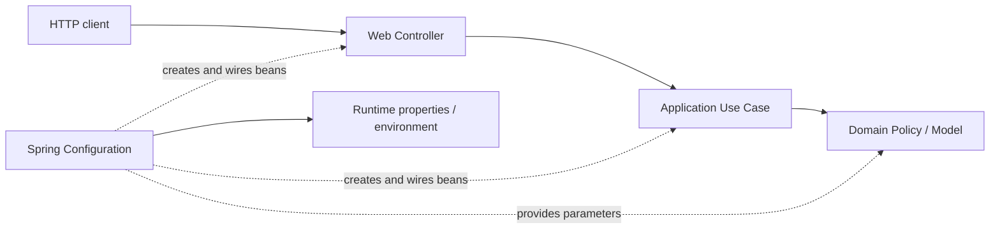
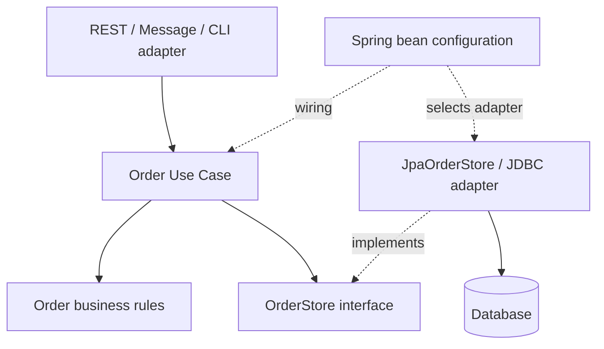

# Separating Business Logic from Infrastructure Configuration Code

When getting started with Spring Boot, placing all classes into one package, adding `@Service`, `@Component`, or `@Configuration`, and letting Spring auto-wire everything often produces fast results. Yet as an application grows, a problem emerges: **business rules, feature orchestration code, and technical configuration code become mixed together**. At that point, a simple request to change a shipping fee can force developers to edit HTTP configuration, data queries, or bean initialization.

In the **Source Organization** chapter of Spring Boot Fundamentals, separating these two areas helps answer three questions:

1. **What must the application do?** These are the business rules and product requirements.
2. **How does the application coordinate the steps?** This is orchestrating a feature or *use case*.
3. **How is the application wired to Spring Boot and external systems?** This is configuration, adapters, and technical infrastructure.

The goal is not to create as many classes as possible. The goal is that **each change has a sensible place to be made**, and learners can explain why a class belongs where it sits.

## 1. Two Distinct Scopes of Responsibility

**Business code** describes the rules, decisions, and processes the product must follow. These rules make sense even when the application has no HTTP server, database, or Spring container yet.

Examples in an online store:

- An order can only be placed when it contains at least one item.
- The quantity of each item must be greater than 0.
- Orders of 500,000 VND or more receive free standard shipping.
- A canceled order cannot be confirmed as paid.
- Customers receive discounts according to product policies.

**Infrastructure and infrastructure configuration code** describes how the application connects, initializes, or operates technical components. These decisions can change when moving from a development machine to a deployment environment while business rules remain the same.

Examples:

- Declaring a bean with `@Configuration` and `@Bean`.
- Configuring a PostgreSQL connection address, connection pool, or HTTP client.
- Choosing a web server port, logging level, or timeout for calling external systems.
- Configuring message broker topic names, storage paths, or secret provisioning methods.
- Choosing a concrete implementation for a data access interface.

Between these two scopes lies **application orchestration code**: receiving a request to execute a use case, invoking business rules, requesting data persistence, or sending notifications in a defined sequence.

| Question | Example | Scope of Responsibility |
| --- | --- | --- |
| When does a customer get free shipping? | Order subtotal reaches policy threshold | Business logic |
| What steps are needed to create an order? | Validate order, calculate total, save order | Application orchestration |
| How is order data stored? | JPA, JDBC, or an external API | Infrastructure / adapter |
| Which objects does Spring create and how are dependencies wired? | `@Bean`, `@ConfigurationProperties`, component scan | Application configuration |
| How do users submit requests? | REST controller, HTTP mapping, JSON | Communication / web |
| Which port does the application run on? | `server.port` | Runtime configuration |

**The boundary is based on responsibility, not solely on annotations or folders.** A `@Service` class might contain true business logic or only HTTP-calling logic. A class named `BusinessConfig` might still be hiding business rules inside a bean factory method.

## 2. Identifying Business Code with the "If Spring Were Removed" Question

Suppose the product manager states a requirement:

> Customers get free standard shipping if the order subtotal is 500,000 VND or more. All other orders pay 30,000 VND. Negative subtotals are not allowed.

This is a business rule. We can write a plain Java class to represent it:

```java
package com.example.store.shipping.domain;

import java.math.BigDecimal;
import java.util.Objects;

public final class ShippingPolicy {

    private final BigDecimal freeShippingFrom;
    private final BigDecimal standardFee;

    public ShippingPolicy(BigDecimal freeShippingFrom, BigDecimal standardFee) {
        Objects.requireNonNull(freeShippingFrom, "freeShippingFrom");
        Objects.requireNonNull(standardFee, "standardFee");

        if (freeShippingFrom.signum() < 0 || standardFee.signum() < 0) {
            throw new IllegalArgumentException("Shipping policy values cannot be negative");
        }

        this.freeShippingFrom = freeShippingFrom;
        this.standardFee = standardFee;
    }

    public BigDecimal calculateFee(BigDecimal orderSubtotal) {
        Objects.requireNonNull(orderSubtotal, "orderSubtotal");
        if (orderSubtotal.signum() < 0) {
            throw new IllegalArgumentException("Order subtotal cannot be negative");
        }

        return orderSubtotal.compareTo(freeShippingFrom) >= 0
                ? BigDecimal.ZERO
                : standardFee;
    }
}
```

This class has the following characteristics:

- Clearly expresses product behavior: validates subtotal and calculates shipping fee.
- Receives the free-shipping threshold and standard fee via constructor, without needing to know where that configuration came from.
- Uses `BigDecimal` rather than floating-point numbers for monetary values in the example.
- Does not import `org.springframework.*`, `jakarta.persistence.*`, HTTP clients, or database access libraries.
- Can be instantiated with `new ShippingPolicy(...)` and tested directly in plain Java.

If the application were moved from Spring Boot to another Java program, the rule above could still be reused. That is a strong sign the core logic is in the right place.

This **does not mean all business code is forbidden from using Spring**. In small applications, a service annotated with `@Service` can be completely reasonable. The key is keeping business rules from needlessly depending on HTTP, database details, or environment configuration mechanics.

## 3. Application Orchestration Code Sits Between Business Logic and Infrastructure

A real feature may require several steps: accepting a command, checking permissions, calculating, reading or saving state, and returning a result. The **application/use case** layer coordinates these steps; the calculations and core invariants themselves should still be clearly expressed in the business model.

For the shipping fee example, let's create a simple use case:

```java
package com.example.store.shipping.application;

import com.example.store.shipping.domain.ShippingPolicy;
import java.math.BigDecimal;
import java.util.Objects;

public final class QuoteShippingService {

    private final ShippingPolicy policy;

    public QuoteShippingService(ShippingPolicy policy) {
        this.policy = Objects.requireNonNull(policy);
    }

    public BigDecimal quote(BigDecimal orderSubtotal) {
        return policy.calculateFee(orderSubtotal);
    }
}
```

In this tiny example, the use case only delegates to the policy, so it may look very thin. That is not a reason to duplicate rules across multiple places. As the real feature grows, the orchestration class can take responsibility for reading the cart, fetching the applicable policy, calculating the fee, and assembling the result, while the fee-decision algorithm remains inside `ShippingPolicy`.

There is no need to create dozens of use-case classes for a small demo program that prints one line. Separation becomes valuable when there are business workflows, extensibility needs, testing needs, or independently changing integrations.

## 4. Spring Boot Connects Classes at the Configuration Boundary

Both `ShippingPolicy` and `QuoteShippingService` are plain Java classes. So how does Spring Boot create those objects? That is the responsibility of the configuration class, often called the *composition root* or dependency assembly layer.

Suppose the policy parameters are declared in `src/main/resources/application.yml`:

```yaml
shipping:
  policy:
    free-shipping-from: 500000
    standard-fee: 30000

server:
  port: 8080
```

We can use Spring Boot Configuration Properties to bind these values into an object:

```java
package com.example.store.shipping.config;

import java.math.BigDecimal;
import org.springframework.boot.context.properties.ConfigurationProperties;

@ConfigurationProperties(prefix = "shipping.policy")
public record ShippingPolicyProperties(
        BigDecimal freeShippingFrom,
        BigDecimal standardFee
) {
}
```

Then declare a class that wires the beans:

```java
package com.example.store.shipping.config;

import com.example.store.shipping.application.QuoteShippingService;
import com.example.store.shipping.domain.ShippingPolicy;
import org.springframework.boot.context.properties.EnableConfigurationProperties;
import org.springframework.context.annotation.Bean;
import org.springframework.context.annotation.Configuration;

@Configuration
@EnableConfigurationProperties(ShippingPolicyProperties.class)
public class ShippingConfiguration {

    @Bean
    ShippingPolicy shippingPolicy(ShippingPolicyProperties properties) {
        return new ShippingPolicy(
                properties.freeShippingFrom(),
                properties.standardFee()
        );
    }

    @Bean
    QuoteShippingService quoteShippingService(ShippingPolicy policy) {
        return new QuoteShippingService(policy);
    }
}
```

When the application context starts up, Spring Boot binds properties prefixed with `shipping.policy` into `ShippingPolicyProperties`. Spring uses the `@Bean` methods to create `ShippingPolicy` and `QuoteShippingService`, automatically supplying the dependencies each method requests.

What matters in the example:

- `ShippingPolicyProperties` knows **how to read parameters from Spring Boot's configuration mechanism**.
- `ShippingConfiguration` knows **which objects need to be created and which objects they depend on**.
- `ShippingPolicy` knows **the shipping fee calculation rule**.
- `QuoteShippingService` knows **which rule the use case needs to invoke**.

Changing how configuration is supplied—such as reading values from environment variables instead of YAML—does not require `ShippingPolicy` to import Spring APIs. Changing the free-shipping threshold for a sales promotion also does not require rewriting the algorithm inside the configuration class.

### Subtle Point: A Value Placed in YAML Can Still Be a Business Parameter

Both properties in the example above live in the YAML file yet carry different meanings:

| Property | Meaning | Decision Category |
| --- | --- | --- |
| `shipping.policy.free-shipping-from` | Free shipping policy threshold | Business parameter supplied via configuration |
| `shipping.policy.standard-fee` | Fee level set by the product | Business parameter supplied via configuration |
| `server.port` | Listening port of the web server | Infrastructure/runtime configuration |

**Not everything inside `application.yml` is infrastructure data.** Where a value is sourced from and what that value means are two separate concerns. If a change affects customers, pricing, or business permissions, treat it as a product policy change—even when stored as a property.

In real systems, policies may be versioned, stored in a database, or managed via a dedicated tool. The storage mechanism does not alter the business nature of the policy.

## 5. Controllers Are Communication Code, Not Where All Business Logic Lives

When adding `spring-boot-starter-web`, the application can accept HTTP requests. A controller is responsible for translating HTTP data into a use-case call, then converting the result into an HTTP response.

Example:

```java
package com.example.store.shipping.web;

import com.example.store.shipping.application.QuoteShippingService;
import java.math.BigDecimal;
import org.springframework.web.bind.annotation.PostMapping;
import org.springframework.web.bind.annotation.RequestBody;
import org.springframework.web.bind.annotation.RequestMapping;
import org.springframework.web.bind.annotation.RestController;

@RestController
@RequestMapping("/api/shipping")
public class ShippingController {

    private final QuoteShippingService quoteShippingService;

    public ShippingController(QuoteShippingService quoteShippingService) {
        this.quoteShippingService = quoteShippingService;
    }

    @PostMapping("/quote")
    public ShippingQuoteResponse quote(@RequestBody ShippingQuoteRequest request) {
        BigDecimal fee = quoteShippingService.quote(request.orderSubtotal());
        return new ShippingQuoteResponse(fee);
    }

    public record ShippingQuoteRequest(BigDecimal orderSubtotal) {
    }

    public record ShippingQuoteResponse(BigDecimal fee) {
    }
}
```

Once the web application is started, send a request:

```http
POST /api/shipping/quote HTTP/1.1
Content-Type: application/json

{"orderSubtotal": 620000}
```

Typical result:

```json
{
  "fee": 0
}
```

The HTTP layer here only receives `orderSubtotal`, invokes the use case, and builds the response. If tomorrow the REST API is replaced with a scheduled job or message consumer, `ShippingPolicy` still does not need to change.

To keep the example focused on code organization boundaries, the controller omits HTTP-layer validation, error mapping, and authentication. In real applications, validate requests and translate business errors into appropriate HTTP responses at the communication layer rather than letting internal exceptions leak directly to clients.

### Style That Mixes Responsibilities

The example below illustrates a pattern to spot when reading a project:

```java
@RestController
class ShippingController {

    @Value("${shipping.policy.free-shipping-from}")
    private BigDecimal threshold;

    @PostMapping("/shipping-fee")
    BigDecimal fee(@RequestBody BigDecimal subtotal) {
        if (subtotal.compareTo(threshold) >= 0) {
            return BigDecimal.ZERO;
        }
        return new BigDecimal("30000");
    }
}
```

In this short snippet, the controller simultaneously knows:

1. How to receive HTTP input.
2. The property name from the Spring environment.
3. The threshold and calculation algorithm.
4. The default fee amount.

If this rule is needed in a batch job, developers might end up duplicating the logic elsewhere. If the fee policy changes, the web layer must be edited. This is a sign the controller holds too many responsibilities.

Splitting into `ShippingPolicy`, `QuoteShippingService`, and `ShippingConfiguration` is one way to reduce that coupling. Do not aim for a fixed class count; what matters is that **controllers do not own rules that other entry points also need**.

## 6. Seeing the Dependency Direction Clearly

A maintainable design usually points in this direction:



Method call arrows during execution flow from web to use case and domain. Domain code does not need to import controllers or Spring configuration. Configuration can know concrete implementations in order to create beans; business logic should not know where it was instantiated.

Distinguish three directions:

- **Runtime call direction:** controller calls use case; use case calls business object.
- **Import/compile-time direction:** web and configuration may depend on application/domain; domain does not need to depend back on them.
- **Initialization direction:** Spring configuration creates or wires dependencies at startup.

These three concepts are easily confused. A business class created by Spring via `@Bean` does not mean that class has to import `ApplicationContext` or know which `@Configuration` created it.

## 7. What Does Infrastructure Configuration in Spring Boot Include?

The term "infrastructure" can refer to external systems (databases, caches, brokers) or details that help the application operate on Spring Boot. In a foundational project, you may encounter:

| Category | Examples in Code or Files | Responsibility |
| --- | --- | --- |
| Bean initialization | `@Configuration`, `@Bean` | Choose implementation, pass dependencies |
| Property binding | `@ConfigurationProperties` | Turn external config into typed objects |
| Conditional initialization | `@Profile`, `@ConditionalOnProperty` | Select config by environment or condition |
| Web server | `server.port`, server settings | Tune the HTTP environment |
| Data access | datasource, JPA, connection pool | Connect and perform I/O with storage |
| External clients | HTTP client, timeout, retry settings | Call other APIs or services |
| Operations | logging, metrics, health indicators | Observe and manage the application |
| Secrets and environment config | credentials, tokens, secret sources | Supply sensitive values safely |

Not every project needs hand-written `@Configuration` classes for every component. Spring Boot provides **auto-configuration** that creates many common beans based on dependencies, properties, and present conditions. Learning Fundamentals means understanding this and knowing when you truly need to declare your own beans.

### Where Should Configuration Live?

Usually distinguish:

**1. Externalized value configuration**

```yaml
spring:
  application:
    name: store-service

server:
  port: 8080

logging:
  level:
    com.example.store: INFO
```

These values can be varied per environment via Boot's externalized configuration mechanism. Do not hardcode real passwords, API keys, or secrets into the repository.

**2. Java object creation configuration**

```java
@Configuration
class StoreConfiguration {
    @Bean
    Clock clock() {
        return Clock.systemUTC();
    }
}
```

The snippet above tells Spring how to create a `Clock` bean. If business logic needs the current timestamp, a use case can receive `Clock` via constructor. During testing, we can pass `Clock.fixed(...)` so time is deterministic.

**3. External deployment configuration**

Examples: environment variables supplied by the cloud platform, container configuration, network policies, secret injection mechanisms. These typically do not live in the Java source of a business class.

Avoid cramming every infrastructure value into one Java class; also avoid creating many configuration files when only a few simple properties exist.

## 8. Boundaries with Data Access Code and External Services

The shipping fee example only performs pure computation. A real feature also has to read inventory, save orders, call a payment gateway, or send emails. Those activities belong to **I/O and integration**.

For instance, the application needs to save an order request. The business logic knows that **a valid order must be saved**, without necessarily knowing whether that is PostgreSQL, MongoDB, or a remote API.

An interface can express the application's need:

```java
package com.example.store.order.application;

public interface OrderStore {
    void save(Order order);
}
```

Here `Order` is a hypothetical business object belonging to the order model. An implementation in the adapter/infrastructure layer implements `OrderStore` using JPA, JDBC, or another storage mechanism.

Organizational diagram:



Significance of this organization:

- The use case depends on the **need to save orders** expressed by `OrderStore`.
- The adapter depends on technical libraries and implements the concrete storage method.
- Spring wires an implementation of `OrderStore` into the use case at runtime.
- You can swap adapters or use a fake in tests without rewriting order creation rules.

In very small CRUD applications, using a Spring Data repository directly from an application service can be a practical choice. An intermediate interface is only useful when it clarifies a business boundary, eases testing, or isolates a specific technology. Avoid creating a "wrapper" layer that merely forwards every method one-for-one with no clear purpose.

### Do Not Confuse Business Repositories with Technical Implementations

The name `Repository` appears in multiple places:

- **Application repository/port concept**: describes a need such as "save and find orders."
- **Spring Data JPA repository**: uses framework mechanisms to define queries and persistence operations.
- **Concrete adapter**: maps from domain models to entities and calls the Spring Data repository.

Matching names do not mean matching responsibilities. When reading code, look at which class imports `org.springframework.data.*` or `jakarta.persistence.*`, which class defines business requirements, and which class performs I/O.

## 9. Organizing Packages by Responsibility

Spring Boot does not enforce a specific directory tree. A small project can often organize packages by layer:

```text
com.example.store
├── StoreApplication.java
├── controller
├── service
├── repository
├── domain
└── config
```

This is easy to start with and helps learners quickly recognize technical roles. However, once there are many features, the `service` package can end up holding services for orders, products, customers, and payments alike, making it harder to find code for one feature.

Another option is to **group by feature, then divide responsibilities inside each feature**:

```text
src/main/java/com/example/store/
├── StoreApplication.java
├── shipping/
│   ├── domain/
│   │   └── ShippingPolicy.java
│   ├── application/
│   │   └── QuoteShippingService.java
│   ├── web/
│   │   └── ShippingController.java
│   └── config/
│       ├── ShippingConfiguration.java
│       └── ShippingPolicyProperties.java
├── order/
│   ├── domain/
│   ├── application/
│   └── infrastructure/
│       └── persistence/
└── shared/
    └── config/
```

Notes:

- `shipping` contains code serving shipping features; `order` contains code serving orders.
- `domain` is where business rules and models meaningful independently of the framework live.
- `application` coordinates use cases and declares the dependencies use cases need.
- `web` translates HTTP requests/responses.
- `infrastructure` or `adapter` implements I/O details.
- `config` holds Spring Boot wiring and related configuration properties.
- `shared` holds only components genuinely used by multiple features; do not turn it into a catch-all for hard-to-classify classes.

In this structure, `StoreApplication` should sit in the parent package `com.example.store` so default component scan covers its subpackages. If placing the startup class deeper or splitting across multiple modules, scan scope and import configurations must be designed deliberately.

### Packages Do Not Protect Boundaries by Themselves

Putting `ShippingController` in a `web` folder while still calculating shipping fees right inside the controller still mixes responsibilities. Conversely, a concise service written across few packages can still be clear if input handling, business processing, and infrastructure access are distinguished.

**Directory trees help readers see the structure; dependency directions and method contents reveal whether separation is real.**

## 10. Understanding Spring Annotations Properly

Annotations help Spring manage objects, yet do not automatically confer good design on a class.

| Annotation | Common Effect | What It Does Not Guarantee |
| --- | --- | --- |
| `@Component` | Registers component via component scan | Whether the class is domain or infrastructure |
| `@Service` | Marks component as a service role | That its contents are strictly business rules |
| `@Repository` | Marks persistence role; supports exception translation in some contexts | That it has no business logic, or that any database is already configured |
| `@RestController` | Receives and handles requests in Spring MVC | That the controller is separated from business logic |
| `@Configuration` | Declares a source of bean definitions | That every method inside is "pure configuration" |
| `@Bean` | Provides a Spring-managed object | That the created class itself must depend on Spring |
| `@ConfigurationProperties` | Binds external config to a typed object | That properties can only carry technical meaning |

For example, both designs below can be instantiated by Spring:

```java
@Service
class ShippingService {
    BigDecimal calculateFee(BigDecimal amount) {
        // Business rule placed directly in a Spring service
        return ...;
    }
}
```

```java
@Configuration
class ShippingConfiguration {
    @Bean
    ShippingPolicy shippingPolicy(ShippingPolicyProperties properties) {
        return new ShippingPolicy(
                properties.freeShippingFrom(),
                properties.standardFee()
        );
    }
}
```

The first snippet may suffice for a small demo application if the logic is genuinely simple. The second fits better when you want to reuse and test rules without booting a Spring context. The decision rests on separation needs, not because "`@Service` is wrong" or "every domain class must use `@Bean`."

## 11. Environment-Specific Configuration vs. Business Policies

Spring Boot supports profiles and externalized configuration to select values, beans, or components suited to an environment:

```yaml
# application-dev.yml
logging:
  level:
    com.example.store: DEBUG
```

```yaml
# application-prod.yml
logging:
  level:
    com.example.store: INFO
```

In this example, the difference in logging level is an **operational decision**. Do not write in the domain:

```java
if ("prod".equals(activeProfile)) {
    // Skip a business validation step
}
```

Using a profile to bypass a business invariant can make the same request produce inconsistent results across environments. If different business policies are needed by country, customer tier, or campaign, model those differences with explicit business data and rules rather than coupling implicitly to `dev` or `prod` labels.

However, selecting a fake adapter for development is a valid use case for configuration:

```java
@Configuration
class NotificationConfiguration {

    @Bean
    @Profile("dev")
    NotificationSender consoleNotificationSender() {
        return new ConsoleNotificationSender();
    }

    @Bean
    @Profile("prod")
    NotificationSender emailNotificationSender() {
        return new EmailNotificationSender();
    }
}
```

The types `NotificationSender`, `ConsoleNotificationSender`, and `EmailNotificationSender` in this snippet are **illustrative interfaces/implementations**. The idea is that the use case just calls an interface to send notifications, while configuration selects the implementation per environment. If both profiles are active simultaneously, duplicate beans or clearer conditions may need handling; that is a configuration concern, not the business rule for sending notifications.

Secrets such as database passwords or email tokens must be supplied from an environment-appropriate secure management source. Never use profiles as an excuse to commit real secrets into `application-prod.yml`.

## 12. Cross-Cutting Concerns: Transactions, Validation, Logging, and Retries

Not every class fits into one absolute box. Some concerns intersect business rules and technical mechanisms. A helpful analysis technique is separating **the intent to guarantee** from **the mechanism implementing that intent**.

### 12.1. Transactions

"Creating an order and deducting inventory must succeed together or fail together" may be a product consistency requirement. Yet `@Transactional`, transaction managers, and isolation levels are technical mechanisms implementing atomicity under specific storage conditions.

In simple Spring Boot applications, placing `@Transactional` on the application service is common and practical. When strict domain independence from persistence is required, transaction boundaries can be wrapped in an adapter or suitable application layer. Avoid sprinkling `@Transactional` onto every method "just to be safe," as proxy behavior and scope affect execution.

### 12.2. Validation

Distinguish:

- **Communication validation:** valid JSON, required request fields, numeric types, email format, payload size limits.
- **Business validation:** order must contain items, valid quantities, disallowed state transitions, non-negative monetary values.

Controllers can use Bean Validation to check incoming data. The domain must still protect core invariants, because the same rules can be invoked from a command-line runner, message consumer, or direct test without going through HTTP validation.

### 12.3. Logging and Metrics

Business code may raise a meaningful event, such as "order confirmed." Writing that event to logs, metrics, traces, or audit storage is the responsibility of external or application mechanisms.

Do not make a pricing function return a result only when the log server is reachable. Conversely, if auditing is a legal/business requirement, **requiring audit recording to succeed** must be designed as a business step with an explicit contract, not treated as an optional log line.

### 12.4. Retries and Timeouts

"Send a payment request at most once per order" is a product behavior requirement. HTTP call timeouts, retry policies, and circuit breakers are resilience techniques. If retrying a payment operation lacks an idempotency key, it can produce duplicate side effects.

Therefore, do not label every retry "purely infrastructure" and apply it blindly without checking business safety. The requirement's intent may belong to the business, while the implementation tools usually sit in adapters/infrastructure.

## 13. Separating Responsibilities Makes Testing Easier

One way to verify the benefit of separating code is to see **how much a test needs to initialize**.

### Testing Business Rules Without Starting Spring

Because `ShippingPolicy` is a standalone Java class, it can be tested directly:

```java
import static org.junit.jupiter.api.Assertions.assertEquals;
import static org.junit.jupiter.api.Assertions.assertThrows;

import com.example.store.shipping.domain.ShippingPolicy;
import java.math.BigDecimal;
import org.junit.jupiter.api.Test;

class ShippingPolicyTest {

    private final ShippingPolicy policy = new ShippingPolicy(
            new BigDecimal("500000"),
            new BigDecimal("30000")
    );

    @Test
    void chargesStandardFeeBelowThreshold() {
        assertEquals(
                new BigDecimal("30000"),
                policy.calculateFee(new BigDecimal("499999"))
        );
    }

    @Test
    void makesShippingFreeAtThreshold() {
        assertEquals(
                BigDecimal.ZERO,
                policy.calculateFee(new BigDecimal("500000"))
        );
    }

    @Test
    void rejectsNegativeSubtotal() {
        assertThrows(IllegalArgumentException.class,
                () -> policy.calculateFee(new BigDecimal("-1")));
    }
}
```

The test above requires only JUnit and the Java class under test. No `@SpringBootTest`, database, or HTTP port. If the policy changes, tests focus on the rule and boundary cases like just below and right at the threshold.

### Testing Spring Wiring

Items worth testing at an appropriate integration level include:

- YAML/environment properties bind properly into `ShippingPolicyProperties`.
- `ShippingPolicy` and `QuoteShippingService` beans can be created in the Spring context.
- Profiles or configuration conditions select the expected implementation.
- Controllers return responses matching the HTTP contract for valid and invalid requests.
- Data access adapters connect and map data properly in the test environment.

`@SpringBootTest` is used when you want to load a Spring Boot application context matching test configuration scope. `@WebMvcTest` can focus on the web slice; `@DataJpaTest` focuses on JPA. Each test type has different goals and costs. **You do not need `@SpringBootTest` to prove a pure Java calculation returns the right number.**

## 14. Signs That Code Has Mixed Responsibilities

While reading or writing source code, watch for these indicators:

| Indicator | Why It Warrants Review | Organizational Direction |
| --- | --- | --- |
| Controller contains dozens of lines calculating prices/discounts | Rules are tightly bound to HTTP | Move policies into domain or application |
| A service reads env vars, calls JDBC, and handles HTTP responses itself | Mixes orchestration, I/O, and communication | Separate use case, adapter, and web mapping |
| `@Configuration` has multiple `if` statements deciding order status | Configuration becomes the home for product policies | Create a domain policy; config only supplies dependencies/parameters |
| Domain imports `HttpServletRequest` to read user ID | Business model depends on web protocol | Pass needed data through use-case inputs |
| Money-handling class calls `System.getenv("DB_PASSWORD")` directly | Business logic knows deployment details | Read configuration at infrastructure boundaries |
| Business logic builds raw SQL between calculations | Rules and persistence change together | Extract repository/adapter when needed |
| Identical logic is copied across REST, batch, and consumers | No shared source of truth for rules | Place rules in a reusable component |
| Unit tests must load the entire Spring context to evaluate one expression | Framework dependency exceeds need | Extract calculations into plain Java classes |

These are **signals to investigate**, not rigid rules forcing every project to refactor. For a very small introductory app, fewer classes and simple logic may be appropriate. When preparing to scale, review spots where one business change forces widespread technical edits.

## 15. Step-by-Step Code Separation in an Existing Project

Suppose all shipping fee calculation currently sits inside `ShippingController`. You can transition in a controlled sequence:

1. **Identify stable rules:** clarify when shipping is free, the fee amount, and invalid input conditions. State them in plain words before moving code.
2. **Extract pure Java calculations:** move fee logic into `ShippingPolicy`, receiving needed parameters via constructor without reading HTTP requests or environment inside.
3. **Extract a use case if orchestration exists:** have an application service call policies, repositories, or required ports. For very small features, the controller can call a thin application service.
4. **Move parameter sources to the configuration boundary:** use `@ConfigurationProperties` or an appropriate configuration mechanism, then create beans with `@Bean` or your chosen DI pattern.
5. **Keep controllers focused on HTTP:** parse requests, call use cases, map results and errors into responses.
6. **Isolate I/O as needed:** when adding database or external system access, place integration code in adapters and express the contract the application actually needs.
7. **Maintain tests at the right level:** test rules with unit tests, and test wiring/properties and HTTP in appropriate integration tests.

You do not need to convert an entire project to a complex architecture just to fix one small method. Start where changes happen frequently, testing is hard, or multiple channels are duplicating the same logic.

## 16. Practice Exercise: Deciding Where Code Belongs

Consider the requirement: "Gold-tier customers receive a 10% discount on items, but only on orders with a positive total; users must be logged in to place an order; order data is saved in PostgreSQL; the dev environment uses a fake email sender."

Classify each part:

| Part to Write | Appropriate Location | Reason |
| --- | --- | --- |
| Gold-tier 10% discount rule | `customer/domain` or `order/domain` depending on model | This is a product policy |
| Positive total condition | Domain invariant | Independent of HTTP or storage |
| Flow of creating order, applying discount, saving order | Application/use case | Coordinates multiple steps |
| HTTP authentication requirement | Web/security configuration and adapter | Relates to HTTP identity and security mechanisms |
| PostgreSQL persistence implementation | Infrastructure/persistence | Depends on database technology |
| Selecting fake email sender in dev | Spring configuration/profile | Selects implementation per environment |
| Converting result to JSON response | Web/controller | Relates to HTTP contract |

If a later version adds "Platinum customers receive 15% off," the main change sits in the policy. If PostgreSQL is swapped for another storage system, the main edit is in the persistence adapter and wiring. If the API changes from REST to a message consumer, the communication layer changes while the discount policy remains valid for the same business logic.

### Class Reading Exercise

Examine the pseudocode:

```java
@Service
class OrderService {
    // 1. Read environment variable to get database address
    // 2. Query inventory count using SQL
    // 3. Calculate discounted price for member
    // 4. Write order to database
    // 5. Return ResponseEntity object
}
```

Explain why this class has multiple reasons to change, then try decomposing it:

- Discount rules into a policy.
- Sequence of checking stock, calculating price, and placing the order into a use case.
- Querying/saving orders into a persistence adapter.
- `ResponseEntity` and HTTP status codes into a controller or web handler layer.
- Database details/credentials into infrastructure configuration.

This separation does not forbid an application service from calling multiple dependencies; it simply ensures **each dependency represents a clearly named responsibility**.

## 17. Key Things to Remember When Organizing Spring Boot Code

Before creating a new class, try answering:

1. Is this class describing a **product rule**, a **use case**, or **how to connect to a specific technology**?
2. If HTTP were replaced with a message consumer, would this rule part need to change?
3. If switching from PostgreSQL to another storage mechanism, which classes truly need to be edited?
4. Can critical rules be tested without starting an `ApplicationContext`?
5. Is this setting a **business policy parameter** or an **operational setting**? Who is responsible for approving changes to it?
6. Do dependencies flow from communication/infrastructure toward application/domain, or is the domain unnecessarily importing infrastructure details?

When organizing source code, use **class responsibility and reasons to change** as your primary criterion. Spring Boot helps initialize, configure, and wire components; product rules should be expressed clearly enough that they are not buried inside controllers, configuration files, or data access code. A good structure for a first project is one where another developer can look at it and immediately see: **where the business rules are, where the application flow is, and how the system runs on the chosen technologies**.
