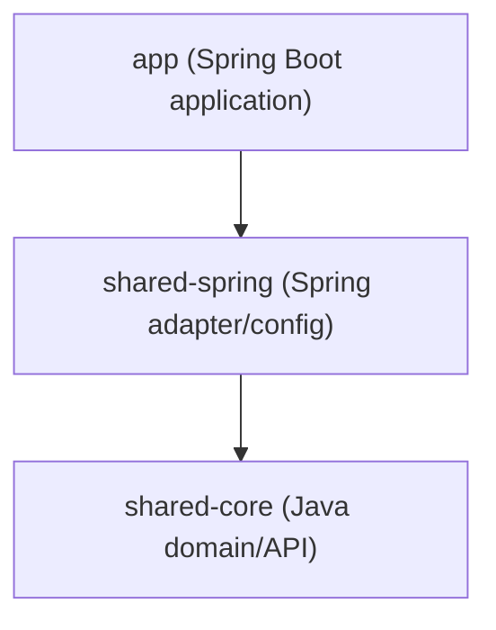
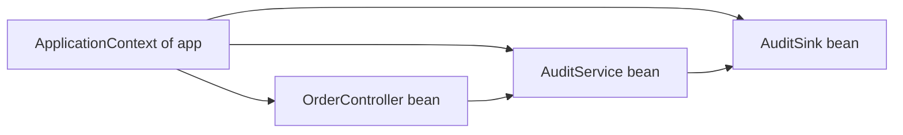

# Multi-Module Applications and Bringing Shared Components into Context

In a sufficiently large Spring Boot application, putting all controllers, services, repositories, configuration, and shared code into a single module obscures responsibility boundaries. Splitting source code into multiple modules gives each part explicit APIs and dependencies. However, **putting a library on the classpath does not mean the classes in that library become Spring beans**.

To organize a multi-module application properly, you must understand two independent yet related things:

1. **The build system** (Gradle or Maven) decides which module depends on which module, and which classes/resources are compiled and placed on the runtime classpath.
2. **The Spring container** decides which configurations are read, which beans are created, and which dependencies are injected into beans inside an \`ApplicationContext\`.

This lesson uses Java 21, Spring Boot 3.x, and Gradle multi-project examples to explain how to build a shared library, how to register it into a context using \`@Import\`, component scanning, or auto-configuration, along with common limitations and errors in practice.

## 1. What Does "Module" Mean in a Spring Boot Application?

The word *module* is easily used with several different meanings:

| Concept | Managed Unit | Primary Effect |
| --- | --- | --- |
| Gradle subproject / Maven module | Directory containing its own source sets and build config | Produces artifacts, establishes dependencies and classpath |
| Java package | Namespace and access level for classes | Organizes code, supports component scanning |
| Spring bean | Object created/managed by Spring | Constructor injection, scope, lifecycle, and AOP |
| \`ApplicationContext\` | Container holding an application's beans | Manages bean definitions, instantiates and wires beans |
| Independently deployed application/service | Separately running process | Separate lifecycle, configuration, memory, and context |
| Java Platform Module System (\`module-info.java\`) | Java language/platform module | Exports/readability between Java modules |

**A Gradle subproject does not automatically create an \`ApplicationContext\`.** One Spring Boot process can consume many JARs from many Gradle modules while still using a single primary application context. Conversely, two independent Spring Boot applications—even when depending on the same library—have two separate contexts and two separate sets of bean instances.

Similarly, a Java package is not a deployment boundary. Packages only affect class naming and how Spring discovers components when an appropriate scanning mechanism is active.

### 1.1. Visualizing Two Different Graphs

Dependency graph at **build** time:



Bean graph at **runtime**:



The two graphs are related, yet **they are not the same**. The first graph allows \`OrderController\` to see the \`AuditService\` type; the second graph ensures an \`AuditService\` bean actually exists to inject.

## 2. Why Separate Shared Components?

A shared library makes sense when multiple parts of the application need the same genuinely stable capability: data normalization rules, value types, ports, pure Java algorithms, a consistently configured HTTP client, or an audit mechanism used across modules.

Example split into three modules:

```text
spring-multimodule-demo/
├── settings.gradle
├── build.gradle
├── shared-core/
│   ├── build.gradle
│   └── src/main/java/com/example/shared/core/
│       ├── AuditSink.java
│       └── AuditService.java
├── shared-spring/
│   ├── build.gradle
│   └── src/main/java/com/example/shared/spring/
│       ├── ConsoleAuditSink.java
│       └── SharedAuditConfiguration.java
└── app/
    ├── build.gradle
    └── src/main/java/com/example/app/
        ├── DemoApplication.java
        └── OrderController.java
```

- \`shared-core\`: pure Java rules with no knowledge of Spring, HTTP, or databases.
- \`shared-spring\`: adapters and Spring bean registration for the shared capability.
- \`app\`: the \`main\` entry point, APIs, and wiring the parts into a runnable application.

This is an organizational choice, not a mandatory layout for every project. For small programs, a single module with clear packages can suffice. Split modules when doing so creates real responsibility boundaries or genuine reuse; avoid creating too many subprojects simply because class counts grow.

### 2.1. Gradle Multi-Project Example

The \`settings.gradle\` file tells Gradle which subprojects participate in the build:

```groovy
rootProject.name = 'spring-multimodule-demo'
include 'shared-core', 'shared-spring', 'app'
```

An illustrative root configuration managing plugins and Java toolchain:

```groovy
// root build.gradle
plugins {
    id 'org.springframework.boot' version '3.3.5' apply false
    id 'io.spring.dependency-management' version '1.1.6' apply false
}

subprojects {
    apply plugin: 'java'

    repositories {
        mavenCentral()
    }

    java {
        toolchain {
            languageVersion = JavaLanguageVersion.of(21)
        }
    }
}
```

The versions above illustrate a specific Spring Boot 3 and Gradle combination; real projects should use the version set managed by the repository, compatibility alignment, and team upgrade policy.

\`shared-core/build.gradle\`:

```groovy
plugins {
    id 'java-library'
}
```

\`shared-spring/build.gradle\`:

```groovy
plugins {
    id 'java-library'
}

dependencies {
    api project(':shared-core')

    implementation platform(
        'org.springframework.boot:spring-boot-dependencies:3.3.5'
    )
    implementation 'org.springframework:spring-context'
}
```

\`app/build.gradle\`:

```groovy
plugins {
    id 'org.springframework.boot'
    id 'io.spring.dependency-management'
}

dependencies {
    implementation project(':shared-spring')
    implementation 'org.springframework.boot:spring-boot-starter-web'

    testImplementation 'org.springframework.boot:spring-boot-starter-test'
}
```

With \`project(':shared-spring')\`, Gradle establishes a dependency on the subproject's artifact, orders the build, and puts required dependencies onto \`app\`'s runtime classpath. There is no need to manually copy \`.class\` files or JARs into the application directory.

The \`api\` and \`implementation\` configurations of the \`java-library\` plugin have distinct meanings:

| Configuration | Meaning for Modules Consuming the Library |
| --- | --- |
| \`api\` | The dependency is part of the API that consuming modules need to see on their compile classpath |
| \`implementation\` | The dependency is primarily an internal detail; still participates at runtime according to dependency resolution rules |
| \`runtimeOnly\` | Needed only at runtime, not for compiling code that calls the library |
| \`testImplementation\` | Used only for compiling/running tests of the declaring module |

Here \`shared-spring\` exposes \`AuditService\` in its bean methods, so putting \`shared-core\` in \`api\` makes sense. If a dependency stays strictly inside a library's internal implementation, \`implementation\` keeps consumers from seeing unnecessary transitive dependencies.

**Note:** Spring libraries do not necessarily need the \`org.springframework.boot\` plugin to build an executable \`bootJar\`. Usually only application modules with an entry point package as Boot executables; libraries use \`java-library\` and ordinary JAR artifacts.

### 2.2. Maven Follows the Same Principle

With a Maven reactor, the parent \`pom.xml\` lists \`<modules>\`, the \`app\` module declares dependencies on library artifacts, and Maven builds them following the dependency graph. The differences lie in syntax and build lifecycle; **classpath and bean registration remain two separate steps**, just as in Gradle.

## 3. Creating a Shared Java Component

The \`shared-core\` layer does not need to know about Spring. It defines the API for recording audit events and the service handling that recording:

\`shared-core/src/main/java/com/example/shared/core/AuditSink.java\`:

```java
package com.example.shared.core;

public interface AuditSink {
    void record(String event);
}
```

\`shared-core/src/main/java/com/example/shared/core/AuditService.java\`:

```java
package com.example.shared.core;

import java.util.Objects;

public final class AuditService {
    private final AuditSink sink;

    public AuditService(AuditSink sink) {
        this.sink = Objects.requireNonNull(sink, "sink");
    }

    public void recordOrderCreated(String orderId) {
        if (orderId == null || orderId.isBlank()) {
            throw new IllegalArgumentException("orderId must not be blank");
        }
        sink.record("ORDER_CREATED:" + orderId);
    }
}
```

Accepting \`AuditSink\` via constructor lets the service know only the contract it requires. It does not instantiate \`JdbcAuditSink\`, \`HttpAuditSink\`, or access the Spring context directly. You can call \`new AuditService(fakeSink)\` in a unit test without starting Spring.

In the adapter module, create a simple implementation:

\`shared-spring/src/main/java/com/example/shared/spring/ConsoleAuditSink.java\`:

```java
package com.example.shared.spring;

import com.example.shared.core.AuditSink;

public final class ConsoleAuditSink implements AuditSink {
    @Override
    public void record(String event) {
        System.out.println(event);
    }
}
```

\`System.out.println\` is used only to observe activity in the example. In a real application, you can swap it for a logger, message broker, or persistence adapter, while applying appropriate data, error, and transaction policies.

At this point, Gradle can compile the classes above, yet Spring **does not yet know** how to create \`AuditService\` and \`AuditSink\`. We need a bean registration mechanism.

## 4. Approach 1: Explicit Bean Registration with \`@Configuration\`, \`@Bean\`, and \`@Import\`

This is an easy-to-inspect option when the application explicitly decides which libraries to use.

Create a configuration in \`shared-spring\`:

\`shared-spring/src/main/java/com/example/shared/spring/SharedAuditConfiguration.java\`:

```java
package com.example.shared.spring;

import com.example.shared.core.AuditService;
import com.example.shared.core.AuditSink;
import org.springframework.context.annotation.Bean;
import org.springframework.context.annotation.Configuration;

@Configuration(proxyBeanMethods = false)
public class SharedAuditConfiguration {

    @Bean
    public AuditSink auditSink() {
        return new ConsoleAuditSink();
    }

    @Bean
    public AuditService auditService(AuditSink auditSink) {
        return new AuditService(auditSink);
    }
}
```

Explanation:

- \`@Configuration\` marks a class containing bean definitions.
- \`@Bean\` on a method instructs Spring to register the returned value as a bean.
- The \`AuditSink auditSink\` parameter of the bean method is resolved by Spring from the context; this is dependency injection via method parameters.
- \`proxyBeanMethods = false\` fits when bean methods do not call each other directly expecting Spring proxy interception. The example uses parameter injection instead of calling \`auditSink()\` inside \`auditService()\`.

For the application to actually use the configuration, import it at the entry point:

\`app/src/main/java/com/example/app/DemoApplication.java\`:

```java
package com.example.app;

import com.example.shared.spring.SharedAuditConfiguration;
import org.springframework.boot.SpringApplication;
import org.springframework.boot.autoconfigure.SpringBootApplication;
import org.springframework.context.annotation.Import;

@SpringBootApplication
@Import(SharedAuditConfiguration.class)
public class DemoApplication {
    public static void main(String[] args) {
        SpringApplication.run(DemoApplication.class, args);
    }
}
```

At startup:

1. Gradle has already placed \`shared-spring\` and \`shared-core\` onto \`app\`'s runtime classpath.
2. Spring Boot begins creating the \`ApplicationContext\`.
3. \`@Import(SharedAuditConfiguration.class)\` brings the library's configuration into bean definition registration.
4. Spring creates \`AuditSink\`, passes that bean into the factory method creating \`AuditService\`, and places \`AuditService\` into the context.
5. An application component can inject \`AuditService\` via its constructor.

Example controller:

\`app/src/main/java/com/example/app/OrderController.java\`:

```java
package com.example.app;

import com.example.shared.core.AuditService;
import org.springframework.http.ResponseEntity;
import org.springframework.web.bind.annotation.PathVariable;
import org.springframework.web.bind.annotation.PostMapping;
import org.springframework.web.bind.annotation.RestController;

@RestController
public class OrderController {
    private final AuditService auditService;

    public OrderController(AuditService auditService) {
        this.auditService = auditService;
    }

    @PostMapping("/demo-orders/{orderId}/audit")
    public ResponseEntity<Void> auditCreatedOrder(@PathVariable String orderId) {
        auditService.recordOrderCreated(orderId);
        return ResponseEntity.accepted().build();
    }
}
```

This endpoint only **illustrates triggering an audit**; it does not create/save a real order. When a request is handled, the controller receives the \`AuditService\` bean from the context, while the service receives the \`AuditSink\` created by the library configuration.

### 4.1. Why Is \`@Import\` Needed Even Though the Module Was Added as a Dependency?

In the example, the main application sits in \`com.example.app\`, while the library configuration sits in \`com.example.shared.spring\`. Default component scanning starts from the package of the \`@SpringBootApplication\` class and its subpackages. \`com.example.shared.spring\` is a **sibling** package, so that configuration is not automatically found by component scan.

\`@Import\` solves this precisely without widening the scan area. The library configuration can still use \`@Bean\` to return plain Java objects, even for classes without \`@Component\`.

A common misconception:

```java
// Compiling Java code successfully does NOT prove that the bean exists:
import com.example.shared.core.AuditService;

// This is only a valid Java type on the classpath.
// There must be a bean definition for Spring to inject AuditService.
```

If you omit \`@Import\` and have no other registration mechanism, Spring typically reports an error like **required a bean of type 'AuditService' that could not be found** when creating \`OrderController\`.

### 4.2. When Should You Use Explicit Configuration?

\`@Import\` fits when an application wants explicit control over which modules are enabled, the library is internal code, or there are only a few integration points. Each application opts into shared parts by importing the corresponding configuration.

If many applications use the same library, repeating the same \`@Import\` across every application can cause configuration duplication. In that case, you can design **Spring Boot auto-configuration**, covered in section 6.

## 5. Approach 2: Using Component Scanning

Spring can create beans from classes bearing stereotype annotations such as \`@Component\`, \`@Service\`, \`@Repository\`, \`@Controller\`, and \`@RestController\`, as well as from scanned \`@Configuration\` classes.

\`@SpringBootApplication\` includes the \`@ComponentScan\` mechanism. By default, the scan scope starts from the main application class's package.

Example package layout:

```text
com.example.demo
├── DemoApplication            (@SpringBootApplication)
├── order
│   └── OrderController        (@RestController)
└── audit
    └── AuditComponent         (@Service)
```

When everything sits underneath \`com.example.demo\`, default component scan can locate properly annotated components, **even when their classes live in different Gradle subprojects** brought onto the runtime classpath.

Conversely, if the application class is in \`com.example.app\` and the component is in \`com.example.shared\`, merely depending on the JAR is not enough for the component to appear in the context.

### 5.1. Deliberately Expanding Scanning Scope

You can specify scanned packages:

```java
package com.example.app;

import org.springframework.boot.autoconfigure.SpringBootApplication;

@SpringBootApplication(scanBasePackages = {
    "com.example.app",
    "com.example.shared.spring"
})
public class DemoApplication {
    // main(...) as in the previous example
}
```

In this **scanning approach**, \`SharedAuditConfiguration\` can be scanned into the context because it carries \`@Configuration\`, and its \`@Bean\` methods are processed as well. Once you choose scanning to load that configuration, you do not need to also \`@Import\` the same configuration in the example.

You can use \`scanBasePackageClasses\` instead of package strings to reduce refactoring mistakes. For instance, pass a marker class placed in the package to scan; Spring then scans that marker class's package and its subpackages.

**Be careful with overly broad scan scopes:** scanning \`com.example\` can accidentally pull test beans, components from another application, or competing implementations into the context. Avoid broadening \`@ComponentScan\` just to fix one missing bean if the library already provides a \`@Configuration\` for explicit import.

### 5.2. Component Scan Does Not Replace All Other Discovery Mechanisms

In Spring Data JPA, normal component scanning is not the same as entity scanning or declaring repository scope.

- \`@EntityScan\` specifies packages containing managed entities when explicit configuration is required.
- \`@EnableJpaRepositories\` may be needed when repository configuration lies outside auto-detected scope or requires custom repository setup.
- \`@ConfigurationPropertiesScan\` locates classes annotated with \`@ConfigurationProperties\` when using that scanning mechanism for property binding.

These annotations address different configuration types; adding \`@ComponentScan\` does not guarantee JPA entities or configuration properties will be handled properly if they lie outside default scopes.

## 6. Approach 3: Providing Spring Boot Auto-Configuration

A library reused across many applications may want to auto-register default beans when present on the classpath, while letting applications override them intentionally. Spring Boot supports this pattern via **auto-configuration**.

This is **an alternative to manually adding \`@Import(SharedAuditConfiguration.class)\`**, not something to turn on alongside the previous example at the same time. When building a real library, clearly choose which mechanism serves as its primary registration API.

### 6.1. Defining Auto-Configuration

Example in a Spring Boot library, using \`@AutoConfiguration\` with conditions to avoid overriding application-provided beans:

```java
package com.example.shared.spring;

import com.example.shared.core.AuditService;
import com.example.shared.core.AuditSink;
import org.springframework.boot.autoconfigure.AutoConfiguration;
import org.springframework.boot.autoconfigure.condition.ConditionalOnMissingBean;
import org.springframework.context.annotation.Bean;

@AutoConfiguration
public class SharedAuditAutoConfiguration {

    @Bean
    @ConditionalOnMissingBean(AuditSink.class)
    public AuditSink auditSink() {
        return new ConsoleAuditSink();
    }

    @Bean
    @ConditionalOnMissingBean(AuditService.class)
    public AuditService auditService(AuditSink sink) {
        return new AuditService(sink);
    }
}
```

This class requires a dependency on \`spring-boot-autoconfigure\` (in addition to \`spring-context\`) in the library module. Applying this to the Gradle structure above, add to \`shared-spring/build.gradle\`:

```groovy
dependencies {
    implementation 'org.springframework.boot:spring-boot-autoconfigure'
}
```

This \`dependencies\` block is an **addition** to the existing library configuration, not a replacement for the \`api\` and BOM declarations in section 2.

### 6.2. Registering Auto-Configuration via Metadata

With Spring Boot 3, the library creates the resource:

\`shared-spring/src/main/resources/META-INF/spring/org.springframework.boot.autoconfigure.AutoConfiguration.imports\`

Contents:

```text
com.example.shared.spring.SharedAuditAutoConfiguration
```

Each line in the imports file is the fully qualified name of an auto-configuration class. When Spring Boot performs auto-configuration, Boot's import mechanism reads this metadata from JARs on the classpath and evaluates eligible configurations. **Putting \`@AutoConfiguration\` on a class alone without registering it in that resource is not enough for Boot to load it automatically from a library.**

\`spring.factories\` was previously used to register \`EnableAutoConfiguration\` in older Boot versions. For auto-configurations developed for Boot 3, using \`AutoConfiguration.imports\` is the standard approach.

### 6.3. Sensible Defaults and Overridability

\`@ConditionalOnMissingBean(AuditSink.class)\` means: register the default bean only when no matching bean of type \`AuditSink\` already exists. Another application can declare its own implementation:

```java
package com.example.app;

import com.example.shared.core.AuditSink;
import org.springframework.context.annotation.Bean;
import org.springframework.context.annotation.Configuration;

@Configuration(proxyBeanMethods = false)
public class AppAuditConfiguration {

    @Bean
    public AuditSink auditSink() {
        return event -> {
            // Illustrates a custom adapter decided by the application.
            // Can be replaced by an actual database/message broker call.
        };
    }
}
```

Under auto-configuration, this bean lets the application replace the default sink without modifying library source code. The \`AuditService\` bean is still constructed using the \`AuditSink\` resolved by the context.

Spring Boot also supports other conditions:

| Annotation | Common Meaning |
| --- | --- |
| \`@ConditionalOnClass\` | Activates only when the required class is present |
| \`@ConditionalOnBean\` | Activates only when a required bean already exists |
| \`@ConditionalOnMissingBean\` | Supplies a default bean if no matching bean exists yet |
| \`@ConditionalOnProperty\` | Enables/disables based on configuration |
| \`@ConditionalOnWebApplication\` | Applies only in an appropriate web application context |

Auto-configurations should use conditions where appropriate to **reduce unintended impact on consuming applications**. Understand evaluation order and condition search scope: \`@ConditionalOnMissingBean\` works well inside auto-configuration because user-defined beans are normally processed first. Putting that condition arbitrarily into normal user configurations can produce unpredictable results.

### 6.4. Toggling Shared Components with Properties

A library can register audit beans only when configuration permits:

```java
@AutoConfiguration
@ConditionalOnProperty(
    prefix = "shared.audit",
    name = "enabled",
    havingValue = "true",
    matchIfMissing = true
)
public class SharedAuditAutoConfiguration {
    // @Bean methods similar to the example above.
}
```

\`application.yml\`:

```yaml
shared:
  audit:
    enabled: false
```

**Note:** when turning off all audit auto-configuration, a controller that still requires a mandatory \`AuditService\` will prevent the application from starting unless a replacement bean is provided. Library design must define clearly what \`enabled=false\` means: no beans, providing a no-op implementation, or altering conditions on dependent components. Do not merely add a flag and assume consumers will adapt on their own.

### 6.5. When to Choose Auto-Configuration?

Auto-configuration suits a shared infrastructure capability with a stable contract, used across many Boot applications, that can provide safe defaults. Examples: metrics adapters, tracing helpers, a shared configured client, or an opt-in audit mechanism with clear defaults.

It is not necessarily suited for a business module used exclusively by one application. In that case, \`@Import\` or direct configuration usually keeps relationships clearer and easier to maintain.

## 7. Three Bean Registration Approaches: Choosing Based on Contract

| Approach | How It Enters the Context | Fits When | What to Watch Out For |
| --- | --- | --- | --- |
| \`@Import(Configuration.class)\` | Application imports a specific config | Explicit dependency declaration desired; internal libraries | Each application must opt in/import |
| Component scanning | Spring scans packages and registers components/configs | Packages within app scope or libraries designed for scanning | Packages outside scan are skipped; overly broad scans cause conflicts |
| Boot auto-configuration | Boot reads imports metadata and applies conditional configs | Libraries/starters used across multiple applications | Requires metadata, defaults, and proper conditions |

All three can coexist in the same ecosystem, yet **you should avoid accidentally registering the same bean through multiple paths**. Creating two implementations of the same interface can cause Spring to fail during type-based injection or on duplicate bean names.

## 8. Bringing Shared Components into Context: Common Pitfalls

### 8.1. Missing Build Dependency

Symptom: compiler reports missing library packages/classes, for example:

\`package com.example.shared.core does not exist\`

This is a **build/classpath** layer error. Check whether the module is declared in \`settings.gradle\`, has a \`project(':...')\` or appropriate Maven dependency, and whether sources sit in the right packages. Editing \`@ComponentScan\` will not help if the class is not yet on the classpath.

### 8.2. Class on Classpath, Missing Bean

Startup symptom:

```text
Parameter 0 of constructor in com.example.app.OrderController
required a bean of type 'com.example.shared.core.AuditService'
that could not be found.
```

This is a **context/bean registration** layer error. Check in order:

1. Is \`AuditService\` registered via \`@Bean\` or \`@Component\`?
2. If using component scan, is the class/config inside a scanned package?
3. If using \`@Import\`, is the configuration imported by the application actually starting up?
4. If using auto-configuration, is the \`AutoConfiguration.imports\` resource packaged inside the JAR, and do conditions allow activation?
5. Is the bean disabled by a profile/property or another conditional configuration?

For example, \`@Service\` inside a library **is not guaranteed to be scanned** when the library sits outside the application's scan packages. Conversely, a \`@Bean\` method can instantiate a class that carries no stereotype annotations at all.

### 8.3. Multiple Beans for the Same Interface

Suppose an application has two \`AuditSink\` beans, one writing to console and one writing to a database. The constructor:

```java
public AuditService(AuditSink sink) {
    this.sink = sink;
}
```

becomes ambiguous without a selection mechanism. In Spring, you can use \`@Qualifier\` at the injection point:

```java
public AuditService(@Qualifier("databaseAuditSink") AuditSink sink) {
    this.sink = sink;
}
```

Or use \`@Primary\` on a default implementation if that matches the contract. These annotations require imports from \`org.springframework.beans.factory.annotation.Qualifier\` and \`org.springframework.context.annotation.Primary\`, respectively.

Good design names beans clearly and avoids creating unintended duplicate implementations; \`@Primary\` is not a way to paper over a library registering extra unwanted beans.

### 8.4. Duplicate Bean Names or Configuration Loaded Twice

Two bean definitions with the same name can fail when Boot disallows bean definition overriding by default. When combining scanning, \`@Import\`, and auto-configuration, clarify which configuration owns each bean's creation.

Do not resolve this by enabling \`spring.main.allow-bean-definition-overriding=true\` globally by default: that can mask real conflicts. If overriding is needed, create intentional extension points via dedicated beans or \`@ConditionalOnMissingBean\` in auto-configuration.

### 8.5. Circular Dependencies

For example, \`PaymentService\` requires \`AuditService\`, while \`AuditService\` requires \`PaymentService\`. Constructor injection exposes the circular dependency immediately during bean creation.

A sustainable fix is reviewing boundaries and dependency directions: extract shared parts, use events, or establish a one-way API where appropriate. Relying on lazy injection to hide circular dependencies usually obscures the design and leaves the root cause unresolved.

### 8.6. Confusing \`ApplicationContext\` Across Applications

Two programs \`AppA.main()\` and \`AppB.main()\` may depend on the same \`shared-spring.jar\`, yet **they do not share bean instances or in-memory state**. Each application starts its own context; sharing data requires appropriate communication/infrastructure such as APIs, message brokers, caches, or databases per system requirements.

Even within a single process, Spring can hold multiple contexts (e.g., parent/child). Bean visibility depends on context structure and inheritance rules. Do not assume every bean in every context can inject every other bean.

## 9. Bean Scope and Lifecycle When Using Shared Libraries

Beans created by \`@Bean\` or \`@Component\` default to **singleton** scope within one context: Spring manages one instance of that bean definition for that context. It is not a JVM-wide singleton or an instance shared across processes.

This has two consequences:

- If multiple controllers inject the same singleton \`AuditService\` bean, they share the same service instance.
- If the service stores request-specific mutable state in a singleton field, concurrent requests can interfere with each other.

Shared services should generally be **stateless** (or manage concurrent state intentionally), receive dependencies via constructor, and keep request data in local variables.

Example of what not to do:

```java
@Service
public class UnsafeOrderTracker {
    private String currentOrderId;

    public void process(String orderId) {
        this.currentOrderId = orderId; // Another request can overwrite it
    }
}
```

If a per-request bean is truly required, Spring provides \`@RequestScope\`; however, choosing a scope must be based on data lifecycle and the application model, not treated as a blanket fix for thread-safety bugs.

### 9.1. Configuration and Lifecycle Belong to the Context Owning the Bean

Annotations such as \`@PostConstruct\`, \`@PreDestroy\`, \`@Profile\`, \`@ConditionalOnProperty\`, or \`@Transactional\` can participate in bean creation and usage, but only when Spring actually manages those beans and relevant conditions are satisfied.

Calling \`new AuditService(...)\` directly creates a valid Java object, yet that object **does not automatically receive container services** such as AOP proxies, annotation-based injection, or lifecycle callbacks. Conversely, bringing an object into the context via \`@Bean\` allows Spring to apply matching bean post-processors.

## 10. Architectural Guidelines When Developing Shared Modules

### 10.1. Keep Dependency Direction One-Way

Ideally:

```text
app                 -> shared-spring -> shared-core
application feature -> reusable port -> infrastructure adapter
```

\`shared-core\` should not depend back on \`app\`, as the library would lose reusability and risk creating build cycles. If two features share an interface, place the interface in a stable module and place implementations on the side responsible for implementing them.

However, not every similar class needs to move into a shared library. "Collecting all utilities" easily produces a central module everything depends on, hard to version and hard to evolve independently. Extract only after clarifying ownership, contracts, and real usage needs.

### 10.2. Distinguish Shared Code from Shared Configuration

A pure Java module holding logic and models may need zero Spring dependencies. A Spring integration module can contain \`@Configuration\`, \`@Bean\`, \`@AutoConfiguration\`, converters, and adapters. Separating these two responsibilities allows business modules to be unit-tested without Spring and avoids pulling the framework into places that do not need it.

### 10.3. Consider Contracts for Shared Configuration

If a shared component needs properties, provide an explicit configuration type rather than reading \`Environment\` in scattered places:

```java
package com.example.shared.spring;

import java.time.Duration;
import org.springframework.boot.context.properties.ConfigurationProperties;

@ConfigurationProperties(prefix = "shared.audit")
public record AuditProperties(Duration timeout) {
    public AuditProperties {
        if (timeout == null || timeout.isNegative() || timeout.isZero()) {
            throw new IllegalArgumentException("timeout must be positive");
        }
    }
}
```

In Boot 3, a record with only a canonical constructor can be bound via constructor binding when registered via \`@ConfigurationPropertiesScan\` or \`@EnableConfigurationProperties(AuditProperties.class)\`. The library's auto-configuration can use \`@EnableConfigurationProperties(AuditProperties.class)\` to ensure the properties bean is registered; merely putting \`@ConfigurationProperties\` on the class is usually not enough for it to appear automatically from a JAR.

YAML example:

```yaml
shared:
  audit:
    timeout: 3s
```

In the example, \`AuditProperties\` illustrates property binding, while the minimal \`ConsoleAuditSink\` above does not yet use the timeout. When building a real HTTP/database adapter, the timeout configuration is passed into that adapter via its constructor.

### 10.4. Limit Direct \`ApplicationContext\` Access from the Domain

The following code couples the domain to the Spring container:

```java
public class OrderService {
    private final ApplicationContext context;

    public OrderService(ApplicationContext context) {
        this.context = context;
    }

    public void process() {
        AuditService audit = context.getBean(AuditService.class);
        // ...
    }
}
```

This is an example of the **service locator** pattern: the class looks up dependencies dynamically at runtime. It hides the service's dependency requirements and forces unit tests to mock a context. For fixed dependencies, prefer constructors:

```java
public class OrderService {
    private final AuditService audit;

    public OrderService(AuditService audit) {
        this.audit = audit;
    }
}
```

Accessing \`ApplicationContext\` still has legitimate infrastructure uses (framework extensions, plugin registries, dynamic bean resolution), though it should not be the default way to wire business logic.

## 11. Testing Two Different Boundaries

A multi-module system needs to separate **testing logic** from **testing wiring**.

### 11.1. Unit Testing shared-core Without Spring

Because \`AuditService\` only depends on the \`AuditSink\` interface, tests can supply a fake directly:

```java
import static org.junit.jupiter.api.Assertions.assertEquals;
import static org.junit.jupiter.api.Assertions.assertThrows;

import com.example.shared.core.AuditService;
import java.util.ArrayList;
import java.util.List;
import org.junit.jupiter.api.Test;

class AuditServiceTest {

    @Test
    void recordsAnOrderCreatedEvent() {
        List<String> events = new ArrayList<>();
        AuditService service = new AuditService(events::add);

        service.recordOrderCreated("O-42");

        assertEquals(List.of("ORDER_CREATED:O-42"), events);
    }

    @Test
    void rejectsBlankOrderId() {
        AuditService service = new AuditService(event -> {});

        assertThrows(IllegalArgumentException.class,
                () -> service.recordOrderCreated("  "));
    }
}
```

These unit tests focus on Java behavior, independent of how Spring registers beans.

### 11.2. Testing Spring Configuration

To confirm the library's beans are actually registered and wired properly, you can use \`ApplicationContextRunner\` from Spring Boot test to create lightweight contexts:

```java
import static org.assertj.core.api.Assertions.assertThat;

import com.example.shared.core.AuditService;
import com.example.shared.core.AuditSink;
import com.example.shared.spring.SharedAuditConfiguration;
import org.junit.jupiter.api.Test;
import org.springframework.boot.test.context.runner.ApplicationContextRunner;

class SharedAuditConfigurationTest {

    private final ApplicationContextRunner runner =
            new ApplicationContextRunner()
                    .withUserConfiguration(SharedAuditConfiguration.class);

    @Test
    void registersAuditServiceAndSink() {
        runner.run(context -> {
            assertThat(context).hasSingleBean(AuditSink.class);
            assertThat(context).hasSingleBean(AuditService.class);
        });
    }
}
```

When testing **auto-configuration** instead of \`@Import\`, use \`ApplicationContextRunner\` with \`AutoConfigurations.of(SharedAuditAutoConfiguration.class)\` to verify cases with/without user-defined beans and enable/disable properties. Tests should reside in a subproject with appropriate test dependencies. This is a practical testing approach, not a test already executed on the current repository.

A \`@SpringBootTest\` in the application module remains useful as a final check that the full context boots, controllers inject services, and real beans satisfy application configuration. You do not need a full context to test every pure Java business branch.

## 12. Layer-by-Layer Diagnosis When the Application Fails to Run

When getting a "bean not found" error in a multi-module application, do not randomly tweak annotations. Identify the failing layer:

| Symptom | Layer to Inspect | Investigation Direction |
| --- | --- | --- |
| Fails to compile due to missing Java type | Gradle/Maven dependencies | Is the module in the build; dependencies and compile classpath |
| Compiles yet missing bean at startup | Bean registration | \`@Import\`, component scan, \`@Bean\`, auto-configuration imports |
| Bean excluded from context | Conditions / profiles | \`@Conditional...\`, \`@Profile\`, properties |
| Two beans implement the same interface | Dependency resolution | Bean names, \`@Qualifier\`, \`@Primary\`, default bean |
| Bean created twice or duplicate name | Configuration loading | Duplicate \`@Import\`, scan, auto-config, or bean factories |
| Entity not managed | Persistence scanning | Entity packages, repository configuration, JPA setup |
| One app sees the bean, another does not | Separate contexts/packaging | Dependencies, startup config, and registration in each app |
| Request state leaks across requests | Bean scope / concurrency | Singletons holding mutable state, request data, thread safety |

In auto-configuration cases, Spring Boot's condition evaluation report can help determine why a configuration was applied or skipped. Enable debug output appropriately when diagnosing in development, then read the specific matched or unmatched conditions instead of guessing from class names.

## 13. Applied Exercises

### Exercise 1 — Extract a Pure Java Module

Create \`shared-core\` containing a \`NotificationSender\` interface and a \`WelcomeService\` class accepting \`NotificationSender\` via constructor. Write unit tests with a fake sender recording messages into a list. Require that \`shared-core\` imports zero Spring annotations.

### Exercise 2 — Bring the Shared Service into Context

Create a \`shared-spring\` module with \`WelcomeConfiguration\` and two \`@Bean\` methods: one returning a \`NotificationSender\` implementation, and one returning \`WelcomeService\`. In the \`app\` module, use \`@Import(WelcomeConfiguration.class)\` and inject \`WelcomeService\` into a controller. Explain why adding the Gradle dependency alone is not enough.

### Exercise 3 — Test a Package Scanning Error

Move \`WelcomeConfiguration\`'s package outside the \`@SpringBootApplication\` package tree. Remove \`@Import\` and observe the startup failure when the controller needs the service. Fix it in one of two ways: restore \`@Import\` or configure intentional package scanning. Explain the pros and cons of each approach.

### Exercise 4 — Write Auto-Configuration with Defaults

Convert the library configuration to \`@AutoConfiguration\`, add the \`AutoConfiguration.imports\` resource and \`@ConditionalOnMissingBean(NotificationSender.class)\`. Verify that the application can supply its own \`NotificationSender\` bean without modifying the library.

### Exercise 5 — Choose Module Boundaries

Suppose a project has three independently running applications: a sales API, a queue worker, and a reporting application. They share \`CustomerId\` and customer-code normalization rules, yet use different databases and authentication mechanisms. Choose what belongs in \`shared-core\`, what should be configured per application, and explain why the applications do not share an \`ApplicationContext\`.

## 14. Conclusion

Multi-module design in Spring Boot combines **build boundaries** and **runtime boundaries**. Gradle/Maven places code and resources onto the classpath; Spring component scanning, \`@Import\`, \`@Bean\`, or auto-configuration determines which objects become beans inside an \`ApplicationContext\`.

When there are only a few internal applications, \`@Configuration\` combined with \`@Import\` is often a straightforward way to state explicitly which modules are wired into the application. When a library is reused more broadly, auto-configuration with metadata and sensible conditional defaults makes configuration easier for consumers. Component scanning can be convenient when packages are intentionally structured, though scanning the entire classpath should not be treated as a universal solution.

Keeping shared logic separate from Spring adapters, maintaining a one-way dependency direction, using constructor injection, and testing logic separately from wiring will allow multi-module systems to evolve while staying understandable, maintainable, and easy to troubleshoot.
