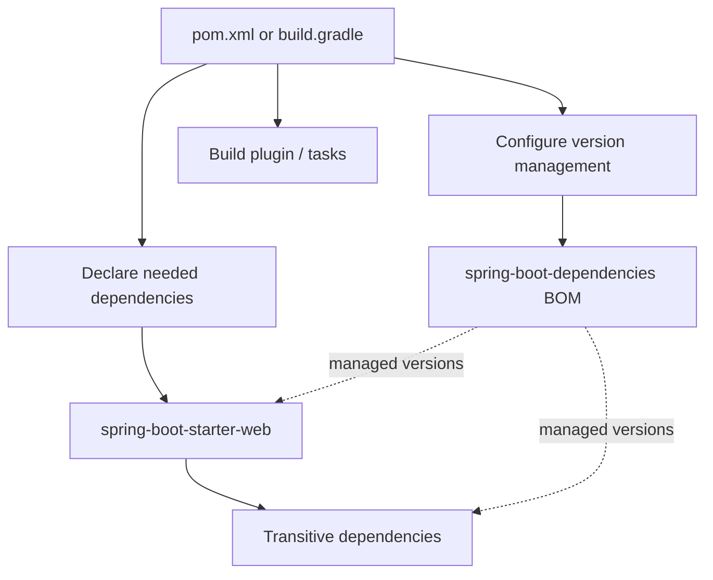
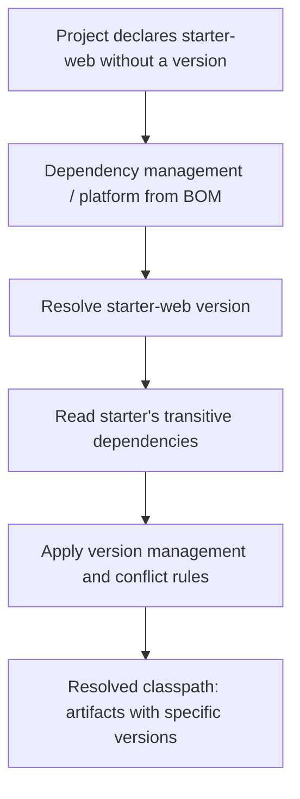

# spring-boot-dependencies BOM and the managed version set

In a Spring Boot project, you often see dependency declarations **without a version**:

```groovy
dependencies {
    implementation 'org.springframework.boot:spring-boot-starter-web'
    implementation 'com.fasterxml.jackson.core:jackson-databind'
    testImplementation 'org.springframework.boot:spring-boot-starter-test'
}
```

Even without `:3.x.y` or `<version>...</version>` on each dependency, Gradle or Maven can still select specific versions. This typically happens because the project uses **Spring Boot dependency management**, specifically the `org.springframework.boot:spring-boot-dependencies` BOM.

This lesson in the **Dependencies and Starters** section of Spring Boot Fundamentals explains what a BOM is, how Spring Boot manages versions, how to enable management in Maven/Gradle, how to inspect actual resolved versions, and key limitations to remember when adding libraries or upgrading Spring Boot.

> **Key point:** A BOM manages **recommended or applied versions according to the build tool's mechanism**; it does not automatically add libraries to your application, does not run Spring Boot by itself, and does not guarantee every arbitrary dependency has a managed version.

## 1. The problem when every dependency chooses its own version

A Spring Boot REST API can use Spring MVC, Jackson, Hibernate, a JDBC driver, Logback, Micrometer, JUnit, and many other libraries. These libraries in turn have **transitive dependencies**: indirect dependencies pulled in by the dependencies we declared.

Simplified example:

```text
Application
├── spring-boot-starter-web
│   ├── spring-web
│   ├── spring-webmvc
│   ├── jackson-databind
│   └── embedded web server
├── spring-boot-starter-data-jpa
│   ├── spring-data-jpa
│   └── hibernate-core
└── spring-boot-starter-test
    └── testing libraries
```

Exact artifact names and dependency structures vary by Spring Boot version. The diagram simply illustrates that a project has **multiple layers of dependencies**.

If you managed them manually, you would have to answer:

- Which Spring Framework version fits the Spring Boot version you are running?
- Which Jackson version works cleanly with Spring Web and the rest of the libraries?
- Which versions of Hibernate and Spring Data JPA belong together?
- Will versions within the same ecosystem drift when another library pulls in an older version?
- When upgrading Spring Boot from one release to another, how must all related libraries be adjusted?

Setting individual versions across dozens of declarations is error-prone. Spring Boot eliminates most of this repetitive work by **publishing a curated set of managed dependency versions**, integration-tested for each release.

## 2. What is a BOM?

**BOM** stands for **Bill of Materials**. In the Maven/Gradle ecosystem, a BOM is a metadata document describing a set of dependencies and managed versions. Spring Boot's BOM has the Maven coordinates:

```text
Group ID:    org.springframework.boot
Artifact ID: spring-boot-dependencies
Version:     chosen Spring Boot version
Packaging:   pom
```

For example, at a specific version:

```text
org.springframework.boot:spring-boot-dependencies:3.3.13
```

The number `3.3.13` here merely illustrates a real release in the Spring Boot 3.3 branch. For new projects, choose a Spring Boot version that is **actively supported** and compatible with your project's Java/Gradle/Maven setup.

A BOM is not a JAR file containing Java classes. It is a **POM** declaring dependency management metadata. Conceptually, inside it are rules such as:

```xml
<!-- Illustrates the dependencyManagement concept, not
     the literal contents of spring-boot-dependencies. -->
<dependencyManagement>
    <dependencies>
        <dependency>
            <groupId>com.fasterxml.jackson.core</groupId>
            <artifactId>jackson-databind</artifactId>
            <version><!-- version managed by Spring Boot --></version>
        </dependency>
        <dependency>
            <groupId>org.hibernate.orm</groupId>
            <artifactId>hibernate-core</artifactId>
            <version><!-- version managed by Spring Boot --></version>
        </dependency>
    </dependencies>
</dependencyManagement>
```

The snippet above only helps visualize **coordinates mapped to versions**; do not copy it into a project.

### 2.1. A BOM is a management list, not a required installation list

Suppose the BOM manages both `jackson-databind` and `hibernate-core`. If the application only needs HTTP/JSON and does not use JPA, simply having `hibernate-core` in the BOM **does not mean** Hibernate will be placed on the classpath.

Distinguish:

- **Declaring a dependency**: “The application needs library X.”
- **Managing versions**: “If library X appears in the dependency graph, here is the managed version according to the build tool's mechanism.”
- **Resolving dependencies**: Maven/Gradle combines declarations, transitive dependencies, constraints, and conflict rules to choose the final version.

A dependency can enter the application directly or indirectly; the BOM only participates in the **version** aspect.

### 2.2. Why is it called a “managed version set”?

Each Spring Boot release publishes a version catalog for the libraries managed by that release. The list typically covers components across the ecosystem:

| Category | Examples managed in appropriate Spring Boot lines | Why it matters |
|---|---|---|
| Spring foundation | Spring Framework, Spring Data, Spring Security | Keeps Spring modules compatible with one another |
| Web and JSON | Jackson, supported embedded web servers | Reduces version drift when building REST APIs |
| Data | Hibernate ORM, JDBC/connection pool libraries | Supports persistence integration |
| Logging | SLF4J, Logback, Log4j depending on release | Coordinates logging APIs and implementations |
| Observability | Micrometer and related modules | Connects metrics/tracing at compatible versions |
| Testing | JUnit, Mockito, AssertJ, and listed components | Provides a consistent testing toolkit |

**The exact list and specific versions change with each Spring Boot release.** You cannot assume Spring Boot always manages **every** library, or that a library managed in one release is definitely managed in another.

## 3. Distinguishing BOM, starter, Spring Boot plugin, and parent POM

These four names often appear side by side, yet they perform different jobs.

| Component | Role | Pulls code onto the classpath automatically? |
|---|---|---|
| `spring-boot-dependencies` BOM | Publishes managed dependency versions | **No**, not merely from importing the BOM |
| `spring-boot-starter-web` | Starter declaring a dependency group for Servlet/MVC web apps | **Yes**, because it is an actual dependency |
| `org.springframework.boot` Gradle plugin | Supports tasks to run/package Boot apps and integrates with certain other plugins | **Does not replace** declaring application dependencies |
| `spring-boot-starter-parent` in Maven | Parent POM providing dependency management **and** useful build/plugin defaults | Does not mean automatically adding web or data starters |

Relationship diagram:



The BOM manages the *version* of a starter; the starter itself declares the *libraries* needed for a feature. Build plugins handle build/run tasks. These responsibilities complement each other.

## 4. How the Spring Boot BOM is used in Maven

There are two very common ways:

1. Inherit `spring-boot-starter-parent`.
2. If the project has its own parent or does not want to use the Spring Boot parent, import `spring-boot-dependencies` inside `dependencyManagement`.

### 4.1. Approach A: Maven inherits spring-boot-starter-parent

Abbreviated `pom.xml` example:

```xml
<project xmlns="http://maven.apache.org/POM/4.0.0"
         xmlns:xsi="http://www.w3.org/2001/XMLSchema-instance"
         xsi:schemaLocation="http://maven.apache.org/POM/4.0.0
                             https://maven.apache.org/xsd/maven-4.0.0.xsd">
    <modelVersion>4.0.0</modelVersion>

    <parent>
        <groupId>org.springframework.boot</groupId>
        <artifactId>spring-boot-starter-parent</artifactId>
        <version>3.3.13</version>
        <relativePath/>
    </parent>

    <groupId>com.example</groupId>
    <artifactId>my-first-boot-app</artifactId>
    <version>0.0.1-SNAPSHOT</version>

    <properties>
        <java.version>21</java.version>
    </properties>

    <dependencies>
        <dependency>
            <groupId>org.springframework.boot</groupId>
            <artifactId>spring-boot-starter-web</artifactId>
        </dependency>

        <dependency>
            <groupId>org.springframework.boot</groupId>
            <artifactId>spring-boot-starter-test</artifactId>
            <scope>test</scope>
        </dependency>
    </dependencies>
</project>
```

Here:

- The Spring Boot parent provides inherited configuration, including dependency management from `spring-boot-dependencies`.
- `spring-boot-starter-web` and `spring-boot-starter-test` **do not need `<version>`** because their versions are managed.
- `<java.version>21</java.version>` configures the Java target for the build setup supported by the parent; it is not a dependency version.
- The parent also brings plugin/build defaults that importing only the BOM does not automatically provide.

**Remember:** Maven only supports one direct `<parent>`. If a project must inherit an organization parent, importing the BOM is the more flexible option.

### 4.2. Approach B: Maven imports the BOM without using the Spring Boot parent

```xml
<project xmlns="http://maven.apache.org/POM/4.0.0"
         xmlns:xsi="http://www.w3.org/2001/XMLSchema-instance"
         xsi:schemaLocation="http://maven.apache.org/POM/4.0.0
                             https://maven.apache.org/xsd/maven-4.0.0.xsd">
    <modelVersion>4.0.0</modelVersion>

    <groupId>com.example</groupId>
    <artifactId>my-first-boot-app</artifactId>
    <version>0.0.1-SNAPSHOT</version>

    <properties>
        <maven.compiler.release>21</maven.compiler.release>
    </properties>

    <dependencyManagement>
        <dependencies>
            <dependency>
                <groupId>org.springframework.boot</groupId>
                <artifactId>spring-boot-dependencies</artifactId>
                <version>3.3.13</version>
                <type>pom</type>
                <scope>import</scope>
            </dependency>
        </dependencies>
    </dependencyManagement>

    <dependencies>
        <dependency>
            <groupId>org.springframework.boot</groupId>
            <artifactId>spring-boot-starter-web</artifactId>
        </dependency>
    </dependencies>
</project>
```

The essential part is placing the BOM in:

```xml
<dependencyManagement>
    <dependencies>
        <dependency>
            <groupId>org.springframework.boot</groupId>
            <artifactId>spring-boot-dependencies</artifactId>
            <version>3.3.13</version>
            <type>pom</type>
            <scope>import</scope>
        </dependency>
    </dependencies>
</dependencyManagement>
```

**Why are `type=pom` and `scope=import` required?** This is how Maven pulls **version management declarations** from a BOM POM into the project's dependency management model. If you declare the BOM like a regular JAR dependency, you are using it for the wrong purpose.

**Important limitation:** Importing the BOM manages **dependency versions**, but **does not replace the plugin management** provided by `spring-boot-starter-parent`. If you need `spring-boot-maven-plugin` to repackage an executable JAR, configure the plugin and compatible version appropriately.

### 4.3. Maven still allows declaring dependencies with an explicit version

For example:

```xml
<dependency>
    <groupId>com.fasterxml.jackson.core</groupId>
    <artifactId>jackson-databind</artifactId>
    <version><!-- project-specific version --></version>
</dependency>
```

When a **direct dependency** has an explicit `<version>`, the specified version can override the corresponding managed version for that dependency. Even though Maven has its own rules for dependency mediation and transitive dependencies, practical guidance is to **avoid declaring custom versions without a sound reason** and check the dependency tree after making changes.

### 4.4. Parent and BOM import behave differently when overriding versions

With `spring-boot-starter-parent`, Spring Boot allows customizing certain managed versions through published Maven properties. For example, a property name like `jackson-bom.version` is only meaningful if the **Boot version in use** actually declares that property.

When only **importing** the BOM via `dependencyManagement`, setting a property with the same name in the project **does not modify the contents of the imported BOM** in the same way parent inheritance does. Instead, place a separate `dependencyManagement` entry for the dependency or BOM you want to override, following Maven's ordering/precedence rules.

This is a very common difference encountered when moving from a sample project using the Spring Boot parent to a project with an internal corporate parent.

## 5. How to use the Spring Boot BOM in Gradle

With Gradle, distinguish two common mechanisms:

- **Spring dependency-management plugin** (`io.spring.dependency-management`).
- **Gradle native BOM support** with `platform(...)`.

Both allow declaring dependencies without specifying versions, but their constraint handling and override behavior are not completely identical.

### 5.1. Gradle with io.spring.dependency-management

Example `build.gradle` (Groovy DSL, following a common Spring Boot 3.3 setup):

```groovy
plugins {
    id 'java'
    id 'org.springframework.boot' version '3.3.13'
}

apply plugin: 'io.spring.dependency-management'

repositories {
    mavenCentral()
}

java {
    toolchain {
        languageVersion = JavaLanguageVersion.of(21)
    }
}

dependencies {
    implementation 'org.springframework.boot:spring-boot-starter-web'
    implementation 'com.fasterxml.jackson.core:jackson-databind'
    testImplementation 'org.springframework.boot:spring-boot-starter-test'
}
```

With **Spring Boot Gradle plugin 3.3** and `io.spring.dependency-management` applied, the Boot plugin automatically imports the BOM matching the Boot plugin version. As a result, dependencies in the managed list can omit `:version`.

**Note on version changes over time:** auto-import behavior and configuration syntax can change between **major versions** of the Spring Boot Gradle plugin. When using another Spring Boot line, read the *Managing Dependencies* section of the plugin documentation for that specific version line instead of assuming every version behaves like 3.3.

In the example:

- `org.springframework.boot` is the Gradle plugin for building/running/packaging Boot apps.
- `io.spring.dependency-management` is the plugin providing the version management mechanism.
- `spring-boot-dependencies` is the BOM imported through their coordination.
- `spring-boot-starter-web` remains the dependency providing web library code for the application.

### 5.2. Gradle native BOM support with platform(...)

Gradle can consume a BOM POM as a **platform dependency** without needing the `io.spring.dependency-management` plugin.

```groovy
plugins {
    id 'java'
    id 'org.springframework.boot' version '3.3.13'
}

repositories {
    mavenCentral()
}

dependencies {
    implementation platform(
        org.springframework.boot.gradle.plugin.SpringBootPlugin.BOM_COORDINATES
    )

    implementation 'org.springframework.boot:spring-boot-starter-web'
    implementation 'com.fasterxml.jackson.core:jackson-databind'

    testImplementation platform(
        org.springframework.boot.gradle.plugin.SpringBootPlugin.BOM_COORDINATES
    )
    testImplementation 'org.springframework.boot:spring-boot-starter-test'
}
```

`SpringBootPlugin.BOM_COORDINATES` resolves the exact group/artifact/version of the BOM matching the **applied Spring Boot plugin**. The `platform(...)` syntax is a **Gradle** mechanism, while the BOM coordinates value is supplied by the Spring Boot plugin.

An equivalent form, useful when **not applying the Spring Boot Gradle plugin** to a library project, is importing the BOM coordinates explicitly:

```groovy
dependencies {
    implementation platform('org.springframework.boot:spring-boot-dependencies:3.3.13')
    implementation 'com.fasterxml.jackson.core:jackson-databind'
}
```

Do not both import `platform(...)` and apply the dependency management plugin in the same setup without a specific reason; choose one primary mechanism, understand how it manages versions, and avoid overlapping rules that are hard to analyze.

### 5.3. Why is a Gradle platform a “constraint” rather than an absolute lock?

With `platform(...)`, Gradle brings the BOM's versions into dependency resolution as **version constraints/recommendations**. If the dependency graph contains other constraints or version requests, the final selected version **may differ** from the version in the BOM.

If you use:

```groovy
implementation enforcedPlatform(
    org.springframework.boot.gradle.plugin.SpringBootPlugin.BOM_COORDINATES
)
```

then `enforcedPlatform(...)` exerts stronger enforcement over versions within its scope. However, this can conflict with other dependencies and **propagate strict constraints to consumers** when used in a published library. Do not use `enforcedPlatform` just to “make sure nothing breaks,” especially in library modules.

### 5.4. BOMs apply per configuration

When you write:

```groovy
dependencies {
    implementation platform('org.springframework.boot:spring-boot-dependencies:3.3.13')
}
```

the BOM participates in resolving dependencies in the `implementation` configuration and configurations set up to **extend** it appropriately. Do not assume it automatically manages every custom configuration, the buildscript classpath, or the plugin classpath.

A project with `implementation`, `testImplementation`, `annotationProcessor`, `integrationTestImplementation`, or custom configurations needs to understand inheritance relationships to apply the platform/management properly. For instance, explicitly adding the BOM to `testImplementation` is an intuitive way for learners to see that test dependencies also need management.

### 5.5. Kotlin DSL with Gradle native BOM

Similar to Groovy, a `build.gradle.kts` example:

```kotlin
plugins {
    java
    id("org.springframework.boot") version "3.3.13"
}

repositories {
    mavenCentral()
}

dependencies {
    implementation(
        platform(org.springframework.boot.gradle.plugin.SpringBootPlugin.BOM_COORDINATES)
    )
    implementation("org.springframework.boot:spring-boot-starter-web")

    testImplementation(
        platform(org.springframework.boot.gradle.plugin.SpringBootPlugin.BOM_COORDINATES)
    )
    testImplementation("org.springframework.boot:spring-boot-starter-test")
}
```

The difference lies mainly in the DSL syntax. The meaning of the BOM and managed dependencies remains the same.

## 6. Example version selection flow

Suppose a BOM for your chosen Boot version manages:

```text
spring-boot-starter-web   → corresponding Boot version
spring-webmvc             → corresponding Spring Framework version
jackson-databind          → corresponding Jackson version
junit-jupiter             → corresponding JUnit version
```

You declare:

```groovy
dependencies {
    implementation 'org.springframework.boot:spring-boot-starter-web'
    testImplementation 'org.springframework.boot:spring-boot-starter-test'
}
```

The reasoning flow can be visualized as:



No “BOM magic” happens inside the JVM when the app runs. Everything takes place during **build time and dependency resolution**. Afterward, the selected JARs are placed onto the corresponding compile/runtime/test classpaths.

### A common conflict scenario

Suppose the application needs `jackson-databind`. The Spring Boot BOM recommends version **X**, while another library requests version **Y**.

The outcome cannot be deduced simply by saying “the BOM manages X”:

- With **Maven**, `dependencyManagement` and mediation rules determine the winning version; direct declarations and POM management each have specific precedence.
- With **Gradle native `platform`**, version constraints and conflict resolution may choose a version different from the BOM.
- With **Gradle + the dependency-management plugin**, the plugin's version management rules participate in resolution differently than Gradle native platforms.
- With an **explicit version**, **strict constraint**, **force**, or **enforcedPlatform**, the outcome can change again.

Therefore, **inspect the actual resolved dependency graph** rather than looking at `build.gradle`/`pom.xml` and asserting which version is running.

## 7. Where to check the actual list of managed versions?

There are two separate questions:

1. **Which versions does the BOM list?** This is the *managed* version list for a specific Spring Boot release.
2. **Which version did the project ultimately select?** This is the result after Maven/Gradle processes the entire dependency graph.

### 7.1. Reading the managed versions list in Spring Boot documentation

Spring Boot provides *Dependency Versions* documentation or an equivalent appendix for each release. There you can look up managed versions for Jackson, Hibernate, JUnit, Tomcat, Micrometer, and many other components, if supported in that release.

Example documentation links:

- [Spring Boot 3.3 – Dependency Versions](https://docs.spring.io/spring-boot/3.3/appendix/dependency-versions/coordinates.html)
- [Spring Boot 3.3 – Managing Dependencies with Gradle](https://docs.spring.io/spring-boot/3.3/gradle-plugin/managing-dependencies.html)

To know the exact version of a dependency, look it up in the documentation for **your exact Spring Boot release**, rather than taking version numbers from an article written for a different release.

### 7.2. Gradle: inspecting the dependency tree

In the directory containing the Gradle Wrapper:

```bash
./gradlew dependencies --configuration runtimeClasspath
```

On Windows:

```powershell
.\gradlew.bat dependencies --configuration runtimeClasspath
```

A displayed line may be interpreted by Gradle in the format:

```text
com.example:some-library:1.0 -> 1.2
```

The left side typically represents the requested/declared version; the `->` symbol shows the final selected version when the two values differ. The data here is illustrative only.

### 7.3. Gradle: asking why a version was selected

An especially helpful tool is `dependencyInsight`:

```bash
./gradlew dependencyInsight \
  --dependency jackson-databind \
  --configuration runtimeClasspath
```

Or on PowerShell:

```powershell
.\gradlew.bat dependencyInsight --dependency jackson-databind --configuration runtimeClasspath
```

The command shows which paths pull in the dependency and the resolution reasons provided by Gradle. When using a `platform` BOM, constraints from the platform can appear in the output; when using the dependency management plugin, information may be presented differently.

To inspect test dependencies, use an appropriate configuration such as `testRuntimeClasspath`.

### 7.4. Maven: inspecting the dependency tree and effective POM

```bash
mvn dependency:tree
```

Focus on a specific library:

```bash
mvn dependency:tree -Dincludes=com.fasterxml.jackson.core:jackson-databind
```

To see the POM model after Maven inherits the parent and processes dependency management:

```bash
mvn help:effective-pom
```

**How to read them properly:** `effective-pom` helps verify inherited/imported configuration, while `dependency:tree` focuses on the project's resolved dependencies. Use both when you suspect “the BOM is imported, yet the library version is still wrong.”

## 8. When should you override a Boot-managed version?

As a baseline, **prefer the versions managed by Spring Boot**. Spring Boot releases and tests against a specific combination of libraries. Arbitrary overrides can introduce subtle errors at compile time, startup, or only when calling a particular API.

However, overrides are sometimes necessary, such as:

- Needing a security fix for a dependency before the corresponding Spring Boot release is published.
- An integration requiring a specific version verified to be compatible.
- An organization maintaining its own dependency management policy and accepting the extra testing effort.

When overriding, determine:

1. **Is the library actually in the BOM for the current release?**
2. **Will changing a single artifact desynchronize an entire group of modules that must share a version?** For example, some library families publish via their own release train/BOM.
3. **Is the override mechanism Maven parent, Maven BOM import, Gradle dependency management, or Gradle native platform?** Syntax and precedence differ.
4. **What is the resolved tree after the change?** Are any artifacts still on the old version or pulled to an unwanted version?
5. **Are there integration tests and a maintenance policy for later updates?** When upgrading Spring Boot, consider removing overrides whose rationale no longer applies.

### 8.1. Overriding via Maven parent

In a project inheriting `spring-boot-starter-parent`, you can use properties **published by Spring Boot**. For example, if the version in use manages Jackson via `jackson-bom.version`, changing the property per the corresponding documentation will adjust the managed Jackson suite.

Do not invent property names. Check the *Dependency Versions Properties* section for your exact release.

### 8.2. Overriding via Maven imported BOM

When only importing `spring-boot-dependencies` in `dependencyManagement`, add a specific management declaration **before the BOM** as Maven recommends; illustrative example:

```xml
<dependencyManagement>
    <dependencies>
        <dependency>
            <groupId>com.fasterxml.jackson.core</groupId>
            <artifactId>jackson-databind</artifactId>
            <version>REPLACE_WITH_VERIFIED_VERSION</version>
        </dependency>

        <dependency>
            <groupId>org.springframework.boot</groupId>
            <artifactId>spring-boot-dependencies</artifactId>
            <version>3.3.13</version>
            <type>pom</type>
            <scope>import</scope>
        </dependency>
    </dependencies>
</dependencyManagement>
```

`REPLACE_WITH_VERIFIED_VERSION` is a placeholder that must be replaced with a verified version before use. This only illustrates the **mechanism**; for Jackson, consider managing the entire Jackson family consistently with an appropriate BOM to avoid version skew across modules in the same group.

### 8.3. Overriding in Gradle

If using `io.spring.dependency-management` with Spring Boot 3.3, some versions can be customized via corresponding properties (such as those provided by the BOM). If using Gradle native `platform(...)`, **you cannot use the BOM's internal properties in the same way**; use Gradle constraints or an appropriate resolution approach.

Example using a constraint to document the reason for upgrading a dependency:

```groovy
dependencies {
    implementation platform('org.springframework.boot:spring-boot-dependencies:3.3.13')

    implementation 'com.fasterxml.jackson.core:jackson-databind'

    constraints {
        implementation('com.fasterxml.jackson.core:jackson-databind:REPLACE_WITH_VERIFIED_VERSION') {
            because 'Verified version for security/compatibility requirements'
        }
    }
}
```

This example is illustrative; replace the placeholder with an actual version and inspect the resolved result. When adjusting multiple modules in the same family, consider a BOM/alignment approach rather than bumping individual artifacts in isolation.

## 9. BOMs in multi-module applications

A Gradle multi-project system might have:

```text
my-project/
├── settings.gradle
├── build.gradle
├── api/
├── domain/
└── persistence/
```

Not every module needs to apply the `org.springframework.boot` plugin to package an executable JAR:

- `api` may be a Spring Boot application needing `bootJar`.
- `domain` is a plain Java library and does not need `bootJar`.
- `persistence` is a library using Spring Data/JPA or JDBC.

Even so, the modules may **share the need for a consistent managed version set** to avoid fragmentation. You can bring the BOM into each module via a project-owned convention plugin/build logic, or apply dependency management in the appropriate scope. If importing the BOM separately for a library, do not blindly apply the Boot plugin to every module just to get managed versions.

Example of a library module using Gradle native BOM:

```groovy
plugins {
    id 'java-library'
}

repositories {
    mavenCentral()
}

dependencies {
    api platform('org.springframework.boot:spring-boot-dependencies:3.3.13')
    api 'org.springframework:spring-context'
}
```

Using `api` instead of `implementation` here merely illustrates that **a platform can participate in a library's API dependency graph**. In a real project, whether to expose constraints via `api` or keep them internal via `implementation` should be chosen based on how the library is consumed and published.

With Maven multi-module builds, `dependencyManagement` in a parent aggregator is inherited by children if the children declare that parent. A project merely listed in the aggregator's `<modules>` **does not automatically inherit dependency management** unless there is an appropriate `<parent>` relationship.

## 10. How does the Spring Boot version set relate to the Spring Cloud BOM?

When also using Spring Cloud libraries, you may encounter another BOM such as:

```text
org.springframework.cloud:spring-cloud-dependencies:<cloud-release-train>
```

This is the BOM for **certain Spring Cloud components**. It **does not completely replace** the Spring Boot BOM and does not turn Spring Cloud into “a single starter.”

In many projects, the build uses:

- The Spring Boot BOM to manage Spring Boot, Spring Framework, and common dependencies.
- The matching Spring Cloud BOM to manage Spring Cloud modules.
- A **compatibility matrix between the Spring Boot release and the Spring Cloud release train**.

Do not randomly pair the latest Spring Boot version with an arbitrary Spring Cloud release train. Consult the official compatibility documentation first, then inspect the dependency graph. If the application does not use Spring Cloud, **there is no reason to import the Spring Cloud BOM** simply because you use Spring Boot.

The same principle applies to other specialized BOMs: Spring Data, Jackson, or another library ecosystem may have its own BOM. Importing multiple BOMs introduces questions of **precedence and overlapping versions**, requiring an understanding of Maven/Gradle rules and verification of the selected versions.

## 11. Common errors during dependency exercises

### 11.1. “I removed the version, yet Gradle cannot find the dependency”

For example:

```groovy
plugins {
    id 'java'
    id 'org.springframework.boot' version '3.3.13'
}

dependencies {
    implementation 'org.springframework.boot:spring-boot-starter-web'
}
```

In applicable Gradle versions/setups, merely applying the **Spring Boot plugin** does not necessarily bring the BOM into dependency resolution if no version management mechanism is added. In Boot 3.3, apply `io.spring.dependency-management` **or** import native `platform(...)`.

You also need to declare a repository (such as `mavenCentral()`), ensure network/repository mirror connectivity, and verify the coordinates exist.

### 11.2. “I already have the BOM, so why do I need to declare starters?”

The BOM **does not pull starters into the application**. You still must declare:

```groovy
implementation 'org.springframework.boot:spring-boot-starter-web'
```

If you omit this starter and have no other source providing Spring MVC/Servlet, simply importing the BOM will not create HTTP endpoints or an embedded web server.

### 11.3. “Does importing the BOM in Maven automatically include spring-boot-maven-plugin?”

No. **Dependency management is different from plugin management.** Importing a BOM does not automatically configure executable JAR packaging tasks, the Java compiler, test plugins, or project-specific plugins the way `spring-boot-starter-parent` does.

### 11.4. “I set explicit versions on all dependencies to be safer”

In practice, this easily breaks the compatible version set prepared by Spring Boot. Only specify a version when the library is **unmanaged**, when you intend to override deliberately, or when required by your build tool/project model.

### 11.5. “Does the BOM guarantee zero security vulnerabilities?”

No. The BOM is updated across Spring Boot releases; an older release may contain dependencies with CVEs discovered after the release date. You still need to update to supported Spring Boot versions, monitor security advisories, and scan resolved artifacts.

### 11.6. “If the BOM version is X, is runtime guaranteed to use X?”

Not in every build. Gradle native `platform` can be affected by other version constraints; Maven also has management and mediation rules; explicit versions/overrides can alter the outcome. To be sure, inspect **runtimeClasspath/dependency tree**.

### 11.7. “Does the BOM manage Gradle plugins, the JVM, and Docker images too?”

No. A dependency BOM manages **dependencies within its published scope**. Versions of the Java toolchain, Gradle wrapper, Spring Boot Gradle plugin, Maven build plugins, container images, and external tools have their own mechanisms.

## 12. Step-by-step practice with a small Spring Boot project

Goal: create a Gradle project using Spring Boot 3.3.13 **to observe the BOM**. This is an illustrative version; when creating a real project, replace it with a Spring Boot version actively supported in your environment.

**Step 1 – Create a project with Gradle Wrapper**, Java, and the Spring Boot plugin. Choose one of the two version management approaches from Section 5. For example, using Gradle native BOM:

```groovy
plugins {
    id 'java'
    id 'org.springframework.boot' version '3.3.13'
}

repositories {
    mavenCentral()
}

dependencies {
    implementation platform(
        org.springframework.boot.gradle.plugin.SpringBootPlugin.BOM_COORDINATES
    )
    implementation 'org.springframework.boot:spring-boot-starter-web'

    testImplementation platform(
        org.springframework.boot.gradle.plugin.SpringBootPlugin.BOM_COORDINATES
    )
    testImplementation 'org.springframework.boot:spring-boot-starter-test'
}
```

**Step 2 – Inspect the classpath** using:

```powershell
.\gradlew.bat dependencies --configuration runtimeClasspath
```

On macOS/Linux, use `./gradlew` instead of `.\gradlew.bat`.

Find the lines containing `spring-web`, `spring-webmvc`, `jackson-databind`, and the embedded server. Look at the **resolved versions**, not just the artifact names.

**Step 3 – Trace a transitive dependency**:

```powershell
.\gradlew.bat dependencyInsight --dependency jackson-databind --configuration runtimeClasspath
```

Identify which paths introduce the library and which version was selected.

**Step 4 – Test your understanding of declaration vs. version management**. Answer for yourself:

- If you remove `implementation 'org.springframework.boot:spring-boot-starter-web'` while keeping the BOM, does the application still automatically have Spring MVC?
- If you keep the starter but remove the BOM and have no other management mechanism, how will the versionless dependency resolve?
- If you add a library not yet in the BOM without specifying a version, where would you look up or provide its version?
- If two dependencies request the same artifact at different versions, which command helps find the selected version?

This is a metadata-reading exercise, not a request to intentionally break builds or override libraries in a real project.

**Step 5 – When upgrading Spring Boot**, update the Boot version following your project's workflow, then re-read the resolved tree. Do not assume you are only changing the starter's version: dependency management can change dozens of indirectly used versions at once.

## 13. Quick comparison table: Maven vs. Gradle

| Goal | Maven | Gradle |
|---|---|---|
| Use Spring Boot defaults for both dependencies and build plugins | `spring-boot-starter-parent` | `org.springframework.boot` plugin **combined with** an appropriate dependency management mechanism |
| Import dependency versions only | `dependencyManagement` + `type=pom`, `scope=import` | `platform(...)` or `io.spring.dependency-management` |
| Can omit versions on managed dependencies? | Yes | Yes, if BOM/management applies to the right configuration |
| Does the BOM add dependencies automatically? | No | No |
| Inspect actual resolved versions | `mvn dependency:tree` | `gradlew dependencies` and `dependencyInsight` |
| Override versions | `dependencyManagement` or properties when inheriting parent (per docs) | Managed properties with corresponding plugin; constraints/resolution via native platform |
| Are plugin versions the BOM's responsibility? | No; separate Maven plugin management | No; separate Gradle plugin versions |

## 14. Self-check questions

**Question 1.** A project imports `spring-boot-dependencies` but does not declare `spring-boot-starter-web`. Can we conclude the project already uses Spring MVC?

**Answer:** No. The BOM does not pull Spring MVC onto the classpath.

**Question 2.** When declaring `implementation 'org.springframework.boot:spring-boot-starter-web'` without a version, what condition is required for Gradle to resolve it?

**Answer:** There must be an appropriate version management mechanism, such as the Spring dependency management plugin paired with a supported Spring Boot plugin version, or Gradle `platform(...)`; additionally, the dependency must be available from a configured repository and satisfy other resolution conditions.

**Question 3.** Are `spring-boot-starter-parent` and `spring-boot-dependencies` the same artifact?

**Answer:** No. The parent POM provides build/plugin defaults alongside dependency management; the BOM focuses on managing dependency versions.

**Question 4.** Why should you still not assert that `jackson-databind` always resolves to the BOM version even after importing Spring Boot BOM 3.3.13?

**Answer:** The dependency graph may contain explicit versions, constraints, and conflict resolution rules; the final version depends on the build tool and full configuration. You must inspect the resolved dependency tree.

**Question 5.** Can a dependency outside the managed versions list always omit its version?

**Answer:** No. It needs another version source, such as a dependency constraint, another BOM, a version catalog, or an explicit version per project policy.

**Question 6.** Why can upgrading a Spring Boot patch version change the versions of Jackson, Hibernate, or JUnit without editing the declaration lines for those libraries?

**Answer:** Each Spring Boot release can update the set of versions managed by its BOM. When the BOM changes, dependency resolution may select newer versions for artifacts appearing in the graph.

## 15. Takeaways when building Spring Boot applications

To use dependency management effectively, keep a simple workflow:

1. **Choose a Spring Boot version** supported by your project and verify Java/build tool compatibility.
2. **Choose one clear BOM mechanism**: Maven parent, Maven import, Gradle dependency management, or Gradle native platform.
3. **Declare the right feature libraries** such as web, data, validation, and test starters; omit versions for dependencies genuinely managed by the BOM.
4. **Inspect the resolved dependency tree** when conflicts occur, when adding new libraries, or when upgrading versions.
5. **Override only intentionally**, understand the entire related library group, and re-verify after upgrades.
6. **Read documentation by version**, since the managed dependencies list and plugin behaviors can change across releases.

Mastering `spring-boot-dependencies` helps you understand why Spring Boot projects have short build files while leveraging a broad library ecosystem. **Starters specify what the application needs; the BOM manages the versions of what the application needs.**

### Official references

- [Spring Boot 3.3 Gradle Plugin – Managing Dependencies](https://docs.spring.io/spring-boot/3.3/gradle-plugin/managing-dependencies.html)
- [Spring Boot Maven Plugin – Using the Plugin / Without the Parent POM](https://docs.spring.io/spring-boot/maven-plugin/using.html)
- [Spring Boot 3.3 – Dependency Versions](https://docs.spring.io/spring-boot/3.3/appendix/dependency-versions/coordinates.html)
- [Gradle User Manual – Platforms](https://docs.gradle.org/current/userguide/platforms.html)
- [Maven – Introduction to the Dependency Mechanism](https://maven.apache.org/guides/introduction/introduction-to-dependency-mechanism.html)
