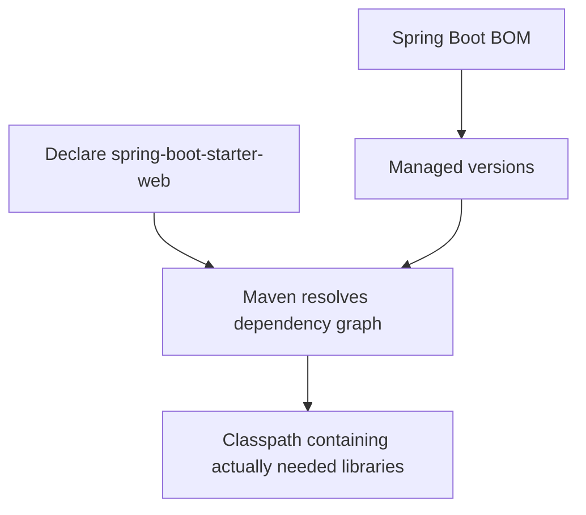
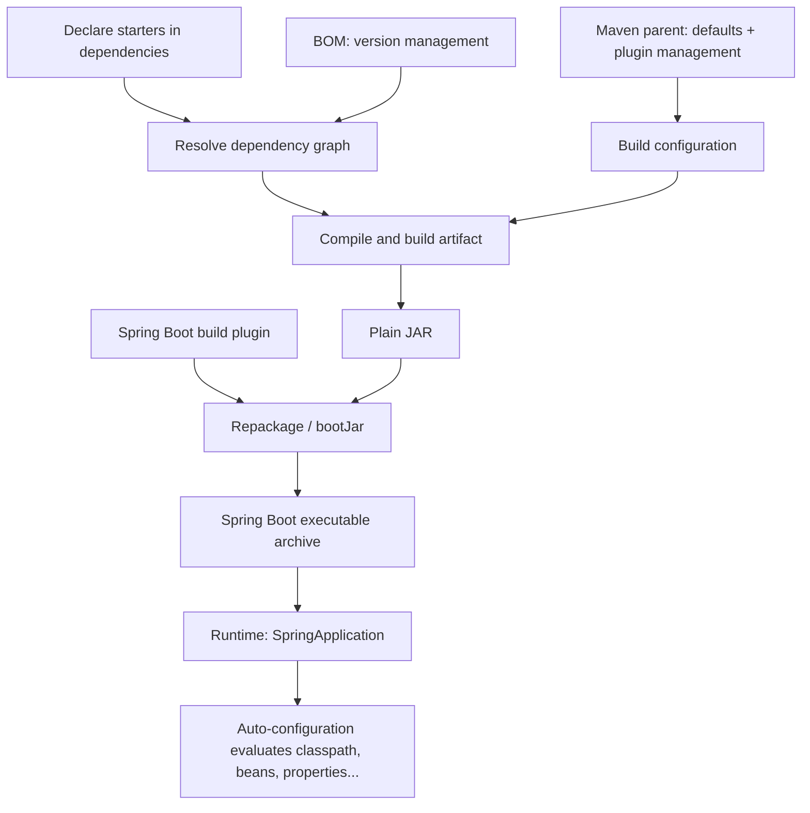

# Distinguishing BOM, Maven parent, and Spring Boot build plugin

When opening a Spring Boot project, you will often see three components sitting near one another in `pom.xml` or `build.gradle`: the **BOM** (`spring-boot-dependencies`), the **Maven parent** (`spring-boot-starter-parent`), and the **Spring Boot build plugin** (`spring-boot-maven-plugin` or the Gradle plugin `org.springframework.boot`). They are related, yet solve three distinct jobs: **managing dependency versions**, **inheriting build conventions**, and **running build/packaging operations**.

This is foundational knowledge in the *Dependencies and Starters* chapter: understanding starters tells us which libraries are brought into the application; understanding the BOM, parent, and plugin helps explain **which versions are selected, what Maven/Gradle executes, and why the final JAR runs or fails to run**.

This lesson uses **Java 21**, **Spring Boot 3.3.5**, and **Maven 3.9+** for its examples. The version `3.3.5` is fixed so configuration snippets stay consistent, not to claim it is the latest release. When practicing on your own project, substitute the compatible version your project uses. At the end of the lesson, there is a comparison with Gradle.

## 1. Seeing the big picture before reading XML

| Component | Primary role | Does it automatically add starters to the project? | Does it automatically create an executable Boot JAR? |
|---|---|---|---|
| Dependency, e.g. `spring-boot-starter-web` | Brings required libraries and transitive dependencies into the project | Yes, for the declared dependency | No |
| BOM `spring-boot-dependencies` | Manages versions of many dependencies | No | No |
| Maven parent `spring-boot-starter-parent` | Inherits dependency management, properties, plugin management, and build conventions | Does not automatically add Spring Web or JPA starters | Not sufficient on its own if the required plugin is not used |
| Maven plugin `spring-boot-maven-plugin` | Integrates Spring Boot's run, repackage, and image-building goals into Maven | No | Can do so when the `repackage` goal is executed |
| Gradle plugin `org.springframework.boot` | Adds Boot tasks like `bootRun`, `bootJar`, and other build integrations | No | Can do so via the `bootJar` task |

**Three questions must be separated:**

1. *Which libraries does the application need?* — dependency declarations, typically via one or more starters.
2. *Where are library versions decided?* — direct declarations, Maven dependency management, or a BOM/platform.
3. *How is the build artifact produced?* — Maven/Gradle configuration and build plugins.

A BOM can manage the version of `spring-boot-starter-web`, yet does not give the application Spring MVC by itself. A Maven parent can supply the version for Maven Compiler Plugin without forcing you to use Spring Boot executable packaging. A build plugin can produce a Boot JAR, yet does not automatically supply versions for every dependency.

## 2. What is a BOM? Why does Spring Boot need a BOM?

**BOM** stands for *Bill of Materials*. In Maven, a BOM is typically a POM with `packaging=pom` containing `dependencyManagement` with numerous dependency coordinates and recommended versions. Spring Boot publishes the BOM:

```text
org.springframework.boot:spring-boot-dependencies:3.3.5
```

The BOM ensures libraries managed by Spring Boot use a set of versions selected and tested together, instead of letting each module pick arbitrary versions of Spring Framework, Jackson, logging, testing libraries, and other components.

### 2.1. The BOM manages versions; it does not add dependencies automatically

Suppose a project imports the BOM and declares:

```xml
<dependencies>
    <dependency>
        <groupId>org.springframework.boot</groupId>
        <artifactId>spring-boot-starter-web</artifactId>
    </dependency>
</dependencies>
```

Maven can look up the version of `spring-boot-starter-web` from the imported dependency management. Then the starter brings into the dependency graph the components required for a web application according to the starter's design and Boot version.

If you delete the entire `spring-boot-starter-web` block while keeping the BOM, the project **does not automatically have** Spring Web. A BOM is like a version management catalog; a **dependency declaration** is the actual request that brings a library into the project.



### 2.2. Importing the BOM without inheriting the Spring Boot parent

In a Maven POM, you can write:

```xml
<properties>
    <spring-boot.version>3.3.5</spring-boot.version>
</properties>

<dependencyManagement>
    <dependencies>
        <dependency>
            <groupId>org.springframework.boot</groupId>
            <artifactId>spring-boot-dependencies</artifactId>
            <version>${spring-boot.version}</version>
            <type>pom</type>
            <scope>import</scope>
        </dependency>
    </dependencies>
</dependencyManagement>

<dependencies>
    <dependency>
        <groupId>org.springframework.boot</groupId>
        <artifactId>spring-boot-starter</artifactId>
    </dependency>
</dependencies>
```

Here:

- `<type>pom</type>` specifies the type of artifact being imported.
- `<scope>import</scope>` inside `dependencyManagement` tells Maven to import dependency management entries from the BOM. This is not a runtime scope for a library.
- `<version>${spring-boot.version}</version>` selects the exact BOM version.
- `spring-boot-starter` in `dependencies` is the actual dependency used by the application. It can omit the version because the BOM manages it.

What **does not happen** when importing the BOM: Maven does not automatically change the compiler target, configure test plugins, add the web starter, force executable JAR packaging, or choose a version for the Spring Boot Maven Plugin.

### 2.3. Scope and limitations of a BOM

A BOM only manages artifacts present in its list. A library outside that list still needs an appropriate way to determine its version. Explicit versions or other specific dependency management rules can influence Maven's resolution outcome. A BOM is not a guarantee that every arbitrary library added by the application will be compatible.

Therefore, when reading dependency errors, distinguish between: **missing dependency declaration**, **dependency without a managed version**, and **actual dependency/version conflict**. Those are three different causes.

## 3. What is a Maven parent?

Maven allows a project to **inherit configuration from a parent POM**. Spring Boot provides a convenient parent for application projects:

```xml
<parent>
    <groupId>org.springframework.boot</groupId>
    <artifactId>spring-boot-starter-parent</artifactId>
    <version>3.3.5</version>
    <relativePath/>
</parent>
```

An empty `<relativePath/>` tells Maven not to search for the parent POM at the default relative path inside the workspace; the Spring Boot parent is resolved from repositories by its artifact coordinates.

**The Spring Boot starter parent includes more benefits than the BOM**:

| Configuration group provided by parent | Meaning |
|---|---|
| Dependency management | Inherits the dependency version set from `spring-boot-dependencies`. |
| Default properties | Common values such as encoding and default Java level for the Boot line in use. |
| Plugin management | Manages versions and configurations for common Maven build plugins. |
| Resource filtering | Resource processing conventions convenient for Spring configuration. |
| Spring Boot plugin configuration | Configurations such as the `repackage` execution are managed so they can be used when the plugin is declared. |

As a result, an application POM using the parent is typically shorter and easier to start with than importing the BOM and filling in every Maven plugin manually.

### 3.1. Is the Maven parent a starter?

No. Even though its name contains `starter-parent`, this artifact is a **parent POM**, not the `spring-boot-starter` dependency. Declaring the parent does not mean logging, web, JPA, or other libraries have been added to the classpath. You still must declare the appropriate dependencies:

```xml
<dependencies>
    <dependency>
        <groupId>org.springframework.boot</groupId>
        <artifactId>spring-boot-starter</artifactId>
    </dependency>
</dependencies>
```

### 3.2. When can you not use the Spring Boot parent?

In Maven, a module can only have **one direct parent**. If your organization requires every project to inherit:

```xml
<parent>
    <groupId>com.acme.build</groupId>
    <artifactId>company-parent</artifactId>
    <version>1.0.0</version>
</parent>
```

then you cannot declare a second direct `<parent>` for `spring-boot-starter-parent`. The common choice is to **keep the company parent and import the `spring-boot-dependencies` BOM** in `dependencyManagement`, then configure any build pieces not supplied by the organization's parent.

This also explains why the **BOM import** approach exists alongside the **starter parent**.

### 3.3. Does the parent automatically run repackage?

The parent provides **plugin management** and inherited configuration. That is different from activating the plugin in `build/plugins`. Under the standard Spring Boot parent configuration, when a project declares `spring-boot-maven-plugin` in `<build><plugins>`, the configuration and `repackage` execution from the parent can be applied to the lifecycle.

If you only have the parent without actually using the plugin, the project should not be assumed to produce an executable Spring Boot JAR.

## 4. What is the Spring Boot build plugin?

A build plugin is a component of the **build tool**. It performs tasks such as running the application during development, structuring artifacts, generating build metadata, or building container images. It is **not a runtime business-logic dependency**.

With Maven, the plugin name is:

```text
org.springframework.boot:spring-boot-maven-plugin:3.3.5
```

Several common goals:

| Maven goal | Responsibility |
|---|---|
| `spring-boot:run` | Runs the application during development via Maven. |
| `spring-boot:repackage` | Repackages the application JAR/WAR into Boot's executable layout. |
| `spring-boot:build-image` | Builds an OCI image when the project and environment meet requirements. |
| `spring-boot:build-info` | Generates build metadata information if needed. |

The plugin does not solve “where does the version of `spring-boot-starter-web` come from?” That is the responsibility of dependency declarations together with dependency management.

### 4.1. Why is `repackage` needed?

A regular Maven JAR typically contains only the module's own classes and resources, while dependencies stay external. A regular JAR does not necessarily have a manifest specifying an entry point and a classpath layout capable of running standalone.

A common Spring Boot executable JAR has the general structure:

```text
demo-0.0.1-SNAPSHOT.jar
├── META-INF/MANIFEST.MF
├── BOOT-INF/
│   ├── classes/            # Application classes and resources
│   └── lib/                # Runtime dependency JARs
└── org/springframework/boot/loader/...
```

The `repackage` goal reorganizes the artifact and sets the appropriate entry point so you can run:

```bash
java -jar target/demo-0.0.1-SNAPSHOT.jar
```

Not **every** module needs `repackage`: a library JAR consumed as a dependency by other modules should usually keep standard library packaging.

### 4.2. Distinguishing `plugins` and `pluginManagement`

In Maven:

| Configuration | Effect |
|---|---|
| `<build><pluginManagement>` | Sets default version/configuration for a plugin when it is used. |
| `<build><plugins>` | Declares a plugin to be used in the build. |
| `<executions>` | Defines goals and binds them to appropriate Maven lifecycle phases. |

A plugin name appearing only in `pluginManagement` does not mean `mvn package` will run that plugin's goals. Furthermore, declaring a plugin in `build/plugins` does not automatically guarantee the `repackage` goal is bound to the `package` phase unless an execution is inherited or declared.

## 5. Maven Configuration A: using the Spring Boot parent

This is the configuration format typically generated by Spring Initializr for a Maven application.

```xml
<?xml version="1.0" encoding="UTF-8"?>
<project xmlns="http://maven.apache.org/POM/4.0.0"
         xmlns:xsi="http://www.w3.org/2001/XMLSchema-instance"
         xsi:schemaLocation="http://maven.apache.org/POM/4.0.0
         https://maven.apache.org/xsd/maven-4.0.0.xsd">
    <modelVersion>4.0.0</modelVersion>

    <parent>
        <groupId>org.springframework.boot</groupId>
        <artifactId>spring-boot-starter-parent</artifactId>
        <version>3.3.5</version>
        <relativePath/>
    </parent>

    <groupId>com.example</groupId>
    <artifactId>demo</artifactId>
    <version>0.0.1-SNAPSHOT</version>

    <properties>
        <java.version>21</java.version>
    </properties>

    <dependencies>
        <dependency>
            <groupId>org.springframework.boot</groupId>
            <artifactId>spring-boot-starter</artifactId>
        </dependency>
    </dependencies>

    <build>
        <plugins>
            <plugin>
                <groupId>org.springframework.boot</groupId>
                <artifactId>spring-boot-maven-plugin</artifactId>
            </plugin>
        </plugins>
    </build>
</project>
```

To give the application an entry point, create `src/main/java/com/example/demo/DemoApplication.java`:

```java
package com.example.demo;

import org.springframework.boot.SpringApplication;
import org.springframework.boot.autoconfigure.SpringBootApplication;

@SpringBootApplication
public class DemoApplication {
    public static void main(String[] args) {
        SpringApplication.run(DemoApplication.class, args);
    }
}
```

Run via Maven:

```bash
mvn spring-boot:run
mvn package
java -jar target/demo-0.0.1-SNAPSHOT.jar
```

In this project there is no web starter or long-running runner, so the application starts up and exits normally. Exiting does not mean the build failed.

Analyzing the POM:

- The parent determines the dependency management set and several build defaults; the `java.version` property targets Java 21.
- `spring-boot-starter` is added as an actual dependency, with its version managed by the parent/BOM.
- `spring-boot-maven-plugin` participates in the build; its version and `repackage` configuration are managed by the parent in this case.

If you remove the plugin while keeping the parent and dependency, the application can still compile, but the output JAR will typically be a plain JAR. If you remove the dependency while keeping the parent and plugin, the main class may fail to compile due to missing Spring Boot classes. These two experiments demonstrate that the parent and plugin do not replace application dependencies.

## 6. Maven Configuration B: without the Spring Boot parent

When an organization already has its own Maven parent or wants explicit control over build configuration, you can **import the BOM and configure build plugins manually**. The following POM illustrates a standalone project without needing the Spring Boot parent:

```xml
<?xml version="1.0" encoding="UTF-8"?>
<project xmlns="http://maven.apache.org/POM/4.0.0"
         xmlns:xsi="http://www.w3.org/2001/XMLSchema-instance"
         xsi:schemaLocation="http://maven.apache.org/POM/4.0.0
         https://maven.apache.org/xsd/maven-4.0.0.xsd">
    <modelVersion>4.0.0</modelVersion>

    <groupId>com.example</groupId>
    <artifactId>demo</artifactId>
    <version>0.0.1-SNAPSHOT</version>

    <properties>
        <spring-boot.version>3.3.5</spring-boot.version>
        <maven.compiler.release>21</maven.compiler.release>
        <project.build.sourceEncoding>UTF-8</project.build.sourceEncoding>
    </properties>

    <dependencyManagement>
        <dependencies>
            <dependency>
                <groupId>org.springframework.boot</groupId>
                <artifactId>spring-boot-dependencies</artifactId>
                <version>${spring-boot.version}</version>
                <type>pom</type>
                <scope>import</scope>
            </dependency>
        </dependencies>
    </dependencyManagement>

    <dependencies>
        <dependency>
            <groupId>org.springframework.boot</groupId>
            <artifactId>spring-boot-starter</artifactId>
        </dependency>
    </dependencies>

    <build>
        <plugins>
            <plugin>
                <groupId>org.apache.maven.plugins</groupId>
                <artifactId>maven-compiler-plugin</artifactId>
                <version>3.13.0</version>
                <configuration>
                    <release>${maven.compiler.release}</release>
                </configuration>
            </plugin>

            <plugin>
                <groupId>org.springframework.boot</groupId>
                <artifactId>spring-boot-maven-plugin</artifactId>
                <version>${spring-boot.version}</version>
                <executions>
                    <execution>
                        <goals>
                            <goal>repackage</goal>
                        </goals>
                    </execution>
                </executions>
            </plugin>
        </plugins>
    </build>
</project>
```

Keeping the same `DemoApplication.java` as before, you can run:

```bash
mvn package
java -jar target/demo-0.0.1-SNAPSHOT.jar
```

Key things to notice:

1. The `spring-boot-dependencies` BOM is the **source for starter version management**; it does not configure plugins on its own.
2. Maven Compiler Plugin specifies an explicit version and `release` to build with Java 21.
3. Spring Boot Maven Plugin has an explicit version because it does not receive configuration from the Spring Boot parent.
4. `<goal>repackage</goal>` is declared in an execution so the goal participates in the lifecycle when running `mvn package`.

For a project using `company-parent`, you typically keep that parent and add a `dependencyManagement` block importing the Spring Boot BOM in the child POM. Inspect existing compiler/plugin configurations provided by `company-parent` so you only add what is genuinely missing.

### 6.1. Difference when overriding versions

When **inheriting** the Spring Boot starter parent, certain version properties provided by the parent can be customized via the parent's property mechanism.

When **importing** the BOM, properties defined in the child POM **do not modify properties already evaluated inside the imported BOM**. If you need to override a BOM-managed dependency, use direct `dependencyManagement` entries or the version management approach approved by your organization.

Illustrative structure example:

```xml
<dependencyManagement>
    <dependencies>
        <dependency>
            <groupId>com.example</groupId>
            <artifactId>sample-library</artifactId>
            <version>2.4.0</version>
        </dependency>
        <dependency>
            <groupId>org.springframework.boot</groupId>
            <artifactId>spring-boot-dependencies</artifactId>
            <version>${spring-boot.version}</version>
            <type>pom</type>
            <scope>import</scope>
        </dependency>
    </dependencies>
</dependencyManagement>
```

`com.example:sample-library` is merely hypothetical coordinates illustrating a direct dependency management entry. For an actual Boot-managed dependency, use the exact group/artifact and evaluate compatibility before overriding. In Maven, direct dependency management declarations in the current POM take appropriate precedence over entries imported from a BOM.

## 7. Two missing-component cases and the resulting errors

### 7.1. Having the BOM without the Spring Boot build plugin

If a project imports the BOM, declares `spring-boot-starter`, and configures the compiler properly, yet **does not use the repackage plugin**, Maven can still resolve dependencies and compile. However, a standard `mvn package` will produce a regular Maven JAR, not an executable Spring Boot JAR.

When running:

```bash
java -jar target/demo-0.0.1-SNAPSHOT.jar
```

you may encounter a missing manifest entry point error or missing classes from runtime dependencies, depending on other packaging settings. The fix lies in **plugin/packaging**, not in modifying the BOM.

This can be the **right design** for a library module: a library module needs a plain JAR for other modules to reference, without repackaging the entire runtime as a standalone runnable application.

### 7.2. Having the Spring Boot plugin without the BOM/parent

A project that only declares the Spring Boot Maven Plugin and then adds a dependency:

```xml
<dependency>
    <groupId>org.springframework.boot</groupId>
    <artifactId>spring-boot-starter-web</artifactId>
</dependency>
```

without **any appropriate dependency management** can encounter a Maven error like:

```text
'dependencies.dependency.version' for
org.springframework.boot:spring-boot-starter-web:jar is missing.
```

The plugin does not automatically provide versions for starters. The right approach is to supply a suitable version management source (parent/BOM or explicit version) and declare the plugin for the needed build goals.

### 7.3. Having the parent without activating the plugin

The parent provides version management and build configuration, but if `spring-boot-maven-plugin` is not actually included in `build/plugins`, you should not assume `mvn package` runs `repackage`. Check the effective POM and inspect the output JAR to verify the final configuration.

## 8. How does Maven `dependencyManagement` differ from `pluginManagement`?

| | `dependencyManagement` | `pluginManagement` |
|---|---|---|
| What does it manage? | Libraries used by the project | Maven plugins serving the build process |
| Examples | `spring-boot-starter-web`, `jackson-databind` | `maven-compiler-plugin`, `spring-boot-maven-plugin` |
| Does it add items into active use automatically? | No; a dependency declaration or valid dependency path is required | No; the plugin/goal must participate in the build |
| Provided by Spring Boot BOM import? | Yes | No |
| Provided by Spring Boot starter parent? | Yes | Yes |

Plugin management example:

```xml
<build>
    <pluginManagement>
        <plugins>
            <plugin>
                <groupId>org.springframework.boot</groupId>
                <artifactId>spring-boot-maven-plugin</artifactId>
                <version>3.3.5</version>
            </plugin>
        </plugins>
    </pluginManagement>
</build>
```

This block only specifies how the plugin is managed when used; it **does not automatically cause `repackage` to run**. For building a Boot executable JAR, check both the plugin declaration and its actual execution.

## 9. Comparing with Gradle: equivalent concepts, different syntax

Gradle **does not have a Maven parent POM**. In Gradle, you typically combine:

1. The Java plugin and the `org.springframework.boot` Gradle plugin for build/run/bootJar tasks.
2. A dependency version management mechanism, such as the Spring Dependency Management plugin or a Gradle platform.
3. Actual starter dependencies inside the `dependencies` block.

### 9.1. Gradle plugin `org.springframework.boot`

This plugin supports tasks such as:

| Task | Function |
|---|---|
| `bootRun` | Runs the Spring Boot application during development. |
| `bootJar` | Creates an executable Boot JAR. |
| `bootWar` | Creates an executable Boot WAR when the `war` plugin and appropriate configuration are used. |
| `bootBuildImage` | Creates an OCI image when configured and when a suitable environment is available. |

The build plugin **does not replace dependency declarations**. You still need to add the appropriate starters.

### 9.2. Option 1: using the Spring Dependency Management plugin

`build.gradle`:

```groovy
plugins {
    id 'java'
    id 'org.springframework.boot' version '3.3.5'
    id 'io.spring.dependency-management' version '1.1.6'
}

group = 'com.example'
version = '0.0.1-SNAPSHOT'

java {
    toolchain {
        languageVersion = JavaLanguageVersion.of(21)
    }
}

repositories {
    mavenCentral()
}

dependencies {
    implementation 'org.springframework.boot:spring-boot-starter'
    testImplementation 'org.springframework.boot:spring-boot-starter-test'
}

tasks.named('test') {
    useJUnitPlatform()
}
```

With the compatible versions in the example, when applying both the Spring Boot Gradle Plugin and `io.spring.dependency-management`, the Boot plugin automatically imports the `spring-boot-dependencies` BOM matching the Boot plugin version. Consequently, `spring-boot-starter` and `spring-boot-starter-test` can omit explicit versions.

**Who does what?** `org.springframework.boot` provides tasks and packaging mechanisms; dependency management/BOM manages versions; the `dependencies` block adds libraries.

### 9.3. Option 2: using a native Gradle platform

Gradle supports importing a BOM via `platform(...)` without requiring `io.spring.dependency-management`:

```groovy
plugins {
    id 'java'
    id 'org.springframework.boot' version '3.3.5'
}

group = 'com.example'
version = '0.0.1-SNAPSHOT'

java {
    toolchain {
        languageVersion = JavaLanguageVersion.of(21)
    }
}

repositories {
    mavenCentral()
}

dependencies {
    implementation platform('org.springframework.boot:spring-boot-dependencies:3.3.5')
    implementation 'org.springframework.boot:spring-boot-starter'

    testImplementation platform('org.springframework.boot:spring-boot-dependencies:3.3.5')
    testImplementation 'org.springframework.boot:spring-boot-starter-test'
}

tasks.named('test') {
    useJUnitPlatform()
}
```

In this variant, `platform(...)` applies the BOM's version constraints to the relevant configurations. For example, declaring it on both `implementation` and `testImplementation` gives versionless dependencies a version source in their respective configurations. In Gradle, platform scope and version selection follow their own rules; inspect the dependency graph when you need to determine actual resolved versions.

Key reminder: **applying the Spring Boot Gradle plugin does not mean every dependency has managed versions**. You still need a proper version management mechanism.

### 9.4. Corresponding Maven and Gradle commands

| Intent | Maven | Gradle |
|---|---|---|
| Run application | `mvn spring-boot:run` | `./gradlew bootRun` |
| Build project | `mvn package` | `./gradlew build` |
| Package Boot executable | `spring-boot:repackage` | `bootJar` |
| View dependencies | `mvn dependency:tree` | `./gradlew dependencies` |
| Investigate version selection | Dependency tree/effective POM | `dependencyInsight` |

On Windows PowerShell, the Gradle Wrapper is usually invoked with `.\gradlew.bat`. Using the wrapper keeps the Gradle version consistent across the project.

## 10. How do BOM, parent, and plugin relate to runtime auto-configuration?

The three mechanisms in this lesson operate primarily at **build time**:



**The BOM does not execute when the application starts.** It exerts indirect influence by deciding the versions of libraries resolved beforehand. **The Spring Boot build plugin is not a runtime auto-configuration mechanism either**; it builds and packages the application.

When `SpringApplication` actually runs, Spring Boot inspects the runtime classpath, properties, and beans, then evaluates conditions to apply appropriate auto-configurations. For instance, adding `spring-boot-starter-web` can introduce classes needed for servlet web auto-configuration. That is an indirect effect of the dependency graph on runtime, not the BOM or Maven plugin creating beans themselves.

## 11. Verifying in a real project with evidence

### 11.1. Inspecting the Maven effective POM

```bash
mvn help:effective-pom -Doutput=effective-pom.xml
```

The effective POM shows the final configuration after parent inheritance, profiles, and relevant Maven settings. Look for `dependencyManagement`, `pluginManagement`, and `build/plugins`.

When you see a dependency with a managed version, ask: **did this version come from the parent or from a BOM import?** When you see a managed plugin, ask: **is it declared in use and is its goal bound to the lifecycle?**

### 11.2. Inspecting the dependency graph

```bash
mvn dependency:tree
```

This command shows the final dependency versions resolved by Maven. For a specific dependency, you can use the filter `-Dincludes=groupId:artifactId` per Maven Dependency Plugin syntax.

With Gradle:

```bash
./gradlew dependencies --configuration runtimeClasspath
./gradlew dependencyInsight --dependency spring-core --configuration runtimeClasspath
```

`dependencies` lists the graph by configuration; `dependencyInsight` helps investigate why a particular version was chosen.

### 11.3. Checking whether a JAR is a Boot executable

In a Maven project:

```bash
mvn package
jar tf target/demo-0.0.1-SNAPSHOT.jar
java -jar target/demo-0.0.1-SNAPSHOT.jar
```

In a typical Boot executable JAR, the entry list includes `BOOT-INF/classes/` and `BOOT-INF/lib/`, along with Boot's launcher/manifest. If the JAR lacks this layout, check whether `repackage` actually ran before changing dependency versions.

In a Gradle project with the Boot plugin and Java plugin, the `bootJar` task is what to check for producing an executable JAR.

## 12. Common misconceptions and accurate understanding

| Common misconception | Accurate understanding |
|---|---|
| “Importing the BOM adds Spring MVC.” | The BOM manages versions; you need a dependency like `spring-boot-starter-web` to get web libraries. |
| “Using the starter parent means you no longer have to declare starters.” | The parent manages build settings and versions; dependencies still must be added as needed. |
| “The BOM and the starter parent are the same.” | The parent adds properties, plugin management, and build defaults alongside dependency management. |
| “The Spring Boot plugin manages versions for every starter.” | The plugin handles builds; the parent/BOM or another mechanism manages dependency versions. |
| “Declaring a plugin in `pluginManagement` runs `repackage` automatically.” | The plugin/goal must actually participate in the lifecycle. |
| “Having a Maven parent immediately produces an executable JAR.” | You must configure the Boot plugin and its corresponding execution. |
| “Every module needs a Boot executable JAR.” | Library modules usually need a plain JAR. |
| “Gradle needs `spring-boot-starter-parent`.” | Gradle uses plugins and platforms/dependency management; it does not use a Maven parent. |
| “The BOM performs auto-configuration.” | Auto-configuration is a runtime mechanism; the BOM only affects dependency versions at build time. |
| “Using the BOM guarantees all libraries are compatible.” | The BOM manages a specific set of dependencies; changes or version overrides still require verification. |

## 13. Four diagnostic scenarios

### Scenario A — Maven reports a missing version

The POM declares:

```xml
<dependency>
    <groupId>org.springframework.boot</groupId>
    <artifactId>spring-boot-starter-web</artifactId>
</dependency>
```

yet the project has no parent or BOM managing that dependency. A typical error:

```text
'dependencies.dependency.version' for
org.springframework.boot:spring-boot-starter-web:jar is missing.
```

**Cause:** Maven cannot find a version. The fix lies in dependency management or an explicit version, not in adding the `repackage` goal.

### Scenario B — Build passes, but `java -jar` fails

The project has a BOM and starter, yet the artifact is a plain JAR, missing an appropriate manifest or runtime dependency layout.

**Cause to inspect:** did packaging use the Spring Boot Maven Plugin `repackage` or Gradle `bootJar`? This is primarily an artifact packaging issue, not a BOM issue.

### Scenario C — The company mandates a custom parent

The project currently inherits `company-parent`. **Keep that parent**, import the Spring Boot BOM into dependency management, and inspect how much compiler/plugin and execution configuration `company-parent` already provides. Use the effective POM to avoid duplicate plugin declarations or unnecessary configuration overrides.

### Scenario D — Gradle has the Boot plugin, but the starter lacks a version

The project declares the `org.springframework.boot` plugin and `org.springframework.boot:spring-boot-starter-web` without a version, yet has not configured appropriate dependency management or a platform.

**Cause:** missing a mechanism to select dependency versions. Add the compatible Spring Dependency Management plugin or import the BOM using a Gradle platform.

## 14. Choosing a configuration by project type

| Context | Typically sensible setup | Purpose |
|---|---|---|
| New Spring Boot Maven application | Starter parent + starter dependencies + Boot Maven plugin | Minimal XML, relying on defaults provided by Boot. |
| Maven project with a company parent | Keep company parent + import Boot BOM + configure plugins if needed | Preserves organizational build conventions. |
| Maven library module using Spring | Appropriate dependency management; repackage not required | Produces a library artifact for other modules to consume. |
| Gradle Boot application | Boot Gradle plugin + dependency management or platform + starters | Uses Gradle's native mechanisms. |
| Multi-module repository | Centralize version and plugin management; apply Boot packaging only to runnable modules | Avoids duplicated configuration and packaging modules with the wrong layout. |

There is no single mandatory configuration for every project. What must stay consistent is the **source of truth for versions**, **which dependencies are added**, and **which modules genuinely need an executable archive**.

## 15. Practice exercise: swap one piece and predict the outcome

Using the POM in Section 5 as a baseline, try each variation independently:

1. **Keep parent + starter, remove Boot Maven plugin.** Predict where Maven gets dependency versions and how the artifact is packaged.
2. **Keep parent + plugin, remove starter.** Predict what happens when `DemoApplication` imports `SpringApplication` while the classpath lacks required dependencies.
3. **Switch from parent to BOM import, keep starter.** List the compiler/plugin configurations you must declare once the Boot parent is gone.
4. **Keep BOM and plugin, but omit `repackage` execution.** Check whether `mvn package` triggers the goal via any other inherited configuration; if not, predict the final JAR.
5. **Convert the module into a library.** Explain why dependency management is still needed, while creating an executable Boot JAR is not necessarily needed.

For each scenario, answer using the template:

> Which dependencies are declared? Where are versions taken from? Which goal/task packages the artifact? Is the final artifact meant to run standalone or be used as a library?

### Self-assessment questions

1. Why does importing the BOM let you omit `<version>` on many dependencies, yet not omit the dependency declaration itself?
2. What does `spring-boot-starter-parent` provide on top of `spring-boot-dependencies`?
3. Why can a Maven project have only one direct parent, and when should you import the BOM instead of using the starter parent?
4. Why can `spring-boot-maven-plugin` produce an executable JAR yet not supply the version for `spring-boot-starter-web`?
5. What is the difference between `dependencyManagement` and `pluginManagement`?
6. Why are the `org.springframework.boot` Gradle plugin and Gradle `platform(...)` two mechanisms that must be distinguished?
7. If a Java application compiles successfully yet the JAR fails to run with `java -jar`, which group of configurations would you investigate first?
8. How are BOMs, starters, and auto-configuration related, and at which different phases do they operate?

### A sample explanation in code review

> This application uses the Spring Boot BOM to manage dependency versions, because the Maven module inherits the company's shared parent and therefore does not directly use `spring-boot-starter-parent`. Starters are still declared individually under `dependencies` to bring libraries onto the classpath. The Spring Boot Maven Plugin is configured with the `repackage` goal to produce an executable JAR runnable via `java -jar`. The compiler and Maven plugins are managed through the company parent or the module's build configuration. Separating these three responsibilities makes it easier to troubleshoot version errors and packaging issues in the right place.

Once you can explain in your own words the differences among **dependencies/starters**, the **BOM managing versions**, the **Maven parent inheriting conventions**, and the **Spring Boot build plugin executing the build**, you can read any Spring Boot project's `pom.xml` or `build.gradle` without conflating library selection with application packaging.
