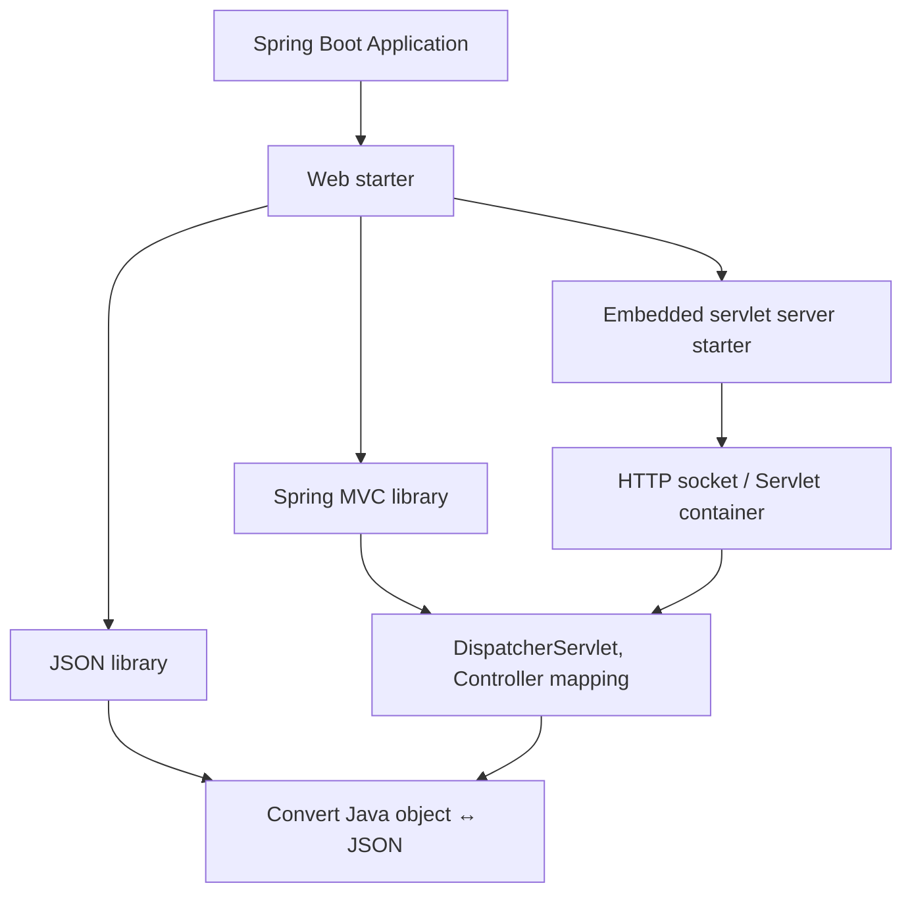
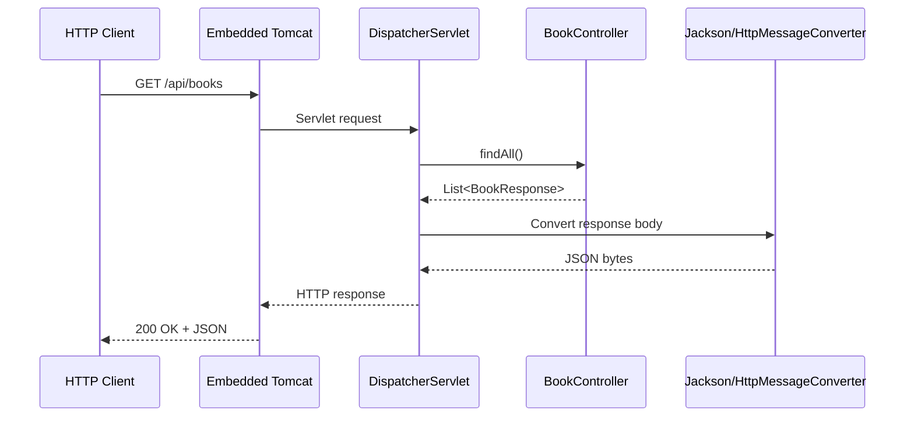

# Feature starters, implementation libraries, and embedded servers

> **Spring Boot Fundamentals · Dependencies and Starters**  
> Spring Boot helps create web applications or APIs with just a few dependencies. Behind that convenience lie three components to distinguish: **feature starters** that gather dependencies, **implementation libraries** containing the code that delivers features, and **embedded servers** handling network connections when a web application runs. Understanding how they relate helps you choose the right dependencies, explain how Spring Boot starts up, and know what to change when swapping HTTP servers or troubleshooting runtime errors.

## 1. Three layers of responsibility in a Spring Boot application

Suppose we want to build an API exposing `GET /api/books`. With Maven, many projects simply declare:

```xml
<dependency>
    <groupId>org.springframework.boot</groupId>
    <artifactId>spring-boot-starter-web</artifactId>
</dependency>
```

With Gradle Groovy DSL:

```groovy
dependencies {
    implementation 'org.springframework.boot:spring-boot-starter-web'
}
```

In a **Spring Boot 3.x application using Spring MVC/Servlet**, this web starter brings in a group of needed dependencies. However, a starter is not a giant library that reimplements all web functionality itself. It aggregates selected dependencies designed to work together.

| Component | What does it do? | Example in a web app |
| --- | --- | --- |
| **Feature starter** | Aggregates appropriate dependencies for a need and tells the build tool which libraries to resolve | `spring-boot-starter-web` |
| **Implementation library** | Contains code performing actual functionality: annotations, MVC, JSON, logging, JDBC, etc. | `spring-webmvc`, `spring-web`, Jackson |
| **Embedded server** | Opens network ports and accepts HTTP connections, running request-handling infrastructure per the server model | Embedded Tomcat in the common servlet web stack |

Example of how they work together:



This is a conceptual diagram. The exact dependency graph depends on the **Spring Boot version**, exclusions, and the project's dependency management. Starter names and feature packaging can change across major versions, so the examples below specify the **Spring Boot 3.x** context whenever concrete artifact names are needed.

### 1.1. Why separate these three concepts?

Because they answer three different questions:

1. **Which feature do I want to build?** Choose the corresponding starter or dependency group.
2. **Which code actually implements that feature?** Inspect the resolved libraries and created beans/infrastructure.
3. **Who accepts incoming HTTP requests over the network?** An appropriate embedded server or an externally deployed servlet container.

Confusing these concepts leads to trial-and-error debugging. For example, adding only a JSON library does not create an HTTP server; adding embedded Tomcat does not create controllers; and adding the web starter does not mean Spring Boot knows the URLs and business logic your API should expose.

## 2. What actually is a feature starter?

A **Spring Boot starter** is a dependency created so an application can declare a technical need at a high level: “I need web,” “I need JPA,” “I need testing,” “I need security,” and so on.

Common starters in the Spring Boot 3.x ecosystem:

| Starter | Need | Components typically included or integrated |
| --- | --- | --- |
| `spring-boot-starter-web` | REST APIs or Spring MVC apps | Spring MVC, JSON support, servlet web stack, embedded Tomcat by default |
| `spring-boot-starter-webflux` | Reactive web stack | Spring WebFlux and reactive HTTP infrastructure, typically with Reactor Netty |
| `spring-boot-starter-data-jpa` | Persistence with JPA | Spring Data JPA, a JPA provider like Hibernate, and required integrations |
| `spring-boot-starter-jdbc` | Data access via JDBC | Spring JDBC, transaction support, integrated DataSource setup |
| `spring-boot-starter-security` | Spring Security integration | Spring Security and conditional default security configuration |
| `spring-boot-starter-validation` | Bean Validation | Jakarta Validation and an appropriate implementation |
| `spring-boot-starter-test` | Writing application tests | Selected test libraries and Spring Boot Test support |
| `spring-boot-starter-actuator` | Application observability and operations | Health, metrics, operational info, and endpoint mechanisms |

**Not every starter includes a server.** The JDBC, Validation, or Test starters do not need to open an HTTP port. Even an application using Spring Boot does not have to be a web application.

Nor does a starter complete all runtime configuration on its own: with JPA/JDBC, the application still needs a database driver and connection settings; with web, the application still has to declare its controllers or endpoints.

### 2.1. How does a starter differ from a regular library dependency?

Both starters and implementation libraries are declared in the build tool's dependency section, yet their roles differ.

- A starter often acts primarily as a **dependency aggregator**, pulling in related libraries and configurations as transitive dependencies.
- An implementation library contains classes and methods called by the application or framework to do actual work, such as `DispatcherServlet` in Spring MVC, Jackson's `ObjectMapper`, or JDBC handling libraries.
- An artifact may sometimes both provide APIs/utilities and pull in other dependencies, yet distinguishing **design intent** remains useful.

For example, in Spring Boot 3.x, `spring-boot-starter-web` typically brings in dependencies such as `spring-web`, `spring-webmvc`, `spring-boot-starter-json`, and `spring-boot-starter-tomcat`. Those artifacts and their underlying transitive dependencies carry most of the actual executable code.

**A starter is not a Maven/Gradle plugin.** Starters are application dependencies; plugins extend the capabilities of the build tool.

### 2.2. Direct dependencies and transitive dependencies

You may declare only the web starter, yet the classpath contains many JARs:

```text
catalog-service
└── spring-boot-starter-web
    ├── spring-boot-starter
    │   └── core Spring Boot components
    ├── spring-boot-starter-json
    │   └── matching Jackson libraries
    ├── spring-web
    ├── spring-webmvc
    └── spring-boot-starter-tomcat
        └── embedded Tomcat components
```

This diagram illustrates **transitive dependencies**; it does not claim to be the complete tree for every Boot release.

When the build tool resolves dependencies, it traverses the dependency graph and applies version selection, exclusions, and conflict resolution rules. Thus, “only declaring one starter” does not mean runtime has only one JAR.

If you need to confirm exactly where a class or server comes from, inspect the **resolved dependency graph** rather than guessing from the starter name.

### 2.3. Why do starters usually omit versions?

Maven example:

```xml
<dependency>
    <groupId>org.springframework.boot</groupId>
    <artifactId>spring-boot-starter-web</artifactId>
</dependency>
```

Gradle example:

```groovy
implementation 'org.springframework.boot:spring-boot-starter-web'
```

Both omit the version because **they assume the project has configured appropriate dependency management**, such as the Spring Boot parent/BOM or a Gradle version management mechanism.

Without corresponding version rules, the build may fail to resolve the dependency. Maven/Gradle does not guess “the latest compatible Spring Boot version” just from seeing the starter name.

## 3. Implementation libraries: where does the real work happen?

Consider a simple HTTP API:

```java
package com.example.catalog.web;

import java.util.List;

import org.springframework.web.bind.annotation.GetMapping;
import org.springframework.web.bind.annotation.RestController;

@RestController
public class BookController {

    @GetMapping("/api/books")
    public List<BookResponse> findAll() {
        return List.of(
                new BookResponse(1L, "Spring Boot Fundamentals"),
                new BookResponse(2L, "Java in Practice")
        );
    }

    public record BookResponse(long id, String title) {}
}
```

For a request to reach the controller and return JSON, multiple libraries perform distinct roles:

| Role | Example infrastructure/library | Work performed |
| --- | --- | --- |
| Route HTTP to controller | Spring MVC / `spring-webmvc` | Receives request from servlet stack, locates handler via mapping |
| Web annotations | Spring Web / `spring-web` | Provides APIs such as `@RestController`, `@GetMapping` |
| Convert Java objects to JSON | Jackson and Spring's HTTP message converters | Serializes `List<BookResponse>` into JSON |
| Bean management, DI | Spring Framework | Creates, locates, and wires controller, service, and config beans |
| Accept network connections / servlet requests | Embedded Tomcat or compatible servlet server | Listens on HTTP port, forwards requests to servlet stack |
| Coordinate startup configuration | Spring Boot | Inspects classpath, conditions, and properties to build infrastructure |

Notice that functionality **does not rely on a single JAR**. A JSON HTTP response requires a serializer (such as Jackson), message converters, and MVC integration. The servlet server only passes requests/responses at the infrastructure layer; it does not decide business payload content.

### 3.1. Adding the right library for the right job

If writing a REST controller, adding Spring MVC via the web starter is usually appropriate. If you only need JSON processing in a batch application, you can use a JSON library directly without adding the entire web stack.

Similarly:

- Need to connect to PostgreSQL: the JDBC driver is the driver implementation library; adding only the driver does not create repository-layer data access logic.
- Need Bean Validation checks: adding the appropriate validation starter provides an implementation, while code must still declare constraints and trigger validation at the right places.
- Need tests: the test starter adds testing libraries; it does not automatically turn code in `src/main/java` into tests.

**Choose starters by application feature**, then add specialized libraries when a need is not covered by that starter. Avoid piling on starters just to silence errors without understanding which dependencies they bring in.

## 4. What is an embedded server?

An **embedded server** is an HTTP server embedded inside the application's runtime process. In this model, the Spring Boot application starts the server using its own Java code, without first requiring you to install a standalone Tomcat and copy a WAR into it.

For a servlet web app in Spring Boot 3.x:

- **Embedded Tomcat** is typically the default choice when using `spring-boot-starter-web`.
- **Jetty** can replace Tomcat if compatible versions and dependencies are used.
- **Undertow** is another embedded servlet server option in supported Spring Boot versions.
- With the **WebFlux reactive stack**, **Reactor Netty** is typically used as the default server when the corresponding starter is included. That is a different model from the default Tomcat servlet server.

An embedded server can coexist inside a single executable JAR alongside application classes and runtime dependencies.

### 4.1. Does “embedded” mean the server disappeared?

No. It is still a real HTTP server, with sockets, connections, request handling, threads/event loops, timeouts, and resource limits. “Embedded” simply means the server is initialized and managed as part of the application's lifecycle.

```text
Launch application
        │
        ▼
SpringApplication.run(...)
        │
        ▼
Create ApplicationContext and apply configuration
        │
        ▼
Create / start embedded web server
        │
        ▼
Server listens on HTTP port
        │
        ▼
Receive request → Servlet / handler chain
        │
        ▼
Controller → Service → Response
```

In a traditional deployment model, you set up a separate servlet container and deploy a WAR. In the executable JAR model with an embedded server, given a compatible Java environment and required application resources, the server starts alongside the application via `java -jar`.

### 4.2. Tomcat and Spring MVC do two different jobs

A helpful distinction:

- **Tomcat**: accepts HTTP requests, implements the Servlet API/servlet container lifecycle, and provides the servlet environment.
- **Spring MVC**: uses the servlet infrastructure (typically via `DispatcherServlet`) to resolve the right controller, bind parameters, invoke methods, convert responses, and handle other MVC concerns.
- **Your controller code**: decides endpoints, returned data, and business rules.



At the application layer, there can also be filters, interceptors, exception handlers, security, validation, and more. The diagram depicts only the core path.

### 4.3. An embedded server is not a packaging tool

Distinguish three closely related concepts in a Spring Boot project:

| Concept | Role |
| --- | --- |
| **Embedded Tomcat** | An HTTP/Servlet server running inside the application process |
| **Spring Boot Maven/Gradle plugin** | Builds artifacts, helps run the app during development, and performs other build tasks |
| **Executable Spring Boot JAR** | An artifact containing classes/resources and appropriate dependencies to bootstrap the application and server at runtime |

The plugin builds the executable JAR; the JAR contains the code so that at runtime the application can start the embedded server. **The plugin is not the server**; nor does a JAR file listen on a port before being executed.

## 5. From dependencies to a running server: the role of auto-configuration

Adding `spring-boot-starter-web` puts many Spring MVC and server classes on the **classpath**. Spring Boot inspects the classpath, application type, properties, and existing beans to decide what needs to be configured.

In Spring Boot 3.x, the main class typically looks like:

```java
package com.example.catalog;

import org.springframework.boot.SpringApplication;
import org.springframework.boot.autoconfigure.SpringBootApplication;

@SpringBootApplication
public class CatalogApplication {

    public static void main(String[] args) {
        SpringApplication.run(CatalogApplication.class, args);
    }
}
```

`@SpringBootApplication` includes enabling auto-configuration. When started, Spring Boot can:

1. Recognize a servlet web application from matching dependencies/classpath.
2. Create a servlet web application context.
3. Configure the corresponding embedded server factory, typically Tomcat in the default web starter setup.
4. Register Spring MVC components, such as the dispatcher servlet and message converters, when conditions are met.
5. Scan and register the application's controllers within the component scan range.
6. Start the HTTP server to accept requests.

This process is **conditional auto-configuration**. For example:

- If required Spring MVC classes are absent from the classpath, the MVC configuration cannot activate in the same way.
- If the application is not a web type, there will not necessarily be an HTTP server.
- If an application-defined bean already exists and auto-configuration uses `@ConditionalOnMissingBean` to back off, the corresponding default configuration may skip creating another bean.
- Server properties can change the port, context path, or timeouts without modifying implementation libraries.

**Classpath presence is different from auto-configuration activation.** A JAR being downloaded does not guarantee every bean/feature inside that JAR is instantiated.

### 5.1. Why don't we have to write `new Tomcat()`?

The framework already integrates server initialization code following common conventions. That is the benefit of starters + auto-configuration:

- Starters bring the required libraries into the build.
- Auto-configuration detects the environment and builds appropriate infrastructure beans.
- Embedded server factories and lifecycle management handle creating/starting the server.
- Developers focus on controllers, services, and important customizations.

That does not mean the server decides everything by itself. In real operations, you still configure ports, TLS/HTTPS, timeouts, resources, reverse proxies, logging, and appropriate security.

## 6. Complete example: a Spring MVC API with embedded Tomcat

This section uses an illustrative **Spring Boot 3.x + Java 17** project so starter and plugin names are clear.

### 6.1. Maven `pom.xml`

```xml
<project xmlns="http://maven.apache.org/POM/4.0.0"
         xmlns:xsi="http://www.w3.org/2001/XMLSchema-instance"
         xsi:schemaLocation="http://maven.apache.org/POM/4.0.0
         https://maven.apache.org/xsd/maven-4.0.0.xsd">
    <modelVersion>4.0.0</modelVersion>

    <parent>
        <groupId>org.springframework.boot</groupId>
        <artifactId>spring-boot-starter-parent</artifactId>
        <version>3.5.0</version>
        <relativePath/>
    </parent>

    <groupId>com.example</groupId>
    <artifactId>catalog-service</artifactId>
    <version>0.0.1-SNAPSHOT</version>

    <properties>
        <java.version>17</java.version>
    </properties>

    <dependencies>
        <dependency>
            <groupId>org.springframework.boot</groupId>
            <artifactId>spring-boot-starter-web</artifactId>
        </dependency>

        <dependency>
            <groupId>org.springframework.boot</groupId>
            <artifactId>spring-boot-starter-test</artifactId>
            <scope>test</scope>
        </dependency>
    </dependencies>

    <build>
        <plugins>
            <plugin>
                <groupId>org.springframework.boot</groupId>
                <artifactId>spring-boot-maven-plugin</artifactId>
            </plugin>
        </plugins>
    </build>
</project>
```

Notice the three distinct elements in the file:

- `spring-boot-starter-web` is a **feature dependency**.
- `spring-boot-starter-test` is a dependency used for **testing**, with scope `test`.
- `spring-boot-maven-plugin` is a **build plugin**, supporting running/packaging the Spring Boot application.

`spring-boot-starter-parent` and its associated dependency management provide compatible versions for many dependencies; you do not need to attach explicit versions to managed starters.

`3.5.0` in the example is an illustrative version from the Spring Boot 3.x line, not an instruction to use that exact version for every new project. In real projects, choose a Spring Boot version that is still supported and compatible with your Java version, plugins, and project ecosystem.

### 6.2. Equivalent Gradle `build.gradle`

```groovy
plugins {
    id 'java'
    id 'org.springframework.boot' version '3.5.0'
    id 'io.spring.dependency-management' version '1.1.7'
}

group = 'com.example'
version = '0.0.1-SNAPSHOT'

java {
    toolchain {
        languageVersion = JavaLanguageVersion.of(17)
    }
}

repositories {
    mavenCentral()
}

dependencies {
    implementation 'org.springframework.boot:spring-boot-starter-web'
    testImplementation 'org.springframework.boot:spring-boot-starter-test'
}

tasks.named('test') {
    useJUnitPlatform()
}
```

Distinguish clearly as well:

- `plugins` adds Java and Spring Boot build capabilities.
- `dependencies` declares libraries used in application code and tests.
- `tasks.named('test')` configures the test task; it does not add an HTTP server.
- The embedded server is placed onto the **runtime classpath** via dependencies and started when the web application runs.

### 6.3. Application source code

The `CatalogApplication` class from Section 5, placed at:

```text
src/main/java/com/example/catalog/CatalogApplication.java
```

The `BookController` controller from Section 3, placed at:

```text
src/main/java/com/example/catalog/web/BookController.java
```

Because the controller is in a subpackage of `com.example.catalog`, default component scanning typically discovers it.

### 6.4. Running and sending a request

Maven Wrapper:

```bash
./mvnw spring-boot:run
```

Gradle Wrapper:

```bash
./gradlew bootRun
```

On Windows PowerShell, use `.\mvnw.cmd spring-boot:run` or `.\gradlew.bat bootRun`.

In the default servlet web setup and if the port has not been changed, the server typically listens on `8080`. A request:

```http
GET /api/books HTTP/1.1
Host: localhost:8080
```

can receive the response:

```json
[
  {
    "id": 1,
    "title": "Spring Boot Fundamentals"
  },
  {
    "id": 2,
    "title": "Java in Practice"
  }
]
```

The HTTP server accepts the connection, Spring MVC routes to the controller, and Jackson (if auto-configured appropriately) converts Java objects to JSON. None of those steps require the controller to open sockets or write a manual JSON serializer.

## 7. Swapping the embedded server: from Tomcat to Jetty

One benefit of separating the **web starter** from the **server implementation** is the ability to swap the servlet container while keeping most controller and service code intact.

In Spring Boot 3.x, to use Jetty instead of Tomcat, the idea is:

1. **Exclude the Tomcat starter** coming from the web starter.
2. **Add the Jetty starter** to supply embedded Jetty.
3. Keep the web starter if you still need Spring MVC.
4. Run the application and observe which server is actually selected.

### 7.1. Maven: exclusion and new dependency

```xml
<dependencies>
    <dependency>
        <groupId>org.springframework.boot</groupId>
        <artifactId>spring-boot-starter-web</artifactId>
        <exclusions>
            <exclusion>
                <groupId>org.springframework.boot</groupId>
                <artifactId>spring-boot-starter-tomcat</artifactId>
            </exclusion>
        </exclusions>
    </dependency>

    <dependency>
        <groupId>org.springframework.boot</groupId>
        <artifactId>spring-boot-starter-jetty</artifactId>
    </dependency>
</dependencies>
```

### 7.2. Gradle: exclude and new implementation

```groovy
dependencies {
    implementation('org.springframework.boot:spring-boot-starter-web') {
        exclude group: 'org.springframework.boot',
                module: 'spring-boot-starter-tomcat'
    }

    implementation 'org.springframework.boot:spring-boot-starter-jetty'
}
```

The scope of change is the **dependency graph**. You do not have to rewrite `@GetMapping` to a Jetty-specific annotation. Spring MVC still handles controllers through the servlet web stack abstraction.

### 7.3. Why must Tomcat be excluded?

If multiple server implementations are placed on the classpath together, auto-configuration may not choose the one you expect; overlapping server components also make the dependency graph harder to reason about. Replacement should be deliberate: remove the old server dependency and add the new server dependency.

**Do not just add `spring-boot-starter-jetty` while leaving Tomcat in place and assume Jetty will automatically win.** The safe way to confirm the outcome is to inspect the dependency tree, startup logs, and the condition evaluation report.

Every replacement must also consider compatibility across the Spring Boot version, Servlet API, and server implementation. Do not apply a Spring Boot 3.x Jetty example verbatim to every major version if dependencies or versions have changed.

### 7.4. Does changing the embedded server alter business logic?

Usually controllers, services, repositories, and DTOs remain unchanged. However, Tomcat-specific configuration features (such as connector settings or tuning at the Tomcat API level) do not automatically translate into equivalent Jetty settings. When an application relies on container-specific features, adjust them specifically for the new server.

This illustrates the boundary between:

- **Business code**: expresses what the application does.
- **Spring MVC**: the HTTP request/response handling contract on the servlet stack.
- **Embedded container**: implements network connections, the Servlet runtime, and server configuration.

## 8. Spring MVC, WebFlux, and server types

A common misconception is thinking that adding any “web” dependency makes all web stacks work the same way.

### 8.1. Servlet web stack (Spring MVC)

With `spring-boot-starter-web` in Spring Boot 3.x:

- The primary processor is typically Spring MVC.
- HTTP requests are received through servlet infrastructure.
- Embedded Tomcat is the default server when using the standard web starter.
- Jetty or another servlet server can be substituted depending on version support.

This model fits many REST APIs, MVC apps, and conventional business applications.

### 8.2. Reactive web stack (Spring WebFlux)

With `spring-boot-starter-webflux`:

- The reactive processor is Spring WebFlux.
- Runtime typically uses Reactor Netty when default dependencies/configuration apply.
- Operation is based on Reactive Streams and non-blocking I/O at appropriate layers.
- Another reactive server can be used depending on framework support and configuration, though you should not assume this from a simple starter swap.

Spring MVC and WebFlux are **two programming models** with similarities and differences. Swapping embedded Tomcat for Jetty **does not** automatically switch Spring MVC to WebFlux.

### 8.3. What if you add both web and webflux starters?

In typical Spring Boot configurations, when both Spring MVC and WebFlux are present on the classpath, Boot usually prioritizes setting up a **Spring MVC servlet application** via its application type detection mechanism. This suits some MVC apps that want to use `WebClient`, yet can mislead newcomers into thinking the app switched to a reactive HTTP server.

When building a pure WebFlux application, understand and control your dependencies, application type, and deployment model. Do not arbitrarily add both starters just to fix an import error.

### 8.4. What if the application is not a web app?

A batch job or command-line application can use Spring Boot without opening an HTTP port:

```properties
spring.main.web-application-type=none
```

This property specifies that the application should not initialize a web application context/server in the usual way. However, web dependencies may still exist on the classpath; changing the application type **does not remove dependencies** from the artifact.

It is better to evaluate whether the application actually needs the web starter. For batch or message-only applications, adding an embedded server can be unnecessary overhead.

## 9. Customizing the embedded server via configuration

Not every server change requires changing dependencies. Common needs can use official properties.

### 9.1. Changing the port

`src/main/resources/application.yml`:

```yaml
server:
  port: 9090
```

Or `application.properties`:

```properties
server.port=9090
```

You can also pass an argument at startup:

```bash
java -jar catalog-service.jar --server.port=9090
```

The default HTTP port in standard web setups is `8080` when not overridden; the actual port is also influenced by other property sources.

### 9.2. Random port for testing

```properties
server.port=0
```

When an embedded server starts, the value `0` asks the operating system to assign a free port instead of binding to a fixed number. This is useful when multiple test suites run in parallel.

Example integration test in Spring Boot 3.x:

```java
package com.example.catalog;

import static org.junit.jupiter.api.Assertions.assertTrue;

import org.junit.jupiter.api.Test;
import org.springframework.boot.test.context.SpringBootTest;
import org.springframework.boot.test.web.server.LocalServerPort;

@SpringBootTest(webEnvironment = SpringBootTest.WebEnvironment.RANDOM_PORT)
class CatalogServerTest {

    @LocalServerPort
    int port;

    @Test
    void serverStartedOnRandomPort() {
        assertTrue(port > 0);
    }
}
```

`@SpringBootTest` with `RANDOM_PORT` starts an actual embedded server according to the applicable web setup, rather than creating only a mock MVC environment. The test code uses Spring Boot Test annotations with the package matching Spring Boot 3.x.

### 9.3. Context path

For a servlet web application:

```yaml
server:
  servlet:
    context-path: /catalog
```

With this configuration, a controller endpoint declared at `/api/books` is accessible at:

```text
http://localhost:8080/catalog/api/books
```

This differs from placing `@RequestMapping("/catalog")` on each controller: the context path belongs to the web application context/servlet deployment configuration.

### 9.4. Timeouts, compression, SSL, and deeper customization

Spring Boot provides server-related properties for compression, SSL, connections, and sessions depending on the version and server. Some properties apply generally, while others belong specifically to Tomcat/Jetty/Netty.

When a specialized requirement has no property, Spring Boot typically offers **customizers** or appropriate extension points, such as `WebServerFactoryCustomizer` for servlet applications. However, that is a more deliberate customization step requiring familiarity with the actual server type and API contract in use.

**Do not assume a Tomcat-specific property will control Jetty.** When switching servers, review properties prefixed for the old engine and select matching settings for the new server.

## 10. How the embedded server is packaged and deployed

Spring Boot can create an **executable JAR** containing application classes, resources, and needed dependencies. For a servlet web app using embedded Tomcat:

```text
catalog-service-0.0.1-SNAPSHOT.jar
├── META-INF/
├── org/springframework/boot/loader/...
└── BOOT-INF/
    ├── classes/
    │   ├── com/example/catalog/CatalogApplication.class
    │   ├── com/example/catalog/web/BookController.class
    │   └── application.yml
    └── lib/
        ├── spring-webmvc-...jar
        ├── spring-web-...jar
        ├── tomcat-embed-core-...jar
        └── ...
```

This is an illustrative layout for a Spring Boot 3.x executable JAR; exact contents depend on versions, plugins, and resolved dependencies.

### 10.1. How do Maven and Gradle package it?

Maven:

```bash
./mvnw package
```

When the Spring Boot Maven Plugin is properly configured/bound to the `repackage` goal, the build can produce an executable JAR containing the required runtime components.

Gradle:

```bash
./gradlew bootJar
```

The `bootJar` task is provided by the Spring Boot Gradle Plugin when properly applied. It builds an executable archive in the format supported by Boot.

Running the artifact:

```bash
java -jar target/catalog-service-0.0.1-SNAPSHOT.jar
```

or:

```bash
java -jar build/libs/catalog-service-0.0.1-SNAPSHOT.jar
```

Adjust the artifact path to match your build output. When running the executable JAR, Boot's loader and the application's main method start the Spring context; the embedded server starts if the application is a web type and configuration satisfies the conditions.

### 10.2. Plain JAR vs. executable Spring Boot JAR

A **plain Java JAR** typically holds only the module's classes and resources without packaging runtime dependencies inside in Boot's format. A Spring Boot executable JAR adds a bootstrap loader and arranges dependencies appropriately so it can run with `java -jar`.

Therefore, if `java -jar` reports missing classes or no main manifest attribute, inspect **which artifact type** you are running, plugin configuration, and classpath. Do not conclude embedded Tomcat is broken just from that message.

### 10.3. Must it always be embedded?

No. A Spring MVC application can also be deployed as a **WAR** to an external servlet container, provided versions and deployment setup are compatible. That requires configuring WAR packaging, a servlet initializer, server dependency scopes such as `provided`/`providedRuntime`, and the target container environment.

The WAR model differs from the executable JAR:

| | Executable JAR + embedded server | WAR + external container |
| --- | --- | --- |
| Who manages the server process? | The Spring Boot app starts the server inside the same process | An external container hosts the artifact and manages its lifecycle |
| Usually launched by | `java -jar ...` | Deploying to an external server/container |
| Server dependencies | Usually packaged inside the runtime artifact | Can be provided by the container environment |
| Deployment operation | Ship the executable artifact | Deploy the WAR per container workflow |

Neither model is universally better; the choice depends on the deployment platform and organizational requirements. In many modern Spring Boot learning examples, an executable JAR with an embedded server lets you start quickly and see the whole application lifecycle.

## 11. The dependency graph decides which libraries are actually present

A dependency in `pom.xml` or `build.gradle` is a declaration of intent; the actual classpath is formed after the build tool resolves all dependencies, versions, and exclusions.

### 11.1. Viewing the dependency graph with Maven

```bash
./mvnw dependency:tree
```

You can use filtering options to focus on specific artifacts, depending on the Maven Dependency Plugin version and project:

```bash
./mvnw dependency:tree -Dincludes=org.apache.tomcat.embed
```

From the output, trace the path from the web starter to the embedded Tomcat libraries. If you switched to Jetty, check whether any Tomcat dependency still appears via another dependency.

### 11.2. Viewing the dependency graph with Gradle

```bash
./gradlew dependencies --configuration runtimeClasspath
```

To explain why a dependency was selected:

```bash
./gradlew dependencyInsight --dependency tomcat --configuration runtimeClasspath
```

These commands help distinguish:

- **Direct** dependencies you declared.
- **Transitive** dependencies pulled in by other dependencies.
- **Excluded** dependencies.
- Versions selected via dependency management or conflict resolution.

In a Spring Boot project, do not look at a single `implementation` line and assume that is the entire runtime classpath.

### 11.3. Why must versions be managed consistently?

Spring MVC, Spring Boot, the servlet container, and the JSON library all have compatibility requirements. The Spring Boot BOM and dependency management system help select versions coordinated to support a given release.

Arbitrarily overriding the version of `spring-webmvc` or Tomcat can cause:

- `NoSuchMethodError` when running code calls an incompatible API.
- `ClassNotFoundException` or `NoClassDefFoundError`.
- Failure to start the ApplicationContext.
- Operational or security issues if a library is incompatible with the configuration.

If you must override to fix a specific issue, understand the impact and test against the target version. Being able to resolve dependencies **does not guarantee** runtime compatibility.

## 12. Common error scenarios

### 12.1. Application does not start an HTTP server

**Symptom:** the program runs and exits immediately, or runs without logging a listening port.

Possibilities:

- No appropriate web dependency is present.
- The application is configured with `spring.main.web-application-type=none`.
- The project is intentionally a command-line or batch application.
- The application context failed before the server started.
- Web/server features were excluded or customized so conditions are no longer satisfied.

**How to check:** inspect full startup logs, the dependency graph, and the application type configuration. Do not assume `@SpringBootApplication` always implies an HTTP server.

### 12.2. Port already in use error

**Symptom:** logs state that port `8080` or the configured port is already taken.

The server is present and trying to bind a socket, but the operating system rejects it because the address/port is unavailable.

**How to fix:** identify the process using the port; stop the unneeded process or change `server.port`. When running multiple local instances, pick distinct ports or `server.port=0` for tests to avoid collisions.

A port conflict **does not mean the web starter is missing**. It usually proves the application got quite far into starting the server.

### 12.3. HTTP server is running, yet endpoint returns 404

Common possibilities:

- The controller is outside `@SpringBootApplication`'s scan scope.
- URL, HTTP method, or context path does not match.
- The controller lacks the required annotations.
- Requests are hitting a different application or port.

**How to fix:** check mappings, package scan scope, actual port, context path, and endpoint logs. Swapping Tomcat for Jetty usually will not fix an unregistered controller.

### 12.4. Controller returns an object, yet JSON fails

In the REST MVC model, returning an object requires an appropriate HTTP message converter. If the JSON serializer, converter configuration, or dependency was excluded, the application may fail to serialize the object to JSON as intended.

**How to fix:** check starter/JSON dependencies, configured converters, content negotiation, and the actual exception. Do not just add Tomcat, because accepting connections does not mean the server automatically knows how to serialize Java objects.

### 12.5. Jetty is added, yet runtime still uses Tomcat

Possible causes:

- Added Jetty without excluding Tomcat.
- Another dependency still brings Tomcat onto the runtime classpath.
- The server factory was configured or chosen under different conditions than expected.

**How to fix:** inspect the resolved dependency graph and server startup logs; ensure the old server is truly removed and the new starter/server matches the Boot version.

### 12.6. Adding a starter causes class or method conflict errors

Errors may stem from version overrides, mixing libraries from different Spring Boot major versions, overly broad exclusions, or dependencies pulled in by external libraries.

**How to fix:** check against the BOM/parent/plugin, inspect the actual classpath, and focus on the conflicting dependency/version. Do not delete starters randomly, as that can introduce new errors.

### 12.7. Running `java -jar` reports missing main class / missing runtime dependencies

Check the application main class, packaging plugin, and JAR type. A plain JAR that was not repackaged may lack the Boot loader or runtime dependencies. This is a **packaging/classpath** issue, not necessarily a Tomcat request-handling issue.

### 12.8. Tests run too slowly because they always start the server

Not every test needs an embedded server:

- Unit tests for business logic can run with JUnit without a Spring context.
- Controller tests can use MVC slice/test infrastructure without binding a real socket.
- End-to-end HTTP integration tests are what need a real server, such as `@SpringBootTest(webEnvironment = RANDOM_PORT)`.

Choosing the right test level for what you are verifying keeps the test suite faster and more stable.

## 13. Misconceptions to avoid

| Statement | Assessment | Explanation |
| --- | --- | --- |
| “The web starter IS Tomcat.” | Inaccurate | The web starter pulls in many dependencies; Tomcat is only one server implementation that may be included. |
| “Adding Spring MVC guarantees an HTTP server.” | Not always true | You also need an appropriate web/server environment and matching auto-configuration or explicit configuration. |
| “The server receives requests, so the server knows controller routes.” | Fundamentally wrong | The servlet server accepts HTTP; Spring MVC routes to controllers. |
| “Having Jackson means you automatically have a REST API.” | Incorrect | Jackson handles JSON; endpoints and web infrastructure are separate pieces. |
| “Switching Tomcat to Jetty means rewriting `@RestController`.” | Usually no | Controllers use Spring MVC/Servlet abstractions, not direct Tomcat APIs. |
| “The Spring Boot plugin is the dependency running the HTTP server.” | Incorrect | The plugin handles builds; the embedded server is a runtime implementation. |
| “Every Spring Boot app must open port 8080.” | Incorrect | Only web apps with an appropriately configured embedded server open an HTTP port, and the port can be changed. |
| “Omitting the starter version makes Maven/Gradle grab the latest version.” | Incorrect | You need version management/constraints or explicit resolution rules. |
| “Building an executable JAR means the server is running.” | Incorrect | A JAR is an artifact; the server only starts when the application process runs and conditions match. |
| “Having both MVC and WebFlux guarantees Netty is used.” | Incorrect | Boot usually prefers a servlet application when both web stacks are on the classpath. |

### 13.1. Clues to identify the category of issue

When encountering an error, you can diagnose in order:

```text
Missing class or method?
  └── Check dependencies / versions / exclusions.

Missing web beans or server factory?
  └── Check application type and auto-configuration conditions.

Server fails to bind port?
  └── Check port configuration and other running processes.

Server runs, yet endpoint returns 404?
  └── Check component scan, routes, and context path.

Endpoint returns an object, yet JSON fails?
  └── Check message converters and serializers.

Packaged into a JAR, yet fails to run?
  └── Check build plugin, main class, bootJar/repackage.
```

This classification does not replace reading the stack trace, yet helps direct your investigation toward the responsible component instead of changing unrelated files.

## 14. Practice exercises

This practice uses a simple Spring Boot 3.x REST API. Either Maven or Gradle may be used. Focus on **observing the relationship among starters, implementation libraries, and the server**, rather than writing lots of business code.

### Step 1 — Build a minimal API

Create `CatalogApplication` and `BookController` from earlier sections. Only add `spring-boot-starter-web` and required test dependencies.

Run the application and access `GET /api/books`. Record:

- The starter declared directly in the build file.
- The resolved Spring MVC, Jackson, and Tomcat JARs.
- Which server is mentioned in the startup logs.
- The JSON response received from the controller.

### Step 2 — Inspect the dependency graph

Maven:

```bash
./mvnw dependency:tree
```

Gradle:

```bash
./gradlew dependencies --configuration runtimeClasspath
```

Locate the dependency leading to the default embedded server. Find at least one Spring MVC library and one JSON library in the graph. Distinguish direct dependencies from transitive dependencies.

### Step 3 — Change the port while keeping dependencies unchanged

`src/main/resources/application.yml`:

```yaml
server:
  port: 9090
```

Restart and access `http://localhost:9090/api/books`. Observe that the server implementation and controller stay unchanged, only the port differs. This demonstrates that properties can alter server behavior without changing libraries.

### Step 4 — Swap the server implementation

If the project uses Spring Boot 3.x with matching artifacts, exclude `spring-boot-starter-tomcat` and add `spring-boot-starter-jetty` as in Section 7. Restart and observe the server in the startup logs.

Answer for yourself:

- Did the controller have to change?
- Do the HTTP endpoint and JSON response still work?
- Does the dependency graph still contain embedded Tomcat unexpectedly?
- Are there any server-specific settings that need adjustment?

### Step 5 — Distinguish tests without a server from tests with a server

Write a pure JUnit unit test for a method processing a list of books, without `@SpringBootTest`. Then write a test with `@SpringBootTest(webEnvironment = RANDOM_PORT)` and observe the server startup logs.

The goal is to see that **test code does not inherently need an embedded server**, and an embedded server is only needed when you genuinely want to test the HTTP path over the network.

### Step 6 — Inspect the packaged artifact

Maven:

```bash
./mvnw package
```

Gradle:

```bash
./gradlew bootJar
```

List JAR contents:

```bash
jar tf path/to/catalog-service.jar
```

Locate `BOOT-INF/classes`, `BOOT-INF/lib`, and the embedded server libraries. Compare runtime dependencies with the JARs present in the artifact. If missing, check whether you are inspecting an **executable Boot JAR** or a plain JAR.

### Self-check questions

1. Why can declaring a single starter pull multiple JARs onto the runtime classpath?
2. In a request to `@RestController`, what different jobs do Tomcat and Spring MVC perform?
3. Why can you change the port without changing the starter?
4. If you want to use Jetty instead of Tomcat, why do you need to both exclude the old dependency and add the new implementation?
5. Does a batch app need an embedded HTTP server? Why or why not?
6. What is the role of the Spring Boot Gradle/Maven plugin compared to `spring-boot-starter-web`?
7. Why can a missing JSON serializer cause an object-returning endpoint to fail even while the HTTP server accepts requests?
8. When an endpoint returns 404, should you check server dependencies or component scanning first? What clues help decide?
9. Does adding `spring-boot-starter-webflux` to a Spring MVC application automatically switch the HTTP server to Netty?
10. How does “dependency is on the classpath” differ from “auto-configuration is activated”?

## 15. Remembering the relationship among the three components

| Question | Appropriate concept | Example |
| --- | --- | --- |
| “I want to build a REST API with Spring MVC.” | **Feature starter** | `spring-boot-starter-web` in Spring Boot 3.x |
| “Which code routes requests and handles JSON?” | **Implementation library** | `spring-webmvc`, Spring Web, Jackson |
| “Which component listens on the HTTP port?” | **Embedded server** | Tomcat, Jetty, or other supported servers |
| “Who decides what infrastructure is created at runtime?” | **Auto-configuration** | Conditions based on classpath, properties, and beans |
| “Who creates the executable JAR?” | **Build plugin/task** | Maven `repackage` or Gradle `bootJar` |
| “How do I know which libraries runtime has?” | **Resolved dependency graph** | `dependency:tree` or `dependencies` |

The path from declaration to a running application can be summarized as a chain: **starters specify the dependency set → build tool resolves implementation libraries and server → Spring Boot auto-configures appropriate infrastructure → embedded server starts listening → Spring MVC handles requests → controllers provide business behavior**.

Once each step is clear, you can pick starters by need, inspect classpaths, swap embedded servers, or troubleshoot startup/runtime issues without confusing the roles of dependencies, plugins, web frameworks, and HTTP servers.
