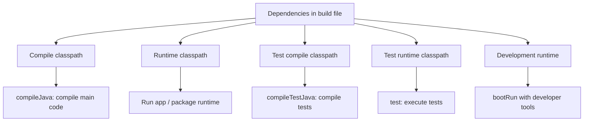
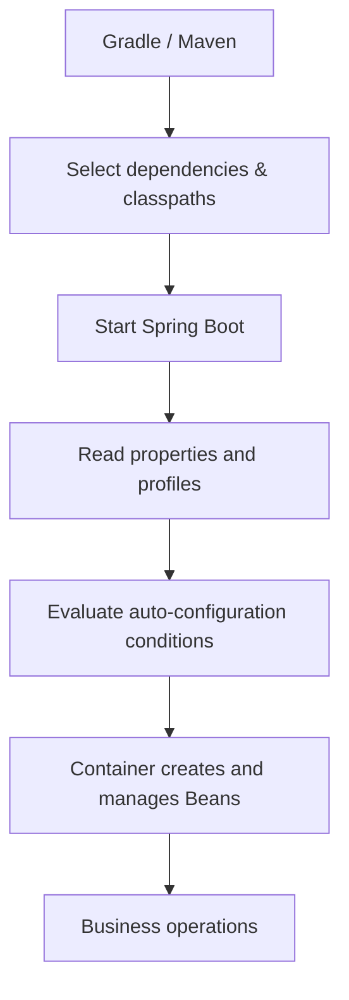
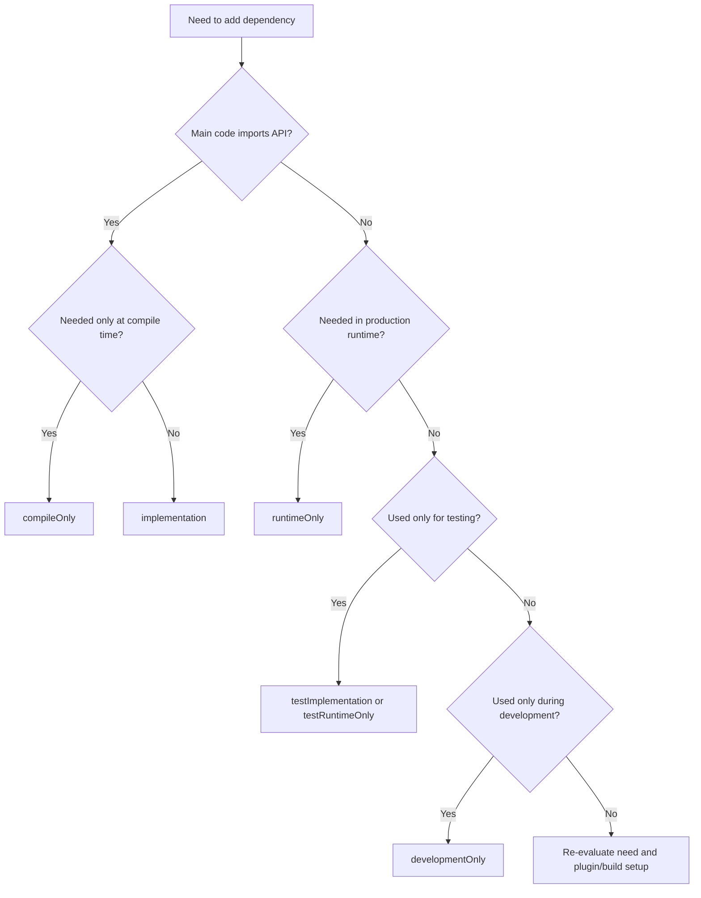

# Compile, runtime, test, and development-only scopes in Spring Boot

When adding a dependency to a Spring Boot project, you need to answer two questions: **which library is needed** and **at which stage is it needed**. A library containing APIs that your source code imports is typically needed at compile time; a JDBC driver may only be needed at runtime; JUnit serves tests only; and Spring Boot DevTools is helpful during development but usually should not ship in release builds.

That is why Maven has **dependency scopes** and Gradle has **dependency configurations**. Choosing the right scope keeps classpaths clean and understandable, prevents “compiles fine but fails at runtime” situations, and cleanly separates production dependencies from developer tooling dependencies.

## 1. Compile time and runtime are two distinct phases

A Java program goes through at least two phases:

1. **Compile time:** The Java compiler reads source code alongside classes/APIs on the **compile classpath**, checks types, and generates `.class` bytecode.
2. **Runtime:** The JVM loads bytecode and classes/resources on the **runtime classpath**, then executes the program.

For example, the following controller needs the Spring Web library in both phases:

```java
package com.example.demo;

import org.springframework.web.bind.annotation.GetMapping;
import org.springframework.web.bind.annotation.RestController;

@RestController
public class HelloController {
    @GetMapping("/hello")
    public String hello() {
        return "Hello, Spring Boot!";
    }
}
```

The compiler must see `@RestController` and `@GetMapping`. When the application runs, Spring MVC must also be present to discover the controller, set up request mappings, and process HTTP requests.

Conversely, with JDBC:

```java
import java.sql.Connection;
import java.sql.DriverManager;

public class ConnectionFactory {
    public Connection open(String url, String user, String password)
            throws Exception {
        return DriverManager.getConnection(url, user, password);
    }
}
```

Here, the source code imports only standard `java.sql` APIs from the JDK. The compiler does not need any PostgreSQL driver-specific classes. However, when running with a `jdbc:postgresql:...` URL, the application needs the PostgreSQL driver on the runtime classpath. This is a classic case of a **runtime-only dependency**.



The branches in the diagram share some libraries, yet they are not identical. A dependency present in test runtime does not automatically get packaged into the production executable JAR.

## 2. Gradle configurations and Maven scopes do not share the same syntax

In Spring Boot, you typically encounter two build systems:

- **Gradle:** `implementation`, `compileOnly`, `runtimeOnly`, `testImplementation`, `testRuntimeOnly`, `developmentOnly`.
- **Maven:** `compile`, `runtime`, `test`, `provided`, and related attributes.

Do not confuse the general concept of “compile” with the legacy Gradle `compile` configuration. In modern Gradle, the old `compile` configuration has been removed; application libraries needed for both compilation and runtime are typically declared with **`implementation`**.

### Common scopes table in Gradle

| Configuration | Main compile | Main runtime | Test compile | Test runtime | Role |
|---|---|---|---|---|---|
| `implementation` | Yes | Yes | Usually yes | Usually yes | Libraries the application needs to compile and run |
| `compileOnly` | Yes | No | Not automatically | No | APIs used only at compile time |
| `runtimeOnly` | No | Yes | No | Usually yes | Drivers or implementations needed only at runtime |
| `annotationProcessor` | Separate processor path | No | No | No | Runs annotation processors for main code |
| `testImplementation` | No | No | Yes | Yes | Libraries for writing and running tests |
| `testCompileOnly` | No | No | Yes | No | APIs needed only when compiling tests |
| `testRuntimeOnly` | No | No | No | Yes | Engines or components needed only when running tests |
| `developmentOnly` | No | Excluded from release runtime | Not a test scope | Not a test scope | Development tools when using the Spring Boot Gradle plugin |

“Usually yes” describes the default relationships among configurations created by the Gradle Java plugin. A project can customize them. `developmentOnly` is a feature integrated by the Spring Boot Gradle plugin, so how it participates in each task's classpath must be considered specifically.

## 3. `implementation`: primary application dependencies

In a project with the Java plugin, Spring Boot Gradle plugin, and an appropriate dependency version management mechanism applied:

```groovy
dependencies {
    implementation 'org.springframework.boot:spring-boot-starter-web'
}
```

The web starter brings Spring MVC, JSON processing libraries, and the default embedded Servlet server into a compatible dependency set. Controllers can import Spring Web APIs at compile time; at runtime, those classes and the corresponding infrastructure remain present.

Examples commonly placed in `implementation`:

```groovy
dependencies {
    implementation 'org.springframework.boot:spring-boot-starter-web'
    implementation 'org.springframework.boot:spring-boot-starter-validation'
    implementation 'org.springframework.boot:spring-boot-starter-data-jpa'
}
```

Note that the example gathers multiple starters to illustrate declaration syntax, not to imply every app needs all three. Adding the JPA starter can cause Boot to prepare datasource and persistence infrastructure; to actually run, you still need a driver and appropriate database configuration.

**Rule of thumb:** if main code imports and uses a library's APIs, and that library is still needed when the program runs, `implementation` is usually the right choice.

### Distinguishing `implementation` and `api`

For a library module applying Gradle's `java-library` plugin, there is an additional `api` configuration:

```groovy
plugins {
    id 'java-library'
}

dependencies {
    api 'org.example:contracts:1.0'
    implementation 'org.example:internal-utils:1.0'
}
```

Dependencies in `api` can appear on the compile classpath of **modules consuming the library**, which fits when the library's public API exposes types from that dependency. `implementation` generally hides implementation details from the consumer's compile classpath. A typical Spring Boot application module does not need to switch every dependency to `api`.

## 4. `compileOnly` and `annotationProcessor`: compiles without packaging for runtime

`compileOnly` supplies classes to the compiler without automatically supplying them at runtime. This suits annotations or APIs provided by another environment at runtime.

A familiar example is Lombok:

```groovy
dependencies {
    compileOnly 'org.projectlombok:lombok'
    annotationProcessor 'org.projectlombok:lombok'
}
```

These two configurations address two separate needs:

- `compileOnly` lets the compiler recognize Lombok annotations imported in source code.
- `annotationProcessor` places Lombok on the **annotation processor path** so the processor can process annotations during compilation.

For example:

```java
import lombok.RequiredArgsConstructor;

@RequiredArgsConstructor
public class OrderService {
    private final OrderRepository repository;
}
```

Here `OrderRepository` is an existing interface or class in the application; when Lombok operates properly, the needed constructor is generated during compilation. The application does not need the Lombok JAR at runtime merely to use the compiled constructor.

**Do not use `compileOnly` for a library actually needed at runtime** unless another source provides that library. Code can compile cleanly yet fail in the JVM with `NoClassDefFoundError` or `ClassNotFoundException` when hitting the missing class.

If test sources also use Lombok annotations, tests are a separate source set: you may need to add `testCompileOnly` and `testAnnotationProcessor` for Lombok in tests. Main's `compileOnly` is not automatically present on the test compile classpath.

## 5. `runtimeOnly`: implementation needed when the JVM runs

A classic case is a database driver. Suppose a Spring Boot app uses Spring Data JPA to access PostgreSQL:

```groovy
dependencies {
    implementation 'org.springframework.boot:spring-boot-starter-data-jpa'
    runtimeOnly 'org.postgresql:postgresql'
}
```

Application code works with `JpaRepository`, `@Entity`, `@Transactional`, and Spring/JPA APIs via the starter in `implementation`. The PostgreSQL driver is only needed when the connection pool or JDBC connects to the database.

Example `src/main/resources/application.properties`:

```properties
spring.datasource.url=jdbc:postgresql://localhost:5432/shop
spring.datasource.username=shop_user
spring.datasource.password=${DB_PASSWORD}
```

`DB_PASSWORD` here is an environment variable expected to be supplied at runtime. The example assumes the `shop` database and user exist and PostgreSQL is running. Adding the driver does not create the database or supply the password.

### Runtime-only does not mean “only used on the developer machine”

`runtimeOnly` means a **dependency needed for actual runtime**, including production runtime when the application uses that capability. The Spring Boot Gradle `bootJar` task normally packages appropriate runtime dependencies into the executable JAR, typically under `BOOT-INF/lib/`.

Distinguish:

- Gradle's regular `jar` builds a plain JAR from module outputs; it does not package all transitive dependencies inside the JAR.
- Spring Boot's `bootJar` builds an executable JAR with required runtime libraries bundled alongside.

If you run manually with an external classpath or deploy differently, the deployment environment must provide the matching runtime dependencies. Setting the right scope in the build file does not replace the full packaging/deployment pipeline.

### When should a driver NOT be `runtimeOnly`?

If Java code directly imports PostgreSQL-specific APIs:

```java
import org.postgresql.PGConnection;
```

the compiler must see that class. In that case `runtimeOnly` is insufficient for that code; you need a configuration present at compile time, usually `implementation`, or you should refactor business code to depend on standard abstractions. Choose scopes based on **how your code actually uses the library**, not on the artifact name.

## 6. `testImplementation`, `testRuntimeOnly`, and test scopes

A typical Java application has two source sets:

```text
src/main/java/          Application code
src/main/resources/     Application resources
src/test/java/          Test code
src/test/resources/     Test resources
```

Tests have their own compile classpath and runtime classpath. Test code needs to see application classes and test APIs, whereas test-only libraries should not become runtime dependencies of the production application.

### `testImplementation`

```groovy
dependencies {
    testImplementation 'org.springframework.boot:spring-boot-starter-test'
}
```

The test starter gathers common Spring Boot testing tools, such as Spring Test, JUnit Jupiter, AssertJ, and Mockito depending on the Boot version. Test sources can import those APIs when compiling, and test runtime can use them during execution.

For example:

```java
package com.example.demo;

import org.junit.jupiter.api.Test;
import static org.junit.jupiter.api.Assertions.assertEquals;

class PriceCalculatorTest {
    @Test
    void addsPrices() {
        PriceCalculator calculator = new PriceCalculator();
        assertEquals(30, calculator.add(10, 20));
    }
}
```

This snippet assumes you already have a `PriceCalculator` class with an `add(int, int)` method. It is a plain Java unit test and does not necessarily start a Spring context. JUnit is still needed for tests even though it is not needed when users call REST APIs in production.

### `testRuntimeOnly`

Some components are needed by the **test runner** without test code importing them directly. For example, the JUnit Platform launcher:

```groovy
dependencies {
    testRuntimeOnly 'org.junit.platform:junit-platform-launcher'
}

tasks.named('test') {
    useJUnitPlatform()
}
```

The launcher participates in test execution mechanics. `testRuntimeOnly` explicitly indicates it is needed in test runtime, not main compile or main runtime.

If a library is only needed when compiling tests and not when executing them, Gradle also provides `testCompileOnly`. One example is compile-time annotations; for test annotation processors, also use `testAnnotationProcessor` when needed.

### Do tests inherit main dependencies?

Under the Gradle Java plugin's default setup, the test classpath uses main's outputs and typically includes dependencies needed by main through the relationships between `testImplementation`/`testRuntimeOnly` and main configurations. Therefore, tests can call application services and use the implementations those services require.

However, **main's `compileOnly` is not automatically present on the test classpath**. If test sources themselves use Lombok annotations or another compile-only API, declare them for tests as well.

## 7. `developmentOnly`: tools for the development workflow

This is a configuration created and supported by the **Spring Boot Gradle plugin**, not a standard Java scope or a built-in configuration in every Gradle project.

```groovy
dependencies {
    developmentOnly 'org.springframework.boot:spring-boot-devtools'
}
```

Spring Boot DevTools assists during development, such as restarting the application when the classpath changes and applying convenient settings for code edits. It is typically wanted when running the app in an IDE or via a Gradle workflow like `bootRun`, but not in release builds.

By default in the Spring Boot Gradle plugin, `developmentOnly` dependencies serve the **development runtime** and are **excluded from executable JARs/WARs** produced by `bootJar`/`bootWar`. That creates an important distinction from `runtimeOnly`:

| Comparison | `runtimeOnly` | `developmentOnly` |
|---|---|---|
| Purpose | Supplies implementations needed when the application runs | Assists developers during the development workflow |
| Example | PostgreSQL JDBC driver | Spring Boot DevTools |
| Needed to compile main? | No | No |
| Available during `bootRun`? | Yes | Yes, with the Boot plugin's default integration |
| Included in default `bootJar`? | Yes, if a packaged runtime dependency | No |
| Used in production? | May be required | Normally no |

**Development-only does not mean “only enabled when the Spring profile is dev.”** This is a build/classpath configuration; profiles are application configuration/bean choices at runtime. Classpath visibility can also depend on how the IDE or run task is configured.

Never put a production database driver in `developmentOnly`: when building the executable JAR, you risk losing the driver. Nor should you place DevTools in `implementation` out of habit if the intent is development-only use.

## 8. A complete illustrative `build.gradle`

Suppose a project uses Spring Web, Spring Data JPA, PostgreSQL, Lombok, DevTools, and a testing framework. The dependency configuration block might look like:

```groovy
dependencies {
    // Main code imports Spring APIs; needed for both compile and runtime
    implementation 'org.springframework.boot:spring-boot-starter-web'
    implementation 'org.springframework.boot:spring-boot-starter-data-jpa'

    // Driver only needed when connecting to the database
    runtimeOnly 'org.postgresql:postgresql'

    // Annotations + processor at compile time
    compileOnly 'org.projectlombok:lombok'
    annotationProcessor 'org.projectlombok:lombok'

    // Tools for development only
    developmentOnly 'org.springframework.boot:spring-boot-devtools'

    // Testing only
    testImplementation 'org.springframework.boot:spring-boot-starter-test'
    testRuntimeOnly 'org.junit.platform:junit-platform-launcher'
}

tasks.named('test') {
    useJUnitPlatform()
}
```

This example **assumes the project already has** the Java plugin, the Spring Boot Gradle plugin, and a dependency version management mechanism (such as the Spring Boot BOM). That configuration will not run standalone without the plugin/build setup. Java/JDK must also be compatible with the Spring Boot version in use.

Lombok is optional; if you do not use Lombok annotations, remove both `compileOnly` and `annotationProcessor` entries. If the application uses real JPA, it needs a running database, connection details, and appropriate Hibernate/JPA configuration. Starters and scopes do not supply a database automatically.

### Is a starter a separate scope?

No. **A starter is a dependency artifact**, whereas a configuration decides which classpath that artifact joins:

```groovy
implementation 'org.springframework.boot:spring-boot-starter-web'
testImplementation 'org.springframework.boot:spring-boot-starter-test'
```

Both are starters, yet one serves the main application and the other serves tests. The word `starter` in the name does not replace the role of `implementation` or `testImplementation`.

## 9. What happens during compile, local run, tests, and packaging

For the illustrative Gradle file:

| Task/activity | Notable dependency groups | What to understand |
|---|---|---|
| `compileJava` | `implementation`, `compileOnly`; separate processor path | Requires only APIs needed to compile main code |
| `bootRun` | Runtime dependencies and Boot plugin's `developmentOnly` support | Runs the application with the development classpath |
| `compileTestJava` | Test compile classpath and main outputs | Tests see JUnit/test APIs, while main `compileOnly` is not inherited automatically |
| `test` | Test runtime dependencies | Includes test frameworks/engines and test runtime dependencies |
| `bootJar` | Release runtime dependencies | Includes libraries needed for the app; excludes test and `developmentOnly` by default |

An illustrative breakdown:

```text
During Java compilation:
    Spring Web API, JPA API, Lombok annotations
    (Lombok processor runs on the processor path)

During local run with bootRun:
    Spring Web + JPA + PostgreSQL driver
    + DevTools (developmentOnly)

During test execution:
    Application code + appropriate runtime dependencies
    + JUnit/Mockito/Spring Test
    + test runtime launcher

During executable JAR packaging for production:
    Application code + Spring Web + JPA + PostgreSQL driver
    (excludes test libraries and DevTools by default)
```

This is the default model for a Spring Boot application using Gradle. Other plugins or custom build logic can modify classpaths or packaging. **Running successfully with `bootRun` does not guarantee the executable JAR contains the right production dependencies.**

## 10. Maven: `compile`, `runtime`, `test`, and `provided`

With Maven, the structure follows the same idea, declared via `<scope>`:

```xml
<dependencies>
    <!-- No scope specified: defaults to compile -->
    <dependency>
        <groupId>org.springframework.boot</groupId>
        <artifactId>spring-boot-starter-web</artifactId>
    </dependency>

    <!-- Needed only at runtime -->
    <dependency>
        <groupId>org.postgresql</groupId>
        <artifactId>postgresql</artifactId>
        <scope>runtime</scope>
    </dependency>

    <!-- For testing only -->
    <dependency>
        <groupId>org.springframework.boot</groupId>
        <artifactId>spring-boot-starter-test</artifactId>
        <scope>test</scope>
    </dependency>

    <!-- Maven has no developmentOnly scope -->
    <dependency>
        <groupId>org.springframework.boot</groupId>
        <artifactId>spring-boot-devtools</artifactId>
        <optional>true</optional>
    </dependency>
</dependencies>
```

This example assumes the Maven project has a parent/BOM managing the required versions.

| Maven scope | Main compile | Main runtime | Test | Closest equivalent in Gradle |
|---|---|---|---|---|
| `compile` (default) | Yes | Yes | Yes | `implementation` in an app |
| `runtime` | No | Yes | Yes | `runtimeOnly` |
| `test` | No | No | Yes | `testImplementation` / `testRuntimeOnly` depending on library |
| `provided` | Yes | Not packaged in typical runtime | Yes | Similar to `compileOnly` in part, though not identical |

### Maven has no `developmentOnly`

In Maven, DevTools is commonly declared with `optional=true`. **Optional only controls whether a dependency propagates transitively to dependent projects**; by itself it does not guarantee exclusion from the project's own artifact. The Spring Boot Maven plugin has a mechanism that **excludes DevTools during `repackage` by default**. That is why `optional` cannot be treated as a one-to-one translation of Gradle's `developmentOnly`.

`provided` in Maven usually describes APIs already provided by an external runtime environment, such as in certain WAR deployments to an application server. For Spring Boot running an embedded server, do not blindly switch starters or server dependencies to `provided`. Maven `provided` is also present in test scope under Maven's rules, whereas Gradle main `compileOnly` does not automatically transfer to the test classpath.

## 11. Dependency scope differs from Spring profiles and Bean scopes

These three terms sound alike, yet control three distinct things:

| Concept | What does it control? | Example |
|---|---|---|
| Dependency scope/configuration | Which classpath a library appears on and which artifact includes it | `runtimeOnly 'org.postgresql:postgresql'` |
| Spring profile | Which configurations and beans are activated at runtime | `@Profile("dev")`, `application-dev.properties` |
| Spring Bean scope | Lifecycle/instance scope of a bean inside the container | `singleton`, `prototype`, `request` |

For example:

```properties
spring.profiles.active=dev
```

This setting does not download new libraries onto the classpath. An executable JAR that excludes DevTools will not suddenly gain DevTools because you activate the `dev` profile. Conversely, Gradle `bootRun` can put `developmentOnly` on the development classpath regardless of which profile name is selected.

Layered responsibility diagram:



Dependency scopes decide “which classes can be present”; Spring profiles and auto-configuration decide “which configurations and beans the application uses atop that classpath.”

## 12. Transitive dependencies and the Spring Boot BOM

A single starter can bring in many dependencies:

```text
spring-boot-starter-web
    ├── Spring MVC and related Spring components
    ├── JSON support
    └── Default embedded Servlet server
```

Thus, a class you import may come from a **transitive** dependency even though the build file only declares the starter. This is convenient, yet if your code directly relies on a library's standalone API long-term, declaring that dependency directly is sometimes clearer than relying on an internal component of a starter.

Spring Boot typically provides a BOM/dependency management to manage compatible **versions**. Keep these separate:

- **Artifact/dependency:** which library is needed?
- **Version/BOM:** which version of that library should be chosen?
- **Scope/configuration:** does the library belong on compile, runtime, test, or development classpaths?

The BOM does not automatically add every managed artifact to the project, nor does it turn a test dependency into a production runtime dependency.

## 13. Inspecting classpaths with Gradle

When hitting missing-class errors, a reliable approach is examining the dependency graph instead of guessing from artifact names.

On macOS/Linux or a shell supporting the wrapper:

```bash
./gradlew dependencies --configuration compileClasspath
./gradlew dependencies --configuration runtimeClasspath
./gradlew dependencies --configuration testCompileClasspath
./gradlew dependencies --configuration testRuntimeClasspath
```

On Windows PowerShell:

```powershell
.\gradlew.bat dependencies --configuration compileClasspath
.\gradlew.bat dependencies --configuration runtimeClasspath
.\gradlew.bat dependencies --configuration testCompileClasspath
.\gradlew.bat dependencies --configuration testRuntimeClasspath
```

To find why the PostgreSQL driver is present at runtime:

```bash
./gradlew dependencyInsight --dependency postgresql --configuration runtimeClasspath
```

In multi-project builds, invoke tasks on the specific project owning the application or use the corresponding `:some-module:dependencies` task path. If you want to see what is inside the executable JAR, after building you can inspect the `BOOT-INF/lib/` directory inside the JAR produced by `bootJar`. The `runtimeClasspath` tree and archive contents can differ if plugins apply exclusion rules or the project has custom packaging logic.

## 14. Common errors caused by choosing the wrong scope

| Symptom | Possible scope-related cause | How to inspect and fix |
|---|---|---|
| `package ... does not exist` during main compilation | Dependency placed in `runtimeOnly` or `testImplementation` | Check `compileClasspath`; move to `implementation` if main needs the API |
| Tests cannot import `org.junit.jupiter.api.Test` | Missing test compile dependency | Use appropriate `testImplementation` |
| Compiles fine, yet JVM throws `ClassNotFoundException` or `NoClassDefFoundError` | Library missing at runtime | Inspect `runtimeClasspath`, classloader, and artifact |
| `bootRun` succeeds, yet executable JAR fails with missing driver | Driver only on development classpath or excluded during packaging | Use `runtimeOnly`/`implementation` per production needs |
| App cannot connect to the database | Driver, URL, credentials, network, or database issue | Verify runtime dependency and datasource config; do not assume scope is the only cause |
| Release artifact bundles unnecessary JUnit/Mockito | Test library placed in `implementation` | Move to the appropriate test scope |
| DevTools missing from executable JAR | `developmentOnly` is excluded from archives by default | Usually expected behavior; use `bootRun` during development |

Not every runtime error is a scope issue: wrong versions, configuration errors, packaging issues, and classloaders can also cause failures. When investigating, combine the error message with actual configuration and the dependency graph.

## 15. Choosing scope based on usage

When adding a dependency, ask in order:

1. **Does main code import its APIs?** If yes and the API is also needed when running, use `implementation`. If needed only at compile time, consider `compileOnly`.
2. **Is it purely an implementation needed when the program runs?** Consider `runtimeOnly`, typically for JDBC drivers when code uses standard abstractions.
3. **Does it serve tests only?** If test code imports its APIs, use `testImplementation`; if only needed when running tests, use `testRuntimeOnly`.
4. **Does it only improve the development experience with the Spring Boot Gradle plugin?** Consider `developmentOnly`, typically DevTools.
5. **Is it an annotation processor?** Use `annotationProcessor` or `testAnnotationProcessor`, plus a separate compile configuration if source code imports its annotations/APIs.
6. **Is the project a library publishing a public API?** Consider Gradle `java-library`'s `api` for dependencies appearing in the consumer-facing contract.

### Three scenarios to reason through

**A.** A controller imports a string conversion library and calls it on every request. The library is needed at both compile-time and runtime: typically use `implementation`.

**B.** Only integration tests use H2, while production uses PostgreSQL. One possible configuration:

```groovy
dependencies {
    runtimeOnly 'org.postgresql:postgresql'
    testRuntimeOnly 'com.h2database:h2'
}
```

You still must configure separate datasources for tests and production. Having two drivers present does not mean Spring knows which database to use in each environment automatically.

**C.** Tests use Mockito, while the production application does not need Mockito. Use `testImplementation` (typically via the Spring Boot test starter), avoiding placing test libraries in `implementation`.

### Decision flowchart for a typical dependency



This diagram is a guide for typical dependencies; annotation processors, library APIs, custom configurations, and transitive dependencies follow additional rules.

When reading a `build.gradle` or `pom.xml`, inspect **library coordinates together with their scope**. `implementation` and Maven `compile` serve code needing both compilation and execution; `runtimeOnly` provides libraries to the JVM without main code importing them directly; test scopes serve tests; and the Spring Boot Gradle plugin's `developmentOnly` separates developer tools from executable archives. Understanding these distinctions helps you master classpaths, fix missing-class errors, and build Spring Boot applications packaged appropriately for their target environment.
