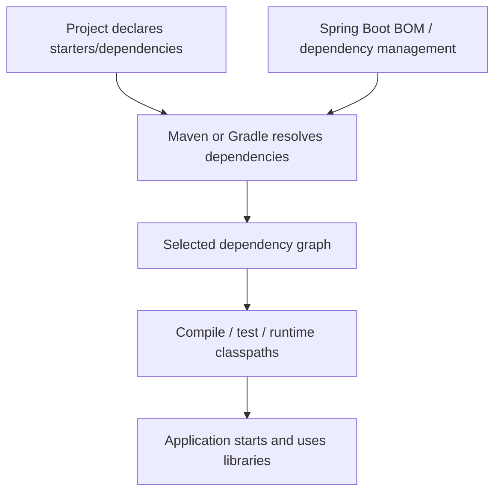
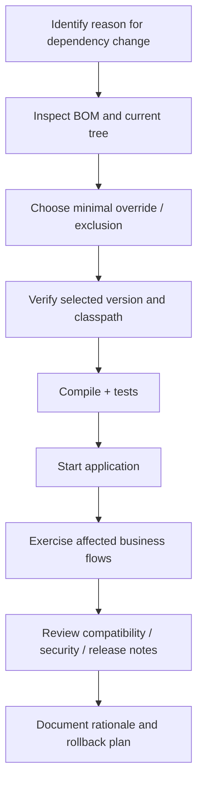

# Overriding versions or excluding dependencies and verifying compatibility

Spring Boot accelerates project setup through **starters** and **dependency version management**. For example, adding `spring-boot-starter-web` can bring Spring MVC, JSON processing libraries, logging, and web application essentials into a project. Developers typically declare just one starter while the build tool resolves many underlying dependencies automatically.

Eventually, a team may need to **override the version** of a library or **exclude a dependency from the dependency tree**: a library gets a security patch, a component causes a conflict, the team wants to switch logging implementations, or a feature stops using an older library. These actions impact the entire application. A single line of configuration can change which classes load at runtime, which APIs are available, and how multiple libraries interoperate.

Within **Spring Boot Fundamentals → Dependencies and Starters**, this lesson explains how Spring Boot, Maven, and Gradle select dependencies; how to override or exclude dependencies intentionally; and how to **verify compatibility using evidence from the dependency graph, builds, and application behavior**. The emphasis is on understanding mechanisms and decision workflows rather than memorizing one quick fix for every project.

## 1. First, understand what is being changed

A **dependency** is a library or module a project needs to compile, test, or execute. There are two common sources:

- **Direct dependency**: declared in the project's `pom.xml` or `build.gradle`.
- **Transitive dependency**: declared by another dependency, then pulled in by Maven/Gradle through dependency relationships.

For example, picture part of a dependency tree:

```text
catalog-service
└── spring-boot-starter-web
    ├── spring-boot-starter
    │   └── spring-boot-starter-logging
    ├── spring-boot-starter-json
    └── spring-webmvc
```

The tree above **only illustrates relationships**, omits many branches, and does not claim every Spring Boot release shares the exact same structure. In real projects, obtain results from your active build's dependency reports.

From there, distinguish the operations:

| Operation | Desired outcome | Example |
| --- | --- | --- |
| Add dependency | Bring a new capability onto the classpath | Add a starter for an HTTP client |
| Override version | Select a different version of the same library | Upgrade `commons-lang3` version |
| Exclude dependency (*exclude*) | Block a transitive dependency edge | Prevent pulling `spring-boot-starter-logging` through a starter |
| Remove direct declaration | Project no longer actively requests the library | Drop an unused dependency |
| Change scope/configuration | Change classpath or usage phase | `testImplementation` instead of `implementation` |
| Replace implementation | Use another library fulfilling the same role | Choose Log4j2 instead of the default logging starter |

“Removing a dependency” is usually understood as **removing a dependency from the dependency tree**. It differs from **changing the usage scope** of a dependency. For example, moving a test library from runtime to test-only is not the same as removing that library from every classpath.

## 2. How does Spring Boot manage dependency versions?

A Spring Boot application typically uses a **BOM – Bill of Materials** (a catalog of coordinated compatible versions). The `spring-boot-dependencies` BOM supplies managed versions for many libraries in the Spring ecosystem and related tools.

General flow:



In a typical configuration, a user can declare:

```xml
<dependency>
    <groupId>org.springframework.boot</groupId>
    <artifactId>spring-boot-starter-web</artifactId>
</dependency>
```

There is no `<version>` element in the example above because the starter's version is managed by the Spring Boot parent/BOM. **Omitting the version does not mean Maven automatically picks the newest release on the Internet.**

### 2.1. Distinguish three decision layers

1. **Spring Boot version**: determines the BOM or default dependency management corresponding to the Boot release in use.
2. **Managed dependency version**: the default version for library coordinates known to the BOM.
3. **Actual resolved version**: the version chosen by Maven/Gradle after evaluating direct dependencies, transitive dependencies, version rules, and exclusions.

These three layers are related, yet do not always match. When intentionally overriding a library, the **actual resolved version** may differ from the version recommended by the Spring Boot BOM.

### 2.2. The BOM aids compatibility; it does not guarantee every setup works

A BOM reduces conflicts because starters and libraries are curated from a matching release line. However, a BOM cannot guarantee:

- Every third-party library has a managed version.
- Every combination of Spring Boot, Spring Cloud, database drivers, JDK, and application code is compatible.
- An overridden version preserves the API/ABI contract of the previous version.
- Any excluded dependency has zero runtime impact.

Therefore, **prefer the BOM-managed versions** whenever there is no specific reason to change. Overrides must be backed by justification and verification.

## 3. When is overriding a version necessary?

Common situations:

| Situation | Might need an override? | What must be verified |
| --- | --- | --- |
| Library has a security vulnerability fixed in a newer version | Yes, if the fix cannot be obtained by upgrading to a suitable Boot release | Applicable CVE/advisory, patched version, compatibility |
| Library has a functional bug affecting the project | Yes | Changelog, regression tests for the specific bug |
| Team wants an API only available in a newer release | Yes, though consider upgrading the platform | Supported APIs and related dependencies |
| Conflict among multiple versions of the same module | Possibly | Paths pulling the dependency in and resolution rules |
| Wanting “latest just to be sure” | Insufficient reason | Is there any need the BOM fails to meet? |
| A library is already stably managed by the BOM | Usually unnecessary | Keep defaults, minimize manual decisions |

The decision workflow should be:

1. Identify the concrete issue (bug, vulnerability, incompatibility, or functional requirement).
2. Identify the affected **library coordinates**: `groupId:artifactId` or `group:name`.
3. Check which version your current Spring Boot release manages.
4. Check whether a supported Spring Boot upgrade resolves the issue without isolated overrides.
5. If an override is still needed, choose a well-grounded target version, make one small change, and verify the dependency graph and application behavior.

**Note on version examples:** numbers like `3.3.5` and `3.17.0` in this lesson illustrate syntax. They are not recommendations for the latest release or guarantees of a patch for any specific vulnerability. Real projects must check compatibility documentation and release advisories for the active version.

## 4. Overriding versions in Maven

Suppose a Spring Boot application uses Maven and the starter parent. An abbreviated `pom.xml`:

```xml
<project>
    <!-- Standard metadata/schema elements omitted -->
    <modelVersion>4.0.0</modelVersion>

    <parent>
        <groupId>org.springframework.boot</groupId>
        <artifactId>spring-boot-starter-parent</artifactId>
        <version>3.3.5</version>
        <relativePath/>
    </parent>

    <groupId>com.example</groupId>
    <artifactId>catalog-service</artifactId>
    <version>0.1.0-SNAPSHOT</version>

    <properties>
        <java.version>21</java.version>
    </properties>

    <dependencies>
        <dependency>
            <groupId>org.springframework.boot</groupId>
            <artifactId>spring-boot-starter-web</artifactId>
        </dependency>
    </dependencies>
</project>
```

When you need to change the version of `org.apache.commons:commons-lang3`, there are several approaches. The right one depends on whether you inherit the Spring Boot parent, import the BOM separately, or manage versions from an organizational parent.

### 4.1. Declaring an explicit version directly on the dependency

```xml
<dependencies>
    <dependency>
        <groupId>org.apache.commons</groupId>
        <artifactId>commons-lang3</artifactId>
        <version>3.17.0</version>
    </dependency>
</dependencies>
```

In this declaration, the project **directly requests** `commons-lang3` version `3.17.0`. This is straightforward for an isolated case. A drawback is repeating the version if multiple modules in the same system need consistent alignment.

### 4.2. Overriding in `dependencyManagement`

In a Maven project or a parent POM managing multiple modules, you can place the version inside `dependencyManagement`:

```xml
<dependencyManagement>
    <dependencies>
        <dependency>
            <groupId>org.apache.commons</groupId>
            <artifactId>commons-lang3</artifactId>
            <version>3.17.0</version>
        </dependency>
    </dependencies>
</dependencyManagement>

<dependencies>
    <dependency>
        <groupId>org.apache.commons</groupId>
        <artifactId>commons-lang3</artifactId>
    </dependency>
</dependencies>
```

Here, `dependencyManagement` dictates which version is used **when the dependency appears** in the tree with matching coordinates. It does not add a library to the application merely by having a management entry. `<dependencies>` is what directly requests using the library in the project.

In an organization with a shared parent POM, check where versions are already managed before adding new declarations. A management entry in a child POM can alter inherited version policies.

### 4.3. Overriding via Spring Boot parent properties

When using `spring-boot-starter-parent`, certain versions are managed through named Maven properties. For properties **that genuinely exist in the selected parent/BOM**, you can override them in the project's `<properties>`, such as for Commons Lang:

```xml
<properties>
    <java.version>21</java.version>
    <commons-lang3.version>3.17.0</commons-lang3.version>
</properties>
```

Before using this technique, verify the property name in the dependency management docs or effective POM for **the exact Spring Boot version you are using**. Do not guess property names from artifact names.

Important: when **not inheriting the Spring Boot parent and only importing the BOM**, declaring a property with the same name in your project does not modify versions already interpolated inside the imported BOM. With that setup, an explicit override entry in `dependencyManagement` is clearer to reason about.

### 4.4. How Maven selects versions and the limits of overriding

Maven resolves dependencies from tree paths and applies mediation rules. A common rule is **nearest definition**: in unmanaged transitive conflicts, the dependency path closer to the project typically wins; at equal depth, declaration order rules apply. However, dependency management can dictate versions for managed coordinates.

Therefore, do not look at a `<version>` in a POM and conclude the entire runtime uses that version. Checking the dependency tree and effective POM reveals what Maven actually chose.

Illustrative example:

```text
catalog-service
├── library-a:1.0  ──> utility-x:1.2
└── library-b:1.0  ──> utility-x:2.1
```

This is a version conflict for `utility-x`. The final version depends on mediation and active management rules. **Do not assume two versions always coexist on the same runtime classpath simply because both appear in source descriptions.**

## 5. Overriding versions in Gradle

Gradle resolves versions differently from Maven. When multiple dependencies request the same module at different versions, Gradle typically selects the higher version under default conflict resolution, yet **platforms, dependency constraints, rich version constraints, capabilities, and resolution rules** also participate. Therefore, the selected version must be verified via Gradle reports.

Example using Groovy DSL and the Spring Boot plugin:

```groovy
plugins {
    id 'java'
    id 'org.springframework.boot' version '3.3.5'
    id 'io.spring.dependency-management' version '1.1.6'
}

group = 'com.example'
version = '0.1.0-SNAPSHOT'

repositories {
    mavenCentral()
}

dependencies {
    implementation 'org.springframework.boot:spring-boot-starter-web'
    implementation 'org.apache.commons:commons-lang3'
    testImplementation 'org.springframework.boot:spring-boot-starter-test'
}
```

When applying `io.spring.dependency-management` alongside the Spring Boot plugin, the project can use versions managed by the Spring Boot BOM. The example assumes compatible Gradle/plugin versions; if the project uses Kotlin DSL, translate syntax to `build.gradle.kts` accordingly.

### 5.1. Writing an explicit version directly

```groovy
dependencies {
    implementation 'org.apache.commons:commons-lang3:3.17.0'
}
```

This is a direct version request in the `implementation` configuration. **In Gradle, writing a version directly does not guarantee that version is the final selection** if other constraints or resolution rules participate. Check `dependencyInsight`.

### 5.2. Using dependency constraints with a native Gradle BOM

Gradle supports BOMs via `platform(...)`. Example illustrating a project using Gradle's native dependency management:

```groovy
plugins {
    id 'java'
    id 'org.springframework.boot' version '3.3.5'
}

repositories {
    mavenCentral()
}

dependencies {
    implementation platform('org.springframework.boot:spring-boot-dependencies:3.3.5')
    implementation 'org.springframework.boot:spring-boot-starter-web'
    implementation 'org.apache.commons:commons-lang3'

    constraints {
        implementation('org.apache.commons:commons-lang3:3.17.0') {
            because 'Target version chosen after compatibility review'
        }
    }
}
```

`constraints` expresses a version policy whenever the dependency enters that configuration; a constraint alone does not pull a new library in. `because` records the rationale right next to the decision. When multiple constraints interact, Gradle still resolves versions according to its rules.

This example uses a **native platform** to make Gradle's mechanism clear. If a project already uses the `io.spring.dependency-management` plugin, understand and stick to one consistent version management strategy before mixing multiple layers of version control.

### 5.3. When a version must be pinned strictly

Gradle supports rich version constraints, such as:

```groovy
dependencies {
    implementation('org.apache.commons:commons-lang3') {
        version {
            strictly '3.17.0'
        }
        because 'Compatibility review requires exactly this version'
    }
}
```

`strictly` states that the version must strictly satisfy the requirement. If another dependency imposes an incompatible constraint, resolution may fail. That can be a useful signal because the build **does not silently select another version**.

Do not reach for `strictly`, `force`, or `resolutionStrategy.force` as a first reflex whenever a conflict appears. Heavy-handed options can hide incompatibilities and make future upgrades harder. Inspect the dependency graph and conflict causes first.

## 6. Excluding a transitive dependency in Maven

An **exclusion** blocks a dependency from being brought in **through a specific dependency relationship**. A practical, recognizable example is changing the logging implementation.

The Spring Boot web starter typically pulls in the default logging components via the base starter branch. If a project decides to use Log4j2, you can exclude the default logging starter from this dependency path and add the Log4j2 starter:

```xml
<dependencies>
    <dependency>
        <groupId>org.springframework.boot</groupId>
        <artifactId>spring-boot-starter-web</artifactId>
        <exclusions>
            <exclusion>
                <groupId>org.springframework.boot</groupId>
                <artifactId>spring-boot-starter-logging</artifactId>
            </exclusion>
        </exclusions>
    </dependency>

    <dependency>
        <groupId>org.springframework.boot</groupId>
        <artifactId>spring-boot-starter-log4j2</artifactId>
    </dependency>
</dependencies>
```

Key points to understand:

- `<exclusion>` identifies the dependency by **groupId and artifactId**; it is not where you specify a target version.
- The exclusion in the example applies to the dependency path starting from `spring-boot-starter-web`.
- If another starter also pulls in `spring-boot-starter-logging`, that dependency **can still appear** from that other path.
- Adding `spring-boot-starter-log4j2` is an **intentional replacement**; merely excluding default logging without providing a working logging mechanism can break runtime logging expectations.

The example focuses on the exclusion mechanism, not suggesting every app should switch logging implementations. Selected starters, active logging backends, and actual dependency paths must be checked beforehand.

### 6.1. An exclusion does not remove a library from every context

Suppose the tree is:

```text
application
├── starter-a ──> library-x
└── starter-b ──> library-x
```

If you exclude `library-x` on `starter-a`, the build can still pull `library-x` via `starter-b`. To confirm a library is absent from the classpath, inspect **all dependency paths** and relevant configurations.

### 6.2. Remove direct dependencies instead of excluding

If the project itself directly declares a library that is no longer used, the sensible first step is **deleting the direct declaration**. Exclusions are for libraries pulled in through other dependencies, not for wrapping complex rules around a declaration you can simply delete.

## 7. Excluding transitive dependencies in Gradle

Gradle allows declaring an exclusion on a specific dependency:

```groovy
dependencies {
    implementation('org.springframework.boot:spring-boot-starter-web') {
        exclude group: 'org.springframework.boot',
                module: 'spring-boot-starter-logging'
    }

    implementation 'org.springframework.boot:spring-boot-starter-log4j2'
}
```

As in Maven, excluding on one dependency does not necessarily block the same module if another dependency brings it into the configuration.

Gradle can also exclude at the configuration level:

```groovy
configurations.configureEach {
    exclude group: 'org.example.legacy', module: 'old-transport'
}
```

The second snippet **is purely a syntax example** using fictional coordinates to explain broad application. Excluding across all configurations has a wide blast radius: main code, tests, runtime, and tasks/plugins may be affected depending on configuration. Use this approach only after understanding all dependency paths and why exclusion at that scope is needed.

### 7.1. Excluding a dependency and changing a Gradle configuration are two different things

For example:

```groovy
dependencies {
    implementation 'org.springframework.boot:spring-boot-starter-web'
    runtimeOnly 'org.postgresql:postgresql'
    testImplementation 'org.springframework.boot:spring-boot-starter-test'
}
```

Here:

- `implementation` serves application code and participates in relevant classpaths per plugin configuration.
- `runtimeOnly` adds the dependency to the runtime classpath without using it to compile main code.
- `testImplementation` serves compiling and executing test code per Gradle configuration relationships.

Changing `runtimeOnly` to `implementation` is usually **not a fix for version conflicts**. Switching scopes only makes sense when source code genuinely needs that library at the corresponding phase.

In Maven, roughly corresponding concepts are expressed using scopes such as `compile`, `runtime`, `test`, and `provided`. Classpath inclusion rules in Maven and Gradle are not identical; compare exact scopes/configurations when switching build tools.

## 8. Excluding a library vs. excluding auto-configuration

In Spring Boot, two operations are frequently confused:

**A. Removing a dependency from the graph** (Maven/Gradle):

```groovy
implementation('org.example:some-starter:1.0.0') {
    exclude group: 'org.example', module: 'unwanted-library'
}
```

**B. Disabling an auto-configuration class** (Spring Boot):

```java
@SpringBootApplication(exclude = DataSourceAutoConfiguration.class)
public class ExampleApplication {
    public static void main(String[] args) {
        SpringApplication.run(ExampleApplication.class, args);
    }
}
```

The Java example requires importing the appropriate `SpringBootApplication`, `SpringApplication`, and `DataSourceAutoConfiguration`. It tells Boot to skip a specific auto-configuration during startup.

The two operations mean different things:

| Mechanism | What it changes | What it does not do automatically |
| --- | --- | --- |
| Maven/Gradle `exclude` | Blocks a path bringing a dependency module into the graph | Does not fix source code importing classes from that library |
| Spring Boot `@SpringBootApplication(exclude = ...)` | Prevents Boot from applying that auto-configuration | Does not remove the library JAR from the classpath |
| `spring.autoconfigure.exclude` | Excludes auto-configurations via property | Does not change the dependency graph |

If an application does not need a database, removing unused data dependencies may be appropriate. Temporarily excluding `DataSourceAutoConfiguration` might work around a specific startup issue, yet the conflicting library remains present if it is still in the graph.

Conversely, excluding a core dependency needed by auto-configuration can change activation conditions or leave other code missing classes. Evaluate actual requirements before deciding whether to exclude a dependency or a configuration.

## 9. Inspecting the dependency graph before making changes

Overriding or excluding should start from **evidence about which version is currently selected**. For instance, if you hit `NoSuchMethodError` at runtime, do not guess that you just need to change the Spring Boot version. First identify which class and library provide that method, in which version, and which classpath is actually running.

### 9.1. With Maven

In the Maven project directory, with the wrapper:

```bash
./mvnw dependency:tree
./mvnw dependency:tree -Dincludes=org.apache.commons:commons-lang3
./mvnw help:effective-pom
```

Meaning:

- `dependency:tree` prints the dependency structure selected by Maven.
- `-Dincludes=...` filters by coordinates to focus on a module under investigation; syntax supports Maven dependency plugin coordinate patterns.
- `help:effective-pom` shows the POM configuration after resolving parent, inheritance, profiles, and plugin management, helping locate where a version or configuration came from.

If the project lacks a Maven Wrapper, the team can use an agreed Maven installation. On Windows PowerShell, typically use `.\mvnw.cmd` instead of `./mvnw`.

When there are multiple modules, run inside the relevant module or use appropriate reactor flags. A report at the root module does not necessarily reveal the classpath of every child module.

### 9.2. With Gradle

In the Gradle project directory:

```bash
./gradlew dependencies --configuration runtimeClasspath
./gradlew dependencyInsight --configuration runtimeClasspath --dependency commons-lang3
./gradlew dependencies --configuration compileClasspath
./gradlew dependencies --configuration testRuntimeClasspath
```

The commands answer different questions:

- `dependencies` shows the dependency tree or graph for a configuration.
- `dependencyInsight` focuses on **why a module and version were selected**, including dependency paths and resolution reasons when Gradle can present them.
- `runtimeClasspath` describes modules expected when the app runs in that configuration.
- `compileClasspath` relates to compiling main code.
- `testRuntimeClasspath` relates to running tests.

On Windows, you can use `.\gradlew.bat`. If the project contains multiple subprojects, target the task/configuration of the subproject you are inspecting, such as `:catalog-service:dependencyInsight` in a multi-module build when task/project names match.

Do not treat a version line declared in `build.gradle` as sufficient proof of the final version: read the **selected version** in the resolution report.

### 9.3. How to read a dependency path

Suppose an illustrative report shows:

```text
catalog-service
└── library-a:2.0
    └── library-x:1.4 -> 2.1
```

In this Gradle report format, `1.4 -> 2.1` usually means a request for `1.4` resolved to `2.1` due to dependency resolution. This line does not mean two versions are active simultaneously.

A Maven report may present conflict mediation and omitted versions differently. Identify the **final version** and **which path requested it** before adding an override.

## 10. Verifying compatibility: from dependency graph to actual behavior

**Successful dependency resolution is only the first condition.** A build can resolve JARs cleanly yet still fail during compilation, startup, or executing a feature.

A thorough verification sequence typically includes these layers:



### 10.1. Level 1 – Correct selected version

Goal: confirm Maven/Gradle actually resolved the target version or excluded the intended dependency across relevant classpaths.

Check:

- Exact coordinates by `group:artifact`, not just similar display names.
- Selected version in `compileClasspath`, `runtimeClasspath`, and `testRuntimeClasspath` where applicable.
- Does any other dependency branch still pull in the excluded library?
- Is any constraint/parent BOM/force rule overriding your new decision?
- Does the project have multiple modules with differing dependency policies?

For example, excluding `spring-boot-starter-logging` while another logging backend remains on the runtime classpath is not inherently an error. What matters is that the final backend matches the project's logging choice, has no conflicting combination, and logs properly at runtime.

### 10.2. Level 2 – Compile and test

Maven example:

```bash
./mvnw clean verify
```

Gradle example:

```bash
./gradlew clean test bootJar
```

These are **reference commands for verifying an appropriate project**, not proof that the examples were executed. Depending on the project, Gradle `check`/`build`, Maven `verify`, or dedicated integration test tasks may be needed.

Issues that can surface at this stage:

- `package ... does not exist` or `cannot find symbol`: a needed class/API is missing from the compile classpath or changed.
- Different method signatures or constructors prevent source code from compiling.
- A newer library version alters serialization, validation, or query behavior, breaking tests.
- An excluded dependency was actually needed by a test framework or build task.

Test failures should not be “solved” by deleting assertions right away. Determine whether the difference is expected behavior or a regression.

### 10.3. Level 3 – Start the application

Some issues only appear when creating the Spring context or loading classes:

- `ClassNotFoundException` or `NoClassDefFoundError`: a required class is missing from the runtime classpath.
- `NoSuchMethodError` or `NoSuchFieldError`: code was compiled against one API version, yet at runtime hits a class missing the expected method or field.
- `BeanCreationException`: a bean or auto-configuration requires a dependency/configuration that no longer matches.
- Multiple SLF4J provider/backend errors: logging dependencies were modified inconsistently.
- Driver or serialization failures when exercising real features.

Example commands when the project has the corresponding Boot configuration:

```bash
# Maven
./mvnw spring-boot:run

# Gradle
./gradlew bootRun
```

Successful startup is a good sign, yet **does not prove critical business flows are compatible**. Many classes are only loaded and executed when a specific endpoint or task is invoked.

### 10.4. Level 4 – Exercise affected flows

If you changed a JSON library, test at minimum request/response flows involving special data types, dates/times, enums, generics, or custom serialization.

If you changed logging, inspect startup logs, logs within request processing, log level configuration, and how the app ships logs to infrastructure.

If you changed a database driver, test connections, transactions, specialized queries, and corresponding migrations.

If you excluded a security-related dependency, test both valid requests and rejected requests; an application that boots yet loses access protection is a severe defect.

### 10.5. Level 5 – Check version matrices and support

Especially when overriding major libraries, verify:

| Component | What to cross-check |
| --- | --- |
| Java/JDK | Minimum version and versions supported by the library |
| Spring Boot | Release notes, dependency versions managed by the BOM |
| Spring Framework | APIs or behavior compatible with the Boot line |
| Spring Cloud (if used) | Release train supporting the corresponding Spring Boot line |
| Servlet container/Jakarta | Compatible namespaces and API versions |
| ORM/database driver | Connection capability and database version support |
| Test tooling | JUnit, Mockito, build plugins, test containers |
| Security | Applicable advisories, patched versions, actual dependency paths |

Not every component is involved in every override. For example, changing `commons-lang3` does not mean re-testing the entire PostgreSQL driver; whereas changing a central library like Jackson or Spring Framework can affect many branches.

## 11. Why can a newer version still break the application?

A theoretical example: `library-a` was compiled to call `utility-x.convert(String)`. The project upgrades `utility-x` to a version where this method was removed or its signature changed. When running that code path inside `library-a`, the JVM can throw `NoSuchMethodError`.

This is a **binary compatibility** issue. Project code might not call `utility-x` directly, so application compilation still succeeds.

Beyond APIs, changing versions can also affect:

- Package/class names or transitive dependencies the library pulls in.
- Metadata files and service/provider auto-registration mechanisms.
- Default configuration, JSON formatting, validation, and error handling.
- Multithreading behavior, connection pooling, or timeout handling.
- Java bytecode targets and module system policies.
- Co-versioned dependencies in the same group that need to upgrade together.

Therefore, you cannot use the formula **“newer version = always more compatible.”** Choose versions based on release notes, framework support, dependency resolution results, and tests on the actual application.

## 12. When excluding a dependency alters auto-configuration

Spring Boot uses conditional auto-configuration, where **classpath presence is a major condition**.

Conceptual example:

```text
Library A is on the classpath
          |
          v
Auto-configuration satisfies condition to create bean X
          |
          v
Application uses bean X
```

When you exclude library A, the corresponding `@ConditionalOnClass` condition may no longer hold. Bean X will not be created by that auto-configuration, or another initialization path may be selected.

This can be:

- **Intended:** removing an unused stack, avoiding unneeded auto-configuration.
- **Unintended:** an active feature needs bean X and no longer receives it.

When investigating, you can enable the auto-configuration condition report as supported by your Boot version and app setup—for instance, running with `debug=true` in development. The condition report reveals **why an auto-configuration was or was not applied**; it does not replace the dependency graph or business verification tests.

Do not exclude a JAR merely to “turn off a feature” when that feature has an official configuration property and another component still uses the library. Nor should you only disable auto-configuration and assume a vulnerable dependency vanished from the shipped artifact.

## 13. Recording the override rationale and plan to return to defaults

A good override has a **clear context and lifecycle**. In code review, future maintainers should be able to answer why the project uses a version different from the BOM:

```text
Dependency: org.apache.commons:commons-lang3
Boot version: 3.3.5 (example)
Requested version: 3.17.0 (example)
Reason: specific project requirement / verified issue
Evidence: before/after dependency graph, test results, release notes
Owner: responsible team
Removal condition: upgrade Boot/BOM once it manages an appropriate version
```

The values above are a **documentation template**, not a compatibility verdict or real CVE data.

Centralize overrides in one easy-to-find place and avoid declaring multiple versions of the same coordinates across multiple build files. If a project has multiple modules, a shared BOM/parent/convention can keep modules aligned, while ensuring you do not accidentally force unrelated modules onto an unsuitable version.

Once a newer Spring Boot BOM satisfies the need, consider removing the manual override after testing. Keeping overrides indefinitely can cause the dependency tree to drift away from configurations tested by the framework.

## 14. Practice workflow: changing logging implementation safely

Suppose a Spring Boot web project uses default logging and the team has a specific requirement to use Log4j2.

**Step 1 – Inspect current configuration.** Confirm which starter pulls in `spring-boot-starter-logging` and which backend is on the runtime classpath.

**Step 2 – Choose a configuration method for your build tool.** With Maven, add `<exclusions>` on the paths to exclude and declare `spring-boot-starter-log4j2`. With Gradle, use `exclude group/module` on the relevant dependencies and add the Log4j2 starter.

**Step 3 – Inspect the dependency graph after editing.** Ensure runtime no longer has conflicting logging backends or missing logging implementation components.

**Step 4 – Run tests and start up.** Observe startup logs and a real request flow, confirming logs are written according to expected configuration.

**Step 5 – Check logging configuration files.** If the app has custom logging config files or custom appenders, review syntax and support for the new backend.

**Step 6 – Document the reason for the change.** Do not swap logging just to shave a line off the dependency graph without a practical goal.

This scenario shows **exclude and replacement can go hand in hand**. However, not every excluded library needs a replacement: an unused dependency can simply be removed as long as the build and remaining features are verified.

## 15. Practice workflow: upgrading a BOM-managed library

Suppose an advisory or functional bug requires upgrading a library currently managed by the Spring Boot BOM.

**Before changing:**

1. Record the Spring Boot, Java, and Maven/Gradle versions.
2. Print the dependency graph to confirm which version of the library is currently selected.
3. Read the advisory and release notes to identify the target version.
4. Check whether upgrading to a supported Spring Boot release avoids a standalone override.

**During the change:**

1. Choose where to override: parent/BOM, `dependencyManagement`, constraint, or direct declaration.
2. Override only the needed coordinates; for multi-module synchronized libraries, consider **the entire version group** per the publisher's guidance.
3. Record the rationale in the change description or near the dependency management block.

**After the change:**

1. Confirm the **selected version** in the report.
2. Compile and run relevant unit/integration tests.
3. Start the application and exercise affected execution paths.
4. Check the dependency tree to see if older versions are still requested or pulled in from any branch.
5. Record results, remaining risks, and criteria for removing the override.

If a change fails verification, identify the root cause and select a well-founded alternative version or solution. **Never turn tests “green” by disabling tests covering the failing path.**

## 16. Common mistakes

| Mistake | Why it is problematic | Right approach |
| --- | --- | --- |
| Pinning the latest version on every dependency | Easily breaks the BOM's compatible version set | Override only with clear reason and tests |
| Deleting `<version>` from POM thinking Maven grabs latest | Version may be managed by parent/BOM | Read effective POM and dependency tree |
| Excluding one path yet the library remains in the graph | Another transitive path pulls the library in | Find all paths via reports |
| Excluding default logging without proper replacement | Can leave runtime without a backend or create provider conflicts | Inspect runtime classpath, test logging |
| Trusting the version in the build file as final | Conflict resolution may pick a different version | Use `dependencyInsight` or `dependency:tree` |
| Checking compilation only | Binary compatibility errors often appear at runtime | Test + startup + affected flows |
| Disabling auto-configuration instead of removing dependency | The JAR remains on the classpath | Choose the mechanism matching your goal |
| Forcing versions globally on conflicts | Can mask real dependency constraints | Investigate the dependency graph first |
| Using the same dependency for runtime and tests unnecessarily | Bloats classpath, invites conflicts | Pick the appropriate scope/configuration |
| Not recording override rationale | Future maintainers struggle to decide whether to keep or drop | Record rationale and removal criteria |

### Diagnostic questions when an error appears after upgrading a dependency

**Application fails to compile?** Check compiler errors, JDK version, and new/old APIs. If the error says a package does not exist, inspect the compile classpath.

**Builds fine, yet startup fails?** Check the root-cause stack trace and missing runtime classes/beans. Compare runtime classpath and condition report.

**Application starts, yet an endpoint fails?** Inspect the newly affected flow, such as JSON binding, validation, client calls, or transaction behavior.

**A dependency was excluded, yet the report still shows it?** Find the other pull source; do not add global exclusions before understanding all paths.

**Declared version differs from actual version?** Inspect dependency management, platforms, constraints, conflict resolution, or force rules before making further edits.

## 17. Applied exercises

### Exercise A – Distinguish requested version from selected version

An illustrative Gradle report:

```text
org.example:core-utils:1.8 -> 2.0
```

Explain what the arrow means, why you cannot conclude the app runs two versions, and which command shows why version `2.0` was chosen.

**Hint:** it is a request for `1.8` resolved to `2.0`; use `dependencyInsight --configuration runtimeClasspath --dependency core-utils` with the appropriate configuration and module name to investigate.

### Exercise B – Path-based exclusion

Given the graph:

```text
application
├── library-a ──> legacy-codec
└── library-b ──> legacy-codec
```

If you only exclude `legacy-codec` from `library-a`, predict whether the dependency still appears. Then state the verification step and the risk of removing every path bringing `legacy-codec` in if part of the system still calls its APIs.

**Hint:** the library can remain via `library-b`; removing it from all paths when code or other dependencies still need it can cause compile or runtime failures.

### Exercise C – Categorizing remedies

Match each situation to a sensible fix:

1. A test library is declared in `implementation` even though the app does not use it at runtime.
2. A starter pulls in a logging backend that conflicts with the team's decision.
3. A BOM-managed library needs a specific patched version for a verified advisory.
4. Spring Boot auto-creates an unsuitable bean because an auto-configuration activated.

**Comparison hints:** (1) consider moving to `testImplementation`; (2) inspect the graph, exclude the unwanted logging path, and provide a matching replacement; (3) prefer upgrading to a supported Boot release, or apply a verified override; (4) inspect auto-configuration conditions, properties, and how to provide your own bean before deciding to exclude libraries from the graph.

### Exercise D – Write a dependency change record

Pick a dependency in a learning project and document:

- `group:artifact` coordinates.
- Declared version and **resolved version** before the change.
- Which path currently pulls it in.
- Reason for changing/excluding it.
- Build file and configuration location you plan to edit.
- Tests or features to verify.
- How to know when the override can be removed in a future upgrade.

This exercise builds the habit of **reading and explaining evidence** before making real changes.

## 18. Conclusion on safe dependency management

In Spring Boot, starters bring in a group of capabilities, while the BOM helps select purposeful default versions. Maven and Gradle resolve the **actual dependency graph** according to their own rules. When overriding a version or excluding a dependency, a successful build-file edit does not automatically mean the application is compatible.

Always clarify **why a change is needed**, **which version is actually selected**, **which classpaths are affected**, and **which features must be proven to still work**. Keep overrides only when their value is clear and backed by verification results. That way, your first Spring Boot project can grow from a few simple starters into a multi-integration application whose dependency graph remains understandable and controllable.
