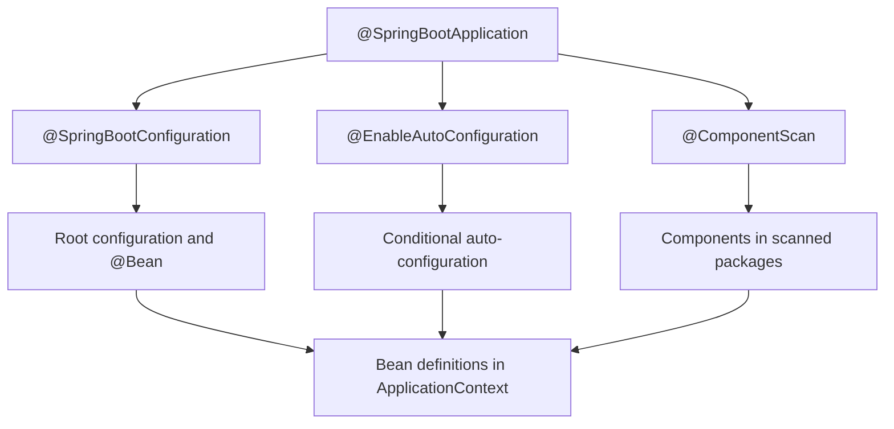
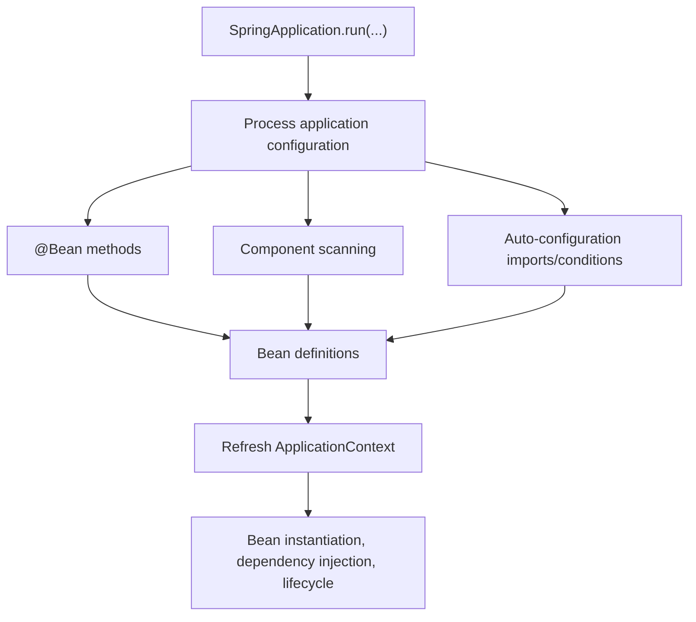

# The Three Roles of @SpringBootConfiguration, @EnableAutoConfiguration, and @ComponentScan

A Spring Boot application typically starts with a very short Java class:

```java
package com.example.demo;

import org.springframework.boot.SpringApplication;
import org.springframework.boot.autoconfigure.SpringBootApplication;

@SpringBootApplication
public class DemoApplication {
    public static void main(String[] args) {
        SpringApplication.run(DemoApplication.class, args);
    }
}
```

Although only a single annotation is attached, `@SpringBootApplication` takes on three distinct responsibilities: identifying the **root configuration**, enabling **Spring Boot auto-configuration**, and **discovering components written by the application**. Understanding these three mechanisms helps explain why a dependency can be present while a bean is still missing, why controllers are discovered automatically, why an application automatically has Spring MVC infrastructure, and why expanding package scanning can sometimes cause unintended errors.

This lesson focuses on Spring Boot 3.x and Spring Framework 6 on Java 21. The examples in each section are written to illustrate a single mechanism; when assembling them into a real project, place each `public class` into a Java file of the same name and declare the appropriate package, imports, and dependencies.

## 1. One Composite Annotation, Three Responsibilities

`@SpringBootApplication` is a **composed annotation**: it carries the following key meta-annotations.

| Annotation | Responsibility | Question it answers |
| --- | --- | --- |
| `@SpringBootConfiguration` | Marks the class as a Spring Boot configuration source; inherits the semantics of `@Configuration` | "Which class is the root configuration of the application?" |
| `@EnableAutoConfiguration` | Allows Boot to evaluate and load auto-configurations that match the classpath, properties, and existing beans | "What should the framework configure out of the box?" |
| `@ComponentScan` | Finds annotated components/configurations in the packages within the scan scope | "Which application classes need to be registered as beans?" |



As a mental model, you can approximate it as:

```java
@SpringBootConfiguration
@EnableAutoConfiguration
@ComponentScan
public class DemoApplication {
    // ...
}
```

This is a **conceptual model**, not the complete source definition of `@SpringBootApplication`. The actual annotation includes forwarded attributes and dedicated filters for component scanning. In typical applications, you should use `@SpringBootApplication` to receive all of Boot's defaults.

All three mechanisms contribute to **a single ApplicationContext construction process**. They do not create three separate containers. `ApplicationContext` manages bean definitions, instantiates appropriate beans, injects dependencies, and coordinates the lifecycle.

### 1.1. Distinguishing Classpath, Bean Definition, and Bean Instance

Three concepts are often conflated:

- **Classpath** contains the Java types and resources that the class loader can read. Gradle/Maven dependencies are one way to put JARs onto the classpath.
- **Bean definition** describes to Spring how to create and manage an object, including its type, name, scope, factory method, and related metadata.
- **Bean instance** is the object instantiated by Spring according to a bean definition or an appropriate bean registration mechanism.

Having a class on the classpath **does not guarantee** there is a bean definition for it, and having a bean definition **does not necessarily** mean the bean has been instantiated immediately. For example, a `@Lazy` bean may be created lazily.

## 2. @SpringBootConfiguration: Marking the Root Configuration Source

`@SpringBootConfiguration` is Spring Boot's specialized variant of `@Configuration`. Therefore, a `@SpringBootApplication` class is also a configuration source in which Spring can process `@Bean` methods.

Example declaring a shared clock:

```java
package com.example.demo;

import java.time.Clock;
import org.springframework.boot.SpringApplication;
import org.springframework.boot.autoconfigure.SpringBootApplication;
import org.springframework.context.annotation.Bean;

@SpringBootApplication
public class DemoApplication {

    public static void main(String[] args) {
        SpringApplication.run(DemoApplication.class, args);
    }

    @Bean
    public Clock applicationClock() {
        return Clock.systemUTC();
    }
}
```

`Clock` is a plain Java type without `@Component`. It still becomes a Spring bean thanks to the `@Bean` method inside a configuration loaded by Spring.

A container-managed service can receive this bean:

```java
package com.example.demo.order;

import java.time.Clock;
import java.time.Instant;
import org.springframework.stereotype.Service;

@Service
public class OrderTimeService {
    private final Clock clock;

    public OrderTimeService(Clock clock) {
        this.clock = clock;
    }

    public Instant createdAt() {
        return clock.instant();
    }
}
```

In this example, the service only needs to know about a `Clock`, without constructing `Clock.systemUTC()` itself. Unit tests can directly use `new OrderTimeService(Clock.fixed(...))` to avoid depending on wall-clock time.

### 2.1. How Does @Bean Differ from @Component?

`@Component` marks a **class** for the component scanner to detect; `@Bean` marks a **factory method** inside a configuration class processed by Spring.

```java
@Component
public class PriceCalculator {
    // Spring can detect this class via component scan.
}
```

```java
@Configuration(proxyBeanMethods = false)
public class PricingConfiguration {
    @Bean
    public ExchangeRateProvider exchangeRateProvider() {
        return new FixedExchangeRateProvider();
    }
}
```

In the second example, `ExchangeRateProvider` and `FixedExchangeRateProvider` are hypothetical application types. `FixedExchangeRateProvider` does not need `@Component`: the `@Bean` method creates it for Spring to manage. However, **the configuration class must first be loaded into the context**, such as through component scanning or `@Import`; simply putting `@Bean` on a class outside every configuration scope is not enough.

### 2.2. Why Does "Root Configuration" Matter for Tests?

Spring Boot uses `@SpringBootConfiguration` as a marker to locate the application configuration in certain situations, most notably `@SpringBootTest` when `classes` is not specified. The framework can search upward from the test class's package through parent packages to identify the Boot configuration class.

Suppose:

```text
com.example.demo
├── DemoApplication                 (@SpringBootApplication)
└── order
    └── OrderTimeServiceTest        (@SpringBootTest)
```

The test resides beneath the root configuration's package, so Boot can typically find it. If the test class is in a completely different package or there are multiple competing Boot configurations, specify the class explicitly:

```java
@SpringBootTest(classes = DemoApplication.class)
class OrderContextTest {
    // Tests the specified application configuration.
}
```

`@SpringBootConfiguration` does not start a web server on its own. `SpringApplication.run(...)` is what bootstraps the application; the web server depends on dependencies, the application type, and the corresponding configuration conditions.

### 2.3. The proxyBeanMethods Attribute

`@SpringBootApplication` has a `proxyBeanMethods` attribute, which defaults to `true` in Spring Boot 3.x. This affects direct calls between `@Bean` methods within a configuration class.

Example:

```java
@Configuration
class InfrastructureConfig {
    @Bean
    MailSender mailSender() {
        return new ConsoleMailSender();
    }

    @Bean
    MailService mailService() {
        return new MailService(mailSender());
    }
}
```

When full proxy mode is used, Spring can intercept the `mailSender()` call between bean methods to return the container-managed bean. If `proxyBeanMethods = false` is set, that call is a regular Java method call and may create a new object.

To use non-proxy mode cleanly, inject the bean via a method parameter:

```java
@Configuration(proxyBeanMethods = false)
class InfrastructureConfig {
    @Bean
    MailSender mailSender() {
        return new ConsoleMailSender();
    }

    @Bean
    MailService mailService(MailSender mailSender) {
        return new MailService(mailSender);
    }
}
```

`MailSender`, `ConsoleMailSender`, and `MailService` here are illustrative types. The key point to remember: Spring resolves `@Bean` method dependencies similarly to how it resolves bean constructor parameters. With `@SpringBootApplication(proxyBeanMethods = false)`, avoid relying on calling another bean method directly to obtain a singleton.

## 3. @EnableAutoConfiguration: Conditional Auto-Configuration

`@EnableAutoConfiguration` instructs Spring Boot to consider **auto-configuration classes** on the classpath. These classes describe conditions and default beans for framework capabilities, such as Spring MVC, HTTP message conversion, JDBC/DataSource, transactions, caching, or library integrations.

Auto-configuration is typically triggered by a combination of:

1. **Classpath**: the required libraries/Java types are present.
2. **Properties/environment**: the configuration is enabled and its values are valid.
3. **Existing beans**: no application-provided implementation exists yet, or a dependency required by the configuration is already present.
4. **Application type**: for example, Servlet Web, Reactive Web, or a non-web application.

Therefore, "auto" does not mean Boot automatically instantiates every class or every bean in a library.

### 3.1. Example with spring-boot-starter-web

When an application adds `spring-boot-starter-web`, the libraries suitable for a Spring MVC application are placed on the classpath. Spring Boot's auto-configurations can select and register foundational beans for the MVC model, JSON serialization, an embedded servlet container, and other web infrastructure if the corresponding conditions are satisfied.

At the same time, the application itself defines:

```java
package com.example.demo.api;

import org.springframework.web.bind.annotation.GetMapping;
import org.springframework.web.bind.annotation.RestController;

@RestController
public class PingController {
    @GetMapping("/ping")
    public String ping() {
        return "pong";
    }
}
```

Both mechanisms work together while keeping distinct roles:

- `@ComponentScan` helps Spring locate `PingController` under the scanned package.
- `@EnableAutoConfiguration` helps Boot configure the web infrastructure matching the classpath and conditions.

If a controller class is merely on the compile classpath without configured web infrastructure, you cannot assume HTTP requests will work.

### 3.2. Auto-Configuration Is Discovered from Metadata

In Spring Boot 3, JARs that provide auto-configuration register their corresponding classes via the resource:

```text
META-INF/spring/org.springframework.boot.autoconfigure.AutoConfiguration.imports
```

The file contains fully qualified class names, one class per line. For example:

```text
com.example.shared.GreetingAutoConfiguration
```

A library might provide:

```java
package com.example.shared;

@FunctionalInterface
public interface GreetingFormatter {
    String format(String name);
}
```

```java
package com.example.shared;

import org.springframework.boot.autoconfigure.AutoConfiguration;
import org.springframework.boot.autoconfigure.condition.ConditionalOnMissingBean;
import org.springframework.context.annotation.Bean;

@AutoConfiguration
public class GreetingAutoConfiguration {

    @Bean
    @ConditionalOnMissingBean(GreetingFormatter.class)
    public GreetingFormatter greetingFormatter() {
        return name -> "Hello " + name;
    }
}
```

Assuming the library has the appropriate dependencies and the JAR contains the imports metadata above, when a Boot application uses the library:

- If no `GreetingFormatter` bean exists yet, this configuration can register the default formatter.
- If the application has already declared a suitable bean, `@ConditionalOnMissingBean` lets the default configuration back off.

Note: `@AutoConfiguration` defines a library's auto-configuration; `@EnableAutoConfiguration` on the application side is the mechanism that enables evaluating those configurations. For a Boot 3 library, merely placing `@AutoConfiguration` on a class without adding `AutoConfiguration.imports` is **not sufficient** for Boot to import that class automatically from the JAR.

### 3.3. Common Conditions

| Annotation | Condition | Typical usage |
| --- | --- | --- |
| `@ConditionalOnClass` | One or more classes are present on the classpath | Integrate only when the relevant library exists |
| `@ConditionalOnMissingBean` | No matching bean exists yet within the check scope | Provide a default bean that the application can replace |
| `@ConditionalOnBean` | A required bean is already present | Enable an extension once its dependency is ready |
| `@ConditionalOnProperty` | A property satisfies a condition | Toggle a feature on or off |
| `@ConditionalOnWebApplication` | An appropriate web context is present | Enable configuration only for web applications |

Example of a default configuration with a toggle flag:

```java
@AutoConfiguration
@ConditionalOnProperty(
    prefix = "feature.greeting",
    name = "enabled",
    havingValue = "true",
    matchIfMissing = true
)
public class GreetingAutoConfiguration {
    // @Bean method same as the example above.
}
```

```yaml
feature:
  greeting:
    enabled: false
```

When the property is `false`, this configuration is excluded by the condition. If a controller still requires `GreetingFormatter` and no other bean provides it, the context may fail to start due to a missing dependency. Toggling auto-configuration must align with how consumers are designed.

### 3.4. Customizing or Excluding Auto-Configuration

The goal of auto-configuration is to provide useful defaults while allowing applications to customize them. You can:

- Define your own bean if the auto-configuration uses `@ConditionalOnMissingBean`.
- Change properties in `application.yml` or environment variables.
- Change dependencies so that conditions match or do not match.
- Exclude a specific auto-configuration when you genuinely do not want to use it.

Example:

```java
import org.springframework.boot.autoconfigure.SpringBootApplication;
import org.springframework.boot.autoconfigure.jdbc.DataSourceAutoConfiguration;

@SpringBootApplication(exclude = DataSourceAutoConfiguration.class)
public class DemoApplication {
    // ...
}
```

The `exclude` attribute of `@SpringBootApplication` forwards to `@EnableAutoConfiguration` processing. It **excludes an auto-configuration**; it does not remove every `@Service` or `@Repository` declared by the application, nor does it remove the JAR from the classpath.

An equivalent configuration can be expressed via a property:

```properties
spring.autoconfigure.exclude=org.springframework.boot.autoconfigure.jdbc.DataSourceAutoConfiguration
```

This is only a syntax example. If a real application still needs a database, excluding `DataSourceAutoConfiguration` may prevent many other beans from being created; identify the root cause before excluding.

## 4. @ComponentScan: Discovering Application Classes

`@ComponentScan` searches for **component candidates** within a package scope, typically classes annotated with `@Component` or annotations carrying `@Component` semantics.

Common stereotypes:

| Annotation | Purpose |
| --- | --- |
| `@Component` | General-purpose Spring component |
| `@Service` | Business/service logic class |
| `@Repository` | Data access adapter, with certain additional Spring semantics |
| `@Controller` | Spring MVC controller |
| `@RestController` | Controller returning the body directly, combining `@Controller` and `@ResponseBody` |
| `@Configuration` | Configuration containing bean definitions, typically with `@Bean` methods |

These annotations only make a class a **candidate**. Spring still evaluates scanning settings and relevant conditions. `@ComponentScan` is not simply "create a bean from every class".

### 4.1. The Default Package Is the Package Containing the @SpringBootApplication Class

With the main class:

```text
com.example.demo
├── DemoApplication              (@SpringBootApplication)
├── api
│   └── GreetingController       (@RestController)
├── service
│   └── GreetingService          (@Service)
└── config
    └── ClockConfiguration       (@Configuration)
```

Spring component scanning by default scans `com.example.demo` and its subpackages. Therefore, annotated classes like those above can be discovered.

A complete example of a service and controller:

```java
package com.example.demo.service;

import org.springframework.stereotype.Service;

@Service
public class GreetingService {
    public String greet(String name) {
        return "Hello " + name;
    }
}
```

```java
package com.example.demo.api;

import com.example.demo.service.GreetingService;
import org.springframework.web.bind.annotation.GetMapping;
import org.springframework.web.bind.annotation.RequestParam;
import org.springframework.web.bind.annotation.RestController;

@RestController
public class GreetingController {
    private final GreetingService service;

    public GreetingController(GreetingService service) {
        this.service = service;
    }

    @GetMapping("/greet")
    public String greet(@RequestParam String name) {
        return service.greet(name);
    }
}
```

When a web starter is present and the app is started with the right configuration, `GET /greet?name=Lan` can return `Hello Lan`. `GreetingController` and `GreetingService` are components discovered via scanning; the MVC infrastructure beans and web server primarily come from auto-configuration.

### 4.2. Packages Outside the Default Tree Are Not Scanned Automatically

Suppose:

```text
com.example.app
└── DemoApplication           (@SpringBootApplication)

com.example.shared
└── SharedMailer              (@Service)
```

Even though `shared-mailer.jar` is on the runtime classpath, `SharedMailer` in the sibling package `com.example.shared` is **not automatically discovered by component scanning from `com.example.app`**.

You can explicitly specify the packages to scan:

```java
@SpringBootApplication(scanBasePackages = {
    "com.example.app",
    "com.example.shared"
})
public class DemoApplication {
    // ...
}
```

Or use marker classes to avoid hardcoding package name strings:

```java
@SpringBootApplication(scanBasePackageClasses = {
    DemoApplication.class,
    SharedScanMarker.class
})
public class DemoApplication {
    // ...
}
```

Assuming `SharedScanMarker` is a class placed by the library in package `com.example.shared`, the application must import that type. This specifies the scanning scope using Java types, enabling better IDE and refactoring support.

The `scanBasePackages` and `scanBasePackageClasses` attributes of `@SpringBootApplication` are aliases for configuring **component scanning**. They **do not automatically change** the scan scope for Spring Data repositories or JPA entities. For JPA structures outside the default scope, you may need `@EntityScan`, `@EnableJpaRepositories`, or technology-specific data configuration.

### 4.3. Where Should the Main Class Be Placed?

Placing `DemoApplication` in the application's root package, with controllers, services, and configurations beneath it, is a common organization:

```text
com.example.shop
├── ShopApplication
├── order
├── catalog
├── customer
└── infrastructure
```

If the main class sits too deep, such as `com.example.shop.bootstrap`, sibling packages may be missed. Conversely, placing it too high, such as `com.example`, may cause the scanner to pick up components from other applications or libraries that do not belong to the current program, leading to unwanted beans.

### 4.4. Include and Exclude Filters

`@ComponentScan` supports `includeFilters`, `excludeFilters`, and `useDefaultFilters` when candidate selection needs to be adjusted:

```java
import org.springframework.context.annotation.ComponentScan;
import org.springframework.context.annotation.FilterType;

@ComponentScan(
    basePackages = "com.example.demo",
    excludeFilters = @ComponentScan.Filter(
        type = FilterType.ASSIGNABLE_TYPE,
        classes = ExperimentalNotifier.class
    )
)
public class ComponentScanningConfiguration {
}
```

In this example, `ExperimentalNotifier` is a type on the classpath. The filter excludes it from candidates during that scan. It is not a general mechanism for disabling auto-configurations that Boot imports through its own mechanism.

In fact, `@SpringBootApplication` also configures certain Spring Boot scanning filters. This further explains why manually replacing the annotation with the three lines `@SpringBootConfiguration`, `@EnableAutoConfiguration`, and `@ComponentScan` does not necessarily yield identical behavior in every edge case.

## 5. How the Three Mechanisms Coordinate at Startup

When `SpringApplication.run(DemoApplication.class, args)` is called, Spring Boot prepares the context, loads configuration sources, and processes bean definitions. You can visualize the flow of responsibilities as:



This diagram illustrates **relationships**, not a claim that the three mechanisms run independently in the exact order drawn. Spring processes configuration classes, imports, conditions, and bean post-processors across multiple steps in the container lifecycle.

From this, we can answer three questions:

**What happens if `@ComponentScan` is removed?** Classes that rely solely on component scanning may not be registered. However, beans declared via `@Bean`, `@Import`, or other registration mechanisms can still exist.

**What happens if `@EnableAutoConfiguration` is removed?** The application may still have the beans it registered itself, but many Spring Boot defaults for web, databases, and libraries will not be loaded automatically; developers must explicitly configure the needed capabilities.

**What happens if `@SpringBootConfiguration` is absent?** The application can still use other Spring `@Configuration` sources, but it loses the Boot convention marker for root configuration; mechanisms that locate the main configuration in certain tests may behave differently or require explicit declaration.

### 5.1. A Bean Can Be Registered Through Multiple Paths

Example of three different bean sources:

```java
// Path 1: component scan if located in a scanned package
@Service
public class BusinessService {
}
```

```java
// Path 2: @Bean inside a loaded configuration
@Configuration(proxyBeanMethods = false)
public class TimeConfiguration {
    @Bean
    public Clock clock() {
        return Clock.systemUTC();
    }
}
```

```java
// Path 3: @Bean inside an auto-configuration imported by Boot
@AutoConfiguration
public class LibraryAutoConfiguration {
    @Bean
    @ConditionalOnMissingBean(LibraryClient.class)
    public LibraryClient libraryClient() {
        return new LibraryClient();
    }
}
```

The `LibraryClient` and `BusinessService` types are illustrative only. Path 3 also requires the `AutoConfiguration.imports` file. All three paths can create beans in the same context, though each follows different selection rules.

## 6. Boundaries in a Multi-Module Project

Consider a Gradle project:

```text
multi-module-project/
├── settings.gradle
├── app/
│   └── src/main/java/com/example/app/DemoApplication.java
├── customer-feature/
│   └── src/main/java/com/example/customer/CustomerService.java
└── shared-spring/
    ├── src/main/java/com/example/shared/SharedAutoConfiguration.java
    └── src/main/resources/META-INF/spring/
        └── org.springframework.boot.autoconfigure.AutoConfiguration.imports
```

If `app` declares dependencies on `customer-feature` and `shared-spring`, Gradle puts the necessary classes and resources onto the classpath. However, bean registration follows its own rules:

| Component | On classpath | Becomes a bean automatically? | Appropriate mechanism |
| --- | --- | --- | --- |
| `CustomerService` with `@Service` in `com.example.customer` | Yes | No if outside component scan | Deliberately adjust scan or import configuration |
| `SharedAutoConfiguration` with valid imports metadata | Yes | Potentially, when auto-configuration is enabled and conditions match | `@EnableAutoConfiguration` |
| `CustomerId` as a plain Java value object | Yes | No | Instantiated with `new` when needed; typically should not be a bean |
| `SharedValidator` without a stereotype | Yes | No | Register via `@Bean`/configuration if DI is needed |

**Each Gradle subproject does not automatically get its own `ApplicationContext`.** Artifacts from multiple subprojects can be combined into a single Boot application sharing one main context. If there are two Boot applications running as two separate processes, each application has its own context, even when using the same library.

### 6.1. Using @Import to Load Shared Configuration

If a shared module has an explicit configuration class, the application can choose to import it:

```java
package com.example.shared;

import org.springframework.context.annotation.Bean;
import org.springframework.context.annotation.Configuration;

@Configuration(proxyBeanMethods = false)
public class SharedConfiguration {
    @Bean
    public SharedValidator sharedValidator() {
        return new SharedValidator();
    }
}
```

```java
package com.example.app;

import com.example.shared.SharedConfiguration;
import org.springframework.boot.autoconfigure.SpringBootApplication;
import org.springframework.context.annotation.Import;

@SpringBootApplication
@Import(SharedConfiguration.class)
public class DemoApplication {
    // ...
}
```

The example assumes `SharedValidator` is a Java class in the shared module. `@Import` loads `SharedConfiguration` even though it sits outside the default scan package of `com.example.app`. This explicit approach is often useful for internal libraries.

If a library is used across multiple Boot applications and wants to provide conditional defaults, auto-configuration with `AutoConfiguration.imports` may be more appropriate. Avoid loading the same configuration through multiple paths if doing so leads to duplicate beans or ambiguity over who owns bean registration.

### 6.2. Component Scanning Differs from Auto-Configuration Packages

In Spring Boot, the location of the class enabling auto-configuration is also used to determine certain default **auto-configuration packages**. These packages play a role in various data discovery mechanisms, such as entities and repositories when the corresponding integrations are present.

This differs from configuring `scanBasePackages` for component scanning. Therefore, if you move JPA entities/repositories to another module, do not assume expanding component scan will automatically resolve `Not a managed type` errors or undetected repositories. Check the entity/repository scope and use `@EntityScan`, `@EnableJpaRepositories`, or the corresponding configuration when needed.

## 7. Distinguishing Auto-Configuration Exclusion from Component Scan Filters

Two operations look similar but have different effects:

```java
@SpringBootApplication(
    exclude = DataSourceAutoConfiguration.class
)
public class DemoApplication {
}
```

This excludes an **auto-configuration**. It does not remove an application-written repository or service.

```java
@ComponentScan(
    basePackages = "com.example.demo",
    excludeFilters = @ComponentScan.Filter(
        type = FilterType.ASSIGNABLE_TYPE,
        classes = DebugOnlyService.class
    )
)
public class ScanConfig {
}
```

This excludes a **candidate from component scanning**, assuming `DebugOnlyService` is on the classpath. It does not mean Boot stops evaluating web or database auto-configurations.

| Customization | Direct effect |
| --- | --- |
| `@SpringBootApplication(exclude = ...)` | Excludes the specified auto-configuration classes |
| `@SpringBootApplication(excludeName = ...)` | Excludes auto-configurations by class name |
| `spring.autoconfigure.exclude` | Excludes auto-configurations configured via properties |
| `@ComponentScan(excludeFilters = ...)` | Filters component candidates within the scan scope |
| Removing a Gradle/Maven dependency | Changes the classpath, which can change auto-configuration condition outcomes |

Changes can have indirect effects: disabling an auto-configuration that creates a `DataSource` can affect beans that require `DataSource`; filtering out a service can leave a controller missing a dependency.

## 8. Diagnosing Errors by Responsibility

### 8.1. "Required a bean ... could not be found"

Suppose:

```text
Parameter 0 of constructor in com.example.demo.api.GreetingController
required a bean of type 'com.example.demo.service.GreetingService'
that could not be found.
```

Determine how the bean was supposed to be registered:

1. Does the class have `@Service` or an annotation recognized by the scanner?
2. Is the class's package within the component scan range?
3. If the bean is created by `@Bean`, has the configuration class been scanned or imported?
4. If created by auto-configuration, is `AutoConfiguration.imports` packaged in the JAR and do the conditions match?
5. Is the bean excluded by a profile/property, or is a required class/dependency missing from the runtime classpath?

Fix the specific mechanism responsible. **Adding `@ComponentScan` cannot fix a JAR missing from the classpath**; adding a dependency will not resolve a package being outside the scan scope.

### 8.2. Multiple Beans of the Same Type

If two `PaymentGateway` implementations both register beans and a service requests a single `PaymentGateway`, Spring may not know which bean to pick.

Intentional solutions include `@Qualifier`, `@Primary`, changing the registration configuration, or designing default auto-configurations with `@ConditionalOnMissingBean`. Avoid using `@Primary` merely to mask overly broad scanning that pulled in beans not meant for this application.

### 8.3. Auto-Configuration Does Not Activate

An auto-configuration may be considered but skipped because:

- A required class is missing on the classpath.
- A property does not satisfy the condition.
- A required bean is missing or a replacement bean already exists.
- The web/non-web context type does not match.
- The configuration was excluded.

When diagnosing in a development environment, running the application with `--debug` outputs the *conditions evaluation report* in the logs:

```text
java -jar app.jar --debug
```

Look for positive/negative matches and the reason why a condition matched or did not match. If using Spring Boot Actuator with appropriate endpoint exposure and access controls configured, `/actuator/conditions` can provide similar information. Do not expose diagnostic endpoints publicly in production by default.

### 8.4. Multiple @SpringBootApplication Classes in the Same Scope

A shared library normally does not need its own `@SpringBootApplication`. If multiple root configurations are scanned or discovered by tests, the context may load unwanted configurations or tests may fail to determine which is the main application.

Usually, each independently deployed application has a clear entry point. Library modules provide `@Configuration` or `@AutoConfiguration` depending on their bean registration contract.

## 9. Testing the Three Mechanisms

Not every test needs a Spring context. For `GreetingService` in section 4, a plain Java unit test is sufficient to verify behavior:

```java
import static org.junit.jupiter.api.Assertions.assertEquals;

import com.example.demo.service.GreetingService;
import org.junit.jupiter.api.Test;

class GreetingServiceTest {

    @Test
    void createsGreeting() {
        GreetingService service = new GreetingService();

        assertEquals("Hello Lan", service.greet("Lan"));
    }
}
```

That test **does not prove** Spring discovered the bean. When you want to verify application wiring, use a Boot context test:

```java
package com.example.demo;

import static org.junit.jupiter.api.Assertions.assertNotNull;

import com.example.demo.service.GreetingService;
import org.junit.jupiter.api.Test;
import org.springframework.beans.factory.annotation.Autowired;
import org.springframework.boot.test.context.SpringBootTest;
import org.springframework.context.ApplicationContext;

@SpringBootTest(classes = DemoApplication.class)
class DemoApplicationContextTest {

    @Autowired
    private ApplicationContext context;

    @Test
    void discoversGreetingService() {
        assertNotNull(context.getBean(GreetingService.class));
    }
}
```

This test requires the `spring-boot-starter-test` dependency or an equivalent test library suite. It verifies that the context builds and the service is present; it does not replace integration tests for HTTP or the database.

### 9.1. Testing Auto-Configuration in Isolation

Spring Boot provides `ApplicationContextRunner` to spin up a lightweight context and test auto-configuration:

```java
import static org.assertj.core.api.Assertions.assertThat;

import org.junit.jupiter.api.Test;
import org.springframework.boot.autoconfigure.AutoConfigurations;
import org.springframework.boot.test.context.runner.ApplicationContextRunner;

class GreetingAutoConfigurationTest {

    private final ApplicationContextRunner runner =
            new ApplicationContextRunner()
                    .withConfiguration(
                        AutoConfigurations.of(GreetingAutoConfiguration.class)
                    );

    @Test
    void registersDefaultBean() {
        runner.run(context ->
                assertThat(context).hasSingleBean(GreetingFormatter.class)
        );
    }

    @Test
    void respectsApplicationBean() {
        runner.withBean(
                GreetingFormatter.class,
                () -> name -> "Hi " + name
        ).run(context -> {
            assertThat(context).hasSingleBean(GreetingFormatter.class);
            assertThat(context.getBean(GreetingFormatter.class).format("Lan"))
                    .isEqualTo("Hi Lan");
        });
    }
}
```

The test above assumes the `GreetingAutoConfiguration` and `GreetingFormatter` classes from section 3 already exist and appropriate test dependencies are available. `ApplicationContextRunner` verifies auto-configuration conditions and bean registration without starting an entire web application.

## 10. Common Misconceptions

| Misconception | Accurate understanding |
| --- | --- |
| "`@SpringBootApplication` only marks the main method." | It combines three roles: configuration, auto-configuration, and component scanning. |
| "`@EnableAutoConfiguration` scans all `@Service` classes." | Finding `@Service` primarily belongs to component scanning. |
| "Adding a dependency turns every class into a bean." | Dependencies add classes/resources to the classpath; beans still need to be registered. |
| "`@ComponentScan` automatically searches every package in JARs." | It scans packages within the configured scope. |
| "`@Bean` in any class is executed by Spring." | The class containing the bean method must be loaded and processed properly by Spring. |
| "Auto-configuration always registers all beans." | Conditions can prevent beans or configurations from being registered. |
| "Excluding an auto-configuration also removes `@Component` classes." | They are two separate mechanisms. |
| "`scanBasePackages` controls all JPA entity/repository discovery." | Entities and repositories have their own scope mechanisms. |
| "Each Gradle module creates its own context." | Subprojects can be used together by one application and one context. |

## 11. Practice Exercises

### Exercise 1 — Observing Component Scan Scope

Place `DemoApplication` in `com.example.demo`, a service in `com.example.demo.service`, and a controller in `com.example.demo.api`. Run the application, then move the service to the `com.example.external` package outside the scan scope. Predict the startup error. Fix it by adjusting the package, configuring `scanBasePackageClasses`, or importing a configuration that registers the service.

### Exercise 2 — Distinguishing @Bean from @Component

Create `@Bean Clock clock()` inside a `@Configuration`, and inject `Clock` into a service. Verify that `Clock` does not need a `@Component` annotation. Then move the configuration outside the scan scope, remove `@Import` if present, and explain why the bean disappears from the context.

### Exercise 3 — Testing Conditional Auto-Configuration

Write a library with `GreetingFormatter`, `GreetingAutoConfiguration` using `@ConditionalOnMissingBean`, and `AutoConfiguration.imports` metadata. Observe the default bean. Then declare a custom formatter in the application and use `ApplicationContextRunner` to verify the user's bean is selected.

### Exercise 4 — Diagnosing Instead of Adding Random Annotations

Create a configuration disabled by `@ConditionalOnProperty`. Read the conditions evaluation report in a development environment and note which property/condition prevented the bean from being created. Check what happens to a controller depending on this bean when the feature is turned off.

### Exercise 5 — Multi-Module Design

Suppose an application has `app`, `catalog`, `payment`, and `shared-observability`. Choose one of component scanning, `@Import`, or auto-configuration for each module. Explain the difference between build dependencies, package scanning, and bean registration in your decisions.

## 12. Conclusion

`@SpringBootApplication` combines three related responsibilities that do not replace each other. **`@SpringBootConfiguration`** identifies the root configuration source and allows declaring `@Bean` methods; **`@EnableAutoConfiguration`** activates Spring Boot's conditional default configurations; **`@ComponentScan`** locates application-declared components/configurations within the scanned package scope.

When encountering a bean error, identify whether that bean was supposed to be registered via a **configuration method**, **component scan**, **auto-configuration**, or **explicit import**. Distinguishing these paths helps organize source code clearly by package/module, customize Boot intentionally, and avoid configuration changes with unintended side effects.
