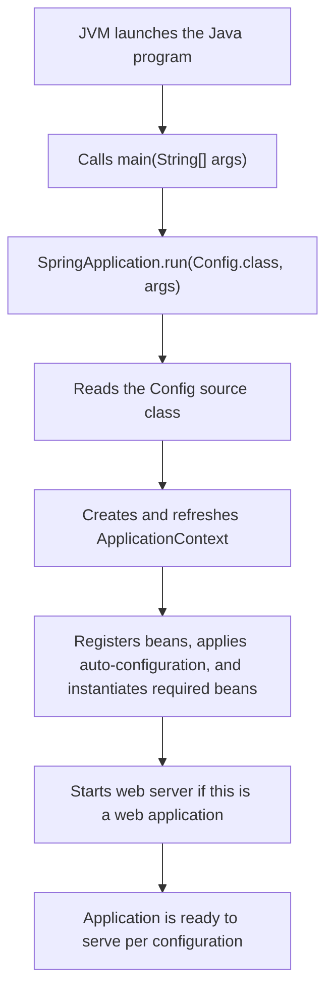
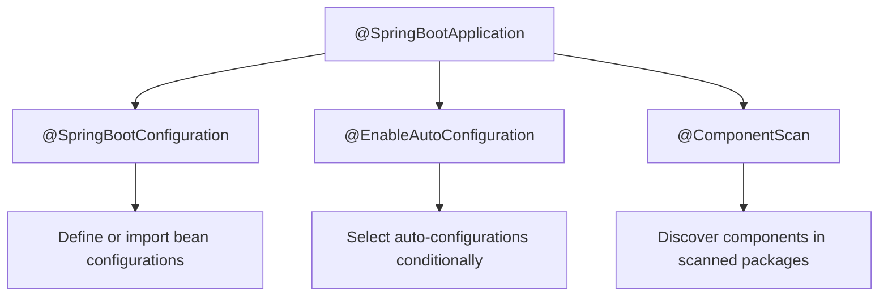

# Distinguishing the Java Main Class from the Spring Configuration Source Class

In your first Spring Boot project, you usually encounter a class like this:

```java
package com.example.demo;

import org.springframework.boot.SpringApplication;
import org.springframework.boot.autoconfigure.SpringBootApplication;

@SpringBootApplication
public class DemoApplication {

    public static void main(String[] args) {
        SpringApplication.run(DemoApplication.class, args);
    }
}
```

Because `@SpringBootApplication` and `main()` live in the same class, beginners easily assume they are inseparable: "The main class must carry `@SpringBootApplication`," or "When Java sees `@SpringBootApplication`, it automatically runs that class." Neither statement is accurate.

**The class containing `main()` is where the JVM starts executing the Java program. The Spring configuration source class is where Spring obtains information to build the `ApplicationContext`.** The two roles are commonly placed together to keep projects simple, yet they can reside in different classes.

To understand this clearly, distinguish three things:

1. **Java entry point:** the `public static void main(String[] args)` method.
2. **Spring Boot launcher:** the `SpringApplication.run(...)` call that starts Spring bootstrapping.
3. **Spring configuration source:** the class passed to `run(...)`, typically annotated with `@SpringBootApplication`, describing the root configuration for Spring to process.

## 1. The Big Picture: Who Does What When Running the Application?



The diagram above is a high-level flow. During startup, Spring Boot also prepares the environment, publishes events, and runs lifecycle callbacks and runners. Exact ordering of certain components depends on the version and application type.

The decisive points are:

- **The JVM** knows how to locate and execute a Java entry point; the JVM does not understand the meaning of `@SpringBootApplication`.
- **SpringApplication** receives one or more configuration sources and orchestrates building the Spring context.
- **The Spring container** uses configuration metadata, component scanning, and auto-configuration to create and manage beans.

Thus, `DemoApplication` appearing twice in the opening example happens because **the same class is serving two roles**: holding `main()` and acting as the configuration source.

## 2. The Java Main Class: Java's Responsibility Before Spring Exists

### 2.1. What Is the Main Method?

In a traditional Java application, a common entry point looks like:

```java
public class PlainJavaApplication {

    public static void main(String[] args) {
        System.out.println("Java program started");

        for (String arg : args) {
            System.out.println("Argument: " + arg);
        }
    }
}
```

If you run this class with a suitable Java launcher, the JVM executes `main(String[] args)`. No Spring, no beans, and no `ApplicationContext` are required.

Each part of the method signature has a role:

| Element | Meaning in a traditional Java entry point |
|---|---|
| `public` | Callable by the launcher per the traditional entry-point contract |
| `static` | Does not require creating an instance of the class before invoking |
| `void` | The method returns no value to the caller |
| `main` | Entry-point method name |
| `String[] args` | Command-line arguments passed to the program |

This is the familiar signature suited for learning Spring Boot fundamentals. Newer Java versions support additional program/entry-point forms, which do not change this explanation of Spring's role.

### 2.2. The Main Class Does Not Automatically Become a Spring Bean

Consider the code:

```java
public class Launcher {

    public static void main(String[] args) {
        System.out.println("Start");
    }
}
```

The JVM invokes this class's static method, yet doing so **does not create a Spring bean named `launcher`**, does not enable dependency injection, and does not configure web components.

Even when an application is launched with `java -jar`, the Java launcher still merely invokes the entry point declared in the packaging metadata. Spring is initialized only when the executed code actually invokes a Spring bootstrap mechanism, typically `SpringApplication.run(...)`.

### 2.3. The Main Method Can Do Many Things, Yet Should Stay Minimal

In a typical Boot application, the main method ideally only needs:

```java
public static void main(String[] args) {
    SpringApplication.run(DemoApplication.class, args);
}
```

You can configure `SpringApplication` before running it, but **you should not write all your business logic directly inside `main()`**. Logic requiring dependency injection, transactions, or Spring lifecycle management belongs inside appropriate beans, such as `@Service`, `ApplicationRunner`, or `CommandLineRunner`.

## 3. The Spring Configuration Source Class: What Does Spring Use It For?

Spring needs a starting point to know:

- Which Java configurations should be processed.
- Which components should be discovered via component scanning.
- Which auto-configurations match the classpath and environment conditions.
- Which `@Bean`, `@Import`, and related configuration metadata should be registered.

A class carrying `@SpringBootApplication` is usually the **primary configuration source** providing that starting point.

```java
package com.example.demo;

import org.springframework.boot.autoconfigure.SpringBootApplication;

@SpringBootApplication
public class ApplicationConfiguration {
}
```

The class above **has no `main()`**. That does not invalidate `@SpringBootApplication`. When passed to a `SpringApplication` as a configuration source, Spring Boot can still process the annotation, scan components, and perform auto-configuration.

However, **this class itself is not a Java entry point**. If you ask the Java launcher to run `ApplicationConfiguration` directly as a traditional main class, there is no `main(String[] args)` method to execute.

### 3.1. "Configuration Source" Does Not Mean the Sole Configuration File

In the context of `SpringApplication.run(ApplicationConfiguration.class, args)`, "source" means **a Java configuration source supplied to the bootstrap process**.

It does not mean:

- All configuration must be written inside one class.
- Only this class is allowed to produce beans.
- Spring stops reading `application.properties` or `application.yml`.
- This class holds all business configuration values.

A real-world application may combine:

- `@SpringBootApplication` as the root configuration.
- `@Configuration` to split configuration by responsibility.
- `@Bean` to register Spring-managed objects.
- `@Component`, `@Service`, `@Repository`, and `@Controller` discovered by component scanning.
- `application.yml`, environment variables, and command-line arguments supplying configuration values.
- Auto-configurations conditionally creating beans based on dependencies and actual settings.

## 4. What Capabilities Does `@SpringBootApplication` Include?

`@SpringBootApplication` is a composite annotation conceptually equivalent to combining:

- `@SpringBootConfiguration`: marks a Spring Boot configuration class, itself a specialized form of `@Configuration`.
- `@EnableAutoConfiguration`: allows Spring Boot to evaluate suitable auto-configurations.
- `@ComponentScan`: scans components from the default package location or configured scope.



### 4.1. `@SpringBootConfiguration` and `@Configuration`

`@Configuration` lets you define beans and import other configurations:

```java
package com.example.demo.config;

import java.time.Clock;
import org.springframework.context.annotation.Bean;
import org.springframework.context.annotation.Configuration;

@Configuration
public class TimeConfiguration {

    @Bean
    public Clock applicationClock() {
        return Clock.systemUTC();
    }
}
```

If this configuration lies within the component scan range or is imported with `@Import`, Spring creates the `applicationClock` bean. The class does not need `main()`.

`@SpringBootConfiguration` clarifies that this is a Spring Boot configuration class, usually the root configuration. `@SpringBootApplication` includes it, so it also acts as a configuration source.

### 4.2. `@EnableAutoConfiguration`

Spring Boot inspects available auto-configurations and their conditions, such as:

- Are Servlet or Reactive web dependencies present?
- Has an application-defined bean already been registered?
- Are properties configured to enable or disable a feature?
- Are corresponding database, logging, or serialization dependencies present?

Based on conditions, Boot can register suitable configurations without you having to write every `@Bean` manually.

**Auto-configuration does not mean "create every bean regardless of what the project needs."** It responds to the classpath, environment, and conditions. If the application supplies its own suitable bean, many auto-configurations will back off.

### 4.3. `@ComponentScan`

Suppose the root configuration sits in package `com.example.demo`:

```text
src/main/java/
└── com/example/demo/
    ├── ApplicationConfiguration.java  ← @SpringBootApplication
    ├── api/
    │   └── GreetingController.java   ← @RestController
    ├── service/
    │   └── GreetingService.java      ← @Service
    └── config/
        └── TimeConfiguration.java     ← @Configuration
```

By default, component scanning from `@SpringBootApplication` searches for components in the configuration class's package and its subpackages.

Thus `GreetingController`, `GreetingService`, and `TimeConfiguration` can be discovered.

If `Launcher` holds `main()` in a different package, **Launcher's location does not determine the component scan scope**. The configuration source's location and scan attributes are what matter.

### 4.4. These Three Capabilities Are Not Three Ways to Call `main()`

`@SpringBootConfiguration`, `@EnableAutoConfiguration`, and `@ComponentScan` are metadata processed by Spring during bootstrapping. The JVM does not invoke `main()` simply because it sees these annotations.

Likewise, declaring `main()` does not automatically activate those three capabilities. A configuration source or an equivalent configuration registration mechanism is still needed.

## 5. The Common Case: One Class Serving Both Roles

This is the structure commonly seen in introductory Spring Boot materials:

```java
package com.example.shop;

import org.springframework.boot.SpringApplication;
import org.springframework.boot.autoconfigure.SpringBootApplication;

@SpringBootApplication
public class ShopApplication {

    public static void main(String[] args) {
        SpringApplication.run(ShopApplication.class, args);
    }
}
```

Reading each element:

| Line of code | Role |
|---|---|
| `public class ShopApplication` | Declares a Java class |
| `@SpringBootApplication` | Marks the class as the Spring Boot root configuration |
| `public static void main(String[] args)` | Java execution entry point |
| `SpringApplication.run(...)` | Starts Spring Boot and builds the application context |
| `ShopApplication.class` | Specifies the **configuration source** class for Spring to process |
| `args` | Forwards command-line arguments to the bootstrap process |

The most commonly misunderstood line is:

```java
SpringApplication.run(ShopApplication.class, args);
```

It is not because `run(...)` sits inside `ShopApplication` that it "must" receive `ShopApplication.class`. This is a **convenient design choice**: the class holding `main()` also happens to be the root configuration.

A more accurate reading is:

> "From this Java starting point, launch Spring Boot with `ShopApplication` as the primary configuration source and forward the command-line arguments."

The return value of `SpringApplication.run(...)` is `ConfigurableApplicationContext`, allowing access to the Spring context when genuinely needed.

## 6. Can the Main Class and Configuration Source Class Be Separated?

**Yes.** The example below separates the two responsibilities completely.

Project structure:

```text
src/main/java/
└── com/example/
    ├── bootstrap/
    │   └── ShopLauncher.java
    └── shop/
        ├── ShopConfiguration.java
        ├── api/
        │   └── GreetingController.java
        └── service/
            └── GreetingService.java
```

### 6.1. Plain Java Main Class

```java
package com.example.bootstrap;

import com.example.shop.ShopConfiguration;
import org.springframework.boot.SpringApplication;

public class ShopLauncher {

    public static void main(String[] args) {
        SpringApplication.run(ShopConfiguration.class, args);
    }
}
```

Note:

- `ShopLauncher` **has** `main()`.
- `ShopLauncher` **does not have** `@SpringBootApplication`.
- This class simply invokes Spring Boot and **specifies a different class as the configuration source**.

### 6.2. Spring Boot Configuration Class

```java
package com.example.shop;

import org.springframework.boot.autoconfigure.SpringBootApplication;

@SpringBootApplication
public class ShopConfiguration {
}
```

Note:

- `ShopConfiguration` **has** `@SpringBootApplication`.
- `ShopConfiguration` **does not have** `main()`.
- This is the starting point for Spring to process configuration, auto-configuration, and component scanning.

### 6.3. Beans and Endpoints Under the Configuration Package

```java
package com.example.shop.service;

import org.springframework.stereotype.Service;

@Service
public class GreetingService {

    public String message() {
        return "Hello from Shop!";
    }
}
```

```java
package com.example.shop.api;

import com.example.shop.service.GreetingService;
import org.springframework.web.bind.annotation.GetMapping;
import org.springframework.web.bind.annotation.RestController;

@RestController
public class GreetingController {

    private final GreetingService greetingService;

    public GreetingController(GreetingService greetingService) {
        this.greetingService = greetingService;
    }

    @GetMapping("/greeting")
    public String greeting() {
        return greetingService.message();
    }
}
```

With an appropriate web starter and no custom port configuration, running the `ShopLauncher.main()` entry point causes Spring Boot to use `ShopConfiguration` in `com.example.shop` to discover components in `com.example.shop.api` and `com.example.shop.service`.

Clients can call:

```http
GET http://localhost:8080/greeting
```

Expected output:

```text
Hello from Shop!
```

**Takeaway:** `ShopConfiguration.class` is what supplies the root for component scanning in this example, while `ShopLauncher.main()` simply starts the Java process. The launcher's `com.example.bootstrap` package does not alter the default scan scope of `ShopConfiguration`.

### 6.4. Why Does Packaging Configuration Matter?

When the two classes are separate, build tools and IDEs must know **which entry point to run**. For example, a Gradle project using the Spring Boot plugin can configure the main class explicitly:

```groovy
springBoot {
    mainClass = 'com.example.bootstrap.ShopLauncher'
}
```

This helps run/packaging tasks select the correct Java class containing `main()`, depending on the plugin version and project configuration.

Do not confuse the **build tool's** `mainClass` setting with the `ShopConfiguration.class` argument in **SpringApplication.run(...)**:

- The build tool's `mainClass` points to the **Java starting point**.
- `ShopConfiguration.class` is passed to Spring Boot to choose the **configuration source**.

Sometimes both values refer to the same class; in this example they differ intentionally.

## 7. Key Question: What Does `SpringApplication.run(...)` Do?

A common call:

```java
SpringApplication.run(ShopConfiguration.class, args);
```

can be understood through these high-level steps:

1. Creates/configures `SpringApplication` with `ShopConfiguration` as the initial configuration source.
2. Prepares the environment (`Environment`), property sources, profiles, and prerequisites for bootstrapping.
3. Determines the appropriate application type (`SERVLET`, `REACTIVE`, or `NONE`) from the classpath and configuration.
4. Creates the appropriate `ApplicationContext` and registers the supplied configuration sources.
5. Processes configuration classes, component scans, imports, auto-configurations, and bean definitions.
6. Instantiates required beans, executes lifecycle callbacks, and starts the web server if it is a web application.
7. Runs startup-related callbacks/runners and notifies the corresponding startup state.
8. Returns the `ConfigurableApplicationContext` once bootstrapping completes.

This is a mental model; exact sequencing depends on the Spring Boot version and active extensions.

**`run(...)` does not merely "call `main()` on the class passed in."** It uses that class's configuration metadata. That explains why passing `ShopConfiguration.class` works even though that class has no `main()`.

A useful variation if you want to retain a reference to the context:

```java
package com.example.bootstrap;

import com.example.shop.ShopConfiguration;
import org.springframework.boot.SpringApplication;
import org.springframework.context.ConfigurableApplicationContext;

public class ShopLauncher {

    public static void main(String[] args) {
        ConfigurableApplicationContext context =
                SpringApplication.run(ShopConfiguration.class, args);

        System.out.println("Context ID: " + context.getId());
    }
}
```

In web applications, the context typically stays alive to serve requests. In non-web applications, the process lifecycle can differ. Do not explicitly call `context.close()` right after `run(...)` if the goal is for an HTTP server to continue serving.

## 8. Comparing `@Configuration` with `@SpringBootApplication` as a Source

You can bootstrap Spring using a plain `@Configuration` class as the source:

```java
package com.example.simple;

import org.springframework.context.annotation.Bean;
import org.springframework.context.annotation.Configuration;

@Configuration
public class MinimalConfiguration {

    @Bean
    public MessageProvider messageProvider() {
        return new MessageProvider();
    }
}
```

```java
package com.example.simple;

public class MessageProvider {

    public String value() {
        return "Configured bean";
    }
}
```

```java
package com.example.simple;

import org.springframework.boot.SpringApplication;
import org.springframework.context.ConfigurableApplicationContext;

public class MinimalLauncher {

    public static void main(String[] args) {
        try (ConfigurableApplicationContext context =
                     SpringApplication.run(MinimalConfiguration.class, args)) {
            System.out.println(
                    context.getBean(MessageProvider.class).value()
            );
        }
    }
}
```

This example demonstrates:

- `MinimalLauncher` provides the entry point.
- `MinimalConfiguration` is the configuration source with `@Bean`.
- Without `@SpringBootApplication`, it **does not by default activate the combined behavior** of `@EnableAutoConfiguration` and `@ComponentScan` provided by that annotation.
- `SpringApplication.run(...)` can still bootstrap a Spring context from `@Configuration`.

For a small non-web example, closing the context with try-with-resources can make sense. For applications that need to serve requests continuously, do not close the context right after startup.

### 8.1. Comparison Table of Configuration Classes

| Declaration style | Is it a Java entry point by itself? | When Spring processes it as a configuration source |
|---|---|---|
| Class with only `main()` | **Yes** | Carries no configuration meaning by itself unless registered appropriately |
| Class with only `@Configuration` | **No** | Can declare `@Bean`, `@Import`, and Spring config; does not automatically include `@SpringBootApplication`'s full mechanisms |
| Class with only `@SpringBootConfiguration` | **No** | Is a Spring Boot configuration class; by itself not equivalent to all three parts of `@SpringBootApplication` |
| Class with `@SpringBootApplication` | **No**, if `main()` is absent | Composite source integrating configuration, auto-configuration, and component scanning |
| Class with both `@SpringBootApplication` and `main()` | **Yes** | Can serve as both the Java entry point and the Spring Boot configuration source |

Read the table along two independent axes: **Where does Java start running?** and **Where does Spring get its configuration from?**

## 9. An Application Can Have Multiple Configuration Sources

Large applications usually do not put all beans inside the `@SpringBootApplication` class. You can split configurations by responsibility:

```java
package com.example.shop.config;

import java.time.Clock;
import org.springframework.context.annotation.Bean;
import org.springframework.context.annotation.Configuration;

@Configuration
public class ClockConfiguration {

    @Bean
    public Clock clock() {
        return Clock.systemUTC();
    }
}
```

```java
package com.example.shop.config;

import org.springframework.context.annotation.Bean;
import org.springframework.context.annotation.Configuration;

@Configuration
public class FormattingConfiguration {

    @Bean
    public PriceFormatter priceFormatter() {
        return new PriceFormatter();
    }
}
```

These two configurations can be discovered by component scanning if they lie under a scanned package, or imported explicitly:

```java
package com.example.shop;

import com.example.shop.config.ClockConfiguration;
import com.example.shop.config.FormattingConfiguration;
import org.springframework.boot.autoconfigure.SpringBootApplication;
import org.springframework.context.annotation.Import;

@SpringBootApplication
@Import({ClockConfiguration.class, FormattingConfiguration.class})
public class ShopConfiguration {
}
```

The `@Import` example merely illustrates explicit declaration. If both configurations are already in a component-scanned package, importing them again is usually unnecessary.

You can also pass multiple sources to `SpringApplication`:

```java
import com.example.shop.ShopConfiguration;
import com.example.shop.config.ClockConfiguration;
import org.springframework.boot.SpringApplication;

public class ShopLauncher {

    public static void main(String[] args) {
        SpringApplication.run(
                new Class<?>[] {ShopConfiguration.class, ClockConfiguration.class},
                args
        );
    }
}
```

In this case, `ClockConfiguration` becomes a directly specified source, though this is just one organizational style. By default, favor an easy-to-find root configuration, clear configuration modules, and a right-sized scan scope.

**Point to remember:** Multiple configuration sources do not mean the application has multiple JVM entry points running simultaneously.

## 10. Which Class's Package Determines Component Scanning?

This is the most common source of confusion when separating the launcher and the configuration source.

Consider the layout:

```text
com.example
├── launcher
│   └── MainLauncher.java
└── app
    ├── MainConfiguration.java       ← @SpringBootApplication
    ├── web
    │   └── HelloController.java
    └── service
        └── HelloService.java

com.external
└── ExtraService.java               ← @Service
```

Suppose:

```java
SpringApplication.run(MainConfiguration.class, args);
```

and `MainConfiguration` lives in `com.example.app`.

Under the default setup:

- `com.example.app.web.HelloController` can be discovered.
- `com.example.app.service.HelloService` can be discovered.
- `com.example.launcher.MainLauncher` **does not automatically become a bean** just by having `main()`; it also sits outside the default scan scope starting from `com.example.app`.
- `com.external.ExtraService` sits outside the default package tree and is not found by regular component scanning.

### 10.1. Adjusting the Scan Scope When There Is a Clear Reason

You can configure:

```java
package com.example.app;

import org.springframework.boot.autoconfigure.SpringBootApplication;

@SpringBootApplication(scanBasePackages = {
        "com.example.app",
        "com.external"
})
public class MainConfiguration {
}
```

Component scanning can then cover `com.external` as well. However, widening the scan to broad packages or external libraries can register unwanted beans, leading to conflicts and startup confusion.

A way to avoid refactor-fragile package strings is using `scanBasePackageClasses` with clear package marker classes:

```java
@SpringBootApplication(
        scanBasePackageClasses = {
                MainConfiguration.class,
                ExtraService.class
        }
)
public class MainConfiguration {
}
```

Here a proper import for `ExtraService` is needed; the snippet illustrates specifying packages via classes. When designing an application, **placing the root configuration in an appropriate parent package** is usually simpler.

### 10.2. Component Scan Is Not Identical to Every Other Scan Mechanism

The `scanBasePackages` or `scanBasePackageClasses` attributes of `@SpringBootApplication` affect **component scanning**. They do not automatically adjust every entity and repository discovery mechanism.

For example, with Spring Data JPA, depending on the application structure, `@EntityScan`, `@EnableJpaRepositories`, or equivalent configuration may be needed to clarify where entities and repositories are searched. Packages used by auto-configuration follow their own rules; do not assume changing component scanning changes all default packages correspondingly.

When a `@Service` bean is not found, check component scanning. When an entity or repository is not found, also check the corresponding data configuration mechanism.

## 11. Is the Configuration Source Class Created as a Bean by Spring?

While processing `@Configuration`, Spring can register a bean representing the configuration class and execute its `@Bean` methods per configuration class semantics. Yet that fact **does not equate** the configuration class with the Java entry point.

Several distinctions to keep clear:

- **Main method** is a `static` method invoked by the Java launcher; it is normally not a `@Bean` and requires no pre-existing Spring object.
- **Configuration class** is an object/metadata processed by the container while constructing the application context.
- **Bean declared with `@Bean`** is a Spring-managed object; it is distinct from the configuration class holding that factory method.
- **`@Service` component** is a business bean; it does not need `main()`.

Example:

```java
package com.example.shop;

import org.springframework.boot.autoconfigure.SpringBootApplication;
import org.springframework.context.annotation.Bean;

@SpringBootApplication
public class ShopConfiguration {

    @Bean
    public CheckoutPolicy checkoutPolicy() {
        return new CheckoutPolicy();
    }
}
```

```java
package com.example.shop;

public class CheckoutPolicy {

    public boolean canCheckout(int quantity) {
        return quantity > 0;
    }
}
```

When Spring processes `ShopConfiguration`, the `checkoutPolicy()` method is the declaration of the `CheckoutPolicy` bean. **There is no requirement for `main()` to call `checkoutPolicy()` directly.**

Production applications usually place `@Bean` methods in dedicated `@Configuration` classes for readability and testability; placing them in the `@SpringBootApplication` class remains valid for small examples.

## 12. If There Is `@SpringBootApplication` Without `main`, Can the Application Run?

It can be **started from a different entry point**. For example:

```java
package com.example.app;

import org.springframework.boot.autoconfigure.SpringBootApplication;

@SpringBootApplication
public class AppConfig {
}
```

```java
package com.example.launcher;

import com.example.app.AppConfig;
import org.springframework.boot.SpringApplication;

public class CommandLineEntry {

    public static void main(String[] args) {
        SpringApplication.run(AppConfig.class, args);
    }
}
```

Here, when `CommandLineEntry` is run, the application starts normally. If only `AppConfig` exists without **any launch mechanism**, the JVM cannot deduce on its own "run the class with this annotation."

Alongside Java `main()`, there are context initialization mechanisms for **integration testing** or **special deployment environments**. They can accept a `@SpringBootApplication` configuration class without directly calling a `main()` you wrote.

### 12.1. Spring Boot Testing Does Not Necessarily Call `main`

Example:

```java
package com.example.app;

import org.junit.jupiter.api.Test;
import org.springframework.boot.test.context.SpringBootTest;

@SpringBootTest(classes = AppConfig.class)
class ApplicationContextTest {

    @Test
    void contextLoads() {
        // Verifies context creation completes without error.
    }
}
```

`@SpringBootTest(classes = AppConfig.class)` supplies the configuration class to Spring Boot test. The test framework initializes the context using its own mechanism; it does not need to call `CommandLineEntry.main()`.

If `classes` is omitted, Spring Boot test typically searches for a `@SpringBootConfiguration` in the test class's package and suitable parent packages. Thus the root configuration class's location also matters for automatic test discovery.

**Distinction:** "Spring context loaded in a test" and "production process running from `main()`" are two separate startup flows, even when sharing the same configuration source.

### 12.2. Interaction with the Web Stack

When bootstrapped, Spring Boot inspects dependencies and configuration to choose an appropriate `WebApplicationType`:

| Application type | Typical ApplicationContext | Characteristics |
|---|---|---|
| Servlet/MVC | `AnnotationConfigServletWebServerApplicationContext` | Starts a Servlet web server if configuration matches |
| Reactive/WebFlux | `AnnotationConfigReactiveWebServerApplicationContext` | Starts a reactive web server |
| Non-web | `AnnotationConfigApplicationContext` | Does not require starting an HTTP server |

The class containing `main()` does not decide among these three types on its own. The choice depends on classpath, configuration, and `SpringApplication` settings.

You can have a launcher without `@SpringBootApplication` that starts a web server, or a `@SpringBootApplication` class used for a non-web app.

## 13. What Happens If the Wrong Class Is Passed to `SpringApplication.run(...)`?

Consider:

```java
public class Launcher {

    public static void main(String[] args) {
        SpringApplication.run(Launcher.class, args);
    }
}
```

If `Launcher` lacks `@SpringBootApplication` or equivalent Spring configuration, passing `Launcher.class` **does not automatically turn it into a full Boot configuration class**.

Depending on the context and version, bootstrapping may fail to register expected beans or fail to activate auto-configuration/component scanning as with the root configuration class. The exact outcome depends on other configuration sources, libraries, and active settings.

The fix is passing the right configuration source:

```java
public class Launcher {

    public static void main(String[] args) {
        SpringApplication.run(AppConfig.class, args);
    }
}
```

or deliberately putting `@SpringBootApplication` on `Launcher` when deciding to combine both roles.

### 13.1. Renaming the Class Is Not the Decisive Factor

Names like `Application`, `Main`, `Bootstrap`, `Config`, or `Launcher` are purely naming conventions. Spring Boot does not force the configuration source class to have an `Application` suffix, and Java does not force the main class to be named `Main`.

What matters is:

- Having an entry point suited to how the app is launched.
- The entry point initializes Spring if the project needs Spring.
- `SpringApplication` receives a properly configured source.
- Package scan, dependencies, and environment align with the application.

### 13.2. Should You Put `@SpringBootApplication` on Multiple Classes?

In a standard application, **there should be one clear root configuration class**. Creating multiple `@SpringBootApplication` classes within the same scan/test scope unintentionally can cause:

- Default configuration becoming hard to reason about.
- Ambiguity when tests auto-discover `@SpringBootConfiguration`.
- Difficult-to-control scanning and auto-configuration.
- Maintainers struggling to tell which launcher is the primary entry point.

If a repository genuinely contains multiple independent applications, each can have its own entry point and root configuration. In that case, keep sources, packages, tests, and packaging cleanly separated.

## 14. Comparison of Four Project Structures

| Structure | Runs as a Spring Boot app? | Reason |
|---|---|---|
| One class with both `main()` and `@SpringBootApplication`; `run(Itself.class, args)` | **Yes**, given matching dependencies and configuration | The class is both the Java entry point and the Boot configuration source |
| `Launcher.main()` calls `run(AppConfig.class, args)`; `AppConfig` has `@SpringBootApplication` | **Yes** | The two responsibilities are cleanly separated |
| Only a `@SpringBootApplication` class, no launcher/entry point to run | **Not sufficient to run directly via a traditional Java launcher** | Annotations do not generate `main()` |
| Has `main()` with only `println`, does not invoke Spring bootstrap | **Runs as a Java program**, yet **does not create a Spring context** | A Java entry point does not start Spring automatically |

Contrast one more case: `main()` calls `SpringApplication.run(MinimalConfiguration.class, args)`, where `MinimalConfiguration` only has `@Configuration`. The Spring context can still initialize with explicit beans, yet **does not by default have the full behavior provided by `@SpringBootApplication`**.

## 15. How to Read Logs to Tell Which Role Is Active

Suppose we use the split-class architecture from section 6:

```text
com.example.bootstrap.ShopLauncher
com.example.shop.ShopConfiguration
```

When Java launches `ShopLauncher`:

1. The JVM executes `ShopLauncher.main()`.
2. `ShopLauncher` invokes `SpringApplication.run(ShopConfiguration.class, args)`.
3. Spring uses `ShopConfiguration` as its source.
4. Spring begins building the application context and beans per configuration.
5. If it is a web application, the web server starts according to the selected web stack and configuration.

You may see logs regarding startup, profiles, and server startup. However, **a single log line like "Started ShopLauncher" or "Started ShopConfiguration" is not enough on its own to prove scan scope or bean existence**; log formats and displayed names vary with runtime configuration.

To understand what the application is scanning, check **the class passed to `run(...)`**, the annotations on that class, its package, and `@Import`. To determine where the JVM begins, check the **run configuration or the `mainClass` selected by the build tool**.

If logs report a missing bean such as:

```text
Parameter 0 of constructor in ... required a bean of type ...
that could not be found
```

one possible cause is a component sitting outside the scan scope or a configuration creating the bean not being loaded. Do not fix this arbitrarily by adding `@Component` to the launcher class; check the configuration source and package boundaries first.

## 16. Common Misconceptions

### Misconception 1: "The Class with `main()` Must Be Annotated with `@SpringBootApplication`"

**False.** `main()` can reside in a `Launcher` class with no Spring annotations, as long as it calls `SpringApplication.run(...)` with an appropriate configuration source.

### Misconception 2: "`@SpringBootApplication` Automatically Runs Java `main`"

**False.** Annotations are processed by Spring when the context is initialized. The Java launcher needs an entry point or a separate launch mechanism.

### Misconception 3: "The `DemoApplication.class` Argument Is Only for Naming the App"

**False.** In `SpringApplication.run(DemoApplication.class, args)`, the class argument is the **configuration source**; it directly governs how Spring locates configurations and creates beans.

### Misconception 4: "The Main Class's Package Is Always the Component Scan Root"

**False.** When launcher and source are separated, the default scope is tied to the location of the root configuration's `@ComponentScan`. Do not infer scan scope from the launcher's package if the launcher is not the configuration source.

### Misconception 5: "The `@SpringBootApplication` Class Must Hold Every `@Bean`"

**False.** You can split out multiple `@Configuration` classes, components, and starters. `@SpringBootApplication` serves as the starting point for coordinating those configurations.

### Misconception 6: "Passing Any Plain Class to `SpringApplication.run(...)` Makes It a Full Boot Configuration"

**False.** Spring processes classes according to their metadata. Passing a plain Java class does not replace the required configuration annotations and auto-configuration mechanisms.

### Misconception 7: "The `@SpringBootApplication` Class Must Always Be a Business Bean"

**False.** It primarily serves as the root configuration. Business beans should be organized into appropriate services, components, and repositories.

### Misconception 8: "`@SpringBootTest` Always Invokes `main()`"

**False.** Tests can build the context from configuration without calling the entry point. To test launcher logic directly, use a testing strategy tailored for that purpose.

## 17. Practice Exercise: Splitting Your First Spring Boot App into Two Classes

Goal: understand the distinction by changing the **startup path** while keeping business beans untouched.

### Step 1. Create the Initial Structure

```text
com.example.demo
├── DemoApplication.java
└── HelloController.java
```

`DemoApplication.java`:

```java
package com.example.demo;

import org.springframework.boot.SpringApplication;
import org.springframework.boot.autoconfigure.SpringBootApplication;

@SpringBootApplication
public class DemoApplication {

    public static void main(String[] args) {
        SpringApplication.run(DemoApplication.class, args);
    }
}
```

`HelloController.java`:

```java
package com.example.demo;

import org.springframework.web.bind.annotation.GetMapping;
import org.springframework.web.bind.annotation.RestController;

@RestController
public class HelloController {

    @GetMapping("/hello")
    public String hello() {
        return "Hello";
    }
}
```

With `spring-boot-starter-web`, run the application and try `GET /hello`. With the default port configuration and no additional security, the URL is `http://localhost:8080/hello`.

### Step 2. Move the Configuration Role to a Separate Class

Replace `DemoApplication.java` with:

```java
package com.example.demo;

import org.springframework.boot.autoconfigure.SpringBootApplication;

@SpringBootApplication
public class DemoConfiguration {
}
```

The actual file should be named `DemoConfiguration.java` to match the public Java class.

Then create `DemoLauncher.java`:

```java
package com.example.demo;

import org.springframework.boot.SpringApplication;

public class DemoLauncher {

    public static void main(String[] args) {
        SpringApplication.run(DemoConfiguration.class, args);
    }
}
```

Select `DemoLauncher` as the main class in your run configuration or build setup. Keep `HelloController` in package `com.example.demo`.

### Step 3. Observe the Result

After running from `DemoLauncher`:

- Spring still uses `DemoConfiguration` as the root configuration.
- Component scanning still discovers `HelloController` in the matching package.
- The `GET /hello` API still works as before.

Architecturally, you **changed where the entry point lives** without having to move controller logic into the launcher class.

### Step 4. Try Changing the Package Location

Move `DemoLauncher` to `com.example.launcher`, keeping `DemoConfiguration` and `HelloController` in `com.example.demo`. Run from `DemoLauncher` with the proper import for `DemoConfiguration`.

Predict: does the API still work?

**Expected answer:** Yes, because the configuration source remains in `com.example.demo` and component scanning still covers the controller. Moving the launcher to another package does not change the configuration source.

### Step 5. Test Passing the Wrong Source Intentionally

Change the call to:

```java
SpringApplication.run(DemoLauncher.class, args);
```

This is a plain Java class, not marked as a Spring Boot configuration source in the example. Observe the difference in beans, web server, and context, then **restore**:

```java
SpringApplication.run(DemoConfiguration.class, args);
```

This exercise helps distinguish **"which class execution starts from"** and **"which class is used as the configuration source"** through observable behavior, rather than just memorizing annotations.

## 18. Reasoning Scenarios

**Scenario A**

```java
@SpringBootApplication
class Config {
}

public class Main {
    public static void main(String[] args) {
        SpringApplication.run(Config.class, args);
    }
}
```

Assuming proper packages, imports, and Java file layout, is this a valid way to use Spring Boot?

**Yes.** `Main` is the Java launcher, and `Config` is the Spring Boot configuration source. Class names and layout in this snippet do not change their roles.

**Scenario B**

```java
@SpringBootApplication
public class Application {
}
```

The IDE reports no main method found when choosing "Run Java Application." Why?

Because the class is marked as a configuration source but **declares no Java entry point**. Add a proper main launcher or use another configured execution mechanism.

**Scenario C**

```java
public class Main {
    public static void main(String[] args) {
        SpringApplication.run(OtherClass.class, args);
    }
}
```

`OtherClass` sits in a package outside the controller's component tree. The API returns 404. What should you investigate?

First check what configuration annotations `OtherClass` has, whether it is an appropriate Spring Boot configuration source, where component scanning starts, and whether the controller was registered by Spring. Which package `main()` resides in is not enough to determine the root cause.

**Scenario D**

A project passes tests using `@SpringBootTest(classes = AppConfig.class)`, yet running the built JAR fails because no main class is found. Is this contradictory?

**No.** The test framework can load the context from configuration. When running the JAR as an application, build and runtime packaging still require specifying an **appropriate Java entry point** and packaging configuration.

## 19. Takeaways Within the `@SpringBootApplication` Topic

| When reading a line of code | Ask yourself |
|---|---|
| `public static void main(String[] args)` | Where does Java begin executing the program? |
| `SpringApplication.run(...)` | Is Spring Boot bootstrapping happening? |
| `SomeConfig.class` in `run(...)` | Which class is Spring using as its configuration source? |
| `@SpringBootApplication` | Which class combines root configuration, auto-configuration, and component scanning? |
| `@Configuration` / `@Bean` | How are beans being registered? |
| `@ComponentScan` / `scanBasePackages` | Which component packages is Spring inspecting? |
| `mainClass` in Gradle/IDE | Which Java entry point did the build tool or runner select? |
| `@SpringBootTest(classes = ...)` | Which configuration is the test framework using to build the context? |

The convention of **placing `@SpringBootApplication` and `main()` in the same class** works very well for initial projects because it is concise, easy to locate, and reduces build configuration. Yet that is a **design convention**, not a technical requirement forcing the two roles to always share one class.

When encountering a Spring Boot application, answer two independent questions: **"Where does Java start running?"** and **"Where does Spring Boot get its starting configuration?"** Answering both helps you understand startup, component scanning, module splitting, context testing, and common configuration mistakes.
