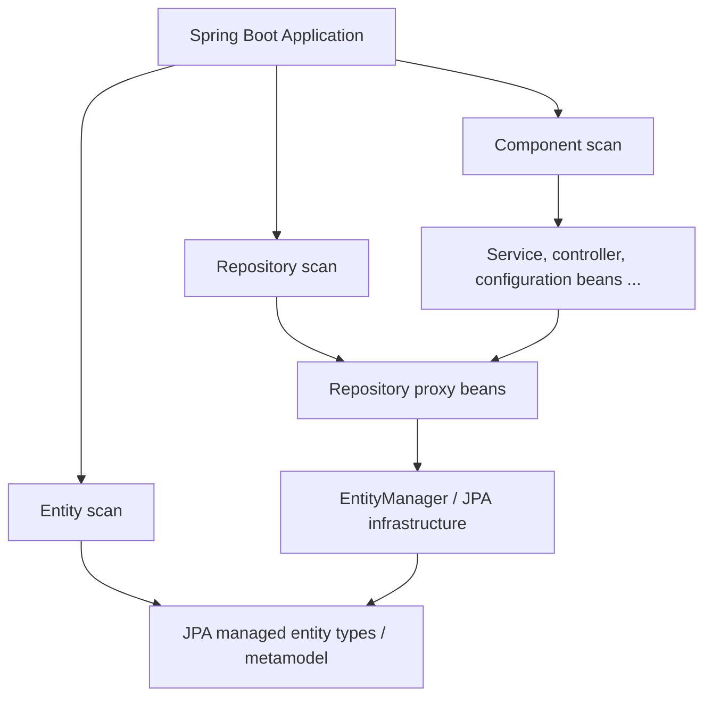
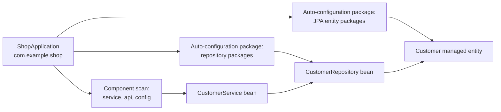
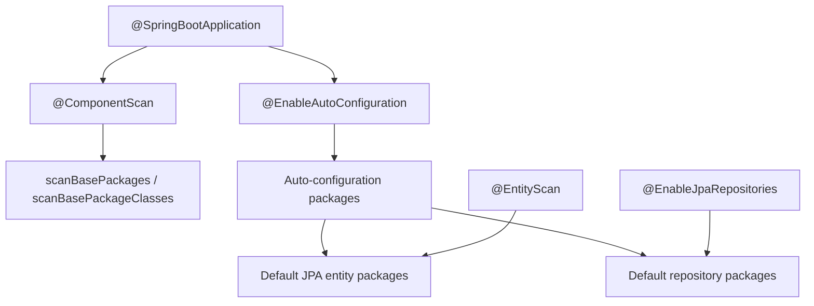
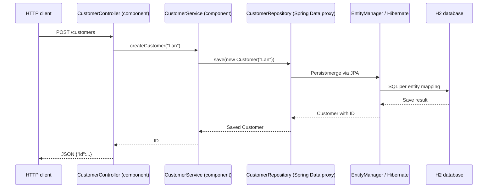

# Component Scan Scope Differs from Entity Scan or Repository Scan

When first working with `@SpringBootApplication`, we are often advised to "put the main class in the root package so Spring can scan the classes underneath." That advice is helpful yet incomplete, especially when a project uses Spring Data JPA. An undiscovered `@Service`, a `@Entity` not managed by Hibernate, and a `JpaRepository` interface failing to produce a bean can all surface as **startup errors**. However, they belong to **three different discovery mechanisms** and do not share the same fix.

This lesson explains the boundary between **component scan**, **JPA entity scan**, and **Spring Data repository scan** in the context of `@SpringBootApplication`. We will start from a standard package layout, observe what happens when packages are separated, and then configure each scope deliberately.

The illustrative examples use **Spring Boot 3.x**, **Java 21**, **Spring Data JPA**, and `jakarta.persistence.*` imports. The mechanics apply to Spring Boot 3.x; package, class, and property names can be substituted to match real projects.

## 1. Three Things Searched, Three Different Outcomes

Imagine an application with the following three types:

```java
@Service
public class CustomerService { /* ... */ }

@Entity
public class Customer { /* ... */ }

public interface CustomerRepository extends JpaRepository<Customer, Long> {
}
```

All three sit in the source code, yet Spring handles them along three separate paths:

| Target | Discovery mechanism | Expected outcome | Related annotations or APIs |
|---|---|---|---|
| `CustomerService` | Spring Framework **component scan** | `CustomerService` bean inside `ApplicationContext` | `@Component`, `@Service`, `@Controller`, `@Repository` (on concrete classes), `@ComponentScan` |
| `Customer` | **Entity scan** for JPA/Hibernate | `Customer` type registered in the JPA persistence unit / metamodel | `@Entity`, `@EntityScan` |
| `CustomerRepository` | Spring Data JPA **repository scan** | Spring Data creates a repository proxy bean to inject into services | `JpaRepository`, `@EnableJpaRepositories`, repository auto-configuration |

**Entities are not Spring beans by default.** Hibernate manages entities as mapped domain objects bound to a persistence context under appropriate operations. Conversely, a repository interface can become a **proxy/factory-generated Spring bean** when Spring Data registers the repository, even though you wrote no implementation class yourself.



This is a key distinction: **all three share the word "scan," yet their outputs are not the same**. Widening the scope for one scan type does not automatically widen the other two.

## 2. What Does `@SpringBootApplication` Actually Do?

The main class typically looks like:

```java
package com.example.shop;

import org.springframework.boot.SpringApplication;
import org.springframework.boot.autoconfigure.SpringBootApplication;

@SpringBootApplication
public class ShopApplication {

    public static void main(String[] args) {
        SpringApplication.run(ShopApplication.class, args);
    }
}
```

`@SpringBootApplication` combines capabilities equivalent to:

- `@SpringBootConfiguration`: marks the root configuration class.
- `@EnableAutoConfiguration`: allows Boot to evaluate auto-configurations matching the classpath, beans, and other conditions.
- `@ComponentScan`: discovers application components within the configured package scope.

With `ShopApplication` in package `com.example.shop`, **default component scanning** searches `com.example.shop` and its subpackages. For example:

```text
com.example.shop
├── ShopApplication
├── api
│   └── CustomerController      @RestController
├── service
│   └── CustomerService         @Service
├── persistence
│   ├── entity
│   │   └── Customer            @Entity
│   └── repository
│       └── CustomerRepository  extends JpaRepository<...>
└── config
    └── TimeConfiguration       @Configuration
```

In this layout, Spring can discover `CustomerController`, `CustomerService`, and `TimeConfiguration` through component scanning. However, **it is not component scanning that creates entities or repositories**:

1. `Customer` is evaluated by Spring Boot/JPA as an entity via the managed-type discovery mechanism.
2. `CustomerRepository` is discovered by Spring Data JPA and turned into a repository bean via the repository registration mechanism.

### Where Does the Default Package for Entities and Repositories Come From?

When using Spring Boot auto-configuration in the standard way, the package containing the `@SpringBootApplication` class is recorded as the **auto-configuration base package**. This mechanism flows through `@EnableAutoConfiguration` and `@AutoConfigurationPackage`, giving auto-configurations that need package-based scanning—including data configurations—an appropriate starting point.

With **default Spring Data JPA auto-configuration** and no explicit scan configuration, entities and repositories are typically searched starting from that auto-configuration base package. That is why all three mechanisms often appear to "overlap" in a small application whose main class sits in the root package.

However, **overlapping under default settings does not merge them into a single scan**. Custom configuration, technology-specific auto-configuration, and the placement of annotated classes can cause them to use different packages.

## 3. Component Scan: Which Classes Does Spring Scan to Create Beans?

`@ComponentScan` searches for types annotated with Spring component annotations in the matching packages. Example:

```java
package com.example.shop.service;

import org.springframework.stereotype.Service;

@Service
public class CustomerService {
    public String displayName(String name) {
        return "Customer: " + name;
    }
}
```

A controller can request the service via its constructor:

```java
package com.example.shop.api;

import com.example.shop.service.CustomerService;
import org.springframework.web.bind.annotation.GetMapping;
import org.springframework.web.bind.annotation.RequestParam;
import org.springframework.web.bind.annotation.RestController;

@RestController
public class CustomerController {
    private final CustomerService service;

    public CustomerController(CustomerService service) {
        this.service = service;
    }

    @GetMapping("/welcome")
    public String welcome(@RequestParam String name) {
        return service.displayName(name);
    }
}
```

Here, `@Service` and `@RestController` are both stereotype annotations tied to `@Component`, so Spring can discover and register them as beans if they sit within the scan scope. Constructor injection works when the context holds a bean satisfying the `CustomerService` type.

### Is `@Repository` Always Repository Scanning?

No. The `org.springframework.stereotype.Repository` annotation can be placed on **a hand-written DAO class**:

```java
package com.example.shop.dao;

import org.springframework.stereotype.Repository;

@Repository
public class LegacyCustomerDao {
    public long countFromLegacySource() {
        return 0L;
    }
}
```

This is a **Spring component**, discovered by component scanning just like other stereotypes. By contrast:

```java
public interface CustomerRepository extends JpaRepository<Customer, Long> {
}
```

is a **Spring Data repository interface**: Spring Data registers a proxy/factory-produced bean based on the interface and metadata. It does not require you to write a concrete implementation or annotate the interface with `@Repository` in the standard case. Both cases can result in a bean serving a data-access role, yet the bean registration sources differ.

## 4. Entity Scan: Which Types Does JPA Manage?

JPA handles classes mapped with annotations such as `@Entity`. Example:

```java
package com.example.shop.persistence.entity;

import jakarta.persistence.Entity;
import jakarta.persistence.GeneratedValue;
import jakarta.persistence.GenerationType;
import jakarta.persistence.Id;
import jakarta.persistence.Table;

@Entity
@Table(name = "customers")
public class Customer {

    @Id
    @GeneratedValue(strategy = GenerationType.IDENTITY)
    private Long id;

    private String name;

    protected Customer() {
        // JPA requires an accessible no-arg constructor.
    }

    public Customer(String name) {
        this.name = name;
    }

    public Long getId() {
        return id;
    }

    public String getName() {
        return name;
    }
}
```

`@Entity` describes a data type that a JPA provider like Hibernate can manage and map. Entities live in the **JPA metamodel** of the persistence unit once recognized. Spring does not normally register each `Customer` instance as a singleton bean in the `ApplicationContext`.

An entity loaded by a repository, or a new entity created by the application via `new Customer("Lan")`, has a **JPA entity** lifecycle (transient, managed, detached, removed depending on operations and the persistence context), not the Spring singleton bean lifecycle of `@Service`.

Therefore, it would be a modeling mistake to write:

```java
@Autowired
private Customer customer; // Not how you retrieve an entity record.
```

To load data, call a repository or `EntityManager`. To create a new record, instantiate an entity with appropriate values and save it via persistence mechanisms.

**Entity scanning does not create database tables on its own.** Whether schema tables are created or updated depends on database settings, Hibernate schema generation, initialization scripts, Flyway/Liquibase, and migration workflows. "Entity is managed by JPA" and "database already has the table" are two distinct states.

### Where Does `@EntityScan` Intervene?

If entities lie outside the application's default package, you can declare:

```java
import com.example.shared.model.Customer;
import org.springframework.boot.autoconfigure.domain.EntityScan;

@EntityScan(basePackageClasses = Customer.class)
```

This is an **illustrative annotation snippet** placed on a configuration class, not a standalone Java class. `basePackageClasses` uses the package containing the class as its starting point, reducing errors during package renames compared to string literals. With Spring Boot JPA auto-configuration, `@EntityScan` affects the packages searched for JPA managed types; it **does not turn `@Service` classes outside the component scan scope into beans** and **does not enable Spring Data repository scanning on its own**.

Within the Spring Boot ecosystem, entity scan metadata may also be used by certain other datastore mappings; this lesson examines only the JPA effects.

## 5. Repository Scan: Finding Interfaces to Create Repository Beans

Spring Data JPA provides interfaces such as `Repository`, `CrudRepository`, and `JpaRepository`. A common declaration:

```java
package com.example.shop.persistence.repository;

import com.example.shop.persistence.entity.Customer;
import org.springframework.data.jpa.repository.JpaRepository;

public interface CustomerRepository extends JpaRepository<Customer, Long> {
    // Spring Data JPA provides basic operations through a repository proxy.
}
```

This interface has no implementation body written by you. When Spring Data JPA is active and discovers the repository, Spring Data infrastructure creates a repository bean using the JPA `EntityManager` to execute the corresponding operations.

Services can inject the repository:

```java
package com.example.shop.service;

import com.example.shop.persistence.entity.Customer;
import com.example.shop.persistence.repository.CustomerRepository;
import org.springframework.stereotype.Service;
import org.springframework.transaction.annotation.Transactional;

@Service
public class CustomerService {
    private final CustomerRepository repository;

    public CustomerService(CustomerRepository repository) {
        this.repository = repository;
    }

    @Transactional
    public Long register(String name) {
        Customer saved = repository.save(new Customer(name));
        return saved.getId();
    }
}
```

In this service variant, `CustomerService` is a bean discovered by **component scan**; `CustomerRepository` is a bean created by **repository infrastructure**; `Customer` is a **JPA managed entity** type. Calling `repository.save(...)` connects the three mechanisms without merging them into one.

### Where Does `@EnableJpaRepositories` Intervene?

You can declare explicitly:

```java
import com.example.shared.persistence.CustomerRepository;
import org.springframework.data.jpa.repository.config.EnableJpaRepositories;

@EnableJpaRepositories(basePackageClasses = CustomerRepository.class)
```

This annotation controls **where Spring Data JPA searches for repository interfaces**. When `basePackages`/`basePackageClasses` is omitted, `@EnableJpaRepositories` normally defaults to the package of the configuration class carrying that annotation. This is separate from setting `scanBasePackages` on `@SpringBootApplication`.

You do not always need `@EnableJpaRepositories`: when using `spring-boot-starter-data-jpa` with auto-configuration enabled and a standard package layout, Boot can automatically enable repository configuration. Explicit declarations are only needed when you require custom scope or specialized repository settings.

## 6. A Project Placed in the Right Root Package: All Three Work Together

Consider this example layout:

```text
src/main/java/
└── com/example/shop/
    ├── ShopApplication.java
    ├── api/
    │   └── CustomerController.java
    ├── service/
    │   └── CustomerService.java
    └── persistence/
        ├── entity/
        │   └── Customer.java
        └── repository/
            └── CustomerRepository.java
```

In an application with the Spring Boot Data JPA starter, a suitable database, and JPA/repository auto-configuration enabled, **you do not need `@ComponentScan`, `@EntityScan`, or `@EnableJpaRepositories` just to support this layout**.

An illustrative Gradle Groovy DSL dependency configuration:

```groovy
dependencies {
    implementation 'org.springframework.boot:spring-boot-starter-data-jpa'
    runtimeOnly 'com.h2database:h2'
    testImplementation 'org.springframework.boot:spring-boot-starter-test'
}
```

The snippet above is only the `dependencies` block in a project that already has the Spring Boot Gradle plugin, Java plugin, and appropriate dependency version management. It is not a complete `build.gradle`.

To practice with an in-memory H2 database, you can add `src/main/resources/application.yml`:

```yaml
spring:
  datasource:
    url: jdbc:h2:mem:shopdb;DB_CLOSE_DELAY=-1
    driver-class-name: org.h2.Driver
    username: sa
    password: ""
  jpa:
    hibernate:
      ddl-auto: create-drop
    show-sql: true
```

`ddl-auto: create-drop` is suitable only for **practice exercises using a temporary database**; when a real application holds persistent data, use an appropriate schema/migration strategy. The database name and H2 URL here are unrelated to scan scopes; they simply let JPA initialize enough infrastructure to observe behavior.

Note: if you want to use the HTTP `CustomerController` in the example, you also need `spring-boot-starter-web`. Without the web starter, Spring MVC classes will lack dependencies. To focus purely on the three scan types, you can use the service and repository without writing a controller yet.



When all classes live beneath the same root, the default scopes happen to align. A common mistake is thinking `@ComponentScan` did all the work.

## 7. Important Case: Classes Outside the Root Package

Suppose we organize across multiple modules or share a data model:

```text
src/main/java/
└── com/example/
    ├── shop/
    │   ├── ShopApplication.java               @SpringBootApplication
    │   └── api/
    │       └── CustomerController.java         @RestController
    ├── business/
    │   └── CustomerService.java               @Service
    └── shared/
        └── persistence/
            ├── Customer.java                  @Entity
            └── CustomerRepository.java        extends JpaRepository
```

The main class sits in `com.example.shop`. Under the default configuration:

- `CustomerController` lies beneath `com.example.shop`, so it falls within component scan.
- `CustomerService` in `com.example.business` lies **outside** the main class's component scan region.
- `Customer` in `com.example.shared.persistence` lies **outside** the default auto-configuration base package for JPA entities.
- `CustomerRepository` in `com.example.shared.persistence` lies **outside** Boot's default repository scan.

To see the separation clearly, try updating the main annotation:

```java
@SpringBootApplication(scanBasePackages = "com.example")
public class ShopApplication {
    // ...
}
```

Component scanning can now discover `CustomerService` because it sits under `com.example`. Yet **`scanBasePackages` is an alias for `@ComponentScan`'s attribute; it does not automatically alter the entity scan or Spring Data repository scan scope**. Entities and repositories outside the auto-configuration base package may still not be processed as desired.

This is the core scenario of the lesson: a change that looks like "scan everything" only resolves **Spring components**, without ensuring JPA entities and Spring Data repositories are registered.

## 8. Configuring the Three Scopes Independently for Separated Packages

If the project needs to preserve sibling packages like those above, configure each mechanism explicitly. A way to avoid package strings is using **type-safe package markers** from real classes/interfaces.

Example `src/main/java/com/example/shop/ShopApplication.java`:

```java
package com.example.shop;

import com.example.business.CustomerService;
import com.example.shared.persistence.Customer;
import com.example.shared.persistence.CustomerRepository;
import org.springframework.boot.SpringApplication;
import org.springframework.boot.autoconfigure.SpringBootApplication;
import org.springframework.boot.autoconfigure.domain.EntityScan;
import org.springframework.data.jpa.repository.config.EnableJpaRepositories;

@SpringBootApplication(
        scanBasePackageClasses = {
                ShopApplication.class,
                CustomerService.class
        }
)
@EntityScan(basePackageClasses = Customer.class)
@EnableJpaRepositories(basePackageClasses = CustomerRepository.class)
public class ShopApplication {

    public static void main(String[] args) {
        SpringApplication.run(ShopApplication.class, args);
    }
}
```

Each annotation serves a specific purpose:

| Configuration | Inferred package | Intended effect |
|---|---|---|
| `scanBasePackageClasses = {ShopApplication.class, CustomerService.class}` | `com.example.shop` and `com.example.business` | Scans controllers/services/configurations under these two regions. |
| `@EntityScan(basePackageClasses = Customer.class)` | `com.example.shared.persistence` | Includes `Customer` in the packages JPA inspects for managed types. |
| `@EnableJpaRepositories(basePackageClasses = CustomerRepository.class)` | `com.example.shared.persistence` | Spring Data JPA searches for the `CustomerRepository` interface to register its repository bean. |

`basePackageClasses` extracts **the package of each provided type**, rather than checking only that single class. If multiple packages contain entities or repositories, you can pass multiple marker classes in the respective arrays. For packages lacking a suitable class to reference, you can create a dedicated marker type or use string-based `basePackages`, keeping refactoring maintenance in mind.

**Do not add `Customer.class` to `scanBasePackageClasses` to turn it into a Spring bean.** Entities belong to JPA, so they must be managed under JPA semantics.

### Could You Move the Main Class Up to `com.example` Instead of Declaring Three Scans?

Yes. If all classes belong to the same application and no architectural constraint forbids it, placing the main class in `com.example` typically lets the default scopes cover all three branches. However, in multi-module projects, widening root scanning too far can register services, configurations, or repositories that do not belong to the current application.

Package organization decisions should therefore reflect **application and module boundaries**, not merely a desire to make a startup error disappear.

## 9. What Happens If You Adjust Only One Scan?

Take the separated package structure from section 7 and apply each change independently:

| Change | What improves | What may still be missing |
|---|---|---|
| Only widen `@SpringBootApplication(scanBasePackages = "com.example")` | `CustomerService` and controllers under the new range can become beans | The `Customer` entity and Spring Data repository still sit outside their dedicated scan scopes. |
| Only add `@EntityScan(basePackageClasses = Customer.class)` | JPA can recognize `Customer` as a managed entity | The repository interface still lacks a bean; services outside the package remain unscanned. |
| Only add `@EnableJpaRepositories(basePackageClasses = CustomerRepository.class)` | Spring Data knows where to find the repository interface | If JPA does not recognize `Customer`, repository creation can fail with `Not a managed type`; out-of-scope services remain missing. |
| Configure all three appropriately for the chosen architecture | Spring has service beans, JPA has entity metadata, Spring Data has repository beans | Still requires appropriate dependencies and database/JPA infrastructure to run. |

A very common mistake is adding only `@EnableJpaRepositories` when seeing that `CustomerRepository` does not exist. Once the repository is found, Spring Data attempts to build the repository proxy and only then discovers that the `Customer` entity is not managed by JPA. **The error changing from "missing repository bean" to "Not a managed type" is a clue pointing to the next configuration step**, not proof that `@EnableJpaRepositories` handled entity scanning too.

## 10. Why Doesn't `@SpringBootApplication(scanBasePackages=...)` Replace the Other Two Annotations?

Looking one level deeper:

1. `@SpringBootApplication` has `scanBasePackages`/`scanBasePackageClasses` attributes as aliases for **`@ComponentScan`**.
2. `@EnableAutoConfiguration` activates auto-configuration and records the root package information into the **`@AutoConfigurationPackage`** mechanism.
3. JPA entity discovery and Spring Data repository registration have their own auto-configurations, base packages, and configuration annotations.
4. Changing `@ComponentScan`'s aliases **does not automatically change the base packages** used by all other auto-configurations.



The diagram depicts the **standard configuration path** in Spring Boot with JPA. When a project has custom JPA configuration classes, multiple data sources, multiple entity managers, or disabled auto-configuration, those custom rules determine the final scopes. Therefore, if a project uses manual persistence configuration, check where `EntityManagerFactory` is built and how repositories reference it.

## 11. Complete Example: Service Using Repository and Entity

We can connect all three layers to observe the runtime flow. Reuse the `Customer` entity class from section 4 and the `CustomerRepository` interface from section 5, placing them in their respective packages.

The service below belongs to `com.example.business`:

```java
package com.example.business;

import com.example.shared.persistence.Customer;
import com.example.shared.persistence.CustomerRepository;
import org.springframework.stereotype.Service;
import org.springframework.transaction.annotation.Transactional;

@Service
public class CustomerService {

    private final CustomerRepository customerRepository;

    public CustomerService(CustomerRepository customerRepository) {
        this.customerRepository = customerRepository;
    }

    @Transactional
    public Long createCustomer(String name) {
        Customer customer = new Customer(name);
        return customerRepository.save(customer).getId();
    }

    @Transactional(readOnly = true)
    public long countCustomers() {
        return customerRepository.count();
    }
}
```

The controller below belongs to `com.example.shop.api`. To use it, the project must also include `spring-boot-starter-web`:

```java
package com.example.shop.api;

import com.example.business.CustomerService;
import org.springframework.web.bind.annotation.GetMapping;
import org.springframework.web.bind.annotation.PostMapping;
import org.springframework.web.bind.annotation.RequestBody;
import org.springframework.web.bind.annotation.RequestMapping;
import org.springframework.web.bind.annotation.RestController;

@RestController
@RequestMapping("/customers")
public class CustomerController {

    private final CustomerService service;

    public CustomerController(CustomerService service) {
        this.service = service;
    }

    @PostMapping
    public CustomerCreated create(@RequestBody CreateCustomer request) {
        return new CustomerCreated(service.createCustomer(request.name()));
    }

    @GetMapping("/count")
    public long count() {
        return service.countCustomers();
    }

    public record CreateCustomer(String name) {}

    public record CustomerCreated(Long id) {}
}
```

Update the dependencies block in a Gradle project configured for Boot:

```groovy
dependencies {
    implementation 'org.springframework.boot:spring-boot-starter-web'
    implementation 'org.springframework.boot:spring-boot-starter-data-jpa'
    runtimeOnly 'com.h2database:h2'
    testImplementation 'org.springframework.boot:spring-boot-starter-test'
}
```

Keep the three-scope configuration annotations from section 8 and the practice H2 configuration, then run the application in your project. You can send requests:

```bash
curl -X POST "http://localhost:8080/customers" \
     -H "Content-Type: application/json" \
     -d '{"name":"Lan"}'

curl "http://localhost:8080/customers/count"
```

When a customer is saved successfully, the first API returns JSON containing the ID, and the second returns the current customer count. The exact ID value is assigned by the database, so do not assume the first record always has ID 1 across every environment.

Execution flow:



The controller and service are registered via **component scan**; the repository interface is turned into a **repository bean** by Spring Data; entity metadata is read by Hibernate via **entity scan**. Each mechanism completes one part of the task.

## 12. Symptoms When Each Scan Is Misconfigured

### 12.1. Service or Controller Is Not Registered

A common error:

```text
Parameter 0 of constructor in ...CustomerController
required a bean of type '...CustomerService'
that could not be found.
```

If the `CustomerService` class has `@Service` yet sits outside component scanning, Spring will not register the bean. Check the main class's package, stereotype annotations, and `@ComponentScan` scope. Do not edit `@EntityScan` to fix this error.

### 12.2. Repository Interface Has No Bean

You may see:

```text
Parameter 0 of constructor in ...CustomerService
required a bean of type '...CustomerRepository'
that could not be found.
```

Investigate repository scanning and JPA infrastructure: is `spring-boot-starter-data-jpa` present, is the repository in a package searched by Spring Data JPA, was auto-configuration disabled, and does the interface extend the right repository type?

Note: a repository bean can also fail to be created due to another error while building the context; read the deepest root cause in the stack trace before concluding it is purely a scan-scope issue.

### 12.3. Repository Is Found, Yet the Entity Is Not Managed

Typical message:

```text
java.lang.IllegalArgumentException: Not a managed type:
class com.example.shared.persistence.Customer
```

This error typically occurs when a repository references a domain type not yet recognized by the current JPA metamodel. Check `@Entity`, the `jakarta.persistence.Entity` import, JPA entity scan packages, persistence unit names, and `EntityManagerFactory` configuration. **Expanding component scanning does not solve the root cause of this error.**

### 12.4. Entity Is Recognized, Yet the Table Does Not Exist

Example:

```text
Table "CUSTOMERS" not found
```

This can be a schema/DDL issue, database URL issue, unapplied migration, or table naming convention mismatch. Even when entity scanning is right, the database still needs the matching table. Distinguish *managed type* errors from *table/column/schema* errors.

### 12.5. Repository Initialization Fails Because of a Query

A repository method whose name does not match an entity property can cause Spring Data to report a query-parsing error. That proves the repository was already **discovered**, yet the repository method declaration is invalid. Not all repository errors are caused by scan scope.

## 13. Verifying Outcomes Using Context and JPA Metamodel

Instead of guessing whether an annotation took effect, inspect the specific output produced by each scan:

| What you want to prove | Appropriate verification source |
|---|---|
| `CustomerService` is a Spring bean | `ApplicationContext.getBean(CustomerService.class)` or Actuator `/actuator/beans` when appropriately enabled |
| `CustomerRepository` is a Spring bean | `ApplicationContext.getBean(CustomerRepository.class)` |
| `Customer` is a JPA managed type | `EntityManagerFactory.getMetamodel().entity(Customer.class)` |
| The `customers` table actually exists in the database | Query schema/metadata or execute a controlled repository query |

A context startup test can illustrate the distinction:

```java
package com.example.shop;

import static org.assertj.core.api.Assertions.assertThat;

import com.example.business.CustomerService;
import com.example.shared.persistence.Customer;
import com.example.shared.persistence.CustomerRepository;
import jakarta.persistence.EntityManagerFactory;
import org.junit.jupiter.api.Test;
import org.springframework.beans.factory.annotation.Autowired;
import org.springframework.boot.test.context.SpringBootTest;
import org.springframework.context.ApplicationContext;

@SpringBootTest
class ScanBoundariesTest {

    @Autowired
    ApplicationContext context;

    @Autowired
    EntityManagerFactory entityManagerFactory;

    @Test
    void serviceAndRepositoryAreBeansButCustomerIsJpaEntity() {
        assertThat(context.getBean(CustomerService.class)).isNotNull();
        assertThat(context.getBean(CustomerRepository.class)).isNotNull();

        assertThat(entityManagerFactory.getMetamodel()
                .entity(Customer.class).getJavaType()).isEqualTo(Customer.class);
    }
}
```

The test assumes dependencies and database are configured as in the previous section, the main class sits in the right project package, and the context starts cleanly. Checking `getBean(...)` proves Spring bean registration; checking the metamodel proves JPA managed-type registration. We **do not check the entity with `context.getBean(Customer.class)`**, because entities are not singleton Spring beans by default.

## 14. Notes for Multiple Modules or Multiple Data Sources

In an application with one database, one persistence unit, and a clean package layout, the three scans rarely need manual declarations. However, larger projects may have:

- Multiple modules containing `entity` and `repository` packages.
- Multiple `DataSource` and `EntityManagerFactory` instances.
- Repositories using different technologies, such as JPA and MongoDB.
- Spring configurations imported intentionally rather than broad component scanning.

In such cases, scanning should align with **functional boundaries and data infrastructure**. With multiple entity managers, `@EnableJpaRepositories` also provides attributes like `entityManagerFactoryRef` and `transactionManagerRef` to wire repositories to the right persistence unit and transaction manager. Likewise, each `EntityManagerFactory` must manage its own set of entities (typically configured separately by packages or managed types). Placing a single broad `@EntityScan` on the main class does not fully solve multi-persistence-unit setups.

Another point to remember: **repository scanning is specific to each Spring Data module**. `@EnableJpaRepositories` belongs to JPA; Spring Data MongoDB has its own repository configuration mechanism. Do not treat one JPA annotation as a switch that scans repositories across every data technology.

In applications using many libraries with auto-configurations or identically named components, widening `@ComponentScan("com")` arbitrarily can pull in unwanted beans, causing conflicts or altered behavior. Configuring targeted scopes and package marker classes is generally easier to maintain.

## 15. Decision Table: Where to Look First When an Error Occurs?

| Question | If the answer is "no" | Where to check |
|---|---|---|
| Does Spring have a `CustomerService` bean? | Service was not scanned/registered or context startup failed | `@ComponentScan`, `@Service`, main class package |
| Does Spring have a `CustomerRepository` bean? | Repository scan or Spring Data JPA setup is misaligned | `@EnableJpaRepositories`, repository auto-configuration, dependencies |
| Does JPA have the `Customer` managed type? | Persistence unit entity discovery/metadata is misaligned | `@Entity`, `@EntityScan`, `EntityManagerFactory` |
| Does the database have the `customers` table? | Schema/migration/connection is misaligned | Hibernate DDL, Flyway/Liquibase, database |
| Do repository methods execute properly? | Query, mapping, transaction, or data is incorrect | Repository declarations, JPA mappings, and SQL |

Read stack traces down to the **deepest root cause**; many errors surface as "Failed to start ApplicationContext," while the actual failure sits in bean injection, entity metadata, or the database.

### An Ordered Diagnostic Workflow

1. **Identify the root package:** where is the `@SpringBootApplication` class placed?
2. **Identify the missing item's type:** is the missing item a Spring component, a JPA entity, or a Spring Data repository?
3. **Check dependencies:** are the JPA starter, database driver, and JPA configuration present?
4. **Identify active scan configurations:** are component scan, entity scan, and repository scan using defaults or explicit declarations?
5. **Verify the matching output:** bean in `ApplicationContext` or managed type in the JPA metamodel?
6. **Only then adjust scope:** relocate the root package or declare explicit scans matching the architecture.

This workflow helps avoid the habit of "adding a `@ComponentScan` covering the entire codebase" when the real error lies in JPA or repository infrastructure.

## 16. Practice Exercise: Adjusting Each Scope Independently

Create a small project like section 7 with packages `com.example.shop`, `com.example.business`, and `com.example.shared.persistence`. Keep JPA and H2 dependencies fully configured. Then apply each change independently:

**Step A — Widen component scan only.** Set `scanBasePackages = "com.example"` on `@SpringBootApplication`. Predict which service can now be discovered and why out-of-root entities/repositories still may not work.

**Step B — Add repository scan without entity scan.** Add `@EnableJpaRepositories(basePackageClasses = CustomerRepository.class)`. Observe the case where the repository is registered yet JPA reports `Not a managed type` for `Customer`.

**Step C — Add entity scan.** Add `@EntityScan(basePackageClasses = Customer.class)`. Explain why Spring Data can now build the repository with a domain type recognized by JPA.

**Step D — Verify each output.** Use `ApplicationContext` to retrieve the service/repository beans, and `EntityManagerFactory.getMetamodel()` to look up the entity. Cross-check with API responses or repository calls.

**Step E — Move everything under a shared root package.** Place `ShopApplication` in an appropriate upper-level package and remove the explicit scan annotations. Explain why default configuration can be sufficient for small projects.

At each step, explicitly note **which change affects component beans, which affects JPA managed types, and which creates the Spring Data repository proxy**. That proves you truly understand the boundary between the three mechanisms.

## 17. Questions You Should Be Able to Answer

1. Which core annotations does `@SpringBootApplication` include, and which one is responsible for component scanning?
2. If a `@Service` class sits outside the package containing the main class, does Spring automatically register it as a bean?
3. Why does `@Entity` not turn each entity into a singleton bean that can be `@Autowired`?
4. By what mechanism does Spring Data turn a `JpaRepository` interface into a bean?
5. Does `@SpringBootApplication(scanBasePackages = "com.example")` automatically expand JPA entity scanning or repository scanning? Why or why not?
6. How do `@EntityScan(basePackageClasses = Customer.class)` and `@EnableJpaRepositories(basePackageClasses = CustomerRepository.class)` solve two different problems?
7. How does a missing `CustomerService` error differ from a missing `CustomerRepository` error and a `Not a managed type` error?
8. Why can an entity be recognized correctly while a table-not-found error still occurs?
9. When there are multiple data sources or multiple entity managers, is widening a single package scan enough?
10. For an initial project, where should the main class be placed so Spring Boot defaults behave predictably?

### Sample Complete Explanation

> Component scanning searches for component classes such as `@Service`, `@Controller`, and `@Configuration` so Spring manages them as beans. Entity scanning searches for `@Entity` types so JPA/Hibernate knows how to map data and add them to the metamodel; entities are not Spring beans by default. Repository scanning is performed by Spring Data JPA to locate interfaces like `JpaRepository` and create repository proxy beans. In Spring Boot, all three scopes often share the same default root package when the `@SpringBootApplication` class sits at the root. However, `scanBasePackages` on this annotation only adjusts component scanning—it does not automatically adjust entity or repository scanning. If entities and repositories reside outside the default region, configure `@EntityScan` and `@EnableJpaRepositories` appropriately or reorganize the root package.

Once you can point to **component beans in `ApplicationContext`**, **entities in the JPA metamodel**, and **repository proxies registered by Spring Data**, you have mastered the boundary that `@SpringBootApplication` often causes beginners to conflate. This is the foundation for handling Spring Boot projects with multiple packages, modules, or persistence configurations without relying on a single scan annotation for everything.
