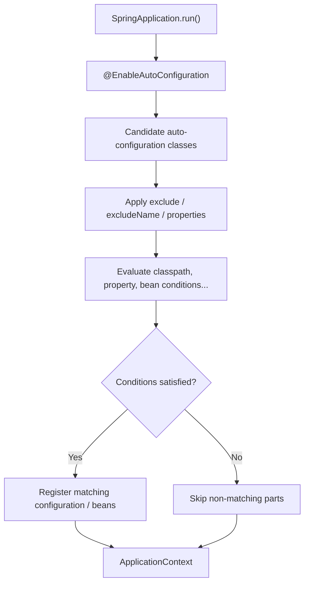

# `exclude`, `excludeName`, and Excluding a Specific Auto-Configuration

> **Spring Boot Fundamentals → `@SpringBootApplication`**  
> In Spring Boot, many infrastructure beans are auto-configured based on present dependencies, properties, and existing beans. Sometimes a particular auto-configuration does not fit an application. `@SpringBootApplication` provides two attributes—**`exclude`** and **`excludeName`**—to instruct Spring Boot **not to include a specific auto-configuration class in the auto-configuration process**. This lesson guides you on choosing the right attribute, understanding the limits of exclusion, and systematically verifying the outcome.

## 1. Why Is It Sometimes Necessary to Exclude an Auto-Configuration?

A major advantage of Spring Boot is reducing manual boilerplate configuration. For instance, after adding `spring-boot-starter-jdbc`, Boot can automatically set up a `DataSource`, transaction manager, and related components when conditions match. After adding a web starter, Boot can create Spring MVC infrastructure and an embedded server.

However, **having a dependency on the classpath** does not always mean the application **wants to use that feature at runtime**. Some common scenarios:

- An HTTP application temporarily inherits a JDBC dependency from a shared module, yet at this stage does not need a database connection.
- A project wants to replace an automatic setup with a custom mechanism after clearly determining which beans the application must supply.
- An auto-configured integration is not yet compatible with the current architecture or environment.
- A test suite or auxiliary application shares dependencies without needing specific auto-configured infrastructure.

Spring Boot allows **selective exclusion**:

```java
@SpringBootApplication(exclude = DataSourceAutoConfiguration.class)
```

That line means: when selecting auto-configurations, **skip** the `DataSourceAutoConfiguration` class. It does not mean "remove JDBC from the classpath," "forbid all `DataSource` beans," or "disable all database features."

### 1.1. Three Concepts to Distinguish

| Action | Impact | Example |
| --- | --- | --- |
| **Exclude an auto-configuration** | Prevents Spring Boot from importing the specified auto-configuration | `@SpringBootApplication(exclude = DataSourceAutoConfiguration.class)` |
| **Exclude a dependency** | Changes which JARs appear on the classpath after building | Gradle `exclude group: ..., module: ...` or Maven `<exclusions>` |
| **Customize/define a bean** | Changes actual components in `ApplicationContext`, which may cause an auto-configuration to back off conditionally | Declaring the application's own `@Bean DataSource` |

These three approaches solve **different problems**. Some cases only need a property, some warrant removing an unneeded dependency, and some require excluding an auto-configuration. Do not choose exclusion simply because it looks like the fastest way to make a startup error vanish.

## 2. How Does `@SpringBootApplication` Relate to Auto-Configuration?

A typical startup class:

```java
package com.example.catalog;

import org.springframework.boot.SpringApplication;
import org.springframework.boot.autoconfigure.SpringBootApplication;

@SpringBootApplication
public class CatalogApplication {

    public static void main(String[] args) {
        SpringApplication.run(CatalogApplication.class, args);
    }
}
```

The `@SpringBootApplication` annotation brings together three core mechanism groups:

| Component annotation | Role |
| --- | --- |
| `@SpringBootConfiguration` | Identifies the application's primary configuration class, built on `@Configuration` |
| `@EnableAutoConfiguration` | Allows Spring Boot to select and apply appropriate auto-configurations |
| `@ComponentScan` | Scans for components in the startup class's package and its subpackages by default |

`exclude` and `excludeName` on `@SpringBootApplication` are attributes forwarded to the `@EnableAutoConfiguration` mechanism.

This matters because **component scanning and auto-configuration are not the same mechanism**:

- `@ComponentScan` searches for controllers, services, components, and beans declared by the application or libraries within the configured scan scope.
- `@EnableAutoConfiguration` imports auto-configuration classes known to Spring Boot and evaluates their corresponding conditions.

Do not use `exclude` as a substitute for narrowing scan packages, and do not use `scanBasePackages` to try to disable an auto-configuration.

### 2.1. How Does Spring Boot Select Auto-Configurations?

Conceptually, the process flows like this:



Spring Boot uses metadata and an auto-configuration import mechanism appropriate to its version, rather than simply component-scanning every class in a package. In **Spring Boot 3.x**, auto-configuration registration metadata lives under `META-INF/spring/org.springframework.boot.autoconfigure.AutoConfiguration.imports` in the respective JARs.

Key takeaway: `exclude`/`excludeName` are used to **remove auto-configuration candidates**. Conditions such as `@ConditionalOnClass`, `@ConditionalOnProperty`, or `@ConditionalOnMissingBean` remain a separate evaluation layer for configurations that were not excluded.

### 2.2. Condition Mismatch Differs from Exclusion

For example, an auto-configuration may require `javax.sql.DataSource` or a specific driver/setup. If the required condition is not met, it can skip itself automatically without the developer writing `exclude`.

Two distinct states:

- **Condition mismatch:** Spring Boot evaluated the configuration, yet conditions caused it not to apply.
- **Excluded:** the developer explicitly instructed Boot to drop that configuration from the candidate list.

In the condition evaluation report, these two states typically leave distinct entries. Distinguishing them clarifies whether Spring Boot made a sensible automatic decision or you explicitly intervened.

## 3. `exclude`: Specifying Auto-Configurations by Class

The `exclude` syntax takes `Class<?>[]`. In Java, it accepts one or more class literals.

The main example of this lesson, using class names in **Spring Boot 3.x**:

```java
package com.example.catalog;

import org.springframework.boot.SpringApplication;
import org.springframework.boot.autoconfigure.SpringBootApplication;
import org.springframework.boot.autoconfigure.jdbc.DataSourceAutoConfiguration;

@SpringBootApplication(exclude = DataSourceAutoConfiguration.class)
public class CatalogApplication {

    public static void main(String[] args) {
        SpringApplication.run(CatalogApplication.class, args);
    }
}
```

### 3.1. Reading the Example Line by Line

- `@SpringBootApplication` marks the configuration/startup class and enables auto-configuration.
- `exclude = ...` requests excluding classes from auto-configuration processing.
- `DataSourceAutoConfiguration.class` is a **class literal**, not a bean name or property string.
- `org.springframework.boot.autoconfigure.jdbc.DataSourceAutoConfiguration` is the fully qualified name of the auto-configuration used in this Spring Boot 3.x example.
- `SpringApplication.run(...)` still boots the application context and all other **non-excluded** auto-configurations.

If the application has Spring Web properly configured, web auto-configuration continues working normally. Excluding datasource does not automatically shut down the HTTP server.

### 3.2. Why Is `exclude` Usually the Clearest Choice?

When the auto-configuration class is on the compile classpath and can be imported directly, `exclude` offers several benefits:

1. **IDE navigation works** straight to the excluded class.
2. **The compiler checks the class name**; import mistakes or nonexistent classes are caught early.
3. **Refactoring is easier to track** when code or dependencies change.
4. Readers do not have to memorize package paths as raw strings.

For example, the Java compiler recognizes `DataSourceAutoConfiguration.class` as a class literal. If you mistype the class or package name in source code, the error typically appears at compile time before running the application.

**Drawback:** code must be able to reference that class at compile time. If an optional auto-configuration class is absent from the module's compile classpath, the class literal syntax is unsuitable.

### 3.3. Excluding Multiple Auto-Configurations

Since the attribute is a class array, you can use array syntax:

```java
import org.springframework.boot.autoconfigure.SpringBootApplication;
import org.springframework.boot.autoconfigure.jdbc.DataSourceAutoConfiguration;
import org.springframework.boot.autoconfigure.orm.jpa.HibernateJpaAutoConfiguration;

@SpringBootApplication(exclude = {
        DataSourceAutoConfiguration.class,
        HibernateJpaAutoConfiguration.class
})
public class CatalogApplication {
    // ...
}
```

This example demonstrates multi-class syntax—**use it only when the application genuinely wants to exclude both configurations**. `HibernateJpaAutoConfiguration` is tied to JPA infrastructure; if the application has JPA repositories/services needing an `EntityManager`, excluding it can prevent startup or break functionality.

There is no inherent benefit to excluding as many classes as possible. Identify the exact auto-configuration class to exclude and the reason why.

## 4. `excludeName`: Specifying by Fully Qualified Class Name

`excludeName` achieves the same goal with a different **data type**: instead of `Class<?>[]`, it accepts `String[]`.

Example:

```java
package com.example.catalog;

import org.springframework.boot.SpringApplication;
import org.springframework.boot.autoconfigure.SpringBootApplication;

@SpringBootApplication(
        excludeName =
                "org.springframework.boot.autoconfigure.jdbc.DataSourceAutoConfiguration"
)
public class CatalogApplication {

    public static void main(String[] args) {
        SpringApplication.run(CatalogApplication.class, args);
    }
}
```

This likewise requests excluding `DataSourceAutoConfiguration` in the Spring Boot 3.x example context.

### 4.1. When Is `excludeName` Useful?

It helps when you need to **specify the auto-configuration class name as a string**, such as:

- A module wants to avoid a direct compile-time reference to an auto-configuration class from an optional library.
- The configuration must compile even when a particular auto-configuration class is absent from that module's compile classpath.
- You need to name a known class without a direct Java import.

However, `excludeName` does not load JARs on its own, nor does it turn a class missing from the classpath into a bean. It only supplies **the configuration name to exclude** to the auto-configuration selection mechanism.

### 4.2. In Return, Strings Must Be Managed Carefully

`excludeName` has several limitations:

- The Java compiler **does not fully validate** the class name string.
- If a library upgrades and renames or moves the auto-configuration package, the string can become stale.
- IDEs may offer limited string navigation depending on tooling.
- If the name is wrong or points to a class not considered an auto-configuration, results may be unexpected; Spring Boot may even report an invalid configuration error depending on the case.

Therefore, when the class is available to import and avoiding a compile-time dependency is unnecessary, `exclude` is usually easier to read and maintain. `excludeName` is a tool for specific situations, not universally better.

### 4.3. Multiple Names Example

```java
@SpringBootApplication(excludeName = {
        "org.springframework.boot.autoconfigure.jdbc.DataSourceAutoConfiguration",
        "org.springframework.boot.autoconfigure.orm.jpa.HibernateJpaAutoConfiguration"
})
public class CatalogApplication {
    // ...
}
```

You must use the **fully qualified class name**. Writing just `"DataSourceAutoConfiguration"` is typically insufficient to identify the auto-configuration class.

## 5. Comparing `exclude` and `excludeName`

| Criterion | `exclude` | `excludeName` |
| --- | --- | --- |
| Data type | `Class<?>[]` | `String[]` |
| How specified | `DataSourceAutoConfiguration.class` | `"org.springframework.boot.autoconfigure.jdbc.DataSourceAutoConfiguration"` |
| Requires class on compile classpath? | Yes | No direct type reference needed in source |
| Compiler catches wrong class name? | Typically yes | Does not check the class name as a Java type |
| IDE/refactoring support | Typically better | Depends on how the IDE handles strings |
| Goal | Exclude one or more auto-configurations | Exclude one or more auto-configurations |
| Removes dependency from JAR? | No | No |
| Changes component scan? | No | No |
| Guarantees all related beans vanish? | No | No |
| Preferred scenario | Class available, want explicit reference | Want to specify by name, avoiding compile-time reference |

Both attributes feed into the auto-configuration exclusion mechanism. They **do not represent stronger or weaker levels** of disabling a configuration.

### 5.1. Can Both Be Used Together?

Syntactically, the annotation can declare both `exclude` and `excludeName`. Spring Boot combines the classes/names to exclude into a single exclusion set.

```java
@SpringBootApplication(
        exclude = DataSourceAutoConfiguration.class,
        excludeName = {
                "org.springframework.boot.autoconfigure.orm.jpa.HibernateJpaAutoConfiguration"
        }
)
public class CatalogApplication {
    // ...
}
```

This combination is valid when there is a specific reason. In most projects, sticking to one consistent style is easier to follow. Listing the same auto-configuration in both attributes adds no extra functional effect.

## 6. Focused Example: Web Application Without a `DataSource`

Suppose a Spring Boot 3.x application has Spring Web and JDBC dependencies. However, the current version of the service returns static data only and **does not yet need database access**.

### 6.1. Dependencies in Maven

Excerpt from `pom.xml`:

```xml
<dependencies>
    <dependency>
        <groupId>org.springframework.boot</groupId>
        <artifactId>spring-boot-starter-web</artifactId>
    </dependency>

    <dependency>
        <groupId>org.springframework.boot</groupId>
        <artifactId>spring-boot-starter-jdbc</artifactId>
    </dependency>
</dependencies>
```

Assuming the Spring Boot parent/BOM manages matching versions.

`spring-boot-starter-jdbc` puts JDBC components onto the classpath. When Boot evaluates data auto-configurations, it may attempt to configure a `DataSource`. If the application lacks a connection URL/driver or a suitable embedded database, startup can fail with a message like:

```text
Failed to configure a DataSource:
'url' attribute is not specified and no embedded datasource could be configured.
```

Exact wording depends on version and conditions, yet the meaning is that Boot cannot build a usable datasource from the available information.

### 6.2. Why Can This Error Appear?

Common contributing factors:

1. JDBC/JPA dependencies satisfy the classpath conditions of the corresponding auto-configuration.
2. The application provides no custom `DataSource` bean.
3. No connection details or suitable embedded database driver are present to build a datasource.
4. Boot attempts to configure data infrastructure and hits the missing prerequisites needed for initialization.

This illustrates how dependencies affect **evaluating** an auto-configuration, while using the feature still requires complete runtime configuration.

### 6.3. Excluding the Specific Auto-Configuration

If you genuinely want the application **not to auto-configure a datasource** at this stage, you can use:

```java
package com.example.catalog;

import org.springframework.boot.SpringApplication;
import org.springframework.boot.autoconfigure.SpringBootApplication;
import org.springframework.boot.autoconfigure.jdbc.DataSourceAutoConfiguration;

@SpringBootApplication(exclude = DataSourceAutoConfiguration.class)
public class CatalogApplication {

    public static void main(String[] args) {
        SpringApplication.run(CatalogApplication.class, args);
    }
}
```

And a controller independent of the database:

```java
package com.example.catalog.web;

import java.util.Map;
import org.springframework.web.bind.annotation.GetMapping;
import org.springframework.web.bind.annotation.RestController;

@RestController
public class StatusController {

    @GetMapping("/api/status")
    public Map<String, String> status() {
        return Map.of("status", "ready");
    }
}
```

With appropriate web dependencies and **no application component requiring a `DataSource`**, the application can start the HTTP server, register the controller, and return a response:

```http
GET /api/status HTTP/1.1
Host: localhost:8080
```

```json
{
  "status": "ready"
}
```

Excluding `DataSourceAutoConfiguration` does not directly affect `StatusController` or Spring MVC configuration. Other auto-configurations continue to be evaluated normally.

### 6.4. What If Code Still Needs a Database?

Suppose a service is:

```java
package com.example.catalog.product;

import javax.sql.DataSource;
import org.springframework.stereotype.Service;

@Service
public class ProductLookupService {

    private final DataSource dataSource;

    public ProductLookupService(DataSource dataSource) {
        this.dataSource = dataSource;
    }
}
```

If no other `DataSource` bean is declared, Spring reports a dependency injection failure when creating `ProductLookupService`. Excluding an auto-configuration does not conjure a database, supply a fallback bean, or make a service needing `DataSource` work on its own.

**Conclusion from this example:** exclusion is only sensible when the application does not need the excluded infrastructure, or when the developer has intentionally provided a complete replacement.

### 6.5. When Should You Remove the Dependency Instead of Excluding?

If the service **does not need JDBC at all** and the dependency was added by mistake, a clearer solution is usually **removing `spring-boot-starter-jdbc` from the build**. Once the relevant library leaves the classpath, auto-configurations conditioned on it skip themselves automatically.

Use exclusion only when there is a reason to keep the dependency: for example, a transitive dependency temporarily needed elsewhere, a shared module, or an intentional application setup.

If `spring-boot-starter-data-jpa` or higher-level data libraries are present, excluding `DataSourceAutoConfiguration` alone may not suffice because remaining auto-configurations may still require JPA infrastructure. Inspect **the entire dependency graph and required beans**.

## 7. Another Approach: The `spring.autoconfigure.exclude` Property

Hardcoding exclusions in annotations is not always necessary. Spring Boot also supports the property:

`spring.autoconfigure.exclude`

In `application.properties`:

```properties
spring.autoconfigure.exclude=org.springframework.boot.autoconfigure.jdbc.DataSourceAutoConfiguration
```

Or `application.yml`:

```yaml
spring:
  autoconfigure:
    exclude:
      - org.springframework.boot.autoconfigure.jdbc.DataSourceAutoConfiguration
```

This is another way to instruct Spring Boot to skip a specific auto-configuration. The property format uses the **fully qualified class name**, similar in spirit to `excludeName`.

### 7.1. When Does the Property Fit Well?

- Needing to adjust auto-configuration selection per environment without editing the startup class.
- Wanting exclusions supplied from an externalized configuration source supported by Spring Boot.
- Sharing code across multiple launch modes that need to enable or disable an auto-configuration at startup time.

For instance, a test environment might not need JDBC while another environment has a full database connection. You can set the exclusion in a profile file or suitable property source, **provided** the remaining components are designed to operate under that choice.

### 7.2. This Property Is Not a Dynamic Feature Flag

`spring.autoconfigure.exclude` is applied during **application context initialization**. Changing the property while the application is running does not mean Spring Boot immediately rebuilds the entire bean graph.

Treat it as a **startup configuration decision**, not a live runtime toggle for business features after the application has already started.

### 7.3. How Do Annotations and Properties Differ in Where the Decision Lives?

| Need | Syntax | Characteristic |
| --- | --- | --- |
| Always exclude an auto-configuration in this app | `@SpringBootApplication(exclude = ...)` | Decision lives in Java source code |
| Need class name as a string | `@SpringBootApplication(excludeName = ...)` | Decision in Java without direct type reference |
| Configure exclusion from external environment | `spring.autoconfigure.exclude` | Decision flows through the property system at startup |

All three share the goal of excluding auto-configurations, differing primarily in **where they are declared**. Do not treat the property as operating on a "different tier" from the annotation.

## 8. Exclusion Is Not a Replacement for Conditional Configuration

Spring Boot provides several mechanisms to decide whether a bean should be created. Using exclusion is a relatively direct, coarse-grained choice targeting **an entire auto-configuration class**; it is not the only tool.

### 8.1. `@ConditionalOnMissingBean`: Backing Off Automatically

Many auto-configurations are designed to **back off** when the application provides a bean for the same role.

Example **illustrating the mechanism**, not a copy of Spring Boot's internal code:

```java
import org.springframework.boot.autoconfigure.AutoConfiguration;
import org.springframework.boot.autoconfigure.condition.ConditionalOnMissingBean;
import org.springframework.context.annotation.Bean;

@AutoConfiguration
class ExampleClientAutoConfiguration {

    @Bean
    @ConditionalOnMissingBean(SomeClient.class)
    SomeClient someClient() {
        return new SomeClient();
    }
}
```

If the application provides a matching `SomeClient` bean, the missing-bean condition no longer holds and the default bean in the example will not be created. **Other** auto-configurations continue to be evaluated.

Important point: **not every custom bean makes every auto-configuration back off**. Check the real conditions on the configuration you are using.

### 8.2. `@ConditionalOnProperty`: Adjusting via Properties

Some features support official properties to toggle them on or off:

```java
@ConditionalOnProperty(
        prefix = "example.client",
        name = "enabled",
        havingValue = "true"
)
```

This is an example of **conditional configuration declared by a developer or library**. An `enabled` property does not automatically exist for every Spring Boot auto-configuration.

If the framework offers an official property to disable the piece you do not need, using that property is usually less intrusive than excluding an entire auto-configuration.

### 8.3. Order of Choosing Solutions

When an auto-configuration causes unwanted behavior, consider:

1. **Is the dependency actually needed?** If not, remove the unnecessary dependency.
2. **Is there an official property to adjust behavior?** If yes, use the property.
3. **Is there a framework-supported extension point or customizer bean?** If yes, extend at that point.
4. **Do you need to exclude the entire auto-configuration class?** If yes, intentionally choose `exclude`, `excludeName`, or `spring.autoconfigure.exclude`.
5. **Do other beans still depend on the excluded infrastructure?** If yes, address those dependencies.

This is not a rigid rule for every project, yet it helps avoid stripping out more default infrastructure than necessary.

## 9. What `exclude` Does **Not** Do

This section is crucial to avoid misconceptions while troubleshooting.

### 9.1. Does Not Remove JARs from the Runtime Classpath

Suppose `pom.xml` still includes:

```xml
<dependency>
    <groupId>org.springframework.boot</groupId>
    <artifactId>spring-boot-starter-jdbc</artifactId>
</dependency>
```

Even after excluding `DataSourceAutoConfiguration`, the corresponding JDBC libraries remain in the dependency tree and executable JAR. To remove libraries from runtime, edit dependencies/exclusions in **Maven or Gradle**.

### 9.2. Does Not Forbid Developers from Declaring Their Own Beans

The application can still define its own `DataSource` bean:

```java
package com.example.catalog.config;

import javax.sql.DataSource;
import org.springframework.context.annotation.Bean;
import org.springframework.context.annotation.Configuration;

@Configuration(proxyBeanMethods = false)
public class CustomDatabaseConfiguration {

    @Bean
    DataSource dataSource() {
        // Conceptual example: return a properly configured DataSource.
        throw new UnsupportedOperationException("Implement for your environment");
    }
}
```

The snippet above **illustrates bean structure only**, not a usable implementation; in practice, return a valid `DataSource` and manage its resources.

Point to understand: excluding `DataSourceAutoConfiguration` does not forbid all `DataSource` beans. A bean created by the application or another configuration mechanism can still exist.

### 9.3. Does Not Remove Beans Registered by Other Means

If a service has `@Service` inside the component scan region, it will still be registered. If that service depends on a bean from the excluded part, the application will fail during dependency resolution.

Do not assume exclusion automatically removes services, controllers, or repositories that use the corresponding feature.

### 9.4. Does Not Change Package Scanning

`@SpringBootApplication(exclude = ...)` targets **auto-configuration**. It does not stop `@ComponentScan` from scanning regular packages.

For example, to restrict an application-written configuration package, inspect component scanning, `@Import`, profiles, or the corresponding bean registration mechanism. Do not pass an arbitrary `@Service` or `@Configuration` class into `exclude` expecting it to disappear.

### 9.5. Does Not Guarantee Disabling an Entire Domain

For security: excluding a default security-related auto-configuration **does not mean** all filters, security configurations, or components supplied by the application or other libraries are disabled. Nor should exclusion be used as a "shortcut to turn off security to make errors go away" without understanding architecture and risks.

For data: excluding `DataSourceAutoConfiguration` does not mean every JPA/JDBC/transaction auto-configuration is excluded. Other mechanisms may still remain active and require related beans.

### 9.6. Does Not Fix Broken JARs or Incompatible Versions

If the application hits `NoSuchMethodError` due to a dependency version conflict, excluding an auto-configuration might delay when the error surfaces or shift the code path, yet it does not fix the underlying version mismatch. Inspect the dependency graph and version management.

## 10. Diagnosing an Auto-Configuration Before Excluding It

Seeing a startup error does not mean you should immediately exclude the mentioned class. What matters is identifying **which conditions Spring Boot evaluated**.

### 10.1. Using `--debug` to View the Condition Evaluation Report

With an executable JAR:

```bash
java -jar catalog-service.jar --debug
```

Or Maven Wrapper:

```bash
./mvnw spring-boot:run -Dspring-boot.run.arguments=--debug
```

Or Gradle Wrapper:

```bash
./gradlew bootRun --args='--debug'
```

In many situations, Spring Boot prints a **Condition Evaluation Report**. The report shows:

- Configurations whose conditions matched.
- Configurations that did not match and why.
- Excluded configurations.
- Beans, classes, or properties that decided the result, depending on the configuration and report.

`--debug` increases startup diagnostic output; it does not set every logger across the entire system to DEBUG level.

### 10.2. With Actuator: The conditions Endpoint

If the project includes Spring Boot Actuator, the `conditions` diagnostic endpoint can report auto-configuration evaluation status when enabled/exposed with appropriate access controls.

Do not expose internal information about conditions, beans, or system settings to the public Internet merely for debugging convenience. In operational environments, choose appropriate access controls and protection mechanisms.

### 10.3. Reading Error Messages Within Scope

Suppose logs report:

```text
Failed to configure a DataSource
```

That signals a need to inspect **data configuration**:

- Does the application actually need a database?
- Are `spring.datasource.url`/driver/credentials properly configured?
- Which dependency pulled JDBC/JPA onto the classpath?
- Is there a custom `DataSource` bean?
- Which auto-configurations were activated conditionally?

If the application **needs a database**, fixing URL/driver/credentials is usually the right direction; excluding datasource strips out infrastructure the code needs.

If the application **does not need a database** and the dependency came from an unused part, removing the dependency or excluding the auto-configuration may be appropriate.

### 10.4. Inspecting the Dependency Tree

Maven:

```bash
./mvnw dependency:tree
```

Gradle:

```bash
./gradlew dependencies --configuration runtimeClasspath
```

These commands show why a library sits on the classpath. If you see a starter you never declared directly still appearing in the graph, it likely arrived via a transitive dependency. When you need to control the classpath, change the build tool configuration; when you need to stop a specific auto-configuration from applying, use exclusion.

## 11. An Observable Experiment Before and After Exclusion

To clearly observe the impact, build a simple Spring Boot 3.x application.

### 11.1. Build Configuration

With Maven, assuming `pom.xml` uses an appropriate `spring-boot-starter-parent` and has dependencies:

```xml
<dependencies>
    <dependency>
        <groupId>org.springframework.boot</groupId>
        <artifactId>spring-boot-starter-web</artifactId>
    </dependency>

    <dependency>
        <groupId>org.springframework.boot</groupId>
        <artifactId>spring-boot-starter-jdbc</artifactId>
    </dependency>

    <dependency>
        <groupId>org.springframework.boot</groupId>
        <artifactId>spring-boot-starter-test</artifactId>
        <scope>test</scope>
    </dependency>
</dependencies>
```

With Gradle, assuming the project has `java`, the Spring Boot plugin, and proper dependency management:

```groovy
dependencies {
    implementation 'org.springframework.boot:spring-boot-starter-web'
    implementation 'org.springframework.boot:spring-boot-starter-jdbc'
    testImplementation 'org.springframework.boot:spring-boot-starter-test'
}

tasks.named('test') {
    useJUnitPlatform()
}
```

The project needs compatible Spring Boot and Java versions; for example, Spring Boot 3.x and Java 17.

### 11.2. Step A: Starting Without Any Exclusion

Startup class:

```java
package com.example.catalog;

import org.springframework.boot.SpringApplication;
import org.springframework.boot.autoconfigure.SpringBootApplication;

@SpringBootApplication
public class CatalogApplication {
    public static void main(String[] args) {
        SpringApplication.run(CatalogApplication.class, args);
    }
}
```

Do not declare a datasource URL, and do not add an embedded database driver. With typical dependencies and conditions, Boot attempts to configure `DataSource` and reports it could not determine a driver/URL.

What to observe is not just the error, but **why** datasource auto-configuration was evaluated: JDBC is on the classpath and its matching conditions passed.

### 11.3. Step B: Using `exclude`

Update the startup class:

```java
package com.example.catalog;

import org.springframework.boot.SpringApplication;
import org.springframework.boot.autoconfigure.SpringBootApplication;
import org.springframework.boot.autoconfigure.jdbc.DataSourceAutoConfiguration;

@SpringBootApplication(exclude = DataSourceAutoConfiguration.class)
public class CatalogApplication {
    public static void main(String[] args) {
        SpringApplication.run(CatalogApplication.class, args);
    }
}
```

Then start with `--debug` and locate `DataSourceAutoConfiguration` in the report. Also observe that the web endpoint continues working if no component depends on `DataSource`.

### 11.4. Step C: Replacing with `excludeName`

Change the annotation to:

```java
@SpringBootApplication(
        excludeName =
                "org.springframework.boot.autoconfigure.jdbc.DataSourceAutoConfiguration"
)
public class CatalogApplication {
    // ...
}
```

The expected result regarding the excluded auto-configuration matches Step B. The difference lies in syntax and how the class is referenced.

### 11.5. Step D: Replacing with a Property

Remove the annotation exclusion and add to `application.properties`:

```properties
spring.autoconfigure.exclude=org.springframework.boot.autoconfigure.jdbc.DataSourceAutoConfiguration
```

Restart and inspect the condition report. You do not need both the annotation and the property just to exclude the same class.

### 11.6. Step E: Removing the JDBC Dependency

If the application does not need JDBC, try removing `spring-boot-starter-jdbc` from the build while removing the exclusion as well. Restart and inspect the difference in the dependency graph.

Comparison:

| Option | JDBC JAR on classpath | Is `DataSourceAutoConfiguration` evaluated/applied? | Meaning |
| --- | --- | --- | --- |
| JDBC starter, no exclusion | Yes | Condition-dependent; may attempt to create datasource | Boot decides based on dependencies and settings |
| JDBC starter + `exclude` | Yes | That class is excluded | Keeps the library, skips the specified auto-configuration |
| JDBC starter + `excludeName` | Yes | That class is excluded | Same goal, specified by name |
| JDBC starter + property exclusion | Yes | That class is excluded | Exclusion configured outside Java code |
| No JDBC starter, no exclusion | May be absent depending on other dependencies | Classpath condition may not match | Removes the dependency/need at the source |

Crucial insight: you cannot draw a blanket conclusion that "no datasource exists at all" across all rows above, because another configuration or application code might still supply the bean.

## 12. Testing Configuration Outcomes

In projects with suitable test setup, you can write an integration test inspecting `ApplicationContext`. Example for an application designed to run **without a datasource**:

```java
package com.example.catalog;

import static org.assertj.core.api.Assertions.assertThat;

import javax.sql.DataSource;

import org.junit.jupiter.api.Test;
import org.springframework.beans.factory.annotation.Autowired;
import org.springframework.boot.test.context.SpringBootTest;
import org.springframework.context.ApplicationContext;

@SpringBootTest
class WithoutDataSourceTest {

    @Autowired
    ApplicationContext context;

    @Test
    void doesNotCreateDataSourceBean() {
        assertThat(context.getBeanNamesForType(DataSource.class))
                .isEmpty();
    }
}
```

This test observes the **absence of a `DataSource` bean in a specific context**. It does not prove all JDBC classes were removed from the classpath or that all data-related auto-configurations were excluded.

If the application runs with multiple profiles or modules, test results also depend on the test context's dependencies, test config, and active profiles.

### 12.1. When Could This Test Fail Despite Exclusion?

If another `@Configuration` creates a `DataSource` itself, the test will see that bean. That **does not contradict** excluding `DataSourceAutoConfiguration`; it simply shows exclusion does not prohibit beans registered from other sources.

If another `@Service` requires `DataSource` and no matching bean exists, the entire test context will fail before assertions run. That signals a real application dependency that needs handling.

## 13. Common Mistakes When Using `exclude` or `excludeName`

| Symptom | What to check | Explanation / fix |
| --- | --- | --- |
| IDE/Java cannot find `DataSourceAutoConfiguration` | Spring Boot version, dependencies, imports | `exclude` needs the class on the compile classpath; verify package name for your version |
| `excludeName` has no expected effect | Fully qualified class name, which configuration creates the bean | String name may be wrong or the bean comes from another auto-configuration |
| Excluded yet a `DataSource` bean still exists | Custom bean or another library/configuration | Exclusion does not remove beans from other sources |
| Excluded and now the app reports missing bean | Services/repositories still depend on the excluded infrastructure | Provide a replacement bean, adjust features, or stop excluding |
| Excluded datasource yet JPA keeps failing | JPA auto-configurations and beans still depend on datasource | Understand the full dependency graph instead of excluding classes randomly |
| Exclusion did not shrink JAR size | JDBC libraries remain in the dependency graph | To shrink the JAR, edit dependencies in Maven/Gradle |
| Trying to exclude a `@Service` or regular config class | Confusing auto-configuration with component scanning | Use the corresponding component scan/bean registration mechanism |
| Web features disappeared after excluding web config | Excluded MVC infrastructure needed by controllers | Restore or replace the excluded configuration per specific goal |
| Application behaves differently across environments | Different profiles and property sources | Check `spring.autoconfigure.exclude`, startup args, and config data |
| Upgrading Boot breaks the string name | The auto-configuration class changed package or name | Update the name for the new version; prefer class-based `exclude` when feasible |
| Added `excludeName` yet driver errors persist | Another auto-configuration or app code needs the driver | Investigate dependencies and runtime requirements instead of treating exclude as a universal cure |

### 13.1. Confusing with `@ComponentScan(excludeFilters = ...)`

Both syntaxes contain the word `exclude`, yet have different effects:

```java
@SpringBootApplication(
        exclude = DataSourceAutoConfiguration.class
)
```

versus:

```java
@ComponentScan(
        excludeFilters = @ComponentScan.Filter(
                type = FilterType.ASSIGNABLE_TYPE,
                classes = SomeApplicationComponent.class
        )
)
```

The second snippet only illustrates the **component scan filter mechanism**; real code requires importing the annotations/classes and accounting for scan scope. It is not equivalent to excluding an auto-configuration from Spring Boot's import list.

To prevent a `@Service` from being scanned, look at component scanning or bean registration conditions. To stop a specific auto-configuration from applying, use the auto-configuration exclusion mechanism.

### 13.2. Confusing with Maven/Gradle Dependency Exclusion

Gradle:

```groovy
dependencies {
    implementation('com.example:some-library:1.0.0') {
        exclude group: 'com.example', module: 'optional-module'
    }
}
```

Maven:

```xml
<dependency>
    <groupId>com.example</groupId>
    <artifactId>some-library</artifactId>
    <version>1.0.0</version>
    <exclusions>
        <exclusion>
            <groupId>com.example</groupId>
            <artifactId>optional-module</artifactId>
        </exclusion>
    </exclusions>
</dependency>
```

These are syntax examples for excluding a **transitive dependency** in the build tool. They alter the resolved dependency graph. By contrast, `@SpringBootApplication(exclude = ...)` is a decision made when Spring Boot selects auto-configurations at startup.

The word `exclude` appears across multiple layers of the system; always identify **which layer is being configured**.

## 14. Cases Requiring Careful Consideration

### 14.1. Excluding Security Configuration

Do not use exclusion as a generic trick to "disable all security." Spring Security can be assembled from multiple beans, filter chains, auto-configurations, and business configurations. Dropping one default auto-configuration does not guarantee all security infrastructure disappears, nor does it ensure the application retains appropriate access controls.

If the goal is changing security rules, configuring a `SecurityFilterChain` or supported Spring Security mechanisms is far more intentional and clear.

### 14.2. Excluding Web Auto-Configuration

Specialized requirements may warrant replacing part of the web infrastructure, yet excluding MVC/servlet server auto-configurations easily removes message converters, handler mappings, or embedded server factories. Do not do this if you merely want to change the port or context path; properties already exist for those needs.

### 14.3. Excluding Database in an App That Actually Uses JPA

If Spring Data repositories require an `EntityManager` and transactions, dropping datasource auto-configuration is not a complete solution. Either connect a real datasource or intentionally design a database-free runtime mode, including conditions on registering related repositories and services.

### 14.4. Excluding Inside a Shared Starter/Module

When a library module is shared across multiple applications, `@SpringBootApplication` normally belongs to each end application. Thus, application A's decision to exclude an auto-configuration should not automatically apply to application B.

When developing a **custom starter**, use appropriate conditional annotations so the starter integrates gracefully with consuming applications; avoid forcing every consumer to exclude manually if you can provide an official toggle property.

## 15. Practice Exercises by Goal

### Exercise A — Identifying Scope

Inspect these three snippets:

```java
@SpringBootApplication(
        exclude = DataSourceAutoConfiguration.class
)
```

```properties
spring.autoconfigure.exclude=org.springframework.boot.autoconfigure.jdbc.DataSourceAutoConfiguration
```

```groovy
dependencies {
    implementation('com.example:sample-library:1.0.0') {
        exclude group: 'com.example', module: 'unneeded-lib'
    }
}
```

Answer:

1. Which snippets intervene in auto-configuration selection at runtime startup?
2. Which snippet edits the dependency graph resolved by the build tool?
3. Which snippet requires a compile-time reference to the auto-configuration class?
4. Which snippet is more convenient when changing exclusions per configuration source?

### Exercise B — Comparing `exclude` and `excludeName`

1. Create a Spring Boot web app with the JDBC dependency without configuring a database; avoid adding services that require `DataSource`.
2. Start the app and observe the error message / condition report when datasource is missing.
3. Add `exclude = DataSourceAutoConfiguration.class` and restart.
4. Replace it with `excludeName` using the fully qualified package name; observe the result.
5. Try using `spring.autoconfigure.exclude` in `application.yml` instead of the annotation.
6. Inspect the dependency tree to confirm JDBC JARs remain present across all three exclusion approaches.

Explain why the startup outcome changes even though the dependency graph does not change.

### Exercise C — Introducing a Real Dependency on `DataSource`

Add a service bean whose constructor requires `DataSource`. Start the app with the exclusion and observe the missing bean error.

Answer:

- Why didn't `exclude` remove that service?
- If the application should access a database, what is the proper way to resolve the issue?
- If the application should run **without** a database, which dependencies or beans must change?

### Exercise D — Reading the Condition Evaluation Report

Start with `--debug` and locate `DataSourceAutoConfiguration`. Compare its status when:

1. There is no exclusion.
2. `exclude` is present.
3. Property exclusion is present.
4. The JDBC starter is removed and no exclusion is present.

Distinguish "excluded configuration" from "evaluated configuration whose conditions did not match."

### Self-Check Questions

1. What major roles does `@SpringBootApplication` carry?
2. How do `exclude` and `excludeName` differ in data type?
3. When is `excludeName` more useful than `exclude`?
4. Does excluding `DataSourceAutoConfiguration` remove JDBC JARs from the artifact?
5. Why can a `DataSource` bean still exist after exclusion?
6. Why can an application with JPA repositories continue failing even after datasource auto-configuration is excluded?
7. When in the application lifecycle does `spring.autoconfigure.exclude` take effect?
8. Is `@ComponentScan(excludeFilters = ...)` equivalent to `@SpringBootApplication(exclude = ...)`?
9. How can you tell whether an auto-configuration was intentionally excluded versus skipped due to unmet conditions?
10. When seeing a missing connection string error, what should you determine before deciding to exclude datasource?

## 16. Summary of Choices

| Situation | Appropriate approach |
| --- | --- |
| Unused dependency | Remove the unneeded dependency or transitive dependency |
| Only need to change port, timeout, or behavior with an official property | Use the property |
| Need to customize a bean via a supported extension API | Use a customizer or configuration bean |
| Want to block a specific auto-configuration whose class is available | `@SpringBootApplication(exclude = SomeAutoConfiguration.class)` |
| Want to exclude by class name, avoiding compile-time reference | `@SpringBootApplication(excludeName = "fully.qualified.SomeAutoConfiguration")` |
| Want to declare exclusions from externalized configuration | `spring.autoconfigure.exclude` |
| Want to limit which `@Component` classes are scanned | Component scan/filters or proper package layout |
| Need to verify why an auto-configuration was applied or skipped | Condition Evaluation Report and dependency graph |
| Exclusion leaves business code missing a required bean | Supply a replacement bean or reconsider the exclusion |

**Core idea:** `exclude` and `excludeName` are **precision exclusion tools at the auto-configuration layer**. They do not turn off all of Spring Boot, do not delete dependencies, and do not guarantee all related components vanish. Pick the exact auto-configuration class to exclude, understand which beans still depend on it, and use the condition report to explain what Spring Boot did.
