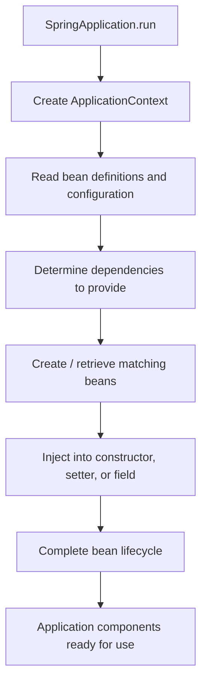
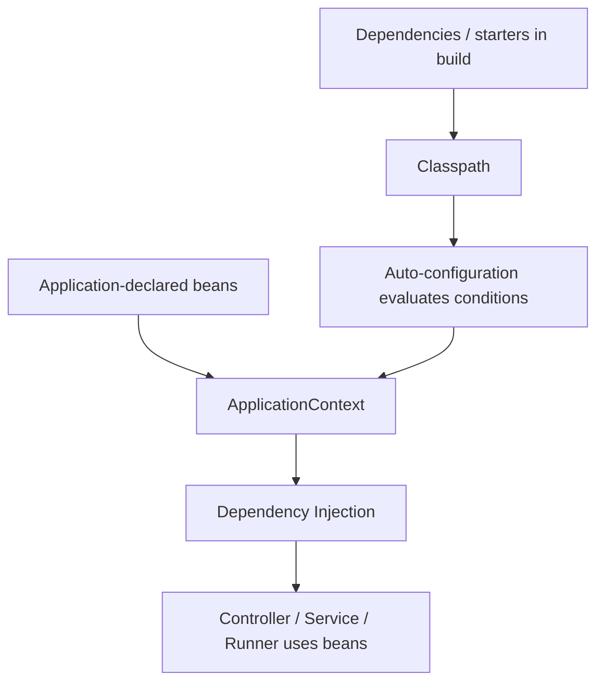

# Dependency Injection Is One Way to Implement IoC

In a Spring Boot application, we often see a `@Service` class receiving a repository via its constructor, a controller receiving a service, or a `@Bean` method taking other beans as parameters. Those objects can work together without source code having to find, instantiate, or manage the entire dependency chain itself. This mechanism relates directly to two foundational concepts: **Inversion of Control (IoC)** and **Dependency Injection (DI)**.

What often causes confusion is that many resources use the two terms almost interchangeably. In reality, **IoC is the general principle of transferring control**, whereas **DI is a specific technique for implementing IoC in providing the objects a class needs to use**. Spring Framework uses an IoC container to manage beans and perform DI; Spring Boot makes preparing and configuring the container more convenient.

This lesson focuses on the relationship between IoC and DI, how Spring's container resolves dependencies, common injection styles, and frequent scenarios encountered when structuring a Spring Boot application.

## 1. Starting from the Problem: Who Decides to Create Dependencies?

Suppose an application calculates the payable amount after a discount. `CheckoutService` needs a discount policy. Initially, we write everything inside the same class:

```java
package com.example.shop.application;

import com.example.shop.domain.PercentageDiscountPolicy;
import java.math.BigDecimal;

public class CheckoutService {

    private final PercentageDiscountPolicy policy =
            new PercentageDiscountPolicy(new BigDecimal("0.10"));

    public BigDecimal totalAfterDiscount(BigDecimal subtotal) {
        return subtotal.subtract(policy.discountFor(subtotal));
    }
}
```

Assume `PercentageDiscountPolicy` is a helper class that calculates discounts, defined in the next section.

In the example above, `CheckoutService` decides three things itself:

1. **Which implementation is needed:** directly using `PercentageDiscountPolicy`.
2. **How to instantiate the implementation:** calling `new PercentageDiscountPolicy(...)`.
3. **What to configure the implementation with:** hardcoding the `0.10` discount rate.

When the policy varies by customer group, when tests need a fake policy, or when the policy must be read from configuration, we are forced to modify or extend `CheckoutService`. The class both calculates orders and holds the details of creating its dependency.

The problem does not lie in the `new` keyword. Creating objects with `new` is a normal part of Java. The problem is that **the class executing business logic binds itself to the construction and selection of a specific dependency**, making changes difficult to isolate.

## 2. What Is IoC?

**Inversion of Control** can be understood as *inverting the control flow*. In traditional code, application code actively calls the functions and creates the components it needs. With IoC, part of the orchestration responsibility is handed over to an external component, such as a framework or container.

Consider a simple comparison:

```text
Without an IoC container:

main()
  |
  +-- new DiscountPolicy(...)
  |
  +-- new CheckoutService(policy)
  |
  +-- call service.totalAfterDiscount(...)

With the Spring IoC container:

SpringApplication.run(...)
  |
  +-- creates ApplicationContext
        |
        +-- identifies required beans
        +-- creates DiscountPolicy
        +-- creates CheckoutService with existing dependencies
        +-- manages bean lifecycles
        |
        +-- supplies beans to application components
```

In the second case, the application declares **the required components and the dependency relationships between them**, while the Spring container decides how to instantiate and wire the beans according to configuration.

### 2.1. "Inverted" Compared to What?

If a class does it itself:

```java
DiscountPolicy policy = new PercentageDiscountPolicy(
        new BigDecimal("0.10")
);
CheckoutService service = new CheckoutService(policy);
```

then that code directly controls object creation. If a framework creates and supplies these dependencies, **instantiation control** moves outside the class that uses them.

IoC also appears in other forms:

- A framework invokes an application method when a matching event or request arrives, rather than application code running an event-dispatching loop itself.
- A framework applies callbacks, listeners, or lifecycle hooks at specified points.
- A container instantiates, links, and manages object lifecycles according to configuration.

For example, Spring MVC calling the appropriate handler/controller when receiving an HTTP request also reflects the idea of a framework orchestrating execution flow. However, Spring MVC calling a controller **does not automatically mean** the controller's dependencies are injected. The two mechanisms may appear together, yet they are two distinct aspects of IoC.

### 2.2. IoC Is a Principle, Not an Annotation

There is no single `@IoC` annotation you add to complete a design. `@Component`, `@Bean`, `@Autowired`, or constructor injection are mechanisms related to the **Spring container and DI**. The IoC principle is broader than that list of annotations.

## 3. What Is Dependency Injection?

A **dependency** is an object or service that another component needs to perform its work. **Dependency Injection** is the practice of **providing dependencies from the outside to the consuming component**, instead of letting that component locate or create every dependency itself.

A class only needs to know **what capability it requires**; which concrete object fulfills that capability can be decided where the application is assembled.

For example, let us define a discount contract:

```java
// src/main/java/com/example/shop/domain/DiscountPolicy.java
package com.example.shop.domain;

import java.math.BigDecimal;

@FunctionalInterface
public interface DiscountPolicy {
    BigDecimal discountFor(BigDecimal subtotal);
}
```

An implementation for a percentage-based discount policy:

```java
// src/main/java/com/example/shop/domain/PercentageDiscountPolicy.java
package com.example.shop.domain;

import java.math.BigDecimal;
import java.util.Objects;

public final class PercentageDiscountPolicy implements DiscountPolicy {

    private final BigDecimal rate;

    public PercentageDiscountPolicy(BigDecimal rate) {
        Objects.requireNonNull(rate, "rate");
        if (rate.signum() < 0 || rate.compareTo(BigDecimal.ONE) > 0) {
            throw new IllegalArgumentException("rate must be between 0 and 1");
        }
        this.rate = rate;
    }

    @Override
    public BigDecimal discountFor(BigDecimal subtotal) {
        Objects.requireNonNull(subtotal, "subtotal");
        if (subtotal.signum() < 0) {
            throw new IllegalArgumentException("subtotal cannot be negative");
        }
        return subtotal.multiply(rate);
    }
}
```

Then rewrite the service so it accepts the contract rather than instantiating an implementation itself:

```java
// src/main/java/com/example/shop/application/CheckoutService.java
package com.example.shop.application;

import com.example.shop.domain.DiscountPolicy;
import java.math.BigDecimal;
import java.util.Objects;

public final class CheckoutService {

    private final DiscountPolicy discountPolicy;

    public CheckoutService(DiscountPolicy discountPolicy) {
        this.discountPolicy = Objects.requireNonNull(
                discountPolicy, "discountPolicy"
        );
    }

    public BigDecimal totalAfterDiscount(BigDecimal subtotal) {
        Objects.requireNonNull(subtotal, "subtotal");
        if (subtotal.signum() < 0) {
            throw new IllegalArgumentException("subtotal cannot be negative");
        }
        return subtotal.subtract(discountPolicy.discountFor(subtotal));
    }
}
```

The decisive shift:

| Before Applying DI | After Applying DI |
| --- | --- |
| Service calls `new PercentageDiscountPolicy(...)` | Service receives `DiscountPolicy` via constructor |
| Service decides the specific discount rate | The initialization site selects and configures the policy |
| Service depends directly on the implementation class | Service depends on the `DiscountPolicy` contract |
| Changing the policy usually requires editing the service | Another policy can be passed while leaving the service unchanged |
| Tests struggle to swap dependencies when hardcoded | Tests can pass a fake or stub easily |

Using an interface is not a strict requirement for DI to work: Spring can inject a concrete class. Interfaces simply help express contracts clearly when there is a real need to swap or decouple implementations.

## 4. DI Can Exist Without Spring

The following example is **Dependency Injection in plain Java**:

```java
import com.example.shop.application.CheckoutService;
import com.example.shop.domain.DiscountPolicy;
import com.example.shop.domain.PercentageDiscountPolicy;
import java.math.BigDecimal;

public class Demo {

    public static void main(String[] args) {
        DiscountPolicy policy =
                new PercentageDiscountPolicy(new BigDecimal("0.10"));

        CheckoutService checkoutService = new CheckoutService(policy);

        BigDecimal result = checkoutService.totalAfterDiscount(
                new BigDecimal("1200000")
        );

        System.out.println(result); // 1080000.00
    }
}
```

Here, `Demo` assembles the objects; `CheckoutService` just receives its dependency and uses it. **There is no Spring IoC container**, yet DI has occurred because the dependency is supplied from outside.

This snippet helps distinguish:

- **DI is a design technique:** dependencies are passed in from the outside.
- **The Spring IoC container is an automation mechanism:** managing beans, selecting implementations, supplying dependencies, and supporting lifecycles according to configuration.

Therefore, saying "DI only exists when Spring is present" is wrong. And saying "just having Spring Boot means every Java class gets DI" is also wrong: only components that are managed or properly wired receive dependencies from the container.

### An Important Term: Composition Root

The piece of code or module responsible for **creating key objects and wiring them together** is often called the *composition root*. In a plain Java application, that might be `main` or a factory. In Spring Boot, the composition root is typically fulfilled by bean configuration and the Spring application context.

Do not interpret "avoid `new` in business logic" as "never use `new` anywhere." Creating a value object like `new BigDecimal("100")` or instantiating a policy in the composition root is entirely reasonable. DI addresses **who owns dependency relationships**, rather than banning object creation.

## 5. How Does the Spring IoC Container Perform DI?

Spring Framework provides abstractions such as `BeanFactory` and `ApplicationContext`. In a typical Spring Boot application, `ApplicationContext` is the central container managing beans.

A **Spring bean** is an object created or registered and managed by the container according to a bean definition. A Java object created with `new` outside the container does not automatically become a Spring bean.

Spring Boot uses `SpringApplication.run(...)` to initialize the application and create an application context appropriate for the application type and configuration.

Conceptual process:



This is a conceptual diagram; Spring also has many internal steps such as bean post-processing, proxies, lazy initialization, and scopes. To grasp the DI principle, the key is seeing that **the container reads dependency definitions and supplies beans**, rather than services looking up dependencies themselves by calling `ApplicationContext.getBean(...)`.

### 5.1. Where Does Spring Find Bean Definitions?

Common sources:

- **Component scanning:** finding classes annotated with `@Component`, `@Service`, `@Repository`, `@Controller`, and related stereotypes within the scan range.
- **Java configuration:** `@Bean` methods in `@Configuration` classes declaring objects managed by the container.
- **Spring Boot auto-configuration:** creating common beans based on classpath, properties, existing beans, and conditions.
- **Other import or bean registration mechanisms:** used when a project has specialized modules or configurations.

Which approach to choose depends on whether the class is owned by the application, requires complex creation parameters, or comes from a third-party library.

### 5.2. Beans Must Reside in the Appropriate Context

Having `@Service` on a class does not mean every Spring Boot application will automatically see it. Default component scanning usually starts from the package containing the `@SpringBootApplication` class and its subpackages. If a component sits outside that scope, the container may not register the bean.

Likewise, a Java interface cannot become an implementation simply by being declared. Spring must have a concrete matching bean to inject.

## 6. Using `@Configuration` and `@Bean` to Perform DI

Continuing with `DiscountPolicy` and `CheckoutService` as plain Java classes, we declare the assembly in Spring:

```java
// src/main/java/com/example/shop/config/CheckoutConfiguration.java
package com.example.shop.config;

import com.example.shop.application.CheckoutService;
import com.example.shop.domain.DiscountPolicy;
import com.example.shop.domain.PercentageDiscountPolicy;
import java.math.BigDecimal;
import org.springframework.context.annotation.Bean;
import org.springframework.context.annotation.Configuration;

@Configuration
public class CheckoutConfiguration {

    @Bean
    DiscountPolicy discountPolicy() {
        return new PercentageDiscountPolicy(new BigDecimal("0.10"));
    }

    @Bean
    CheckoutService checkoutService(DiscountPolicy policy) {
        return new CheckoutService(policy);
    }
}
```

The `discountPolicy()` method tells Spring how to provide a bean of type `DiscountPolicy`. The `checkoutService(DiscountPolicy policy)` method declares a dependency via its parameter. When `CheckoutService` needs to be created, Spring supplies a bean compatible with `DiscountPolicy` and invokes the `@Bean` method.

The application class can declare a runner to observe it:

```java
// src/main/java/com/example/shop/ShopApplication.java
package com.example.shop;

import com.example.shop.application.CheckoutService;
import java.math.BigDecimal;
import org.springframework.boot.CommandLineRunner;
import org.springframework.boot.SpringApplication;
import org.springframework.boot.autoconfigure.SpringBootApplication;
import org.springframework.context.annotation.Bean;

@SpringBootApplication
public class ShopApplication {

    public static void main(String[] args) {
        SpringApplication.run(ShopApplication.class, args);
    }

    @Bean
    CommandLineRunner checkoutDemo(CheckoutService service) {
        return args -> System.out.println(
                service.totalAfterDiscount(new BigDecimal("1200000"))
        );
    }
}
```

When the project has the appropriate Spring Boot starter to run the application, classes under the `com.example.shop` package fall within the default component scan scope. Spring creates the beans in `CheckoutConfiguration` and supplies `CheckoutService` to the runner. With the numbers above, the printed result has the value **1,080,000** in `BigDecimal` representation.

Points to observe:

1. `ShopApplication` starts the container.
2. The container finds `CheckoutConfiguration`.
3. The `@Bean discountPolicy()` method creates the implementation.
4. The `@Bean checkoutService(...)` method receives that implementation from the container.
5. `CommandLineRunner` receives `CheckoutService` and executes the business logic.

`CheckoutService` code never calls `SpringApplication.run`, `ApplicationContext.getBean`, or `new PercentageDiscountPolicy`. It merely expresses that it needs a `DiscountPolicy`. This is **DI performed by the Spring IoC container**.

### 6.1. Why Not Put `@Component` on Every Class?

With `PercentageDiscountPolicy`, the constructor takes a `BigDecimal rate` value. Simply adding `@Component` without supplying an appropriate value leaves Spring unable to guess the discount rate you want by default. Creating the bean via `@Bean` makes the parameters explicit.

Third-party objects whose source code we cannot edit can also be provided using `@Bean`. Thus, `@Configuration` and `@Bean` are a way of expressing DI alongside annotation scanning, not a sign that the application is bypassing IoC.

## 7. Using Stereotype Annotations for Spring to Manage Classes

For classes owned by the project, many applications use `@Component` and specialized annotations so Spring automatically registers beans.

Example of a notification flow:

```java
// com/example/shop/notification/Notifier.java
package com.example.shop.notification;

public interface Notifier {
    void send(String message);
}
```

```java
// com/example/shop/notification/ConsoleNotifier.java
package com.example.shop.notification;

import org.springframework.stereotype.Component;

@Component
public class ConsoleNotifier implements Notifier {
    @Override
    public void send(String message) {
        System.out.println(message);
    }
}
```

```java
// com/example/shop/notification/RegistrationService.java
package com.example.shop.notification;

import org.springframework.stereotype.Service;

@Service
public class RegistrationService {

    private final Notifier notifier;

    public RegistrationService(Notifier notifier) {
        this.notifier = notifier;
    }

    public void register(String username) {
        // Simplified example: no persistence or input validation yet.
        notifier.send("Registered: " + username);
    }
}
```

If the classes are within the component scan range:

- `ConsoleNotifier` is registered as a bean via `@Component`.
- `RegistrationService` is registered via `@Service`, a stereotype of `@Component`.
- The constructor of `RegistrationService` declares a dependency on `Notifier`.
- Spring finds a matching bean, `ConsoleNotifier` in this example, and injects it into the service.

For a class with **only one constructor**, modern Spring can use that constructor to inject dependencies without writing `@Autowired`. The absence of `@Autowired` in this example **does not mean DI is disabled**.

### 7.1. `@Component`, `@Service`, and `@Repository` Do Not Replace Responsibility Design

| Annotation | Common Role | Notes on DI |
| --- | --- | --- |
| `@Component` | General Spring-managed component | Can be scanned into a bean |
| `@Service` | Marks an application/business service layer class | For scanning mechanics, it is a specialized stereotype |
| `@Repository` | Data access component | Beyond stereotype, carries exception translation semantics in appropriate contexts |
| `@Controller` / `@RestController` | Component handling web requests | Can still receive dependencies via constructor |
| `@Configuration` | Class declaring beans and configuration | Usually contains `@Bean` methods |

Annotations help Spring recognize beans, but **do not guarantee** that a class has clear responsibilities or proper architecture. A controller that creates its own database client and calculates prices is still tightly coupled even if that controller is a Spring bean.

### 7.2. Choose One Clear Way to Register a Bean

If you already use `@Bean` to create `CheckoutService`, you should not simultaneously add `@Service` to the same class and keep both creation paths without clear intent. That can create multiple beans of the same type and lead to ambiguous injection errors.

Both approaches are valid:

**Approach A:** use plain Java classes and declare beans in `@Configuration`.

**Approach B:** annotate implementations with `@Service` or `@Component`, let Spring scan them, and use constructor injection.

Choose the approach that is readable and consistent with your project structure.

## 8. Three Common Forms of Dependency Injection

DI in Spring is commonly introduced in three forms: **constructor injection**, **setter injection**, and **field injection**. They differ in when dependencies are provided and how well they express mandatory requirements.

### 8.1. Constructor Injection

```java
@Service
public class InvoiceService {

    private final TaxCalculator taxCalculator;

    public InvoiceService(TaxCalculator taxCalculator) {
        this.taxCalculator = taxCalculator;
    }
}
```

In the example, `TaxCalculator` is an assumed dependency type that already has a matching bean in the Spring context.

Advantages:

- The constructor makes it explicit that the class **cannot function properly without the dependency**.
- Fields can be declared `final`, preventing accidental reassignment after construction.
- Easy to instantiate the class in unit tests without loading a Spring context.
- If a matching bean is missing, the error usually surfaces when the container attempts to create the service.
- Mandatory dependencies are concentrated in the constructor signature, helping spot classes with too many responsibilities.

For mandatory dependencies, **constructor injection is usually the preferred option**.

### 8.2. Setter Injection

```java
@Component
public class ReportGenerator {

    private ReportFormatter formatter = new PlainTextFormatter();

    @Autowired
    public void setFormatter(ReportFormatter formatter) {
        this.formatter = formatter;
    }
}
```

Assume `ReportFormatter` and `PlainTextFormatter` are the example's interface and implementation. Setter injection supplies the dependency by calling a method after the object is created. This can be suitable when a dependency is mutable or has explicitly designed optional configuration.

However, **a setter annotated with `@Autowired` in the standard way still requires a matching bean**. Using a setter does not automatically make the dependency optional. You can use `@Autowired(required = false)` or other appropriate mechanisms when you truly want to skip an unavailable dependency.

A drawback of setter injection is that the class can exist before the dependency is assigned; default states and timing of usage must be designed carefully. You should not use setters merely to hide that a class depends on a mandatory service.

### 8.3. Field Injection

```java
@Service
public class LegacyInvoiceService {

    @Autowired
    private TaxCalculator taxCalculator;
}
```

Spring can inject directly into fields via the container mechanism. The syntax is short, but it has disadvantages:

- Dependencies are hidden from the constructor; looking at the construction signature does not reveal what the class needs.
- Hard to construct a complete instance in plain Java unit tests.
- Fields cannot conveniently be `final` with this injection style.
- Can tie the class to the container even when the logic does not need Spring.

Therefore, for new application code, you should **prefer constructor injection** and only use field injection when there is a specific reason, such as working with legacy code or frameworks with special constraints.

### 8.4. Quick Comparison

| Criterion | Constructor | Setter | Field |
| --- | --- | --- | --- |
| Mandatory dependencies | Expressed very clearly | Requires clear conventions | Hidden from construction API |
| Supports `final` | Good | Not suitable when reassignment is needed | Incompatible with standard field injection |
| Unit testing without Spring | Convenient | Needs setter calls | Harder |
| Replacement after creation | Not via constructor API | Can be designed | No public API |
| Recommendation for new services | Generally preferred | Use when aligned with goal | Limit usage |

## 9. When Multiple Implementations of an Interface Exist

Spring does not always know which bean to pick if multiple candidate beans share the same type.

Suppose two policies implement `DiscountPolicy`:

```java
@Configuration
class DiscountConfiguration {

    @Bean("standardDiscountPolicy")
    DiscountPolicy standardDiscountPolicy() {
        return new PercentageDiscountPolicy(new BigDecimal("0.05"));
    }

    @Bean("vipDiscountPolicy")
    DiscountPolicy vipDiscountPolicy() {
        return new PercentageDiscountPolicy(new BigDecimal("0.15"));
    }
}
```

If a constructor simply accepts a `DiscountPolicy` without distinguishing metadata, the container may fail with an error such as `NoUniqueBeanDefinitionException` because multiple matching candidates exist.

### 9.1. Using `@Qualifier`

```java
@Service
class StandardCheckoutService {

    private final DiscountPolicy policy;

    StandardCheckoutService(
            @Qualifier("standardDiscountPolicy") DiscountPolicy policy
    ) {
        this.policy = policy;
    }
}
```

Here, `@Qualifier` directs the container to select the bean with the matching qualifier. The usage of `policy` is omitted in the example to focus on the injection mechanism. You need to import `org.springframework.beans.factory.annotation.Qualifier`.

### 9.2. Using `@Primary`

If one bean should take precedence when injecting by type without a specific qualifier, you can declare:

```java
@Bean
@Primary
DiscountPolicy standardDiscountPolicy() {
    return new PercentageDiscountPolicy(new BigDecimal("0.05"));
}
```

`@Primary` prioritizes this bean among candidates of the same type in applicable situations. However, it should not be used to mask that the application has not clearly determined which policy should be used.

When business logic genuinely has multiple policies (VIP customers, regular customers, event promotions), sometimes the use case needs a **policy selector based on business data** rather than a fixed container choice at startup. `@Qualifier` and `@Primary` are bean configuration tools; they do not replace runtime customer-based policy selection algorithms.

### 9.3. Avoid Confusing Bean Name with Class Name

Bean name is the bean's identity in the container; Java class name is the type's identity. A single class can correspond to one or multiple beans across different configurations. Hence, having "Vip" in the class name does not guarantee Spring will pick it for every VIP request. Always verify actual bean names, qualifiers, `@Primary`, and wiring.

## 10. Missing Dependencies, Optional Dependencies, and Lazy Lookup

### 10.1. Missing Mandatory Bean

Suppose we have:

```java
@Service
class PaymentService {

    PaymentService(PaymentGateway gateway) {
        this.gateway = gateway;
    }

    private final PaymentGateway gateway;
}
```

If `PaymentGateway` has no implementation registered as a bean, Spring cannot satisfy this constructor. When the container attempts to instantiate `PaymentService`, the application may fail with `UnsatisfiedDependencyException` or an underlying cause related to `NoSuchBeanDefinitionException`.

Reasonable investigation steps:

1. Locate the `PaymentGateway` interface/class and the expected implementation.
2. Check whether the implementation is marked for scanning or declared via `@Bean`.
3. Check package scanning, profiles, conditional configurations, and beans of the same type.
4. Verify that the module/dependency providing the implementation is on the classpath.

Do not fix the error by calling `new` on an arbitrary implementation directly inside `PaymentService`; doing so bypasses container management and pushes coupling into business logic.

### 10.2. Truly Optional Dependencies

Some features can run when a bean is unavailable, such as an optional metrics recording module. In that case, you can explicitly express optionality using `Optional<T>`, `ObjectProvider<T>`, or conditional configuration depending on the scenario.

Example:

```java
@Service
class OptionalMetricsService {

    private final Optional<MetricsPublisher> publisher;

    OptionalMetricsService(Optional<MetricsPublisher> publisher) {
        this.publisher = publisher;
    }

    void record(String event) {
        publisher.ifPresent(p -> p.publish(event));
    }
}
```

`MetricsPublisher` here is an example interface. When Spring injects `Optional<MetricsPublisher>`, the application can legitimately represent the absence of a bean when no candidate exists. You must clearly decide whether skipping metric recording aligns with requirements.

For mandatory dependencies, using `Optional` just to dodge startup failures usually only postpones the problem to runtime. Do not replace a mandatory requirement with an empty value if business logic cannot operate without it.

### 10.3. `ObjectProvider` for On-Demand Bean Retrieval

`ObjectProvider<T>` is a Spring capability allowing flexible bean retrieval, such as obtaining a bean only when truly needed or interacting with dependencies that have special scopes.

```java
@Service
class JobService {

    private final ObjectProvider<JobContext> contextProvider;

    JobService(ObjectProvider<JobContext> contextProvider) {
        this.contextProvider = contextProvider;
    }

    void execute() {
        JobContext context = contextProvider.getObject();
        context.run();
    }
}
```

The example assumes a corresponding `JobContext` bean exists. `getObject()` can fail if the required bean does not exist or is not uniquely defined; it does not automatically create an implementation outside the container. `ObjectProvider` is especially useful when on-demand retrieval is required, though it is not needed for every ordinary dependency.

## 11. How Bean Scope Affects DI

In Spring, a bean has a **scope** determining the lifespan and sharing of instances managed by the container.

| Scope | Basic Meaning | Relevance to DI |
| --- | --- | --- |
| `singleton` | One instance per bean definition in a Spring container | Default scope for standard Spring beans |
| `prototype` | Container creates a new instance each time a matching bean is requested | Does not automatically create a new instance on every method call of a singleton that injected it |
| `request` | One instance tied to an HTTP request when an appropriate web context exists | Does not exist automatically in non-web applications |
| `session` | One instance scoped to an HTTP session when supported | Requires understanding session lifecycle and the receiving object |

Example:

```java
@Component
@Scope("prototype")
class WorkUnit {
}
```

If a singleton service receives `WorkUnit` directly via constructor, Spring normally resolves the dependency **when creating the singleton**. The service does not automatically receive a new `WorkUnit` on each method invocation. If the requirement truly calls for a fresh instance per operation, you may need `ObjectProvider<WorkUnit>` or an appropriate object creation approach.

Scope also relates to thread safety. Multiple requests can share the same singleton service, so storing per-request state in fields can cause concurrency bugs. DI manages how objects are wired; **DI does not automatically make every singleton thread-safe**.

### Spring's Singleton Is Not an Absolute JVM-Wide Singleton

A Spring singleton is scoped to a single bean definition within a single container. It does not mean only one instance of that Java class exists across the entire JVM, nor does it prevent other code from calling `new` to create a similar object.

## 12. DI and Bean Lifecycle: What Does Spring Manage?

When an object becomes a bean, the container can:

- Instantiate the object and resolve dependencies.
- Apply lifecycle callbacks and bean post-processors as configured.
- Create proxies when features like transactions or AOP are needed.
- Invoke bean destruction callbacks for supported scopes when the context closes.

Example:

```java
@Component
class LocalCache {

    @PostConstruct
    void initialize() {
        // Initialize cache data after dependencies have been supplied.
    }

    @PreDestroy
    void cleanup() {
        // Release resources when the container destroys this bean.
    }
}
```

For Spring Boot versions using Jakarta APIs, import `jakarta.annotation.PostConstruct` and `jakarta.annotation.PreDestroy`. Actual lifecycle behavior depends on scope; for prototypes, Spring does not automatically track and call full destruction callbacks for every instance after handing it to the caller.

This shows that the IoC container does more than pass constructor arguments. **DI is part of how the container manages components**, while the container also handles configuration, scopes, and lifecycles.

You should not manually instantiate an object with `new` and expect Spring-managed callbacks, transaction proxies, or annotations to take effect on that instance. Objects created manually outside the container are plain Java objects unless integrated through a special mechanism.

## 13. Circular Dependencies: When Beans Require Each Other

A common issue:

```text
OrderService needs PaymentService
          ^
          |
          v
PaymentService needs OrderService
```

If both classes use mandatory constructor injection, Spring cannot create the first object because each requires the other to already exist. This situation typically results in a bean creation failure due to a **circular dependency**.

Minimal example:

```java
@Service
class OrderService {
    OrderService(PaymentService paymentService) {
    }
}

@Service
class PaymentService {
    PaymentService(OrderService orderService) {
    }
}
```

Sometimes retrieving a bean can be deferred using `@Lazy` or a provider in special situations, but that is not a default design solution. When two services depend on each other, review their responsibilities:

- Can coordination flow be moved into a separate use-case/application service?
- Is one of the two classes carrying too many responsibilities?
- Are both classes accessing the same data through a shared contract that could be extracted?
- Is the dependency truly needed in both directions?

Constructor injection exposes circular relationships early. That is a design benefit, even though it prevents the application from starting when dependency structure is flawed.

## 14. DI vs. Service Locator

The two approaches below can both use the Spring container, yet carry different levels of coupling.

### Approach 1: Class Looks Up Dependencies from the Container Itself

```java
@Service
class OrderProcessor {

    private final ApplicationContext context;

    OrderProcessor(ApplicationContext context) {
        this.context = context;
    }

    void process() {
        PaymentGateway gateway = context.getBean(PaymentGateway.class);
        gateway.charge();
    }
}
```

This is an example exhibiting **Service Locator** characteristics: the class queries a registry/container itself to obtain what it needs. The `PaymentGateway` dependency is hidden from the constructor signature, even though the class still relies on it to function. Application code is also tied to `ApplicationContext`.

### Approach 2: Container Injects Dependencies Directly

```java
@Service
class OrderProcessor {

    private final PaymentGateway gateway;

    OrderProcessor(PaymentGateway gateway) {
        this.gateway = gateway;
    }

    void process() {
        gateway.charge();
    }
}
```

This is constructor injection: `OrderProcessor` explicitly declares the dependency it needs. When testing, we can provide a fake gateway without creating a Spring container.

`PaymentGateway` in both examples is an illustrative interface assumed to have a `charge()` method and a matching bean.

Not every `getBean` call is wrong. In framework integration code or places requiring dynamic bean selection, accessing the container sometimes has technical justification. For ordinary business services, however, **constructor injection makes dependencies easier to see and control**.

## 15. How Does DI in Spring Boot Relate to Auto-Configuration?

**Spring Boot auto-configuration** helps register certain beans based on conditions such as classpath, properties, and existing beans. **DI** is the mechanism that supplies matching beans to the objects that need them.

The two mechanisms collaborate, yet are not the same:



For example, when a starter and matching configuration cause Boot to create an `ObjectMapper` or related beans, an application service can receive that bean via its constructor. If the application defines its own replacement bean, auto-configuration can adjust its behavior based on its conditions.

Therefore:

- **Starters** resolve the group of dependencies brought into the project.
- **Auto-configuration** helps define certain beans in the context conditionally.
- **The IoC container** manages the registered beans and their lifecycles.
- **DI** supplies beans to other components that need to use them.

Do not say "having a starter guarantees the bean exists." Whether a bean is registered depends on specific conditions. Nor should you say "creating a bean means DI is complete": only when the dependency is provided to the consuming object does the injection aspect actually take place.

## 16. Unit Tests Demonstrate the Practical Benefit of DI

`CheckoutService` was written with constructor injection and accepts `DiscountPolicy`. As a result, we can swap the dependency with a simple fake:

```java
import static org.junit.jupiter.api.Assertions.assertEquals;

import com.example.shop.application.CheckoutService;
import com.example.shop.domain.DiscountPolicy;
import java.math.BigDecimal;
import org.junit.jupiter.api.Test;

class CheckoutServiceTest {

    @Test
    void returnsSubtotalWhenDiscountIsZero() {
        DiscountPolicy noDiscount = subtotal -> BigDecimal.ZERO;
        CheckoutService checkoutService = new CheckoutService(noDiscount);

        BigDecimal total = checkoutService.totalAfterDiscount(
                new BigDecimal("900")
        );

        assertEquals(new BigDecimal("900"), total);
    }
}
```

This is a standard Java unit test with JUnit. No `@SpringBootTest` or Spring application context is required because the class under test does not look up beans itself and does not require a container to operate.

If we want to test the discount policy itself, we can test `PercentageDiscountPolicy` independently. If we want to verify that Spring recognizes `CheckoutConfiguration` and wires beans properly, we use an integration test with an appropriate Spring context. **Each test type validates a different question**:

| Question | Appropriate Verification |
| --- | --- |
| Does the discount rule compute accurately? | Unit test `PercentageDiscountPolicy` |
| Does the service use the passed dependency correctly? | Unit test `CheckoutService` with a fake policy |
| Can Spring create the beans at startup? | Context/integration test |
| Does the controller accept requests and return proper responses? | Web test or integration test |
| Does the real repository persist data as expected? | Persistence/integration test |

DI makes it easier to test component boundaries, but **DI by itself does not guarantee correct logic**. You still need tests covering behavior and key business scenarios.

## 17. Distinguishing DI from Similar Concepts

### 17.1. DI and Interfaces

Interfaces provide abstraction, but do not automatically create DI. A class can declare an interface-typed field and still call `new` on an implementation:

```java
private final Notifier notifier = new ConsoleNotifier();
```

That snippet uses an interface yet still chooses and instantiates the dependency inside the class. Conversely, a constructor receiving a concrete class from outside is still DI, even without an interface.

### 17.2. DI and Factory

A Factory is responsible for creating objects according to some rule. DI is responsible for supplying dependencies to an object that needs them. A Factory can be used **inside the composition root** to create beans and pass them into a service; thus, the two techniques are not mutually exclusive.

When a dependency genuinely needs to vary per call, an injected factory or provider can fit better than an implementation fixed at startup.

### 17.3. DI and Singleton

A singleton bean can be injected into multiple services. However, DI does not imply singleton: prototype beans, scoped beans, or manually created objects can all be supplied through an appropriate form of injection.

### 17.4. DI and Dependency Management

In build files, the word "dependency" typically refers to libraries such as `spring-boot-starter-web` or `junit-jupiter`. In object design, a dependency can be a `DiscountPolicy` instance that a service needs to run.

The two concepts are related: build dependencies supply types/classes, whereas DI concerns **passing a concrete object to another object at runtime**. Declaring a JAR in Maven/Gradle does not automatically inject every class in that JAR.

### 17.5. DI and AOP

AOP is commonly used to separate cross-cutting concerns such as transactions or certain logging mechanisms. Spring can create proxies around beans to apply these behaviors. DI supplies the appropriate bean/proxy to consuming objects, yet **AOP and DI are two distinct mechanisms**.

A service does not need to know whether it was injected with an implementation directly or with an appropriate proxy. However, when investigating transaction/proxy behavior, you must understand that calls within the same object may not go through the proxy the way calls from another bean do.

## 18. Common Misconceptions for Beginners

| Statement | More Accurate Understanding |
| --- | --- |
| "IoC is just DI." | DI is one way to implement IoC; IoC is broader in scope. |
| "Without Spring there is no DI." | Plain Java can inject via constructors or setters. |
| "Only `@Autowired` counts as DI." | A single constructor usually does not need `@Autowired`. |
| "Any class with `@Component` will always be created." | The class must be within scan scope and meet applicable conditions. |
| "Putting an annotation on an interface tells Spring the implementation." | There must be a matching implementation bean or an explicitly declared bean. |
| "Using an interface means dependencies are decoupled." | If the class still instantiates the implementation itself, coupling is not fully resolved. |
| "Banning every `new` is proper DI." | Creating objects in the composition root or value objects is completely reasonable. |
| "DI makes services thread-safe." | Scopes and shared state must still be designed safely. |
| "If a bean is missing, just use `Optional`." | Mandatory dependencies should be properly supplied instead of hiding errors. |
| "Every class must become a bean." | Transient data objects, domain value objects, and many plain Java classes do not need container management. |

## 19. How to Investigate DI Errors in a Spring Boot Application

When encountering startup errors related to dependencies, read **the root cause in the stack trace**, identify which bean is being created, and see which dependency is unsatisfied.

### Case A: No Matching Bean

The message may state that a constructor requires a bean of type `PaymentGateway` that could not be found.

Check the implementation, `@Component`/`@Bean`, package scan, profile conditions, classpath, and auto-configuration eligibility. Do not rush to swap `@Service` for `@Component`, since both annotations can be recognized by component scanning as stereotypes.

### Case B: Multiple Beans of the Same Type

If two beans both implement `DiscountPolicy`, a constructor accepting only `DiscountPolicy` may not resolve uniquely. Check which bean should be default, whether `@Qualifier` or `@Primary` applies, or whether a factory selecting by business context is needed.

### Case C: Circular Dependency

If A requires B and B requires A via constructors, review responsibility boundaries and dependency direction. Enabling options that allow circular references just to make the application start is generally not a good design choice.

### Case D: Null Dependency Even Though the Class Has `@Autowired`

One possible cause is that the object was created with `new` outside the container:

```java
// Illustrating a mistake:
ReportService service = new ReportService();
```

If `ReportService` relies on field injection performed by Spring, this manually created instance will not be injected by the container as a Spring bean. The fix is to let the container supply the bean properly, or design constructor injection and pass dependencies yourself when instantiating outside the container.

### Case E: Bean Exists but in the Wrong Environment

`@Profile` or configuration conditions may cause a bean to exist only in certain environments. Verify active profiles and actual conditions rather than assuming the bean is present in every deployment.

## 20. Hands-On Exercises: Observing DI Yourself

### Exercise 1: Moving from Self-Creation to Constructor Injection

Given the class:

```java
class MessageService {
    private final EmailSender sender = new SmtpEmailSender();

    void notifyUser(String email) {
        sender.send(email, "Welcome");
    }
}
```

Refactor it as follows:

1. Declare an `EmailSender` interface with an appropriate send method.
2. Have `MessageService` receive `EmailSender` via constructor.
3. Instantiate an `SmtpEmailSender` implementation at the application assembly point.
4. In tests, pass a `FakeEmailSender` to verify the message was requested to be sent.

Expected outcome: `MessageService` no longer decides whether to use SMTP or another delivery mechanism.

### Exercise 2: Distinguishing IoC and DI

Examine three cases:

- A method invoked by Spring MVC when an HTTP request arrives.
- A `@Service` receiving a repository bean via constructor.
- A plain Java class receiving an interface implementation via constructor.

Explain how **control is handed over** in each case and which cases directly demonstrate **Dependency Injection**.

Hint: the first case primarily demonstrates framework orchestration of callbacks/handlers; the second uses DI via the Spring container; the third is also DI, without requiring Spring.

### Exercise 3: Analyzing a Non-Unique Bean Error

Given two beans:

```java
@Bean("smsNotifier")
Notifier smsNotifier() {
    return new SmsNotifier();
}

@Bean("emailNotifier")
Notifier emailNotifier() {
    return new EmailNotifier();
}
```

Assume both implementations and the interface are validly defined. A service has the constructor:

```java
NotificationService(Notifier notifier) {
    this.notifier = notifier;
}
```

Determine what happens if there is no explicit bean selection mechanism. Then try writing two ways to specify the right bean: using `@Qualifier("emailNotifier")` and using `@Primary` on one of the two beans.

### Exercise 4: Analyzing a Circular Dependency

Suppose `UserService` accepts `NotificationService` and `NotificationService` accepts `UserService` via constructor. Identify which responsibility can move into a separate use case or event handler so the two services no longer depend on each other.

Try redrawing the dependency direction after splitting, then state the benefit of catching cycles via constructors before the application runs.

### Exercise 5: Testing Without `ApplicationContext`

Using `CheckoutService` from the beginning of the lesson, create a `DiscountPolicy` that returns a fixed discount of 20,000 for valid orders. Instantiate `CheckoutService` with `new` and verify the remaining total when the subtotal is 100,000.

If you can write the test without `@SpringBootTest`, you have observed an important benefit of constructor injection: **services can work independently of the framework's startup mechanism**.

## 21. Key Takeaways Before Moving to the Next Topic

After studying this lesson, you should be able to explain:

1. **IoC** is transferring control of part of the work to a framework, container, or external component.
2. **DI** is the technique of supplying dependencies to an object instead of letting it locate and create them itself.
3. **DI is one way to implement IoC**, while IoC also encompasses framework coordination of callbacks, lifecycles, and other mechanisms.
4. **The Spring IoC container** manages beans and performs DI according to bean definitions, component scans, configuration, and active conditions.
5. **Spring Boot** assists with initializing and auto-configuring applications on top of Spring Framework; it does not make DI a concept unique to Boot.
6. **Constructor injection** is generally a strong choice for mandatory dependencies because it is explicit and easy to test.
7. Issues such as **missing beans, multiple beans of the same type, scopes, circular dependencies, and objects created outside the container** must be analyzed from actual dependency relationships.

When you understand that **a class only needs to describe the capabilities it uses, while the composition root/container handles assembly**, organizing services, repositories, controllers, and Spring Boot configurations becomes much clearer. This is the practical meaning of **"Dependency injection is one way to implement IoC"**: the responsibility of choosing and providing dependencies is moved out of the consuming class, resulting in code with explicit dependency relationships that are easy to swap and test.
