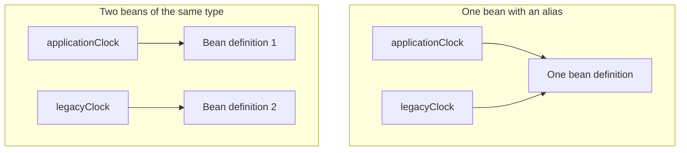

# Bean Name, Bean Type, and Alias in the Spring IoC Container

In Spring Boot, developers commonly use `@Component`, `@Service`, `@Repository`, `@Controller`, and `@Bean` to register objects for the **IoC container** to manage. These objects are called **Spring beans**. Every bean can be identified by a **name**, has a **Java type** for Spring to select during dependency injection, and sometimes has **aliases** — secondary names pointing to the same bean.

These three concepts are related yet not interchangeable:

| Concept | Question Answered | Example |
|---|---|---|
| **Bean name** | Which string does the container use to identify this bean? | `orderService`, `primaryDataSource` |
| **Bean type** | As which Java type(s) can the bean be used? | `OrderService`, `PaymentGateway`, `Clock` |
| **Alias** | Besides its primary name, what other names point to the same bean? | `legacyClock` is an alias for `applicationClock` |

Understanding the difference helps you read autowiring errors, know when `@Qualifier` or `@Primary` is needed, and avoid confusing "two names" with "two different beans."

## 1. What Is a Bean in the IoC Container?

**IoC (Inversion of Control)** means creating and wiring important objects is handed over to a container. In Spring, the container uses bean metadata to instantiate objects, link dependencies, and manage lifecycles appropriately.

Example:

```java
package com.example.shop;

import org.springframework.stereotype.Service;

@Service
public class OrderService {

    public String placeOrder() {
        return "Order placed";
    }
}
```

When component scanning covers the package above, Spring registers a bean from the `OrderService` class. Under normal naming conventions, this bean is named `orderService`.

One way to visualize it:

```text
ApplicationContext
┌──────────────────────────────────────────────────┐
│ Bean definition                                  │
│   bean name: "orderService"                      │
│   Java type: com.example.shop.OrderService       │
│   scope: singleton (default)                     │
│   creation: container instantiates/registers obj │
└──────────────────────────────────────────────────┘
```

A bean is not identical to a class. **A single class can be used to create multiple distinct beans**, and **a single bean can be accessed through multiple Java types** such as its class, interfaces, or compatible supertypes.

Container data includes both the **bean definition** (metadata to create/manage) and bean instances supplied per scope. You should not assume there is always only one instance per definition: that also depends on scope, factories, and how Spring returns the object.

## 2. Bean Name: A String Identifier

A bean name is the identifier Spring uses to distinguish beans registered in a container.

Example:

```java
@Component("cardPaymentGateway")
public class CardPaymentGateway implements PaymentGateway {
    // ...
}
```

In this case:

- `cardPaymentGateway` is the **bean name**.
- `CardPaymentGateway` is the **Java class**.
- `PaymentGateway` is the **interface** the bean implements.

Spring can retrieve the bean by name:

```java
PaymentGateway gateway =
        context.getBean("cardPaymentGateway", PaymentGateway.class);
```

The string `"cardPaymentGateway"` is not a class name; it is a **lookup key in the container**. Bean names are typically case-sensitive: `paymentGateway` and `PaymentGateway` are not automatically treated as the same name.

### 2.1. Default Name When Using `@Component`

If no explicit name is given:

```java
@Component
public class InventoryService {
}
```

Spring usually generates the name `inventoryService` from the class name `InventoryService`.

Stereotype annotations such as `@Service`, `@Repository`, and `@Controller` can also use this naming mechanism during component scanning:

```java
@Service
public class PricingService {
    // Typically generated name: pricingService
}
```

The derivation rule is not simply lowercasing the first letter in every case. Spring uses logic similar to JavaBeans `Introspector.decapitalize`: names starting with two consecutive uppercase letters may retain their leading uppercase characters. The naming strategy can also be customized via `BeanNameGenerator`.

Therefore, when a bean name acts as an important contract with other components, **explicit naming** is clearer than relying on conventions.

### 2.2. Explicit Name When Using `@Component`

```java
@Service("regionalPricingService")
public class PricingService {
}
```

The declared name is `regionalPricingService`. Do not assume `pricingService` is still registered as a secondary name. Unless an alias is declared, this name does not automatically gain an alias just because the class is named `PricingService`.

### 2.3. Default Name When Using `@Bean`

With `@Bean`, the default bean name is typically the **method name**:

```java
package com.example.shop.config;

import java.time.Clock;
import org.springframework.context.annotation.Bean;
import org.springframework.context.annotation.Configuration;

@Configuration
public class TimeConfiguration {

    @Bean
    public Clock utcClock() {
        return Clock.systemUTC();
    }
}
```

In the example:

- Bean name: `utcClock`.
- Declared type: `Clock`.
- Factory method: `utcClock()`.
- Containing configuration class: `TimeConfiguration`.

The `utcClock()` method declares how to create the object; the bean name does not have to be `clock` or `TimeConfiguration`.

You can specify an explicit name:

```java
@Bean("applicationClock")
public Clock utcClock() {
    return Clock.systemUTC();
}
```

Now the primary name is `applicationClock`. The method name `utcClock` does not automatically become an alias.

### 2.4. Comparing Naming Approaches

| Declaration | Expected Bean Name | Bean Type |
|---|---|---|
| `@Component` on `InventoryService` | `inventoryService` by convention | `InventoryService` |
| `@Component("warehouse")` on `InventoryService` | `warehouse` | `InventoryService` |
| `@Bean Clock appClock()` | `appClock` | `Clock` |
| `@Bean("systemClock") Clock appClock()` | `systemClock` | `Clock` |

A bean name is a **container identifier**. It does not have to match a class name, Java variable name, package name, or filename.

## 3. Bean Type: Through Which Type Does Spring View a Bean?

Bean type relates to Java's type system. One implementation can satisfy an interface, a superclass, or multiple interfaces simultaneously.

Example:

```java
public interface MessageSender {
    void send(String message);
}

public class EmailSender implements MessageSender {

    @Override
    public void send(String message) {
        System.out.println("EMAIL: " + message);
    }
}
```

Bean registration:

```java
@Configuration
public class SenderConfiguration {

    @Bean
    public MessageSender emailSender() {
        return new EmailSender();
    }
}
```

Here:

- The bean name is `emailSender`.
- The **declared** return type of the factory method is `MessageSender`.
- The normal instance created by the method is `EmailSender`.
- Other components can depend on the `MessageSender` interface.

```java
@Service
public class NotificationService {

    private final MessageSender sender;

    public NotificationService(MessageSender sender) {
        this.sender = sender;
    }

    public void notifyCustomer() {
        sender.send("Your order is ready");
    }
}
```

When only one candidate bean matches `MessageSender`, Spring can inject it into the constructor without manual `getBean(...)` calls.

### 3.1. One Type Can Have Multiple Beans

Suppose we add:

```java
@Component("emailSender")
public class EmailSender implements MessageSender {
    @Override
    public void send(String message) {
        System.out.println("EMAIL: " + message);
    }
}
```

```java
@Component("smsSender")
public class SmsSender implements MessageSender {
    @Override
    public void send(String message) {
        System.out.println("SMS: " + message);
    }
}
```

In a configuration using these two components **without simultaneously registering the extra `emailSender` from the previous config example**, the container holds two beans:

```text
"emailSender" ---> EmailSender instance ---┐
                                            ├---> MessageSender
"smsSender"   ---> SmsSender instance -----┘
```

When calling:

```java
context.getBean(MessageSender.class);
```

Spring must locate one bean matching `MessageSender`. If two candidates exist and no rule selects one, it can throw `NoUniqueBeanDefinitionException`.

**This is a type-selection conflict**, not a name conflict: two beans have distinct names yet both satisfy `MessageSender`.

### 3.2. One Class Can Produce Multiple Beans with Different Names

Example:

```java
public class ApiClient {
    private final String baseUrl;

    public ApiClient(String baseUrl) {
        this.baseUrl = baseUrl;
    }

    public String baseUrl() {
        return baseUrl;
    }
}
```

```java
@Configuration
public class ApiClientConfiguration {

    @Bean("primaryClient")
    public ApiClient primaryClient() {
        return new ApiClient("https://primary.example.test");
    }

    @Bean("backupClient")
    public ApiClient backupClient() {
        return new ApiClient("https://backup.example.test");
    }
}
```

These are **two distinct beans** sharing the same `ApiClient` type:

| Name | Type | Configuration |
|---|---|---|
| `primaryClient` | `ApiClient` | Primary base URL |
| `backupClient` | `ApiClient` | Backup base URL |

`backupClient` must not be treated as an alias merely because both beans use the same class.

### 3.3. Declared Type and Runtime Class

A `@Bean` can return an interface:

```java
@Bean
public MessageSender emailSender() {
    return new EmailSender();
}
```

The declared exposed type is `MessageSender`, while the concrete object returned has class `EmailSender`. Furthermore, Spring can create **proxies** for transactions, AOP, caching, and other features. In that case, `bean.getClass()` may be a proxy class rather than the original class.

Therefore, in application code, prefer interface contracts or published types. Do not try retrieving beans by concrete implementation based on an assumption that the runtime class always matches the class you wrote.

## 4. Alias: Multiple Names Pointing to One Bean

An **alias** is an extra name for an already-identified bean. Aliases help support legacy names, compatibility with other components, or consistent naming without creating extra bean definitions.

Example:

```java
package com.example.shop.config;

import java.time.Clock;
import org.springframework.context.annotation.Bean;
import org.springframework.context.annotation.Configuration;

@Configuration
public class ClockConfiguration {

    @Bean(name = {"applicationClock", "legacyClock"})
    public Clock applicationClock() {
        return Clock.systemUTC();
    }
}
```

Here:

- `applicationClock` is the **primary name**.
- `legacyClock` is an **alias**.
- Spring registers **one bean definition** for `Clock`.
- Both names access the same registered bean.

```java
Clock first = context.getBean("applicationClock", Clock.class);
Clock second = context.getBean("legacyClock", Clock.class);
```

Under the default `singleton` scope, both variables normally reference **the same instance**:

```java
System.out.println(first == second); // true for ordinary singletons
```

### 4.1. Alias Does Not Mean Creating Two Beans

Compare:

**One bean with two names:**

```java
@Bean(name = {"applicationClock", "legacyClock"})
Clock clock() {
    return Clock.systemUTC();
}
```

**Two distinct beans of the same type:**

```java
@Bean("applicationClock")
Clock firstClock() {
    return Clock.systemUTC();
}

@Bean("legacyClock")
Clock secondClock() {
    return Clock.systemUTC();
}
```

The first example creates **one bean definition** with two ways to reference it. The second creates **two bean definitions** via two factory methods, even though both may return `Clock` objects.



### 4.2. Ways to Declare Aliases

With Java configuration, the clearest approach is passing multiple names to `@Bean`:

```java
@Bean(name = {"primaryName", "alternativeName"})
public SomeService someService() {
    return new SomeService();
}
```

Spring also supports registering aliases through registry APIs and traditional XML configuration:

```xml
<alias name="primaryName" alias="alternativeName"/>
```

The XML example is only to illustrate the mechanism. In modern Spring Boot projects using Java config, there is usually no need to create XML just for aliases. Programmatic alias registration via API is an infrastructure task to run at an appropriate lifecycle stage; you should not arbitrarily mutate the registry while requests are running.

### 4.3. Aliases and Scopes — A Very Common Misunderstanding

Saying "both names always point to the same bean" refers to **identity/definition**, not a guarantee that **every call returns the same object**.

- **Singleton:** a singleton bean within the same container normally returns the same instance regardless of whether primary name or alias is used.
- **Prototype:** each bean request can create a new instance, even when using the same name twice.
- **Request/session scope:** instances depend on request/session context and retrieval mechanism.

Example:

```java
@Bean(name = {"requestToken", "token"})
@Scope("prototype")
RequestToken token() {
    return new RequestToken();
}
```

```java
Object a = context.getBean("requestToken");
Object b = context.getBean("token");

System.out.println(a == b); // usually false due to prototype
```

The alias is still valid: both names refer to **the same bean definition**, while prototype scope determines how instances are created per lookup.

## 5. Looking Up Beans by Name and by Type

Spring provides APIs to inspect the container via `ApplicationContext`.

| API | Purpose |
|---|---|
| `getBean("name")` | Retrieve bean by name or alias; general return type is `Object` |
| `getBean("name", Type.class)` | Look up by name and verify type |
| `getBean(Type.class)` | Locate a single bean matching the type |
| `getBeanNamesForType(Type.class)` | List bean names matching the type |
| `getAliases("name")` | List associated aliases |
| `containsBean("name")` | Check whether a bean can be resolved by name/alias |
| `getType("name")` | Inspect the type the container can determine |
| `isTypeMatch("name", Type.class)` | Check whether the bean is compatible with the type |

With `ClockConfiguration` from section 4:

```java
Clock byName = context.getBean("applicationClock", Clock.class);
Clock byAlias = context.getBean("legacyClock", Clock.class);
Clock byType = context.getBean(Clock.class);
```

Calling `getBean(Clock.class)` works when there is a single matching `Clock` bean. If the app has two or more `Clock` beans and cannot pick one, type-only lookup will not suffice.

### 5.1. Listing Names and Aliases

```java
import java.time.Clock;
import java.util.Arrays;

String[] names = context.getBeanNamesForType(Clock.class);
String[] aliases = context.getAliases("applicationClock");

System.out.println(Arrays.toString(names));
System.out.println(Arrays.toString(aliases));
```

In the simple example with one `Clock` bean:

```text
[applicationClock]
[legacyClock]
```

**Important point:** `getBeanNamesForType` normally returns the names of matching beans; an alias **does not become a second bean definition** just by having an alternate name.

The actual list may differ if the application has additional beans of the same type or uses special configurations.

### 5.2. `containsBean` Differs from `containsBeanDefinition`

`containsBean("legacyClock")` can return `true` because `legacyClock` is a valid alias. However, that **does not mean** the registry holds a separate bean definition named `legacyClock`.

In Spring's model:

- A **bean definition** describes how to create/manage a bean.
- A **bean name** identifies the bean in the factory.
- An **alias** maps to a bean name.
- Some singletons can be registered directly without going through a standard bean definition.

Definition-checking APIs and bean-lookup APIs are not identical. This is why you should not count aliases to count beans in the application.

### 5.3. When Should You Call `getBean(...)` Directly?

In hands-on exercises, `getBean(...)` is very helpful for learning how the container maps names and types. In business code, however, prefer **constructor injection**:

```java
@Service
public class ReportService {

    private final Clock clock;

    public ReportService(Clock clock) {
        this.clock = clock;
    }
}
```

Dependencies appear directly in the constructor, making them easier to test and recognize than having the service hold `ApplicationContext` and repeatedly fetch beans by name. Dynamic lookup suits infrastructure, factories, plugins, or cases genuinely requiring runtime bean selection.

## 6. Are Bean Name, Alias, and `@Qualifier` the Same?

**No.** They may be used together when selecting dependencies, yet they serve different roles:

- **Bean name:** primary identifier, e.g., `emailSender`.
- **Alias:** secondary name mapping to the same `emailSender` bean.
- **Qualifier:** metadata filtering or specifying **candidates during autowiring**. A qualifier value may match a name/alias, yet does not create a new bean name by default.

Suppose there are two implementations:

```java
public interface MessageSender {
    void send(String message);
}
```

```java
@Component("emailSender")
public class EmailSender implements MessageSender {

    @Override
    public void send(String message) {
        System.out.println("EMAIL: " + message);
    }
}
```

```java
@Component("smsSender")
public class SmsSender implements MessageSender {

    @Override
    public void send(String message) {
        System.out.println("SMS: " + message);
    }
}
```

If a constructor asks only for a `MessageSender`:

```java
@Service
public class NotificationService {

    private final MessageSender sender;

    public NotificationService(MessageSender sender) {
        this.sender = sender;
    }
}
```

Spring has two beans of the same type and may fail to pick one. Here `@Qualifier` clarifies which one to use:

```java
import org.springframework.beans.factory.annotation.Qualifier;
import org.springframework.stereotype.Service;

@Service
public class NotificationService {

    private final MessageSender sender;

    public NotificationService(
            @Qualifier("emailSender") MessageSender sender
    ) {
        this.sender = sender;
    }
}
```

### 6.1. A Qualifier Is Metadata, Not Necessarily a Bean Name

Example:

```java
@Component("outboundEmailSender")
@Qualifier("transactional")
public class TransactionalEmailSender implements MessageSender {
    // ...
}
```

Here `outboundEmailSender` is the bean name; `transactional` is the qualifier. Spring can use the qualifier to filter injection candidates, yet calling:

```java
context.getBean("transactional");
```

does not succeed by default because `@Qualifier("transactional")` **does not automatically register an alias** named `transactional`.

### 6.2. `@Primary` Default Selection

If multiple beans share a type and one should be prioritized:

```java
@Component("emailSender")
@Primary
public class EmailSender implements MessageSender {
    // ...
}
```

`@Primary` tells Spring to prefer this bean during applicable autowiring when multiple candidates exist. It **does not rename the bean**, **does not create aliases**, and **does not remove other beans**.

Comparison:

| Mechanism | Meaning |
|---|---|
| `@Primary` | Prioritizes one bean during autowiring selection |
| `@Qualifier("emailSender")` | Narrows/specifies candidate by qualifier |
| Alias `legacyEmailSender` | Allows looking up the bean by another name |
| `getBean("emailSender")` | Lookup by name |
| `getBean(MessageSender.class)` | Lookup by type |

Actual selection rules can also consider generic types, qualifiers, priority, parameter/field names, and candidate flags. Do not conclude that Spring **always** picks a bean whose name matches the variable name.

### 6.3. Parameter Names Can Affect Autowiring

When multiple beans of the same type exist, some Spring versions/configurations can use constructor parameter names as a tiebreaker when selecting beans, for example:

```java
public NotificationService(MessageSender emailSender) {
    this.sender = emailSender;
}
```

This depends on whether parameter-name metadata is preserved at compile time and on the Spring version's resolution rules. In Java, compiler flags such as `-parameters` can be relevant. In business designs needing a specific implementation, `@Qualifier` states intent more explicitly than relying on variable names.

### 6.4. `@Resource` Typically Looks Up by Name

Jakarta Annotations provides:

```java
import jakarta.annotation.Resource;

@Resource(name = "emailSender")
private MessageSender sender;
```

`@Resource` typically executes name-first resolution based on the specified name, whereas `@Autowired` prioritizes type resolution and selection rules. Even so, `@Resource` **is not an alias-creation mechanism**. For mandatory dependencies, constructor injection is usually clearer and easier to test.

## 7. Duplicate Names and Duplicate Types Are Two Distinct Problems

### 7.1. Duplicate Bean Names

For example, two configurations attempting to register the same name:

```java
@Configuration
class FirstConfig {
    @Bean("emailSender")
    MessageSender senderOne() {
        return new EmailSender();
    }
}

@Configuration
class SecondConfig {
    @Bean("emailSender")
    MessageSender senderTwo() {
        return new SmsSender();
    }
}
```

This is a **bean name conflict**. In modern Spring Boot, bean definition overriding is typically disabled by default; startup can fail because two definitions share the same name.

Related configuration:

```properties
spring.main.allow-bean-definition-overriding=false
```

Do not enable overriding just to ignore the issue. Determine which bean should exist, resolve duplicate configuration, or use distinct names when two beans are genuinely needed.

### 7.2. Same Type, Different Names

Example:

```java
@Bean("emailSender")
MessageSender senderOne() {
    return new EmailSender();
}

@Bean("smsSender")
MessageSender senderTwo() {
    return new SmsSender();
}
```

These two beans have different names, so there is no name conflict. However, injecting a single `MessageSender` can trigger **ambiguous dependency**.

Solutions:

- Use `@Qualifier` if a specific implementation is needed.
- Use `@Primary` when a sensible default exists.
- Inject `List<MessageSender>` or `Map<String, MessageSender>` if all of them should be used.
- Remove the mistakenly created bean when only one is truly needed.

Example retrieving all of them:

```java
@Service
public class NotificationRouter {

    private final Map<String, MessageSender> senders;

    public NotificationRouter(Map<String, MessageSender> senders) {
        this.senders = senders;
    }

    public void sendByBeanName(String beanName, String message) {
        MessageSender sender = senders.get(beanName);
        if (sender == null) {
            throw new IllegalArgumentException("Unknown sender: " + beanName);
        }
        sender.send(message);
    }
}
```

In typical `Map<String, MessageSender>` injection, the keys correspond to **bean names**, without duplicating a bean into multiple map entries because of aliases.

## 8. Aliases and Bean Lifecycle

Aliases do not control bean creation order. Spring determines dependencies and lifecycles from configuration, constructors, bean definitions, and related mechanisms.

Example:

```java
@Service
public class OrderService {

    private final InventoryService inventoryService;

    public OrderService(InventoryService inventoryService) {
        this.inventoryService = inventoryService;
    }
}
```

Spring must supply `InventoryService` when creating `OrderService`. The fact that `orderService` precedes `inventoryService` alphabetically does not determine initialization order.

If you need special initialization ordering between beans lacking direct explicit dependencies, mechanisms like `@DependsOn` exist. An alias is merely an **alternate name**, not a lifecycle-ordering tool.

## 9. Advanced Case: `FactoryBean` and the `&` Prefix

Spring has the `FactoryBean<T>` interface, allowing a bean to act as a factory **producing another product object**. For a `FactoryBean` registered as `clientFactory`:

- `context.getBean("clientFactory")` normally returns the **product** created by the factory.
- `context.getBean("&clientFactory")` returns the **FactoryBean instance itself**.

```text
"clientFactory"
      |
      +-- getBean("clientFactory")  --> product
      |
      +-- getBean("&clientFactory") --> FactoryBean
```

The `&` prefix here is **special syntax to dereference the factory**, not an alias declared as an extra name.

For factory beans or proxied beans, the type published by the container and the actual runtime class may need separate analysis. Do not impose a rule that "every name points directly to an instance of the declared class itself" onto every kind of Spring bean.

## 10. Hands-On Practice: Registering a Bean with a Primary Name and an Alias

Suppose we create a Spring Boot application with `spring-boot-starter` to use `ApplicationRunner`. Structure:

```text
src/main/java/com/example/beans/
├── BeanNamesApplication.java
├── ClockConfiguration.java
├── GreetingService.java
└── BeanInspector.java
```

### 10.1. Entry Point Class

```java
package com.example.beans;

import org.springframework.boot.SpringApplication;
import org.springframework.boot.autoconfigure.SpringBootApplication;

@SpringBootApplication
public class BeanNamesApplication {

    public static void main(String[] args) {
        SpringApplication.run(BeanNamesApplication.class, args);
    }
}
```

### 10.2. Registering a Bean with Two Names

```java
package com.example.beans;

import java.time.Clock;
import org.springframework.context.annotation.Bean;
import org.springframework.context.annotation.Configuration;

@Configuration
public class ClockConfiguration {

    @Bean(name = {"applicationClock", "legacyClock"})
    public Clock applicationClock() {
        return Clock.systemUTC();
    }
}
```

### 10.3. Injecting the Bean by Type with a Qualifier

```java
package com.example.beans;

import java.time.Clock;
import org.springframework.beans.factory.annotation.Qualifier;
import org.springframework.stereotype.Service;

@Service
public class GreetingService {

    private final Clock clock;

    public GreetingService(
            @Qualifier("applicationClock") Clock clock
    ) {
        this.clock = clock;
    }

    public String greeting() {
        return "Current time: " + clock.instant();
    }
}
```

If `Clock` is the only bean of its type in the context, type-only injection is usually sufficient; here the qualifier demonstrates explicit selection.

### 10.4. Printing Information from the Container

```java
package com.example.beans;

import java.time.Clock;
import java.util.Arrays;
import org.springframework.boot.ApplicationRunner;
import org.springframework.context.ApplicationContext;
import org.springframework.context.annotation.Bean;
import org.springframework.context.annotation.Configuration;

@Configuration
public class BeanInspector {

    @Bean
    ApplicationRunner inspect(
            ApplicationContext context,
            GreetingService greetingService
    ) {
        return args -> {
            Clock primary =
                    context.getBean("applicationClock", Clock.class);
            Clock viaAlias =
                    context.getBean("legacyClock", Clock.class);

            System.out.println("Same object: " + (primary == viaAlias));
            System.out.println("Names for Clock: " +
                    Arrays.toString(context.getBeanNamesForType(Clock.class)));
            System.out.println("Aliases: " +
                    Arrays.toString(context.getAliases("applicationClock")));
            System.out.println(greetingService.greeting());
        };
    }
}
```

In the sample application, the output has a form similar to:

```text
Same object: true
Names for Clock: [applicationClock]
Aliases: [legacyClock]
Current time: 2026-11-13T...
```

The timestamp changes on each run. The expected output illustrates that `legacyClock` and `applicationClock` are not two separate beans, and `Clock.class` is the type used when looking up or injecting.

### 10.5. Try Three Changes to Spot the Differences

1. Change `@Bean(name={"applicationClock","legacyClock"})` to `@Bean("applicationClock")` and try looking up `legacyClock`: the secondary name is no longer declared.
2. Add another `Clock` bean named `secondaryClock`: now the question "which `Clock` bean to choose?" becomes relevant during type-based autowiring.
3. Put `@Scope("prototype")` on the bean and look it up via primary name and alias twice: the alias remains valid, yet two lookups can yield two instances.

Change one thing at a time in each experiment so the cause is clear.

## 11. Common Errors and How to Read Them

### 11.1. `NoSuchBeanDefinitionException`

Example:

```text
No bean named 'legacyClock' available
```

The container could not find a bean with the requested name. Things to check:

- Has the bean been registered?
- Does the casing match?
- Was the alias actually registered?
- Is `@Component` within the scan scope?
- Was the `@Configuration` class containing `@Bean` loaded?
- Are `@Profile` or `@Conditional` preventing bean creation?
- Are you inspecting the right `ApplicationContext`?

If the error says *No qualifying bean of type ...*, check the **type** and candidate-selection conditions, not only the name.

### 11.2. `NoUniqueBeanDefinitionException`

Example:

```text
No qualifying bean of type 'MessageSender' available:
expected single matching bean but found 2: emailSender,smsSender
```

Multiple matching beans share the same type and a single one could not be selected. Check `@Qualifier`, `@Primary`, or switch to collection injection when all are needed.

Do not remove aliases to fix this error, because a mere alias **does not add another bean candidate**.

### 11.3. Duplicate Name / Overriding Errors

For example, logs may state that bean `emailSender` is already defined and cannot be re-registered. This is a **bean name or bean definition** conflict, distinct from multiple beans of the same type.

Locate duplicate declarations, configuration conditions, or overlapping component scans. Do not solve it by arbitrarily enabling bean overriding.

### 11.4. Name Exists, Yet Type Does Not Match

```java
context.getBean("emailSender", PaymentGateway.class);
```

If `emailSender` is incompatible with `PaymentGateway`, the lookup still fails even though the name exists. **Name-plus-type lookup** requires both the identifier and the type to be valid.

## 12. Common Misconceptions

| Statement | True or False? | Explanation |
|---|---|---|
| A bean name is always the Java class name | **False** | Can follow conventions or be set explicitly |
| Two beans of the same type are always the same object | **False** | They can be two distinct definitions |
| An alias creates a second bean instance | **False** | An alias is only a secondary name for an existing bean |
| Two names via alias always return the same Java object | **Not in every scope** | Prototype or other scopes can create/return different instances across lookups |
| `@Qualifier("fast")` always creates an alias `fast` | **False** | Qualifiers are dependency-selection metadata |
| `@Primary` renames a bean | **False** | Only affects autowiring precedence when applicable |
| `getBean(Type.class)` is always unambiguous if a bean of that type exists | **False** | Multiple unresolved candidates can exist |
| `@Bean` defaults to using the class name as the bean name | **False** | Usually uses the method name |
| `applicationClock` and `ApplicationClock` are the same name | **False** | Bean names are typically case-sensitive |
| Two aliases create two entries in `Map<String, Type>` injection | **False** | Aliases do not duplicate bean definitions |
| A bean always has a runtime class identical to the declared class | **False** | Proxies, factories, or interface return types make this subtler |

## 13. Self-Check Questions

**Question 1.** Consider the snippet:

```java
@Bean("pricingEngine")
public PriceCalculator calculator() {
    return new DiscountCalculator();
}
```

What is the bean name? What is the exposed type? Does `calculator` automatically become an alias?

**Hint:** The name is `pricingEngine`; the declared return type is `PriceCalculator`; the method instantiates `DiscountCalculator` provided it is a valid subtype. The name `calculator` does not automatically become an alias when an explicit name is specified.

**Question 2.** What does this snippet declare—one bean with two names, or two beans?

```java
@Bean(name = {"defaultClock", "clock"})
Clock defaultClock() {
    return Clock.systemUTC();
}
```

**Answer:** One bean definition with primary name `defaultClock` and alias `clock`.

**Question 3.** Two beans `emailSender` and `smsSender` both implement `MessageSender`. Why can the constructor `NotificationService(MessageSender sender)` fail?

**Answer:** Multiple bean candidates match `MessageSender` and there is no sufficient rule to pick one.

**Question 4.** A bean named `outboundEmailSender` has `@Qualifier("transactional")`. Can you by default call `getBean("transactional")`?

**Answer:** No. A qualifier does not automatically declare a bean name or alias.

**Question 5.** Alias `token` points to a bean `requestToken` with prototype scope. Why can two `getBean` calls yield two distinct objects?

**Answer:** Prototype scope creates an instance per lookup; aliases do not dictate instance identity.

**Question 6.** Why might `getBeanNamesForType(Clock.class)` list only `applicationClock` without `legacyClock`?

**Answer:** `legacyClock` is an alias, not a separate bean definition listed as a new bean.

## 14. Rules for Using Bean Names in Spring Boot Projects

When designing applications, explicit bean naming is useful if:

- Multiple implementations share the same type, such as `primaryDataSource` and `auditDataSource`.
- A stable identifier is needed for configuration or integration.
- You are migrating bean names and need an alias for backwards compatibility during transition.
- The identifier carries business meaning worth expressing directly.

Conversely, for a simple `@Service` injected solely by type, the default bean name is usually enough.

Best practices:

- Name beans after their role, such as `auditEventPublisher` or `systemClock`.
- Consistently follow `lowerCamelCase`.
- Create aliases only when there is a clear identification purpose.
- Use `@Qualifier` when injection must select one specific implementation.
- Use `@Primary` for a sensible default choice.
- When autowiring errors occur, inspect **bean name, bean type, qualifiers, and candidate count** instead of guessing from class names.

## 15. Takeaways

Picture the Spring container as a management registry:

```text
ApplicationContext
  Primary name  ───────────────> Bean definition
                                     ├── Type/metadata
  Alias A ────> Primary name         ├── Scope
  Alias B ────> Primary name         ├── Instantiation strategy
                                     └── Dependencies/lifecycle

  Lookup by name:  "applicationClock"
  Lookup by alias: "legacyClock"
  Lookup by type:  Clock.class
```

**Bean name** answers: *"Which identifier points to this bean?"*

**Bean type** answers: *"Under which Java types can this object be used?"*

**Alias** answers: *"Are there secondary names that also point to this bean?"*

Once you distinguish these three, you understand why Spring injects dependencies by interface, why multiple implementations cause ambiguity, why `@Qualifier` and aliases are not the same thing, and why a bean with multiple names can still be **a single bean definition** in the IoC container.
