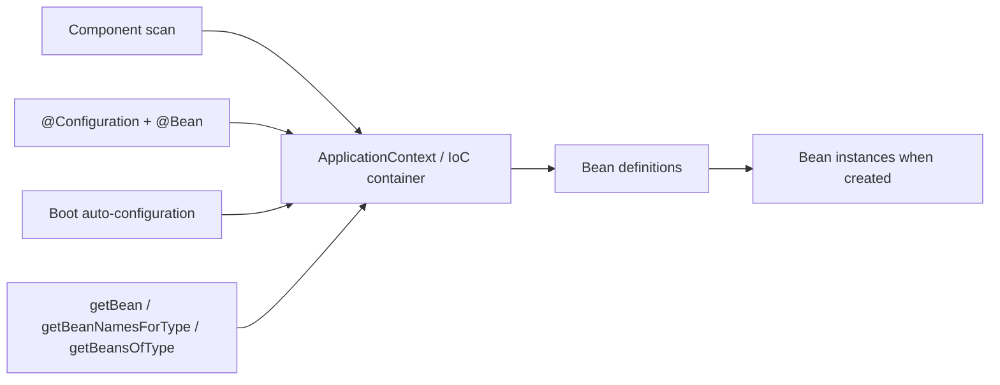
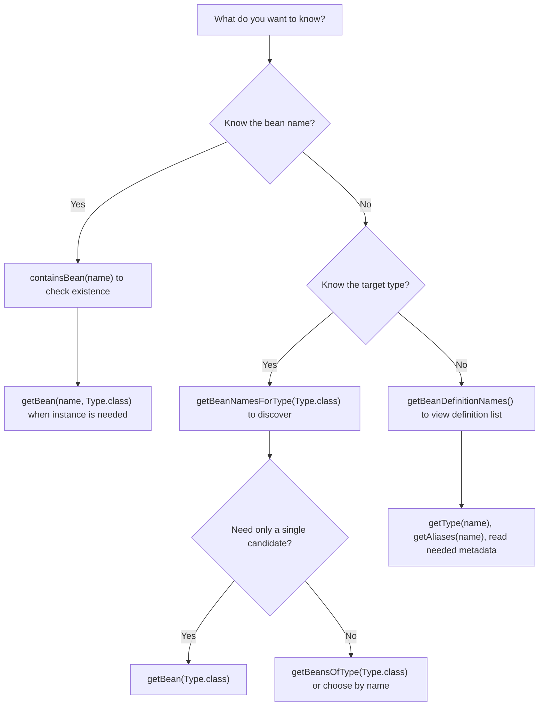

# Looking Up Beans by Name or Type to Inspect the IoC Container

When a Spring Boot application starts, many objects are registered and managed inside the **IoC container**. These can be services and controllers you wrote, beans declared with `@Bean`, or infrastructure components auto-configured by Spring Boot. When a dependency is not injected as expected, you often need to answer concrete questions:

- Which beans currently exist in the container?
- Does a bean named `greetingService` exist? What is its type?
- How many beans implement a given interface?
- Why is a lookup by type `MessageFormatter` ambiguous while a lookup by name succeeds?
- Does retrieving a bean from the container cause it to be instantiated?

Spring provides APIs on `ApplicationContext` and `BeanFactory` to inspect these details. This lesson moves from basic lookups to a small runnable Spring Boot application, then explains multi-bean scenarios, names/aliases, scopes, and side effects to watch out for when inspecting the container.

> **Main purpose of direct lookup:** learning how the container manages beans, assisting error investigation, and writing infrastructure integration points when needed. For most business services, continue favoring **constructor injection** instead of calling `getBean(...)` everywhere.

## 1. What Does Having a Bean in the Container Mean?

A **Bean** is an object registered and managed by the Spring container according to a **Bean definition** or corresponding registration mechanism. Each bean has a name, a type recognizable by Spring, a scope, and metadata related to how it is created and managed.

Two concepts to separate:

- **Bean definition:** metadata or recipe telling the container how to create and manage the bean.
- **Bean instance:** the concrete object provided by the container, which may already be initialized or only created when needed (for instance, with `@Lazy`).

Typically, a Spring Boot application has one main `ApplicationContext`. This context implements contracts such as `BeanFactory` and `ListableBeanFactory`, so it can:

1. Retrieve a bean by name or type.
2. Query the names of all beans matching a type.
3. List registered bean definitions.
4. Inspect details such as aliases, bean type, and scope.



Lookup APIs do not turn an object created externally with `new` into a bean. They only work with objects and definitions known to the container.

## 2. Key Lookup APIs

`ApplicationContext` inherits the capabilities required for bean lookup:

| API | Result | When to Use? |
|---|---|---|
| `getBean("name")` | An `Object` by name | You know the name without specifying a type |
| `getBean("name", SomeType.class)` | A bean by name with type check | You want the exact bean with an explicit type |
| `getBean(SomeType.class)` | A single/matching bean by type | Only one candidate exists or Spring can pick a primary candidate |
| `getBeanNamesForType(SomeType.class)` | Array of bean names matching the type | Discover candidate beans without instantiating/fetching all instances yet |
| `getBeansOfType(SomeType.class)` | `Map<String, SomeType>` | You want all matching instances along with their names |
| `containsBean("name")` | `boolean` | Check whether a name/alias can be resolved |
| `containsBeanDefinition("name")` | `boolean` | Check whether a bean definition with that name is registered **in the current factory** |
| `getType("name")` | `Class<?>` or `null` | Query the type the container can determine for the bean name |
| `getBeanDefinitionNames()` | Array of bean definition names | Inspect registered definitions |
| `getBeanDefinitionCount()` | `int` | Count bean definitions known to the current factory |
| `getAliases("name")` | Array of aliases | View other names pointing to a bean |
| `isSingleton("name")` / `isPrototype("name")` | `boolean` | Query a bean's scope traits by name |

**A note on reading the table:** "lookup by type" does not necessarily retrieve an instance of the exact class declared in source code. An interface can have multiple implementations; a bean can also be proxied by Spring, and the actual runtime type of the returned object may differ from the class you wrote in a Java file.

## 3. Lookup by Name: `getBean(String name)`

When you already know the bean name:

```java
Object object = applicationContext.getBean("greetingService");
```

This API returns `Object` because the bean name is a string; the compiler does not know the concrete type upfront. If you cast manually:

```java
GreetingService service =
        (GreetingService) applicationContext.getBean("greetingService");
```

you take responsibility for the cast. A clearer approach is using the overload taking both name and type:

```java
GreetingService service =
        applicationContext.getBean("greetingService", GreetingService.class);
```

Here Spring checks whether the corresponding bean is compatible with `GreetingService`. If not, it throws a type mismatch error such as `BeanNotOfRequiredTypeException`.

If the container finds no bean with that name, `getBean("name")` and its overloads typically throw `NoSuchBeanDefinitionException`. Therefore, do not assume `getBean` returns `null` when a bean does not exist.

### Where Do Bean Names Come From?

Bean names can be assigned explicitly:

```java
@Component("upperFormatter")
public class UpperFormatter implements MessageFormatter {
    // ...
}
```

Or assigned by Spring defaults:

```java
@Service
public class GreetingService {
    // Default bean name is typically "greetingService".
}
```

With `@Bean`, the default name is usually the method name unless an explicit name is declared:

```java
@Configuration(proxyBeanMethods = false)
class FormatterConfiguration {
    @Bean("bracketFormatter")
    MessageFormatter bracketFormatter() {
        return text -> "[" + text + "]";
    }
}
```

Remember: bean names are determined by naming rules, annotations, or registration, **not necessarily always the class name with a lowercase first letter**. If code relies on a specific name, declare the name explicitly or inspect the container metadata.

## 4. Lookup by Type: `getBean(Class<T> requiredType)`

In many situations you do not need to know the bean name. If `GreetingService` is the only registered bean of its type:

```java
GreetingService service =
        applicationContext.getBean(GreetingService.class);
```

The convenience is writing code against Java types instead of string names. However, "by type" means Spring considers **beans assignable to the requested type**, not just beans whose exact class equals that type.

Example:

```java
public interface MessageFormatter {
    String format(String text);
}
```

Suppose the container holds two beans:

```text
Bean name           Type
---------------------------------
upperFormatter      UpperFormatter implements MessageFormatter
bracketFormatter    Another implementation of MessageFormatter
```

The following call does not specify which bean:

```java
MessageFormatter formatter =
        applicationContext.getBean(MessageFormatter.class);
```

If no appropriate prioritization rule exists, Spring throws `NoUniqueBeanDefinitionException` rather than picking one arbitrarily by declaration order. You can:

- Look up explicitly by name and type: `getBean("upperFormatter", MessageFormatter.class)`.
- Use `@Primary` when designating one implementation as default.
- Use `@Qualifier` at the **injection point** to specify the desired bean.
- Retrieve a list/map of candidates when the goal is truly handling multiple beans.

A bean marked `@Primary` can take precedence during type-based resolution, yet `@Primary` does not change the bean's name and does not make the other beans disappear from the container.

## 5. Complete Spring Boot Example to Inspect the Container

Let us build a small console application using Spring Boot, requiring no HTTP server or database. The goal is to have:

- One `GreetingService`.
- Two beans implementing `MessageFormatter`.
- One bean discovered via `@Component`, and one bean declared via `@Bean`.
- An `ApplicationRunner` looking up beans and printing what the container knows.

### 5.1. Declaring Dependencies

In a project **already configured with the Spring Boot Gradle plugin, Java plugin, and dependency version management**:

```groovy
dependencies {
    implementation 'org.springframework.boot:spring-boot-starter'
}
```

The example does not use Spring MVC, so `spring-boot-starter-web` is not needed. In a compatible Spring Boot 3.x project, Spring's core/container classes are included through the starter.

### 5.2. Source Structure

```text
src/main/java/com/example/beanlookup/
├── BeanLookupApplication.java
├── MessageFormatter.java
├── UpperFormatter.java
└── GreetingService.java
```

**File `MessageFormatter.java`**

```java
package com.example.beanlookup;

public interface MessageFormatter {
    String format(String text);
}
```

**File `UpperFormatter.java`**

```java
package com.example.beanlookup;

import java.util.Locale;
import org.springframework.stereotype.Component;

@Component("upperFormatter")
public class UpperFormatter implements MessageFormatter {
    @Override
    public String format(String text) {
        return text.toUpperCase(Locale.ROOT);
    }
}
```

**File `GreetingService.java`**

```java
package com.example.beanlookup;

import org.springframework.beans.factory.annotation.Qualifier;
import org.springframework.stereotype.Service;

@Service
public class GreetingService {
    private final MessageFormatter formatter;

    public GreetingService(
            @Qualifier("upperFormatter") MessageFormatter formatter) {
        this.formatter = formatter;
    }

    public String greet(String name) {
        return formatter.format("Hello " + name);
    }
}
```

Here the constructor explicitly specifies `@Qualifier("upperFormatter")` because shortly there will be **two** `MessageFormatter` beans. No `@Autowired` is needed since the class has a single constructor.

**File `BeanLookupApplication.java`**

```java
package com.example.beanlookup;

import java.util.Arrays;
import java.util.Map;
import org.springframework.beans.factory.NoUniqueBeanDefinitionException;
import org.springframework.boot.ApplicationRunner;
import org.springframework.boot.SpringApplication;
import org.springframework.boot.autoconfigure.SpringBootApplication;
import org.springframework.context.ApplicationContext;
import org.springframework.context.annotation.Bean;

@SpringBootApplication
public class BeanLookupApplication {

    public static void main(String[] args) {
        SpringApplication.run(BeanLookupApplication.class, args);
    }

    // Second bean of type MessageFormatter.
    @Bean("bracketFormatter")
    MessageFormatter bracketFormatter() {
        return text -> "[" + text + "]";
    }

    @Bean
    ApplicationRunner inspectBeans(ApplicationContext context) {
        return args -> {
            // 1. Lookup by type: only one GreetingService exists.
            GreetingService serviceByType =
                    context.getBean(GreetingService.class);

            // 2. Lookup by name and type.
            GreetingService serviceByName =
                    context.getBean("greetingService", GreetingService.class);

            System.out.println(serviceByType.greet("Alice"));
            System.out.println("Same instance: "
                    + (serviceByType == serviceByName));

            // 3. List names of all MessageFormatter beans.
            String[] formatterNames =
                    context.getBeanNamesForType(MessageFormatter.class);
            Arrays.sort(formatterNames);
            System.out.println("Formatter names: "
                    + Arrays.toString(formatterNames));

            // 4. Retrieve exact beans by name and type.
            MessageFormatter upper =
                    context.getBean("upperFormatter", MessageFormatter.class);
            MessageFormatter bracket =
                    context.getBean("bracketFormatter", MessageFormatter.class);
            System.out.println(upper.format("spring"));
            System.out.println(bracket.format("spring"));

            // 5. Retrieve all instances matching a type.
            Map<String, MessageFormatter> all =
                    context.getBeansOfType(MessageFormatter.class);
            System.out.println("Formatter count: " + all.size());
            all.forEach((name, bean) ->
                    System.out.println(name + " -> " + bean.format("hello")));

            // 6. Lookup by type when a single candidate cannot be determined.
            try {
                context.getBean(MessageFormatter.class);
            } catch (NoUniqueBeanDefinitionException ex) {
                System.out.println("Multiple MessageFormatters found: "
                        + ex.getNumberOfBeansFound());
            }

            // 7. Other inspection queries.
            System.out.println("Has greetingService bean? "
                    + context.containsBean("greetingService"));
            System.out.println("Type of greetingService: "
                    + context.getType("greetingService"));
            System.out.println("Singleton? "
                    + context.isSingleton("greetingService"));
            System.out.println("Total bean definitions: "
                    + context.getBeanDefinitionCount());
        };
    }
}
```

### 5.3. Explaining What Happens

1. `SpringApplication.run(...)` creates/starts the appropriate `ApplicationContext`.
2. `@SpringBootApplication` enables component scanning from the `com.example.beanlookup` package. Spring discovers `UpperFormatter` and `GreetingService`.
3. The `@Bean("bracketFormatter")` method registers an additional bean of type `MessageFormatter`.
4. When constructing `GreetingService`, the container uses the qualifier to pick `upperFormatter`.
5. `ApplicationRunner` runs once the application is ready; it queries the context for what the container knows.

Sample output looks like:

```text
HELLO ALICE
Same instance: true
Formatter names: [bracketFormatter, upperFormatter]
SPRING
[spring]
Formatter count: 2
bracketFormatter -> [hello]
upperFormatter -> HELLO
Multiple MessageFormatters found: 2
Has greetingService bean? true
Type of greetingService: class com.example.beanlookup.GreetingService
Singleton? true
Total bean definitions: ...
```

This is **illustrative output**. The line order printed by `Map.forEach(...)` should not be relied on as a guarantee of bean order; the total count of bean definitions also varies with configuration, versions, and application auto-configurations. `Arrays.sort(...)` in the example merely makes the **name array** easier to read.

The application above is a console app; once `ApplicationRunner` finishes, the JVM may exit because no server or background task keeps the process alive. That does not affect lookups while the runner executes.

## 6. Why Do Different Lookup Methods Yield Different Results?

In the example above, Spring holds:

```text
ApplicationContext
├── greetingService     : GreetingService
│      └── depends on upperFormatter
├── upperFormatter      : UpperFormatter implements MessageFormatter
├── bracketFormatter    : MessageFormatter (instance returned by @Bean)
├── inspectBeans        : ApplicationRunner
└── Infrastructure beans registered by Spring Boot/Spring
```

Each call answers a different question:

```java
context.getBean("upperFormatter", MessageFormatter.class);
```

**"Get the bean with the exact name `upperFormatter`, and verify it is compatible with `MessageFormatter`."** Even with two beans of the same type, this remains unambiguous.

```java
context.getBean(GreetingService.class);
```

**"Find a bean compatible with `GreetingService`."** Since there is only one candidate, Spring retrieves it.

```java
context.getBean(MessageFormatter.class);
```

**"Find a bean compatible with `MessageFormatter`."** Two candidates exist; the example has no primary bean, making this lookup ambiguous.

```java
context.getBeanNamesForType(MessageFormatter.class);
```

**"Which beans are compatible with type `MessageFormatter`?"** This lookup serves inspection, returning multiple names rather than demanding a single bean.

```java
context.getBeansOfType(MessageFormatter.class);
```

**"Return all instances compatible with `MessageFormatter`, paired with each bean's name."** Use this when you actually need to operate on the real beans, not just read their names.

## 7. Using `getBeanNamesForType` to Discover Before Instantiating Beans

Two type-listing APIs are frequently conflated:

| | `getBeanNamesForType(T.class)` | `getBeansOfType(T.class)` |
|---|---|---|
| Returns | `String[]` | `Map<String, T>` |
| Used for | Finding candidate names | Retrieving candidate instances |
| Fetches instances to return? | No, returns names | Yes |
| Potential to trigger initialization | Has exceptions involving type inference and `FactoryBean` | Can initialize beans not yet created |
| For lightweight inspection | Usually better suited | Use only if objects are genuinely needed |

Example of finding all controllers:

```java
String[] names = context.getBeanNamesForType(
        org.springframework.web.bind.annotation.RestController.class);
```

The snippet above is **not** the normal way to find controllers, because `@RestController` is an **annotation**, not a supertype of controller classes. To inspect controllers by annotation, use the matching API:

```java
String[] controllerNames =
        context.getBeanNamesForAnnotation(
                org.springframework.web.bind.annotation.RestController.class);
```

A proper example of `getBeanNamesForType` is finding beans by class/interface:

```java
String[] names = context.getBeanNamesForType(MessageFormatter.class);
Arrays.sort(names);
for (String name : names) {
    System.out.println(name);
}
```

In Spring Boot with many auto-configured components, searching for **one specific type** is much more useful than printing hundreds of bean names.

### Limiting Eager Initialization During Type Lookups

`ListableBeanFactory` provides an overload:

```java
String[] names = context.getBeanNamesForType(
        MessageFormatter.class,
        true,   // includeNonSingletons
        false   // allowEagerInit
);
```

The `allowEagerInit=false` argument helps avoid certain cases where `FactoryBean`s or related beans would be eagerly initialized solely to determine their type. It is helpful when writing container inspection tools. In exchange, beans whose types cannot be determined without initialization may not appear in the result.

This is not a promise that every inspection call has zero side effects: depending on bean definitions and versions/configuration, type resolution can be complex. When you only want to read metadata, prefer appropriate name/definition APIs and avoid unnecessary `getBeansOfType` calls.

## 8. Checking Bean Existence

### `containsBean` Differs from `getBean`

`containsBean("name")` simply returns `true` or `false` indicating whether a bean can be resolved by name; it does not return an object:

```java
if (context.containsBean("greetingService")) {
    System.out.println("Container knows the name greetingService");
}
```

Unlike `getBean(...)`, checking existence by name is a suitable inspection step before looking up a potentially absent bean. Still, in dynamic systems container state could change between two operations; in normal business code, declare mandatory dependencies via constructors and let Spring report configuration errors right at startup.

### What Does `containsBeanDefinition` Check?

`ListableBeanFactory` provides:

```java
boolean locallyDefined =
        context.containsBeanDefinition("greetingService");
```

It checks whether a **bean definition registered in the current factory** exists under the queried name. This does not mean every resolvable bean must have a direct bean definition under that exact name:

- A bean can have **aliases**; aliases resolve to the bean without creating a second definition.
- Some singletons may be registered directly without a standard bean definition.
- In systems with a **parent context**, `containsBean` can resolve beans in the parent context, whereas `containsBeanDefinition` checks definitions only in the current factory.

Therefore, `containsBean("someAlias")` and `containsBeanDefinition("someAlias")` can yield different results without contradiction.

### Inspecting Types and Aliases

```java
Class<?> type = context.getType("greetingService");
String[] aliases = context.getAliases("greetingService");

System.out.println(type);
System.out.println(Arrays.toString(aliases));
```

`getType(...)` may return `null` when the type cannot be determined. Do not assume every bean has an implementation class guessable from its name; a bean can originate from a factory method, proxy, or `FactoryBean`.

## 9. Listing Bean Definitions to View the Whole Container

Sometimes you want to know all definitions the container registered, not just one interface:

```java
String[] allNames = context.getBeanDefinitionNames();
Arrays.sort(allNames);

System.out.println("Bean definition count: "
        + context.getBeanDefinitionCount());

for (String name : allNames) {
    System.out.println(name);
}
```

Notes:

- A Spring Boot application can contain **very many** internal beans. The full list easily clutters logs.
- `getBeanDefinitionNames()` lists names of definitions known to the current factory, **not** names of every Java object in the JVM.
- `getBeanDefinitionCount()` is the count of definitions, **not** the count of already created instances.
- With `prototype` beans, one definition can create many instances. With `@Lazy` beans, a definition can already exist even when no instance exists yet.

If you want to view only your application's beans, deliberately filter names or types by package or annotation. Do not infer "every bean I wrote" from simple name prefixes, because names can be generated by `@Bean`, aliases, or custom naming strategies.

### Inspecting Metadata of a Bean Definition

When deeper metadata is needed, you can work with `ConfigurableApplicationContext` and `ConfigurableListableBeanFactory`:

```java
import org.springframework.beans.factory.config.BeanDefinition;
import org.springframework.beans.factory.config.ConfigurableListableBeanFactory;
import org.springframework.context.ConfigurableApplicationContext;

ConfigurableApplicationContext configurableContext = /* existing context */;
ConfigurableListableBeanFactory factory =
        configurableContext.getBeanFactory();

if (factory.containsBeanDefinition("greetingService")) {
    BeanDefinition definition =
            factory.getBeanDefinition("greetingService");

    System.out.println("Scope metadata: " + definition.getScope());
    System.out.println("Bean class metadata: "
            + definition.getBeanClassName());
}
```

This is an **illustrative snippet** showing how to read metadata, not a standalone program: you need a `ConfigurableApplicationContext` instance. One way to obtain it inside an application is injecting the context type into a diagnostic component.

A few important interpretation points:

- `definition.getScope()` can be an empty string representing the default scope; do not conclude an empty string means the bean "has no scope."
- `getBeanClassName()` can return `null` for definitions created via factory methods or mechanisms where Spring does not store a class name directly in that attribute.
- Metadata offers a view of **how the bean was registered**, while `context.getType(name)` queries **the bean type recognizable by the container**. The two APIs do not always return identical information.

## 10. Bean Names, Aliases, and `FactoryBean`

Spring supports multiple names for the same bean:

```java
@Bean(name = {"friendlyFormatter", "displayFormatter"})
MessageFormatter friendlyFormatter() {
    return text -> "<" + text + ">";
}
```

Here `friendlyFormatter` is the bean's primary name, and `displayFormatter` is an alias. Both resolve to the same bean:

```java
MessageFormatter a =
        context.getBean("friendlyFormatter", MessageFormatter.class);
MessageFormatter b =
        context.getBean("displayFormatter", MessageFormatter.class);
System.out.println(a == b); // true with default singleton
```

For default singletons, looking up via an alias does not create another singleton. You can call `getAliases("friendlyFormatter")` to inspect aliases.

An advanced case is `FactoryBean<T>`, a Spring mechanism letting a specialized factory bean produce **a product object**:

- `getBean("someFactory")` normally retrieves the **product object** supplied by the `FactoryBean`.
- `getBean("&someFactory")` requests the **`FactoryBean` object itself**.

The `&` character here is a special `BeanFactory` convention when dealing with `FactoryBean`; it is not syntax to prepend to arbitrary bean names. Beginners can leave this mechanism until encountering libraries that use `FactoryBean`, such as certain infrastructure or framework integrations.

## 11. How Do Scope and Lazy Initialization Affect Lookup Results?

### Singleton: Retrieving the Same Bean Repeatedly

The default scope in Spring is `singleton`: normally one instance per bean definition within **one container**.

```java
GreetingService first = context.getBean(GreetingService.class);
GreetingService second = context.getBean(GreetingService.class);

System.out.println(first == second); // true in default singleton configuration
```

This does not mean "the entire JVM can only have one instance of this class." Multiple contexts or distinct bean definitions can produce multiple instances of the same class.

### Prototype: Each Request Can Yield a New Instance

```java
import org.springframework.context.annotation.Scope;
import org.springframework.stereotype.Component;

@Component
@Scope("prototype")
public class TraceToken {
}
```

When looking up:

```java
TraceToken a = context.getBean(TraceToken.class);
TraceToken b = context.getBean(TraceToken.class);

System.out.println(a == b); // false for typical prototype
System.out.println(context.isPrototype("traceToken")); // true
```

The container still holds only **one bean definition** corresponding to `TraceToken`, even though it can create many instances when you call `getBean`. For prototype beans, Spring normally performs creation and initialization steps, yet does not manage instance destruction the same way as singletons; releasing prototype-owned resources may need to be handled by the consumer.

### `@Lazy`: Checking the Name Differs from Fetching the Object

```java
import org.springframework.context.annotation.Lazy;
import org.springframework.stereotype.Component;

@Lazy
@Component
public class ExpensiveClient {
    public ExpensiveClient() {
        System.out.println("ExpensiveClient was just created");
    }
}
```

When a lazy bean has not yet been created, `containsBean("expensiveClient")` or inspecting bean definitions can still show the bean is registered. However:

```java
ExpensiveClient client = context.getBean(ExpensiveClient.class);
```

can **trigger instance creation**. Likewise, `getBeansOfType(ExpensiveClient.class)` retrieves instances and is therefore not a pure metadata-inspection operation.

This matters particularly if a bean opens connections, creates files, calls services, or initializes expensive resources. Do not run a "dump all beans" routine in production just to check counts if it inadvertently instantiates beans that were not yet needed.

## 12. Common Exceptions During Lookup

| Operation | Situation | Typical Outcome | How to Handle |
|---|---|---|---|
| `getBean("unknownBean")` | No matching name | `NoSuchBeanDefinitionException` | Check name, component scan, `@Bean` conditions, and auto-configuration |
| `getBean(MissingService.class)` | No bean matching type | `NoSuchBeanDefinitionException` | Register the bean or check package scan/conditions |
| `getBean(MessageFormatter.class)` | Two implementations, no candidate chosen | `NoUniqueBeanDefinitionException` | Use name+type, `@Primary`, or qualifiers when injecting |
| `getBean("upperFormatter", WrongType.class)` | Bean with that name exists, incompatible type | `BeanNotOfRequiredTypeException` | Fix requested type or bean name |
| `getBean("brokenClient")` | Definition exists, bean creation failed | Usually `BeanCreationException` or related error | Read root cause inside stack trace |
| `getBeansOfType(...)` | Some beans require initialization and fail | May throw initialization exceptions | Prefer inspecting metadata/names; investigate failing bean |

Example handling a missing bean:

```java
import org.springframework.beans.factory.NoSuchBeanDefinitionException;

try {
    context.getBean("notRegistered");
} catch (NoSuchBeanDefinitionException ex) {
    System.out.println("No bean named notRegistered yet");
}
```

Do not catch and swallow every `BeansException` during startup just so "the application stays running." If a mandatory dependency is missing or fails to initialize, failing fast and reading the root cause is safer than hiding configuration bugs.

## 13. How Direct Bean Lookup Differs from Dependency Injection

The two approaches below can obtain the same singleton instance, yet carry very different design roles.

**Preferred in business code — constructor injection:**

```java
@Service
public class OrderService {
    private final GreetingService greetingService;

    public OrderService(GreetingService greetingService) {
        this.greetingService = greetingService;
    }

    public String describe(String customer) {
        return greetingService.greet(customer);
    }
}
```

The dependency is expressed in the constructor signature; Spring supplies it when instantiating `OrderService`. Unit tests can pass fakes/test doubles directly without starting the container.

**Explicit lookup — appropriate when you truly need to query the container:**

```java
GreetingService greetingService =
        context.getBean(GreetingService.class);
```

Code needs a reference to the container and actively fetches the dependency. If used inside every business method, dependencies are hidden inside method bodies and code becomes harder to test in isolation. This pattern is commonly called **service locator** when overused to look up all services from the container.

Cases where direct lookup makes more sense:

- Writing container diagnostic tools to display bean lists, types, and scopes.
- Building frameworks/integrations that must pick beans from a dynamically registered set.
- Writing study/teaching snippets to observe IoC mechanics.
- Performing infrastructure tasks at application startup where the context itself is the managed object.

When you want to inject multiple beans sharing an interface into a service, **injecting `List<MessageFormatter>` or `Map<String, MessageFormatter>`** is often preferable to passing `ApplicationContext` and calling `getBeansOfType`:

```java
@Service
public class FormatterCatalog {
    private final Map<String, MessageFormatter> formatters;

    public FormatterCatalog(Map<String, MessageFormatter> formatters) {
        this.formatters = Map.copyOf(formatters);
    }

    public MessageFormatter get(String name) {
        MessageFormatter formatter = formatters.get(name);
        if (formatter == null) {
            throw new IllegalArgumentException("Formatter not found: " + name);
        }
        return formatter;
    }
}
```

This snippet assumes `MessageFormatter` beans already exist and taking a map snapshot in the constructor fits application needs. Spring can inject the map keyed by bean name. For dynamic/lazy beans or special lifecycles, examine creation timing and appropriate solutions further.

## 14. Inspecting the Container with Tests

Beyond `ApplicationRunner`, an integration test can verify container structure cleanly. If the project uses `spring-boot-starter-test`:

```groovy
dependencies {
    testImplementation 'org.springframework.boot:spring-boot-starter-test'
}
```

An illustrative test:

```java
package com.example.beanlookup;

import static org.junit.jupiter.api.Assertions.assertEquals;
import static org.junit.jupiter.api.Assertions.assertSame;
import static org.junit.jupiter.api.Assertions.assertTrue;

import org.junit.jupiter.api.Test;
import org.springframework.beans.factory.annotation.Autowired;
import org.springframework.boot.test.context.SpringBootTest;
import org.springframework.context.ApplicationContext;

@SpringBootTest
class BeanLookupTest {

    @Autowired
    ApplicationContext context;

    @Test
    void canLookUpBeanByNameAndType() {
        GreetingService byType = context.getBean(GreetingService.class);
        GreetingService byName =
                context.getBean("greetingService", GreetingService.class);

        assertSame(byType, byName);
        assertTrue(context.containsBean("greetingService"));
        assertEquals(2,
                context.getBeanNamesForType(MessageFormatter.class).length);
    }
}
```

This test verifies how the container is wired, so it needs to run a Spring test context. It serves a different purpose from unit testing `GreetingService` instantiated with `new` and a fake formatter: the unit test verifies class logic, whereas the integration test verifies bean registration and resolution.

Note that `@SpringBootTest` can trigger the example's `ApplicationRunner`; if a runner prints logs or performs actions unsuitable for tests, structure runners/configuration cleanly rather than letting startup logic cause unintended side effects.

## 15. Advanced Points When Inspecting Large Applications

### Parent Context and Child Context

Some architectures use multiple tiers of `ApplicationContext`. A child context can look up beans from a parent context when appropriate, yet listing APIs such as `getBeansOfType`/`getBeanDefinitionNames` primarily reflect bean definitions of the queried factory itself.

If you genuinely need type listings **including beans from ancestor factories**, Spring provides helpers in `BeanFactoryUtils`, such as `beansOfTypeIncludingAncestors(...)`. For typical Spring Boot applications with a single primary context, you may not need this level yet.

### Proxies and Requested Types

Spring AOP or transaction management can wrap beans in proxies. If a bean is proxied by interface, querying by **interface** is usually safer than assuming the runtime object can always be cast to the concrete implementation.

For example, a service implementing `PaymentService` wrapped in a JDK proxy can be resolved via `PaymentService.class`, yet casting it to the concrete implementation class is not always valid. When encountering type-mismatch errors, distinguish **target class** from **the type exposed by the proxy**.

### Generic Types

`getBean(SomeClass.class)` uses a plain `Class`, so it cannot fully express parameterized generic types like `Repository<Customer>` versus `Repository<Order>`. When generic type resolution is needed, Spring supports mechanisms such as `ResolvableType` and `getBeanProvider(ResolvableType)` overloads. That is an advanced topic; master standard name and Java type resolution first.

### Do Not Dump All Beans in Production Environments

Bean definitions and condition metadata can expose internal application structure, integration names, or configuration details. When writing diagnostic endpoints, restrict exposed data and access controls. Printing bean names in a console demo is completely different from a public API listing every infrastructure component.

## 16. Practice: Asking Questions of the Container Yourself

Try changing **one thing at a time** in the complete example to see what the APIs return:

1. **Rename the bean.** Change `@Component("upperFormatter")` to `@Component("shoutFormatter")` without updating the qualifier in `GreetingService`. Observe the startup error; then update the qualifier to the new name and check `getBeanNamesForType`.
2. **Add `@Primary`.** Annotate `UpperFormatter` with `@Primary`, then call `context.getBean(MessageFormatter.class)` again. See which bean is chosen and verify `getBeansOfType` still returns two beans.
3. **Add a `@Lazy` bean.** Declare a bean that logs in its constructor. Call `containsBean` or list names first, then call `getBean` and observe when the constructor log appears.
4. **Try a prototype bean.** Declare `@Scope("prototype")`, then call `getBean` twice; compare identities with `==` and check `isPrototype`.
5. **Check definition count.** Check `getBeanDefinitionCount` and `getBeanDefinitionNames` before and after adding a new `@Bean`. Distinguish definition count from actual instance count.

These experiments help visualize the relationships among **bean name**, **bean type**, **bean definition**, **instance**, **scope**, and **candidate selection rules**.

## 17. Mental Model for Investigating the Container



When debugging dependency injection, a useful sequence is:

1. Identify the **dependency type** that the constructor actually requires.
2. Query the container with `getBeanNamesForType(RequiredType.class)` to see whether there are **0, 1, or many** candidates.
3. If zero candidates exist: check component scan, `@Bean`, auto-configuration conditions, profiles, and context scope.
4. If multiple candidates exist: inspect bean names, qualifiers, `@Primary`, and design intent.
5. If a candidate exists yet bean creation fails: read the stack trace and initialization cause, because **"registered"** does not mean **"instance created successfully."**

Lookup by **name** fits when you need a specific bean; lookup by **type** fits when using an abstraction or finding all implementations; **listing/metadata** APIs fit when you only want to observe the container. Whichever API you use, remember that the IoC container takes responsibility for creating, wiring, and managing beans for the application. Direct lookup should help you understand and diagnose that structure; normal business code should still expose dependencies via constructors so it remains readable, replaceable, and testable.
