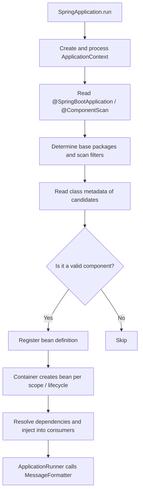
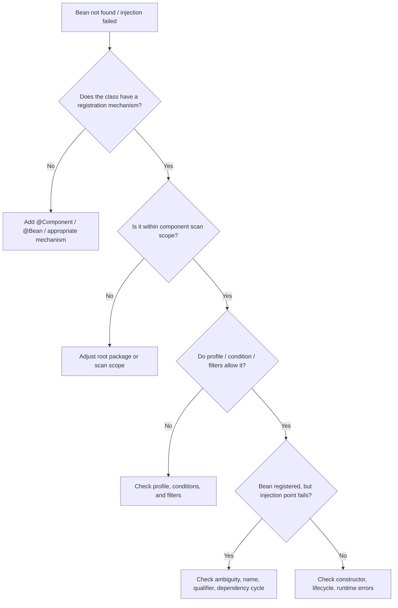

# `@Component` and Component Discovery Mechanism

One of the very first things you do when learning Spring Boot is put `@Component` on a class and notice that it can be injected elsewhere without writing `new` yourself. Behind that seemingly simple behavior lies a sequence of steps: **determine the package scan scope → find component candidates → register bean definitions → create beans → wire dependencies**. Understanding each step helps you explain why an annotated class sometimes still fails to become a Spring bean.

This lesson belongs to the **Bean Registration** chapter of *Spring Boot Fundamentals*. We will practice with a small Java application and explore the nature of `@Component`, how `@ComponentScan` works, how bean names and bean scopes are determined, how to create custom stereotypes, and common cases where Spring fails to detect components.

The examples use **Java 21 and Spring Boot 3.x**, with the root package `com.example.demo`. You can apply the same principles to a plain Spring Framework project or a Spring Boot project using Maven/Gradle.

## 1. Learning Objectives

After completing this lesson, you will be able to answer through code and practical observation:

1. What does `@Component` signify, and does it automatically create a bean as soon as the JVM loads the class?
2. Which classes does component scan look for, and based on which packages and annotations?
3. How does `@SpringBootApplication` relate to `@ComponentScan`?
4. Why can Spring inject a service into a constructor without the application instantiating it manually?
5. How are default bean names generated, and when should you specify a name explicitly?
6. How do `@Service`, `@Repository`, and `@Controller` differ from `@Component`?
7. When a class already has `@Component` yet still reports "bean not found", what should you check?

Key takeaway from the start: **an annotation is a marker for the scanning mechanism to inspect the class; the Spring container itself manages the bean**.

## 2. What is `@Component`?

`@Component` is a Spring Framework annotation located in the package:

```java
import org.springframework.stereotype.Component;
```

It marks a class as a **candidate to be automatically detected and registered by the Spring container**, when that class resides within an appropriate component scanning scope. For example:

```java
package com.example.demo;

import org.springframework.stereotype.Component;

@Component
public class MessageFormatter {

    public String format(String name) {
        return "Hello, " + name + "!";
    }
}
```

`MessageFormatter` remains an ordinary Java class. The `format` method does not depend on Spring, does not become an HTTP API, and is not invoked automatically just because the class has `@Component`.

The annotation tells Spring: **if the scanning mechanism passes through this class and the registration conditions are met, consider creating a bean definition for it**.

### How does a Java class differ from a Spring bean?

A Java class describes a blueprint for creating objects. You can create an instance yourself:

```java
MessageFormatter formatter = new MessageFormatter();
System.out.println(formatter.format("Lan"));
```

That instance is a Java object created by your code. By contrast, when Spring detects `MessageFormatter`, Spring can create and hold an instance in the `ApplicationContext`, then provide that instance to beans that need it. An instance created and managed by Spring is called a **Spring bean**.

| Object created manually with `new` | Spring bean |
|---|---|
| Your code decides when to create the object and where to store the reference. | The container creates/manages it according to bean definition, scope, and lifecycle. |
| Not automatically provided by Spring to other beans. | Can be looked up by type/name and injected into appropriate dependencies. |
| Does not automatically receive container-attached mechanisms on the instance. | Can receive dependency injection, lifecycle callbacks, and appropriate framework processing. |
| Still calls regular Java methods. | Still a Java object, but resides within Spring's management system. |

**`@Component` does not turn every instance of a class into a bean.** If you both let Spring register `MessageFormatter` and call `new MessageFormatter()` yourself, you have different instances. An instance created with `new` outside the container does not automatically become a bean just because its class is annotated.

## 3. Minimal Project to Observe the Mechanism

In Spring Initializr, create a Java 21, Spring Boot 3.x, Gradle project with the foundational `spring-boot-starter` dependency. You can add `spring-boot-starter-test` if you want to practice verifying with tests.

The `dependencies` block in `build.gradle` can look like this:

```groovy
dependencies {
    implementation 'org.springframework.boot:spring-boot-starter'
    testImplementation 'org.springframework.boot:spring-boot-starter-test'
}
```

This is a **dependency configuration snippet**, not the entire Gradle file. Keep the plugins, repositories, toolchain, and the rest generated by the project initializer.

Initial source structure:

```text
src/main/java/
└── com/example/demo/
    ├── DemoApplication.java
    ├── MessageFormatter.java
    └── StartupReporter.java
```

File `DemoApplication.java`:

```java
package com.example.demo;

import org.springframework.boot.SpringApplication;
import org.springframework.boot.autoconfigure.SpringBootApplication;

@SpringBootApplication
public class DemoApplication {

    public static void main(String[] args) {
        SpringApplication.run(DemoApplication.class, args);
    }
}
```

File `MessageFormatter.java`:

```java
package com.example.demo;

import org.springframework.stereotype.Component;

@Component
public class MessageFormatter {

    public String format(String name) {
        return "Hello, " + name + "!";
    }
}
```

File `StartupReporter.java`:

```java
package com.example.demo;

import org.springframework.boot.ApplicationArguments;
import org.springframework.boot.ApplicationRunner;
import org.springframework.context.ApplicationContext;
import org.springframework.stereotype.Component;

@Component
public class StartupReporter implements ApplicationRunner {

    private final MessageFormatter formatter;
    private final ApplicationContext context;

    public StartupReporter(
            MessageFormatter formatter,
            ApplicationContext context) {
        this.formatter = formatter;
        this.context = context;
    }

    @Override
    public void run(ApplicationArguments args) {
        System.out.println(formatter.format("Lan"));
        System.out.println("Has formatter bean: "
                + context.containsBean("messageFormatter"));
        System.out.println("Number of beans of type MessageFormatter: "
                + context.getBeansOfType(MessageFormatter.class).size());
    }
}
```

In this example, **both `MessageFormatter` and `StartupReporter` have `@Component`**. Spring needs to register both as beans; only then can Spring Boot invoke the runner at startup.

### Running the Application

On Linux/macOS:

```bash
./gradlew bootRun
```

On Windows PowerShell:

```powershell
.\gradlew.bat bootRun
```

The lines printed by the application will be equivalent to:

```text
Hello, Lan!
Has formatter bean: true
Number of beans of type MessageFormatter: 1
```

The application has no web starter or long-running background task, so it starts and exits normally after the runner executes. There is no need to try calling `localhost:8080` in this lesson.

Three things can be observed: Spring creates the `MessageFormatter` bean, Spring injects that bean into `StartupReporter`, and `ApplicationContext` can look up the bean by name or type.

## 4. How Does the Component Discovery Mechanism Work?

A helpful way to understand this is to break the process into clear stages:



### Step 1 — Determine the scan scope

Spring needs to know **which packages to search for components**. With `@SpringBootApplication` placed in `com.example.demo`, the default component scan scope is this package and its subpackages.

### Step 2 — Find candidate classes

Spring has a mechanism to read metadata of classes on the classpath within the scan scope. It looks for classes with matching component annotations, including direct annotations or related meta-annotations.

Do not imagine that Spring has to call the constructor of **every** class in a package to see whether it is a component. Candidate discovery and instance creation are separate phases.

### Step 3 — Register the bean definition

When `MessageFormatter` meets the criteria, the container registers a **bean definition**: a description of how to create the bean, its name, type, scope, and other necessary details. A bean definition is registration information; by itself, it does not mean every instance has already been created.

### Step 4 — Create beans and wire dependencies

In the default configuration, an ordinary singleton bean is created when the context initializes. Spring sees the constructor `StartupReporter(MessageFormatter, ApplicationContext)` and supplies the appropriate dependencies.

### Step 5 — The bean consumer runs

After the context initialization phase, Spring Boot invokes beans implementing `ApplicationRunner`. The runner uses the injected formatter to produce the greeting.

This is the **IoC/DI** relationship: instantiation, holding references, and wiring dependencies are delegated to the Spring container; business methods are still defined and called by application code when needed.

## 5. How Does `@SpringBootApplication` Enable Component Scan?

`@SpringBootApplication` is a composite annotation combining key capabilities:

| Component | Responsibility |
|---|---|
| `@SpringBootConfiguration` | Marks the configuration class of the Boot application. |
| `@EnableAutoConfiguration` | Lets Boot consider eligible auto-configurations. |
| `@ComponentScan` | Discovers components based on package scope and filters. |

If the main class is in:

```java
package com.example.demo;
```

then the classes underneath are typically found:

```text
com.example.demo
├── DemoApplication                    @SpringBootApplication
├── MessageFormatter                  @Component          ✓
├── runner
│   └── StartupReporter               @Component          ✓
└── service
    └── OrderService                  @Service            ✓

com.example.shared
└── ExternalFormatter                 @Component          outside default scope
```

**Placing the main class in an appropriate root package** is the simplest way for application components to be discovered by Spring by default.

### Intentionally Expanding the Scan Scope

When you genuinely need components in other packages, `@SpringBootApplication` supports:

```java
@SpringBootApplication(
        scanBasePackages = {
                "com.example.demo",
                "com.example.shared"
        }
)
public class DemoApplication {
    // ...
}
```

The `scanBasePackages` attribute is one way to configure the scope of `@ComponentScan`. Package strings need to be updated whenever you move or rename packages.

Another approach uses classes as anchors:

```java
import com.example.shared.ExternalFormatter;

@SpringBootApplication(
        scanBasePackageClasses = {
                DemoApplication.class,
                ExternalFormatter.class
        }
)
public class DemoApplication {
    // ...
}
```

This example assumes `ExternalFormatter` is a real class in the `com.example.shared` package. `scanBasePackageClasses` takes **the packages containing the specified classes**, scanning each package and its subpackages; it does not scan only the exact classes in the array.

Putting overly broad packages into the scan scope can cause Spring to register beans or configurations the application does not intend to use. Therefore, choose a scan scope that reflects **application boundaries**, rather than scanning from `com` or `org` by default.

### Case Where No Package Is Declared for the Main Class

You should avoid putting `DemoApplication` in the **default package** (without a `package ...;` statement). Doing so can make the component scan scope overly broad, easily pulling unintended classes and configurations into the scan. Place the main class in a named package and organize components beneath it.

## 6. `@Component` and Stereotype Annotations

Spring provides specialized annotations **meta-annotated** with `@Component`, the most common being:

| Annotation | Intended meaning | Included in standard component scan? |
|---|---|---|
| `@Component` | General-purpose component not necessarily tied to a specific layer. | Yes |
| `@Service` | Class containing business logic or application services. | Yes |
| `@Repository` | Data access/DAO class written by the application. | Yes |
| `@Controller` | Spring MVC controller returning views or handling requests. | Yes |
| `@RestController` | REST controller; combines `@Controller` and `@ResponseBody`. | Yes |
| `@Configuration` | Configuration class that may contain `@Bean` methods. | Yes |

`@Service` and `@Repository` are not a "different DI technology" from `@Component`: they communicate **the class's role** and can be recognized by component scan through meta-annotation.

For example:

```java
package com.example.demo.service;

import org.springframework.stereotype.Service;

@Service
public class PriceService {
    public long priceWithTax(long basePrice) {
        return Math.round(basePrice * 1.1);
    }
}
```

Spring can find the `PriceService` bean because `@Service` is a stereotype of `@Component`. Using `@Service` expresses the "business service" role more clearly than a generic `@Component`.

### Specific Note About `@Repository`

A **concrete DAO class** annotated with `@Repository` can be discovered by component scan. However, a Spring Data JPA `JpaRepository<Customer, Long>` interface is typically registered by the **Spring Data repository scanning** infrastructure as a repository proxy bean. Do not assume every repository interface is processed by component scan in the same way as a regular `@Component` class.

Similarly, a JPA `@Entity` is a data type managed by JPA; it is **not automatically a Spring component bean** just because it sits in the same package.

## 7. How Are Default Bean Names Chosen?

When you write:

```java
@Component
public class MessageFormatter {
}
```

the default bean name is typically `messageFormatter`: Spring takes the short class name and applies decapitalization rules according to the default naming mechanism. That is why `ApplicationContext.containsBean("messageFormatter")` works in the example.

You can specify an explicit name:

```java
@Component("customerMessageFormatter")
public class MessageFormatter {
}
```

In that case, the bean name is `customerMessageFormatter` instead of the default generated name. If you inject by the **unique type** `MessageFormatter`, you usually do not need to know the bean name. Names become important when looking up beans by name or when multiple beans share the same type.

**A bean name is not the same as a Java variable name or package.** For example, the `formatter` field in the runner is just a reference variable name; it does not determine whether the bean is registered.

### What If Two Classes Have the Same Simple Name?

Suppose you have:

```text
com.example.demo.email.NotificationSender
com.example.demo.sms.NotificationSender
```

Both are annotated with `@Component` and lie within the scan scope. Both default names could be `notificationSender`, leading to a bean definition conflict or a situation requiring specific registration handling.

You can use explicit names such as `@Component("emailNotificationSender")` and `@Component("smsNotificationSender")` to avoid name collisions, while also designing clear interfaces and injection points when multiple implementations exist.

## 8. Constructor Dependency Injection

Suppose a service needs to use `MessageFormatter`:

```java
package com.example.demo;

import org.springframework.stereotype.Service;

@Service
public class GreetingService {

    private final MessageFormatter formatter;

    public GreetingService(MessageFormatter formatter) {
        this.formatter = formatter;
    }

    public String greet(String name) {
        return formatter.format(name);
    }
}
```

When Spring creates the `GreetingService` bean, it inspects the constructor and looks for a bean matching the `MessageFormatter` type. If there is only one suitable candidate, Spring passes that bean into the constructor. In modern Spring, **a single constructor does not require `@Autowired`**.

Why is constructor injection generally preferred?

- Required dependencies appear explicitly in the constructor signature.
- Fields can be `final` and do not need setters that mutate state later.
- When a dependency is missing, Spring can fail fast during context creation.
- The class is easy to test in plain Java by creating test dependencies and passing them into the constructor.

In the example, `GreetingService` and `MessageFormatter` are both Spring beans when scanned, but **providing a bean** and **consuming a bean** are two distinct responsibilities.

### What If There Are Multiple Implementations of the Same Type?

Suppose we extract the formatter into an interface:

```java
package com.example.demo;

public interface TextFormatter {
    String format(String name);
}
```

Create two components:

```java
package com.example.demo;

import org.springframework.stereotype.Component;

@Component("friendlyFormatter")
public class FriendlyFormatter implements TextFormatter {
    @Override
    public String format(String name) {
        return "Hi " + name + "!";
    }
}
```

```java
package com.example.demo;

import org.springframework.stereotype.Component;

@Component("formalFormatter")
public class FormalFormatter implements TextFormatter {
    @Override
    public String format(String name) {
        return "Greetings, " + name + ".";
    }
}
```

If a constructor only asks for `TextFormatter`:

```java
public GreetingService(TextFormatter formatter) {
    this.formatter = formatter;
}
```

then there are **two beans satisfying the type**, and Spring may throw an error unable to determine which bean to inject. To clarify the choice, use `@Qualifier`:

```java
import org.springframework.beans.factory.annotation.Qualifier;

public GreetingService(
        @Qualifier("friendlyFormatter") TextFormatter formatter) {
    this.formatter = formatter;
}
```

This is a **variation** of `GreetingService`, so to apply it you need to change the field to `private final TextFormatter formatter;`. You can also mark one implementation with `@Primary` to set a default preference in suitable injection scenarios.

Key point: **both components may have been scanned successfully**; the error occurs at the *bean selection for injection* step, not at the component scanning step.

## 9. How Does `@Component` Differ from `@Bean`?

Component scanning is not the only way to register beans. For a class you cannot or do not want to annotate directly (such as a class from an external library), you can define a `@Bean` factory method:

```java
package com.example.demo;

import java.time.Clock;
import org.springframework.context.annotation.Bean;
import org.springframework.context.annotation.Configuration;

@Configuration(proxyBeanMethods = false)
public class TimeConfiguration {

    @Bean
    Clock clock() {
        return Clock.systemUTC();
    }
}
```

Spring detects `TimeConfiguration` as a configuration class if it is within the scan scope or registered otherwise, and then processes `@Bean` methods. The return value from `clock()` becomes a Spring bean according to its corresponding bean definition.

Comparison:

| `@Component` | `@Bean` |
|---|---|
| Placed directly on a class. | Placed on a method that creates or returns an object inside a Spring-processed configuration class. |
| Component scan can automatically find the candidate class. | Spring must first know about the configuration containing the `@Bean` method. |
| Suitable for application classes whose source you control. | Suitable for library objects, factory methods, or special instantiation logic. |
| The bean is created via corresponding configuration and constructor. | The bean is created from the factory method's return value. |

If a class does not have `@Component` but is returned by a `@Bean` method, that class **still has a Spring bean**. Conversely, a class with `@Component` that is outside any scan scope and not registered by another mechanism may **have no bean**.

### Relation to Auto-Configuration

In Spring Boot, `@EnableAutoConfiguration` brings appropriately registered auto-configuration classes into configuration processing. These configurations can declare `@Bean` methods conditionally—for example, when a required class is on the classpath or a specific bean does not yet exist.

**Component scanning and auto-configuration are related but distinct mechanisms.** Not every bean you see in `ApplicationContext` was found by scanning `@Component` from your application's packages.

## 10. How Do `@ComponentScan` Filters Work?

By default, component scan uses standard criteria to find properly annotated components and stereotypes. When you need finer control over scope, Spring supports `includeFilters`, `excludeFilters`, and `useDefaultFilters`.

For example, a configuration class can scan only one package and exclude a specific component:

```java
package com.example.demo.config;

import com.example.demo.experimental.ExperimentalClient;
import org.springframework.context.annotation.ComponentScan;
import org.springframework.context.annotation.Configuration;
import org.springframework.context.annotation.FilterType;

@Configuration(proxyBeanMethods = false)
@ComponentScan(
        basePackages = "com.example.demo.experimental",
        excludeFilters = @ComponentScan.Filter(
                type = FilterType.ASSIGNABLE_TYPE,
                classes = ExperimentalClient.class
        )
)
public class ExperimentalScanConfiguration {
}
```

This snippet assumes `ExperimentalClient` is a real class. The exclude filter applies when processing **the scan configured by this annotation**; if the same component is also discovered through another scan or registration mechanism, the bean may still appear in the context. For typical Spring Boot projects, start with clean package organization and defaults before adding complex filters.

Common filter types:

| Filter type | Meaning |
|---|---|
| `FilterType.ANNOTATION` | Includes or excludes classes by annotation. |
| `FilterType.ASSIGNABLE_TYPE` | Includes or excludes classes by type or type hierarchy. |
| `FilterType.REGEX` | Matches class names using a regular expression. |
| `FilterType.CUSTOM` | Uses a custom `TypeFilter` implementation. |

If you set `useDefaultFilters = false`, Spring no longer applies the default filters in the same way; you must declare appropriate filters to find the components you need. This is an advanced option, useful when you have a clear reason to tightly control component registration.

## 11. Meta-Annotation: Creating Custom Stereotypes Built on `@Component`

You can create an annotation that expresses a custom application role while still allowing component scan to recognize it. For example, to mark classes that handle use cases:

```java
package com.example.demo.stereotype;

import java.lang.annotation.Documented;
import java.lang.annotation.ElementType;
import java.lang.annotation.Retention;
import java.lang.annotation.RetentionPolicy;
import java.lang.annotation.Target;
import org.springframework.stereotype.Component;

@Target(ElementType.TYPE)
@Retention(RetentionPolicy.RUNTIME)
@Documented
@Component
public @interface UseCase {
}
```

Then use it:

```java
package com.example.demo.usecase;

import com.example.demo.stereotype.UseCase;

@UseCase
public class GenerateGreeting {

    public String execute(String name) {
        return "Hello, " + name + "!";
    }
}
```

If both `com.example.demo.stereotype` and `com.example.demo.usecase` are within the scanned packages, `GenerateGreeting` is treated as a component candidate via the **`@Component` meta-annotation** on `@UseCase`.

Relationship structure:


This explains why `@Service`, `@Repository`, and `@Controller` are discovered even though the class source does not directly write `@Component`.

If a custom stereotype needs to allow setting the bean name via an annotation attribute, you must design an appropriate alias to `@Component.value`; do not assume Spring automatically maps every `value` attribute of a custom annotation to the bean name.

## 12. Bean Scope: Being Scanned Does Not Mean Creating a New Object Every Time

With `@Component`, the default scope is **singleton** within a Spring container. For example:

```java
@Component
public class RequestCounter {
    private int count;
}
```

If multiple beans inject the default `RequestCounter`, they typically share the same instance. In a multithreaded application, a singleton with mutable state must be designed carefully because threads can access it concurrently.

You can declare a different scope:

```java
import org.springframework.context.annotation.Scope;
import org.springframework.stereotype.Component;

@Component
@Scope("prototype")
public class TraceToken {
}
```

With prototype scope, Spring can create a new instance each time the bean is requested directly from the container. However, if **a singleton is created once and its constructor receives a prototype bean**, that dependency is typically resolved once when the singleton is created; it does not automatically become a new instance on each method call of the singleton.

When you actually need to obtain a prototype multiple times from a singleton, one approach is to inject `ObjectProvider<TraceToken>` and call `getObject()` when needed:

```java
import org.springframework.beans.factory.ObjectProvider;
import org.springframework.stereotype.Component;

@Component
public class TraceService {
    private final ObjectProvider<TraceToken> tokens;

    public TraceService(ObjectProvider<TraceToken> tokens) {
        this.tokens = tokens;
    }

    public TraceToken newToken() {
        return tokens.getObject();
    }
}
```

**Component scan** registers the bean definition; **scope** determines the instance provisioning rules. These two concerns should not be conflated.

## 13. How Do `@Lazy` and `@Profile` Affect Registration?

### 13.1. Lazy initialization

By default, many singleton beans are created during context initialization. With:

```java
import org.springframework.context.annotation.Lazy;
import org.springframework.stereotype.Component;

@Component
@Lazy
public class ExpensiveCalculator {
    public ExpensiveCalculator() {
        System.out.println("Created ExpensiveCalculator");
    }
}
```

the bean definition can still be registered via component scan, but Spring defers instance creation until it is actually needed, depending on how the bean is used. If another eager singleton has a required dependency on `ExpensiveCalculator`, resolving that dependency may still cause the lazy bean to be created at startup.

Therefore, **not seeing a constructor log at startup does not prove the component was not registered**. Distinguish between a bean definition and an instantiated object.

### 13.2. Profile and conditional registration

A class can both be marked as a component and only be valid under a specific profile:

```java
import org.springframework.context.annotation.Profile;
import org.springframework.stereotype.Component;

@Component
@Profile("dev")
public class DevDiagnostics {
    public String description() {
        return "Diagnostics for dev environment";
    }
}
```

When the `dev` profile is inactive, Spring does not register the `DevDiagnostics` bean due to the `@Profile` condition. If you enable the profile with:

```bash
./gradlew bootRun --args='--spring.profiles.active=dev'
```

then the bean can be registered during that run. On Windows PowerShell, you can run `.\gradlew.bat bootRun --args="--spring.profiles.active=dev"`.

Spring Boot also provides conditional annotations such as `@ConditionalOnProperty` to decide registration based on properties. Conditions are another control layer: component scan may **recognize the class as a candidate**, yet a condition prevents it from becoming a bean in the current context.

## 14. Why Does a Bean Still Not Exist Even with `@Component`?

The same symptom—"Spring cannot find the bean"—can have different causes:

| Symptom or configuration | What to check |
|---|---|
| Class is outside the root package | Where is `@SpringBootApplication` placed? Does `scanBasePackages` cover that area? |
| Class is annotated but excluded | Are there `excludeFilters`, special scan configurations, or other configs excluding the candidate? |
| Component belongs to an inactive profile | Is there a `@Profile` or similar condition? |
| Class lacks a component stereotype | Needs `@Component`/`@Service`, or registration via `@Bean`, `@Import`, or an appropriate mechanism. |
| Class in an external library is not found | Is the JAR on the classpath? Is the library's package within the scan scope? |
| Multiple beans of the same type | Does the bean exist while the injection point is **ambiguous**? |
| Bean name collision | Do two components share the same name, or does another bean definition collide with it? |
| Context fails to initialize | Read the root cause: missing dependency, constructor error, bean cycle, or configuration condition? |
| Lazy bean has not run its constructor yet | Check bean registration rather than relying only on constructor logs. |

Example of a missing bean error when Spring creates `GreetingService`:

```text
Parameter 0 of constructor in ...GreetingService
required a bean of type '...MessageFormatter'
that could not be found.
```

This is an **illustrative** message format; the actual log depends on the version and cause. A "bean not found" line only tells you Spring had no matching candidate for that injection point. You need to investigate why the candidate is absent.

### Case Where a Package Is Outside the Scan Scope

Suppose:

```text
com.example.application
└── DemoApplication           @SpringBootApplication

com.example.shared
└── SharedFormatter           @Component
```

By default, scanning from `com.example.application` **does not automatically cross over into** `com.example.shared`. Even though `SharedFormatter` has `@Component`, default scanning does not see it. You can move the class into an appropriate subpackage, move the main class up to an appropriate root, or explicitly configure the additional package scope.

Do not fix this by indiscriminately scanning the entire classpath: that easily pulls configurations and components into the context that do not belong to the application's responsibilities.

## 15. How to Observe Components Actually Registered

### 15.1. Querying `ApplicationContext`

In the `StartupReporter` example, we used:

```java
context.containsBean("messageFormatter");
context.getBeansOfType(MessageFormatter.class);
```

You can also retrieve a bean by type:

```java
MessageFormatter bean = context.getBean(MessageFormatter.class);
System.out.println(bean.format("Minh"));
```

`getBean(Class<T>)` works when there is a single matching bean candidate or when bean selection rules resolve to one bean. If no bean exists or multiple candidates cannot be resolved, it throws an error.

To view bean names by type without coupling code to a specific name:

```java
import java.util.Arrays;

String[] names = context.getBeanNamesForType(MessageFormatter.class);
System.out.println(Arrays.toString(names));
```

In the initial example, the list typically contains `messageFormatter`.

### 15.2. Using a Test That Starts the Spring Context

If the project includes `spring-boot-starter-test`, you can write a test:

```java
package com.example.demo;

import static org.assertj.core.api.Assertions.assertThat;

import org.junit.jupiter.api.Test;
import org.springframework.beans.factory.annotation.Autowired;
import org.springframework.boot.test.context.SpringBootTest;
import org.springframework.context.ApplicationContext;

@SpringBootTest
class ComponentDiscoveryTest {

    @Autowired
    ApplicationContext context;

    @Test
    void discoversMessageFormatter() {
        assertThat(context.getBeanNamesForType(MessageFormatter.class))
                .contains("messageFormatter");
        assertThat(context.getBean(MessageFormatter.class)
                .format("Lan"))
                .isEqualTo("Hello, Lan!");
    }
}
```

When the test creates the full context, `StartupReporter` may also be invoked by Spring Boot and print output to the console. That is normal behavior when an `ApplicationRunner` bean exists in an application context bootstrapped via `@SpringBootTest`.

### 15.3. Component Discovery Logging

When you need to deeply investigate scanning in a development environment, you can increase the log level for component scanning:

```properties
logging.level.org.springframework.context.annotation=TRACE
```

Place this in `application.properties` of your practice project, observe the startup logs, and turn it back off afterward. `TRACE` level can generate a lot of output; exact logger names may vary by Spring version.

If the application includes Actuator, the `/actuator/beans` endpoint (when properly exposed and secured) also helps inspect registered beans. You do not need to add Actuator just to complete this lesson.

## 16. Component Scan Is Not "Scanning Everything"

The word "scan" sometimes leads learners to think Spring looks through every class in every JAR and instantiates them automatically. This understanding is wrong on several points:

1. **There is a specific package scope.** The scope is determined by the configuration class or `@ComponentScan` declaration.
2. **There are candidate criteria.** An ordinary Java class does not automatically become a component just by sitting in a scanned package.
3. **There are conditions and filters.** Not every candidate results in an active bean definition.
4. **There are other bean registration mechanisms.** `@Bean`, `@Import`, auto-configuration, and framework integrations can create beans that do not come from standard component scanning.
5. **There is lifecycle and scope after registration.** Registering a bean definition does not necessarily run the constructor immediately.

A library JAR on the runtime classpath **can** contain scanned components if its package falls within the scan scope and its metadata matches. However, adding a JAR to dependencies **does not guarantee every `@Component` class inside that JAR will be discovered**. Starters and auto-configurations may provide beans through mechanisms other than scanning application packages.

## 17. Step-by-Step Practice Exercises

Keep the three classes `DemoApplication`, `MessageFormatter`, and `StartupReporter` from Section 3, then try each variation independently. After each variation, restore the original state before moving to the next one.

### Exercise A — Removing the `@Component` Annotation

Remove `@Component` from `MessageFormatter`. Run the program again.

**Explain:** why is the runner still a component, yet Spring cannot create the runner when its constructor requires `MessageFormatter` and no matching bean exists? The failure surfaces during dependency resolution, while the root cause is the missing registration of the formatter.

### Exercise B — Annotated Component Outside the Package

Move `MessageFormatter` to `com.example.shared`, update the import in the runner, and keep `@Component`.

**Explain:** why is `com.example.shared` not under `com.example.demo`, causing the formatter not to be scanned? Then try configuring `scanBasePackageClasses` or placing the class back within appropriate package boundaries.

### Exercise C — Changing the Bean Name

Change the annotation to `@Component("mainFormatter")`. In the runner, update the check:

```java
System.out.println(context.containsBean("mainFormatter"));
```

**Explain:** does changing the bean name alter the `MessageFormatter` type or constructor injection behavior when there is only one bean of that type?

### Exercise D — Creating Two Implementations

Create the `TextFormatter` interface and the two classes `FriendlyFormatter` and `FormalFormatter` as in Section 8. Have the runner or a service inject `TextFormatter`; observe the multiple-bean situation. Then use `@Qualifier("friendlyFormatter")` or `@Primary` to select one implementation.

**Explain:** how does this error differ from a missing-bean error?

### Exercise E — Creating a Bean Without `@Component`

Remove `@Component` from `MessageFormatter` and create a `@Bean` method returning `new MessageFormatter()` inside a `@Configuration` class under the root package.

**Explain:** why can the formatter still be a Spring bean even though the class no longer has a component annotation? Distinguish between **being managed by the container** and **being discovered by component scan**.

### Exercise F — Using a Profile to Control Registration

Add `@Profile("dev")` to a standalone component, then compare the context when `dev` is enabled versus disabled.

**Explain:** how can Spring scan and see the candidate class, yet the profile condition prevents it from being registered as a bean in the current run?

## 18. Troubleshooting Model for Components in a Spring Boot Application

When a component "does not work", ask in order:



Do not jump to the conclusion that "Spring scanned wrong". Some errors happen during candidate registration, some only appear during instance creation, and others happen when selecting a bean for a constructor.

In a larger application, you also need to know where a bean comes from: **component scan**, **`@Bean` method**, **repository infrastructure**, or **Spring Boot auto-configuration**. The fix depends on the registration source, not just the class name.

## 19. Self-Assessment Questions

1. If a class has `@Component` but is in a package outside the scan scope, does it automatically become a Spring bean?
2. Which capability does `@SpringBootApplication` enable to discover components by default?
3. How do "a bean definition is registered" and "a bean instance is created" differ?
4. Why can Spring supply `MessageFormatter` to `StartupReporter`'s constructor even though there is no `new` call in the runner?
5. How does component scan's recognition of `@Service` and `@Controller` relate to `@Component`?
6. What does the bean name `messageFormatter` mean, and when should you specify an explicit bean name?
7. If there are two implementations of the same type, why can a dependency injection error occur even when both have been scanned?
8. When does using a `@Bean` method make more sense than annotating a class with `@Component`?
9. How do `@Lazy` and `@Profile` differ in affecting instantiation timing versus registration conditions?
10. Why can adding a Spring Boot starter cause beans to appear via auto-configuration even when you did not scan the library's packages yourself?

### Sample Explanation

> `@Component` marks a class as a candidate for Spring to discover via component scanning. In a Spring Boot application, `@SpringBootApplication` includes `@ComponentScan`, so by default Spring searches for component classes in the package containing the main class and its subpackages. When a matching candidate is found, Spring registers a bean definition; the container then creates instances according to scope, resolves dependencies, and injects them into beans that need them. `@Service`, `@Controller`, or custom stereotypes can be recognized via the `@Component` meta-annotation. A class with `@Component` can still fail to become a bean if it is outside the scan scope or fails a condition. Beyond component scan, Spring has other bean registration mechanisms such as `@Bean` and auto-configuration.

When you can **point out where a component is scanned from, under what conditions its bean definition is registered, and how the bean is supplied to a constructor**, you understand the component discovery mechanism rather than merely memorizing `@Component` syntax. This is the foundation for reading and troubleshooting any Spring Boot project with multiple interdependent services, controllers, or configurations.
