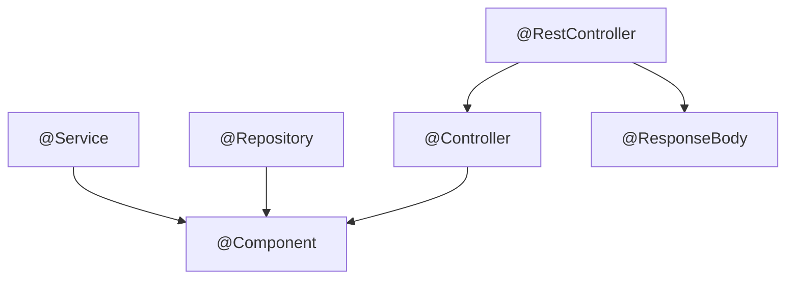
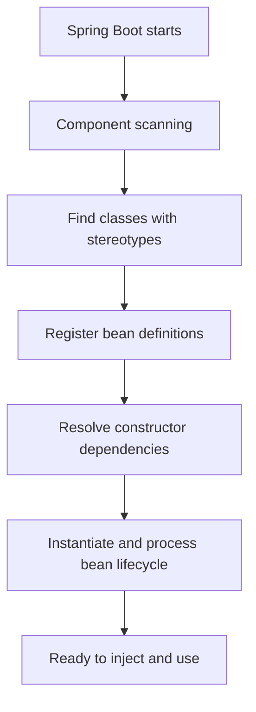
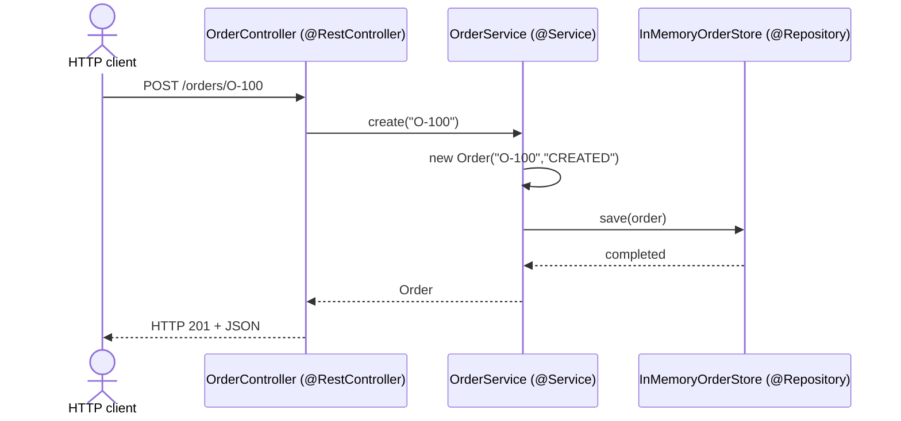

# `@Service`, `@Repository`, `@Controller`, and Stereotype Semantics

In Spring Boot, classes can carry `@Service`, `@Repository`, or `@Controller` annotations to describe their role in the application. These are **stereotype annotations**: architectural labels that also allow Spring to recognize the class and register a bean via component scanning.

The key is to understand **both sides** of these annotations. In terms of bean registration, all three are specialized forms of `@Component`. In terms of semantics, they help readers and the framework distinguish business logic classes, data access classes, and classes handling client requests. Some stereotypes are also tied to Spring-specific processing, so they should not be treated merely as three interchangeable ways of writing the same thing.

This lesson covers the bean registration mechanism, the role of each annotation, how they collaborate in Spring MVC, common pitfalls, and a small example that can grow into a real Spring Boot application.

## 1. What Is a Stereotype?

In software design, a *stereotype* is a way of classifying components by role. In the Spring Framework, familiar stereotypes include:

| Annotation | Intended role | Notable points |
| --- | --- | --- |
| `@Component` | General-purpose Spring component | Recognized when within an appropriate component scan |
| `@Service` | Class providing business logic or an application capability | A form of `@Component`; the annotation itself does not create transactions |
| `@Repository` | Component for accessing, querying, or persisting data | A `@Component`; plays a role in persistence exception translation |
| `@Controller` | Class receiving and dispatching Spring MVC web requests | A `@Component`; recognized by MVC infrastructure as a controller |
| `@RestController` | Controller returning response data directly | Combines `@Controller` and `@ResponseBody` |

Examples of declarations:

```java
import org.springframework.stereotype.Component;
import org.springframework.stereotype.Service;
import org.springframework.stereotype.Repository;
import org.springframework.stereotype.Controller;
import org.springframework.web.bind.annotation.RestController;

@Component
class DateFormatterComponent {}

@Service
class CheckoutService {}

@Repository
class ProductRepositoryAdapter {}

@Controller
class CatalogPageController {}

@RestController
class CatalogApiController {}
```

The classes above are standalone examples of stereotypes; the end-to-end example later will declare full working components.

### 1.1. Relationship with `@Component`

`@Service`, `@Repository`, and `@Controller` are defined with `@Component` as a meta-annotation. `@RestController` is built upon `@Controller` and `@ResponseBody`.

You can visualize this as:



When component scanning finds a class marked with a valid stereotype, it can create a **bean definition** for that class. From the bean definition, the Spring container resolves dependencies, instantiates the object, and manages its lifecycle according to configuration.

However, an annotation having `@Component` does not mean every related feature is automatically enabled. For instance, `@Service` does not start transactions on its own; `@Controller` must run inside a web setup with appropriate request-handling configuration to actually act as an HTTP endpoint.

### 1.2. How Do Beans, Java Classes, and Objects Differ?

Three concepts are often confused:

- **Class**: the Java type definition, e.g., `OrderService`.
- **Object**: an instance created with `new OrderService(...)` or another mechanism.
- **Spring bean**: an object managed by Spring's `ApplicationContext` according to a bean definition or equivalent registration mechanism.

If you write:

```java
OrderService service = new OrderService(repository);
```

then `service` is an ordinary Java object. It does not automatically become a bean just because the class has `@Service`. Conversely, when Spring registers and creates `OrderService`, the container manages its lifecycle, injection, and any applicable interceptors/proxies.

## 2. From Stereotype to Bean in `ApplicationContext`

In a typical Spring Boot application:

```java
package com.example.orders;

import org.springframework.boot.SpringApplication;
import org.springframework.boot.autoconfigure.SpringBootApplication;

@SpringBootApplication
public class OrdersApplication {
    public static void main(String[] args) {
        SpringApplication.run(OrdersApplication.class, args);
    }
}
```

`@SpringBootApplication` includes `@ComponentScan`. By default, Spring scans the application class's package and its subpackages:

```text
com.example.orders
├── OrdersApplication                @SpringBootApplication
├── web
│   └── OrderController              @RestController
├── application
│   └── OrderService                 @Service
└── persistence
    └── InMemoryOrderStore           @Repository
```

With this layout, the component classes can be discovered. The conceptual flow is:



**Classpath and component scan are two different conditions.** A class inside a library added as a dependency may still not be scanned if its package lies outside the scan scope. Conversely, Spring can also create a bean from a `@Bean` method even if the returned class has no stereotype at all.

## 3. `@Service`: The Business Logic Layer

`@Service` marks a class responsible for executing business logic or orchestrating an application *use case*.

Services typically handle tasks such as validating business rules, processing an order-creation workflow, coordinating multiple data ports, or sending notifications based on business requirements. A service should not depend directly on HTTP APIs if the same logic may also be called from a message consumer, scheduled job, or CLI.

Example:

```java
package com.example.orders.application;

import com.example.orders.domain.Order;
import com.example.orders.domain.OrderStore;
import java.util.Optional;
import org.springframework.stereotype.Service;

@Service
public class OrderService {
    private final OrderStore store;

    public OrderService(OrderStore store) {
        this.store = store;
    }

    public Order create(String orderId) {
        Order order = new Order(orderId, "CREATED");
        store.save(order);
        return order;
    }

    public Optional<Order> findById(String orderId) {
        return store.findById(orderId);
    }
}
```

This snippet illustrates **constructor injection**: `OrderService` requires an `OrderStore`, and Spring finds a matching bean to pass into the constructor.

This structure yields two benefits:

1. Required dependencies are explicitly declared in the constructor. Without a matching `OrderStore`, creating the service bean fails clearly.
2. The service depends only on the `OrderStore` contract, so it can use an in-memory implementation, a database implementation, or a fake in unit tests.

### 3.1. Does `@Service` Automatically Create Transactions?

**No.** The `@Service` annotation describes the role and enables component scanning. To apply declarative transactions, you need appropriate transaction support configured along with `@Transactional` where needed:

```java
import org.springframework.stereotype.Service;
import org.springframework.transaction.annotation.Transactional;

@Service
public class PaymentService {
    private final PaymentRepository repository;

    public PaymentService(PaymentRepository repository) {
        this.repository = repository;
    }

    @Transactional
    public void settlePayment(String paymentId) {
        // Read and update data according to business rules.
        repository.markSettled(paymentId);
    }
}
```

`PaymentRepository` is an illustrative application interface. A compatible transaction manager and a matching repository bean must exist for this code to work in a real application.

Additional note: proxy-based transaction mechanisms typically intercept only calls that pass through the proxy. Calling a `@Transactional` method from another method **on the same instance** generally does not trigger the interceptor as you might expect. This is behavior of the AOP/proxy mechanism, not a feature specific to `@Service`.

### 3.2. A Service Does Not Have to Be "One Huge Class"

Services should be split by clear responsibility. One service might implement a use case while another handles domain calculations; not all logic has to live inside a single class named `BusinessService`. If a controller merely forwards parameters and the service purely delegates to a repository, evaluate whether the intermediate layer adds real value rather than adding layers purely out of ceremony.

## 4. `@Repository`: The Data Access Layer

`@Repository` marks a component that interacts with a storage mechanism. This could be an adapter using JDBC, JPA, a NoSQL database client, or an in-memory store for demonstration purposes.

In a design that separates business logic from infrastructure, have the service depend on an interface:

```java
package com.example.orders.domain;

import java.util.Optional;

public interface OrderStore {
    void save(Order order);

    Optional<Order> findById(String orderId);
}
```

A shared data type:

```java
package com.example.orders.domain;

public record Order(String id, String status) {
    public Order {
        if (id == null || id.isBlank()) {
            throw new IllegalArgumentException("order id must not be blank");
        }
        if (status == null || status.isBlank()) {
            throw new IllegalArgumentException("status must not be blank");
        }
    }
}
```

An in-memory implementation:

```java
package com.example.orders.persistence;

import com.example.orders.domain.Order;
import com.example.orders.domain.OrderStore;
import java.util.Optional;
import java.util.concurrent.ConcurrentHashMap;
import java.util.concurrent.ConcurrentMap;
import org.springframework.stereotype.Repository;

@Repository
public class InMemoryOrderStore implements OrderStore {
    private final ConcurrentMap<String, Order> orders = new ConcurrentHashMap<>();

    @Override
    public void save(Order order) {
        orders.put(order.id(), order);
    }

    @Override
    public Optional<Order> findById(String orderId) {
        return Optional.ofNullable(orders.get(orderId));
    }
}
```

With this example, Spring scans `InMemoryOrderStore` and registers a bean compatible with `OrderStore`. When creating `OrderService`, Spring can inject that implementation.

This is only a **temporary in-process** store: when the application stops, data is lost, and each application instance has its own store. `ConcurrentHashMap` makes individual map accesses safer under concurrent requests, but it does not provide transactions or database-level durability.

### 4.1. How Does `@Repository` Differ from `@Component`?

Both allow the bean to be recognized by component scanning. However, `@Repository` is also treated by Spring as a marker for the persistence layer and is associated with **persistence exception translation**.

In an application with the appropriate infrastructure, Spring can use `PersistenceExceptionTranslationPostProcessor` and `PersistenceExceptionTranslator` implementations to translate certain persistence-provider-specific errors into Spring's unified `DataAccessException` hierarchy. This allows callers to handle data access errors with less coupling to specific storage technology exception names.

Conceptual illustration:

```text
Error from persistence provider
          ↓
@Repository bean via appropriate exception translation mechanism
          ↓
DataAccessException (Spring exception hierarchy)
          ↓
Service / error handling layer
```

Limitations to keep in mind:

- Not every exception thrown inside a `@Repository` class is automatically translated.
- An exception translation mechanism and compatible translator must be configured.
- Invocations through proxies/interceptors can affect whether translation occurs.
- `JdbcTemplate` already has its own `SQLException` translation mechanism; not every `DataAccessException` originates from `@Repository`.
- This annotation does not start transactions and does not replace data source or persistence provider configuration.

For `InMemoryOrderStore` using `ConcurrentHashMap` above, the main purpose of `@Repository` is to express its role and register the bean; the example has no database persistence exceptions to translate.

### 4.2. Do Spring Data Repository Interfaces Need `@Repository`?

When using Spring Data JPA, learners often encounter:

```java
import org.springframework.data.jpa.repository.JpaRepository;

public interface OrderJpaRepository extends JpaRepository<OrderEntity, Long> {
    // Spring Data generates a proxy implementation when repository configuration is valid.
}
```

`OrderEntity` is a JPA entity that must be defined and mapped separately. This is an illustrative example, not a direct extension of the `Order` record used in the in-memory store.

With Spring Data, repository interfaces are detected by **repository scanning and the repository factory mechanism**; Spring Data generates an implementation/proxy for eligible interfaces. Normally, you do not need to put `@Repository` on every `JpaRepository` interface just for Spring Data to create a bean. This is a different mechanism from component scanning an ordinary implementation class.

If you write your own adapter using `EntityManager`, `JdbcTemplate`, or a database SDK, `@Repository` on the concrete class expresses its role very clearly. Do not assume that merely adding `@Repository` to a custom interface will make Spring generate an implementation for that interface.

## 5. `@Controller`: The HTTP Request-Receiving Layer in Spring MVC

`@Controller` marks a class that acts as a controller in an MVC application. When Spring MVC is active, infrastructure such as `RequestMappingHandlerMapping` inspects controller metadata to determine which method handles an incoming request.

Example of a controller serving an HTML page:

```java
package com.example.orders.web;

import org.springframework.stereotype.Controller;
import org.springframework.ui.Model;
import org.springframework.web.bind.annotation.GetMapping;

@Controller
public class OrderPageController {
    private final OrderQueryService queryService;

    public OrderPageController(OrderQueryService queryService) {
        this.queryService = queryService;
    }

    @GetMapping("/orders/page")
    public String showOrders(Model model) {
        model.addAttribute("orders", queryService.listAll());
        return "orders/list";
    }
}
```

`OrderQueryService` here is an example service that would be defined as a separate bean. The snippet demonstrates MVC behavior: `return "orders/list"` is interpreted as a **logical view name** under standard view resolution, not as a JSON string.

If using Thymeleaf, the project needs the dependency, view resolver configuration, and the corresponding template, such as `src/main/resources/templates/orders/list.html`. Adding `@Controller` alone does not create HTML files or template rendering support.

### 5.1. Must `@Controller` Return HTML?

No. In Spring MVC, a method inside a `@Controller` can also return a response body directly if annotated with `@ResponseBody`:

```java
import org.springframework.stereotype.Controller;
import org.springframework.web.bind.annotation.GetMapping;
import org.springframework.web.bind.annotation.ResponseBody;

@Controller
public class HealthTextController {
    @GetMapping("/health-text")
    @ResponseBody
    public String healthText() {
        return "ok";
    }
}
```

Because `@ResponseBody` is present, `"ok"` becomes the **response body content**, written via the appropriate HTTP message converter. If you omit `@ResponseBody` in an MVC controller returning `String`, Spring typically interprets the string according to view-name resolution rules.

This is an important distinction between **returning a view name** and **returning HTTP response data**.

## 6. `@RestController`: Controller for Serving APIs

`@RestController` combines `@Controller` and `@ResponseBody`. It is widely used for JSON REST APIs.

Building on `OrderService` from Section 3, you can expose an API:

```java
package com.example.orders.web;

import com.example.orders.application.OrderService;
import com.example.orders.domain.Order;
import org.springframework.http.HttpStatus;
import org.springframework.http.ResponseEntity;
import org.springframework.web.bind.annotation.GetMapping;
import org.springframework.web.bind.annotation.PathVariable;
import org.springframework.web.bind.annotation.PostMapping;
import org.springframework.web.bind.annotation.RequestMapping;
import org.springframework.web.bind.annotation.RestController;

@RestController
@RequestMapping("/orders")
public class OrderController {
    private final OrderService service;

    public OrderController(OrderService service) {
        this.service = service;
    }

    @PostMapping("/{orderId}")
    public ResponseEntity<Order> create(@PathVariable String orderId) {
        Order created = service.create(orderId);
        return ResponseEntity.status(HttpStatus.CREATED).body(created);
    }

    @GetMapping("/{orderId}")
    public ResponseEntity<Order> find(@PathVariable String orderId) {
        return service.findById(orderId)
                .map(ResponseEntity::ok)
                .orElseGet(() -> ResponseEntity.notFound().build());
    }
}
```

When the application includes `spring-boot-starter-web` and Jackson, the `Order` record can be serialized into JSON:

```http
POST /orders/O-100
```

Sample response:

```http
HTTP/1.1 201 Created
Content-Type: application/json

{"id":"O-100","status":"CREATED"}
```

Then:

```http
GET /orders/O-100
```

Response:

```json
{"id":"O-100","status":"CREATED"}
```

This is a demo API taking an order ID from the URL; a production application needs access control, duplicate-creation prevention, validation at the HTTP boundary, ID generation strategy, persistence durability, and status codes aligned with the API contract.

### 6.1. Role of `@GetMapping` and `@PostMapping`

`@Controller`/`@RestController` classifies the **class** as a controller, while `@GetMapping`, `@PostMapping`, `@PutMapping`, and `@DeleteMapping` describe **handler methods** for matching HTTP requests. `@RequestMapping` on the class can establish a shared path prefix.

Example:

```java
@RestController
@RequestMapping("/products")
class ProductController {
    @GetMapping("/{sku}")
    ProductDto get(@PathVariable String sku) {
        // ...
        return product;
    }
}
```

This illustrates mapping structure; `ProductDto` and `product` must be defined in a real application. A method does not become an HTTP endpoint just by living inside a `@Service`; the MVC framework must recognize it as a handler within a controller context.

### 6.2. Comparing `@Controller` and `@RestController`

| Criterion | `@Controller` | `@RestController` |
| --- | --- | --- |
| Common purpose | MVC returning views or mixing response types | API returning response bodies |
| Has `@Controller` meta-annotation | Is the annotation itself | Yes |
| Has class-wide `@ResponseBody` | Not by default | Yes |
| Method returning a plain `String` | Can be a view name | Is response body content |
| Returns JSON | Yes, with `@ResponseBody` or `ResponseEntity` | Yes, when a suitable converter is present |
| Auto-configures a serializer? | No | No; still requires an appropriate HTTP message converter |

Despite having "REST" in its name, `@RestController` **does not guarantee** that an API follows all REST principles such as resource modeling, idempotency, status codes, or caching. Those are responsibilities of your application's HTTP interface design.

## 7. How Do the Three Stereotypes Work Together?

For the order example, the basic flow is:



The layers divide responsibilities:

- **Controller**: interprets HTTP (path variables, request body, status, headers), invokes use cases, and builds the HTTP response.
- **Service**: validates and executes business rules, coordinating related dependencies.
- **Repository/adapter**: reads and persists data using the chosen technology.
- **Domain model**: represents business concepts and invariants; does not require a stereotype.

The compile-time dependency graph can be `Controller → Service → OrderStore interface`, while Spring wires the `InMemoryOrderStore` implementation into the interface at startup. As a result, swapping the storage technology does not force changes to the controller.

**There is no rule that every request must pass through all three layers.** This is a common and useful organizational pattern, but a layer should not be created merely to meet a layer count when it carries no real responsibility.

## 8. Using the Right Annotation Is Not Enough: Conditions for Bean Creation

Stereotypes take effect only when Spring actually recognizes the class.

### 8.1. Package Outside the Component Scan Scope

Suppose the structure is:

```text
com.example.app
└── AppApplication            @SpringBootApplication

com.example.shared
└── AuditService              @Service
```

The default scan scope starts at `com.example.app`, so `com.example.shared.AuditService` is not discovered by the annotation alone. You can:

- Place the application class in an appropriate parent package if the architecture allows.
- Configure `@ComponentScan`/`scanBasePackages` for the required package.
- Import a `@Configuration` that registers the bean explicitly.
- For reusable Boot libraries, provide proper auto-configuration.

Example of expanding the scan scope:

```java
@SpringBootApplication(scanBasePackages = {
    "com.example.app",
    "com.example.shared"
})
public class AppApplication {
    // ...
}
```

Avoid scanning too broadly, as doing so can pull non-application components into the context, creating extra beans or conflicts.

### 8.2. Registering Beans via `@Bean` Instead of Stereotypes

When a class belongs to an external library, its source cannot be edited, or instantiation requires custom logic, you can use:

```java
import org.springframework.context.annotation.Bean;
import org.springframework.context.annotation.Configuration;

@Configuration(proxyBeanMethods = false)
class NotificationConfiguration {
    @Bean
    NotificationSender notificationSender() {
        return new SmtpNotificationSender();
    }
}
```

This is an illustrative snippet: `NotificationSender` and `SmtpNotificationSender` must be defined or included via dependencies. `@Bean` registers a bean from the method's return value even if `SmtpNotificationSender` has no `@Component`.

When you want to **swap implementations** for an interface, `@Bean` is also a clear assembly point. Stereotype scanning and Java configuration can be combined, but you need to know which mechanism creates each bean to avoid duplicate registrations.

### 8.3. Component Scanning Does Not Replace Repository/Entity Scanning

Scanning `@Component` classes is one mechanism. Spring Data repository interfaces and JPA entities have their own discovery mechanisms. For example:

- `@EnableJpaRepositories` or Spring Data JPA auto-configuration governs how repository interfaces are recognized when conditions apply.
- `@EntityScan` can specify where to search for JPA entities when they live outside the default scope.
- `@ConfigurationPropertiesScan` discovers `@ConfigurationProperties` types as configured.

If the application reports "Not a managed type", adding `@Service` or `@Component` to the entity is usually not the solution.

### 8.4. `@Profile` and Conditions Can Prevent Bean Registration

Example:

```java
@Repository
@Profile("dev")
public class DevOrderStore implements OrderStore {
    // ...
}
```

When the `dev` profile is not active, no bean is registered from this class. Likewise, conditions can decide whether a bean is created. Therefore, placing a class in the right package does not guarantee it is present in every environment.

## 9. What If There Are Multiple Beans of the Same Type?

An interface can have multiple implementations:

```java
@Repository
class JdbcOrderStore implements OrderStore { /* ... */ }

@Repository
class InMemoryOrderStore implements OrderStore { /* ... */ }
```

If both are registered and `OrderService` injects an `OrderStore` without a clear way to choose, Spring may throw `NoUniqueBeanDefinitionException`.

You can specify the desired implementation with `@Qualifier`:

```java
import org.springframework.beans.factory.annotation.Qualifier;
import org.springframework.stereotype.Service;

@Service
public class OrderService {
    private final OrderStore store;

    public OrderService(@Qualifier("jdbcOrderStore") OrderStore store) {
        this.store = store;
    }
}
```

Or use `@Primary` to mark a preferred implementation when an injection point does not specify further:

```java
@Repository
@Primary
class JdbcOrderStore implements OrderStore {
    // ...
}
```

The `JdbcOrderStore` fragments here only illustrate the concept; an actual class implementing `OrderStore` must implement both methods of the interface.

In some cases, you should use `@Profile` so only one adapter is active per environment, or use auto-configuration with `@ConditionalOnMissingBean` to provide a default implementation. Do not use `@Primary` to mask a design conflict when only one adapter is supposed to exist.

## 10. Bean Name, Bean Scope, and Lifecycle

When Spring scans a stereotype without an explicit name, the bean name is typically derived from the class name via `AnnotationBeanNameGenerator`. For example, `OrderService` usually becomes `orderService`, and `InMemoryOrderStore` usually becomes `inMemoryOrderStore`. There are additional rules for acronyms and configurable naming strategies; do not rely solely on lowercasing the first character in every case.

You can specify a name:

```java
@Service("primaryOrderService")
public class OrderService {
    // ...
}
```

However, code should generally inject by type and use qualifiers when selection is needed; manually naming every bean is unnecessary.

### 10.1. Default Scope Is Singleton Per Context

Stereotype beans default to `singleton` scope, meaning one instance per bean definition within **one Spring container**. A Spring singleton does not mean a single object across the entire JVM, let alone a shared object across microservices running in separate processes.

A singleton `@Service` should avoid storing per-request mutable data in fields:

```java
@Service
class UnsafeCheckoutService {
    private String currentUserId;

    void checkout(String userId) {
        this.currentUserId = userId; // Risks being overwritten by another request.
    }
}
```

Request data should be passed via method parameters or kept in an appropriately scoped lifecycle. Stereotype annotations alone do not guarantee thread safety.

### 10.2. `@Repository` and Transactions Are Not Synonymous

Scope, transactions, exception translation, and stereotypes are separate axes:

| Axis | Common mechanism |
| --- | --- |
| Role-based bean registration | `@Component`, `@Service`, `@Repository`, `@Controller` |
| Transaction control | `@Transactional` with transaction infrastructure |
| Data-layer exception handling | Data access APIs and appropriate exception translation |
| Environment-based bean selection | `@Profile`, conditions |
| Bean lifetime control | `@Scope`, `@RequestScope`, other scopes |
| Disambiguating same-type beans | `@Qualifier`, `@Primary` |

Keeping these distinct helps diagnose the true cause if the application fails to start or behaves unexpectedly.

## 11. Controllers Also Relate to Validation and HTTP Error Handling

Stereotypes identify a class's role; they do not automatically validate every incoming request.

Example controller receiving JSON:

```java
import jakarta.validation.Valid;
import jakarta.validation.constraints.NotBlank;
import org.springframework.web.bind.annotation.PostMapping;
import org.springframework.web.bind.annotation.RequestBody;
import org.springframework.web.bind.annotation.RestController;

record CreateOrderRequest(@NotBlank String orderId) {}

@RestController
class CreateOrderController {
    private final OrderService service;

    CreateOrderController(OrderService service) {
        this.service = service;
    }

    @PostMapping("/new-orders")
    Order create(@Valid @RequestBody CreateOrderRequest request) {
        return service.create(request.orderId());
    }
}
```

For Jakarta Bean Validation to work, the application needs an appropriate provider, typically added in Spring Boot via `spring-boot-starter-validation`. `@Valid` and `@NotBlank` are not features provided by `@RestController` itself.

When validation fails, Spring MVC returns error responses according to the application's configuration and exception handling. For business errors, you can provide `@ControllerAdvice` or `@RestControllerAdvice` for consistent handling:

```java
import java.util.Map;
import org.springframework.http.HttpStatus;
import org.springframework.http.ResponseEntity;
import org.springframework.web.bind.annotation.ExceptionHandler;
import org.springframework.web.bind.annotation.RestControllerAdvice;

@RestControllerAdvice
class ApiErrorHandler {
    @ExceptionHandler(IllegalArgumentException.class)
    ResponseEntity<Map<String, String>> handleBadInput(
            IllegalArgumentException exception) {
        return ResponseEntity.status(HttpStatus.BAD_REQUEST)
                .body(Map.of("error", exception.getMessage()));
    }
}
```

This is an illustrative handler. In real applications, do not blindly map **every** `IllegalArgumentException` to a client error; distinguish between input errors, business errors, and programming bugs, and avoid exposing sensitive details in exception messages.

`@ControllerAdvice` extends handling scope across controllers; `@RestControllerAdvice` also applies response body semantics. These two annotations complement controllers and are not replacements for `@Service` or `@Repository`.

## 12. Testing According to Each Layer's Responsibility

Because stereotypes exist to wire classes into the context, not every test needs to start Spring.

### 12.1. Isolated Service Unit Test

Use a fake repository to verify logic:

```java
import static org.junit.jupiter.api.Assertions.assertEquals;
import static org.junit.jupiter.api.Assertions.assertTrue;

import com.example.orders.application.OrderService;
import com.example.orders.domain.Order;
import com.example.orders.domain.OrderStore;
import java.util.HashMap;
import java.util.Map;
import java.util.Optional;
import org.junit.jupiter.api.Test;

class OrderServiceTest {
    @Test
    void createsAndStoresOrder() {
        Map<String, Order> saved = new HashMap<>();

        OrderStore fake = new OrderStore() {
            @Override
            public void save(Order order) {
                saved.put(order.id(), order);
            }

            @Override
            public Optional<Order> findById(String orderId) {
                return Optional.ofNullable(saved.get(orderId));
            }
        };

        OrderService service = new OrderService(fake);

        Order created = service.create("O-100");

        assertEquals("CREATED", created.status());
        assertTrue(service.findById("O-100").isPresent());
        assertEquals(created, saved.get("O-100"));
    }
}
```

This test focuses on the service's behavior against the storage contract. It needs no `@SpringBootTest`, no component scan, and no database.

### 12.2. Web Slice Test for Controllers

When verifying request mappings, JSON serialization, status codes, and HTTP validation, you can use `@WebMvcTest` to load only the needed Spring MVC slice, then provide or mock the controller's dependencies according to your Spring Boot version.

A web slice is not the full application: lower-layer services and repositories are not automatically loaded in full as they are with `@SpringBootTest`. This is intentional so you can test the HTTP boundary in isolation.

### 12.3. Integration Tests for Wiring and Persistence

Use integration tests when the goal is to verify that the context has all required beans, that repositories interact properly with the database, that transactions work, or that an HTTP flow traverses multiple layers. With Spring Data JPA you can use `@DataJpaTest` where appropriate; for the whole application you can use `@SpringBootTest`.

Each type of test answers a different question:

| Test type | Core question |
| --- | --- |
| Service unit test | With fake dependencies, is the business logic correct? |
| MVC slice test | Are requests mapped, validated, and serialized into responses properly? |
| Persistence slice test | Are data mappings, queries, and adapters working properly? |
| Full-application integration test | Do the bean graph and layers collaborate properly? |

A test that successfully boots the context does not prove every business branch was tested; conversely, a plain Java unit test will not catch forgotten component scans or bean conflicts.

## 13. Common Misconceptions

| Misconception | Accurate explanation |
| --- | --- |
| "`@Service` and `@Repository` are just decorative names." | They support component scanning and communicate roles; `@Repository` can also participate in exception translation. |
| "A class with `@Service` is guaranteed to be injected by Spring." | Only if it is registered as a bean in the appropriate context. |
| "Adding a dependency JAR makes Spring scan all its classes." | Having a class on the classpath does not mean its package is scanned. |
| "`@Service` automatically creates transactions." | You need `@Transactional` and matching transaction infrastructure. |
| "`@Repository` auto-generates SQL or implementations for any interface." | Spring Data repository interfaces use a separate factory mechanism; custom interfaces do not automatically get implementations. |
| "`@Controller` always returns JSON." | Without `@ResponseBody`, a `String` is typically a view name in MVC. |
| "`@RestController` always returns status 200." | Status can be controlled via `ResponseEntity`, `@ResponseStatus`, or exception handling. |
| "Singleton beans are automatically thread-safe." | Singleton describes only scope; mutable state can still suffer race conditions. |
| "Every class must have a stereotype." | Value objects, DTOs, entities, and domain models can be created and managed differently. |
| "Using `@Primary` fixes any multi-bean error." | It sets an injection preference, without fixing duplicate bean registration or architectural mistakes. |
| "Unit tests calling `new Service(...)` are invalid because Spring is missing." | For pure logic with explicit dependencies, this is often the simplest, most appropriate test approach. |

## 14. When Should You Write Custom Stereotypes?

In larger projects, some teams want to define domain-meaningful stereotypes like `@DomainService`. Spring supports **composed annotations**: custom annotations meta-annotated with `@Service`.

Example:

```java
package com.example.orders.support;

import java.lang.annotation.Documented;
import java.lang.annotation.ElementType;
import java.lang.annotation.Retention;
import java.lang.annotation.RetentionPolicy;
import java.lang.annotation.Target;
import org.springframework.stereotype.Service;

@Target(ElementType.TYPE)
@Retention(RetentionPolicy.RUNTIME)
@Documented
@Service
public @interface DomainService {
}
```

Usage:

```java
@DomainService
public class PricingPolicyService {
    // ...
}
```

When the class is scanned within the appropriate scope, the meta-annotation allows it to participate in component discovery. Custom annotations can express architectural conventions; however, **they do not automatically prevent a class from calling the wrong layer or violating dependency rules**. If you need to enforce architectural rules, you can add architecture tests to your build/test suite.

If you want a custom stereotype to support bean naming or other attributes of the base annotation, you must properly design alias attributes with `@AliasFor`; the `@DomainService` example above only defines a role and adds no new attributes.

## 15. Guided Practice

### Exercise 1 — Read and Classify Responsibilities

Given four classes: `CheckoutService`, `JdbcPaymentAdapter`, `CheckoutApiController`, and `Money`. Choose an appropriate annotation for each class and explain why `Money` (a value object) does not necessarily need to be a bean.

### Exercise 2 — Diagnose a Missing Bean Error

Place `@SpringBootApplication` in `com.acme.shop` but place a `@Service` in `com.acme.shared`. Create constructor injection from a controller to the service. When the application reports a missing bean, explain the difference between classpath and component scanning, then fix it using an appropriate scan scope or `@Configuration`/`@Import`.

### Exercise 3 — Replace a Real Repository with a Fake

Write a `CustomerStore` interface, a `JdbcCustomerStore` adapter annotated with `@Repository`, and a `CustomerService` accepting the interface via constructor. Write a unit test without Spring, passing a fake store, and verify data is stored and retrieved as expected.

### Exercise 4 — Distinguish Views from Response Bodies

Write two endpoints returning the string `"hello"`: one in a `@Controller` returning a view name and one using `@ResponseBody` or `@RestController` returning an HTTP body. Explain how MVC handles each and what dependencies are needed to render a view.

### Exercise 5 — Distinguish Annotations from Infrastructure Mechanisms

Answer these questions: Does `@Service` guarantee transactions? Does `@Repository` replace Spring Data scanning? Does `@RestController` handle validation automatically? If two beans both implement `PaymentGateway`, how will you perform bean selection?

## 16. Mindset for Spring Boot Projects

When designing a new feature, identify each class's role first: does this class handle requests, execute business logic, access data, or simply represent a value? Then choose the corresponding stereotype **if the class actually needs to be managed by Spring**.

`@Controller` or `@RestController` places HTTP communication responsibilities at the web boundary. `@Service` expresses business logic and workflows. `@Repository` belongs to data adapters and can participate in persistence exception translation. All of them enter the `ApplicationContext` through an appropriate bean registration mechanism; component scanning is just one of those mechanisms.

Understanding stereotype semantics helps you read Spring Boot codebases faster, organize layers more cleanly, and diagnose the right root cause when beans are missing, implementations compete, or HTTP/transaction behavior differs from expectations.
