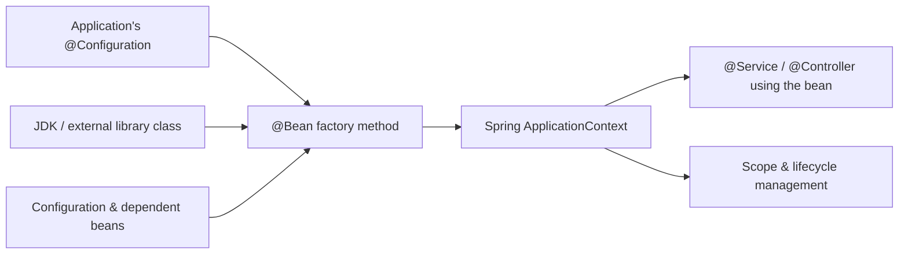

# `@Bean` for External Libraries or Explicitly Created Objects

> **Spring Boot Fundamentals · Bean Registration**  
> When building a Spring Boot application, not every object can or should carry `@Component`. Some classes belong to external libraries, some objects must be created via factories or builders, and some require constructor arguments pulled from configuration. `@Bean` is an explicit declaration: **call this method to create an object, put the result into the Spring ApplicationContext, and let Spring manage it as a bean**.

This lesson focuses on deciding **when to use `@Bean`, how to write factory methods, how to wire beans with other components, how to handle multiple beans of the same type, and how to manage the lifecycle of created objects**.

## 1. Problem: Not Every Class Is Owned by the Application

In a Spring Boot application, we often write:

```java
package com.example.catalog.product;

import org.springframework.stereotype.Service;

@Service
public class ProductService {

    public String findName(long id) {
        return "Product #" + id;
    }
}
```

With `@Service`, Spring can discover `ProductService` via component scan and create a bean. This is convenient when **the class is written by the application itself** and can be marked with annotations.

But what happens when you need an object such as:

- `java.time.Clock` to determine "now" in business logic, swappable with a fixed clock in tests.
- `java.net.http.HttpClient` requiring timeouts and startup configuration.
- A **Caffeine** library cache needing capacity limits and expiration times.
- An external system's SDK client with a factory method/builder needing an endpoint or credentials.
- An `ExecutorService` whose startup/shutdown lifecycle must be explicitly managed.

These classes may carry no Spring annotations, and many come from libraries whose source code **we cannot edit**. Putting `@Component` on them is impossible, unnecessary, or the wrong responsibility.

The solution is to create **a configuration class owned by the application**, using `@Bean` methods to create the objects.



**Key point:** A bean is an **object managed by the Spring container**. `@Bean` is one way to register a bean; `@Component` and stereotype annotations are other ways.

## 2. Three Ways to Create Objects: `new`, `@Component`, and `@Bean`

| Approach | Who creates the object? | Automatically becomes a Spring bean? | When to use? |
| --- | --- | --- | --- |
| `new SomeClass()` in business code | Direct calling code | No | Short-lived objects, temporary data, or values not needing DI/lifecycle |
| `@Component` / `@Service` on a class | Spring via component scan | Yes, when the class is within the scan scope | Application classes that Spring should instantiate and manage |
| `@Bean` on a method in a Spring-loaded configuration | Spring calls the factory method and registers the returned object | Yes | External objects, special builders/factories/constructors, explicit configuration |

Example of `new`:

```java
Clock clock = Clock.systemUTC();
Instant now = clock.instant();
```

This creates and uses an ordinary Java object. It **does not automatically register `Clock` in the ApplicationContext**, so other Spring beans cannot inject that object simply by requesting a `Clock`.

Example of `@Bean`:

```java
package com.example.catalog.config;

import java.time.Clock;
import org.springframework.context.annotation.Bean;
import org.springframework.context.annotation.Configuration;

@Configuration(proxyBeanMethods = false)
public class TimeConfiguration {

    @Bean
    public Clock applicationClock() {
        return Clock.systemUTC();
    }
}
```

If Spring finds and loads `TimeConfiguration`, it registers a `Clock` bean. Other beans can request `Clock` via constructor injection.

### 2.1. `@Bean` Does Not Turn an External Class into a Component

For example, `Clock` belongs to the JDK and has no `@Component`. We do not modify the `Clock` class either. Spring only manages **the instance returned** from `applicationClock()`.

Therefore, even though the object belongs to an external library, **the configuration class still belongs to our project** and is brought into the ApplicationContext via component scan or an appropriate import mechanism.

### 2.2. Not Every Object Needs to Enter the Container

An object like a `StringBuilder` created fresh inside each method generally does not need to be a bean. A DTO received from a request is also usually not a singleton bean. If every small object were registered with `@Bean`, the ApplicationContext would become hard to follow and blur **short-lived business state** with **shared services and infrastructure**.

A practical question: "Does this object need to be shared, centrally configured, injected into multiple components, or have its lifecycle managed?" If yes, `@Bean` may be appropriate.

## 3. Basic Structure of a `@Bean` Method

A minimal configuration:

```java
package com.example.catalog.config;

import java.time.Clock;
import org.springframework.context.annotation.Bean;
import org.springframework.context.annotation.Configuration;

@Configuration(proxyBeanMethods = false)
public class TimeConfiguration {

    @Bean
    Clock applicationClock() {
        return Clock.systemUTC();
    }
}
```

Breakdown:

1. `@Configuration` marks a class containing bean declarations. To take effect, this class must be registered by Spring, e.g., by residing in the component scan scope or being imported with `@Import`.
2. `@Bean` marks the factory method that Spring invokes when creating the bean.
3. The return type `Clock` is typically the type other components can inject.
4. The method name `applicationClock` usually becomes the **default bean name**.
5. The body `return Clock.systemUTC()` determines how the object is created.
6. The bean has **singleton scope by default**, meaning one instance per bean definition within a single Spring ApplicationContext per container rules.

`@Configuration(proxyBeanMethods = false)` is a good option when `@Bean` methods do not need to be called directly to have Spring intercept/proxy internal calls. We will explain this later; it is not mandatory for every `@Configuration` class.

### 3.1. Where Should `@Bean` Live?

Typically, place it in a configuration class with a clear responsibility:

```text
src/main/java/com/example/catalog/
├── CatalogApplication.java
├── config/
│   ├── TimeConfiguration.java
│   ├── ClientConfiguration.java
│   └── CacheConfiguration.java
├── product/
│   └── ProductService.java
└── web/
    └── ProductController.java
```

Startup class:

```java
package com.example.catalog;

import org.springframework.boot.SpringApplication;
import org.springframework.boot.autoconfigure.SpringBootApplication;

@SpringBootApplication
public class CatalogApplication {
    public static void main(String[] args) {
        SpringApplication.run(CatalogApplication.class, args);
    }
}
```

Because `com.example.catalog.config` is a subpackage of `com.example.catalog`, Spring Boot normally discovers `@Configuration` classes inside it through default component scanning.

If a configuration is placed outside the scan scope, you must register it explicitly, for instance with `@Import(TimeConfiguration.class)` on an appropriate configuration. Merely creating a Java file or adding `@Bean` does not guarantee Spring has loaded that configuration.

### 3.2. Can Multiple `@Bean` Methods Live in One Configuration?

Yes. Group related beans when it improves readability. For example:

```java
@Configuration(proxyBeanMethods = false)
class TimeConfiguration {

    @Bean
    Clock applicationClock() {
        return Clock.systemUTC();
    }

    @Bean
    TimeFormatter timeFormatter(Clock applicationClock) {
        return new TimeFormatter(applicationClock);
    }
}
```

`TimeFormatter` here is an illustrative application-defined class that needs a constructor accepting `Clock`. Notice that Spring can **pass the `Clock` bean into the `@Bean` method parameter**. You do not need to call `applicationClock()` directly inside another factory method.

## 4. How Does Spring Inject Beans Returned by `@Bean`?

When Spring creates the `ProductService` bean, it inspects the class's constructor to resolve declared dependencies. If a matching bean exists in the context, Spring passes that instance in.

Example service using `Clock`:

```java
package com.example.catalog.product;

import java.time.Clock;
import java.time.Instant;
import org.springframework.stereotype.Service;

@Service
public class ProductAuditService {

    private final Clock clock;

    public ProductAuditService(Clock clock) {
        this.clock = clock;
    }

    public Instant recordedAt() {
        return Instant.now(clock);
    }
}
```

With the `Clock` bean configured earlier, Spring can create the service as follows (conceptual flow):

```text
Spring creates Clock via @Bean
            ↓
Clock bean registered in ApplicationContext
            ↓
Spring creates ProductAuditService
            ↓
Passes Clock into ProductAuditService constructor
            ↓
Service methods use the injected Clock
```

In modern Spring applications, when a class has a single constructor, `@Autowired` is usually not needed on that constructor.

### 4.1. Why Is Constructor Injection a Good Choice?

- The class's dependencies are explicitly exposed in the constructor.
- Fields can generally be `final` and remain immutable after creation.
- Unit tests are easy to write by passing fake dependencies.
- Spring catches missing beans at startup rather than letting errors surface late when a method is called.

Unit test example **without needing a Spring context**:

```java
package com.example.catalog.product;

import static org.junit.jupiter.api.Assertions.assertEquals;

import java.time.Clock;
import java.time.Instant;
import java.time.ZoneOffset;

import org.junit.jupiter.api.Test;

class ProductAuditServiceTest {

    @Test
    void recordsFixedTime() {
        Instant fixed = Instant.parse("2026-01-15T10:00:00Z");
        Clock clock = Clock.fixed(fixed, ZoneOffset.UTC);

        ProductAuditService service = new ProductAuditService(clock);

        assertEquals(fixed, service.recordedAt());
    }
}
```

This is a direct benefit of taking `Clock` as a dependency: application code avoids calling `Instant.now()` against the system clock everywhere; tests can pass a fixed time for deterministic results.

## 5. Practical Case: Using `@Bean` for an External Library Class

Let's examine a non-Spring Java library: **Caffeine**, which provides in-process caching.

Suppose the application needs to cache up to 500 product previews, each expiring after 5 minutes. The cache class comes from an external library, so we cannot add `@Component` to its source. Instead, we declare the bean via a factory method.

### 5.1. Adding the Caffeine Dependency

Maven, in a project with a Spring Boot BOM/parent managing compatible versions:

```xml
<dependency>
    <groupId>com.github.ben-manes.caffeine</groupId>
    <artifactId>caffeine</artifactId>
</dependency>
```

Gradle Groovy DSL, if the project has appropriate dependency management configured:

```groovy
dependencies {
    implementation 'com.github.ben-manes.caffeine:caffeine'
}
```

If your project does not manage the Caffeine version via a BOM or another mechanism, you must declare a compatible version according to your build tool. Omitting the version in the example **assumes** the project has version management in place.

### 5.2. Creating the Bean via the Library's Builder

```java
package com.example.catalog.config;

import java.time.Duration;

import com.github.benmanes.caffeine.cache.Cache;
import com.github.benmanes.caffeine.cache.Caffeine;

import org.springframework.context.annotation.Bean;
import org.springframework.context.annotation.Configuration;

@Configuration(proxyBeanMethods = false)
public class CacheConfiguration {

    @Bean("productPreviewCache")
    Cache<String, String> productPreviewCache() {
        return Caffeine.newBuilder()
                .maximumSize(500)
                .expireAfterWrite(Duration.ofMinutes(5))
                .build();
    }
}
```

The object creation part:

```java
Caffeine.newBuilder()
        .maximumSize(500)
        .expireAfterWrite(Duration.ofMinutes(5))
        .build();
```

is **Caffeine's** API, not Spring's bean creation API. `@Bean`'s role is to receive the returned object and register it with the container.

### 5.3. Injecting the Cache into a Service

```java
package com.example.catalog.product;

import com.github.benmanes.caffeine.cache.Cache;
import org.springframework.beans.factory.annotation.Qualifier;
import org.springframework.stereotype.Service;

@Service
public class ProductPreviewService {

    private final Cache<String, String> cache;

    public ProductPreviewService(
            @Qualifier("productPreviewCache") Cache<String, String> cache) {
        this.cache = cache;
    }

    public String findPreview(String productId) {
        return cache.get(productId, id -> "Preview of " + id);
    }
}
```

The `cache.get(key, mappingFunction)` method loads a value via the function if no matching cache entry exists. This is an easy-to-observe example; real applications may fetch data from a repository or external system.

**Design note:** cache beans default to singleton within **one Spring ApplicationContext**, so multiple services in the same process can share the cache. If the application runs multiple instances/servers, each instance normally has its own cache. A local Caffeine cache does not automatically become a distributed cache just because it is registered with `@Bean`.

### 5.4. What Did `@Bean` Solve in This Example?

- Created the object using the library's own builder API.
- Centralized `maximumSize` and `expireAfterWrite` configuration in one place.
- Made the object injectable instead of each service building its own cache.
- Allowed Spring to manage the bean's scope; easy to swap with another implementation when needs change.
- Enabled testing the service by passing a test cache or mock, decoupled from Spring context details.

`@Bean` **does not automatically enable Spring's `@Cacheable` mechanism** in this example. The service is calling the **Caffeine API directly**. To use Spring's caching annotations, you must configure a `CacheManager` and enable caching via Spring's caching abstraction; that is a separate integration layer.

## 6. Objects Requiring Explicit Creation Even When Not External Libraries

Not every use case for `@Bean` involves third-party dependencies.

For instance, `java.net.http.HttpClient` belongs to the JDK, yet it has a builder, timeouts, and may need a shared instance:

```java
package com.example.catalog.config;

import java.net.http.HttpClient;
import java.time.Duration;

import org.springframework.context.annotation.Bean;
import org.springframework.context.annotation.Configuration;

@Configuration(proxyBeanMethods = false)
public class HttpClientConfiguration {

    @Bean
    HttpClient partnerHttpClient() {
        return HttpClient.newBuilder()
                .connectTimeout(Duration.ofSeconds(3))
                .followRedirects(HttpClient.Redirect.NORMAL)
                .build();
    }
}
```

A client service can inject it:

```java
package com.example.catalog.partner;

import java.net.http.HttpClient;
import java.net.http.HttpRequest;
import java.net.http.HttpResponse;
import java.net.URI;
import java.time.Duration;

import org.springframework.stereotype.Service;

@Service
public class PartnerStatusClient {

    private final HttpClient httpClient;

    public PartnerStatusClient(HttpClient httpClient) {
        this.httpClient = httpClient;
    }

    public int statusCode(URI endpoint) throws Exception {
        HttpRequest request = HttpRequest.newBuilder(endpoint)
                .timeout(Duration.ofSeconds(5))
                .GET()
                .build();

        HttpResponse<Void> response = httpClient.send(
                request, HttpResponse.BodyHandlers.discarding());

        return response.statusCode();
    }
}
```

This example shows how Spring manages an object built with a JDK builder. In real production systems, you need network error handling, policy-appropriate retries, authentication, observability, and resource limits. Never blindly accept an untrusted URI and send requests to it from a public endpoint; the sample service assumes the endpoint is controlled by the application.

### 6.1. Why Not Create `HttpClient` on Every Request?

Calling `HttpClient.newHttpClient()` in a controller or service every time can create separate objects with inconsistent configuration, making timeouts and resources hard to control. Registering a shared client ensures consumers receive the same initialization policy.

At the same time, you should not make every object like `HttpRequest` a singleton bean: a request holds parameters specific to a single call and should normally be created per call. Distinguish **shared infrastructure** (client) from **per-operation data** (request).

## 7. How Spring Resolves Dependencies for `@Bean` Methods

A `@Bean` method is not limited to calling a no-arg constructor. It can accept **dependent beans** via its parameters, similar to constructor injection.

Example of creating a plain Java service without annotations:

```java
package com.example.catalog.audit;

import java.time.Clock;
import java.time.Instant;

public class AuditStampFactory {

    private final Clock clock;

    public AuditStampFactory(Clock clock) {
        this.clock = clock;
    }

    public Instant createStamp() {
        return clock.instant();
    }
}
```

Registration:

```java
package com.example.catalog.config;

import java.time.Clock;

import com.example.catalog.audit.AuditStampFactory;

import org.springframework.context.annotation.Bean;
import org.springframework.context.annotation.Configuration;

@Configuration(proxyBeanMethods = false)
public class AuditConfiguration {

    @Bean
    Clock clock() {
        return Clock.systemUTC();
    }

    @Bean
    AuditStampFactory auditStampFactory(Clock clock) {
        return new AuditStampFactory(clock);
    }
}
```

When Spring creates `auditStampFactory`, the container resolves the `Clock` parameter from available beans.

**Avoid doing this when `proxyBeanMethods = false`:**

```java
@Bean
AuditStampFactory auditStampFactory() {
    return new AuditStampFactory(clock()); // Direct Java method call.
}
```

Because `clock()` is an ordinary Java method call in a non-proxied configuration, it may create a **new instance** instead of obtaining the Spring-managed singleton bean. Using a method parameter `Clock clock` makes the dependency relationship explicit and works reliably whether proxy bean methods are enabled or disabled.

### 7.1. What About `@Configuration(proxyBeanMethods = true)`?

The `proxyBeanMethods = true` mode (the default on `@Configuration`) allows Spring to use a proxy to handle calls from one `@Bean` method to another in the same class according to container semantics, when proxy conditions apply.

For example, if code calls `clock()` from `auditStampFactory()`, Spring can intercept the call and return the managed bean rather than creating a new object.

Still, **method parameter injection** is easier to understand: declare dependencies in the method signature, without relying on whether the call is proxied.

### 7.2. Is `@Autowired` Needed on `@Bean` Methods?

Usually **no**. Spring automatically resolves factory method parameters:

```java
@Bean
AuditStampFactory auditStampFactory(Clock clock) {
    return new AuditStampFactory(clock);
}
```

This is concise and makes dependencies explicit. The requirement is that a matching `Clock` bean exists to inject.

### 7.3. Can Properties Be Injected into Factory Methods?

Yes. For example:

```java
import java.time.Duration;
import java.net.http.HttpClient;

import org.springframework.beans.factory.annotation.Value;
import org.springframework.context.annotation.Bean;

@Bean
HttpClient partnerHttpClient(
        @Value("${partner.connect-timeout-seconds:3}") long timeoutSeconds) {

    return HttpClient.newBuilder()
            .connectTimeout(Duration.ofSeconds(timeoutSeconds))
            .build();
}
```

Here `@Value` reads the `partner.connect-timeout-seconds` property, using `3` as the default in the expression if the property is not provided. For multiple related properties or when validation is needed, prefer `@ConfigurationProperties` to manage strongly typed configuration groups.

## 8. Combining `@ConfigurationProperties` with `@Bean` for Clear Configuration

When an SDK or client has many parameters, stuffing multiple `@Value` strings into a factory method can become hard to maintain.

Example application properties:

```yaml
# src/main/resources/application.yml
partner:
  client:
    connect-timeout: 3s
    follow-redirects: false
```

A record-based properties class on Spring Boot 3.x + Java 17:

```java
package com.example.catalog.config;

import java.time.Duration;

import org.springframework.boot.context.properties.ConfigurationProperties;

@ConfigurationProperties(prefix = "partner.client")
public record PartnerClientProperties(
        Duration connectTimeout,
        boolean followRedirects
) {}
```

Configuration class registering the properties and using them to create the client:

```java
package com.example.catalog.config;

import java.net.http.HttpClient;
import java.net.http.HttpClient.Redirect;

import org.springframework.boot.context.properties.EnableConfigurationProperties;
import org.springframework.context.annotation.Bean;
import org.springframework.context.annotation.Configuration;

@Configuration(proxyBeanMethods = false)
@EnableConfigurationProperties(PartnerClientProperties.class)
public class PartnerClientConfiguration {

    @Bean
    HttpClient partnerHttpClient(PartnerClientProperties properties) {
        Redirect redirects = properties.followRedirects()
                ? Redirect.NORMAL
                : Redirect.NEVER;

        return HttpClient.newBuilder()
                .connectTimeout(properties.connectTimeout())
                .followRedirects(redirects)
                .build();
    }
}
```

From this example:

- `@ConfigurationProperties` describes **configuration data**, not the HTTP client factory itself.
- `@EnableConfigurationProperties` registers the properties type so Spring binds data to it.
- `@Bean` consumes the bound properties and invokes the JDK API to build the client.
- Other services simply inject `HttpClient`, without needing to know whether properties came from YAML, environment variables, or another configuration source.

In real systems, ensure timeouts have valid values and appropriate defaults or validation; a null `Duration` field can cause failures in the builder. You can use Bean Validation, constructor logic, or clearly defined defaults.

### 8.1. Centralizing Configuration for Easy Environment Switching

Development environments may have different timeouts than production. Using `@ConfigurationProperties`, Spring Boot can bind properties from config data and externalized configuration per your version's rules; the factory method stays unchanged.

Do not hardcode connection secrets in `@Configuration` classes or committed `application.yml` files. For API keys, passwords, certificates, or tokens, use a secret manager and appropriate secure configuration sources.

## 9. Bean Name, Bean Type, and How Spring Selects on Injection

By default, the name of a bean created by `@Bean` is typically **the method name**.

```java
@Bean
Clock applicationClock() {
    return Clock.systemUTC();
}
```

Default bean name: `applicationClock`. Matching bean type: `Clock`.

You can set an explicit name:

```java
@Bean("auditClock")
Clock auditClock() {
    return Clock.systemUTC();
}
```

or:

```java
@Bean(name = {"auditClock", "businessClock"})
Clock auditClock() {
    return Clock.systemUTC();
}
```

In the second example, `businessClock` is an alias for the same bean instance; it does not create a second `Clock`.

### 9.1. What If There Are Two Beans of the Same Type?

For example, needing two different time zones:

```java
package com.example.catalog.config;

import java.time.Clock;
import java.time.ZoneId;
import java.time.ZoneOffset;

import org.springframework.context.annotation.Bean;
import org.springframework.context.annotation.Configuration;

@Configuration(proxyBeanMethods = false)
public class ClockConfiguration {

    @Bean("utcClock")
    Clock utcClock() {
        return Clock.systemUTC();
    }

    @Bean("businessClock")
    Clock businessClock() {
        return Clock.system(ZoneId.of("Asia/Ho_Chi_Minh"));
    }
}
```

A constructor that simply asks for `Clock` without further guidance becomes **ambiguous** if Spring has no rule to select a single candidate. A common error is `NoUniqueBeanDefinitionException`.

A clear resolution:

```java
package com.example.catalog.audit;

import java.time.Clock;
import org.springframework.beans.factory.annotation.Qualifier;
import org.springframework.stereotype.Service;

@Service
public class AuditService {

    private final Clock clock;

    public AuditService(@Qualifier("utcClock") Clock clock) {
        this.clock = clock;
    }
}
```

`@Qualifier("utcClock")` requests the specifically identified bean. This is especially helpful when configuring two HTTP clients, two caches, two serializers, or two data sources.

### 9.2. When to Use `@Primary`?

If most consumers should use one default bean, you can mark it:

```java
@Bean
@Primary
Clock utcClock() {
    return Clock.systemUTC();
}
```

When injecting by type `Clock` without a specific qualifier, the `@Primary` bean is typically preferred over other candidates of the same type according to Spring's autowiring rules.

Remember to import:

```java
import org.springframework.context.annotation.Primary;
```

**`@Primary` does not replace `@Qualifier` in all cases.** A qualifier expresses a specific choice, whereas primary indicates the default candidate when multiple beans of the same type exist.

### 9.3. A Bean Name Is Not a Class Name

`@Bean(name = "partnerHttpClient")` sets **a bean's name in the context**. It does not rename the Java class `HttpClient`, does not create a new package, and does not completely replace type matching during dependency injection.

If multiple beans share the same type, Spring can use qualifiers, primary markers, or other resolution rules to choose. For clarity, prefer explicit qualifiers when beans serve distinct roles.

## 10. Bean Lifecycle: When Created, When Released?

A bean is not just a global variable. Spring applies rules for **scope, creation timing, initialization, and destruction**.

### 10.1. Default Singleton

With:

```java
@Bean
Clock clock() {
    return Clock.systemUTC();
}
```

the bean usually has **singleton scope**, meaning Spring manages one instance per bean definition within **a single ApplicationContext**. Two services injecting that bean receive the same instance within that context.

A Spring singleton **does not mean** a single instance across the entire JVM or across all processes running the application. If there are multiple `ApplicationContext` instances, each context can have its own bean. If you deploy three replicas, each replica has its own context and instance.

### 10.2. Prototype When a New Object Is Needed Each Time

You can specify:

```java
import org.springframework.beans.factory.config.ConfigurableBeanFactory;
import org.springframework.context.annotation.Scope;

@Bean
@Scope(ConfigurableBeanFactory.SCOPE_PROTOTYPE)
MyWorker myWorker() {
    return new MyWorker();
}
```

`MyWorker` here is an illustrative application-defined class. With prototype scope, each time the container performs a suitable lookup/injection request, Spring can create a new instance.

Note carefully: **injecting a prototype into a singleton constructor once does not give you a new prototype on every method call of the singleton**. When you need a fresh object per operation, use `ObjectProvider<MyWorker>`, a factory abstraction, or an appropriate scope mechanism.

Additionally, the container generally does not manage full destruction callbacks for prototype beans the way it does for singletons. Do not rely on prototype scope to "automatically ensure all resources are closed" without a clear lifecycle plan.

### 10.3. `@Lazy` and Initialization Timing

Singleton beans are normally created during context startup unless lazy initialization or special conditions apply. You can mark:

```java
@Bean
@Lazy
ExpensiveClient expensiveClient() {
    return createExpensiveClient();
}
```

You need to import `org.springframework.context.annotation.Lazy`. Here `ExpensiveClient` and `createExpensiveClient()` are illustrative names, not built-in APIs.

`@Lazy` can defer bean creation until needed, depending on how the bean is injected and consumed. When another eager singleton directly requires the lazy bean during startup, resolving it can still trigger early creation; lazy is not an absolute guarantee that all initialization cost is deferred.

### 10.4. Cleanup for Objects Holding Resources

Some objects hold threads, connections, sockets, or file handles. For those, check the library's resource-closing mechanism.

For example, `ExecutorService` is a JDK object with a `shutdown()` method:

```java
package com.example.catalog.config;

import java.util.concurrent.ExecutorService;
import java.util.concurrent.Executors;

import org.springframework.context.annotation.Bean;
import org.springframework.context.annotation.Configuration;

@Configuration(proxyBeanMethods = false)
public class WorkerConfiguration {

    @Bean(destroyMethod = "shutdown")
    ExecutorService reportExecutor() {
        return Executors.newFixedThreadPool(4);
    }
}
```

When the Spring context closes normally and the singleton bean is managed, Spring calls the configured destroy method. Thus creation and release of the executor are managed centrally.

**`shutdown()` asks the executor to stop accepting new tasks, but it does not automatically wait indefinitely for running tasks to finish.** If you need graceful shutdown with a timeout and cancellation of lingering tasks, design additional lifecycle handling and a proper termination policy. Do not assume `destroyMethod` solves all concurrency shutdown concerns by itself.

### 10.5. Initialization and Destroy Callbacks

`@Bean` also has `initMethod` and `destroyMethod` attributes:

```java
@Bean(initMethod = "start", destroyMethod = "stop")
SomeExternalClient someExternalClient() {
    return new SomeExternalClient(...);
}
```

This is **illustrative code**: `SomeExternalClient` must actually have those methods and a valid constructor in the concrete library.

Spring can automatically infer certain common close methods like `close`/`shutdown` on eligible beans; however, for specific SDKs, declaring lifecycle callbacks explicitly is clearer. Avoid calling `start()` yourself and also configuring `initMethod = "start"` if calling it twice is unsupported.

## 11. `@Bean` and Spring Boot Auto-Configuration

Spring Boot pre-creates many beans via **auto-configuration**. When you declare beans yourself, it is important to understand which auto-configurations will **back off** and which will continue creating other infrastructure.

For instance, `@Bean Clock` is an application-declared bean. For other libraries, Boot may already create a default client, serializer, `DataSource`, or `CacheManager` when conditions match.

### 11.1. `@ConditionalOnMissingBean`

An auto-configuration might define:

```java
@AutoConfiguration
public class ExampleClientAutoConfiguration {

    @Bean
    @ConditionalOnMissingBean(ExampleClient.class)
    ExampleClient exampleClient() {
        return new ExampleClient();
    }
}
```

This is a **conceptual simulation**, not actual Spring Boot source code. It illustrates that when the application already supplies a matching `ExampleClient`, the default bean in that auto-configuration does not need to be created.

However, do not assume that:

- Every auto-configuration uses `@ConditionalOnMissingBean`.
- Every custom bean overrides a Spring Boot bean.
- Creating one custom bean disables all related infrastructure.
- Two beans with the same name are always allowed to override each other's definitions.

Always inspect the conditions of the specific auto-configuration in use.

### 11.2. Be Careful When Declaring Your Own `ObjectMapper`

Jackson's `ObjectMapper` is an example of an external library class that can be created with:

```java
@Bean
ObjectMapper objectMapper() {
    return new ObjectMapper();
}
```

However, **do not copy this snippet into a Spring Boot REST app without understanding the consequences**. Spring Boot may already auto-configure an `ObjectMapper` with registered modules and JSON properties. A custom bean can cause default auto-configuration to back off, stripping away customizations the app relies on.

When you only want to change serialization settings, check Jackson configuration properties or extension points such as builders/customizers supported by your Spring Boot version. When you truly need an independent mapper, give it a clear name and qualifier, check the impact on auto-configuration, and verify the behavior.

This illustrates a rule: **knowing how to create a bean with `@Bean` does not mean you should always replace framework-configured beans**.

### 11.3. When Only Properties Are Needed, Don't Replace the Whole Bean

For example, to change HTTP timeouts, cache sizes, or JDBC pool settings, look for the integration's official properties or customizers. Only define the bean yourself when you need full control over object construction, need a specialized builder, or the framework lacks suitable configuration options.

This approach preserves the utilities, lifecycle hooks, and integrations Spring Boot provides.

### 11.4. Is Excluding Auto-Configuration Required to Use `@Bean`?

No. Many auto-configurations already back off cleanly when the application defines its own bean. `@Bean` does not require `@SpringBootApplication(exclude = ...)`.

Only exclude an auto-configuration when you understand the specific configuration class being excluded and its effect on dependent beans. Do not treat exclusion as a default ritual whenever adding a `@Bean`.

## 12. Distinguishing `@Bean` from `@Component` from a Design Perspective

### 12.1. Simple, Scannable Classes You Write Yourself

When writing:

```java
@Service
public class ProductService {
    private final ProductRepository repository;

    public ProductService(ProductRepository repository) {
        this.repository = repository;
    }
}
```

component scan is usually the simplest option. There is no need to add configuration like:

```java
@Bean
ProductService productService(ProductRepository repository) {
    return new ProductService(repository);
}
```

just to replace `@Service`, unless you specifically need factory control or strict module boundaries.

### 12.2. Classes from SDKs or External Libraries

You cannot edit classes like `Caffeine`, `HttpClient`, `Clock`, or vendor SDK clients. `@Bean` cleanly handles choosing parameters and initialization steps.

### 12.3. Choosing a Specific Implementation at Startup

An application has an interface:

```java
package com.example.catalog.notification;

public interface NotificationSender {
    void send(String recipient, String text);
}
```

You can decide the implementation in configuration:

```java
@Configuration(proxyBeanMethods = false)
class NotificationConfiguration {

    @Bean
    NotificationSender notificationSender() {
        return new ConsoleNotificationSender();
    }
}
```

This snippet assumes `ConsoleNotificationSender` is an application-provided implementation with a matching constructor. Using `@Bean` here expresses the **implementation choice at the composition root**.

An alternative is putting `@Component` on each implementation combined with `@Profile`, `@Conditional`, or qualifiers. Both are viable; choose whichever expresses intent most clearly for your project.

### 12.4. Do Not Instantiate Manually and Bypass the Container

If a Spring-managed service does:

```java
public class ReportService {
    private final RemoteClient client = new RemoteClient(...);
}
```

then Spring does not directly manage `RemoteClient`'s lifecycle, making configuration hard to change and fake clients hard to pass in tests. Instead, inject it:

```java
public class ReportService {
    private final RemoteClient client;

    public ReportService(RemoteClient client) {
        this.client = client;
    }
}
```

and create `RemoteClient` via a `@Bean`. `RemoteClient` here is an illustrative external SDK class. Avoid hiding infrastructure creation inside consumers, which couples consumers to connection details.

## 13. Common Errors and How to Reason About Them

| Symptom | Possible cause | How to check |
| --- | --- | --- |
| `NoSuchBeanDefinitionException` | `@Configuration` class not loaded; method not processed; bean condition unmatched | Check package scan, `@Import`, profiles, conditionals, and bean name/type |
| `NoUniqueBeanDefinitionException` | Multiple beans of the same type; Spring cannot pick a candidate | Use `@Qualifier` or `@Primary` as appropriate |
| `BeanCreationException` | `@Bean` factory method threw an exception or dependency creation failed | Read the root cause to locate the failing constructor/builder/property |
| Bean created twice | Calling the factory method directly, multiple contexts, or calling `new` outside Spring | Check `proxyBeanMethods`, injection, and instantiation sites |
| Conflicting bean definitions with same name | Multiple declarations share the same bean name | Rename/qualify or review configs; avoid enabling overriding blindly |
| External library class cannot be imported | Missing dependency or wrong version | Check Maven/Gradle dependency graph, classpath, and actual package |
| Startup succeeds but SDK call fails on network | Endpoint, auth, timeout, DNS, TLS, or runtime dependency | Separate bean creation errors from API call errors and read actual exception |
| Object closed prematurely or never closed | Improper lifecycle management | Check singleton/prototype, `destroyMethod`, and context shutdown behavior |
| Custom `ObjectMapper` changes JSON behavior | New bean affected auto-configuration/customizers | Check Jackson conditions and settings instead of only replacing `@Bean` |
| Data leaks across requests | Singleton bean holds mutable per-request state | Keep service beans stateless or manage concurrency/scope properly |
| `@Bean` in an ordinary class is not registered | Spring never processed the containing class | Place in a loaded configuration/component or use `@Import` |

### 13.1. Why Does Spring Still Report a Missing Bean Despite `@Bean`?

Check in order:

1. Is the class containing `@Bean` loaded into the Spring `ApplicationContext`?
2. Is the `@Bean` method restricted by `@Profile` or `@Conditional`?
3. Is the return type compatible with the constructor parameter type being injected?
4. Are there multiple `ApplicationContext` instances putting the bean in a different context?
5. Does the bean have a different name or qualifier that the consumer did not specify?
6. Did the factory method throw an exception before the bean could be created?

This checklist is usually far more effective than randomly adding `@ComponentScan` everywhere.

### 13.2. When to Use `@Import`?

If a bean configuration lies outside the component scan scope or is packaged in a separate module, you can import it explicitly:

```java
package com.example.catalog;

import com.example.shared.TimeConfiguration;
import org.springframework.boot.autoconfigure.SpringBootApplication;
import org.springframework.context.annotation.Import;

@SpringBootApplication
@Import(TimeConfiguration.class)
public class CatalogApplication {}
```

This example assumes `com.example.shared.TimeConfiguration` actually exists and is a project-owned configuration. When a configuration is distributed as a library, organizing Spring Boot auto-configuration for custom starters is a broader topic; simply placing a `@Configuration` class inside a JAR does not make every application load it automatically.

### 13.3. Why Does Spring Report `BeanCurrentlyInCreationException`?

One possibility is a **circular dependency**: bean A requires B in its constructor, and bean B requires A in its constructor. Moving factory methods into `@Configuration` does not remove that cycle. Review relationships between components and split responsibilities, or use an appropriate resolution mechanism when justified.

Do not treat enabling circular references as a standard design fix for every dependency cycle.

### 13.4. Singletons and Thread Safety

A `@Bean` defaults to singleton and can be used concurrently across multiple requests. If a library object holds mutable, non-thread-safe state, registering it as a singleton can cause race conditions.

Before putting a client, formatter, or parser into a singleton, check the library's **thread-safety contract**. You may need:

- A shared immutable/thread-safe instance.
- A fresh object per operation via a factory/prototype.
- Synchronized access or state partitioning.
- Library-provided pooling or dedicated concurrency models.

Adding `@Bean` does not make an inherently non-thread-safe object thread-safe.

## 14. Testing Objects Created with `@Bean`

### 14.1. Unit Testing Logic with Directly Passed Dependencies

With `ProductAuditService` from Section 4, simply pass `Clock.fixed` to the constructor; no Spring context is needed. This is usually the simplest way to test logic that depends on an abstraction.

### 14.2. Testing Bean Registration

When you want to verify that `@Configuration` creates a bean as expected, you can use Spring Test:

```java
package com.example.catalog.config;

import static org.junit.jupiter.api.Assertions.assertNotNull;

import java.time.Clock;
import org.junit.jupiter.api.Test;
import org.springframework.beans.factory.annotation.Autowired;
import org.springframework.test.context.junit.jupiter.SpringJUnitConfig;

@SpringJUnitConfig(TimeConfiguration.class)
class TimeConfigurationTest {

    @Autowired
    Clock clock;

    @Test
    void registersClock() {
        assertNotNull(clock);
    }
}
```

This example uses Spring Test + JUnit Jupiter, assuming test dependencies are configured. `@SpringJUnitConfig(TimeConfiguration.class)` creates a Spring test context with the specified configuration class without booting the entire Boot application.

### 14.3. Replacing a Bean in Spring Integration Tests

You can provide a preferred `Clock` bean for tests:

```java
package com.example.catalog;

import java.time.Clock;
import java.time.Instant;
import java.time.ZoneOffset;

import org.springframework.boot.test.context.TestConfiguration;
import org.springframework.context.annotation.Bean;
import org.springframework.context.annotation.Primary;

@TestConfiguration(proxyBeanMethods = false)
class FixedClockTestConfiguration {

    @Bean
    @Primary
    Clock fixedTestClock() {
        return Clock.fixed(
                Instant.parse("2026-01-15T10:00:00Z"),
                ZoneOffset.UTC);
    }
}
```

In tests, you can import the configuration:

```java
@SpringBootTest
@Import(FixedClockTestConfiguration.class)
class ProductAuditIntegrationTest {
    // Beans injecting Clock by type will prefer the @Primary bean.
}
```

This abbreviated snippet requires the corresponding JUnit/Spring imports in a real file. When using `@Primary`, **the original `Clock` bean may still exist in the context**; Spring chooses the preferred bean when resolving injection without a qualifier. Do not think of `@Primary` as deleting other beans.

If the application places `@Qualifier("utcClock")` at an injection point, `@Primary` on another bean will not necessarily override that choice. Tests should align with how consumers identify their beans.

### 14.4. Testing Factory Methods with Fake Dependencies

If a configuration builds an SDK client from properties or dependent beans, write a test ensuring the factory receives the right configuration. You can do this via a direct unit test of the factory method (when logic is simple) or a Spring context test if you need to verify real wiring, conditionals, and lifecycle.

Avoid starting an embedded web server or real database just to test a simple `Clock` bean; choose the test level appropriate to the behavior you want to observe.

## 15. Practice Exercises: From Java Object to Spring Bean

### Exercise 1 — Registering an Application Clock

Create a `TimeConfiguration` class:

```java
@Configuration(proxyBeanMethods = false)
public class TimeConfiguration {

    @Bean
    Clock appClock() {
        return Clock.systemUTC();
    }
}
```

Place it under a subpackage of the `@SpringBootApplication` class, add necessary imports, and create a service injecting `Clock` via constructor. Have the service return `Instant.now(clock)`.

Observe that you do not need to annotate `Clock` with `@Component`.

### Exercise 2 — Two Beans of the Same Type

Add a second bean:

```java
@Bean("localClock")
Clock localClock() {
    return Clock.system(ZoneId.of("Asia/Ho_Chi_Minh"));
}
```

Try injecting `Clock` without a qualifier and observe how Spring resolves or reports an error. Then use `@Qualifier("appClock")` to specify the exact clock. Try adding `@Primary` and explain how it differs from a qualifier.

### Exercise 3 — Configuring an External Object via Builder

Add the Caffeine dependency and `CacheConfiguration` from Section 5. Inject `Cache<String,String>` into `ProductPreviewService`.

Call `findPreview("P-101")` twice and use the cache API to inspect cached entries. Change `maximumSize` and `expireAfterWrite` to understand configuration semantics. Do not confuse an in-process cache with a distributed cache across multiple instances.

### Exercise 4 — Obtaining a Bean via Parameter Injection

Write:

```java
@Bean
AuditStampFactory auditStampFactory(Clock appClock) {
    return new AuditStampFactory(appClock);
}
```

Explain why this is clearer than calling `appClock()` directly within the same configuration, especially with `proxyBeanMethods = false`.

### Exercise 5 — Lifecycle of Resource-Holding Objects

Create an `ExecutorService` bean with `destroyMethod = "shutdown"`. Explain when Spring calls the close method and why an explicit task-drain policy is needed if the application runs long tasks.

### Exercise 6 — Investigating a Bean Missing from Context

Move `TimeConfiguration` into a package outside the scan scope, then start an application with a service requiring `Clock`. Observe the error, then restore it by putting the configuration in the right package or using `@Import` explicitly.

Confirm from this that: `@Bean` only takes effect when its containing class **is processed by Spring**.

### Self-Check Questions

1. Why are external library classes usually well suited to `@Bean` declarations?
2. How does `@Bean` create a bean? Who calls the factory method and manages the returned instance?
3. How does `new HttpClient(...)` inside a service differ from `@Bean HttpClient` injected into the service?
4. What is the default bean name returned by a method named `applicationClock()`?
5. With two `Clock` beans, how do you specify which clock the audit service uses?
6. Does `@Primary` remove other beans of the same type from the context?
7. Why is method parameter injection recommended over calling another `@Bean` method directly?
8. Does a singleton bean mean one single instance across all Kubernetes replicas?
9. If an external library creates threads, sockets, or connections, what lifecycle considerations apply?
10. If Spring Boot already provides an auto-configured `ObjectMapper`, why shouldn't you casually define `new ObjectMapper()` in a `@Bean`?
11. Does `@Bean` automatically enable Spring caching annotations, or does it only register the cache object in the Caffeine example?
12. You have `@Bean` yet the app still reports a missing bean: how will you check package scan, conditionals, and injection?

## 16. Summary of Choices

| Need | Mechanism to consider |
| --- | --- |
| Simple, application-owned class needing DI | `@Component`, `@Service`, `@Repository`, or appropriate stereotype |
| Class from SDK/library/JDK needing builder/factory creation | `@Bean` inside `@Configuration` |
| Object needing configuration from YAML/environment | `@Bean` accepting `@ConfigurationProperties` or appropriate properties |
| Multiple beans of the same type | `@Qualifier` or `@Primary` as appropriate |
| Two beans with a dependency relationship | `@Bean` method parameters or constructor injection |
| Bean holding resources with its own lifecycle | `@Bean(initMethod=..., destroyMethod=...)` or appropriate callbacks/lifecycle |
| Temporary object for a single request/method | `new` or on-demand factory, no need to register a singleton |
| Spring Boot already auto-configures a matching bean | Check properties/customizers/conditions before replacing it yourself |
| `@Bean` configuration is not loaded | Place under scan package or use `@Import` in the right place |
| Testing logic depending on time/clients | Constructor injection and fake/fixed dependencies |
| Testing bean wiring itself | Spring context test with relevant configuration |

**Core takeaway:** `@Bean` is the way to bring an explicitly created object into Spring's dependency injection system. The object can come from an external library, from the JDK, or be an implementation chosen by the application. Once the bean is registered, Spring can inject it by type/name/qualifier, manage its scope, and support its lifecycle. `@Bean` delivers the greatest value when object construction should be centralized and consumers only need to know **the dependency contract**, rather than handling instantiation details themselves.
