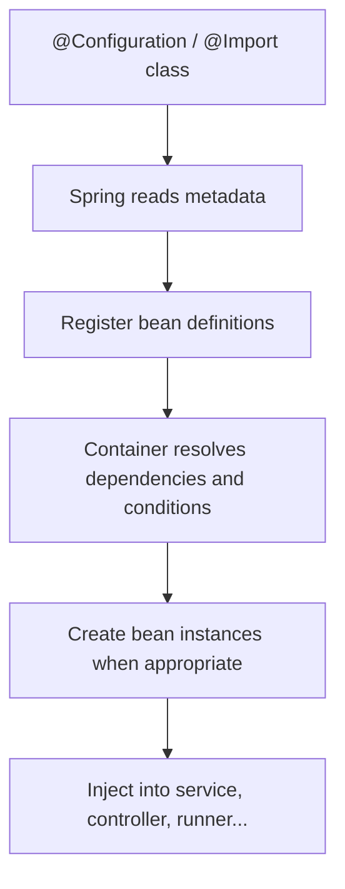
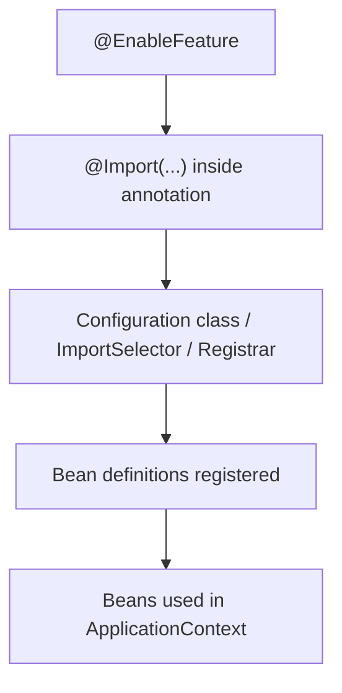
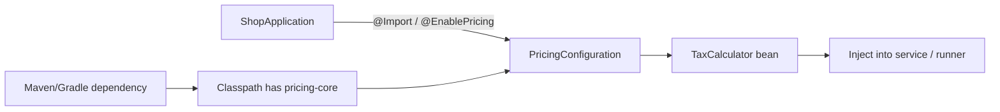

# `@Import` to Bring Configuration Classes or Components into the Context

In Spring Boot, beans are commonly registered via `@Component`, `@Service`, `@Repository`, or `@Bean` methods inside a `@Configuration` class. However, the configuration or component you need does not always live inside the application's component scan scope. Sometimes it belongs to another package, a shared module, or a library that should only be activated when the application **explicitly opts in**.

**`@Import` is a tool for bringing specified configuration classes or components into the Spring container's bean registration process.** Instead of widening package scanning everywhere, the application can state clearly: "I need this configuration group" or "I need this component". Spring processes that declaration while building the `ApplicationContext`.

In the **Bean Registration** chapter of *Spring Boot Fundamentals*, the goal is to understand where `@Import` fits in the context lifecycle, how to use it properly with `@Configuration` and regular classes, how to distinguish it from `@ComponentScan`, and common error cases and limitations.

## 1. Why Do We Need a Mechanism to Import into the Spring Context?

Suppose a system has an e-commerce application:

```text
com.example.shop
└── ShopApplication

com.example.shared.pricing
├── TaxCalculator
└── PricingConfiguration
```

`ShopApplication` resides in `com.example.shop`. Under typical setup, `@SpringBootApplication` enables component scanning from the application class's package and its subpackages. The `com.example.shared.pricing` package lies outside that scope.

If `PricingConfiguration` in the external package is not registered through another mechanism, Spring will not automatically discover the `@Bean` methods inside it just because the class exists on the classpath. Consequently, a needed `TaxCalculator` bean may be missing from the context.

There are several solutions, each with different design implications:

- Expand component scanning to scan additional packages.
- Register a specific bean via a `@Bean` method.
- Register a configuration via `@Import(PricingConfiguration.class)`.
- Use a dedicated library/auto-configuration mechanism if building a starter that activates conditionally.

When an application wants to **explicitly select a group of configurations**, `@Import` is a natural, readable choice. Importing expresses an application-level decision: that configuration is part of the current context.

## 2. What Is `@Import` and How Does It Differ from Java `import`?

Spring provides the annotation:

```java
import org.springframework.context.annotation.Import;
```

You can use it as:

```java
@Import(PricingConfiguration.class)
```

The two uses of "import" here have completely different roles:

| Mechanism | Where does it happen? | Effect |
| --- | --- | --- |
| `import com.example...PricingConfiguration;` | Java language syntax | Allows using the short class name in source code |
| `@Import(PricingConfiguration.class)` | Spring configuration metadata processing | Instructs Spring to process the specified class and register its beans |
| Maven/Gradle dependency | Build configuration and dependency graph | Makes the code/library available on the appropriate classpath |

Adding only a Java `import` statement **does not make Spring create a bean**. Conversely, `@Import` **does not download or add a missing library**: the referenced class must already be available for the project to compile and run.

What Spring imports is the **class metadata**, from which the container creates bean definitions or processes configuration. `@Import` does not mean it immediately instantiates an object on the line of the annotation.

### 2.1. Bean Definition vs. Bean Instance

A *bean definition* tells Spring how to manage a component: its class type, instantiation approach, scope, dependencies, and related metadata. A bean instance is the concrete Java object supplied by the container at the appropriate time.



For non-lazy singletons, Spring normally creates beans during context initialization. For lazy beans, prototypes, or other scopes, instantiation timing can differ. Therefore, when we say `@Import` "brings beans into the context", we are describing **component registration and management**, not claiming every instance is created instantaneously.

## 3. Complete Example: Importing a Configuration Class Outside Component Scan

Let's build a minimal Spring Boot application that calculates tax at a fixed rate. The goal is to observe `@Import`, so no web server, database, or Spring Data is needed.

Assume the project has the core Spring Boot starter and these files:

```text
src/main/java/
├── com/example/shop/
│   └── ShopApplication.java
└── com/example/shared/pricing/
    ├── TaxCalculator.java
    └── PricingConfiguration.java
```

### 3.1. Create the Business Class

`TaxCalculator.java`:

```java
package com.example.shared.pricing;

import java.math.BigDecimal;
import java.util.Objects;

public final class TaxCalculator {

    private final BigDecimal rate;

    public TaxCalculator(BigDecimal rate) {
        Objects.requireNonNull(rate, "rate");
        if (rate.signum() < 0 || rate.compareTo(BigDecimal.ONE) > 0) {
            throw new IllegalArgumentException("Rate must be from 0 to 1");
        }
        this.rate = rate;
    }

    public BigDecimal taxOn(BigDecimal amount) {
        Objects.requireNonNull(amount, "amount");
        if (amount.signum() < 0) {
            throw new IllegalArgumentException("Amount must be non-negative");
        }
        return amount.multiply(rate);
    }
}
```

`TaxCalculator` is a plain Java class; it does not need any Spring dependency. It simply encapsulates the calculation.

### 3.2. Declare the Bean Configuration

`PricingConfiguration.java`:

```java
package com.example.shared.pricing;

import java.math.BigDecimal;
import org.springframework.context.annotation.Bean;
import org.springframework.context.annotation.Configuration;

@Configuration(proxyBeanMethods = false)
public class PricingConfiguration {

    @Bean
    public TaxCalculator taxCalculator() {
        return new TaxCalculator(new BigDecimal("0.08"));
    }
}
```

This configuration class defines a bean of type `TaxCalculator`. It will not enter the application's context automatically if this package lies outside the scan scope and no other import/registration mechanism points to it.

In this example, `proxyBeanMethods = false` fits because the `@Bean` method is standalone and does not directly call another `@Bean` method relying on proxying. This setting is not required for `@Import` to work; plain `@Configuration` works fine while learning bean registration.

### 3.3. Import the Configuration on the Application Class

`ShopApplication.java`:

```java
package com.example.shop;

import com.example.shared.pricing.PricingConfiguration;
import com.example.shared.pricing.TaxCalculator;
import java.math.BigDecimal;
import org.springframework.boot.CommandLineRunner;
import org.springframework.boot.SpringApplication;
import org.springframework.boot.autoconfigure.SpringBootApplication;
import org.springframework.context.annotation.Bean;
import org.springframework.context.annotation.Import;

@SpringBootApplication
@Import(PricingConfiguration.class)
public class ShopApplication {

    public static void main(String[] args) {
        SpringApplication.run(ShopApplication.class, args);
    }

    @Bean
    CommandLineRunner demo(TaxCalculator calculator) {
        return args -> System.out.println(
                calculator.taxOn(new BigDecimal("100000"))
        );
    }
}
```

When the application starts normally, the runner prints the tax amount **8000.00** (formatted per `BigDecimal`'s representation). This example merely illustrates a calculation with a sample rate; real tax policies can be more complex.

### 3.4. What Did Spring Process?

1. `SpringApplication.run` creates the application context.
2. Spring processes metadata on `ShopApplication`, including `@SpringBootApplication` and `@Import`.
3. `@Import(PricingConfiguration.class)` causes `PricingConfiguration` to be processed as a configuration class even though it sits outside the default scan package.
4. Spring reads the `@Bean taxCalculator()` method and registers the corresponding bean definition.
5. The container supplies the `TaxCalculator` bean to the `demo(TaxCalculator calculator)` parameter.
6. When the runner executes, it uses the injected instance.


Key takeaway: **`@Import` selects the configuration class; `@Bean` defines the component; DI supplies that component to consumers**. The three mechanisms collaborate, yet are not synonymous.

### 3.5. What Happens If `@Import` Is Removed?

With this exact package layout, removing `@Import(PricingConfiguration.class)` without adding another registration mechanism means `PricingConfiguration` is not found by default component scanning. Because `TaxCalculator` is not registered elsewhere, Spring cannot supply a bean for the runner parameter. Context creation may fail due to the missing `TaxCalculator` bean.

The issue is not the Java `import` statement. The `TaxCalculator` class still exists in the project, yet **having a class on the classpath is different from having a bean in the container**.

## 4. Importing Multiple Configurations at Once

`@Import` accepts an array of classes, allowing a configuration or application class to opt into multiple components:

```java
@SpringBootApplication
@Import({
    PricingConfiguration.class,
    AuditConfiguration.class,
    NotificationConfiguration.class
})
public class ShopApplication {
}
```

In this illustrative example, `AuditConfiguration` and `NotificationConfiguration` are assumed configuration classes present on the classpath. Spring processes metadata from all three to register the beans they provide.

This style works well when an application wants to advertise enabled capabilities explicitly:

- Pricing for price calculation.
- Audit for event recording.
- Notification for sending alerts.

However, do not import every available configuration just to "be sure the beans are there". A configuration might open connections, start background tasks, or require specific properties. Bring into the context only what the application genuinely needs.

### 4.1. Nested Imports

An imported configuration class can itself import another configuration:

```java
@Configuration
@Import(EmailTransportConfiguration.class)
public class NotificationConfiguration {
}
```

If the application imports `NotificationConfiguration`, Spring also processes configurations referenced via `@Import` inside it. This lets you bundle a feature set under a single activation point.

Because imports can be transitive across multiple classes, when investigating why a bean appeared, check **indirectly imported configurations** as well. Never assume a bean was only registered if the application class directly imported the class defining it.

## 5. `@Import` Can Also Bring Ordinary Classes into the Context

`@Import` is not restricted to `@Configuration` classes. Spring can process a regular component class referenced by `@Import` and register it as a bean, even if the class is not annotated with `@Component`.

Example:

```java
package com.example.shared.format;

public class BannerFormatter {

    public String format(String title) {
        return "=== " + title + " ===";
    }
}
```

Application declaration:

```java
@SpringBootApplication
@Import(BannerFormatter.class)
public class ShopApplication {

    @Bean
    CommandLineRunner banner(BannerFormatter formatter) {
        return args -> System.out.println(
                formatter.format("Spring Boot")
        );
    }
}
```

In this example, the class has a suitable default constructor and needs no extra configuration. Spring registers `BannerFormatter` via `@Import` and supplies it to the runner via DI.

Points to remember:

- `BannerFormatter` does not require `@Component` in this scenario.
- It does not need to reside in a scanned package because it was imported explicitly.
- If a class has a constructor requiring dependencies, the container must still find matching beans to instantiate it.
- For complex initialization, explicit arguments, or external library classes, a `@Bean` method usually expresses intent more clearly.

Do not misinterpret this mechanism as "`@Import` automatically creates a bean for every class referenced by the imported class". If `BannerFormatter`'s constructor requires `FormatterSettings`, Spring still needs a matching bean definition for `FormatterSettings`.

## 6. Differences Between `@Import`, `@ComponentScan`, and `@Bean`

These three mechanisms can appear together in the same Spring Boot application, yet they serve different purposes.

| Mechanism | What do you declare? | What does Spring do? | When to use? |
| --- | --- | --- | --- |
| `@ComponentScan` | Packages to search | Scans candidate classes with filters and registers components | Applications with clean package structure and many components |
| `@Bean` | Method that creates an object | Registers a bean from the method's return value | Controlling instantiation, passing arguments, integrating third-party classes |
| `@Import` | List of configuration/component classes, selectors, or registrars | Includes them in bean registration processing | Selecting a specific set of configurations or components |

Side-by-side comparison:

```java
// Option 1: scan packages containing matching components
@SpringBootApplication
@ComponentScan(basePackages = {
    "com.example.shop",
    "com.example.shared"
})
class ScanApplication {
}
```

```java
// Option 2: select only one specific configuration
@SpringBootApplication
@Import(PricingConfiguration.class)
class ImportApplication {
}
```

```java
// Option 3: create a bean directly in the current configuration
@Configuration
class LocalPricingConfiguration {
    @Bean
    TaxCalculator taxCalculator() {
        return new TaxCalculator(new BigDecimal("0.08"));
    }
}
```

These three snippets are separate alternatives illustrating the differences, not three startup classes to place together in the same sample project. Choose one appropriate registration strategy to avoid duplicate bean registrations for the same role.

### 6.1. Scope of Selection

`@ComponentScan("com.example.shared")` can pick up many candidate classes in that package and its subpackages. This is handy when the entire package tree belongs in the application context, but it can be broader than actually intended.

`@Import(PricingConfiguration.class)` expresses a more targeted decision: the pricing configuration is needed. If `PricingConfiguration` itself imports additional configurations or registers extra beans, those related components still enter the context; **being explicit at the entry point does not mean the final result is always a single bean**.

`@Bean` is useful when an application simply needs to construct a specific bean without introducing a separate configuration class.

### 6.2. `@SpringBootApplication` Already Includes Component Scan

`@SpringBootApplication` is a composite annotation combining `@SpringBootConfiguration`, `@EnableAutoConfiguration`, and `@ComponentScan` (along with related aliases/metadata). Therefore, in most ordinary Spring Boot applications, you do not need to add `@ComponentScan` just to discover components in the application class's package and subpackages.

Adding an explicit `@ComponentScan` is a deliberate configuration choice; review its scope and effect on the default configuration rather than copying it mechanically from other examples.

## 7. Which Classes Can Carry `@Import`?

Commonly, `@Import` is placed on:

- The `@SpringBootApplication` startup class.
- A `@Configuration` class representing a feature.
- A custom annotation to provide a readable configuration trigger.

Example on a configuration class:

```java
@Configuration
@Import(PricingConfiguration.class)
public class CommerceConfiguration {
}
```

The application then only needs to import `CommerceConfiguration` when enabling that capability group.

Crucially, the class carrying `@Import` must itself **be processed by Spring as a configuration source**. If an arbitrary class is not scanned, imported, registered, or otherwise fed into metadata processing, `@Import` on that class has no effect on the active context.

Likewise, having `@Import` on a class in source code does not "broadcast globally" to every `ApplicationContext` running in the JVM.

## 8. Importing with a Custom Annotation

When building a shared module, a team might want consumers to simply write `@EnablePricing` to activate all required components. A common pattern is creating an annotation meta-annotated with `@Import`.

Example:

```java
package com.example.shared.pricing;

import java.lang.annotation.ElementType;
import java.lang.annotation.Retention;
import java.lang.annotation.RetentionPolicy;
import java.lang.annotation.Target;
import org.springframework.context.annotation.Import;

@Target(ElementType.TYPE)
@Retention(RetentionPolicy.RUNTIME)
@Import(PricingConfiguration.class)
public @interface EnablePricing {
}
```

Application usage:

```java
@SpringBootApplication
@EnablePricing
public class ShopApplication {
    public static void main(String[] args) {
        SpringApplication.run(ShopApplication.class, args);
    }
}
```

When Spring processes metadata on the application class, it recognizes `@Import` on `@EnablePricing` and processes `PricingConfiguration` accordingly.

This pattern is popular when a library wants a friendly configuration API:

- Users opt into the feature via a meaningful annotation name.
- Details of imported configuration classes or registrars stay encapsulated inside the module.
- The library can change internal registration details while keeping the `@EnablePricing` surface stable, provided the public contract holds.

However, do not invent an `@Enable...` annotation for every tiny bean. It shines when representing **a meaningful feature and a reusable configuration bundle**.

## 9. Advanced Mechanism: `ImportSelector`

Beyond importing configuration classes directly, `@Import` can accept a class implementing `ImportSelector`. A selector lets you **return a list of class names to import** based on metadata of the importing class.

Illustrative example:

```java
package com.example.shared.reports;

import org.springframework.context.annotation.ImportSelector;
import org.springframework.core.type.AnnotationMetadata;

public class ReportingSelector implements ImportSelector {

    @Override
    public String[] selectImports(AnnotationMetadata importingClassMetadata) {
        return new String[] {
            ReportingConfiguration.class.getName()
        };
    }
}
```

In this example, `ReportingConfiguration` is a valid configuration class defined in the shared module.

Using the selector:

```java
@Configuration
@Import(ReportingSelector.class)
public class ReportsFeatureConfiguration {
}
```

The container invokes `selectImports(...)` during configuration processing, then processes the returned class names. The `AnnotationMetadata` parameter informs the selector about the importing class's metadata, enabling it to pick configurations based on an annotation or attribute.

Key difference:

- `@Import(ReportingConfiguration.class)`: classes are listed explicitly in the annotation.
- `@Import(ReportingSelector.class)`: classes to import are chosen by the selector during Spring metadata processing.

`ImportSelector` is useful for libraries and configurations with multiple selection branches. When you simply need to add one configuration, direct import is much simpler.

### 9.1. `DeferredImportSelector`

Spring also provides `DeferredImportSelector`, a selector variant processed at a later phase than ordinary `ImportSelector` during configuration analysis. This plays an important role in how Spring handles composite and conditional configurations, including mechanisms tied to auto-configuration.

At the Fundamentals level, it is enough to know **Spring processes metadata in multiple phases** and `@Import` can be extended with selectors. You do not need to implement `DeferredImportSelector` yourself for a small CRUD project.

## 10. Advanced Mechanism: `ImportBeanDefinitionRegistrar`

Another class type supported by `@Import` is `ImportBeanDefinitionRegistrar`. Unlike importing a configuration class containing pre-written `@Bean` methods, a registrar can **register bean definitions programmatically**.

Example:

```java
package com.example.shared.audit;

import org.springframework.beans.factory.support.BeanDefinitionRegistry;
import org.springframework.beans.factory.support.RootBeanDefinition;
import org.springframework.context.annotation.ImportBeanDefinitionRegistrar;
import org.springframework.core.type.AnnotationMetadata;

public class AuditRegistrar implements ImportBeanDefinitionRegistrar {

    @Override
    public void registerBeanDefinitions(
            AnnotationMetadata importingClassMetadata,
            BeanDefinitionRegistry registry
    ) {
        if (!registry.containsBeanDefinition("auditClock")) {
            registry.registerBeanDefinition(
                    "auditClock",
                    new RootBeanDefinition(AuditClock.class)
            );
        }
    }
}
```

`AuditClock` here is an illustrative class with a suitable constructor present on the classpath.

Activation:

```java
@Configuration
@Import(AuditRegistrar.class)
public class AuditFeatureConfiguration {
}
```

The registrar registers a bean definition named `auditClock`. The container then manages bean creation according to that definition.

### 10.1. When Is a Registrar Truly Needed?

Registrars typically appear in libraries or frameworks that register beans based on metadata, annotations, classpath presence, or discovered interfaces. For example, a library might generate proxies/adapters for multiple user-declared interfaces.

For a simple application, easier-to-maintain choices are:

1. `@Component` on application-managed classes.
2. `@Bean` when constructing objects manually.
3. `@Import` of a configuration class to activate a group of beans.

Use a registrar only when dynamic bean registration is needed and the approaches above cannot express it clearly. Registrars add complexity around metadata, bean names, conditions, and processing order.

## 11. How Does `@Import` Relate to `@Enable...` Annotations?

Many `@Enable...` annotations in the Spring ecosystem use or coordinate with configuration import mechanisms underneath.

Conceptual diagram:



Accordingly, when an `@Enable...` annotation causes beans to appear, check which configurations it imports or which registration mechanism it activates. This is especially helpful when reading modular library code.

Not every annotation starting with `Enable` works the exact same way, and you should not guess behavior solely from its name. Read the actual contract and configuration of the annotation you use.

## 12. `@Import` and Spring Boot Auto-Configuration

In Spring Boot, **auto-configuration** registers beans based on conditions such as classpath dependencies, properties, existing beans, and application type. `@Import` also participates in Spring's configuration processing ecosystem, yet it is not synonymous with "enabling auto-configuration".

### 12.1. Import Is Typically an Explicit Decision

```java
@SpringBootApplication
@Import(PricingConfiguration.class)
class ShopApplication {
}
```

The application explicitly selects `PricingConfiguration`. Beans inside the configuration may still have conditions, but the import trigger is explicit.

### 12.2. Auto-Configuration Decides Conditionally

An auto-configuration class may use `@ConditionalOnClass`, `@ConditionalOnMissingBean`, or other conditions to determine which beans apply. In modern Spring Boot generations, auto-configurations from libraries are declared via dedicated metadata files, such as `META-INF/spring/org.springframework.boot.autoconfigure.AutoConfiguration.imports` inside the JAR.

Therefore, **simply writing `@Import(MyAutoConfiguration.class)` in an application does not mean you have built a proper Spring Boot starter**. It imports that configuration directly and may bypass the selection/ordering semantics intended for library auto-configuration.

If building an internal module that only needs a manual opt-in, `@Import` or an `@Enable...` annotation can suffice. If distributing a starter that auto-configures based on dependencies, follow the auto-configuration contract for your target Spring Boot line.

### 12.3. `@Import` Does Not Bypass Conditions on Beans

Suppose a configuration is imported, yet contains:

```java
@Configuration
@ConditionalOnProperty(
    prefix = "feature.audit",
    name = "enabled",
    havingValue = "true"
)
class AuditConfiguration {

    @Bean
    AuditService auditService() {
        return new AuditService();
    }
}
```

This snippet assumes `AuditService` has an appropriate default constructor. If the property and conditions are not met, the configuration/bean may not be registered even though `AuditConfiguration` is referenced by `@Import`. Spring Boot evaluates conditions during metadata processing.

Thus, when a bean does not appear, distinguish **configuration was not imported** from **configuration was imported, but conditions did not match**.

## 13. `@Import` and Environment Profiles

Spring allows placing `@Profile` on configuration classes or bean definitions to select components based on active profiles.

Example:

```java
@Configuration
@Profile("dev")
public class DevMailConfiguration {

    @Bean
    MailSender mailSender() {
        return new ConsoleMailSender();
    }
}
```

`MailSender` and `ConsoleMailSender` here are illustrative types representing a mail contract and a console-printing implementation.

The application might import:

```java
@SpringBootApplication
@Import(DevMailConfiguration.class)
class ShopApplication {
}
```

If the `dev` profile is inactive, the profile condition on the configuration prevents the bean from being created. **Explicit importing does not force Spring to ignore `@Profile`.**

Separate the two decisions:

- `@Import`: which configurations are brought into processing.
- `@Profile` and `@Conditional...`: whether those configurations/beans satisfy conditions to be registered.

When combining both, avoid designing features that rely on subtle, hard-to-trace condition chains. Naming and documentation should clarify why a bean is or is not created.

## 14. Common Mistakes When Using `@Import`

### 14.1. Confusing Java `import` with `@Import`

```java
import com.example.shared.pricing.PricingConfiguration;
```

This only lets source code reference the class. For Spring to process the configuration via import, place `@Import(PricingConfiguration.class)` on a configuration source Spring actually processes, or use another bean registration mechanism.

### 14.2. Assuming `@Import` Puts a Class on the Classpath

If the module lacks the dependency containing `PricingConfiguration`, Java source referencing `PricingConfiguration.class` will not compile. Add the Maven/Gradle dependency first, then register the configuration in the Spring context.

### 14.3. Placing `@Import` on a Class Spring Does Not Read

```java
@Import(PricingConfiguration.class)
public class UnusedHelper {
}
```

If `UnusedHelper` is not processed as a configuration class or configuration participant, the annotation does nothing in the application context merely because the Java file exists. Verify what the actual entry point is.

### 14.4. Importing Conflicting Components

If two different configuration classes register beans with the same name, or multiple beans of the same type are injected without disambiguation, the application can hit registration errors or dependency selection errors.

Example:

```java
@Configuration
class LocalPricingConfiguration {
    @Bean
    TaxCalculator taxCalculator() {
        return new TaxCalculator(new BigDecimal("0.05"));
    }
}
```

If the application simultaneously imports `PricingConfiguration` (which defines `taxCalculator()`) and declares the configuration above, both methods suggest the bean name `taxCalculator`. Depending on bean overriding policy and configuration discovery, the context may reject the duplicate name or exhibit unintended behavior. Do not rely on class-loading order to pick a policy version.

Decide which bean is authoritative, or design an intentional alternative with distinct names, qualifiers, or conditions.

### 14.5. Widening Component Scan Overly Broadly Just to Find One Configuration

If you only need `PricingConfiguration`, scanning all of `com.example.shared` may pull unrelated components into bean registration. An explicit `@Import` can be easier to control.

Still, if the entire package is designed to be scanned as part of the application, component scan remains sensible. The choice depends on **module boundaries and desired control**.

### 14.6. Thinking Importing a Plain Class Runs All Related Configurations

`@Import(BannerFormatter.class)` can register that class as a bean, yet it does not automatically create other dependencies just because they appear as fields or constructor parameters. If a coordinated group of beans is needed, configuring via `@Bean` or importing a `@Configuration` is usually clearer.

### 14.7. Confusing `@Import` with `@ImportResource`

Spring also has `@ImportResource` for loading bean definitions from configuration resources such as XML:

```java
@Configuration
@ImportResource("classpath:legacy-beans.xml")
public class LegacyIntegrationConfiguration {
}
```

`@ImportResource` takes **resource paths**. `@Import` takes **classes** (configurations, components, selectors, or registrars). Do not use them interchangeably when the input configuration formats differ.

## 15. Checking Whether a Bean Appears in the Context

When learning `@Import`, separate two questions: "Has Spring processed the configuration?" and "Can the bean the application needs be resolved?"

### 15.1. Observing with `CommandLineRunner`

An example for development environments:

```java
@Bean
CommandLineRunner inspectContext(ApplicationContext context) {
    return args -> {
        boolean present = context.containsBean("taxCalculator");
        System.out.println("taxCalculator registered: " + present);
    };
}
```

This snippet requires importing `org.springframework.context.ApplicationContext` and `org.springframework.boot.CommandLineRunner`. With `PricingConfiguration` above, the `@Bean taxCalculator()` method typically registers a bean named `taxCalculator`.

Checking by name only works when you know the exact bean name. To check by type, you can query the context by `TaxCalculator.class`, keeping in mind that if multiple beans share that type, requesting a single bean is ambiguous.

In ordinary business code, **constructor injection** remains the right way to express dependencies. Do not turn every service into a class calling `ApplicationContext.getBean(...)` just to check whether imports worked.

### 15.2. Verifying with a Spring Context Test

Example verifying wiring after import:

```java
package com.example.shop;

import static org.junit.jupiter.api.Assertions.assertEquals;

import com.example.shared.pricing.TaxCalculator;
import java.math.BigDecimal;
import org.junit.jupiter.api.Test;
import org.springframework.beans.factory.annotation.Autowired;
import org.springframework.boot.test.context.SpringBootTest;

@SpringBootTest
class ShopApplicationContextTest {

    @Autowired
    private TaxCalculator taxCalculator;

    @Test
    void importedConfigurationProvidesCalculator() {
        assertEquals(
                new BigDecimal("8000.0000"),
                taxCalculator.taxOn(new BigDecimal("100000.00"))
        );
    }
}
```

This is an example of a **context/integration test** requiring Spring Boot Test dependencies. It loads the application context, verifies `TaxCalculator` is injected, and runs the calculation. The `BigDecimal` result keeps matching scale when multiplying `100000.00` by `0.08`.

For pure calculation rules, you can still write a unit test without Spring:

```java
TaxCalculator calculator =
        new TaxCalculator(new BigDecimal("0.08"));
```

The two test styles answer different questions: the unit test verifies the formula; the context test verifies registration and DI wiring.

### 15.3. Using Logs and the Condition Report When Needed

When using conditional configurations, Spring Boot's debug/condition evaluation report helps explain why an auto-configuration or condition was or was not applied. However, the condition report does not replace directly checking bean names/types in the context or tracing import paths from the startup class.

## 16. Real-World Scenario: Explicitly Activating a Shared Module

Suppose a team has two Java modules:

```text
shop-app/
  └── ShopApplication

pricing-core/
  ├── TaxCalculator
  ├── PricingConfiguration
  └── EnablePricing
```

The `pricing-core` module holds Java classes and Spring configuration providing pricing functionality. The `shop-app` application adds this module as a build dependency.

Two decisions are required:

1. **Build-time dependency:** make `pricing-core` classes available on `shop-app`'s classpath.
2. **Runtime/container registration:** tell Spring to process the pricing configuration, e.g., via `@Import(PricingConfiguration.class)` or `@EnablePricing`.

This is a strength of modular configuration: anyone looking at the startup class or application configuration immediately sees which capabilities it chose to enable.

When writing a reusable library, define the **activation contract** clearly:

- Must users call `@Import` directly?
- Does the library provide a dedicated `@Enable...` annotation?
- Or is the library a Spring Boot starter with conditional auto-configuration?

All of these can be appropriate, but do not mix them without clear documentation. Consumers need to know whether adding the dependency alone suffices or an explicit activation step is required.

### A Layered Diagram



The diagram shows that **classpath** and **bean registration** are related yet independent steps.

## 17. Checklist for Identifying the Right Scope of `@Import`

Before adding `@Import`, ask:

1. **Is the class to import already on the classpath?** If not, resolve build dependencies first.
2. **Is it a `@Configuration`, regular component, selector, or registrar?** Each produces different registration behavior.
3. **Is the class carrying `@Import` processed by Spring?** If not, the import never triggers.
4. **Where is the needed bean defined?** In a `@Bean` method, on the imported class itself, or in a transitively imported configuration?
5. **Are there `@Profile` or `@Conditional...` conditions?** If so, importing does not guarantee the bean always appears.
6. **Is there risk of bean name collisions or multiple same-type candidates?** If so, design clear disambiguation.
7. **Should you import one class or scan an entire package?** Pick the scope matching your module boundaries.
8. **Should auto-configuration be used instead of manual import?** For Spring Boot-specific libraries, evaluate distribution and activation models.

This checklist helps clarify design direction. There is no rule that every application must use `@Import` or that every configuration must be discovered by component scan.

## 18. Practice Exercises

### Exercise 1 – Predict Whether a Bean Exists in the Context

Given the layout:

```text
com.example.inventory.InventoryApplication
com.example.common.TimeConfiguration
com.example.common.SystemClock
```

`InventoryApplication` has `@SpringBootApplication`. `TimeConfiguration` has `@Configuration` and a `@Bean` method creating `SystemClock`. There is no expanded component scan.

Answer:

1. Is adding only Java `import com.example.common.TimeConfiguration;` to source enough to register `SystemClock`?
2. What changes if you place `@Import(TimeConfiguration.class)` on `InventoryApplication`?
3. Do you need to add `@Component` to `SystemClock` if a `@Bean` method already registers it?

**Hint:** Java `import` alone does not alter the context; Spring `@Import` brings the configuration into processing; a bean can be created via `@Bean` without `@Component` on the class.

### Exercise 2 – Compare `@ComponentScan` and `@Import`

A shared module `com.example.shared` contains two configurations:

```text
com.example.shared.pricing.PricingConfiguration
com.example.shared.mail.MailConfiguration
```

The application only wants pricing. Analyze the difference between:

```java
@ComponentScan("com.example.shared")
```

and:

```java
@Import(PricingConfiguration.class)
```

**Hint:** scanning can pick up multiple candidate components across the package scope; importing states the exact configuration class to process. Actual results also depend on class annotations and other imports/conditions.

### Exercise 3 – Diagnose a Missing Bean

A `@Configuration` was imported, yet a bean inside it is marked `@Profile("dev")`. The application runs with the `prod` profile.

Explain why `@Import` alone is insufficient for the bean to appear and how to verify active profiles and conditions.

### Exercise 4 – Custom `@Enable...` Annotation

Write an `@EnableAudit` annotation with:

- `@Target(ElementType.TYPE)`.
- `@Retention(RetentionPolicy.RUNTIME)`.
- `@Import(AuditConfiguration.class)`.

Then place `@EnableAudit` on the Spring Boot application class. Trace the path from the annotation to `AuditConfiguration` and its `@Bean` methods.

### Exercise 5 – Choose the Registration Mechanism

Consider four requirements:

| Requirement | Suggested mechanism |
| --- | --- |
| Register an application class in a scanned package | `@Component` or appropriate stereotype |
| Create an HTTP client with special constructor arguments | `@Bean` method in configuration |
| Enable a configuration bundle from a shared module | `@Import` or `@Enable...` annotation |
| Write a library deciding multiple beans dynamically from annotation metadata | Consider `ImportSelector`/`ImportBeanDefinitionRegistrar` when truly needed |

For each option, explain **what is responsible for creating the bean definition**, **when the configuration is processed**, and **whether any activation conditions apply**.

## 19. Takeaways on `@Import` in Spring Boot Fundamentals

`@Import` is a mechanism for **selective registration of configurations and components** in the Spring IoC container. It is particularly useful when an application needs a configuration class outside its component scan scope or wants to explicitly enable a feature group from a shared module.

Keeping these distinctions straight avoids most confusion:

- **Java `import`** resolves class references in source code.
- **Maven/Gradle dependency** puts a library on the classpath.
- **Spring `@Import`** feeds specified classes into configuration/bean registration processing.
- **`@Configuration` and `@Bean`** describe how to provide specific objects.
- **`@ComponentScan`** discovers components by packages and filters.
- **`@Profile` and conditions** decide whether beans are registered during configuration processing.
- **DI** supplies registered beans to services, controllers, or runners that need them.

When reading a Spring Boot application, trace the chain: **which configurations Spring recognizes → which configurations are imported → which beans are defined → which conditions apply → which beans are injected into consumers**. This perspective explains why a bean is present in the context, why it disappears in another environment, and when `@Import` is preferable to widening package scans or writing extra `@Bean` declarations.
