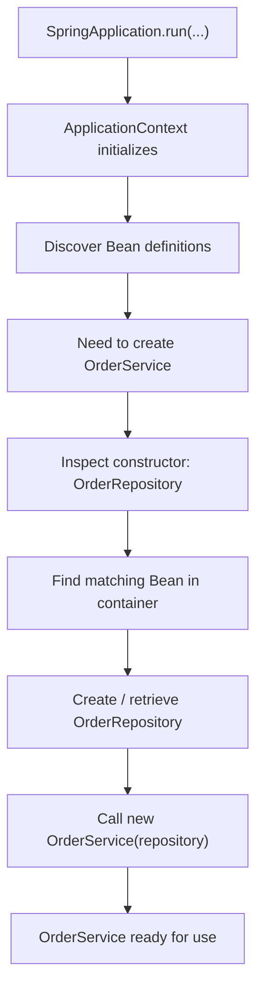
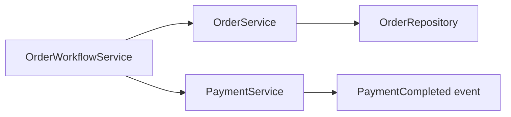
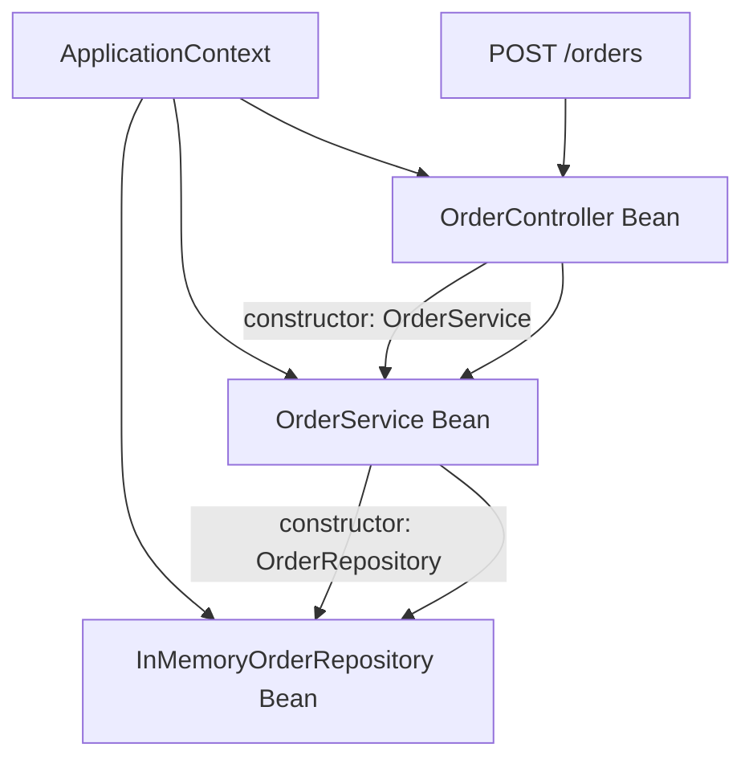

# Constructor Injection for Required Dependencies

In a Spring Boot application, a service rarely does everything by itself. It may need a repository to read data, a gateway to call an external service, or another component to execute business logic. These collaborating objects are called **dependencies**.

When a dependency is a mandatory requirement for an object to function properly, the clearest way to express it is usually **constructor injection**: declare the dependency as a constructor parameter, then let the Spring IoC container provide the appropriate Bean when creating the object.

Example:

```java
@Service
public class OrderService {
    private final OrderRepository orderRepository;

    public OrderService(OrderRepository orderRepository) {
        this.orderRepository = orderRepository;
    }
}
```

The code makes it clear that a valid `OrderService` must have an `OrderRepository` right from the moment it is created. Spring does not need to wait for a field to be assigned later; the container resolves the dependency and passes it into the constructor.

Constructor injection is especially well-suited for required dependencies because it prevents an object from ending up in a "created but missing the parts needed to work" state. It also makes the dependency structure easy to read, supports using `final`, detects circular dependencies early, and allows unit tests to run without starting Spring.

## 1. What Is a Required Dependency?

Consider a service that processes orders. To create an order, it needs to save the order to a repository:

```java
public class OrderService {
    private OrderRepository repository;

    public void placeOrder(Order order) {
        repository.save(order);
    }
}
```

If code creates the object using `new OrderService()`, the `repository` field remains `null`. The error only surfaces when `placeOrder()` is called. Someone reading the class also cannot tell from the constructor signature that the repository is an indispensable component.

A dependency is considered **required** when the service cannot perform its responsibility properly without that dependency. For example:

- `OrderService` needs a repository to save orders.
- `PaymentService` needs a payment gateway to execute transactions.
- `InvoiceService` needs a formatter to generate invoice content.
- `UserController` needs the business service to which the controller delegates.

Conversely, an integration can be truly optional if the application still functions properly when it is not configured—for example, a supplementary notifier in an environment where notifications are disabled. In that case, optionality should be expressed explicitly using an appropriate type/API, rather than pretending a required dependency can be absent.

## 2. How Does Constructor Injection Work?

In Spring, the container is responsible for creating Beans and wiring them together into an object graph. With constructor injection, the constructor parameters describe the Beans required to create the current Bean.



The diagram illustrates the principle, not the detailed ordering of every callback in Spring. A Bean may be created eagerly or lazily depending on its scope, lazy initialization, and how it is used.

Key steps:

1. Spring knows which classes need to be registered as Beans, for example via `@Service`, `@Component`, or `@Bean` methods.
2. When it needs to create a Bean, the container inspects the constructor Spring selects.
3. For each parameter, Spring looks up a matching dependency among the registered Beans.
4. If the right candidate is found, the container passes those objects into the constructor.
5. The constructor finishes, the object is instantiated, and it proceeds through the corresponding lifecycle steps.

If a required dependency does not exist or cannot be uniquely resolved, Spring typically fails during context initialization. This is helpful behavior: the application detects missing configuration before receiving business requests.

## 3. Writing Basic Constructor Injection

The example below uses an interface to decouple the service from the specific storage mechanism:

```java
public interface OrderRepository {
    void save(Order order);
}
```

The service receives the repository via its constructor:

```java
import org.springframework.stereotype.Service;

@Service
public class OrderService {
    private final OrderRepository orderRepository;

    public OrderService(OrderRepository orderRepository) {
        this.orderRepository = orderRepository;
    }

    public void placeOrder(Order order) {
        orderRepository.save(order);
    }
}
```

Here:

- `OrderRepository` is a dependency of `OrderService`.
- The constructor requires an object compatible with that interface.
- The `final` field is assigned exactly once in the constructor.
- The service does not create the repository itself with `new SomeOrderRepository()`.
- The service does not call `applicationContext.getBean(...)` itself to look up the repository.

An implementation that Spring can discover:

```java
import org.springframework.stereotype.Repository;

@Repository
public class InMemoryOrderRepository implements OrderRepository {
    @Override
    public void save(Order order) {
        // Illustrative example; a real application would persist to a database.
        System.out.println("Saved order: " + order.id());
    }
}
```

The example assumes `Order` is a data type with an `id()` method. When `OrderService` and `InMemoryOrderRepository` are in component-scanned packages, Spring can register both Beans and inject the implementation into the service.

## 4. A Single Constructor Does Not Need @Autowired

In modern Spring Framework (since Spring 4.3), if a Bean has only **one constructor**, Spring automatically uses that constructor for autowiring. You do not need to add `@Autowired`.

```java
@Service
public class CatalogService {
    private final ProductRepository repository;

    public CatalogService(ProductRepository repository) {
        this.repository = repository;
    }
}
```

This is the standard and cleanest way to write a service with a single constructor.

You can still write:

```java
@Autowired
public CatalogService(ProductRepository repository) {
    this.repository = repository;
}
```

but this annotation is unnecessary when there is only one constructor. Omitting the annotation does not disable constructor injection.

### What if a class has multiple constructors?

When a class has multiple constructors, Spring needs to know which constructor to use to create the Bean and inject dependencies. You can mark the intended constructor:

```java
@Service
public class ReportService {
    private final ReportRepository repository;

    public ReportService() {
        this(null);
    }

    @Autowired
    public ReportService(ReportRepository repository) {
        this.repository = repository;
    }
}
```

This is only a syntax example to show how a constructor is selected, **not a recommended design**: a no-argument constructor passing `null` creates an object without its required dependency. If the class is a Spring Bean that needs a repository, prefer a single constructor that reflects the true contract rather than adding an empty constructor just to "make it easy for Spring to instantiate."

In typical applications, keeping a single constructor makes the structure clearer. If you truly need multiple constructors, read Spring's autowiring rules and explicitly mark the appropriate injection constructor; do not rely on guessing that Spring will always pick the constructor with the most parameters.

## 5. Why Use `final` Fields?

For required dependencies, declaring fields `final` is a useful design signal:

```java
@Service
public class ShippingService {
    private final ShippingRepository repository;
    private final ShippingRateCalculator calculator;

    public ShippingService(
            ShippingRepository repository,
            ShippingRateCalculator calculator) {
        this.repository = repository;
        this.calculator = calculator;
    }
}
```

Once the constructor finishes executing, the two dependency references cannot be reassigned. That does not by itself make the objects they point to immutable, but it protects the service's collaborator structure from accidental modification.

Constructors also help avoid half-initialized states. If a constructor requires three dependencies, a caller cannot construct a valid object while forgetting the third dependency.

### Comparing with field injection

```java
@Service
public class ShippingService {
    @Autowired
    private ShippingRepository repository;
}
```

Field injection looks like less code, but it has several drawbacks:

- Dependencies do not appear in a public constructor, making it harder for readers to see what the object needs to work.
- Fields cannot be `final` with standard field injection.
- The object can exist before Spring injects the field; instantiating the object directly in a unit test leaves the field `null`.
- Tests often have to start Spring or use reflection to assign fields.
- Having too many dependencies hidden in fields makes it easy for a class to accumulate too many responsibilities.

### Comparing with setter injection

```java
@Service
public class ShippingService {
    private ShippingRepository repository;

    @Autowired
    public void setRepository(ShippingRepository repository) {
        this.repository = repository;
    }
}
```

Setter injection is useful when a dependency is genuinely optional or there is a reason to change it after the object is created. However, if the repository is a prerequisite for the service to function, a setter allows the object to exist in a state without a repository. Constructor injection expresses mandatory requirements more strictly.

| Criterion | Constructor injection | Setter injection | Field injection |
|---|---|---|---|
| Dependencies shown in constructor | Yes | No | No |
| Easy to use `final` fields | Yes | Not in the standard way | No |
| Can create object missing dependencies | Difficult/impossible when constructor requires them | Yes | Yes, before injection |
| Unit testing with `new` | Easy | Requires calling setters | Requires Spring/reflection |
| Fit for required dependencies | Very well-suited | Less suited | Less suited |
| Fit for optional dependencies | Possible, if optionality is clearly expressed | Suitable | Possible, though often harder to test |

## 6. Multiple Dependencies of the Same Type: Using @Qualifier or @Primary

Constructor injection requires Spring to resolve each parameter by type and related metadata. If the container has only one matching Bean, selection is straightforward. But if there are multiple implementations of the same interface, a selection rule is needed.

Example:

```java
public interface NotificationSender {
    void send(String recipient, String message);
}
```

Two implementations:

```java
@Component("emailSender")
public class EmailNotificationSender implements NotificationSender {
    @Override
    public void send(String recipient, String message) {
        // Send email.
    }
}
```

```java
@Component("smsSender")
public class SmsNotificationSender implements NotificationSender {
    @Override
    public void send(String recipient, String message) {
        // Send SMS.
    }
}
```

If the constructor only declares:

```java
public AlertService(NotificationSender sender) {
    this.sender = sender;
}
```

Spring sees two candidates and cannot choose based on business intent on its own. Typically, the context will fail with a multiple matching Beans error (for example, `NoUniqueBeanDefinitionException`).

### Selecting with @Qualifier

```java
@Service
public class AlertService {
    private final NotificationSender sender;

    public AlertService(
            @Qualifier("emailSender") NotificationSender sender) {
        this.sender = sender;
    }
}
```

`@Qualifier("emailSender")` narrows the selection to the Bean with the matching qualifier. In this example the component name is also used as the default qualifier, so the string `emailSender` matches the Bean name. In larger systems, you can create custom qualifier annotations to express business roles more clearly instead of relying on string names.

### Setting a default with @Primary

If one implementation should be the default choice for most injection points:

```java
@Primary
@Component
public class EmailNotificationSender implements NotificationSender {
    @Override
    public void send(String recipient, String message) {
        // Send email.
    }
}
```

When a matching primary Bean exists, injection by type can select it. The remaining Beans still exist and can be selected using a qualifier or injected as a collection.

**Should you choose qualifier or primary?**

- Use `@Qualifier` when a specific consumer needs a specific implementation.
- Use `@Primary` when there is one sensible default implementation for the entire application.
- Use a collection when the business logic needs to iterate over all implementations.

Do not add `@Primary` merely to mask a design issue if two implementations actually serve different roles and each consumer should choose explicitly.

## 7. Constructor Injection with Multiple Dependencies

A service may require several mandatory dependencies:

```java
@Service
public class CheckoutService {
    private final OrderRepository orderRepository;
    private final PaymentGateway paymentGateway;
    private final InventoryService inventoryService;

    public CheckoutService(
            OrderRepository orderRepository,
            PaymentGateway paymentGateway,
            InventoryService inventoryService) {
        this.orderRepository = orderRepository;
        this.paymentGateway = paymentGateway;
        this.inventoryService = inventoryService;
    }

    public Order checkout(Cart cart) {
        inventoryService.reserve(cart);
        paymentGateway.charge(cart.total());

        Order order = Order.from(cart);
        orderRepository.save(order);
        return order;
    }
}
```

This is a structural example assuming the domain types `Cart`, `Order`, and corresponding methods are already defined. The important point is not the number of parameters, but that the constructor makes every required collaborator explicit.

If a constructor keeps growing with too many parameters, that is usually a sign to review the class's responsibilities. The service might be coordinating too much business logic, or a group of dependencies might belong to a collaborator with a clear responsibility. Avoid bundling dependencies into an aggregate "container" object just to make the constructor shorter, because doing so hides dependency relationships.

### Injecting a collection when multiple implementations are needed

Spring can inject all matching Beans into a collection:

```java
@Service
public class NotificationCoordinator {
    private final List<NotificationSender> senders;

    public NotificationCoordinator(List<NotificationSender> senders) {
        this.senders = List.copyOf(senders);
    }

    public void broadcast(String recipient, String message) {
        senders.forEach(sender -> sender.send(recipient, message));
    }
}
```

Or inject a map keyed by Bean name:

```java
@Service
public class NotificationRegistry {
    private final Map<String, NotificationSender> senders;

    public NotificationRegistry(Map<String, NotificationSender> senders) {
        this.senders = Map.copyOf(senders);
    }

    public NotificationSender get(String name) {
        NotificationSender sender = senders.get(name);
        if (sender == null) {
            throw new IllegalArgumentException("Unknown sender: " + name);
        }
        return sender;
    }
}
```

This is still constructor injection: the constructor receives the collection/map built by the container. It is suitable when the business logic itself needs a set of implementations; it is not a workaround to avoid choosing a single required dependency.

## 8. Truly Optional Dependencies: Expressing Them Explicitly

Not every collaborator is mandatory. For example, the system may operate even when an additional integration is disabled. In such cases, express optionality in the constructor's types instead of leaving a field that can silently be `null`.

### Using Optional

```java
@Service
public class OrderNotificationService {
    private final Optional<NotificationSender> optionalSender;

    public OrderNotificationService(
            Optional<NotificationSender> optionalSender) {
        this.optionalSender = optionalSender;
    }

    public void notifyIfAvailable(String customer, String message) {
        optionalSender.ifPresent(
                sender -> sender.send(customer, message));
    }
}
```

This example is only appropriate if the absence of `NotificationSender` is a valid state. If sending notifications is a mandatory business requirement, using `Optional` weakens the contract and can hide missing configuration.

### Using ObjectProvider when lazy resolution is needed

`ObjectProvider<T>` is useful when a dependency might not exist or when you want to retrieve it at the time of use:

```java
@Service
public class OptionalReportExporter {
    private final ObjectProvider<ReportExporter> exporters;

    public OptionalReportExporter(ObjectProvider<ReportExporter> exporters) {
        this.exporters = exporters;
    }

    public void export(Report report) {
        ReportExporter exporter = exporters.getIfAvailable();
        if (exporter != null) {
            exporter.export(report);
        }
    }
}
```

This is an example of a dependency resolved via a provider; it is helpful for certain infrastructure integrations or runtime choices. If the application must always have an exporter, injecting `ReportExporter` directly expresses the requirement more strongly and simply.

Spring also supports `@Nullable` and other optional mechanisms in appropriate situations. Whichever approach you choose, make it clear to readers that the dependency may be absent and that the code handles that situation proactively.

## 9. Constructor Circular Dependencies: A Design Signal to Review

Constructor injection exposes circular dependencies clearly:

```java
@Service
public class OrderService {
    public OrderService(PaymentService paymentService) {
        // ...
    }
}

@Service
public class PaymentService {
    public PaymentService(OrderService orderService) {
        // ...
    }
}
```

To create `OrderService`, the container needs `PaymentService`. To create `PaymentService`, the container in turn needs `OrderService`. The two constructors cannot complete in this direct manner. Spring typically detects the circular dependency and fails Bean creation (often with information about the reference cycle, such as `BeanCurrentlyInCreationException`).

Instead of trying to enable circular references, review the direction of dependencies:

- Extract shared logic into a third service with a small, clear responsibility.
- Move workflow coordination into an application service; the two domain/business services do not need to call back into each other.
- Publish an event when an operation completes if communication should be decoupled and asynchronous.
- Invert the dependency direction through an interface/port if two modules know too much about each other.

For example, if Order needs to request Payment, while Payment only needs to emit a "payment completed" signal, you can design a one-way coordination flow:



This is just one architectural direction to consider; event-based implementations must address transaction consistency, retries, and business ordering. The goal is to give the dependency graph a clear direction without creating cycles in constructors.

## 10. How Constructor Injection Helps Unit Testing

When a class receives its dependencies via its constructor, you can test it in plain Java. There is no need to start Spring, no need for component scanning, and no need to create an application context.

Suppose we have a service:

```java
public class DiscountService {
    private final DiscountPolicy policy;

    public DiscountService(DiscountPolicy policy) {
        this.policy = policy;
    }

    public int priceAfterDiscount(int originalPrice) {
        return policy.apply(originalPrice);
    }
}
```

In a unit test, create a fake dependency:

```java
import static org.junit.jupiter.api.Assertions.assertEquals;

import org.junit.jupiter.api.Test;

class DiscountServiceTest {
    @Test
    void delegatesDiscountCalculationToPolicy() {
        DiscountPolicy fixedPolicy = price -> price - 10;
        DiscountService service = new DiscountService(fixedPolicy);

        assertEquals(90, service.priceAfterDiscount(100));
    }
}
```

The example assumes `DiscountPolicy` is a functional interface with an `apply(int)` method. The fake policy keeps the test focused on how the service collaborates with its dependency; no database or network call is needed.

If using Mockito, you can create a mock and pass it into the constructor:

```java
@ExtendWith(MockitoExtension.class)
class DiscountServiceMockitoTest {
    @Mock
    DiscountPolicy policy;

    @Test
    void usesConfiguredPolicy() {
        when(policy.apply(100)).thenReturn(85);

        DiscountService service = new DiscountService(policy);

        assertEquals(85, service.priceAfterDiscount(100));
        verify(policy).apply(100);
    }
}
```

This snippet requires the appropriate static imports for Mockito APIs (such as `when`, `verify`) and the JUnit extension. The key point is that the dependency is supplied right when the object is created, so the test does not have to use reflection to assign private fields.

### Unit tests vs. Spring integration tests

- **Unit test:** instantiate the class yourself with `new Service(fakeDependency)` to test the class's logic.
- **Spring integration test:** start the context (for example, `@SpringBootTest`) to verify Bean registration, qualifiers, auto-configuration, and wiring between components.

Constructor injection supports both: it enables isolated testing while still letting Spring resolve Beans automatically in a real context.

## 11. Complete Spring Boot Example: Order Processing

Let's combine the ideas above into a small example. The application has a controller receiving requests, a service processing orders, and a repository saving orders. The example uses an in-memory implementation to focus on constructor injection without needing a database.

### Package structure

```text
src/main/java/com/example/orders/
├── OrdersApplication.java
├── Order.java
├── OrderRepository.java
├── InMemoryOrderRepository.java
├── OrderService.java
└── OrderController.java
```

**OrdersApplication.java**

```java
package com.example.orders;

import org.springframework.boot.SpringApplication;
import org.springframework.boot.autoconfigure.SpringBootApplication;

@SpringBootApplication
public class OrdersApplication {
    public static void main(String[] args) {
        SpringApplication.run(OrdersApplication.class, args);
    }
}
```

**Order.java**

```java
package com.example.orders;

public record Order(Long id, String customer, int amount) {
}
```

**OrderRepository.java**

```java
package com.example.orders;

public interface OrderRepository {
    Order save(Order order);
}
```

**InMemoryOrderRepository.java**

```java
package com.example.orders;

import java.util.concurrent.atomic.AtomicLong;
import org.springframework.stereotype.Repository;

@Repository
public class InMemoryOrderRepository implements OrderRepository {
    private final AtomicLong sequence = new AtomicLong();

    @Override
    public Order save(Order order) {
        return new Order(
                sequence.incrementAndGet(),
                order.customer(),
                order.amount());
    }
}
```

**OrderService.java**

```java
package com.example.orders;

import org.springframework.stereotype.Service;

@Service
public class OrderService {
    private final OrderRepository repository;

    public OrderService(OrderRepository repository) {
        this.repository = repository;
    }

    public Order create(String customer, int amount) {
        if (customer == null || customer.isBlank()) {
            throw new IllegalArgumentException("Customer is required");
        }
        if (amount <= 0) {
            throw new IllegalArgumentException("Amount must be positive");
        }

        return repository.save(new Order(null, customer, amount));
    }
}
```

**OrderController.java**

```java
package com.example.orders;

import org.springframework.http.HttpStatus;
import org.springframework.web.bind.annotation.PostMapping;
import org.springframework.web.bind.annotation.RequestMapping;
import org.springframework.web.bind.annotation.RequestParam;
import org.springframework.web.bind.annotation.ResponseStatus;
import org.springframework.web.bind.annotation.RestController;

@RestController
@RequestMapping("/orders")
public class OrderController {
    private final OrderService orderService;

    public OrderController(OrderService orderService) {
        this.orderService = orderService;
    }

    @PostMapping
    @ResponseStatus(HttpStatus.CREATED)
    public Order create(
            @RequestParam String customer,
            @RequestParam int amount) {
        return orderService.create(customer, amount);
    }
}
```

Assuming the project declares `spring-boot-starter-web` and appropriate Spring Boot Gradle/Maven configuration, run the application and send a request:

```bash
curl -X POST "http://localhost:8080/orders?customer=Lan&amount=250"
```

Expected JSON response:

```json
{
  "id": 1,
  "customer": "Lan",
  "amount": 250
}
```

### How does the container wire the Beans?



The controller only knows the service, and the service only knows the repository abstraction. When you want to replace the in-memory repository with a JPA repository, you can provide another matching implementation without modifying the order-creation logic in the service. This is the benefit of combining constructor injection with dependency inversion.

## 12. Lombok and Constructor Injection

In a project with the Lombok annotation processor configured, `@RequiredArgsConstructor` can generate a constructor for `final` fields (and fields marked with `@NonNull`):

```java
@Service
@RequiredArgsConstructor
public class OrderService {
    private final OrderRepository repository;
    private final PaymentGateway paymentGateway;
}
```

Lombok generates an equivalent constructor:

```java
public OrderService(
        OrderRepository repository,
        PaymentGateway paymentGateway) {
    this.repository = repository;
    this.paymentGateway = paymentGateway;
}
```

With a single generated constructor, Spring automatically injects it without needing `@Autowired`. However:

- Readers must know which constructor the Lombok annotation generates; for small classes, writing the constructor explicitly is sometimes easier to understand.
- The build requires the Lombok annotation processor to be configured properly.
- `@RequiredArgsConstructor` does not resolve having multiple Beans of the same type on its own. You still need qualifiers or an appropriate selection strategy.
- Do not use Lombok to disguise a design with too many dependencies; a long constructor is still a signal to review the class's responsibilities.

## 13. Common Errors and How to Handle Them

| Symptom | Common cause | Resolution |
|---|---|---|
| `NoSuchBeanDefinitionException` | No Bean matches the constructor parameter | Check component scan, `@Bean`, profiles, and auto-configuration conditions |
| `NoUniqueBeanDefinitionException` | Multiple Beans of the same type with no clear selection | Use `@Qualifier`, `@Primary`, or inject a collection |
| `BeanCurrentlyInCreationException` / circular reference | Beans have a circular constructor dependency | Split responsibilities, invert call direction, or use events when appropriate |
| Dependency field is `null` in unit test | Service instantiated with `new`, but previously relied on field injection | Switch to constructor injection and pass a fake/mock |
| Constructor is too long | Class is taking on too many responsibilities or coordinating too many subsystems | Review service boundaries and extract meaningful collaborators |
| No suitable constructor found | Multiple constructors or unresolvable parameters | Keep one clear constructor or mark the appropriate autowire constructor |

### Missing Bean due to component scan

If `OrderService` requires `OrderRepository` but the implementation lies outside the scanned packages, Spring will not automatically know to register it. With `@SpringBootApplication`, component scanning starts by default from the package containing the main application class and scans subpackages.

Example:

```text
com.example.orders.OrdersApplication
com.example.orders.service.OrderService
com.example.orders.repository.InMemoryOrderRepository
```

This is a favorable package structure because all classes reside under the root package `com.example.orders`. If an implementation is in a package outside that tree, you need to configure scanning/imports or register the Bean explicitly.

### Multiple Beans of the same type from auto-configuration

Some starters or libraries may register Beans automatically. If you also declare a Bean of the same type, you need to check auto-configuration conditions, qualifiers, primary settings, and override goals. Do not rush to add `@Primary` before knowing which Beans are being created and why.

### Do not solve every problem with @Lazy

`@Lazy` can defer Bean creation and sometimes alter when certain dependency cycles are resolved, but it does not replace a good dependency graph design. If two services need to know about each other to fulfill their responsibilities, review the architecture before deferring object creation.

## 14. Best Practices

**Declare all required dependencies in the constructor.** Readers can look at the signature and immediately know what the object needs to exist.

**Use `private final` for collaborators that do not need to be replaced after creation.** This keeps the object's structure clear and prevents unintended reassignment.

**Prefer a single constructor.** When there is only one constructor, Spring injects it automatically; no `@Autowired` is needed.

**Depend on an interface when it represents a useful contract.** You do not need to create an interface for every class mechanically; introduce an abstraction when there is a real substitution, testing, or architectural boundary.

**Use qualifiers when there are multiple implementations.** Names/qualifiers should be meaningful and stable; avoid relying on Bean declaration order.

**Do not pass the entire ApplicationContext into a service just to look up Beans.** That hides dependencies and couples business logic to the container.

**Keep constructors reasonably sized.** A constructor with too many parameters usually indicates the class is doing too much; split responsibilities instead of bundling dependencies into a catch-all bag object.

**Use optional types only when a missing dependency is valid.** A genuinely optional integration can use `Optional<T>` or `ObjectProvider<T>`; a required repository should be injected directly.

**Let the container catch configuration errors early.** Do not catch and ignore missing required dependency errors just to let the application keep starting.

## 15. Practice Exercises to Reinforce Understanding

Using the Order example above, try each change and observe the behavior:

1. Remove `@Repository` from `InMemoryOrderRepository` without registering it any other way. Start the application and inspect which missing Bean the constructor injection error reports.
2. Add a second `OrderRepository` implementation. Observe why Spring cannot choose a Bean; then try `@Primary` or `@Qualifier`.
3. Make the `repository` field `final`, delete the constructor, and observe the compile error. This shows that a `final` field must be assigned in the constructor or at its declaration.
4. Write a unit test for `OrderService` using a fake `OrderRepository`. Instantiate the service with `new OrderService(fakeRepository)` and verify the data passed into `save`.
5. Try creating a circular dependency between `OrderService` and another service. Observe the startup error, then fix it by extracting coordination into a third class.
6. Add a genuinely optional dependency using `ObjectProvider<T>`, without using this approach for the required repository.

As you practice, distinguish errors at three layers: **compile errors** from mismatched Java constructors/types; **context startup errors** when the container cannot resolve Beans; and **runtime business errors** when business logic or external systems fail. Constructor injection surfaces dependency configuration errors early at the startup layer instead of waiting until a business method is invoked.

## 16. Connecting to the IoC Container Big Picture

Constructor injection is a concrete expression of **Inversion of Control**:

```text
Without DI:
OrderService calls new InMemoryOrderRepository itself
    → Service decides the implementation itself
    → Hard to replace and hard to test in isolation

With constructor injection:
OrderService declares it needs OrderRepository
    → ApplicationContext finds the matching Bean
    → Container passes the dependency into the constructor
    → Service focuses on business logic
```

You can look at a Bean's constructor and treat it as a specification of the conditions required for that Bean to operate. The Spring container is responsible for satisfying those conditions using registered Beans. If a required dependency is missing or ambiguous, the context reports an error during initialization; if every dependency is resolved, the object is constructed with all collaborators in place.

Therefore, for a typical service, start with constructor injection for every required dependency. This clarifies the class's contract, keeps dependency references stable, reduces direct reliance on Spring APIs, and makes it easy to write plain Java unit tests. Mechanisms like setter injection, field injection, providers, or direct lookup still have their place in special scenarios, but they should be chosen based on the true nature of the dependency rather than simply to save a few lines of code.
