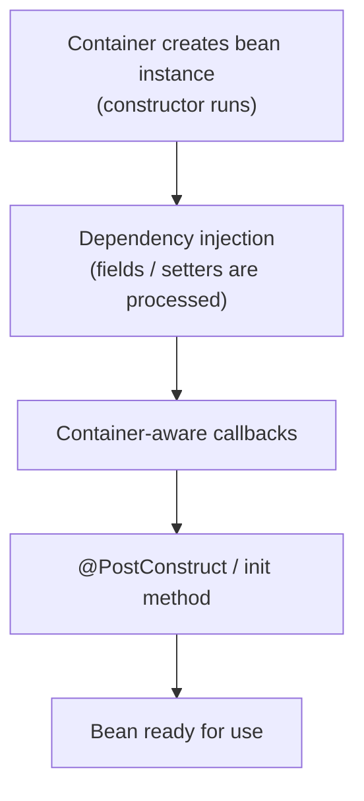
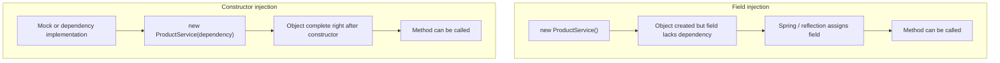

# Field Injection and Its Impact on Testability

Spring supports several ways to supply dependencies to a bean. One approach frequently encountered in older codebases is **field injection**: placing `@Autowired` directly on a field so Spring assigns the dependency after creating the object. It is short and looks convenient at first glance, but it hides dependencies from the constructor, makes the object hard to instantiate validly in plain Java, and forces unit tests to rely on a Spring context or workarounds like reflection.

In the **Dependency Injection** chapter of *Spring Boot Fundamentals*, this lesson focuses on field injection and its consequences for testability. We will:

- Identify field injection and understand when Spring performs field assignment.
- Compare field injection with constructor injection and setter injection.
- Write the same service both ways to see the difference during testing.
- Understand why tests using a Spring context are typically heavier than plain unit tests.
- Know when an optional dependency is needed and how to express it clearly.
- Choose the right injection style for new code and handle legacy code.

Examples use Java 21, Spring Boot 3.x, JUnit 5, and Mockito. Test snippets assume the project includes `spring-boot-starter-test`.

## 1. What Is Field Injection?

Field injection is the practice of injecting a dependency directly into a class field, typically via `@Autowired`:

```java
package com.example.demo.service;

import org.springframework.beans.factory.annotation.Autowired;
import org.springframework.stereotype.Service;

@Service
public class ProductService {

    @Autowired
    private ProductCatalog productCatalog;

    public String displayName(long productId) {
        return productCatalog.findName(productId);
    }
}
```

In this example, `ProductService` needs `ProductCatalog` to do its work. You do not see that dependency in the constructor. Spring can still supply it because the container processes injection annotations on fields when creating the bean.

A simple interface for illustration:

```java
package com.example.demo.catalog;

public interface ProductCatalog {
    String findName(long productId);
}
```

An implementation that can be registered as a bean:

```java
package com.example.demo.catalog;

import org.springframework.stereotype.Component;

@Component
public class InMemoryProductCatalog implements ProductCatalog {

    @Override
    public String findName(long productId) {
        return switch ((int) productId) {
            case 1 -> "Keyboard";
            case 2 -> "Mouse";
            default -> "Unknown product";
        };
    }
}
```

When Spring initializes `ProductService`, it finds a bean matching the `ProductCatalog` type and assigns it to the `productCatalog` field. Once injection completes, the `displayName` method can use the dependency.

### Field injection is not automatic Java assignment

If you instantiate the object yourself:

```java
ProductService service = new ProductService();
System.out.println(service.displayName(1));
```

Java knows nothing about `@Autowired`. The `productCatalog` field is unassigned and remains `null`. Calling the method will likely throw a `NullPointerException`.

This is a core difference: **the object only works properly after being processed by the Spring container**, even though its Java constructor has already finished running.

## 2. When Does Spring Perform Field Injection?

To understand why field injection affects testability, look at a simplified model of bean initialization order:



With field injection:

1. Spring creates an instance of `ProductService` using its constructor.
2. The annotation injection processor finds fields annotated with `@Autowired`.
3. Spring resolves the dependency by type/qualifier and assigns it to the field.
4. Subsequent initialization callbacks run; the bean becomes ready for use.

Because the dependency is assigned **after the constructor**, the constructor cannot use that field as an already-ready dependency. If the constructor calls a method that relies on `productCatalog`, the field may still be `null` at that point.

Spring can inject into `private` fields via reflection. That does not mean private fields become public or that Java calls a setter on its own; the container accesses and sets the field during bean processing.

Example of what not to write:

```java
@Service
public class ProductService {

    @Autowired
    private ProductCatalog productCatalog;

    public ProductService() {
        // Do not use productCatalog here.
        // Field injection has not happened yet.
    }
}
```

If initialization logic needs a dependency, constructor injection expresses the ordering and class requirements more accurately.

## 3. Short-Term Convenience and Long-Term Drawbacks

Field injection has one obvious advantage: concise code with no need to write constructors or setters. In a small class, it can look very convenient.

However, as the number of dependencies grows, the drawbacks become clearer:

| Aspect | Field injection | Impact |
|---|---|---|
| Dependency visibility | Dependencies are scattered across fields | Readers must scan the entire class to know what it requires. |
| Object creation in Java | Default constructor can still create the object without assigned dependencies | Object can be in an invalid state when used outside Spring. |
| Unit testing | Often requires starting a Spring context, using reflection, or test framework injection | Tests are harder to keep concise and become coupled to the framework. |
| Immutability | Fields generally cannot be declared `final` under standard injection | Dependencies can be modified after object creation. |
| Required dependency checks | Errors may surface only when Spring processes fields or when a method is called | The constructor contract does not express mandatory dependencies. |
| Construction and initialization | Dependencies are not available while the constructor runs | Unsuitable when initialization invariants require dependencies. |
| Refactoring | Field injections can be added without changing constructor signatures | Makes it easy for a class to accumulate hidden dependencies. |

Field injection does not make unit testing impossible. You can still use Spring Test, Mockito, or reflection to populate fields. The issue is that **tests have to compensate for a design that does not express dependencies right in the constructor**.

## 4. Constructor Injection: Dependencies Visible at Creation Time

Rewriting `ProductService`:

```java
package com.example.demo.service;

import com.example.demo.catalog.ProductCatalog;
import org.springframework.stereotype.Service;

@Service
public class ProductService {

    private final ProductCatalog productCatalog;

    public ProductService(ProductCatalog productCatalog) {
        this.productCatalog = productCatalog;
    }

    public String displayName(long productId) {
        return productCatalog.findName(productId);
    }
}
```

Spring locates the single constructor and provides the matching `ProductCatalog` bean. `@Autowired` is not required on a single constructor in modern Spring.

The difference goes beyond line count:

- Dependencies become part of the **object construction contract**.
- Fields can be declared `final`.
- A valid `ProductService` cannot be created without passing a `ProductCatalog`.
- A unit test can create a mock and pass it directly into the constructor without starting Spring.

Plain Java example:

```java
ProductCatalog catalog = productId -> "Test product";
ProductService service = new ProductService(catalog);

System.out.println(service.displayName(1));
```

This is an object with a valid dependency even without an `ApplicationContext`. That very characteristic makes the class easy to test and usable in environments that do not initialize Spring.

## 5. Testing Field Injection: Starting a Container or Setting Fields

Imagine we need to test `ProductService.displayName` without hitting a real database, API, or external system. We can create a mock `ProductCatalog`.

### 5.1. Why does ordinary object creation fail?

With the field injection version:

```java
ProductService service = new ProductService();
service.displayName(1);
```

The `productCatalog` field is unassigned. The test cannot simply pass a mock into the constructor because the class does not declare a constructor that accepts the dependency.

### 5.2. Using a Spring context to test

One approach is to start a Spring context and ask Spring to inject the dependency:

```java
package com.example.demo.service;

import static org.assertj.core.api.Assertions.assertThat;

import org.junit.jupiter.api.Test;
import org.springframework.beans.factory.annotation.Autowired;
import org.springframework.boot.test.context.SpringBootTest;

@SpringBootTest
class ProductServiceSpringTest {

    @Autowired
    ProductService productService;

    @Test
    void shouldReturnProductName() {
        assertThat(productService.displayName(1))
                .isEqualTo("Keyboard");
    }
}
```

This test verifies wiring and behavior with the real `InMemoryProductCatalog` implementation. However, `@SpringBootTest` typically starts the application's context: component scanning, auto-configuration, and related beans may all be created. It is appropriate for integration tests or verifying wiring, but usually too broad if the goal is just to test a small method.

If the application has a database, message broker, or many auto-configurations, context tests can be slow and require extra setup. A test might also fail because of a component unrelated to the `displayName` logic.

### 5.3. Using reflection to assign fields in unit tests

If you still need to test a field-injected class without starting the entire Spring context, you can use `ReflectionTestUtils` from Spring Test:

```java
package com.example.demo.service;

import static org.assertj.core.api.Assertions.assertThat;
import static org.mockito.Mockito.mock;
import static org.mockito.Mockito.when;

import com.example.demo.catalog.ProductCatalog;
import org.junit.jupiter.api.Test;
import org.springframework.test.util.ReflectionTestUtils;

class ProductServiceFieldInjectionTest {

    @Test
    void shouldUseInjectedCatalog() {
        ProductCatalog catalog = mock(ProductCatalog.class);
        when(catalog.findName(7)).thenReturn("Test keyboard");

        ProductService service = new ProductService();
        ReflectionTestUtils.setField(service, "productCatalog", catalog);

        assertThat(service.displayName(7)).isEqualTo("Test keyboard");
    }
}
```

This test assumes `ProductService` is the **field-injection version with a default constructor**, not the constructor-injection version from the previous section. `ReflectionTestUtils.setField` accesses the field by name and assigns the mock to it.

The test works, but consider one detail: if the `productCatalog` field is renamed, the test must also update the `"productCatalog"` string. The test knows about the internal structure of the class and needs reflection just to pass a dependency into the object.

This is a valid workaround when dealing with legacy code or specific testing scenarios, but not a good reason to choose field injection for new code.

## 6. Testing Constructor Injection with Plain Unit Tests

With the constructor-injection version, the test is simpler:

```java
package com.example.demo.service;

import static org.assertj.core.api.Assertions.assertThat;
import static org.mockito.Mockito.mock;
import static org.mockito.Mockito.verify;
import static org.mockito.Mockito.when;

import com.example.demo.catalog.ProductCatalog;
import org.junit.jupiter.api.Test;

class ProductServiceTest {

    @Test
    void shouldReturnCatalogName() {
        ProductCatalog catalog = mock(ProductCatalog.class);
        when(catalog.findName(7)).thenReturn("Test keyboard");

        ProductService service = new ProductService(catalog);

        assertThat(service.displayName(7)).isEqualTo("Test keyboard");
        verify(catalog).findName(7);
    }
}
```

The test only needs to:

1. Create a `ProductCatalog` mock.
2. Define what the mock returns when `findName(7)` is called.
3. Instantiate `ProductService` via its constructor and pass the mock.
4. Call the method under test and verify the result and interactions.

No `@SpringBootTest`, no `ApplicationContext` creation, no component scanning, no database, and no reflection.

Comparison diagram:



The key difference is **the object-creation path in tests**. With constructor injection, tests use the class's public API to supply dependencies. With field injection, tests need an extra step to mutate internal state after instantiating the object.

## 7. Required Dependencies and Immutability

Consider a service that needs three dependencies:

```java
@Service
public class CheckoutService {
    @Autowired
    private CartRepository cartRepository;

    @Autowired
    private PaymentGateway paymentGateway;

    @Autowired
    private ReceiptSender receiptSender;
}
```

A reader only sees that the class has three fields. The constructor does not indicate that these three dependencies are required to create a valid checkout service.

Constructor injection states the contract directly:

```java
@Service
public class CheckoutService {
    private final CartRepository cartRepository;
    private final PaymentGateway paymentGateway;
    private final ReceiptSender receiptSender;

    public CheckoutService(
            CartRepository cartRepository,
            PaymentGateway paymentGateway,
            ReceiptSender receiptSender) {
        this.cartRepository = cartRepository;
        this.paymentGateway = paymentGateway;
        this.receiptSender = receiptSender;
    }
}
```

A `CheckoutService` object cannot be constructed through this constructor if any of the three dependencies is missing. The Java compiler and constructor signature make the requirements visible before the application runs.

The `final` fields also show that dependency references are not reassigned after the constructor finishes. This does not automatically make every dependency object immutable, but it makes the service's dependency structure more stable.

### Required dependencies should not be made optional by accident

With field injection, an author might use `@Autowired(required = false)` so the dependency is not required. When the dependency is absent, the field can remain `null`. Then the code must check for null everywhere it is used.

If a dependency is genuinely optional, express that intent explicitly using an appropriate data type or API, for example:

```java
@Service
public class ReportService {
    private final Optional<ReportExporter> exporter;

    public ReportService(Optional<ReportExporter> exporter) {
        this.exporter = exporter;
    }

    public void exportIfAvailable(Report report) {
        exporter.ifPresent(value -> value.export(report));
    }
}
```

Spring supports resolving `Optional<T>` during dependency injection; if no matching bean exists, the value can be `Optional.empty()`. When a dependency needs to be looked up multiple times or decided at runtime, `ObjectProvider<T>` is also an option. Do not use optional injection just to mask a dependency that is actually always required.

## 8. Setter Injection and When It Makes Sense

Setter injection supplies a dependency through a setter method:

```java
package com.example.demo.service;

import com.example.demo.catalog.ProductCatalog;
import org.springframework.beans.factory.annotation.Autowired;
import org.springframework.stereotype.Service;

@Service
public class ProductService {

    private ProductCatalog productCatalog;

    @Autowired
    public void setProductCatalog(ProductCatalog productCatalog) {
        this.productCatalog = productCatalog;
    }

    public String displayName(long productId) {
        return productCatalog.findName(productId);
    }
}
```

Like field injection, the dependency is supplied after the object has been created. The difference is that assignment goes through a named method, where validation or auxiliary handling can be placed inside the setter. Still, the object can exist before the setter is invoked, and the dependency is not enforced by the constructor.

Setter injection can be appropriate for **optional dependencies** or configuration that needs to change after the object is created, though it should be used intentionally. If the dependency is a mandatory prerequisite for the object to operate, constructor injection is generally clearer.

| Injection type | When dependency is provided | Best suited for |
|---|---|---|
| Constructor | During object creation | Required dependencies |
| Setter | After object creation, via setter | Optional or post-creation configurable dependencies |
| Field | After object creation, container assigns field directly | Legacy code or specific framework cases with clear justification |

## 9. Why Does Field Injection Tend to Couple Tests to a Spring Context?

Look at a plain unit test:

```java
ProductService service = new ProductService();
```

With field injection, the object is incomplete. For the test to call methods safely, you must:

- start Spring so Spring performs injection;
- use reflection to set the field;
- use a test framework capable of injecting fields;
- or add an extra setter/constructor solely for tests, complicating the class API.

If you pick `@SpringBootTest`, the test no longer verifies just one class. It typically starts the entire application context and related configurations. Sometimes that is exactly what you want—for example, checking component wiring, auto-configuration, or transactions. But if the goal is only to test a logic branch, plain unit tests are usually faster, have fewer dependencies, and isolate failures better.

Constructor injection does not automatically make tests correct, but it **makes dependencies directly passable** and lets tests run without a container.

### Unit tests and integration tests do not compete with each other

| Unit test | Spring integration test |
|---|---|
| Instantiate class directly, pass mocks/fakes via constructor | Initialize part or all of a Spring context |
| Fast, narrow scope | Verifies wiring and interaction across multiple components |
| No component scan required | May require component scan and auto-configuration |
| Suitable for testing service logic | Suitable for testing bean configuration, persistence, transactions, web integration |

A healthy project combines both. Do not try to turn every unit test into `@SpringBootTest`, and do not rely solely on unit tests to conclude that your entire Spring configuration works properly.

## 10. Does Mockito `@InjectMocks` Solve Field Injection Drawbacks?

Mockito provides the `@InjectMocks` annotation to help instantiate the object under test and inject matching mocks into it. Example:

```java
@ExtendWith(MockitoExtension.class)
class ProductServiceTest {

    @Mock
    ProductCatalog catalog;

    @InjectMocks
    ProductService service;
}
```

Mockito may attempt to inject via constructor, setter, or field according to its rules. This is convenient for tests, but keep in mind:

- Mockito injection **is not Spring dependency injection**.
- It does not prove component scanning or the Spring context works.
- It can use reflection to assign fields, so tests can still mask hidden dependencies.
- When constructor injection is already used, tests are often clearer when they instantiate the class directly and pass mocks into the constructor.

`@InjectMocks` is useful in many Mockito tests, but it should not be used as a justification for choosing field injection in production code.

## 11. Field Injection and Common Pitfalls

### 11.1. Field is `null` when the object is created outside Spring

A class with `@Autowired private ProductCatalog productCatalog` cannot guarantee the dependency is present when someone calls `new ProductService()`. This is a common bug in unit tests, utility code, or objects instantiated by libraries outside the container.

### 11.2. Cannot use field dependencies in the constructor

Spring creates the instance first and processes field injection afterward. If the constructor needs to call a dependency, the field has not yet been assigned. Constructor injection solves this ordering issue directly.

### 11.3. Field injection does not support static fields in the usual way

`@Autowired` is not designed to inject into static fields. Dependencies belong to bean instances, so avoid creating global static state and expecting the container to manage it like a regular field.

### 11.4. Fields generally cannot be `final` with this injection style

Standard field injection requires Spring to assign values after the object is created. A `final` field must already be initialized in the constructor or at declaration time; hence field injection is not suitable for dependencies you want to keep immutable.

### 11.5. Dependency cycles

When A needs B and B needs A, field/setter injection can sometimes allow certain dependency cycles to be resolved through Spring's early reference mechanism. However, Spring Boot discourages and by default prohibits circular references in modern application configurations. Using field injection to dodge a constructor cycle error is a sign to review the design, not a good fix.

Look for ways to split responsibilities, invert dependencies via interfaces, move coordination into a third service, or redesign the call flow to eliminate the cycle.

## 12. How Do Injection Annotations Differ?

In Spring, field injection can be performed using annotations compatible with dependency injection processing:

| Annotation | Common meaning |
|---|---|
| `@Autowired` | Spring annotation to automatically resolve dependencies by type and related rules. |
| `@Qualifier` | Narrows selection when multiple beans share the same type; can be used on fields/parameters. |
| `@Resource` | Jakarta standard annotation for looking up resources, typically matching by name first and then by type. |
| `@Inject` | Jakarta standard annotation for dependency injection; supported by Spring in appropriate environments. |

Example:

```java
@Autowired
@Qualifier("friendlyFormatter")
private TextFormatter formatter;
```

This tells Spring to inject the `TextFormatter` bean with the matching qualifier/name. It is still **field injection** because the annotation is placed directly on the field. Replacing `@Autowired` with `@Inject` or `@Resource` does not make the dependency appear in the constructor and does not remove the testability consequences of field injection.

## 13. Does Lombok Make Constructor Injection Cleaner?

If the project already uses Lombok, `@RequiredArgsConstructor` can generate a constructor for `final` fields or fields marked with `@NonNull`:

```java
package com.example.demo.service;

import com.example.demo.catalog.ProductCatalog;
import lombok.RequiredArgsConstructor;
import org.springframework.stereotype.Service;

@Service
@RequiredArgsConstructor
public class ProductService {

    private final ProductCatalog productCatalog;

    public String displayName(long productId) {
        return productCatalog.findName(productId);
    }
}
```

Lombok generates a constructor conceptually equivalent to:

```java
public ProductService(ProductCatalog productCatalog) {
    this.productCatalog = productCatalog;
}
```

Spring still uses the single constructor to inject the dependency. You do not need to add `@Autowired` just because the constructor is generated by Lombok.

However, do not add Lombok to a project solely to avoid writing a simple constructor. Use it when the project has already adopted Lombok and the team understands annotation processing.

## 14. How to Migrate a Legacy Class from Field Injection to Constructor Injection

Suppose legacy code looks like this:

```java
@Service
public class InvoiceService {
    @Autowired
    private InvoiceRepository invoiceRepository;

    @Autowired
    private TaxCalculator taxCalculator;

    public Invoice calculate(long id) {
        Invoice invoice = invoiceRepository.findById(id).orElseThrow();
        invoice.setTax(taxCalculator.calculate(invoice));
        return invoice;
    }
}
```

Migrate to:

```java
@Service
public class InvoiceService {
    private final InvoiceRepository invoiceRepository;
    private final TaxCalculator taxCalculator;

    public InvoiceService(
            InvoiceRepository invoiceRepository,
            TaxCalculator taxCalculator) {
        this.invoiceRepository = invoiceRepository;
        this.taxCalculator = taxCalculator;
    }

    public Invoice calculate(long id) {
        Invoice invoice = invoiceRepository.findById(id).orElseThrow();
        invoice.setTax(taxCalculator.calculate(invoice));
        return invoice;
    }
}
```

The migration typically involves:

1. Listing the dependency fields currently being injected.
2. Moving required dependencies into constructor parameters.
3. Assigning them to `private final` fields.
4. Removing `@Autowired` from the migrated fields.
5. Updating any places that manually instantiate the class with `new` (if any) to pass the dependencies.
6. Writing unit tests using mocks/fakes via the constructor.
7. Running appropriate Spring context tests to verify wiring still works.

If a class has too many dependencies, do not simply convert all of them into a huge constructor and consider the design good. A long dependency list may indicate the class has too many responsibilities or depends on too many components. Constructor injection makes that problem visible, giving you an opportunity to split responsibilities.

## 15. A Complete Test Example Using a Fake Instead of Mockito

Not every test needs a mocking framework. For a small interface, you can create a fake directly:

```java
package com.example.demo.service;

import static org.assertj.core.api.Assertions.assertThat;

import com.example.demo.catalog.ProductCatalog;
import org.junit.jupiter.api.Test;

class ProductServiceFakeTest {

    @Test
    void shouldUseProvidedCatalog() {
        ProductCatalog fakeCatalog = productId -> {
            if (productId == 10) {
                return "Test monitor";
            }
            return "Unknown";
        };

        ProductService service = new ProductService(fakeCatalog);

        assertThat(service.displayName(10)).isEqualTo("Test monitor");
        assertThat(service.displayName(99)).isEqualTo("Unknown");
    }
}
```

This fake is just a small implementation for testing. It keeps the test independent of Spring and avoids reflection. Anyone reading `ProductService`'s constructor immediately sees which dependency the test supplies.

This is a broader design benefit beyond testability: dependency injection through the constructor makes code depend on **abstractions** (interfaces) and allows swapping implementations across environments without changing service logic.

## 16. When Does Field Injection Still Appear?

You may encounter field injection in:

- Legacy projects written in an older Spring style.
- Short examples or prototypes prioritizing minimal line count.
- Certain framework integrations or special scenarios with specific technical reasons.
- Test code using reflection/test utilities to set fields.

Encountering it does not mean everything must be rewritten immediately. When modifying a class, consider migrating required dependencies to the constructor if doing so does not break contracts or how the framework instantiates the class. For classes instantiated by a framework under special rules, understand the framework's lifecycle before making changes.

For ordinary Spring Boot application code, **constructor injection is the preferred default**. Field injection is not forbidden by Spring; it simply carries trade-offs that make dependencies harder to see and classes harder to instantiate and test independently.

## 17. Practice Exercise: Comparing Both Injection Styles with the Same Logic

Create the `ProductCatalog` interface and a `findName(long id)` method as in Section 1. Then complete the following:

### Exercise A — Field injection version

Write `ProductService` with:

```java
@Autowired
private ProductCatalog productCatalog;
```

Create a plain unit test, try instantiating it with `new ProductService()`, and observe the state of the dependency. Use `ReflectionTestUtils` to assign a mock, then verify the test passes.

**Explain:** why did the test need reflection? What leaves the object unready right after the constructor?

### Exercise B — Constructor injection version

Change the service to:

```java
private final ProductCatalog productCatalog;

public ProductService(ProductCatalog productCatalog) {
    this.productCatalog = productCatalog;
}
```

Rewrite the test, create a mock, and pass it directly through the constructor.

**Explain:** does the test need a Spring context? What does the constructor signature tell you about the service's contract?

### Exercise C — Making a dependency optional

Suppose the service only sends a supplementary notification when a `NotificationSender` exists. Use `Optional<NotificationSender>` in the constructor and write tests for both present and absent dependency cases.

**Explain:** why is expressing optionality through the data type clearer than a nullable field resulting from `@Autowired(required = false)`?

### Exercise D — Verifying Spring wiring separately

Create a `@SpringBootTest` or small context test to confirm Spring can instantiate `ProductService` and inject `ProductCatalog`. Compare the goal of this test with the logic unit test in Exercise B.

**Explain:** which test checks business logic quickly, and which test verifies container wiring and configuration?

## 18. Decision Workflow for Choosing an Injection Style in a Project

When writing a new bean, ask:

1. Is the dependency required for the object to work properly? If yes, prefer the constructor.
2. Does the dependency need to change after the object is created? If there is a clear reason, consider a setter.
3. Is the dependency truly optional? Use `Optional`, `ObjectProvider`, or an appropriate API instead of leaving an unpredictable nullable field.
4. Can the class be tested in plain Java with mocks/fakes via its constructor?
5. Does the class have too many dependencies, suggesting responsibilities should be split?
6. Is there a special framework lifecycle requiring a specific instantiation pattern?

A quick decision table:

| Need | Recommended approach |
|---|---|
| Required dependency | Constructor injection |
| Optional dependency configured after creation | Setter injection or an explicitly expressed optional type |
| Need to obtain instances on demand / at runtime | `ObjectProvider<T>` or an appropriate factory abstraction |
| Legacy code using field injection | Keep stable for small changes; migrate gradually when opportunities and tests allow |
| Want to unit test the class without starting Spring | Constructor injection with mocks/fakes |

## 19. Self-Assessment Questions

1. At which stage of bean creation does Spring process `@Autowired` on a field?
2. Why doesn't `new ProductService()` automatically have `ProductCatalog` even though the class has `@Service`?
3. How does field injection differ from constructor injection in expressing mandatory dependencies?
4. Why does constructor injection usually allow declaring dependencies as `private final`?
5. When is `@SpringBootTest` an appropriate choice, and when is it too broad for a unit test?
6. How does `ReflectionTestUtils.setField` help in testing field injection, and what is the cost of that approach?
7. Is Mockito `@InjectMocks` the same as Spring dependency injection?
8. How does setter injection differ from field injection, and when is it useful?
9. Why should you avoid using field injection just to bypass a circular dependency?
10. If a class has eight required dependencies in its constructor, what design issue might that indicate?

### Sample complete explanation

> Field injection is the way Spring assigns dependencies directly into fields, usually via `@Autowired`, after the object has been instantiated. Because dependencies do not appear in the constructor, the object can be constructed in plain Java while still missing its dependencies and cannot be used safely. Unit tests must start a Spring context or use reflection/test frameworks to set the fields. Constructor injection puts dependencies into the constructor at object creation time, allows fields to be `final`, and makes required dependencies explicit. Tests can create mocks/fakes and pass them directly into the constructor without Spring. Therefore, for ordinary Spring Boot application beans, constructor injection is the preferred choice; field injection should mainly be understood to read and maintain existing code.

Once you can write the same unit test by instantiating the service directly, passing dependencies via the constructor, and verifying behavior without starting Spring, you have seen clearly the connection between **dependency design** and **testability**.
