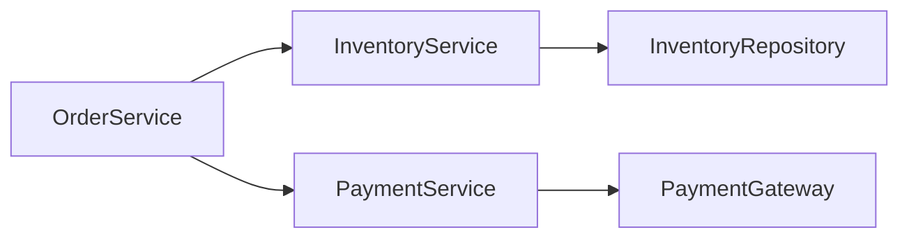
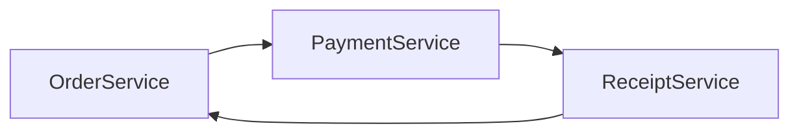
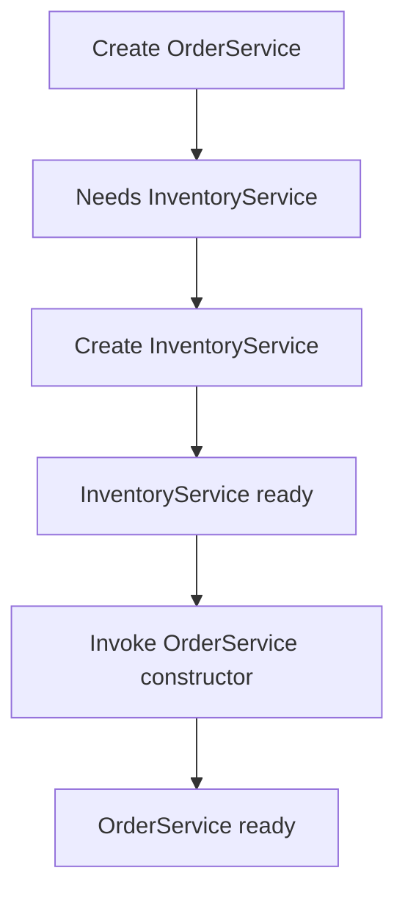
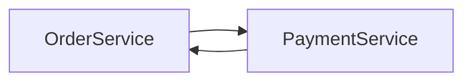
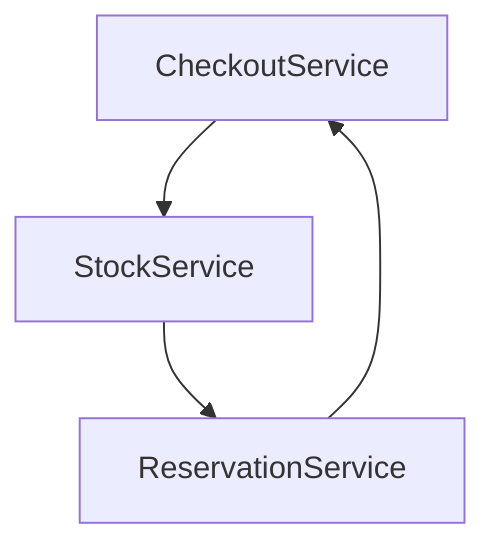
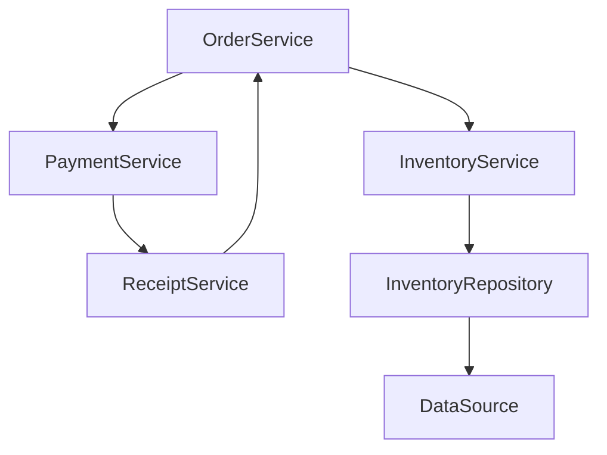
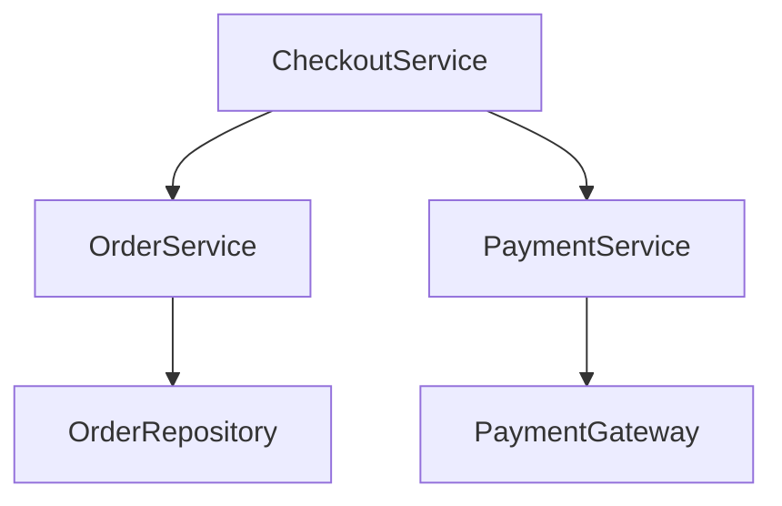
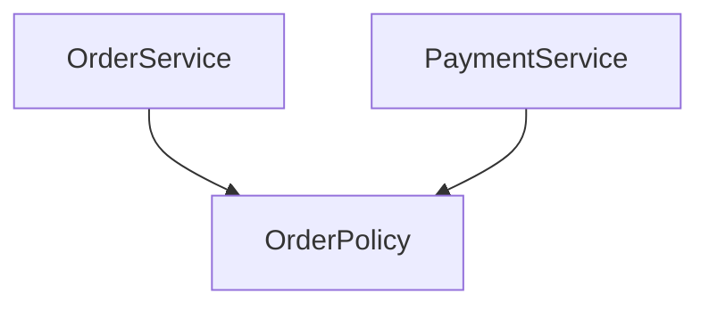
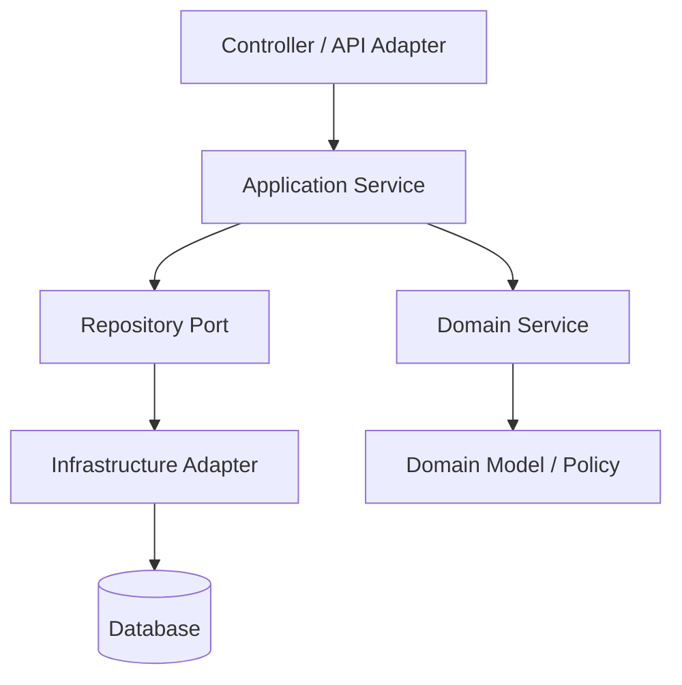

# Circular Dependencies and Why Errors Occur When Building the Bean Graph

In a Spring Boot application, one bean often needs other beans to perform its work. For example, `OrderService` needs `PaymentService` to process payments; `PaymentService` might in turn need `OrderService` to inspect or update an order. When dependencies loop back to depend on each other, the container can run into a **circular dependency** while creating beans.

Circular dependencies are a common reason a Spring context fails to start. To handle them properly, you need to understand the **dependency graph**, how Spring creates beans, why constructor injection exposes cycles, and how to redesign responsibility boundaries to eliminate unnecessary mutual dependencies.

## 1. What Are Dependencies Between Beans?

A bean can declare dependencies via constructor, field, setter, or configuration methods. Example:

```java
@Service
public class OrderService {
    private final InventoryService inventoryService;

    public OrderService(InventoryService inventoryService) {
        this.inventoryService = inventoryService;
    }
}
```

To create `OrderService`, Spring must supply an `InventoryService` instance to the constructor. Therefore, `OrderService` **depends on** `InventoryService`.

In this lesson, arrows point from the bean **needing a dependency** to the bean **it needs**:

```text
OrderService  ─────depends on─────>  InventoryService
```

A system with many beans can be modeled as a directed graph:

- **Node:** a bean or bean definition.
- **Edge:** a relationship where one bean needs another to be created or configured.
- **Path:** a chain of dependencies between beans.
- **Cycle:** a path starting at one bean and returning to that same bean.

Example without a cycle:



`OrderService` needs `InventoryService` and `PaymentService`; each service needs its own dependency. No dependency path loops back to the starting bean. This graph can be ordered into a valid creation sequence.

Conversely:



We have a cycle:

```text
OrderService
    → PaymentService
        → ReceiptService
            → OrderService
```

Creating `OrderService` requires `PaymentService`. Creating `PaymentService` requires `ReceiptService`. Creating `ReceiptService` in turn requires `OrderService`. There is no natural starting point to complete the constructor dependency chain.

A cycle can involve just two beans (`A → B → A`) or more beans (`A → B → C → D → A`). Indirect cycles are often harder to spot because each constructor looks reasonable in isolation.

## 2. Why Does Spring Need to Build a Bean Graph?

When Spring initializes an `ApplicationContext`, the container must prepare bean definitions and supply instances according to dependency relationships. With constructor injection, the general process is:

1. Spring identifies a bean to create.
2. The container inspects the selected constructor.
3. Spring finds matching beans for each parameter.
4. Dependencies are created/provided before calling the current bean's constructor.
5. Once dependencies are ready, Spring instantiates the bean.
6. The container proceeds with remaining injection, initialization callbacks, post-processing, and lifecycle management.

Example where `OrderService` needs `InventoryService`:



Spring does not instantiate every class in alphabetical order. The container uses bean metadata and dependency relationships to supply required beans at the right time.

For an acyclic graph, you can think of creation order as a **topological ordering**. If the graph has a cycle, no linear order satisfies every dependency relationship in the standard way.

## 3. Constructor Injection and Dependency Cycles

Constructor injection expresses required dependencies explicitly:

```java
@Service
public class OrderService {
    private final PaymentService paymentService;

    public OrderService(PaymentService paymentService) {
        this.paymentService = paymentService;
    }

    public void placeOrder() {
        paymentService.charge();
    }
}
```

```java
@Service
public class PaymentService {
    private final OrderService orderService;

    public PaymentService(OrderService orderService) {
        this.orderService = orderService;
    }

    public void charge() {
        // Process payment
    }
}
```

Dependency graph:



To create `OrderService`, Spring needs `PaymentService`. Yet to create `PaymentService`, its constructor needs the `OrderService` currently being created. Both constructors require the other object to exist beforehand.

### 3.1. Why cannot a constructor cycle be resolved normally?

Suppose Spring starts creating `OrderService`:

1. The container does not yet have a complete `OrderService` instance.
2. The container needs `PaymentService` to call `OrderService`'s constructor.
3. The container starts creating `PaymentService`.
4. `PaymentService`'s constructor needs `OrderService`.
5. `OrderService` cannot finish because it is still waiting on `PaymentService`.

Neither step can complete the first constructor. Spring typically fails with an error such as `BeanCurrentlyInCreationException` or a message describing the dependency cycle.

**Constructor injection does not give Spring an incomplete instance to hand back into the other constructor.** Therefore, constructor dependency cycles normally fail right at context creation.

### 3.2. Indirect cycle across multiple beans

```java
@Service
public class CheckoutService {
    public CheckoutService(StockService stockService) {
    }
}

@Service
public class StockService {
    public StockService(ReservationService reservationService) {
    }
}

@Service
public class ReservationService {
    public ReservationService(CheckoutService checkoutService) {
    }
}
```

Graph:



No pair of classes has to inject each other directly. An indirect dependency path returning to the starting bean is enough to form a cycle.

## 4. How Does Spring Report the Error?

When Spring cannot resolve a dependency cycle, startup can halt with a message like:

```text
APPLICATION FAILED TO START

The dependencies of some of the beans in the application context form a cycle:

┌─────┐
| checkoutService
↑     ↓
| reservationService
└─────┘
```

Or the stack trace may contain:

```text
org.springframework.beans.factory.BeanCurrentlyInCreationException:
Error creating bean with name 'orderService':
Requested bean is currently in creation
```

Exact messages vary by Spring Framework version, Spring Boot version, and bean creation path. When reading the error, focus on:

- **Bean names** mentioned in the message.
- The chain of beans Spring describes as mutually dependent.
- The constructor or configuration method that requested each dependency.
- Which bean began creation first during startup and which bean requested back into it.
- Whether the failure happens during context creation or only when a request is handled after startup.

### 4.1. What does `BeanCurrentlyInCreationException` mean?

This exception indicates the container encountered a request for a bean while that bean was still in the process of being created, in a context where Spring cannot supply a valid object.

It is a common indicator of a circular dependency, though during investigation you should still inspect the entire cause chain and accompanying messages. Avoid glancing only at the exception name and editing a random constructor.

### 4.2. Distinguishing from other dependency errors

| Error | Common meaning |
|---|---|
| `NoSuchBeanDefinitionException` | No matching bean found by requested name/type |
| `NoUniqueBeanDefinitionException` | Multiple matching beans exist, and one could not be chosen |
| `BeanCurrentlyInCreationException` | A bean currently under construction was requested in a way the container cannot resolve; commonly seen in circular dependencies |
| `UnsatisfiedDependencyException` | A bean's dependency could not be supplied; check `Caused by` for the underlying cause |

`UnsatisfiedDependencyException` does not by itself mean the cause is definitely a cycle. It can wrap a missing bean, a bean creation error, a constructor error, or another configuration issue.

## 5. How Spring Framework and Spring Boot Handle Circular References

Distinguish between **technical capability of Spring Framework** and **default configuration of Spring Boot**.

### 5.1. Constructor injection cycles

A dependency cycle through constructors cannot be resolved by standard early-reference mechanisms. Neither bean has a constructed instance to pass to the other constructor.

Example:

```java
@Service
class AService {
    AService(BService bService) {
    }
}

@Service
class BService {
    BService(AService aService) {
    }
}
```

Even if circular references are allowed, a constructor cycle does not become a valid design under standard bean instantiation.

### 5.2. Setter/field injection cycles

For singleton beans, Spring Framework has an **early singleton reference** mechanism to support certain dependency cycles when beans are instantiated in a way that allows creating the instance first and injecting properties or setters afterward.

Technical example:

```java
@Service
public class AService {
    private BService bService;

    @Autowired
    public void setBService(BService bService) {
        this.bService = bService;
    }
}
```

```java
@Service
public class BService {
    private AService aService;

    @Autowired
    public void setAService(AService aService) {
        this.aService = aService;
    }
}
```

If circular references are permitted, the container can instantiate one bean first, expose an early reference to the other bean, and then finish property injection. However, this applies only to cases compatible with the lifecycle and bean types; not every cycle can be resolved.

**This is a technical compatibility feature, not a design recommendation.** A bean may be referenced before all its initialization steps have finished, making behavior and bugs harder to understand.

### 5.3. Spring Boot prohibits circular references by default

Since **Spring Boot 2.6**, circular references are disabled by default. If an application has a setter/field cycle that older configs or versions might have allowed, modern Spring Boot typically fails and prompts a redesign.

Related property:

```yaml
spring:
  main:
    allow-circular-references: false
```

Setting it to `true` can allow Spring Framework to handle **certain** dependency cycles resolvable via early references:

```yaml
spring:
  main:
    allow-circular-references: true
```

Do not enable this property as a default fix. It can hide coupling between beans and will not resolve constructor cycles or cases where an early reference cannot be safely provided.

### 5.4. Prototype scope and other cases

The early singleton reference mechanism is tied to singleton management in the container. Prototype beans have a different lifecycle: the container creates an object on demand and does not manage completion/cleanup the same way as singletons. Do not expect circular prototype dependencies to be resolved by the singleton mechanism.

Proxies, factory methods, `FactoryBean`, custom scopes, or post-processors can also complicate bean creation. When errors occur in these cases, read the actual message instead of applying one simple rule to every bean kind.

## 6. Where Do Circular Dependencies Usually Come From?

A cycle usually reflects **entangled responsibilities across classes**.

### 6.1. Two services know too much about each other

```java
@Service
class OrderService {
    OrderService(PaymentService paymentService) {
    }
}

@Service
class PaymentService {
    PaymentService(OrderService orderService) {
    }
}
```

Perhaps `OrderService` manages the entire order lifecycle, while `PaymentService` both processes payments and wants to reach back into all order behaviors. Responsibility boundaries are unclear.

### 6.2. One service both orchestrates and performs business details

A class might do too much: checking stock, calculating pricing, persisting orders, charging payments, and sending notifications. Other classes end up calling back into it to reuse part of that functionality, leading to circular dependencies.

A warning sign to examine is a service acting as an **orchestrator** that is also depended upon in reverse by lower-level services.

### 6.3. Splitting classes technically instead of by responsibility

For instance, a system has `OrderService`, `OrderHelper`, `PaymentHelper`, and `CommonService`. If `CommonService` holds business logic from multiple modules, modules can end up depending back on one another through the "common" class.

Naming something `CommonService` does not make its dependencies neutral. Look at which responsibility it actually owns.

### 6.4. Callbacks turning into two-way synchronous calls

An order service calls a payment service. Then the payment service calls back into the order service to update status. If both directions are expressed via constructor injection, a cycle can form.

For asynchronous workflows, publishing a business event like `PaymentCompleted` can reduce direct coupling. Still, events also require proper contracts, transactions, retries, and idempotency; merely replacing a method call with an event does not make every problem vanish.

## 7. Spotting Cycles with a Dependency Diagram

When startup fails, rewrite dependencies as a directed list:

```text
OrderService
  needs PaymentService
  needs InventoryService

PaymentService
  needs ReceiptService

ReceiptService
  needs OrderService

InventoryService
  needs InventoryRepository

InventoryRepository
  needs DataSource
```

Turn it into a graph:



The cycle lies in:

```text
OrderService → PaymentService → ReceiptService → OrderService
```

`InventoryService`, `InventoryRepository`, and `DataSource` are not part of this cycle. Do not alter those beans if they are unrelated to the error.

A practical analysis routine:

1. Extract the list of beans from the cycle error report.
2. Open the corresponding constructors or `@Bean` methods.
3. Record which bean each parameter requires.
4. Follow dependencies forward until you return to an already-visited bean.
5. Identify which relationship represents a misplaced responsibility.
6. Redesign so dependencies flow clearly in one direction.

For larger projects, you can generate diagrams from code or dependency analysis tools, though the graph should reflect dependencies actually wired by the container, not just method calls in code.

## 8. Best Fix: Redesigning Responsibilities

Initial example:

```java
@Service
public class OrderService {
    private final PaymentService paymentService;

    public OrderService(PaymentService paymentService) {
        this.paymentService = paymentService;
    }

    public void placeOrder() {
        // Save order and invoke payment
    }

    public void markPaid(Long orderId) {
        // Update order status
    }
}
```

```java
@Service
public class PaymentService {
    private final OrderService orderService;

    public PaymentService(OrderService orderService) {
        this.orderService = orderService;
    }

    public void charge(Long orderId) {
        // Read order details
        // Execute payment
        // Call orderService.markPaid(...)
    }
}
```

Here, `OrderService` calls `PaymentService`, and `PaymentService` calls back into `OrderService`.

### 8.1. Introduce an orchestrating application service

A cleaner design:



Illustrative code:

```java
@Service
public class OrderService {
    private final OrderRepository orderRepository;

    public OrderService(OrderRepository orderRepository) {
        this.orderRepository = orderRepository;
    }

    public Order createPendingOrder(CheckoutCommand command) {
        Order order = Order.pending(command);
        return orderRepository.save(order);
    }

    public void markPaid(Long orderId) {
        Order order = orderRepository.findById(orderId).orElseThrow();
        order.markPaid();
        orderRepository.save(order);
    }
}
```

```java
@Service
public class PaymentService {
    private final PaymentGateway paymentGateway;

    public PaymentService(PaymentGateway paymentGateway) {
        this.paymentGateway = paymentGateway;
    }

    public PaymentResult charge(Order order) {
        return paymentGateway.charge(order.totalAmount());
    }
}
```

```java
@Service
public class CheckoutService {
    private final OrderService orderService;
    private final PaymentService paymentService;

    public CheckoutService(
            OrderService orderService,
            PaymentService paymentService
    ) {
        this.orderService = orderService;
        this.paymentService = paymentService;
    }

    public void checkout(CheckoutCommand command) {
        Order order = orderService.createPendingOrder(command);
        PaymentResult result = paymentService.charge(order);

        if (result.successful()) {
            orderService.markPaid(order.id());
        }
    }
}
```

In this design:

- `CheckoutService` is the application-level orchestrator coordinating the use case.
- `OrderService` focuses on order business operations.
- `PaymentService` focuses on payment processing.
- `OrderService` does not need to inject `PaymentService`.
- `PaymentService` does not need to inject `OrderService` in reverse.

The dependency graph flows in one direction:

```text
CheckoutService
  ├──> OrderService
  │      └──> OrderRepository
  └──> PaymentService
         └──> PaymentGateway
```

This is a structural example. Real systems must also handle failed payments, timeouts, refunds, and consistency; do not treat this short snippet as a complete payment transaction flow.

### 8.2. Extract shared logic into an independent bean

Sometimes two services depend on each other solely because both need the same piece of logic. You can move that logic into a smaller component:



Example:

```java
@Component
public class OrderPolicy {
    public boolean canBePaid(Order order) {
        return order.status() == OrderStatus.PENDING
                && order.totalAmount().signum() > 0;
    }
}
```

Both services can depend on `OrderPolicy` without calling back into each other. Still, splitting out a class merely to break a technical cycle is not enough; the new component should own a **clear business responsibility**.

### 8.3. Use events to turn reverse calls into one-way notifications

If `PaymentService` only needs to announce that payment completed, it does not necessarily have to know about `OrderService`.

Define an event:

```java
public record PaymentCompleted(Long orderId) {
}
```

Publish the event:

```java
@Service
public class PaymentService {
    private final ApplicationEventPublisher events;
    private final PaymentGateway gateway;

    public PaymentService(
            ApplicationEventPublisher events,
            PaymentGateway gateway
    ) {
        this.events = events;
        this.gateway = gateway;
    }

    public void charge(Order order) {
        PaymentResult result = gateway.charge(order.totalAmount());

        if (result.successful()) {
            events.publishEvent(new PaymentCompleted(order.id()));
        }
    }
}
```

Another bean handles the event:

```java
@Component
public class PaymentEventHandler {
    private final OrderService orderService;

    public PaymentEventHandler(OrderService orderService) {
        this.orderService = orderService;
    }

    @EventListener
    public void onPaymentCompleted(PaymentCompleted event) {
        orderService.markPaid(event.orderId());
    }
}
```

`PaymentService` emits notifications without injecting `OrderService`. `PaymentEventHandler` receives the event and triggers the order update logic.

**Transaction note:** standard in-process Spring application events are not automatically durable messages. If you need handling only after a transaction commits, look into `@TransactionalEventListener`; if you need guaranteed delivery across database/process boundaries, consider an outbox or message broker with appropriate retry and idempotency mechanisms.

## 9. Deferred Dependency Techniques and Their Limits

Not every situation can be refactored right away. Spring provides tools to defer retrieving a dependency. They are helpful when used intentionally, though they should not be used to hide a circular design.

### 9.1. `@Lazy`

`@Lazy` at an injection point can cause Spring to supply a proxy that defers retrieving the real bean until the proxy is used:

```java
@Service
public class AService {
    private final BService bService;

    public AService(@Lazy BService bService) {
        this.bService = bService;
    }
}
```

This can break the cycle **at initialization time**, because `AService`'s constructor receives a proxy without immediately instantiating the real `BService`. Yet when a method is invoked on the proxy, Spring still must resolve the target bean. If both services genuinely depend on each other functionally, the coupling problem still exists.

Proxies can also affect runtime class inspection, object identity, and exception behavior. Use `@Lazy` when there is a clear lifecycle reason, not as a default patch for every circular dependency.

### 9.2. `ObjectProvider<T>`

`ObjectProvider<T>` allows a bean to request a dependency **when needed**, instead of requiring an instance immediately while the constructor executes:

```java
@Service
public class AService {
    private final ObjectProvider<BService> bServiceProvider;

    public AService(ObjectProvider<BService> bServiceProvider) {
        this.bServiceProvider = bServiceProvider;
    }

    public void execute() {
        BService bService = bServiceProvider.getObject();
        bService.run();
    }
}
```

This defers the lookup. However, if `BService` calls back into `AService` or the two beans require each other during processing, coupling and recursion risks remain. `ObjectProvider` is better suited when a dependency is genuinely optional, lazy, or scoped to invocation time.

Another API is `jakarta.inject.Provider<T>` if the project includes that dependency.

### 9.3. Setter injection

Setter injection lets Spring construct the instance first and assign the dependency afterward:

```java
@Service
public class AService {
    private BService bService;

    @Autowired
    public void setBService(BService bService) {
        this.bService = bService;
    }
}
```

It can help resolve certain singleton cycles when circular references are enabled. However, required dependencies are no longer expressed as `final` constructor arguments, and objects can exist before setters are called.

In modern Spring Boot, circular references are disabled by default, so switching from constructor to setter **does not guarantee the application will start**.

### 9.4. Field injection

```java
@Service
public class AService {
    @Autowired
    private BService bService;
}
```

Field injection can also be processed after object creation in certain lifecycles. However, it hides dependencies inside the class, makes unit tests harder, and does not solve cycles if Spring Boot prohibits circular references.

For required dependencies, constructor injection is usually preferred.

### 9.5. `@DependsOn` does not break cycles

`@DependsOn` expresses initialization order between beans—for example, bean A requires bean B to initialize first due to a specific side effect. Yet if A depends on B and B also depends on A, adding `@DependsOn` does not eliminate the cycle; it can make ordering constraints even tighter.

Do not confuse **controlling initialization order** with **eliminating circular dependencies**.

## 10. Why Shouldn't You Enable `allow-circular-references=true` as Your First Fix?

You may see this suggestion in error output:

```text
Relying upon circular references is discouraged and they are prohibited by default.
Update your application to remove the dependency cycle between beans.
```

A quick workaround might look like:

```yaml
spring:
  main:
    allow-circular-references: true
```

However, this carries risks:

1. **Hides design issues:** the two services still know too much about each other.
2. **Complex lifecycle dependencies:** a bean can receive an early reference before full initialization finishes.
3. **Does not solve every cycle:** constructor cycles are not resolved merely by flipping the flag.
4. **Harder to test and maintain:** changes in initialization order, proxies, or post-processors can alter behavior.
5. **Relies on special configuration:** future maintainers may not understand why the application requires circular references enabled.

If you must enable it temporarily in a legacy system to preserve compatibility during a migration, document the exact bean cycle, its scope of impact, and a plan to remove it. For new projects, keep the safe default and design unidirectional dependencies.

## 11. Distinguishing a Bean Dependency Cycle from a Method Call Cycle

Two services can call each other at runtime without **necessarily** forming a circular dependency during bean creation, provided the bean creation graph has no cycle.

Example:

```java
public void runA() {
    bService.runB();
}

public void runB() {
    aService.runA();
}
```

If `runA()` calls `runB()` and `runB()` calls `runA()` without a termination condition, the program can loop infinitely or throw `StackOverflowError`.

This is a **runtime call cycle**, distinct from a **bean creation dependency cycle**.

| Criterion | Bean creation cycle | Runtime call cycle |
|---|---|---|
| Timing | While Spring creates/initializes beans | While code executes methods |
| Symptom | Context startup failure, bean creation exception | Infinite recursion, looping logic, growing call stack |
| Cause | Dependency relationships between bean definitions | Method call flow returning to its starting point |
| Remedy | Redesign the dependency graph | Redesign control flow and termination conditions |

A system can suffer from both at the same time, yet each must be diagnosed separately.

## 12. A Good Dependency Graph Usually Has a Clear Direction

Not every bidirectional dependency is bad in every programming paradigm, yet in the service layer of a Spring application, circular constructor dependencies usually indicate mixed responsibilities.

A common layered structure:



This is just one common organization. What matters is that dependencies follow responsibility boundaries; infrastructure should not call back into an application service merely to finish an operation the application service is coordinating.

- If `OrderService` needs functionality from `OrderController`, review the design. A controller is an HTTP request adapter and should not hold business logic that services call back into.
- Repositories should focus on data access. If a repository injects a business service to orchestrate workflows, layer boundaries may have been inverted.
- If multiple services need the same policy, consider extracting that policy into an abstraction with its own clear responsibility.

### 12.1. Interfaces do not automatically break circular dependencies

```java
interface OrderOperations {
    void updateStatus(Long id);
}

@Service
class OrderService implements OrderOperations {
    OrderService(PaymentService paymentService) {
    }
}

@Service
class PaymentService {
    PaymentService(OrderOperations orderOperations) {
    }
}
```

Changing the reference type from a class to an interface **does not eliminate the cycle**:

```text
OrderService → PaymentService → OrderOperations
                              └── implementation is OrderService
```

The dependency still loops back to the exact same bean. Interfaces can improve abstraction and dependency direction in some designs, but merely extracting an interface does not solve a cycle if the implementation still depends back on the caller.

## 13. How to Investigate in a Spring Boot Project

When an application reports a circular dependency error, proceed in order:

### Step 1. Confirm the error occurs at startup

Look for `APPLICATION FAILED TO START`, `BeanCurrentlyInCreationException`, or the bean cycle description. Distinguish it from errors that occur only after an endpoint is invoked.

### Step 2. Write down the list of beans in the cycle

Example:

```text
orderService
paymentService
receiptService
orderService
```

This chain shows the path leading back to the starting point.

### Step 3. Inspect corresponding constructors and bean configurations

Check:

- Constructor parameters.
- Fields/setters annotated with `@Autowired`.
- `@Bean` methods accepting other beans as parameters.
- `@DependsOn`.
- `@Lazy`, `ObjectProvider`, or factories/proxies.
- Configurations enabled by profile or conditions.

### Step 4. Redraw the graph

Use one arrow per dependency relationship. When returning to a previously seen bean, mark the cycle. If there are multiple cycles, resolve each one along responsibility boundaries.

### Step 5. Ask why the two beans need each other

- Is one service both coordinating the use case and implementing low-level business details?
- Should some logic live in a domain model or a third service?
- Is one service calling back merely to report an outcome?
- Can an event or a return value replace the reverse call?
- Is there an underlying abstraction that both sides can depend on?

### Step 6. Refactor and restart

After removing the cycle, rerun the application and confirm the Spring context initializes successfully. If another error appears, inspect the new cycle; an application can contain multiple independent cycles.

### Step 7. Verify business behavior

Successful context startup only proves the container can create the beans. Run relevant tests and use cases to confirm order, payment, or inventory flows remain correct after splitting responsibilities.

## 14. Remediation Choice Table

| Scenario | Approach to consider | Why |
|---|---|---|
| Two services constructor-inject each other | Refactor responsibilities, extract an orchestrator or cohesive shared service | Eliminates the cycle at its root |
| One service only needs to notify another of an event | Application events or appropriate messaging | Reduces direct call coupling |
| Dependency is genuinely needed late for valid reasons | `ObjectProvider<T>` or `@Lazy` | Defers lookup intentionally |
| Legacy singleton setter cycle during migration | Evaluate early-reference capability and temporary scope | Should not be treated as a long-term solution |
| Prototype beans in a circular dependency | Redesign lifecycle and dependencies | Cannot rely on singleton early-reference mechanisms |
| Using `@DependsOn` to fix a cycle | Do not use as a cycle-breaking solution | Only controls order, does not remove the cycle |
| Swapped class for interface, still reverse-injecting | Inspect the actual runtime graph | Interfaces alone do not change bean-level dependency direction |
| Two beans of same type causing selection error | `@Qualifier`, `@Primary`, or collection injection | This is type ambiguity, not a cycle |

## 15. Common Misconceptions

| Statement | True or false? | Explanation |
|---|---|---|
| Two beans calling each other's methods definitely form a bean cycle | **False** | Bean cycles depend on creation/injection relationships; runtime call cycles are a separate issue |
| Constructor injection cycles are easily resolved automatically by Spring | **False** | Constructors need dependencies before a complete instance can exist |
| Setting `allow-circular-references=true` fixes every cycle | **False** | Does not solve constructor cycles or cases unsupported by early references |
| Setter injection is always a better fix than constructor injection | **False** | Can hide mandatory dependencies and allow incomplete object states |
| `@Lazy` removes the dependency relationship altogether | **False** | It mainly defers resolving the dependency |
| `@DependsOn` breaks cycles | **False** | It only adds an initialization ordering constraint |
| Changing a dependency class to an interface automatically breaks cycles | **False** | The implementation can still depend back on the caller |
| `@Primary` resolves circular dependencies | **False** | It chooses among multiple beans of the same type without altering the dependency graph |
| Spring Boot always allows circular references by default | **False** | Since Spring Boot 2.6, circular references are prohibited by default |
| If context startup succeeds, mutual method calls definitely cannot recurse | **False** | Runtime call cycles may appear only when executing a use case |

## 16. Self-Check Exercises

### Exercise 1: Identifying a two-bean cycle

```java
@Service
class CustomerService {
    CustomerService(AddressService addressService) {
    }
}

@Service
class AddressService {
    AddressService(CustomerService customerService) {
    }
}
```

**Question:** What cycle exists in the graph? Why can't constructor injection finish?

**Hint:** `CustomerService → AddressService → CustomerService`. Each constructor requires an instance of the other before it can finish creating itself.

### Exercise 2: Detecting an indirect cycle

```java
@Service
class InvoiceService {
    InvoiceService(TaxService taxService) {
    }
}

@Service
class TaxService {
    TaxService(CustomerService customerService) {
    }
}

@Service
class CustomerService {
    CustomerService(InvoiceService invoiceService) {
    }
}
```

**Question:** Which beans form the cycle?

**Hint:** `InvoiceService → TaxService → CustomerService → InvoiceService`. Two beans do not need to inject each other directly for a circular dependency to exist.

### Exercise 3: Distinguishing cycles from ambiguity

Two beans `emailSender` and `smsSender` both implement `MessageSender`. A service injects `MessageSender` and startup fails with `NoUniqueBeanDefinitionException`.

**Question:** Is this a circular dependency?

**Answer:** No. This is multiple candidates of the same type. Use `@Qualifier`, `@Primary`, or collection injection depending on intent.

### Exercise 4: Evaluating `@Lazy`

A constructor cycle was temporarily bypassed by placing `@Lazy` on one dependency.

**Question:** Has the dependency relationship disappeared?

**Answer:** No. Resolution is deferred via a proxy; when the dependency is invoked, the target bean is still required. Determine why the two services depend on each other and whether responsibilities can be separated.

### Exercise 5: Redesigning a payment flow

`OrderService` calls `PaymentService`; `PaymentService` calls back into `OrderService` to update status.

**Question:** How can this be reorganized?

**Hint:** Let an application service coordinate both, or have `PaymentService` publish a `PaymentCompleted` event with a handler updating the order. Choose the option fitting your transaction, sync/async, and error-handling needs.

## 17. Takeaways

- **A dependency graph** describes which bean needs which other bean to be created or configured.
- **A circular dependency** occurs when a dependency path leads back to the starting bean, directly or indirectly.
- **Constructor injection** makes required dependencies explicit; constructor cycles generally cannot be resolved by step-by-step instantiation.
- **Setter/field injection** may be supported in certain singleton cycles via early references, yet modern Spring Boot prohibits circular references by default.
- **`@Lazy` and `ObjectProvider`** can defer lookups, though they do not fix design coupling on their own.
- **Refactoring responsibilities, introducing an orchestrating application service, or using events** are typical ways to eliminate circular dependencies at their root.
- **`@DependsOn`, `@Primary`, `@Qualifier`, and switching to interfaces** do not automatically break a dependency cycle.

When you hit a bean creation failure, sketch the graph and ask: **"What does this bean actually need the other bean for, and why is the dependency looping back?"** Answering that question usually leads to a much more sustainable fix than toggling a flag to make the container tolerate cycles.
