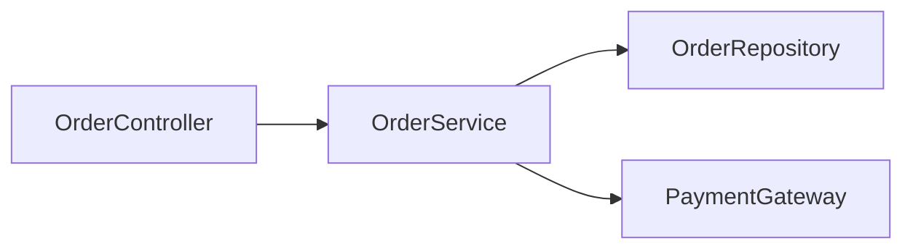
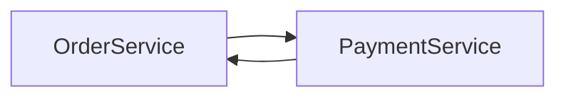
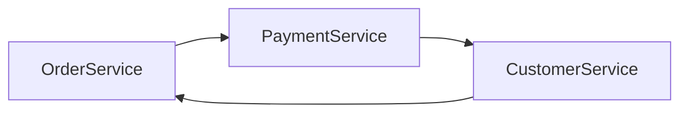
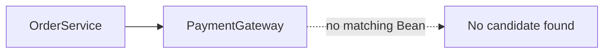
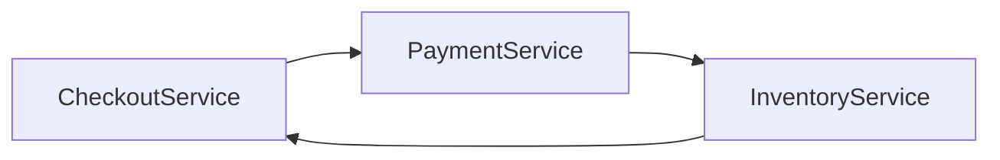
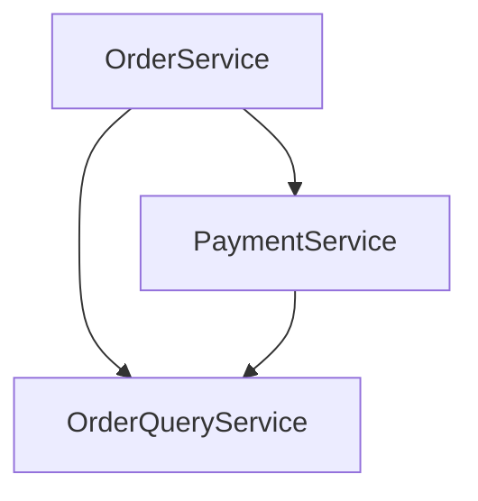
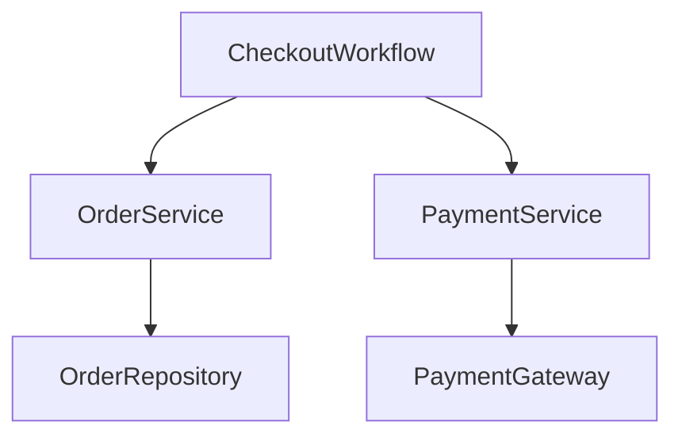

# Distinguishing Design Circular Dependencies from Missing Bean Errors

When Spring Boot fails to create a Bean, logs often mention dependencies, constructors, or the ApplicationContext. Two situations that are easily confused are:

- **Circular dependency:** Bean A needs Bean B, while Bean B also needs Bean A, directly or through a chain of other Beans. The dependency graph contains a cycle.
- **Missing bean error:** a Bean needs a dependency, but the container cannot find a matching Bean to supply. The dependency graph has an edge with no valid candidate.

Both can prevent the application from starting, and both can surface inside an overarching exception such as **UnsatisfiedDependencyException**. However, their root causes and remedies differ. If you mistake a circular dependency for a missing Bean, you might try adding a new implementation even though the real issue is two services calling back into each other. If you mistake a missing Bean for a circular dependency, you might split classes unnecessarily when you merely need to register the right Bean or fix a configuration condition.

This lesson explains how to read the dependency graph, recognize signals in exceptions, understand why constructor cycles cannot be constructed in the normal way, and choose fixes aligned with good design.

## 1. Viewing Dependencies as a Directed Graph

Each Bean is a node. If Bean A needs Bean B to be created or to operate, we represent an edge from A to B:

**A → B** means A depends on B.

Example of a normal dependency flow:



OrderController needs OrderService; OrderService needs a repository and a payment gateway. No path loops back to form a cycle.

A direct circular dependency:



An indirect circular dependency:



A missing Bean error has a different shape:



In the last diagram, the problem is not a cycle. OrderService needs PaymentGateway, yet the container has no Bean matching the required type or qualifier.

| Characteristic | Circular dependency | Missing Bean |
|---|---|---|
| Graph structure | Contains cycle A → B → … → A | Has a dependency with no candidate found |
| Core question | Which Beans require each other in a loop? | Which Bean requires a type that is not registered/resolved? |
| Common symptoms | Circular reference, BeanCurrentlyInCreationException | NoSuchBeanDefinitionException |
| Resolution direction | Break the cycle or redesign collaboration | Register the right Bean, fix scan/condition/profile/qualifier |
| Can happen simultaneously? | Yes | Yes |

The two situations are not mutually exclusive. A cycle can also contain an unregistered dependency; in that case both issues must be resolved. Always read the root cause and reconstruct the graph rather than looking only at the outermost exception.

## 2. Direct Circular Dependency via Constructors

Suppose two services are written as follows:

```java
@Service
public class OrderService {
    private final PaymentService paymentService;

    public OrderService(PaymentService paymentService) {
        this.paymentService = paymentService;
    }
}
```

```java
@Service
public class PaymentService {
    private final OrderService orderService;

    public PaymentService(OrderService orderService) {
        this.orderService = orderService;
    }
}
```

When creating OrderService, Spring needs PaymentService to pass into the constructor. Yet to create PaymentService, Spring needs a completed OrderService. Both constructors require the other object to already be ready.

The process gets stuck:

```text
Create OrderService
    ↓ needs PaymentService
        ↓ create PaymentService
            ↓ needs OrderService
                ↓ OrderService not yet finished
                    ↓ cannot complete initialization chain
```

With constructor injection, the container cannot instantiate one of the two objects first and assign the missing dependency after the constructor finishes. Neither object has a valid state to supply to the other constructor.

The result is typically a context startup failure with a circular dependency message or an exception related to a Bean currently in creation, such as **BeanCurrentlyInCreationException**. The outer wrapper exception may be **UnsatisfiedDependencyException**; check the cause chain and the circular reference notice to confirm.

### Circular dependencies do not always involve only two classes

```java
@Service
class CheckoutService {
    CheckoutService(PaymentService paymentService) {}
}

@Service
class PaymentService {
    PaymentService(InventoryService inventoryService) {}
}

@Service
class InventoryService {
    InventoryService(CheckoutService checkoutService) {}
}
```

The actual graph is:



When reading logs, do not look only for a pair of classes referencing each other. Follow the dependency chain until you see a Bean returning to a Bean encountered earlier.

## 3. Why Does Spring Boot Reject Circular References by Default?

Spring Framework has mechanisms to support circular dependencies among singletons in certain cases, particularly when dependencies are assigned after instances have already been instantiated. However, that mechanism cannot solve constructor cycles in general.

Since Spring Boot 2.6, Boot disallows circular references in the application context by default (the **spring.main.allow-circular-references** property defaults to **false**). Modern Spring Boot versions continue to encourage acyclic dependency graphs. As a result, older applications that used to start thanks to early references may start failing upon upgrade.

You may encounter this property in legacy applications:

```properties
spring.main.allow-circular-references=true
```

This property merely re-enables permitting certain circular references that Spring can resolve. It **cannot make every constructor cycle valid**, nor does it fix mutually dependent designs. Do not enable it as a knee-jerk reaction to a startup failure.

### How do setter/field cycles differ from constructor cycles?

With setter injection, Spring can technically instantiate the object first and assign the dependency afterward:

```java
@Service
public class ReportService {
    private NotificationService notificationService;

    @Autowired
    public void setNotificationService(
            NotificationService notificationService) {
        this.notificationService = notificationService;
    }
}
```

If NotificationService also needs ReportService via a setter, the container can use singleton early references in some cases. However, this depends on scope, proxies, and lifecycle; not every cycle can be resolved.

An object may be constructed before all dependencies are populated. If a lifecycle callback or initialization logic accesses a collaborator too early, the application can still fail. Thus, the fact that Spring can resolve a setter cycle does not make it a good design.

With constructor injection, dependencies must be ready at object creation time; a constructor cycle cannot be resolved by handing out a half-initialized object.

## 4. Missing Bean Error: Dependency Has No Matching Candidate

Consider the service:

```java
@Service
public class OrderService {
    private final PaymentGateway paymentGateway;

    public OrderService(PaymentGateway paymentGateway) {
        this.paymentGateway = paymentGateway;
    }
}
```

If the application context has no Bean implementing PaymentGateway, Spring cannot invoke the constructor. The error typically looks like:

```text
Parameter 0 of constructor in OrderService required a bean of type
'PaymentGateway' that could not be found.
```

The root cause is usually **NoSuchBeanDefinitionException**. This is a missing dependency, not a circular dependency.

### An interface does not become a Bean on its own

```java
public interface PaymentGateway {
    void charge(long amount);
}
```

Declaring an interface only defines a Java type. It creates no instance and registers no Bean in the Spring container.

You need a registered implementation:

```java
@Component
public class DemoPaymentGateway implements PaymentGateway {
    @Override
    public void charge(long amount) {
        System.out.println("Charged: " + amount);
    }
}
```

Or declare a Bean in configuration:

```java
@Configuration(proxyBeanMethods = false)
public class PaymentConfiguration {
    @Bean
    PaymentGateway paymentGateway() {
        return new DemoPaymentGateway();
    }
}
```

Only one appropriate registration is needed. If the implementation is within component scan scope, `@Component` is enough; if the object comes from an external library or needs factory logic, `@Bean` is usually better suited.

## 5. Common Reasons a Bean Is Missing

A Bean may not be found for many reasons. Check each possibility instead of immediately adding a new class.

### 5.1. Class lies outside component scan scope

`@SpringBootApplication` includes component scanning starting from the package containing the main application class and scanning down into subpackages.

Example:

```text
com.example.shop.ShopApplication
com.example.shop.order.OrderService
com.example.shop.payment.DemoPaymentGateway
```

All three classes live under `com.example.shop`, so this package layout works smoothly with default component scanning.

However, if the implementation lives in:

```text
com.example.shop.ShopApplication
com.example.shop.order.OrderService
org.example.payment.DemoPaymentGateway
```

then `org.example.payment` is not beneath `com.example.shop`. Spring does not automatically scan external packages just because a class has `@Component`.

Possible solutions:

- Move the implementation into an appropriate subpackage under the application's root package.
- Configure `@ComponentScan` with explicit base packages.
- Import the configuration or register the Bean using an appropriate mechanism.

Avoid widening component scan overly broadly—like scanning an entire root package—if doing so could pull unrelated components into the context.

### 5.2. Forgetting to register the implementation

Plain Java interfaces and classes do not automatically become Spring Beans:

```java
public class DemoPaymentGateway implements PaymentGateway {
    // Neither @Component nor @Bean registers this class.
}
```

If the class is not scanned/imported and not created via `@Bean`, a constructor requiring `PaymentGateway` will have no candidate.

### 5.3. Configuration containing `@Bean` has not been loaded

A `@Bean` method only takes effect when its configuration class is discovered or imported by Spring:

```java
@Configuration
public class PaymentConfiguration {
    @Bean
    PaymentGateway paymentGateway() {
        return new DemoPaymentGateway();
    }
}
```

If `PaymentConfiguration` is outside scan scope and not `@Import`ed, this method will not run automatically. Check packages, `@Import`, configuration conditions, and how the application loads configuration.

### 5.4. `@Profile` does not match the active environment

A Bean may only be registered under a specific profile:

```java
@Profile("production")
@Component
public class RealPaymentGateway implements PaymentGateway {
    // Real payment integration.
}
```

If the application runs with the `dev` profile, this Bean is not registered. Without a substitute implementation for `dev`, the required dependency is missing.

Check:

```properties
spring.profiles.active=dev
```

and corresponding profile configurations. The question to answer is: under the active profile, is there any Bean implementing the required type?

### 5.5. Auto-configuration conditions are not met

Spring Boot and libraries may register Beans conditionally:

- **@ConditionalOnClass:** is the required library/class on the classpath?
- **@ConditionalOnProperty:** does the property have the expected value?
- **@ConditionalOnBean:** does the prerequisite Bean already exist?
- **@ConditionalOnMissingBean:** did a user-defined Bean cause the default configuration to back off?
- **@ConditionalOnWebApplication:** is the application the expected web context type?

If a condition is not met, the default Bean may not be created. This is a registration-condition issue, not a circular dependency.

When needed, run the application with `--debug` to view Spring Boot's Condition Evaluation Report:

```bash
java -jar app.jar --debug
```

The report shows which auto-configurations matched or did not match and can pinpoint which condition went unmet.

### 5.6. Multiple Beans exist without a unique matching Bean

This is a third scenario, distinct from both circular dependencies and missing Beans.

Suppose two classes implement `PaymentGateway`:

```java
@Component("bankGateway")
class BankPaymentGateway implements PaymentGateway { /* ... */ }

@Component("walletGateway")
class WalletPaymentGateway implements PaymentGateway { /* ... */ }
```

Constructor:

```java
public OrderService(PaymentGateway paymentGateway) {
    this.paymentGateway = paymentGateway;
}
```

The container finds two candidates and does not know which one to choose. The error is typically **NoUniqueBeanDefinitionException**, wrapped inside **UnsatisfiedDependencyException**.

Resolve with `@Qualifier`:

```java
public OrderService(
        @Qualifier("bankGateway") PaymentGateway paymentGateway) {
    this.paymentGateway = paymentGateway;
}
```

Or mark a default implementation with `@Primary` if that is genuinely a sensible default choice.

## 6. Reading Exceptions: Distinguishing Root Causes from Wrapper Exceptions

Spring often wraps exceptions at higher layers to give context on which Bean was being initialized. Therefore, the first line of a stack trace does not always name the ultimate cause.

### Circular dependency signals

You might see a message like:

```text
The dependencies of some of the beans in the application context form a cycle:

   orderService
      ↓
   paymentService
      ↓
   orderService
```

Or the exception chain includes **BeanCurrentlyInCreationException**, noting that a Bean was requested while still unfinished.

Construct a graph from the Beans listed in the cycle. If a path returns to the starting Bean, that is a circular dependency signal.

### Missing Bean signals

Example message:

```text
Parameter 0 of constructor in OrderService required a bean of type
'PaymentGateway' that could not be found.
```

The nested cause may be:

```text
NoSuchBeanDefinitionException:
No qualifying bean of type 'PaymentGateway' available
```

The message clearly names the dependency type with no matching candidate. Check Bean registration, scanning, profiles, conditions, and qualifiers.

### Multiple Beans of the same type signals

```text
NoUniqueBeanDefinitionException:
expected single matching bean but found 2
```

The container is not missing a Bean; it has more than one candidate. Determine which implementation the consumer wants or whether it actually needs to handle the full collection.

### Exceptions can be nested

A log may look like:

```text
UnsatisfiedDependencyException
    Caused by: NoSuchBeanDefinitionException
```

or:

```text
UnsatisfiedDependencyException
    Caused by: BeanCurrentlyInCreationException
```

`UnsatisfiedDependencyException` only indicates Spring could not satisfy a Bean's required dependency. Read down into the nested cause to tell whether it is a missing candidate, multiple candidates, an initialization cycle, or another Bean creation failure.

| Exception / signal | Initial meaning | What to check |
|---|---|---|
| NoSuchBeanDefinitionException | No matching Bean | Required type, scan, `@Bean`, profile, conditions |
| NoUniqueBeanDefinitionException | Multiple Beans of the same type | Qualifier, Primary, collection injection |
| BeanCurrentlyInCreationException | Bean requested while already in creation | Dependency graph, constructor/setter cycle, proxies |
| Circular dependency report A → B → A | Bean cycle exists | Find why A and B need each other |
| BeanCreationException | A Bean failed to initialize | Read root cause; could be config or an error inside the constructor |
| UnsatisfiedDependencyException | Could not satisfy parameter/field/method injection | Read nested causes to distinguish scenarios |

Never jump to conclusions from the outermost exception name alone. `BeanCreationException` can also come from a database connection error in a factory method; that does not automatically make it a circular dependency.

## 7. Fixing Circular Dependencies at the Design Level

When a cycle exists, the goal is to give the dependency graph a clear direction. Do not merely look for ways to postpone when Spring creates objects.

### 7.1. Extract shared responsibility into a third service

Suppose:

```text
OrderService → PaymentService
PaymentService → OrderService
```

Perhaps both services need a piece of logic such as reading order info or checking status. Extract that part into a collaborator with its own responsibility:



In the new design, both services depend on `OrderQueryService`, while orchestration flows in one direction. Do not create a third class solely to forward methods; it should own a meaningful responsibility.

### 7.2. Move orchestration into an application service

If two services call back into each other because each coordinates half of a workflow, lift the workflow into a higher layer:



`CheckoutWorkflow` invokes services in business sequence. `OrderService` does not need to call `PaymentService`, and `PaymentService` does not need a reference to `OrderService`.

### 7.3. Use events when components do not need to call each other directly

If one service only needs to announce that an event occurred, events can reduce coupling:

```java
public record PaymentCompleted(Long orderId) {
}
```

A payment-handling service can publish the event upon completion; another listener updates order status. This is an illustrative direction—real applications must also design transaction boundaries, retries, idempotency, and event durability.

Events are not an automatic cure for every circular dependency. If a listener calls back synchronously into the event-publishing service in the same loop, the logical cycle still exists.

### 7.4. Invert dependencies with abstractions at the right boundary

Interfaces can prevent high-level modules from depending on concrete implementations. However, **adding an interface does not automatically break a circular dependency** if A still injects B and B still injects A. What must change is dependency direction and responsibility ownership, not merely Java type names.

## 8. Why Shouldn't You Enable Circular References to Fix the Error Immediately?

You may come across the suggestion:

```properties
spring.main.allow-circular-references=true
```

This is a compatibility option for certain legacy applications, yet it has clear limitations:

- Constructor cycles still cannot be resolved by completing one object before the other exists.
- Early-reference mechanics involve singletons and can become fragile when Beans are proxied (e.g., AOP/transactions).
- A Bean may be exposed before injection/lifecycle steps finish; early initialization code may observe incomplete state.
- Circular dependencies continue to make modules hard to understand, test, and change.
- The application may start up, only for business or lifecycle bugs to appear later.

Consider this property only when maintaining a legacy system, after you understand the exact cycle and have adequate tests. For new code, fix the graph so Beans have clear unidirectional relationships.

### What about `@Lazy` or `ObjectProvider`?

Both mechanisms can defer resolving a dependency:

```java
@Service
public class AService {
    private final BService bService;

    public AService(@Lazy BService bService) {
        this.bService = bService;
    }
}
```

Or:

```java
@Service
public class AService {
    private final ObjectProvider<BService> bServiceProvider;

    public AService(ObjectProvider<BService> bServiceProvider) {
        this.bServiceProvider = bServiceProvider;
    }

    public void runWhenNeeded() {
        BService bService = bServiceProvider.getObject();
        bService.execute();
    }
}
```

They are useful when deferred initialization or dynamic/optional dependencies are needed. Yet if A and B still call each other to carry out the same process, deferring only shifts when the issue surfaces; it does not eliminate coupling. Use them for an explicit runtime requirement, not as a default bandage for every cycle.

## 9. Fixing Missing Bean Errors by Root Cause

Unlike circular dependencies, missing Bean errors are typically fixed by ensuring the container has the right Bean in the right context.

| Cause | How to check | Resolution |
|---|---|---|
| No implementation exists | Only interface exists or class is unregistered | Create implementation and add `@Component` or `@Bean` |
| Outside component scan | Implementation package is outside root package | Adjust package, `@ComponentScan`, or `@Import` |
| Configuration not loaded | Class with `@Bean` is not scanned/imported | Register configuration explicitly |
| Profile mismatch | `@Profile` excludes Bean from active profile | Check `spring.profiles.active` and supply Bean for that environment |
| Unmet condition | Missing class/property/Bean or wrong app type | Read Condition Evaluation Report and fix required conditions |
| Wrong qualifier | Bean exists but qualifier does not match | Fix qualifier or Bean metadata |
| Dependency missing from classpath | Module/library containing implementation not added | Check project's Gradle/Maven dependencies |

### Component scan and root package

With:

```text
com.example.shop.ShopApplication
com.example.shop.order.OrderService
com.example.shop.payment.DemoPaymentGateway
```

default component scanning from `com.example.shop` discovers components in subpackages. If the implementation lives in `org.example.payment`, that package is not part of this scan tree merely because the class carries `@Component`.

### Profiles and runtime environments

If the real Bean only has `@Profile("production")` while the app runs with `dev`, that Bean is not registered. If the dependency is required in every environment, provide an appropriate implementation for `dev` (such as a fake/local gateway), or clearly design which environments are permitted to run that feature.

### Auto-configuration

Boot may skip creating a default Bean when conditions are not satisfied. Common conditions include `@ConditionalOnClass`, `@ConditionalOnProperty`, `@ConditionalOnBean`, `@ConditionalOnMissingBean`, and `@ConditionalOnWebApplication`.

Run:

```bash
java -jar app.jar --debug
```

to inspect the Condition Evaluation Report. The report shows which configurations applied, which were skipped, and why. It is useful when a starter Bean does not appear; it does not replace graph analysis when the error is a circular dependency among application Beans.

## 10. Step-by-Step Investigation Workflow

When the application reports a Bean creation failure, follow this sequence:

1. **Find the first Bean mentioned.** Read the "Error creating bean with name ..." line and the associated parameter/field/method dependency.
2. **Read the entire cause chain.** Distinguish `NoSuchBeanDefinitionException`, `NoUniqueBeanDefinitionException`, `BeanCurrentlyInCreationException`, and exceptions thrown by initialization code.
3. **Sketch a small dependency graph.** Write `A → B` for each constructor dependency. If you return to a Bean already seen, there is a cycle. If a type has no candidate, that is a missing edge.
4. **If a Bean is missing, check registration.** Component scan, `@Bean`, `@Import`, classpath dependencies, profiles, and conditional configuration.
5. **If multiple Beans exist, check selection.** Qualifiers, `@Primary`, or collection injection.
6. **If a cycle exists, ask why both sides need each other.** Split responsibilities, move orchestration up a layer, or use events when appropriate.
7. **Restart the context or run a startup test.** Confirm the error is gone under the exact profile and configuration the application needs.

### A classification exercise

**Scenario A**

```java
@Service
class CustomerService {
    CustomerService(AddressService addressService) {}
}
```

No class/Bean implements or provides `AddressService`. This is a missing Bean error. Register the appropriate dependency or correct the requested type if it is wrong.

**Scenario B**

```java
@Service
class CustomerService {
    CustomerService(AddressService addressService) {}
}

@Service
class AddressService {
    AddressService(CustomerService customerService) {}
}
```

The two constructors require each other directly. This is a circular dependency. Adding a second `AddressService` will not solve the problem; the relationship must be redesigned.

**Scenario C**

```java
@Component("emailGateway")
class EmailGateway implements MessageGateway {}

@Component("smsGateway")
class SmsGateway implements MessageGateway {}

@Service
class AlertService {
    AlertService(MessageGateway gateway) {}
}
```

The container has two Beans matching `MessageGateway`. This is a multiple-candidates error, neither a missing Bean nor a cycle. Use a qualifier, primary, or collection depending on business logic.

## 11. Connecting to Constructor Injection and the IoC Container

Constructor injection makes the dependency graph visible right in source code. Example:

```java
public OrderService(
        OrderRepository repository,
        PaymentGateway paymentGateway) {
    this.repository = repository;
    this.paymentGateway = paymentGateway;
}
```

From the constructor signature, you can list the edges:

```text
OrderService → OrderRepository
OrderService → PaymentGateway
```

If the container cannot create `OrderService`, the next questions are:

- Does an `OrderRepository` Bean exist?
- Does a `PaymentGateway` Bean exist?
- Are there multiple Beans of the same type?
- Does one of the dependencies have a path looping back to `OrderService`?

That is how you turn a long stack trace into a small graph you can reason about. **Missing Bean** means the container found no candidate for an edge; **circular dependency** means existing edges form a cycle; **multiple Beans of the same type** means multiple candidates exist without a selection rule.

In Spring Boot applications, constructor injection keeps mandatory dependencies transparent and lets the container detect issues early. When an error appears, determine the exact graph structure before changing code: register a missing Bean, choose the right implementation, or break a design cycle. Those three actions solve three distinct root causes and make the architecture easier to understand, test, and extend.
