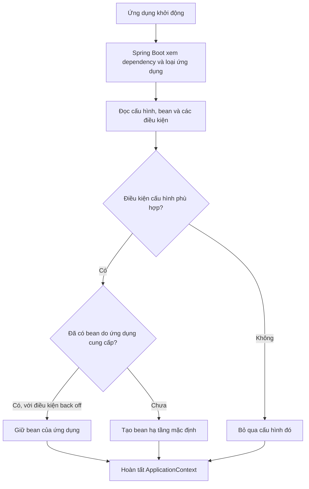

# Quy ước mặc định, tự cấu hình và quyền chủ động của người phát triển

> **Bối cảnh:** Spring Boot Fundamentals → Bức tranh Spring Boot. Bài này giải thích vì sao một ứng dụng Spring Boot có thể chạy với rất ít cấu hình, những gì framework thực sự tự quyết định, và cách người phát triển kiểm soát các quyết định đó khi nhu cầu thay đổi.

## 1. Ba ý tưởng cần phân biệt

Khi bắt đầu với Spring Boot, ta thường chỉ thêm một starter, viết lớp `@SpringBootApplication`, tạo một controller rồi chạy được HTTP API. Cảm giác là Spring Boot đã “làm hết mọi thứ”. Thực tế có ba cơ chế liên quan nhưng không đồng nghĩa:

| Khái niệm | Câu hỏi được giải quyết | Ví dụ |
| --- | --- | --- |
| **Quy ước mặc định (convention/default)** | Nếu lập trình viên không chọn, framework sẽ dùng giá trị hay cách tổ chức nào? | Server HTTP thường lắng nghe ở cổng `8080` nếu không cấu hình cổng khác. |
| **Tự cấu hình (auto-configuration)** | Dựa vào thư viện, cấu hình và bean đang có, Spring Boot nên tạo những thành phần hạ tầng nào? | Có các thư viện Spring MVC phù hợp trên classpath, Spring Boot thiết lập các thành phần cần thiết để nhận và xử lý HTTP request. |
| **Quyền chủ động (explicit control)** | Lập trình viên thay đổi, bổ sung hoặc thay thế các lựa chọn mặc định ra sao? | Đặt `server.port=9090`, định nghĩa bean của riêng mình, hoặc loại một auto-configuration không cần thiết. |

Ba cơ chế này phối hợp với nhau. **Quy ước** giúp giảm quyết định lặp lại; **tự cấu hình** kết nối những thành phần phù hợp; **quyền chủ động** cho phép ứng dụng phục vụ yêu cầu thực tế mà không bị ràng buộc bởi cấu hình mặc định.

Spring Boot được xây trên Spring Framework. Spring Framework cung cấp IoC container, dependency injection, MVC, quản lý giao dịch và nhiều thành phần nền tảng. Spring Boot đóng gói cách khởi động, quản lý dependency, cấu hình và tích hợp chúng để ứng dụng có một điểm bắt đầu thuận tiện. Boot không thay thế những nguyên lý cốt lõi của Spring.

## 2. Quy ước mặc định: bớt cấu hình, không bớt trách nhiệm thiết kế

Trước khi có quy ước thống nhất, mỗi dự án phải tự chọn cách kết nối nhiều thành phần hạ tầng, khai báo chi tiết cấu hình và tổ chức bước khởi động. Spring Boot đưa ra những lựa chọn thường hợp lý cho phần lớn ứng dụng để ta chỉ cần khai báo **những điểm khác biệt**.

Một vài quy ước quen thuộc:

- Với ứng dụng web dùng servlet và starter web phù hợp, Boot có thể khởi động máy chủ nhúng; ở cấu hình thông dụng, cổng mặc định là `8080`.
- File `application.properties` hoặc `application.yml` được dùng để cung cấp cấu hình ứng dụng.
- Những thành phần được đánh dấu `@Component`, `@Service`, `@Repository`, `@Controller` hoặc `@RestController` có thể được tìm thấy qua component scan trong phạm vi package thích hợp.
- Logging, HTTP message conversion và xử lý lỗi có những thiết lập ban đầu để ứng dụng có thể hoạt động sớm.

Các ví dụ này phụ thuộc vào loại ứng dụng, phiên bản Spring Boot, dependency và cấu hình cụ thể. Chẳng hạn, không có thư viện web thì không thể mặc nhiên suy ra ứng dụng sẽ mở HTTP server. Quy ước chỉ có ý nghĩa **khi điều kiện sử dụng nó đã thỏa mãn**.

### 2.1. “Convention over configuration” vận hành như thế nào?

Giả sử API có thể chạy ở cổng mặc định. Không cần viết:

```properties
# application.properties
# Không cần khai báo server.port nếu cổng mặc định đáp ứng nhu cầu.
```

Khi môi trường yêu cầu cổng `9090`, ta chỉ thay đổi phần cần thiết:

```properties
server.port=9090
```

Cùng một chương trình có thể nhận giá trị từ biến môi trường `SERVER_PORT` hoặc tham số khởi động:

```bash
java -jar app.jar --server.port=9090
```

Trong cấu hình thông thường, tham số dòng lệnh có độ ưu tiên cao hơn giá trị trong `application.properties`. Spring Boot có nhiều nguồn cấu hình khác nhau nên khi có giá trị trùng nhau, cần xem **nguồn nào được ưu tiên** theo quy tắc externalized configuration của phiên bản đang dùng.

### 2.2. Quy ước không phải hợp đồng bất biến

Giá trị mặc định có thể thay đổi theo phiên bản, theo dependency trên classpath hoặc loại ứng dụng. Vì vậy:

1. Hiểu mặc định để khởi động nhanh.
2. Khai báo rõ những giá trị mang ý nghĩa vận hành hoặc nghiệp vụ.
3. Khi nâng phiên bản, kiểm tra thay đổi liên quan đến mặc định thay vì giả định chúng luôn giữ nguyên.

Ví dụ, với môi trường production, những quyết định như cổng mạng, nguồn dữ liệu, bí mật truy cập, giới hạn tài nguyên, log level và chính sách bảo mật cần được quản lý rõ ràng. “Có mặc định” không có nghĩa “mặc định phù hợp với mọi hệ thống”.

## 3. Auto-configuration: Spring Boot ra quyết định dựa trên điều kiện

Auto-configuration là cơ chế Spring Boot đăng ký những bean cấu hình sẵn khi ngữ cảnh ứng dụng thỏa các điều kiện tương ứng. Đây là **cấu hình có điều kiện**, không phải việc Spring Boot tự suy đoán toàn bộ ý đồ kinh doanh của lập trình viên.

Một cách hình dung đơn giản:



Sơ đồ mô tả nguyên tắc thường gặp; **không phải mọi auto-configuration đều dùng cùng một điều kiện**. Một số cấu hình phụ thuộc vào property, loại ứng dụng web, bean cụ thể hoặc sự tồn tại của những bean khác.

### 3.1. Starter khác auto-configuration ở đâu?

Hai khái niệm rất dễ bị nhầm:

- **Starter** là một bộ dependency thuận tiện. Thay vì tự chọn hàng loạt thư viện tương thích, ta khai báo starter tương ứng với nhu cầu.
- **Auto-configuration** là logic kiểm tra môi trường và tạo cấu hình/bean phù hợp. Starter thường đem các thư viện cần thiết vào classpath để điều kiện tự cấu hình có thể được đáp ứng.

Ví dụ minh họa trong một dự án Spring Boot 3.x dùng Maven:

```xml
<dependency>
    <groupId>org.springframework.boot</groupId>
    <artifactId>spring-boot-starter-web</artifactId>
</dependency>
```

Dependency này giúp dự án có các thư viện phục vụ ứng dụng Spring MVC. Khi khởi động, Spring Boot kiểm tra điều kiện để thiết lập hạ tầng web tương ứng, ví dụ DispatcherServlet, message converters và server nhúng trong cấu hình servlet web phổ biến.

Tên hoặc cách chia starter có thể thay đổi giữa các phiên bản lớn; với dự án thực tế, hãy dùng dependency được tài liệu của **phiên bản Spring Boot đang triển khai** khuyến nghị.

**Thêm starter không đồng nghĩa chắc chắn mọi tính năng của starter sẽ hoạt động ngay.** Chẳng hạn, thêm thư viện truy cập cơ sở dữ liệu không làm xuất hiện một kết nối database hợp lệ nếu thiếu driver hoặc thông tin kết nối cần thiết.

### 3.2. Những điều kiện thường gặp

Trong mã nguồn các lớp auto-configuration, ta sẽ gặp những annotation như:

| Điều kiện | Ý nghĩa thường gặp | Tình huống điển hình |
| --- | --- | --- |
| `@ConditionalOnClass` | Chỉ kích hoạt nếu class cần thiết có trên classpath. | Không thiết lập một tích hợp khi thư viện tương ứng chưa được thêm vào. |
| `@ConditionalOnMissingBean` | Chỉ tạo bean nếu chưa có bean phù hợp. | Cho phép cấu hình mặc định nhường chỗ cho bean do ứng dụng tự định nghĩa. |
| `@ConditionalOnBean` | Chỉ kích hoạt nếu đã có một bean phù hợp. | Một thành phần phụ thuộc vào thành phần hạ tầng được khai báo trước. |
| `@ConditionalOnProperty` | Dựa vào giá trị cấu hình. | Bật hoặc tắt một tính năng cấu hình. |
| `@ConditionalOnWebApplication` | Chỉ dùng trong loại ứng dụng web thích hợp. | Một cấu hình dành riêng cho web không áp dụng vào ứng dụng chạy batch thuần túy. |

Ví dụ **mã giả để diễn giải cơ chế**, không phải bản sao mã nguồn nội bộ Spring Boot:

```java
@AutoConfiguration
@ConditionalOnClass(SomeClient.class)
class ExampleClientAutoConfiguration {

    @Bean
    @ConditionalOnMissingBean(SomeClient.class)
    SomeClient someClient() {
        return new SomeClient();
    }
}
```

Nếu thư viện chứa `SomeClient` hiện diện và ứng dụng chưa có bean `SomeClient`, cấu hình trên có thể cung cấp bean mặc định. Nếu ứng dụng đã có bean tương ứng, điều kiện `@ConditionalOnMissingBean` ngăn việc tạo bean thứ hai. Điều này thường gọi là **back off**.

Điểm cần nhớ: một bean ứng dụng tự định nghĩa **chỉ làm auto-configuration nhường chỗ khi điều kiện của cấu hình đó thực sự xét đến bean tương ứng**. Không nên suy ra rằng mọi bean tự tạo đều ghi đè bean mặc định.

## 4. Một ví dụ từ khởi động đến HTTP response

Xét ứng dụng Java nhỏ với package gốc `com.example.catalog`. Lớp khởi động:

```java
package com.example.catalog;

import org.springframework.boot.SpringApplication;
import org.springframework.boot.autoconfigure.SpringBootApplication;

@SpringBootApplication
public class CatalogApplication {
    public static void main(String[] args) {
        SpringApplication.run(CatalogApplication.class, args);
    }
}
```

Tạo controller trong package con `com.example.catalog.api`:

```java
package com.example.catalog.api;

import org.springframework.web.bind.annotation.GetMapping;
import org.springframework.web.bind.annotation.PathVariable;
import org.springframework.web.bind.annotation.RequestMapping;
import org.springframework.web.bind.annotation.RestController;

@RestController
@RequestMapping("/api/books")
public class BookController {

    @GetMapping("/{id}")
    public BookResponse findBook(@PathVariable long id) {
        return new BookResponse(id, "Spring Boot Fundamentals");
    }

    public record BookResponse(long id, String title) {}
}
```

Với starter web phù hợp được khai báo và ứng dụng khởi động thành công, yêu cầu:

```http
GET /api/books/7 HTTP/1.1
Host: localhost:8080
```

có thể nhận JSON:

```json
{
  "id": 7,
  "title": "Spring Boot Fundamentals"
}
```

Phân tích vai trò của từng phần:

1. **Người phát triển viết nghiệp vụ:** định nghĩa URL, kiểu dữ liệu phản hồi và quy tắc xử lý request.
2. **Spring Framework xử lý cơ chế chung:** tạo và quản lý controller bean, ánh xạ request đến handler, thực hiện dependency injection khi cần.
3. **Spring Boot hỗ trợ khởi động:** thiết lập các thành phần web phù hợp nhờ dependency, điều kiện tự cấu hình và mặc định.
4. **Quy ước làm giảm khai báo:** ở cấu hình quen thuộc, ta không cần tự viết mã khởi tạo HTTP server hoặc chuyển đối tượng Java đơn giản thành JSON.

### 4.1. Vai trò của `@SpringBootApplication`

Annotation này gộp ba ý quan trọng:

- `@SpringBootConfiguration`: đánh dấu lớp cấu hình chính của ứng dụng, dựa trên cơ chế `@Configuration` của Spring.
- `@EnableAutoConfiguration`: bật cơ chế lựa chọn auto-configuration.
- `@ComponentScan`: quét component bắt đầu từ package chứa lớp khởi động, mặc định bao gồm các package con.

Chính vì quy tắc quét package, việc đặt lớp khởi động ở package gốc của ứng dụng thường thuận lợi. Nếu đặt controller ở package ngoài phạm vi quét, controller có thể không được đăng ký dù code biên dịch thành công. Auto-configuration được nạp qua cơ chế import riêng, **không phải** do quét tất cả các lớp auto-configuration như component thông thường.

### 4.2. Sự khác nhau giữa “được phát hiện” và “được tự cấu hình”

Một `@Service` do ta viết thường trở thành bean nhờ component scan. Một bean hạ tầng do Boot cung cấp có thể xuất hiện thông qua auto-configuration. Cả hai đều nằm trong Spring `ApplicationContext`, nhưng **đường đi đến lúc được đăng ký** khác nhau:

| Bean | Ai quyết định hành vi của bean? | Cách đăng ký thường gặp |
| --- | --- | --- |
| `BookController` trong ví dụ | Lập trình viên | Component scan từ `@RestController` |
| `BookService` tự viết | Lập trình viên | Component scan từ `@Service` |
| HTTP message converter phù hợp | Framework với các tùy chỉnh ứng dụng | Auto-configuration, tùy dependency và điều kiện |
| `DataSource` mặc định (nếu cấu hình đủ) | Framework dựa trên property/dependency | Auto-configuration có điều kiện |
| `DataSource` tự khai báo | Lập trình viên | Phương thức `@Bean` trong lớp `@Configuration` |

## 5. Ba mức độ can thiệp của người phát triển

Khi mặc định chưa đáp ứng nhu cầu, hãy chọn cơ chế can thiệp **phù hợp với mức độ thay đổi**.

### Mức 1 — Đổi một property, giữ nguyên hạ tầng được cấu hình tự động

Đây thường là bước đơn giản nhất:

```yaml
# src/main/resources/application.yml
server:
  port: 9090

logging:
  level:
    com.example.catalog: DEBUG
```

Ứng dụng vẫn dùng cơ chế web do Spring Boot cấu hình; chỉ có cổng và log level được thay đổi. Property là dữ liệu đầu vào của cấu hình, không có nghĩa Spring Boot tạo ra bean hoàn toàn mới mỗi khi một giá trị thay đổi.

Nên ưu tiên mức này khi framework đã có property chính thức cho yêu cầu đang giải quyết.

### Mức 2 — Thêm cấu hình hoặc bean riêng, tận dụng phần hạ tầng còn lại

Giả sử ứng dụng muốn đọc thiết lập nghiệp vụ của chính mình:

```yaml
app:
  catalog:
    page-size: 25
```

Ta định nghĩa một lớp type-safe để nhận dữ liệu cấu hình:

```java
package com.example.catalog.config;

import org.springframework.boot.context.properties.ConfigurationProperties;

@ConfigurationProperties(prefix = "app.catalog")
public record CatalogProperties(int pageSize) {}
```

Đăng ký lớp đó bằng cách thêm `@EnableConfigurationProperties` vào lớp cấu hình đang được Spring quản lý:

```java
package com.example.catalog.config;

import org.springframework.boot.context.properties.EnableConfigurationProperties;
import org.springframework.context.annotation.Configuration;

@Configuration(proxyBeanMethods = false)
@EnableConfigurationProperties(CatalogProperties.class)
public class CatalogConfiguration {}
```

Một service có thể nhận `CatalogProperties` qua constructor injection rồi sử dụng `pageSize()`. Với dự án lớn có nhiều cấu hình cùng loại, `@ConfigurationPropertiesScan` là một lựa chọn khác để phát hiện các lớp cấu hình này.

Điểm đáng chú ý: **property `app.catalog.page-size` không phải mặc định bí mật của Spring Boot**. Đây là quy ước do chính ứng dụng đặt ra. Spring Boot cung cấp cơ chế binding để chuyển nó thành dữ liệu có kiểu rõ ràng.

Ta cũng có thể điều chỉnh hành vi của một thành phần bằng extension point chính thức như `WebMvcConfigurer`, các customizer bean hoặc callback được framework hỗ trợ, tùy trường hợp. Cách đó thường giữ được nhiều cấu hình mặc định hữu ích hơn so với thay toàn bộ thành phần.

### Mức 3 — Tự định nghĩa bean thay cho cấu hình mặc định

Giả sử ứng dụng có JDBC starter cùng driver thích hợp và muốn tự quản lý bean kết nối dữ liệu. Một ví dụ sử dụng `DataSourceProperties` do Boot bind từ cấu hình:

```java
package com.example.catalog.config;

import javax.sql.DataSource;

import org.springframework.boot.autoconfigure.jdbc.DataSourceProperties;
import org.springframework.context.annotation.Bean;
import org.springframework.context.annotation.Configuration;

@Configuration(proxyBeanMethods = false)
public class DatabaseConfiguration {

    @Bean
    DataSource dataSource(DataSourceProperties properties) {
        return properties.initializeDataSourceBuilder().build();
    }
}
```

Cấu hình tương ứng có thể lấy từ môi trường triển khai:

```yaml
spring:
  datasource:
    url: jdbc:postgresql://localhost:5432/catalog
    username: catalog_app
    # password được cung cấp qua secret/biến môi trường phù hợp
```

Nếu bean này được đăng ký thành công và auto-configuration liên quan có điều kiện `@ConditionalOnMissingBean(DataSource.class)`, Boot sẽ không tạo thêm DataSource mặc định ở vị trí đó. Đây là ví dụ về cơ chế **nhường quyền**; bean tự tạo có thể vẫn sử dụng các tiện ích của Spring Boot.

Trong hệ thống thật, thường **không cần** tự tạo `DataSource` chỉ để đổi URL, username hoặc pool size: hãy kiểm tra các property `spring.datasource.*` và property pool tương ứng trước. Khi tự quản lý bean, lập trình viên nhận thêm trách nhiệm về khởi tạo, tài nguyên, lifecycle, tính tương thích và test.

### Mức đặc biệt — Loại bỏ auto-configuration

Nếu một cấu hình tự động hoàn toàn không áp dụng, có thể loại nó ra. Ví dụ minh họa:

```java
import org.springframework.boot.autoconfigure.SpringBootApplication;
import org.springframework.boot.autoconfigure.jdbc.DataSourceAutoConfiguration;

@SpringBootApplication(exclude = DataSourceAutoConfiguration.class)
public class CatalogApplication {
    // ...
}
```

Chỉ nên làm khi **thực sự không muốn** hạ tầng đó được tự động tạo, sau khi đã hiểu tại sao nó được kích hoạt. Cấu hình loại trừ này không sửa dependency, không thay thế việc cung cấp thành phần mà code ứng dụng đang cần; nếu vẫn có service yêu cầu `DataSource`, ứng dụng có thể không khởi động được.

Có thể sử dụng `spring.autoconfigure.exclude` khi cần cấu hình loại trừ từ properties. Danh sách và tên lớp auto-configuration phụ thuộc phiên bản nên cần kiểm tra với phiên bản Boot thực tế.

## 6. Externalized configuration: cùng một mã nguồn, nhiều môi trường

Một ứng dụng thường phải hoạt động trên máy phát triển, môi trường thử nghiệm và production. Spring Boot cho phép lấy cấu hình từ nhiều nguồn mà không phải sửa mã Java mỗi lần triển khai.

Ví dụ tổ chức:

```text
src/main/resources/
├── application.yml
├── application-dev.yml
└── application-prod.yml
```

`application.yml` chứa giá trị dùng chung:

```yaml
app:
  catalog:
    page-size: 25

logging:
  level:
    root: INFO
```

`application-dev.yml` có thể bật log chi tiết:

```yaml
logging:
  level:
    com.example.catalog: DEBUG
```

Khi kích hoạt profile `dev`:

```bash
java -jar app.jar --spring.profiles.active=dev
```

các thuộc tính dành cho profile `dev` sẽ được xét cùng cấu hình chung theo thứ tự ưu tiên thích hợp.

**Profile không phải công cụ bảo mật secret.** Không đưa password, private key hay token production vào repository chỉ vì đã tách file `application-prod.yml`. Với các giá trị nhạy cảm, dùng cơ chế quản lý secret, biến môi trường hoặc nguồn cấu hình bảo mật của môi trường triển khai.

### 6.1. Vì sao cùng một property có thể cho kết quả khác?

Ví dụ `server.port` xuất hiện trong `application.yml`, biến môi trường và tham số dòng lệnh. Spring Boot giải quyết xung đột theo thứ tự ưu tiên của `PropertySource`. Với những nguồn cấu hình phổ biến, command-line argument có thể ghi đè giá trị từ file cấu hình; môi trường bên ngoài cũng có thể thay giá trị đóng gói cùng ứng dụng.

Khi kiểm tra sự cố, đừng chỉ mở một file `application.yml` rồi kết luận đó là giá trị thực sự. Hãy xem profile đang hoạt động, biến môi trường, tham số khởi động và nguồn cấu hình bên ngoài.

## 7. Khi auto-configuration không làm điều ta kỳ vọng

Giả sử controller không nhận request hoặc ứng dụng báo không tìm thấy `DataSource`. Thay vì thêm annotation ngẫu nhiên, cần lần theo điều kiện cấu hình:

| Dấu hiệu | Nguyên nhân cần kiểm tra | Hướng điều tra |
| --- | --- | --- |
| Ứng dụng khởi động nhưng endpoint trả 404 | Controller nằm ngoài component scan; đường dẫn không khớp; cấu hình web khác mong đợi | Xem package của lớp khởi động, `@RestController`, `@RequestMapping` và đường dẫn request. |
| Ứng dụng không có embedded server | Chưa có dependency web phù hợp hoặc ứng dụng được cấu hình không phải web | Xem dependency tree và giá trị `spring.main.web-application-type` nếu có. |
| Không tạo được bean `DataSource` | Thiếu driver, URL, credential hoặc cấu hình datasource không hợp lệ | Kiểm tra dependency, `spring.datasource.*` và thông báo lỗi khởi động. |
| Bean mặc định không xuất hiện | Có bean khác khiến điều kiện `@ConditionalOnMissingBean` không còn đúng | Kiểm tra bean ứng dụng đã khai báo và condition evaluation report. |
| Property đổi nhưng ứng dụng dùng giá trị cũ | Nguồn cấu hình khác có độ ưu tiên cao hơn, hoặc profile khác đang active | Xem tham số chạy, biến môi trường, profile và cấu hình ngoài. |
| Sau khi exclude một cấu hình, ứng dụng thiếu dependency injection | Một bean ứng dụng vẫn phụ thuộc hạ tầng vừa bị loại bỏ | Xác định thành phần thực sự cần trước khi quyết định giữ hoặc bỏ exclude. |

### 7.1. Xem báo cáo điều kiện

Spring Boot có **Condition Evaluation Report** giúp thấy những auto-configuration nào khớp hoặc không khớp điều kiện và vì sao. Trong nhiều trường hợp, chạy ứng dụng với tùy chọn:

```bash
java -jar app.jar --debug
```

sẽ cung cấp thêm thông tin chẩn đoán, trong đó có báo cáo về điều kiện tự cấu hình. Đọc cả phần matched lẫn did not match; một cấu hình bị bỏ qua có thể là hành vi **đúng** vì dependency hoặc bean cần thiết chưa tồn tại.

Nếu ứng dụng có Spring Boot Actuator, endpoint conditions cũng có thể hữu ích cho chẩn đoán khi được cài đặt và cấu hình phơi bày phù hợp. Không nên tự động công khai endpoint chẩn đoán nội bộ ra Internet.

### 7.2. Cách suy luận hiệu quả

Khi một thành phần không xuất hiện, lần lượt đặt câu hỏi:

1. **Có dependency đúng không?** Thiếu classpath thường khiến điều kiện thất bại ngay từ đầu.
2. **Ứng dụng thuộc loại phù hợp không?** Cấu hình servlet, reactive và non-web không hoàn toàn giống nhau.
3. **Property nào quyết định hành vi?** Giá trị đang dùng đến từ nguồn nào?
4. **Bean đã tồn tại chưa?** Có bean tự định nghĩa khiến cấu hình mặc định back off hay không?
5. **Điều kiện nào thực tế không khớp?** Dùng condition report để xác minh thay vì đoán.

Cách kiểm tra này giúp phân biệt lỗi code nghiệp vụ, lỗi dependency, lỗi quét component và việc auto-configuration đang hành xử đúng thiết kế.

## 8. Quyền chủ động đến đâu, trách nhiệm tăng đến đó

Có thể nhìn ba mức độ kiểm soát như một phổ liên tục:

| Cách triển khai | Phần framework hỗ trợ | Phần cần tự chịu trách nhiệm |
| --- | --- | --- |
| Dùng quy ước và mặc định | Phần lớn thiết lập khởi động và hạ tầng thông dụng | Nghiệp vụ, kiểm tra mặc định có phù hợp yêu cầu |
| Đổi property | Vẫn dùng auto-configuration hiện có | Chọn giá trị phù hợp theo môi trường; quản lý cấu hình |
| Thêm extension point/customizer | Giữ phần lớn tích hợp của framework | Hiểu hợp đồng extension point và hành vi tùy chỉnh |
| Tự cung cấp bean | Framework vẫn quản lý bean và dependency injection | Cấu hình chi tiết, tính tương thích, lifecycle và tác động đến bean khác |
| Exclude auto-configuration | Giảm hoặc bỏ phần tự thiết lập tương ứng | Cung cấp giải pháp thay thế nếu các thành phần khác còn phụ thuộc |

Không có mức nào luôn đúng cho mọi tình huống. Nguyên tắc thực dụng là bắt đầu bằng API cấu hình chính thức, mở rộng qua extension point khi cần, và tự nắm hạ tầng khi có lý do kỹ thuật rõ ràng. Việc kiểm soát toàn bộ một thành phần có thể hữu ích cho hệ thống đặc thù, nhưng cũng làm tăng lượng logic ứng dụng phải duy trì khi nâng cấp Spring Boot.

### 8.1. Một số hiểu lầm phổ biến

**“Spring Boot tự làm mọi thứ nên không cần hiểu Spring.”** Sai. Người phát triển vẫn cần hiểu bean, IoC, scope, dependency injection, lifecycle và cách xử lý request. Boot giúp giảm thao tác khai báo, không thay các khái niệm nền tảng.

**“Có starter thì chắc chắn có bean.”** Không hẳn. Dependency chỉ là một trong nhiều điều kiện. Property, loại ứng dụng và sự hiện diện của bean khác có thể quyết định bean có được tạo hay không.

**“Tạo `@Bean` là đã ghi đè mọi thứ.”** Không hẳn. Việc bean tự khai báo thay thế cấu hình mặc định phụ thuộc vào logic điều kiện. Thậm chí nếu trùng tên bean, Spring Boot thông thường không cho phép tùy tiện ghi đè định nghĩa bean theo tên; cần thiết kế cấu hình thay thế có chủ đích.

**“Đổi một property là tắt auto-configuration.”** Không đúng. Phần lớn property chỉ tùy chỉnh hoạt động của cơ chế hiện có. Tắt hoặc exclude là quyết định khác.

**“Auto-configuration là magic không thể kiểm chứng.”** Không đúng. Điều kiện được khai báo bằng annotation và có công cụ xem kết quả đánh giá; có thể lần theo dependency, property và bean để giải thích quyết định của Boot.

## 9. Bài thực hành ngắn

Dùng ứng dụng `CatalogApplication` và `BookController` ở phần 4 để tự quan sát ba cơ chế:

1. Chạy ứng dụng web theo cấu hình mặc định. Truy cập `GET /api/books/7` và ghi nhận cổng thực tế trong log khởi động.
2. Thêm `server.port=9090` vào `application.properties`. Chạy lại, truy cập cùng endpoint qua cổng mới. Xác nhận **mã controller không thay đổi**.
3. Chạy với `--server.port=9191` và so sánh với giá trị trong file. Xác định nguồn cấu hình nào thắng.
4. Chuyển `BookController` sang một package không nằm dưới package của `CatalogApplication`. Quan sát bean/controller không còn được phát hiện theo component scan mặc định; trả controller về đúng vị trí.
5. Chạy với `--debug` rồi tìm những cấu hình web đã khớp điều kiện. Đọc nguyên nhân của ít nhất một cấu hình không khớp. Không cần sửa code để “ép” mọi cấu hình đều khớp.

Câu hỏi tự kiểm tra:

- Vì sao đổi cổng không cần viết lại cơ chế khởi tạo web server?
- Vì sao thêm dependency khác với tự tạo bean?
- Khi ứng dụng đã tự định nghĩa một bean hạ tầng, cần kiểm tra điều gì trước khi kết luận Spring Boot sẽ nhường chỗ?
- Nếu property trong file không có tác dụng, nên kiểm tra các nguồn cấu hình nào?
- Khi cần một hành vi rất đặc thù, làm thế nào chọn giữa property, customizer, `@Bean` và exclude?

## 10. Điều cốt lõi cần ghi nhớ

Spring Boot tạo ra điểm cân bằng giữa **khởi động thuận tiện** và **khả năng kiểm soát**. Quy ước mặc định trả lời “nếu không nói gì thì dùng gì”; auto-configuration trả lời “với những gì đang có, nên lắp ghép hạ tầng nào”; còn cấu hình chủ động giúp lập trình viên trả lời “ứng dụng này thực sự cần gì”.

Khi hiểu được ranh giới giữa ba ý tưởng, ta có thể bắt đầu dự án nhanh mà vẫn biết cách giải thích, quan sát và thay đổi các quyết định của framework. Đó là nền tảng để chuyển từ một ứng dụng demo chạy được sang một ứng dụng Spring Boot có cấu hình rõ ràng, phù hợp môi trường và dễ bảo trì.
