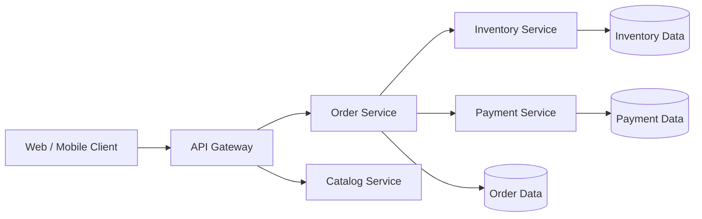
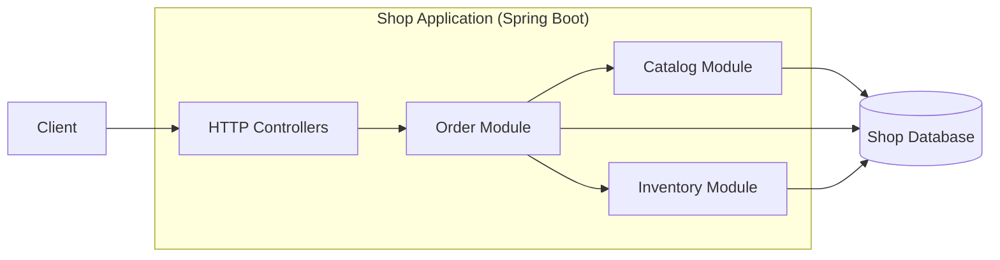
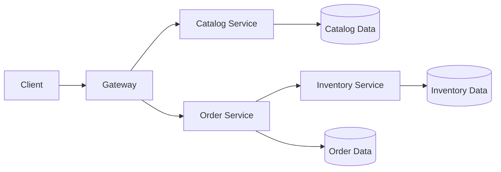

# Phân biệt Spring Boot với Spring Cloud và kiến trúc microservices

Khi bắt đầu học Spring Boot, người học thường gặp ba tên gọi xuất hiện cạnh nhau: **Spring Boot**, **Spring Cloud** và **microservices**. Chúng liên quan chặt chẽ nhưng không cùng loại. Spring Boot là công cụ xây dựng ứng dụng; Spring Cloud là hệ sinh thái hỗ trợ một số vấn đề thường gặp trong hệ thống phân tán; còn microservices là cách thiết kế và tổ chức một hệ thống phần mềm.

Hiểu ranh giới này giúp bạn chọn đúng công cụ, biết lúc nào thực sự cần chia dịch vụ và tránh biến một ứng dụng đơn giản thành hệ thống khó vận hành.

## 1. Ba khái niệm trả lời ba câu hỏi khác nhau

| Khái niệm | Câu hỏi chính | Bản chất | Ví dụ |
|---|---|---|---|
| **Spring Boot** | Làm thế nào tạo, cấu hình, chạy một ứng dụng Spring nhanh và nhất quán? | Framework và công cụ phát triển ứng dụng dựa trên Spring Framework | Một ứng dụng REST API có controller, service, repository, cấu hình và health endpoint |
| **Spring Cloud** | Khi có nhiều ứng dụng/dịch vụ giao tiếp qua mạng, ta xử lý các nhu cầu hạ tầng phân tán như thế nào? | Hệ sinh thái các dự án/thư viện tích hợp với Spring Boot | API Gateway, cấu hình tập trung, service discovery, client-side load balancing, circuit breaker |
| **Microservices** | Nên chia hệ thống thành những đơn vị nghiệp vụ và triển khai độc lập ra sao? | Phong cách kiến trúc phần mềm | Hệ thống bán hàng gồm Order Service, Inventory Service, Payment Service với hợp đồng giao tiếp rõ ràng |

Đặt thêm **Spring Framework** vào bức tranh:

- **Spring Framework** cung cấp nền tảng như dependency injection, IoC container, quản lý bean, Spring MVC/WebFlux, transaction và tích hợp dữ liệu.
- **Spring Boot** xây trên Spring Framework, bổ sung quy ước cấu hình, auto-configuration, starter dependencies, cách đóng gói/chạy ứng dụng và công cụ vận hành.
- **Spring Cloud** cung cấp các thư viện giải quyết một số vấn đề phát sinh khi nhiều ứng dụng phối hợp; phần lớn ứng dụng Spring Cloud được xây bằng Spring Boot.
- **Microservices** là quyết định kiến trúc: chọn ranh giới dịch vụ, quyền sở hữu dữ liệu, cách giao tiếp, cách triển khai và vận hành.

Có thể hình dung:

```text
Spring Framework  →  Nền tảng lập trình ứng dụng Java
       │
       └── Spring Boot  →  Cách tạo và chạy ứng dụng Spring thuận tiện
                  │
                  ├── Có thể xây monolith / modular monolith
                  ├── Có thể xây một microservice
                  └── Có thể kết hợp Spring Cloud khi cần khả năng phân tán

Microservices = quyết định kiến trúc ở cấp toàn hệ thống,
không phải một framework con của Spring Boot hay Spring Cloud.
```

**Kết luận cốt lõi:** Dùng Spring Boot **không đồng nghĩa** đang làm microservices. Dùng Spring Cloud cũng **không tự động** biến ứng dụng thành microservices. Và xây microservices **không bắt buộc** dùng Spring Cloud.

## 2. Spring Boot giải quyết vấn đề ở cấp một ứng dụng

Spring Boot giúp nhà phát triển dành ít công sức hơn cho việc khởi tạo và cấu hình lặp lại, tập trung vào logic nghiệp vụ.

Các khả năng tiêu biểu:

1. **Auto-configuration:** Dựa trên thư viện hiện có, bean và cấu hình, Boot tự đề xuất cấu hình phù hợp. Lập trình viên vẫn có thể ghi đè hoặc tự định nghĩa.
2. **Starters:** Các nhóm dependency theo nhu cầu, ví dụ `spring-boot-starter-web` cho ứng dụng Spring MVC hoặc `spring-boot-starter-data-jpa` cho JPA.
3. **Ứng dụng có thể chạy độc lập:** Với ứng dụng web phù hợp, có thể đóng gói cùng embedded server và chạy bằng `java -jar`.
4. **Externalized configuration:** Dùng `application.yml`, biến môi trường, tham số dòng lệnh và các nguồn cấu hình được hỗ trợ để tách cấu hình khỏi mã nguồn.
5. **Production-ready features:** Spring Boot Actuator cung cấp các endpoint và khả năng phục vụ giám sát như health, metrics, tùy dependency và cấu hình.

Ví dụ, một ứng dụng Spring Boot đơn giản:

```java
import org.springframework.boot.SpringApplication;
import org.springframework.boot.autoconfigure.SpringBootApplication;
import org.springframework.web.bind.annotation.GetMapping;
import org.springframework.web.bind.annotation.PathVariable;
import org.springframework.web.bind.annotation.RequestMapping;
import org.springframework.web.bind.annotation.RestController;

@SpringBootApplication
public class CatalogApplication {
    public static void main(String[] args) {
        SpringApplication.run(CatalogApplication.class, args);
    }
}

@RestController
@RequestMapping("/api/products")
class ProductController {
    @GetMapping("/{sku}")
    ProductView findBySku(@PathVariable String sku) {
        return new ProductView(sku, "Demo product");
    }
}

record ProductView(String sku, String name) {}
```

Với starter web thích hợp, ứng dụng trên cung cấp endpoint `GET /api/products/{sku}`. Nó là **một ứng dụng Spring Boot**. Chỉ nhìn vào annotation `@SpringBootApplication` hay `@RestController`, ta **không thể kết luận** nó là một microservice.

Nếu ứng dụng này chứa toàn bộ các module sản phẩm, giỏ hàng, đặt hàng và thanh toán trong cùng một tiến trình triển khai, ta có thể đang xây một **monolith**. Nếu nó chỉ sở hữu chức năng danh mục trong một hệ thống gồm nhiều dịch vụ độc lập, nó có thể là **Catalog Service** trong kiến trúc microservices. Mã Spring Boot cơ bản không phải yếu tố quyết định; **ranh giới và cách vận hành hệ thống** mới là yếu tố quyết định.

### Spring Boot không tự cung cấp toàn bộ hành vi của hệ thống phân tán

Spring Boot hỗ trợ tạo HTTP API, HTTP client, cấu hình và quan sát ứng dụng. Nhưng khi một yêu cầu đi qua nhiều dịch vụ, các câu hỏi mới xuất hiện:

- Địa chỉ của dịch vụ khác được tìm ở đâu?
- Nếu có nhiều instance, yêu cầu được phân phối như thế nào?
- Nếu dịch vụ phía sau chậm, lỗi hoặc tạm ngừng, ta xử lý ra sao?
- Một request đi qua ba dịch vụ thì theo dõi luồng xử lý như thế nào?
- Nếu đơn hàng đã lưu nhưng thanh toán thất bại, làm sao giữ dữ liệu nhất quán?

Một số bài toán có thể được giải bằng Spring Cloud; một số cần chính sách thiết kế, hạ tầng triển khai hoặc cơ chế dữ liệu khác. Không có framework nào tự giải quyết tất cả.

## 3. Microservices là kiến trúc, không phải tên một dependency

**Microservices** chia một hệ thống thành các dịch vụ tương đối nhỏ, tập trung vào năng lực nghiệp vụ, giao tiếp qua hợp đồng rõ ràng và có thể thay đổi/triển khai với mức độc lập cao. Từ “micro” không có nghĩa mỗi dịch vụ bắt buộc rất ít dòng code, chỉ có một controller hoặc chỉ một bảng.

Những đặc điểm thường hướng tới:

- **Ranh giới nghiệp vụ rõ ràng:** Ví dụ quản lý đơn hàng khác với quản lý tồn kho; lựa chọn ranh giới có thể dựa trên bounded context của Domain-Driven Design.
- **Đóng gói logic và dữ liệu:** Mỗi dịch vụ sở hữu quy tắc nghiệp vụ và cách truy cập dữ liệu của mình. Dịch vụ khác giao tiếp qua API hoặc sự kiện thay vì sửa trực tiếp bảng nội bộ.
- **Triển khai độc lập:** Có thể cập nhật Order Service mà không nhất thiết phát hành lại toàn bộ hệ thống, miễn hợp đồng và các phụ thuộc vẫn tương thích.
- **Giao tiếp qua mạng:** Thường dùng HTTP/REST, gRPC hoặc messaging/event. Giao tiếp qua mạng có độ trễ, timeout, lỗi từng phần và chi phí quan sát.
- **Khả năng mở rộng theo nhu cầu:** Có thể tăng số instance của dịch vụ nhiều tải thay vì luôn mở rộng toàn bộ ứng dụng.
- **Tự chủ có trách nhiệm:** Mỗi dịch vụ cần có kiểm thử, quan sát, vận hành và chính sách triển khai phù hợp; độc lập không có nghĩa được phép phá vỡ hợp đồng của bên dùng.

Một kiến trúc minh họa:



Mỗi hình chữ nhật “Service” có thể là một ứng dụng Spring Boot riêng. Phần Gateway có thể dùng Spring Cloud Gateway hoặc một giải pháp gateway khác. Các mũi tên thể hiện **quan hệ giao tiếp logic**, không bắt buộc mọi request đều phải gọi đồng bộ theo sơ đồ đó.

### “Sở hữu dữ liệu” khác với “mỗi dịch vụ phải có một máy chủ cơ sở dữ liệu”

Trong microservices, nguyên tắc quan trọng là **quyền sở hữu và ranh giới truy cập dữ liệu**. Ví dụ, Inventory Service là nơi quyết định tồn kho còn bao nhiêu; Order Service không nên sửa trực tiếp bảng tồn kho của Inventory Service. Hai dịch vụ có thể dùng các hạ tầng database khác nhau hoặc dùng chung một cụm máy chủ trong giai đoạn đầu, miễn quyền sở hữu được cô lập và không tạo phụ thuộc chặt vào schema nội bộ của nhau.

Nếu chia mã thành năm ứng dụng nhưng tất cả cùng sửa một bộ bảng, phải triển khai cùng lúc và thay đổi một bảng làm hỏng bốn ứng dụng khác, hệ thống dễ trở thành **distributed monolith**: gánh chi phí phân tán nhưng thiếu tính độc lập mong muốn.

## 4. Monolith, modular monolith và microservices

Không phải cứ hệ thống có nhiều module nghiệp vụ là microservices. Ba cách tổ chức phổ biến:

| Tiêu chí | Monolith | Modular monolith | Microservices |
|---|---|---|---|
| Đơn vị triển khai | Thường một ứng dụng | Một ứng dụng | Nhiều dịch vụ |
| Tổ chức mã | Có thể phân lớp hoặc trộn lẫn | Module nghiệp vụ với ranh giới nội bộ rõ | Dịch vụ nghiệp vụ tách tiến trình |
| Giao tiếp giữa phần nghiệp vụ | Gọi hàm/bean trong tiến trình | API/module boundary trong tiến trình | API hoặc sự kiện qua mạng |
| Transaction dữ liệu | Dễ dùng transaction cục bộ | Dễ dùng transaction cục bộ khi cùng kho dữ liệu | Transaction xuyên dịch vụ cần thiết kế riêng |
| Phát hành | Thường cùng một lần | Thường cùng một lần | Có thể phát hành riêng từng dịch vụ |
| Vận hành | Ít thành phần hơn | Ít thành phần, dễ bảo vệ ranh giới | Nhiều triển khai, log, cấu hình, kết nối, chính sách lỗi |
| Trường hợp hợp lý | Sản phẩm nhỏ, MVP | Hệ thống cần cấu trúc tốt nhưng chưa cần phân tán | Ranh giới nghiệp vụ ổn định, nhu cầu phát hành/mở rộng độc lập đủ lớn |

**Modular monolith** thường là một bước khởi đầu tốt: tách Catalog, Order, Inventory thành các module có interface rõ ràng nhưng vẫn chạy trong một ứng dụng Spring Boot. Nếu sau này thật sự cần tách dịch vụ, các ranh giới đã được làm rõ sẽ giúp giảm rủi ro.

Microservices là một lựa chọn có chi phí. Nó không mặc nhiên nhanh hơn, an toàn hơn hay “hiện đại hơn” một modular monolith được thiết kế tốt.

## 5. Spring Cloud hỗ trợ những vấn đề nào?

Spring Cloud là một **hệ sinh thái dự án**, không phải một server duy nhất có tên “Spring Cloud” mà chỉ cần cài lên là hoàn thành kiến trúc phân tán. Mỗi thành phần có mục tiêu riêng; chọn theo vấn đề thực tế.

| Nhu cầu | Ví dụ giải pháp trong hệ sinh thái Spring Cloud | Ý nghĩa |
|---|---|---|
| Điểm vào cho nhiều API | **Spring Cloud Gateway** | Định tuyến request, xử lý một số chính sách ở biên như filter, xác thực tích hợp hoặc giới hạn lưu lượng tùy cấu hình |
| Quản lý cấu hình từ một nguồn chung | **Spring Cloud Config** | Nhiều ứng dụng lấy cấu hình từ nguồn trung tâm; cần chính sách bảo mật và phân tách môi trường |
| Tìm địa chỉ instance dịch vụ | **Spring Cloud Discovery** và adapter như Eureka khi phù hợp | Giúp client tìm dịch vụ theo tên logic thay vì gắn cứng địa chỉ từng instance |
| Chọn một instance để gọi | **Spring Cloud LoadBalancer** | Cân bằng tải phía client khi có nhiều instance được phát hiện |
| Chống lỗi lan truyền | **Spring Cloud CircuitBreaker** cùng implementation phù hợp như Resilience4j | Cung cấp abstraction cho circuit breaker; timeout, retry và fallback cần được thiết kế có chủ đích |
| Gọi HTTP service thuận tiện | **Spring Cloud OpenFeign** trong những hệ thống đang dùng Feign | Khai báo HTTP client theo interface; cần quan tâm tính tương thích/định hướng bảo trì của phiên bản lựa chọn |
| Giao tiếp qua broker/event | **Spring Cloud Stream** | Abstraction cho tích hợp messaging; không thay thế việc thiết kế event, delivery và idempotency |
| Tích hợp môi trường Kubernetes | **Spring Cloud Kubernetes** khi thực sự cần | Các tích hợp với Kubernetes API và cấu hình/service discovery tương ứng |

Không cần cài tất cả thành phần trên. Một ứng dụng có thể chỉ dùng Spring Cloud Gateway; ứng dụng khác dùng Config; dịch vụ thứ ba hoàn toàn không dùng Spring Cloud.

### 5.1. API Gateway

Trong một hệ thống có Catalog, Order và Payment Service, client không nhất thiết phải biết mọi địa chỉ nội bộ. Một gateway có thể nhận `/api/products/**` và chuyển đến Catalog Service, nhận `/api/orders/**` và chuyển đến Order Service.

Gateway còn có thể đảm nhiệm một số mối quan tâm tại biên: xác thực đầu vào, CORS, rate limiting, logging, correlation và routing. Tuy vậy, **gateway không thay cho kiểm tra quyền trong từng dịch vụ**; dịch vụ vẫn phải bảo vệ các thao tác và dữ liệu thuộc trách nhiệm của mình.

Spring Cloud Gateway chỉ là một lựa chọn. NGINX, Traefik, Envoy, API Gateway của cloud provider hoặc ingress/gateway ở Kubernetes cũng có thể thực hiện các chức năng tương tự. Chọn giải pháp theo topology, yêu cầu bảo mật, đội ngũ vận hành và stack hiện có.

### 5.2. Service discovery và load balancing

Giả sử Inventory Service có ba instance:

```text
inventory-instance-1:8080
inventory-instance-2:8080
inventory-instance-3:8080
```

Nếu địa chỉ thay đổi do autoscaling, hard-code từng IP vào Order Service là không bền vững. Discovery cho biết những instance nào đang sẵn sàng; load balancing chọn instance để gửi yêu cầu.

Tuy nhiên, môi trường Kubernetes đã có **Service và DNS** cho nhiều tình huống tìm dịch vụ và phân phối lưu lượng. Khi đó không nhất thiết phải dựng Eureka hay bật discovery phía ứng dụng. Việc dùng Spring Cloud Discovery/LoadBalancer hay tận dụng hạ tầng phụ thuộc mô hình triển khai.

### 5.3. Cấu hình tập trung

Với một ứng dụng, `application.yml` và biến môi trường thường đã đủ. Với nhiều dịch vụ và môi trường, có thể phát sinh nhu cầu quản lý cấu hình tập trung, có phiên bản và chính sách truy cập.

Spring Cloud Config là một giải pháp. Nhưng môi trường container cũng có ConfigMap, Secret, secret manager hoặc dịch vụ cấu hình của nhà cung cấp. **Cấu hình tập trung không có nghĩa đưa mật khẩu vào Git hoặc log**; secret phải được quản lý với quyền truy cập và cơ chế bảo mật thích hợp.

### 5.4. Circuit breaker và lỗi từng phần

Khi Order Service gọi Payment Service, lỗi ở Payment có thể khiến thread/request của Order bị chờ kéo dài hoặc thất bại hàng loạt. Một circuit breaker theo dõi lỗi và có thể tạm ngừng các lời gọi đến dependency đang có vấn đề, giảm áp lực và cho hệ thống cơ hội phục hồi.

Circuit breaker không thay thế **timeout**, **retry có giới hạn** hay thiết kế nghiệp vụ. Đặc biệt, retry thao tác tạo thanh toán có thể gây trùng giao dịch nếu API không hỗ trợ **idempotency key**. Fallback cũng không được tùy tiện trả “thanh toán thành công” khi chưa có xác nhận.

### 5.5. Observability

Khi request đi qua gateway, Order và Inventory, chỉ đọc log một ứng dụng là không đủ. Cần log có correlation ID, metrics, distributed tracing, cảnh báo và dashboard phù hợp.

Trong hệ sinh thái Spring hiện đại, **Spring Boot Actuator, Micrometer và Micrometer Tracing** hỗ trợ nhiều phần của observability; có thể tích hợp OpenTelemetry/collector/backend theo thiết kế triển khai. **Distributed tracing không đòi hỏi bắt buộc phải cài Spring Cloud Sleuth**; Sleuth thuộc các thế hệ công cụ cũ và không nên coi là lựa chọn mặc định cho dự án mới.

## 6. Mối quan hệ thực tế: Có những tổ hợp nào?

| Cách xây dựng | Có hợp lý không? | Tình huống |
|---|---|---|
| **Spring Boot + monolith** | Có | Một backend quản lý người dùng, sản phẩm, đơn hàng; triển khai cùng một ứng dụng |
| **Spring Boot + modular monolith** | Có | Một ứng dụng với module Catalog, Order, Inventory tách ranh giới nội bộ |
| **Nhiều Spring Boot services, không Spring Cloud** | Có | Mỗi dịch vụ độc lập; giao tiếp qua HTTP, DNS/Kubernetes Service, broker và hạ tầng sẵn có |
| **Nhiều Spring Boot services + một số Spring Cloud projects** | Có | Cần Spring Cloud Gateway, Config, CircuitBreaker hoặc discovery theo nhu cầu |
| **Spring Cloud nhưng chưa có microservices** | Có thể xảy ra | Một ứng dụng dùng một thư viện Cloud cho nhu cầu riêng; dependency không chứng minh kiến trúc |
| **Microservices không dùng Java/Spring** | Có | Dịch vụ xây bằng Go, Node.js, .NET, Python hoặc kết hợp nhiều stack |

Đây là điểm giúp đọc đúng câu nói “chúng tôi làm hệ thống Spring Boot microservices”: nó thường có nghĩa **mỗi dịch vụ được triển khai bằng Spring Boot**, còn kiến trúc toàn hệ thống là microservices. Tên công nghệ và tên kiến trúc đóng hai vai trò khác nhau.

## 7. Ví dụ xuyên suốt: Hệ thống bán hàng

Giả sử một cửa hàng cần ba chức năng: xem sản phẩm, tạo đơn hàng và kiểm tra tồn kho.

### Phương án A: Một ứng dụng Spring Boot có nhiều module



Trong trường hợp này:

- Catalog, Order và Inventory cùng chạy trong **một tiến trình ứng dụng**.
- Order Module có thể gọi một interface do Inventory Module cung cấp ngay trong tiến trình.
- Có thể dùng transaction cục bộ của cơ sở dữ liệu khi các thao tác thật sự nằm trong cùng phạm vi transaction.
- Chỉ cần một pipeline triển khai ứng dụng chính; không nhất thiết có gateway hoặc service registry riêng.

Đây vẫn là **Spring Boot Fundamentals** đúng nghĩa: xây API, dependency injection, phân lớp, quản lý dữ liệu, transaction, cấu hình và kiểm thử. Tổ chức module tốt ngay từ đầu giúp hệ thống dễ mở rộng về sau.

### Phương án B: Tách thành các Spring Boot microservices



Ở phương án này:

1. **Catalog Service** sở hữu thông tin sản phẩm và API tra cứu.
2. **Order Service** sở hữu vòng đời đơn hàng và trạng thái xử lý.
3. **Inventory Service** sở hữu lượng tồn và các quy tắc giữ/trừ hàng.
4. Client có thể đi qua Gateway; Order Service gọi Inventory Service hoặc sử dụng sự kiện, tùy luồng nghiệp vụ.
5. Mỗi dịch vụ có artifact, cấu hình, số instance và vòng đời triển khai riêng.

Sự thay đổi quan trọng **không phải** chuyển annotation từ `@Service` sang “microservice annotation” nào đó. Ta phải xác định hợp đồng API, quyền sở hữu dữ liệu, cơ chế lỗi, transaction xuyên dịch vụ, quan sát và cách triển khai.

### Một luồng đặt hàng và những gì có thể hỏng

Giả sử luồng đồng bộ:

```text
POST /orders
    ↓
Order Service tạo đơn PENDING
    ↓
Order Service yêu cầu Inventory Service giữ hàng
    ├── Thành công → đơn chuyển sang bước thanh toán
    ├── Hết hàng  → từ chối / hủy đơn
    └── Timeout   → chưa biết giữ hàng thành công hay thất bại
```

Điểm “timeout → chưa biết” là một khác biệt lớn so với gọi hàm cục bộ. Timeout không chứng minh phía Inventory chưa xử lý. Nếu Order tự động gọi lại mà không có mã yêu cầu ổn định hoặc idempotency, hàng có thể bị giữ hai lần.

Một thiết kế thực tế thường cân nhắc:

- Định nghĩa trạng thái đơn và giữ hàng như `PENDING`, `RESERVED`, `REJECTED`.
- Sử dụng **idempotency key** hoặc định danh yêu cầu để xử lý lời gọi lặp.
- Thiết lập timeout rõ ràng; chỉ retry các thao tác an toàn hoặc có cơ chế chống lặp.
- Có cơ chế bù trừ khi quy trình nhiều bước thất bại, ví dụ hủy giữ hàng sau khi thanh toán không thành công.
- Với luồng sự kiện, dùng outbox/inbox hoặc kỹ thuật tương đương để giảm khoảng trống giữa ghi database và phát/nhận event.

**Saga**, event-driven communication và eventual consistency là các kỹ thuật thiết kế hệ thống phân tán. Chúng không được kích hoạt tự động chỉ bằng cách thêm Spring Cloud vào `build.gradle`.

## 8. Một ví dụ HTTP để thấy đâu là Boot, đâu là kiến trúc

Giả sử Catalog Service từ ví dụ ở mục 2 chạy ở cổng 8081. Một Order Application khác muốn đọc tên sản phẩm. Với Spring Boot và Spring Framework, ta đã có thể tạo HTTP client mà **chưa cần Spring Cloud**.

Trong cấu hình Order Application:

```yaml
catalog:
  base-url: http://localhost:8081
```

Một controller minh họa lời gọi:

```java
import org.springframework.beans.factory.annotation.Value;
import org.springframework.web.bind.annotation.GetMapping;
import org.springframework.web.bind.annotation.PathVariable;
import org.springframework.web.bind.annotation.RequestMapping;
import org.springframework.web.bind.annotation.RestController;
import org.springframework.web.client.RestClient;

@RestController
@RequestMapping("/api/orders")
class OrderController {
    private final RestClient catalogClient;

    OrderController(
            RestClient.Builder builder,
            @Value("${catalog.base-url}") String catalogBaseUrl
    ) {
        this.catalogClient = builder.baseUrl(catalogBaseUrl).build();
    }

    @GetMapping("/product-name/{sku}")
    String findProductName(@PathVariable String sku) {
        ProductView product = catalogClient.get()
                .uri("/api/products/{sku}", sku)
                .retrieve()
                .body(ProductView.class);
        return product == null ? "Unknown product" : product.name();
    }
}

record ProductView(String sku, String name) {}
```

Đoạn ví dụ dùng API `RestClient` của Spring Framework và khả năng tự cấu hình builder của Spring Boot phù hợp với phiên bản hỗ trợ. Hai tiến trình giao tiếp HTTP qua một địa chỉ cố định, nên đây là một **ví dụ giao tiếp liên ứng dụng**; chỉ riêng điều đó chưa đủ chứng minh hệ thống được thiết kế thành microservices tốt.

Trong môi trường thực tế, cần bổ sung ít nhất timeout, xử lý mã lỗi, bảo mật, kiểm thử hợp đồng và quan sát. Nếu có nhiều instance Catalog và địa chỉ thay đổi, có thể dùng DNS/service của nền tảng, discovery/load balancing, hoặc cấu hình routing khác.

**Lưu ý về mã minh họa:** Biểu thức `@Value("${catalog.base-url}")` đọc thuộc tính `catalog.base-url` từ cấu hình. Đây là địa chỉ cấu hình tĩnh cho ví dụ; muốn phát hiện địa chỉ dịch vụ động cần thêm giải pháp hạ tầng phù hợp.

### Nếu bổ sung Spring Cloud thì thay đổi gì?

Ta có thể bổ sung **một dịch vụ gateway** xây trên Spring Boot và Spring Cloud Gateway để client chỉ gọi một điểm vào. Có thể bổ sung Spring Cloud CircuitBreaker ở lời gọi Catalog và thêm nguồn config/discovery khi cần. Các thư viện ấy **hỗ trợ cơ chế giao tiếp/vận hành**; chúng không tự quyết định Catalog sở hữu bảng nào hoặc ranh giới Order và Catalog đặt ở đâu.

Một minh họa cấu hình định tuyến ở mức ý tưởng:

```text
Client gọi GET /api/products/ABC
  → Gateway khớp đường dẫn /api/products/**
  → Chuyển đến Catalog Service
  → Trả phản hồi về Client
```

Thuộc tính cấu hình và starter cụ thể của Spring Cloud Gateway có thể khác theo phiên bản và theo lựa chọn stack Servlet/WebFlux. Khi thực hành, hãy đọc tài liệu đúng **cặp phiên bản Spring Boot và Spring Cloud** đang dùng, đồng thời tạo gateway thành ứng dụng phù hợp với stack đã chọn.

## 9. Điều gì khiến microservices khó hơn một ứng dụng đơn?

### 9.1. Network không đáng tin như lời gọi trong cùng tiến trình

Lời gọi Java thông thường hoặc chạy thành công hoặc ném lỗi theo ngữ cảnh chương trình. Lời gọi HTTP có thể mất kết nối sau khi phía nhận đã xử lý xong; client không biết chắc kết quả nếu thiếu giao thức xác nhận. Cần phân biệt:

- **Lỗi đã xác nhận:** Dịch vụ trả phản hồi nghiệp vụ rõ ràng, ví dụ hết hàng.
- **Lỗi hạ tầng:** DNS, kết nối, TLS, gateway, dependency gặp sự cố.
- **Kết quả chưa rõ:** Timeout trước khi nhận phản hồi, dù bên nhận có thể đã ghi dữ liệu.

Đối với thao tác thay đổi trạng thái, việc xử lý yêu cầu lặp thường quan trọng hơn việc “retry cho đến khi thành công”.

### 9.2. Transaction xuyên dịch vụ

Trong một database và một transaction cục bộ, Spring có thể quản lý commit/rollback dễ hơn. Giữa Order Database và Inventory Database, một `@Transactional` trong Order Service **không** tự động rollback transaction đã commit ở Inventory Service.

Phải thiết kế business workflow phù hợp: trạng thái tạm, sự kiện, saga/compensation hoặc cơ chế đồng bộ rõ ràng. Eventual consistency nghĩa dữ liệu ở các nơi có thể nhất thời khác nhau, nên API và UX phải phản ánh được trạng thái “đang xử lý”.

### 9.3. Độc lập triển khai đòi hỏi hợp đồng tương thích

Nếu Catalog đổi response từ `productId` sang `sku`, Order có thể hỏng dù hai dịch vụ đều build thành công riêng. Vì thế cần versioning hợp đồng, contract testing, backward compatibility và chiến lược phát hành/rollback.

### 9.4. Quan sát và vận hành phức tạp hơn

Thay vì một log file và một instance, có nhiều service, instance và môi trường. Cần trả lời: request bắt đầu ở đâu, thất bại ở bước nào, dependency nào làm tăng latency và ảnh hưởng tới người dùng bao nhiêu. Health/readiness, metrics, structured logging, tracing và cảnh báo trở thành năng lực vận hành thiết yếu.

### 9.5. Chi phí tổ chức cũng là chi phí kiến trúc

Mỗi dịch vụ mới kéo theo pipeline, quyền truy cập, dependency, cấu hình, test, dashboard và trách nhiệm vận hành. Một tổ chức nhỏ, chưa có CI/CD và quan sát đủ tốt có thể nhận nhiều rủi ro hơn lợi ích khi chia dịch vụ quá sớm.

## 10. Quyết định khi nào dùng Spring Boot, Spring Cloud và microservices

Hãy ra quyết định theo **bài toán** chứ không theo danh sách công nghệ phổ biến.

| Bối cảnh | Lựa chọn thường hợp lý | Vì sao |
|---|---|---|
| Bắt đầu ứng dụng REST API, CRUD, authentication, persistence | **Spring Boot** | Cần một ứng dụng ổn định trước khi tính đến phân tán |
| Ứng dụng có nhiều nghiệp vụ nhưng một nhóm phát triển, phát hành cùng nhịp | **Spring Boot + modular monolith** | Giữ cấu trúc tốt, giảm chi phí hệ thống phân tán |
| Các vùng nghiệp vụ có nhu cầu phát hành/mở rộng khác nhau, nhóm sở hữu độc lập | **Cân nhắc microservices** | Tính độc lập có thể tạo giá trị lớn hơn chi phí |
| Có nhiều dịch vụ cần điểm vào thống nhất và policy ở biên | **Gateway** (Spring Cloud Gateway hoặc giải pháp nền tảng) | Giải quyết routing và chính sách ở biên |
| Service instance thay đổi liên tục | **Discovery/load balancing phù hợp môi trường** | Có thể dùng Kubernetes Service/DNS hoặc Spring Cloud |
| Lời gọi liên dịch vụ cần kiểm soát lỗi lan truyền | **Timeout, resilience và circuit breaker khi phù hợp** | Tăng khả năng chịu lỗi, nhưng cần idempotency/giới hạn retry |
| Nhiều dịch vụ có nhu cầu quản lý cấu hình tập trung | **Spring Cloud Config hoặc config/secret platform** | Chọn một nguồn cấu hình được vận hành nhất quán |

Một chuỗi quyết định thực dụng:

1. **Bắt đầu từ năng lực nghiệp vụ** và ranh giới module.
2. **Đo nhu cầu thật**: nhóm phát triển, tần suất phát hành, tải, độ sẵn sàng, yêu cầu tuân thủ và cách vận hành.
3. **Nếu chưa cần deploy độc lập**, dùng modular monolith để giữ hệ thống đơn giản.
4. **Nếu cần tách**, xác định ownership, API/event contracts, mô hình dữ liệu, failure mode và quan sát trước.
5. **Chỉ chọn Spring Cloud module cho khoảng trống cụ thể**, sau khi xem nền tảng triển khai đã cung cấp khả năng đó chưa.

### Vấn đề tương thích phiên bản

Spring Boot và Spring Cloud có **ma trận tương thích phiên bản**. Trong dự án thật, cần chọn một Spring Cloud release train phù hợp với phiên bản Spring Boot, quản lý dependency qua BOM/dependency management tương ứng và kiểm tra hướng dẫn của từng starter. Không nên sao chép một starter hoặc ví dụ từ khóa học cũ rồi giả định nó hỗ trợ mọi phiên bản mới.

Ngoài ra, nhiều tài liệu cũ nhắc **Netflix Ribbon**, **Hystrix** hoặc **Spring Cloud Sleuth** như lựa chọn mặc định. Với dự án hiện đại, hãy ưu tiên tài liệu hiện hành về Spring Cloud LoadBalancer, Spring Cloud CircuitBreaker/Resilience4j và Micrometer Tracing tương ứng. Không đồng nhất tên các thư viện lịch sử với toàn bộ hệ sinh thái Spring Cloud hiện tại.

## 11. Những hiểu lầm thường gặp

| Nhận định | Đúng hay sai? | Cách hiểu đúng |
|---|---|---|
| “Cứ có `@SpringBootApplication` là microservice.” | **Sai** | Đây là entry point/cấu hình của một ứng dụng Boot; kiến trúc cần được đánh giá ở cấp hệ thống |
| “Muốn làm microservices phải cài Spring Cloud.” | **Sai** | Có thể dùng Spring Boot + hạ tầng Kubernetes/DNS/broker hoặc công nghệ khác |
| “Spring Cloud thay thế Spring Boot.” | **Sai** | Spring Cloud bổ sung thư viện cho các nhu cầu phân tán, thường dựa trên ứng dụng Spring Boot |
| “Chỉ cần thêm Eureka và Gateway thì hệ thống thành microservices.” | **Sai** | Còn cần ranh giới nghiệp vụ, ownership, hợp đồng, triển khai và khả năng vận hành |
| “Mỗi controller phải là một service riêng.” | **Sai** | Dịch vụ nên bám theo năng lực nghiệp vụ, không theo số endpoint |
| “Microservices luôn chạy trên public cloud.” | **Sai** | Có thể vận hành on-premises; “microservices” và “cloud hosting” là hai quyết định khác nhau |
| “Mỗi microservice bắt buộc là một repository và một máy chủ database riêng.” | **Sai** | Repository và hạ tầng vật lý là lựa chọn tổ chức; điều cốt lõi là ranh giới và quyền sở hữu |
| “Circuit breaker giúp mọi giao dịch an toàn khi retry.” | **Sai** | Giao dịch còn cần idempotency, timeout, trạng thái nghiệp vụ và xử lý kết quả chưa rõ |
| “Monolith luôn là thiết kế tệ.” | **Sai** | Modular monolith có thể là lựa chọn rất tốt nếu chưa cần phân tán |

## 12. Bài tập tư duy

Hãy xét ba hệ thống sau và trả lời: **Đâu là ứng dụng Spring Boot? Đâu là microservices? Spring Cloud có bắt buộc không?**

**Tình huống A.** Một ứng dụng Spring Boot có module User, Product và Order, một database, một artifact deploy. Các module dùng interface nội bộ để giao tiếp.

**Tình huống B.** Ba ứng dụng Spring Boot tách Order, Catalog, Inventory; từng dịch vụ sở hữu dữ liệu, có thể triển khai độc lập. Chúng giao tiếp qua HTTP và tên DNS của Kubernetes; không dùng dependency Spring Cloud.

**Tình huống C.** Một hệ thống tách năm ứng dụng, cài Eureka và Gateway, nhưng mọi ứng dụng sửa cùng các bảng dữ liệu và mỗi lần đổi schema đều phải phát hành lại tất cả.

**Gợi ý đáp án:**

- **A:** Là Spring Boot modular monolith, không phải microservices chỉ vì có nhiều module; Spring Cloud không bắt buộc.
- **B:** Có thể là kiến trúc microservices đúng nghĩa nếu ranh giới và vận hành thực sự độc lập. Không cần Spring Cloud chỉ để có nhãn “microservices”.
- **C:** Có thành phần hạ tầng thường gặp trong hệ thống phân tán, nhưng ranh giới dữ liệu và khả năng phát hành độc lập yếu; dễ là distributed monolith. Eureka/Gateway không khắc phục được vấn đề thiết kế này.

Hãy thử vẽ sơ đồ cho cả ba trường hợp và đánh dấu: **đơn vị triển khai**, **ranh giới dữ liệu**, **kiểu giao tiếp** và **điểm có thể thất bại**. Bốn yếu tố này thường cho thấy kiến trúc rõ hơn tên framework trong `build.gradle`.

## 13. Ghi nhớ để học các chủ đề Spring Boot tiếp theo

- **Spring Framework** là nền tảng DI, web, data và nhiều khả năng ứng dụng khác.
- **Spring Boot** giúp tạo, cấu hình, chạy và vận hành một ứng dụng Spring thuận tiện hơn. Bạn có thể dùng Boot cho monolith, modular monolith hoặc một microservice.
- **Microservices** là lựa chọn thiết kế nhiều dịch vụ theo ranh giới nghiệp vụ, với hợp đồng và vận hành độc lập tương đối. Chia tiến trình tạo thêm bài toán network, dữ liệu phân tán và tổ chức.
- **Spring Cloud** là tập hợp công cụ hỗ trợ một số bài toán giữa các dịch vụ; chọn từng công cụ theo nhu cầu và hạ tầng hiện có.

Khi gặp một công nghệ mới trong hệ sinh thái Spring, hãy hỏi: **“Nó giúp ứng dụng của mình chạy tốt hơn, giúp các dịch vụ phối hợp tốt hơn, hay nó là quyết định về cách chia cả hệ thống?”** Câu hỏi đó giúp đặt đúng Spring Boot, Spring Cloud và microservices vào bức tranh kiến trúc.
