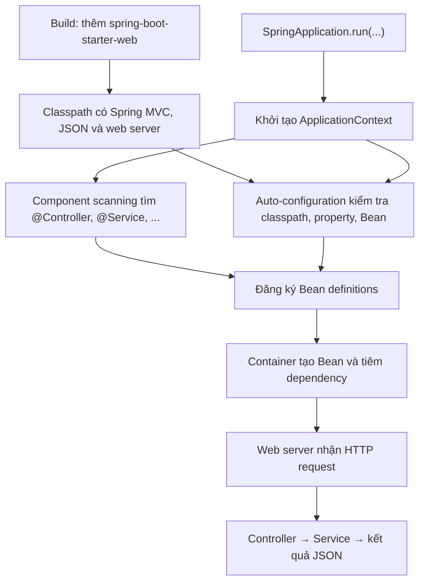
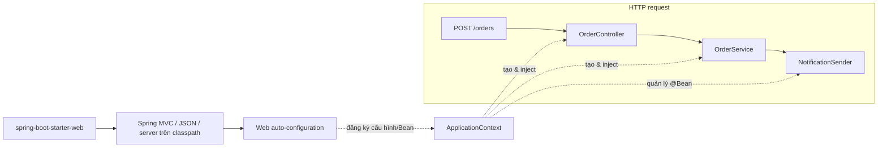

# Bean, container, dependency injection, starter và auto-configuration trong một bức tranh

Khi mới học Spring Boot, bạn thường thấy một điều khá lạ: chỉ cần thêm một dependency, viết vài class có annotation rồi chạy hàm `main`, ứng dụng đã có HTTP server, API trả JSON và các đối tượng tự tìm được nhau. Điều này dễ tạo cảm giác Spring Boot đang làm mọi thứ một cách bí ẩn.

Thực tế, có **năm khái niệm phối hợp với nhau**:

- **Bean** là đối tượng được Spring đăng ký và quản lý.
- **Container** (thường là `ApplicationContext`) giữ thông tin về Bean, tạo chúng, kết nối các dependency và quản lý vòng đời.
- **Dependency injection (DI)** là cách một đối tượng nhận đối tượng mà nó cần từ bên ngoài, thường do container cung cấp.
- **Starter** là gói dependency được Spring Boot chọn sẵn cho một nhu cầu, ví dụ xây dựng REST API hoặc truy cập cơ sở dữ liệu.
- **Auto-configuration** là cơ chế Spring Boot đọc những gì có trên classpath, cấu hình ứng dụng và các Bean đã khai báo để tự đề xuất cấu hình, Bean phù hợp.

Điểm quan trọng là **starter không tự tiêm dependency**, **DI không tự quyết định cần thư viện nào**, còn **auto-configuration không thay thế container**. Tất cả cùng dẫn về một nơi: container quản lý các Bean tạo nên ứng dụng.

## 1. Toàn cảnh: từ dependency đến HTTP request

Giả sử bạn muốn viết một REST API nhận yêu cầu tạo đơn hàng. Bạn khai báo `spring-boot-starter-web`, tạo một controller và một service. Ở mức khái niệm, quá trình diễn ra như sau:



Sơ đồ đã đơn giản hóa một số giai đoạn nội bộ. Nó cho thấy mối liên hệ nhân quả, không phải thứ tự tuyệt đối của từng callback khi Spring khởi động. Chẳng hạn Bean `@Lazy` có thể chỉ được tạo khi cần, và các điều kiện auto-configuration được đánh giá trong quá trình xử lý cấu hình.

| Thành phần | Trả lời câu hỏi | Ví dụ |
|---|---|---|
| Bean | “Đối tượng nào thuộc quyền quản lý của Spring?” | Một instance của `OrderService` |
| Container | “Ai tạo, lưu, nối và quản lý các đối tượng đó?” | `ApplicationContext` |
| DI | “`OrderService` nhận `NotificationSender` như thế nào?” | Qua tham số constructor |
| Starter | “Tôi cần các thư viện nào để xây REST API?” | `spring-boot-starter-web` |
| Auto-configuration | “Với những thư viện và thiết lập hiện có, cần cấu hình gì?” | Cấu hình Spring MVC, JSON, web server phù hợp |

## 2. Bean: đối tượng Java có sự quản lý của Spring

Một đối tượng Java bình thường được tạo bằng `new`:

```java
OrderService service = new OrderService(sender);
```

Đây chỉ là một object, chưa tự động trở thành Spring Bean. Nó trở thành Bean khi được **đăng ký vào Spring container**. Từ đó container có thể biết kiểu của Bean, tên, scope, các dependency cần thiết và những xử lý vòng đời áp dụng cho nó.

Spring có nhiều cách đăng ký Bean; hai cách thường gặp nhất là:

**Cách 1 — đánh dấu class để component scanning phát hiện:**

```java
@Service
public class OrderService {
    // Logic nghiệp vụ
}
```

Các annotation như `@Component`, `@Service`, `@Repository` và `@Controller`/`@RestController` đều có thể khiến class được nhận diện như một component khi nó nằm trong vùng package được quét. `@Service` diễn đạt rõ vai trò nghiệp vụ; `@Repository` dành cho tầng truy cập dữ liệu, đồng thời có ý nghĩa trong cơ chế chuyển đổi một số lỗi truy cập dữ liệu của Spring.

**Cách 2 — khai báo một factory method với `@Bean`:**

```java
@Configuration(proxyBeanMethods = false)
public class NotificationConfiguration {

    @Bean
    NotificationSender notificationSender() {
        return new ConsoleNotificationSender();
    }
}
```

Đây là cách phù hợp khi object đến từ một thư viện bên ngoài, không thể hoặc không nên sửa class để gắn `@Component`. Với `@Bean`, **giá trị trả về** của method được đăng ký thành Bean. Method thường có tên làm tên Bean mặc định; bạn cũng có thể đặt tên cụ thể bằng `@Bean("customSender")`.

Điều cần nhớ:

- Một class được đánh dấu `@Service` **chưa chắc** thành Bean nếu nó không nằm trong phạm vi scan hoặc không được import/đăng ký bằng cách khác.
- Một class hoàn toàn không có annotation của Spring **vẫn có thể** trở thành Bean thông qua `@Bean` hoặc cơ chế đăng ký khác.
- Hai Bean có thể cùng kiểu Java nhưng khác tên và cấu hình. Khi inject theo kiểu, Spring có thể phải lựa chọn giữa các ứng viên.
- Một đối tượng bạn tự tạo bằng `new` ở đâu đó trong ứng dụng không tự động nhận những xử lý quản lý vòng đời/DI dành cho Bean.

### Bean không đồng nghĩa với class, cũng không đồng nghĩa với singleton toàn JVM

Bean là **một đối tượng được quản lý**, còn class là định nghĩa kiểu. Mặc định, Bean có scope `singleton`: container thường dùng **một instance cho mỗi Bean definition trong chính container đó**. Đây không phải bảo đảm rằng toàn bộ JVM chỉ có một instance của class.

Một số scope phổ biến:

| Scope | Ý nghĩa |
|---|---|
| `singleton` (mặc định) | Một instance cho một Bean definition trong container |
| `prototype` | Tạo instance mới mỗi khi container được yêu cầu lấy Bean đó |
| `request` | Một instance trong phạm vi một HTTP request; cần web-aware context |
| `session` | Một instance trong phạm vi một HTTP session; cần web-aware context |

Với Bean singleton, tránh giữ dữ liệu thay đổi riêng cho từng request trong field như `currentUser` hoặc `currentOrder`: nhiều request có thể dùng chung instance và dẫn tới lỗi tranh chấp hoặc rò rỉ trạng thái. Singleton service thường nên không có trạng thái request, hoặc chỉ giữ dependency an toàn khi chia sẻ.

## 3. Container: nơi các Bean hình thành một hệ thống

**Inversion of Control (IoC)** nghĩa là trách nhiệm tạo và kết nối phần lớn đối tượng ứng dụng được chuyển từ code nghiệp vụ sang một cơ chế bên ngoài. Trong Spring, cơ chế đó là IoC container.

Hai interface quan trọng:

- `BeanFactory` cung cấp các khả năng cốt lõi để quản lý và truy xuất Bean.
- `ApplicationContext` mở rộng chức năng của `BeanFactory` với những tiện ích như sự kiện, tài nguyên, thông điệp quốc tế hóa và tích hợp môi trường cấu hình. Ứng dụng Spring Boot thường làm việc với một `ApplicationContext`.

Lời gọi:

```java
SpringApplication.run(ShopApplication.class, args);
```

khởi động cơ chế Spring Boot và tạo/refresh application context phù hợp loại ứng dụng. Ở một ứng dụng Servlet web thông thường, context phối hợp việc chuẩn bị embedded server và các Bean phục vụ HTTP.

Container không chỉ là một `Map<String, Object>`. Nó xử lý **Bean definition** (thông tin cách tạo Bean), dependency, scope, vòng đời và các extension như `BeanPostProcessor`. Ở mức học nhập môn, có thể hình dung:

1. Spring đọc các nguồn định nghĩa Bean: class được scan, method `@Bean`, import cấu hình và các định nghĩa từ auto-configuration.
2. Spring tổng hợp các định nghĩa và giải quyết dependency cần thiết.
3. Khi cần tạo Bean, Spring chọn constructor/factory method, cung cấp dependency, rồi thực hiện những xử lý khởi tạo tương ứng.
4. Bean được đưa vào sử dụng trong ứng dụng; khi context đóng, Spring thực hiện cleanup cho các Bean thuộc scope mà nó quản lý vòng đời hủy.

Thứ tự cụ thể có ngoại lệ: Bean lazy/prototype có thể được tạo vào thời điểm khác; không nên suy ra toàn bộ Bean luôn được khởi tạo ngay trong bước 3.

### Vòng đời Bean ở mức cơ bản

Đối với một Bean singleton thông thường:

```text
Định nghĩa Bean
    ↓
Tạo instance (constructor / factory method)
    ↓
Tiêm dependency và xử lý Bean
    ↓
Callback khởi tạo (ví dụ @PostConstruct)
    ↓
Bean sẵn sàng phục vụ
    ↓
Đóng ApplicationContext
    ↓
Callback dọn dẹp (ví dụ @PreDestroy)
```

Trong Spring Boot 3, các annotation lifecycle chuẩn dùng namespace `jakarta.annotation`:

```java
import jakarta.annotation.PostConstruct;
import jakarta.annotation.PreDestroy;
import org.springframework.stereotype.Component;

@Component
public class CacheLifecycle {

    @PostConstruct
    void initialize() {
        // Chạy sau khi dependency đã được tiêm và Bean được khởi tạo.
    }

    @PreDestroy
    void shutdown() {
        // Dọn dẹp trước khi Bean singleton này bị container hủy.
    }
}
```

Trong thực tế, đừng đặt thao tác khởi động rất lâu hoặc nghiệp vụ phụ thuộc vào HTTP request vào `@PostConstruct`. Hãy chọn lifecycle hook phù hợp với nhu cầu, ví dụ `ApplicationRunner`/`CommandLineRunner` cho công việc cần chạy sau khi context đã được chuẩn bị.

## 4. Dependency injection: kết nối các Bean mà không ghép cứng cách khởi tạo

Một service thường cần cộng tác với các object khác. Ví dụ `OrderService` cần gửi thông báo. Nếu tự tạo dependency:

```java
public class OrderService {
    private final ConsoleNotificationSender sender =
            new ConsoleNotificationSender();
}
```

thì logic đơn hàng gắn cứng với một cách gửi thông báo. Muốn chuyển qua email thật hoặc viết unit test dùng fake sender, bạn phải sửa/chèn code tạo object.

Với **constructor injection**, service chỉ mô tả điều nó cần:

```java
public interface NotificationSender {
    void send(String recipient, String message);
}

@Service
public class OrderService {
    private final NotificationSender sender;

    public OrderService(NotificationSender sender) {
        this.sender = sender;
    }

    public void placeOrder(String customer) {
        sender.send(customer, "Đã tạo đơn hàng");
    }
}
```

Khi Spring tạo `OrderService`, container tìm một Bean có thể gán vào kiểu `NotificationSender` và truyền nó vào constructor. Đây chính là DI. Service **không cần biết** Bean đó do component scan, method `@Bean` hay auto-configuration tạo ra.

Constructor injection thường là lựa chọn ưu tiên vì:

- Dependency bắt buộc xuất hiện ngay trong chữ ký constructor; object không ở trạng thái thiếu dependency sau khi tạo thành công.
- Field có thể khai báo `final` và dễ kiểm tra tính bất biến của cấu trúc object.
- Unit test có thể tạo service trực tiếp bằng `new OrderService(fakeSender)`, không cần khởi động Spring context.
- Quan hệ phụ thuộc hiển thị rõ, dễ phát hiện class đang ôm quá nhiều trách nhiệm.

Nếu class có **một constructor duy nhất**, Spring tự dùng nó để inject nên không cần thêm `@Autowired`. Spring cũng hỗ trợ setter injection và field injection, nhưng với dependency bắt buộc trong code ứng dụng, constructor injection thường dễ duy trì hơn.

### DI theo kiểu và trường hợp có nhiều Bean

Giả sử container có hai Bean cùng implement `NotificationSender`: một gửi email, một ghi log. Nếu constructor chỉ yêu cầu `NotificationSender`, Spring không đủ thông tin để quyết định Bean nào và thường báo lỗi nhiều ứng viên, chẳng hạn `NoUniqueBeanDefinitionException`.

Có thể giải quyết bằng cách nêu rõ qualifier:

```java
@Service
public class OrderService {
    private final NotificationSender sender;

    public OrderService(
            @Qualifier("consoleSender") NotificationSender sender
    ) {
        this.sender = sender;
    }
}
```

Ví dụ trên giả định **đã có** Bean tên `consoleSender` (qua `@Component("consoleSender")` hoặc `@Bean("consoleSender")`). Đừng thêm nguyên đoạn này vào ví dụ ở phần sau nếu chưa đổi tên Bean tương ứng.

Một lựa chọn khác là đánh dấu Bean mặc định bằng `@Primary`. Khi dependency thật sự tùy chọn hoặc có nhiều instance cần duyệt, các cơ chế như `ObjectProvider<T>`, `Optional<T>` và `List<T>` có thể phù hợp. Không nên dùng chúng để che giấu một dependency bắt buộc đang bị thiếu.

**Circular dependency** xảy ra khi `A` cần `B` trong constructor nhưng `B` lại cần `A`. Spring Boot hiện đại mặc định không khuyến khích và thường từ chối loại vòng phụ thuộc này. Cách xử lý nên là thiết kế lại trách nhiệm hoặc luồng giao tiếp, thay vì bật cấu hình cho phép circular reference.

## 5. Ví dụ xuyên suốt: một REST API nhỏ

Ta ghép các khái niệm bằng ứng dụng `ShopApplication`. API `POST /orders?customer=Lan` sẽ gọi service; service sử dụng một sender được khai báo qua `@Bean`. Đây là ví dụ tối giản để thấy container kết nối các class; nó chưa lưu đơn hàng vào database.

### 5.1. Thêm starter web

Trong một dự án Gradle **đã cấu hình Spring Boot plugin và quản lý phiên bản dependency của Boot**, thêm:

```groovy
dependencies {
    implementation 'org.springframework.boot:spring-boot-starter-web'
}
```

Không cần khai báo thủ công từng dependency cho Spring MVC, các thư viện JSON thông dụng và embedded Tomcat mặc định: starter giúp tập hợp chúng theo bộ phiên bản tương thích.

### 5.2. Cấu trúc package

```text
src/main/java/com/example/shop/
├── ShopApplication.java
├── notification/
│   ├── NotificationSender.java
│   ├── ConsoleNotificationSender.java
│   └── NotificationConfiguration.java
└── order/
    ├── OrderReceipt.java
    ├── OrderService.java
    └── OrderController.java
```

**File `ShopApplication.java`:**

```java
package com.example.shop;

import org.springframework.boot.SpringApplication;
import org.springframework.boot.autoconfigure.SpringBootApplication;

@SpringBootApplication
public class ShopApplication {
    public static void main(String[] args) {
        SpringApplication.run(ShopApplication.class, args);
    }
}
```

**File `notification/NotificationSender.java`:**

```java
package com.example.shop.notification;

public interface NotificationSender {
    void send(String recipient, String message);
}
```

**File `notification/ConsoleNotificationSender.java`:**

```java
package com.example.shop.notification;

public class ConsoleNotificationSender implements NotificationSender {
    @Override
    public void send(String recipient, String message) {
        System.out.println("To " + recipient + ": " + message);
    }
}
```

Đây là plain Java class, không gắn `@Component`. Nó sẽ được đăng ký thành Bean qua cấu hình bên dưới.

**File `notification/NotificationConfiguration.java`:**

```java
package com.example.shop.notification;

import org.springframework.context.annotation.Bean;
import org.springframework.context.annotation.Configuration;

@Configuration(proxyBeanMethods = false)
public class NotificationConfiguration {

    @Bean
    NotificationSender notificationSender() {
        return new ConsoleNotificationSender();
    }
}
```

Method `notificationSender()` định nghĩa một Bean tên `notificationSender`, có kiểu `NotificationSender` và instance triển khai thực tế `ConsoleNotificationSender`. `proxyBeanMethods = false` phù hợp ở đây vì ta không gọi qua lại các method `@Bean` để phụ thuộc vào cơ chế proxy.

**File `order/OrderReceipt.java`:**

```java
package com.example.shop.order;

public record OrderReceipt(String status, String customer) {
}
```

**File `order/OrderService.java`:**

```java
package com.example.shop.order;

import com.example.shop.notification.NotificationSender;
import org.springframework.stereotype.Service;

@Service
public class OrderService {
    private final NotificationSender sender;

    public OrderService(NotificationSender sender) {
        this.sender = sender;
    }

    public OrderReceipt placeOrder(String customer) {
        sender.send(customer, "Đã tạo đơn hàng");
        return new OrderReceipt("CREATED", customer);
    }
}
```

**File `order/OrderController.java`:**

```java
package com.example.shop.order;

import org.springframework.web.bind.annotation.PostMapping;
import org.springframework.web.bind.annotation.RequestMapping;
import org.springframework.web.bind.annotation.RequestParam;
import org.springframework.web.bind.annotation.RestController;

@RestController
@RequestMapping("/orders")
public class OrderController {
    private final OrderService orderService;

    public OrderController(OrderService orderService) {
        this.orderService = orderService;
    }

    @PostMapping
    public OrderReceipt create(@RequestParam String customer) {
        return orderService.placeOrder(customer);
    }
}
```

Chạy `ShopApplication.main()` từ IDE hoặc chạy tác vụ khởi động mà dự án đã cấu hình. Khi server đã sẵn sàng, gửi:

```bash
curl -X POST "http://localhost:8080/orders?customer=Lan"
```

Kết quả JSON dự kiến:

```json
{
  "status": "CREATED",
  "customer": "Lan"
}
```

Ứng dụng cũng in ra console một thông báo tương tự `To Lan: Đã tạo đơn hàng`. Cách `System.out.println` ở đây chỉ phục vụ demo; ứng dụng thực tế nên dùng logger.

### 5.3. Spring đã kết nối ví dụ này như thế nào?

1. `@SpringBootApplication` tại `com.example.shop` kích hoạt quét các component trong package này và các package con.
2. Spring phát hiện `OrderController`, `OrderService` và `NotificationConfiguration`; method `@Bean` trong configuration đăng ký `NotificationSender`.
3. Khi container tạo `OrderService`, nó tìm Bean `NotificationSender` để truyền vào constructor.
4. Khi tạo `OrderController`, container truyền Bean `OrderService` vào constructor của controller.
5. Auto-configuration liên quan đến web chuẩn bị các thành phần Spring MVC, chuyển đổi JSON và embedded server nếu điều kiện tương ứng thỏa mãn.
6. Khi nhận `POST /orders`, Spring MVC gọi method trong controller; controller gọi service; service gọi sender; đối tượng `OrderReceipt` được hệ thống HTTP message converter phù hợp chuyển thành JSON cho response.

Phân biệt **quan hệ dependency** với **luồng xử lý request**:



Ở đây, `OrderService` **không tự đi tìm** `NotificationSender` từ context trong mỗi request. Nó đã nhận dependency lúc được tạo và dùng instance đó khi chạy nghiệp vụ.

### 5.4. Thử thay dependency mà không sửa service

Giả sử bạn có `EmailNotificationSender` implement cùng interface. Bạn chỉ cần thay cấu hình tạo Bean:

```java
@Bean
NotificationSender notificationSender() {
    return new EmailNotificationSender(/* các dependency cần thiết */);
}
```

Đoạn này minh họa ý tưởng nên chưa phải code chạy độc lập: bạn phải có class `EmailNotificationSender` và các dependency cụ thể của nó. Điều đáng chú ý là constructor và logic của `OrderService` **không đổi**. Đây là lợi ích thực tế của việc lập trình dựa trên interface kết hợp DI.

## 6. Starter: chọn sẵn một bộ dependency

Starter nằm ở **tầng build/dependency**. Bạn thêm một dependency thuận tiện, còn Maven/Gradle giải quyết các dependency bắc cầu cần thiết.

Ví dụ thường gặp:

| Starter | Nhu cầu thông dụng | Một số thành phần liên quan |
|---|---|---|
| `spring-boot-starter-web` | REST API trên Spring MVC | Spring MVC, JSON, embedded Servlet server mặc định |
| `spring-boot-starter-data-jpa` | JPA và persistence | Spring Data JPA, Hibernate cùng hạ tầng liên quan |
| `spring-boot-starter-validation` | Bean Validation | Jakarta Validation API và provider phù hợp |
| `spring-boot-starter-actuator` | Quan sát, kiểm tra tình trạng ứng dụng | Actuator endpoints và health/metrics support |
| `spring-boot-starter-test` | Kiểm thử | Các công cụ kiểm thử do Boot tập hợp |

Starter **không bảo đảm** mọi thành phần đều sử dụng được ngay mà không cấu hình. Chẳng hạn muốn kết nối database thật, bạn còn cần driver tương ứng, thông tin kết nối và cơ sở dữ liệu đang hoạt động. Thêm starter JPA cũng không tự tạo một database production cho bạn.

Vì sao starter giúp auto-configuration? Vì starter đưa các thư viện nhất định lên **classpath**. Auto-configuration có thể kiểm tra sự hiện diện của class để suy ra chức năng nào có thể bật. Tuy nhiên starter và auto-configuration là **hai cơ chế khác nhau**: starter mang dependency; auto-configuration đánh giá điều kiện và đăng ký cấu hình/Bean.

Một thư viện còn có thể cung cấp auto-configuration mà không đóng gói dưới dạng starter riêng. Ngược lại, dependency thường có thể được thêm thủ công mà không thông qua starter; chỉ là bạn tự chịu trách nhiệm nhiều hơn về lựa chọn và tương thích phiên bản.

## 7. Auto-configuration: những quyết định có điều kiện

Nếu không có auto-configuration, bạn phải khai báo nhiều thành phần hạ tầng thủ công trước khi có HTTP server hay JSON converter. Spring Boot giảm phần code lặp lại bằng cách cung cấp **cấu hình mặc định có điều kiện**.

`@SpringBootApplication` kết hợp ba ý chính:

```java
@SpringBootConfiguration
@EnableAutoConfiguration
@ComponentScan
```

Đây là phần diễn giải các annotation cấu thành, không phải đoạn cần dán thêm lên class `ShopApplication`. Trong đó:

- `@SpringBootConfiguration` đánh dấu class cấu hình chính của ứng dụng (dựa trên `@Configuration`).
- `@EnableAutoConfiguration` mở cơ chế nạp các auto-configuration được cung cấp trên classpath.
- `@ComponentScan` tìm các component trong vùng package tương ứng.

Auto-configuration thường dựa vào các điều kiện như:

| Điều kiện | Ý nghĩa minh họa |
|---|---|
| `@ConditionalOnClass` | Chỉ kích hoạt khi class/thư viện yêu cầu tồn tại |
| `@ConditionalOnMissingBean` | Chỉ đăng ký Bean mặc định khi chưa có Bean tương ứng |
| `@ConditionalOnBean` | Chỉ kích hoạt khi một Bean cần thiết đã có |
| `@ConditionalOnProperty` | Chỉ kích hoạt khi property thỏa điều kiện |
| `@ConditionalOnWebApplication` | Chỉ kích hoạt trong loại ứng dụng web phù hợp |

Hãy hình dung một cấu hình dành cho một client thư viện:

```java
// Ví dụ minh họa về auto-configuration của một thư viện riêng.
@AutoConfiguration
@ConditionalOnClass(GreetingClient.class)
public class GreetingAutoConfiguration {

    @Bean
    @ConditionalOnMissingBean(GreetingClient.class)
    GreetingClient greetingClient() {
        return new GreetingClient();
    }
}
```

Giả sử thư viện thực sự có class `GreetingClient` và đã đăng ký `GreetingAutoConfiguration` đúng cách. Cấu hình này chỉ có thể tạo client mặc định nếu class có mặt và chưa có Bean `GreetingClient` tương ứng. Nếu ứng dụng đã tự khai báo Bean thích hợp thì auto-configuration này **nhường quyền** cho cấu hình của ứng dụng.

Trong Spring Boot 3, thư viện auto-configuration thường công bố các class cấu hình trong tệp:

```text
META-INF/spring/org.springframework.boot.autoconfigure.AutoConfiguration.imports
```

với nội dung là tên class cấu hình đầy đủ theo từng dòng, ví dụ:

```text
com.example.greeting.GreetingAutoConfiguration
```

Đây là phần dành cho **tác giả thư viện/starter**, không phải thứ mỗi ứng dụng Spring Boot đều phải tự tạo.

### Một ví dụ quen thuộc hơn: JSON

Trong ứng dụng web ở trên, starter web đưa thư viện JSON thường dùng lên classpath. Những auto-configuration có liên quan có thể tạo hoặc tùy chỉnh các Bean xử lý JSON theo điều kiện. Vì vậy controller trả về `OrderReceipt` có thể được Spring MVC chuyển thành JSON mà bạn không cần tự viết serializer.

Nếu ứng dụng tự khai báo một `ObjectMapper` tương thích, cấu hình mặc định của Boot có thể nhường chỗ tùy vào loại Bean và các điều kiện liên quan. Nhưng **tự thay toàn bộ `ObjectMapper`** có thể làm mất các tùy chỉnh mặc định; nếu chỉ muốn chỉnh cách serialize, thường nên tìm cơ chế tùy chỉnh do Boot hỗ trợ thay vì thay cả Bean một cách không cần thiết.

Auto-configuration không có nghĩa “Boot luôn tự bật mọi thứ”. Có thư viện trên classpath chưa đủ; điều kiện còn có thể phụ thuộc web application type, property, sự có mặt/vắng mặt của các Bean và các điều kiện khác.

### Component scanning và auto-configuration khác nhau ở đâu?

| | Component scanning | Auto-configuration |
|---|---|---|
| Nguồn chính | Các class trong vùng package được quét | Các class cấu hình được framework/thư viện đăng ký cho Boot |
| Thường gặp | `@Service`, `@RestController`, `@Component` | `@AutoConfiguration`, các annotation `@Conditional...` |
| Mục đích | Tìm code ứng dụng bạn đã viết | Cung cấp cấu hình hạ tầng phù hợp với môi trường |
| Đầu ra | Bean definitions của ứng dụng | Các cấu hình và Bean definitions bổ sung khi đủ điều kiện |
| Nơi gặp nhau | Cùng được container xử lý và quản lý | Cùng được container xử lý và quản lý |

Lưu ý: cấu hình do bạn tự viết với `@Configuration`/`@Bean` cũng là nguồn đăng ký Bean; nó không nhất thiết là component scan của chính class Bean đó, và cũng không mặc nhiên là auto-configuration.

## 8. Khi bạn tự cấu hình, Spring Boot phản ứng thế nào?

Triết lý thường gặp là **cung cấp mặc định hợp lý, cho phép ứng dụng ghi đè có chủ đích**.

Ví dụ với sender ở trên, bạn tự đăng ký `NotificationSender` bằng `@Bean` nên không cần Spring tự đoán dùng implementation nào. Đối với một auto-configuration có `@ConditionalOnMissingBean(NotificationSender.class)`, Bean ứng dụng của bạn có thể khiến định nghĩa mặc định đó không được tạo.

Cần phân biệt:

- **Thêm property**: có thể thay đổi thông số của Bean do Boot cấu hình, chẳng hạn `server.port=8081` thay đổi cổng HTTP server mặc định.
- **Khai báo Bean tùy chỉnh**: có thể khiến cấu hình mặc định theo điều kiện “missing bean” rút lui, hoặc được tích hợp theo cơ chế extension phù hợp.
- **Loại trừ auto-configuration**: khi có lý do cụ thể, bạn có thể exclude một class auto-configuration; cách này mạnh hơn và dễ làm mất cả một nhóm cấu hình mong muốn.

Ví dụ đổi cổng trong `src/main/resources/application.properties`:

```properties
server.port=8081
```

Lúc đó endpoint ví dụ chạy tại `http://localhost:8081/orders`, miễn là cổng này khả dụng. Bạn không cần tự viết code tạo socket hoặc chỉnh controller.

## 9. Đọc lỗi và quan sát những gì Spring đang làm

Những thông báo lỗi lúc khởi động có thể trở nên dễ hiểu nếu hỏi theo đúng năm khái niệm:

| Hiện tượng | Câu hỏi cần kiểm tra |
|---|---|
| `NoSuchBeanDefinitionException` / “required a bean ... that could not be found” | Class có được scan không? Có `@Bean` không? Auto-configuration có đủ điều kiện không? |
| `NoUniqueBeanDefinitionException` / “found 2” | Có nhiều Bean cùng kiểu? Cần `@Qualifier` hay `@Primary`? |
| Circular dependency | Hai Bean đang phụ thuộc lẫn nhau? Có nên tách trách nhiệm? |
| API trả 404 | Controller có nằm trong vùng scan? Mapping và HTTP method có khớp? |
| Không có web server | Có starter/driver web phù hợp và ứng dụng đang chạy ở web application type đúng không? |
| Bean hạ tầng không xuất hiện | Thiếu dependency, property hoặc một điều kiện `@Conditional...` chưa thỏa? |

### Bật Condition Evaluation Report

Một cách trực tiếp để hiểu quyết định auto-configuration là bật chế độ debug khi chạy:

```bash
java -jar app.jar --debug
```

Hoặc đặt property tương ứng trong cấu hình phát triển:

```properties
debug=true
```

Boot sẽ in báo cáo điều kiện auto-configuration (positive/negative matches, v.v.). Bạn có thể tìm tên cấu hình mình quan tâm rồi xem **điều kiện nào đã khớp hoặc chưa khớp**. Điều này thường chính xác hơn suy đoán “Boot phải tự tạo Bean đó”.

Nếu ứng dụng có `spring-boot-starter-actuator`, endpoint `conditions` của Actuator cũng có thể hỗ trợ phân tích khi được kích hoạt và cho phép truy cập theo cấu hình. Với hệ thống thực tế, chỉ bật/expose những endpoint vận hành cần thiết theo chính sách truy cập phù hợp; không mặc định công khai dữ liệu chẩn đoán cho Internet.

### Vị trí đặt main class và phạm vi scan

Với cấu trúc:

```text
com.example.shop.ShopApplication
com.example.shop.order.OrderService
com.example.shop.order.OrderController
```

thì component scan mặc định từ `ShopApplication` nhìn thấy các class trong package con. Nhưng nếu bạn vô tình đặt `OrderService` ở `com.example.other`, ngoài cây `com.example.shop`, nó có thể không được quét. Lúc đó constructor của controller không tìm thấy Bean yêu cầu.

Giải pháp tự nhiên nhất là đặt class ứng dụng chính ở package gốc bao phủ các component của ứng dụng. Bạn có thể cấu hình vùng scan rõ ràng khi kiến trúc cần thiết, nhưng tránh mở scan quá rộng rồi đưa nhầm Bean không liên quan vào context.

## 10. Những nhầm lẫn dễ gặp

**“Cứ có `@Autowired` là Spring tự tạo được bất kỳ object nào.”** Không đúng. Spring chỉ inject được khi có Bean phù hợp hoặc một cơ chế phân giải dependency tương ứng. Annotation không tự biến class ở ngoài vùng scan thành Bean.

**“Starter chính là auto-configuration.”** Không. Starter là cách phân phối dependency; auto-configuration dùng thông tin classpath, property và Bean để quyết định cấu hình.

**“Bean do Spring tạo lúc nào cũng là singleton.”** Không. Singleton là mặc định; prototype và các web scope cũng tồn tại. Ngay cả singleton cũng được hiểu theo một Bean definition/container cụ thể.

**“Chỉ cần gắn `@Service` là mọi package đều được quét.”** Không. Vùng scan quyết định Spring có phát hiện class hay không.

**“DI là annotation `@Autowired`.”** Không. DI là nguyên tắc truyền dependency từ ngoài vào. Constructor injection bằng một constructor duy nhất thường hoạt động mà không cần `@Autowired`, và bạn vẫn có thể áp dụng DI khi dùng plain Java.

**“Muốn dùng đối tượng nào thì gọi `applicationContext.getBean(...)` ở khắp nơi.”** Làm vậy biến phần lớn code nghiệp vụ thành code tự truy xuất container và giấu dependency. Với dependency cố định, constructor injection thường rõ ràng hơn. `getBean` hữu ích cho một số điểm tích hợp hoặc hạ tầng động, nhưng không nên là cách mặc định viết service.

**“Có `spring-boot-starter-data-jpa` là kết nối database tự chạy.”** Không. Starter cung cấp dependency; các auto-configuration vẫn phải thỏa điều kiện và cần cấu hình, driver, tài nguyên phù hợp.

**“Tôi khai báo Bean cùng loại thì mọi auto-configuration đều bị tắt.”** Không. Chỉ những nhánh cụ thể có điều kiện tương ứng mới rút lui; các auto-configuration khác vẫn có thể hoạt động.

## 11. Tự kiểm tra hiểu biết bằng ba thay đổi nhỏ

**Thử nghiệm A — bỏ `@Service` khỏi `OrderService`.** Nếu không còn cách nào khác đăng ký nó thành Bean, controller sẽ thiếu dependency và ứng dụng thường không khởi động được. Như vậy bạn thấy vai trò của Bean registration và container, không phải lỗi của HTTP endpoint.

**Thử nghiệm B — thêm implementation `NotificationSender` thứ hai vào container.** Khi có hai Bean cùng kiểu mà không có chỉ dẫn, constructor của `OrderService` có thể trở nên mơ hồ. Thêm qualifier (đúng với tên Bean) hoặc chỉ định một Bean primary rồi quan sát kết quả.

**Thử nghiệm C — thay `server.port` và xem condition report.** Thay cổng nhưng giữ nguyên controller, service và sender. Qua đó phân biệt cấu hình web infrastructure với nghiệp vụ, đồng thời thấy cách Boot áp dụng property lên phần hạ tầng được chuẩn bị bởi auto-configuration.

Nếu cần kiểm tra service riêng biệt mà không khởi động server, bạn có thể truyền một fake sender vào constructor:

```java
NotificationSender fakeSender =
        (recipient, message) -> System.out.println("FAKE: " + message);

OrderService service = new OrderService(fakeSender);
OrderReceipt result = service.placeOrder("Lan");

// result.status() là "CREATED"
```

Đây là plain Java: container không tham gia vào unit test đơn giản này. Thiết kế dựa trên interface và constructor injection khiến điều đó trở nên dễ dàng.

## 12. Ghép năm khái niệm thành một mô hình để nhớ

Khi xem một ứng dụng Spring Boot bất kỳ, hãy đi theo chuỗi câu hỏi:

1. **Starter/dependency:** Trên classpath có những thư viện gì, được thêm từ đâu?
2. **Auto-configuration:** Dựa vào classpath, property và các điều kiện, Boot đang đề xuất những cấu hình/Bean nào?
3. **Bean registration:** Những controller, service, repository và Bean cấu hình thủ công nào đang được đăng ký?
4. **Container và DI:** Bean nào phụ thuộc Bean nào, Spring tạo và inject chúng ra sao?
5. **Runtime:** Một HTTP request hoặc tác vụ nghiệp vụ đi qua các Bean đó như thế nào?

Trong ví dụ `ShopApplication`:

```text
spring-boot-starter-web
          ↓
Có thư viện Web MVC, JSON, web server trên classpath
          ↓
Auto-configuration phù hợp + code cấu hình của ứng dụng
          ↓
ApplicationContext quản lý các Bean
          ├── OrderController
          │       └── OrderService
          │               └── NotificationSender
          │                       └── ConsoleNotificationSender
          └── Các Bean hạ tầng HTTP/JSON do framework cấu hình
          ↓
POST /orders → controller → service → sender
          ↓
OrderReceipt → JSON response
```

Bạn có thể nhìn lại bất kỳ annotation hoặc dependency nào trong code rồi đặt nó vào bức tranh này. `@Service` trả lời cách **đăng ký Bean**, constructor trả lời cách **nhận dependency**, `ApplicationContext` là nơi **quản lý các quan hệ**, starter giúp **mang thư viện vào dự án**, còn auto-configuration giúp **ghép phần hạ tầng mặc định theo điều kiện**. Hiểu rõ sự phân công ấy là nền tảng để đọc lỗi khởi động, tự cấu hình Bean và phát triển ứng dụng Spring Boot có thể kiểm thử, mở rộng.
