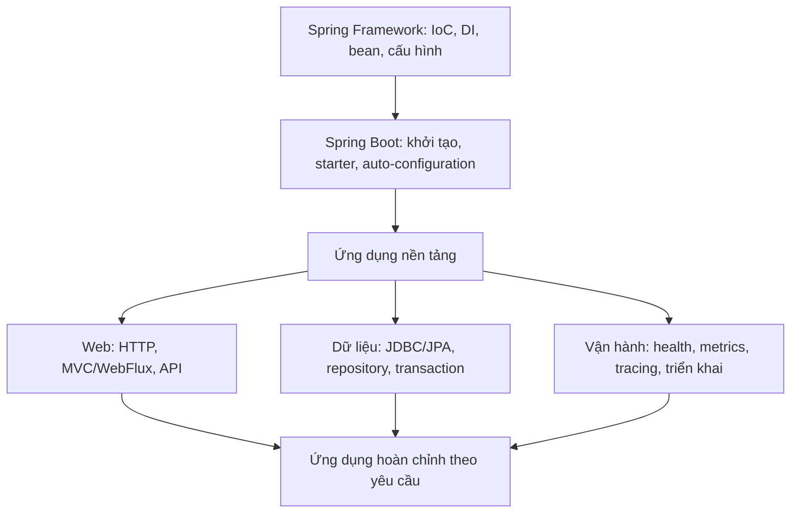
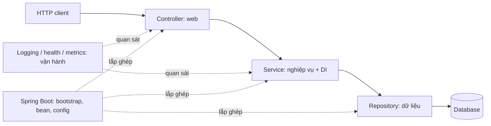

# Ranh giới kiến thức nền tảng với tích hợp dữ liệu, web và vận hành chuyên sâu

Trong lộ trình **Spring Boot Fundamentals**, điều quan trọng không chỉ là biết cách tạo một ứng dụng chạy được, mà còn phải biết **kiến thức nào thuộc cơ chế nền tảng của Spring Boot** và **kiến thức nào thuộc một lĩnh vực tích hợp cụ thể**. Nếu không phân biệt được hai phạm vi này, người học dễ đánh đồng Spring Boot với REST API, JPA hoặc Docker; đồng thời khó xác định nguyên nhân khi ứng dụng gặp lỗi.

Bài học này xây dựng một bản đồ kiến thức: Spring Boot chịu trách nhiệm khởi tạo và kết nối các thành phần theo quy ước như thế nào, khi nào ta bước sang tích hợp web hoặc dữ liệu, và lúc nào bài toán đã chuyển sang vận hành chuyên sâu.

## 1. Hiểu đúng vai trò của Spring Boot

**Spring Framework** cung cấp những cơ chế lập trình ứng dụng như IoC container, Dependency Injection (DI), bean, cấu hình, AOP, giao dịch và các mô-đun tích hợp. **Spring Boot** xây dựng trên Spring Framework để giảm công việc cấu hình ban đầu và giúp ứng dụng có cách khởi chạy, đóng gói, cấu hình nhất quán hơn.

Ba khái niệm cần tách bạch:

| Thành phần | Trả lời câu hỏi | Ví dụ |
| --- | --- | --- |
| Spring Framework | Đối tượng trong ứng dụng được tạo, quản lý và kết nối ra sao? | `ApplicationContext`, `@Bean`, `@Service`, constructor injection |
| Spring Boot | Ứng dụng Spring được khởi tạo, tự cấu hình, nhận cấu hình ngoài và chạy như thế nào? | `@SpringBootApplication`, auto-configuration, starter, `SpringApplication.run` |
| Mô-đun tích hợp và hạ tầng | Ứng dụng trao đổi HTTP, lưu dữ liệu, xác thực người dùng hay chạy trên môi trường production ra sao? | Spring MVC, Spring Data JPA, Spring Security, Actuator, container, Kubernetes |

Spring Boot không tự đồng nghĩa với ứng dụng web. Một ứng dụng dùng Spring Boot có thể là tiến trình chạy tác vụ, công cụ xử lý dữ liệu theo lô, dịch vụ HTTP hoặc ứng dụng sử dụng cơ chế lập lịch. Việc có máy chủ HTTP, kết nối cơ sở dữ liệu hay hệ thống giám sát phụ thuộc vào **dependency, cấu hình và mã nguồn thực tế**.

Sơ đồ tư duy:



Các nhánh trong sơ đồ là **nhóm năng lực**, không bắt buộc phải đi theo một thứ tự cố định. Một ứng dụng có thể chỉ cần nhánh dữ liệu, chỉ cần nhánh web hoặc kết hợp cả ba. Cơ chế nền tảng là phần dùng chung để hiểu cách các nhánh được gắn vào ứng dụng.

## 2. Phần nào thuộc Spring Boot Fundamentals?

Một kiến thức nên được xem là **nền tảng** khi nó giúp người học lý giải được cách Spring Boot tạo và vận hành `ApplicationContext`, ngay cả khi chưa có HTTP endpoint, database hay hệ thống triển khai thực tế.

### 2.1. Khởi tạo và vòng đời ứng dụng

Các nội dung cốt lõi gồm:

- Vai trò của lớp có `@SpringBootApplication`, phương thức `main` và lời gọi `SpringApplication.run(...)`.
- Quá trình xây dựng `ApplicationContext`, phát hiện thành phần, đăng ký bean, giải quyết dependency và chạy các hook khởi động như `CommandLineRunner` hoặc `ApplicationRunner`.
- Phân biệt lỗi biên dịch, lỗi tạo bean, lỗi bind cấu hình và lỗi xảy ra khi logic nghiệp vụ chạy.
- Biết rằng cơ chế dừng tiến trình, đóng context và giải phóng tài nguyên có liên quan đến vòng đời bean; các chính sách shutdown của hạ tầng nằm ở mức sâu hơn.

Ở mức Fundamentals, mục tiêu là hiểu **điều gì xảy ra và vì sao ứng dụng có thể khởi động hoặc thất bại**. Không cần phân tích nội bộ từng bước của Spring Boot source code.

### 2.2. Bean, IoC và Dependency Injection

Đây là điểm nối trực tiếp giữa Spring Framework và Spring Boot. Người học cần hiểu:

- Bean là đối tượng được Spring container quản lý; một đối tượng tạo bằng `new` trong code thông thường không tự trở thành bean.
- `@Component`, `@Service`, `@Repository` và `@Configuration`/`@Bean` là các cách khai báo hoặc cung cấp thành phần cho container.
- Constructor injection giúp thể hiện dependency rõ ràng và cho phép thay thế implementation khi kiểm thử.
- Phạm vi component scan, trùng nhiều bean cùng kiểu hoặc thiếu bean đều có thể làm ứng dụng khởi động lỗi.

Kiến thức chuyên sâu như AOP proxy, bean post-processor hay các vòng đời đặc biệt chỉ cần học khi gặp một tình huống cụ thể đòi hỏi chúng.

### 2.3. Starter và auto-configuration

**Starter** là tập dependency tiện dụng dành cho một nhu cầu. **Auto-configuration** là các cấu hình mà Spring Boot cân nhắc kích hoạt dựa trên những điều kiện như classpath, bean hiện có, property và loại ứng dụng.

Chẳng hạn:

- `spring-boot-starter` cung cấp bộ phụ thuộc nền tảng của một ứng dụng Boot.
- `spring-boot-starter-web` bổ sung các thành phần thường dùng cho ứng dụng web Servlet, trong đó có Spring MVC và máy chủ nhúng theo cấu hình starter mặc định.
- `spring-boot-starter-data-jpa` bổ sung nền tảng tích hợp JPA và Spring Data JPA; việc kết nối database còn cần driver cùng cấu hình phù hợp.
- `spring-boot-starter-actuator` bổ sung các khả năng theo dõi và quản trị ứng dụng, nhưng không tự xây dựng một hệ thống quan sát production hoàn chỉnh.

Điểm cần nắm là **thêm starter tạo điều kiện cho tính năng xuất hiện**, chứ không bảo đảm mọi tính năng đã sẵn sàng để sử dụng. Auto-configuration có điều kiện; bean người dùng khai báo có thể làm cấu hình mặc định thay đổi hoặc không được tạo.

### 2.4. Cấu hình bên ngoài và profiles

Người học Fundamentals cần biết `application.properties`/`application.yml`, property từ môi trường, cấu hình theo profile, và cách Spring Boot bind giá trị vào thành phần ứng dụng. Cần hiểu rằng một property có thể điều khiển bean hoặc hành vi khởi động; không nên nhúng mật khẩu và khóa bí mật trực tiếp trong mã nguồn.

Ví dụ:

```yaml
spring:
  application:
    name: learning-catalog

app:
  greeting-prefix: "Xin chào"
```

Đổi `app.greeting-prefix` chỉ ảnh hưởng nếu mã nguồn có đọc property ấy. Tương tự, đặt `spring.profiles.active=dev` không tự động tạo một database dev; profile chỉ giúp chọn cấu hình và bean tương ứng **nếu chúng đã được định nghĩa**.

Phần chuyên sâu bắt đầu khi cần hệ thống quản lý secrets, chiến lược cấu hình nhiều môi trường, cấu hình phân tán hay quản trị thay đổi cấu hình trên một cụm máy.

### 2.5. Đóng gói, logging và kiểm thử tối thiểu

Fundamentals cũng gồm kiến thức vừa đủ để:

- Phân biệt source code, dependency, build artifact và tiến trình Java đang chạy; hiểu mục đích của executable JAR và lệnh khởi động ứng dụng.
- Đọc log khởi động, exception và chuỗi nguyên nhân (caused by) để xác định nơi lỗi xảy ra.
- Biết cách kiểm thử một lớp nghiệp vụ độc lập và khi nào cần nạp Spring context bằng `@SpringBootTest`.
- Hiểu test dùng context có chi phí và phạm vi khác unit test thông thường; các test chuyên biệt về HTTP, database hoặc môi trường container thuộc chủ đề tích hợp.

Không nhất thiết phải triển khai CI/CD, log aggregation, distributed tracing hay chiến lược triển khai không gián đoạn để hoàn thành phần nền tảng.

## 3. Một ví dụ chỉ dùng cơ chế nền tảng

Xét một ứng dụng in lời chào khi khởi chạy. Giả sử project đã được cấu hình để sử dụng Spring Boot và có dependency nền tảng `spring-boot-starter`. Ví dụ dưới đây **không yêu cầu Spring MVC, JPA hay máy chủ HTTP**.

```java
package com.example.learning;

import org.springframework.boot.CommandLineRunner;
import org.springframework.boot.SpringApplication;
import org.springframework.boot.autoconfigure.SpringBootApplication;
import org.springframework.context.annotation.Bean;
import org.springframework.stereotype.Service;

@SpringBootApplication
public class LearningApplication {
    public static void main(String[] args) {
        SpringApplication.run(LearningApplication.class, args);
    }

    @Bean
    CommandLineRunner demo(GreetingService greetingService) {
        return args -> System.out.println(greetingService.greet("Spring Boot"));
    }
}

@Service
class GreetingService {
    String greet(String name) {
        return "Xin chào, " + name + "!";
    }
}
```

Điều xảy ra khi chạy:

1. `SpringApplication.run` khởi tạo Spring application context.
2. Component scan tìm thấy `GreetingService` trong phạm vi package phù hợp.
3. Spring tạo bean cho `GreetingService` và đưa nó vào tham số của phương thức `@Bean`.
4. Spring đăng ký `CommandLineRunner` và thực thi runner sau khi context được khởi tạo.
5. Runner gọi dịch vụ và in ra `Xin chào, Spring Boot!`.

Đây là bài tập đúng phạm vi Fundamentals vì nội dung chính là **khởi tạo, quản lý bean, tiêm dependency và lifecycle hook**. Không cần REST controller để chứng minh rằng Spring Boot đang hoạt động. Với ứng dụng command-line không có tác vụ giữ tiến trình, chương trình có thể kết thúc sau khi runner hoàn thành.

Nếu đổi ứng dụng để phục vụ HTTP, truy cập database hoặc cung cấp endpoint theo dõi sức khỏe, ta đã thêm một nhu cầu tích hợp. Cơ chế DI và bootstrap vẫn dùng chung, nhưng các khái niệm mới phải được học theo đúng lĩnh vực của chúng.

## 4. Ranh giới với tích hợp web

**Tích hợp web** bắt đầu khi ứng dụng cần nhận và trả lời yêu cầu qua HTTP, xử lý đường dẫn, phương thức, header, body, mã trạng thái hoặc các vấn đề riêng của giao thức.

### 4.1. Giao điểm với nền tảng

Ở mức Fundamentals, người học nên hiểu:

- Vì sao thêm `spring-boot-starter-web` có thể khiến ứng dụng chuyển từ non-web sang ứng dụng Servlet web với máy chủ nhúng.
- Controller cũng là bean được Spring quản lý; constructor injection trong controller tuân theo cùng quy tắc DI.
- Web server, DispatcherServlet và HTTP request flow thuộc web stack, còn cơ chế tạo context và auto-configuration là kiến thức Boot chung.
- Có thể cấu hình các giá trị cơ bản như cổng chạy qua property; xung đột cổng lúc startup khác với lỗi xử lý một request.

### 4.2. Khi nào đã sang kiến thức web?

Ví dụ mở rộng từ `GreetingService` ở trên:

```java
package com.example.learning;

import org.springframework.web.bind.annotation.GetMapping;
import org.springframework.web.bind.annotation.PathVariable;
import org.springframework.web.bind.annotation.RequestMapping;
import org.springframework.web.bind.annotation.RestController;

@RestController
@RequestMapping("/greetings")
class GreetingController {
    private final GreetingService service;

    GreetingController(GreetingService service) {
        this.service = service;
    }

    @GetMapping("/{name}")
    String greet(@PathVariable String name) {
        return service.greet(name);
    }
}
```

Đoạn controller này được thêm vào **khi project có `spring-boot-starter-web` và các class liên quan trên classpath**. Sau khi ứng dụng web khởi động thành công, yêu cầu `GET /greetings/An` có thể được ánh xạ tới `greet` và trả về chuỗi lời chào.

Phần nền tảng trong ví dụ là bean, DI và việc Boot lắp ghép dependency. Phần web là:

- Ý nghĩa của `GET`, route và path variable.
- Cách `@RestController` chuyển giá trị trả về thành HTTP response.
- Mã trạng thái, exception handling, validation và chuyển đổi JSON.
- Các lựa chọn Servlet/MVC so với reactive/WebFlux, bảo mật HTTP, CORS, filter và interceptor.

Đừng lấy việc “đã viết được controller” làm điều kiện để coi như đã hiểu Spring Boot. Ngược lại, hiểu bootstrap và DI không có nghĩa đã nắm thiết kế REST API hay toàn bộ HTTP stack.

## 5. Ranh giới với tích hợp dữ liệu

**Tích hợp dữ liệu** bắt đầu khi ứng dụng cần đọc, ghi, truy vấn hoặc đồng bộ với một hệ lưu trữ hay hệ thống dữ liệu bên ngoài.

### 5.1. Giao điểm với nền tảng

Fundamentals giúp giải thích vì sao một `DataSource`, repository hoặc transaction manager có thể được tạo thành bean; auto-configuration cân nhắc tạo thành phần nào dựa trên classpath và cấu hình; và cách application context liên kết service với repository.

Nhưng Spring Boot không thay thế kiến thức về SQL, transaction, entity mapping hoặc mô hình dữ liệu. Chẳng hạn, thêm `spring-boot-starter-data-jpa` **không có nghĩa** ứng dụng đã kết nối được cơ sở dữ liệu. Với cấu hình thông thường, ứng dụng còn cần database driver, thông tin kết nối phù hợp và entity/repository khi có nhu cầu sử dụng JPA.

### 5.2. Các chủ đề nằm sau ranh giới

| Phạm vi | Kiến thức tiêu biểu |
| --- | --- |
| Truy cập dữ liệu | JDBC, `JdbcTemplate`, JPA, Hibernate, Spring Data repository |
| Mô hình và truy vấn | Entity, quan hệ, SQL, pagination, N+1 query, indexing |
| Tính nhất quán | Transaction boundary, isolation, rollback, locking |
| Quản lý thay đổi | Migration schema, versioning, dữ liệu kiểm thử |
| Kết nối và hiệu năng | Connection pool, timeout, retry, giám sát truy vấn |
| Tích hợp khác | Cache, Redis, message broker, API của hệ thống bên ngoài |

Ví dụ: khi một `@Service` nhận repository qua constructor, việc Spring cung cấp dependency là **nền tảng**. Cách repository ánh xạ entity, xây câu truy vấn, chọn transaction hay xử lý truy cập đồng thời là **tích hợp dữ liệu**.

Một lỗi `NoSuchBeanDefinitionException` có thể xuất phát từ wiring hoặc phạm vi scan; nhưng nếu startup báo không cấu hình được `DataSource` sau khi thêm JPA, phải kiểm tra điều kiện của lớp tích hợp dữ liệu thay vì cho rằng DI nói chung bị hỏng.

## 6. Ranh giới với vận hành chuyên sâu

Ứng dụng chạy thành công trên máy phát triển là điểm bắt đầu. **Vận hành chuyên sâu** tập trung vào việc đảm bảo ứng dụng có thể triển khai, giám sát, phục hồi, bảo vệ và mở rộng một cách đáng tin cậy trong môi trường thực tế.

### 6.1. Phần Fundamentals cần biết

- Đọc log lúc startup và khi phát sinh exception; hiểu tầm quan trọng của mức log và không đưa dữ liệu bí mật vào log.
- Biết Spring Boot có thể cung cấp thông tin health và metrics thông qua Actuator khi thêm dependency, cấu hình và quyền truy cập thích hợp.
- Biết cấu hình ứng dụng thay đổi theo môi trường, và executable JAR là một cách phân phối ứng dụng.
- Phân biệt ứng dụng đã khởi động, đang sẵn sàng nhận traffic và đang đáp ứng được các dependency quan trọng: đó là những trạng thái không nên gộp thành một.

Actuator là **một thư viện hỗ trợ vận hành**, không phải toàn bộ hệ thống monitoring. Có health endpoint cũng không tự đảm bảo đã thiết lập cảnh báo, lưu metrics dài hạn hay tracing phân tán.

### 6.2. Phần vận hành chuyên sâu

| Nhu cầu thực tế | Kiến thức cần đào sâu |
| --- | --- |
| Chạy trên môi trường khác | Container image, triển khai cloud/Kubernetes, cấu hình tài nguyên |
| Xác định hệ thống khỏe hay lỗi | Health indicators, liveness, readiness, dependency checks |
| Quan sát hành vi production | Metrics, logs tập trung, trace, correlation ID, alerting |
| Chịu tải và ổn định | Thread pool, connection pool, timeout, backpressure, capacity planning |
| Phục hồi và phát hành | Graceful shutdown, rolling deployment, rollback, backup, disaster recovery |
| Bảo vệ ứng dụng | Secrets management, quyền truy cập, TLS, bảo vệ endpoint quản trị |

Cần tách khái niệm **lifecycle của bean** (nền tảng) khỏi **graceful shutdown dưới traffic thật** (vận hành). Tương tự, biết `server.port` là thuộc cấu hình cơ bản; thiết kế ingress, load balancer, autoscaling và quản lý certificate là bài toán triển khai.

Các cơ chế bảo mật như Spring Security có giao điểm với web, dữ liệu và vận hành; phần xác thực, phân quyền và bảo vệ API thường cần một lộ trình chuyên sâu riêng.

## 7. Dùng cùng một ứng dụng để nhận diện ranh giới

Giả sử nhóm xây dựng một dịch vụ tra cứu sản phẩm. Nhìn theo từng quyết định kỹ thuật sẽ thấy khi nào kiến thức đã đổi phạm vi:

| Yêu cầu mới | Việc cần học hoặc làm | Phạm vi chính |
| --- | --- | --- |
| Khởi động ứng dụng, tạo `CatalogService` và tiêm vào runner | Application context, DI, component scan, bootstrap | Spring Boot Fundamentals |
| Đọc tên ứng dụng, mức cấu hình từ YAML/environment | Property sources, binding, profiles | Spring Boot Fundamentals |
| Cho người dùng gọi `GET /products/{id}` | HTTP, routing, controller, response, xử lý lỗi | Tích hợp web |
| Lấy sản phẩm từ PostgreSQL | Driver, datasource, ORM/JDBC, transaction, SQL | Tích hợp dữ liệu |
| Yêu cầu endpoint chỉ người dùng được cấp quyền mới truy cập được | Authentication, authorization, HTTP security | Bảo mật ứng dụng |
| Kiểm tra service có sẵn sàng phục vụ hay không | Actuator, readiness semantics, probes | Giao điểm Boot và vận hành |
| Phân tích request chậm trên nhiều service | Metrics, distributed tracing, query profiling | Vận hành và tích hợp chuyên sâu |

Ranh giới không phải bức tường giữa các công nghệ. Một tính năng có thể đi qua nhiều lớp: một HTTP request đi vào controller, gọi service, đọc database và tạo metric. Mục đích của việc phân loại là biết **cơ chế nào đang được sử dụng và nên tìm kiến thức ở đâu khi phát triển hoặc sửa lỗi**.



Trong sơ đồ, Spring Boot cung cấp cách khởi tạo và kết nối các bean theo cấu hình, còn web, persistence và operations có quy tắc nghiệp vụ/kỹ thuật riêng.

## 8. Cách xác định phạm vi khi gặp vấn đề

Khi một ứng dụng không hoạt động đúng, hãy đặt câu hỏi về **điểm phát sinh lỗi** trước khi chọn tài liệu để đọc.

| Triệu chứng | Câu hỏi cần đặt | Nhánh kiến thức nên kiểm tra đầu tiên |
| --- | --- | --- |
| Ứng dụng không tạo được bean | Có đăng ký bean, component scan, qualifier hoặc dependency phù hợp không? | IoC/DI và cấu hình Boot |
| Không bind được property | Tên key, kiểu dữ liệu, nguồn cấu hình, profile đang active có đúng không? | Externalized configuration |
| Ứng dụng chạy nhưng `GET /items` trả 404 | Controller và HTTP mapping có đúng, request có đi tới đúng ứng dụng không? | Web |
| `POST` trả 400 do body không hợp lệ | JSON, data binding, validation và thông báo lỗi được thiết kế thế nào? | Web |
| Không tạo được `DataSource` | Có driver, URL, credentials, database sẵn sàng và cấu hình phù hợp không? | Dữ liệu và auto-configuration |
| API trả đúng nhưng truy vấn chậm | Query plan, số lần truy vấn, index, mapping hoặc pool có vấn đề không? | Dữ liệu/hiệu năng |
| Service khởi động nhưng bị loại khỏi traffic | Readiness probe, dependency health và chính sách triển khai ra sao? | Vận hành |
| Không thấy trace xuyên qua nhiều dịch vụ | Ứng dụng đã instrument, truyền context và gửi dữ liệu tới backend quan sát chưa? | Observability |

Một số lỗi nằm ở **ranh giới hai lớp**. Ví dụ lỗi datasource xuất hiện trong quá trình Boot tạo context: cần đọc stack trace của Spring Boot để xác định bean thất bại, sau đó kiểm tra driver/cấu hình/kết nối theo kiến thức dữ liệu. Phân loại là cách định hướng điều tra, không phải thay thế việc đọc bằng chứng thực tế.

## 9. Chiến lược học để không bị lẫn phạm vi

Một trình tự học hợp lý cho người bắt đầu:

1. **Chạy được ứng dụng non-web nhỏ:** nhận biết entry point, context, bean và DI. Có thể dùng `CommandLineRunner` để quan sát mà không cần thiết lập database hoặc endpoint.
2. **Hiểu Boot cấu hình ứng dụng:** thêm một property, thay đổi theo profile, giải thích auto-configuration nào liên quan tới dependency hiện có.
3. **Chọn một đường tích hợp theo mục tiêu:** nếu xây API, học HTTP và Spring MVC; nếu xử lý dữ liệu, học SQL/JDBC hoặc JPA. Không cần học toàn bộ các đường tích hợp cùng một lúc.
4. **Ghép các lớp bằng một chức năng nhỏ:** controller gọi service, service gọi repository khi dự án thật sự cần cả web và dữ liệu.
5. **Chuyển sang yêu cầu chạy thực tế:** thêm kiểm tra sức khỏe, bảo mật, quan sát, cơ chế triển khai, kiểm thử tích hợp và tối ưu khi có tình huống cụ thể.

Trong mỗi bước, hãy giữ một câu hỏi kiểm chứng: **Nếu bỏ HTTP và database đi, kiến thức này có còn giúp giải thích cách Boot vận hành không?** Nếu có, nó có khả năng thuộc phần nền tảng. Nếu không, hãy xác định nó thuộc giao thức, lưu trữ hay hạ tầng nào. Đây là quy tắc định hướng, không phải phân loại tuyệt đối: auto-configuration cho datasource hay web vẫn có thành phần thuộc Boot Fundamentals, dù tính năng cụ thể nằm trong nhánh tích hợp.

### Bài tập tự đối chiếu

**Tình huống A:** Một `@Service` không được tìm thấy vì nằm ngoài phạm vi component scan. Đây là bài toán thành phần và cấu hình context. Người học nên kiểm tra vị trí của lớp `@SpringBootApplication`, cấu trúc package và việc bean có được đăng ký.

**Tình huống B:** Controller hoạt động, nhưng dữ liệu trả về bị lặp hoặc thiếu do quan hệ JPA được fetch sai. Boot đã lắp ghép ứng dụng thành công; câu hỏi chính nằm ở entity mapping, truy vấn và chiến lược tải dữ liệu.

**Tình huống C:** Ứng dụng chạy được trên laptop, nhưng sau triển khai hệ thống liên tục khởi động lại do liveness probe không phù hợp. Cần phân tích cấu hình probe, đặc tính khởi động và cách môi trường orchestration xử lý tiến trình.

**Tình huống D:** Thêm `spring-boot-starter-web` khiến ứng dụng mở cổng mặc định và một số auto-configuration mới được áp dụng. Việc giải thích **vì sao dependency làm thay đổi kiểu ứng dụng** thuộc nền tảng Boot; việc thiết kế contract của API mới thuộc web.

## 10. Dấu hiệu đã nắm vững phần nền tảng

Trước khi đi sâu vào dữ liệu, web hoặc vận hành, người học nên có thể:

- Tự giải thích quan hệ giữa Spring Framework, Spring Boot, starter và auto-configuration.
- Viết ứng dụng Boot tối giản có service và một runner, giải thích chính xác bean nào được tạo và dependency được tiêm ở đâu.
- Đọc một lỗi startup và xác định bước đầu nên kiểm tra bean, property, dependency hay phần tích hợp.
- Nhìn vào `build.gradle` hoặc `pom.xml` để nhận diện sự có mặt của các starter và các tính năng chúng có thể kích hoạt.
- Đọc cấu hình ứng dụng, hiểu nguồn property/profile và nhận biết khác biệt giữa cấu hình Boot với cấu hình riêng của web, datasource hoặc hệ thống triển khai.
- Vẽ được luồng từ HTTP đến service, database và observability, đồng thời chỉ rõ Boot đóng vai trò khởi tạo/lắp ghép ở đâu.

Kiến thức nền tảng đủ tốt sẽ giúp mở rộng ứng dụng theo nhu cầu mà không phụ thuộc vào một “mẫu dự án đầy đủ” có sẵn. Khi bước sang HTTP, database hay production, người học giữ được cùng một mô hình về context, bean và cấu hình, rồi bổ sung chính xác các khái niệm riêng của lĩnh vực đang giải quyết.
