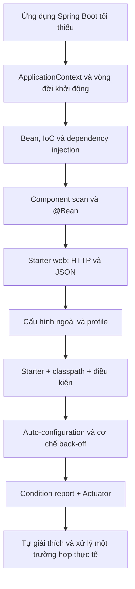
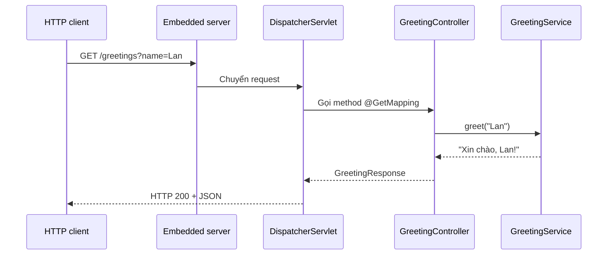
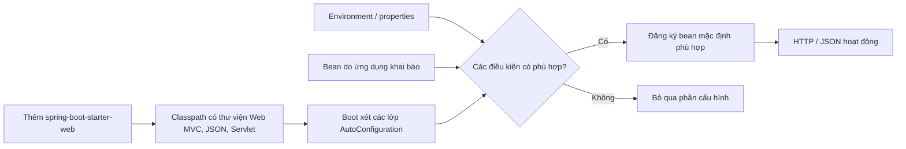

# Trình tự học từ ứng dụng tối thiểu đến giải thích được cơ chế tự cấu hình

Spring Boot thường tạo cảm giác “chỉ thêm một dependency và một annotation là mọi thứ tự chạy”. Cảm giác đó hữu ích khi bắt đầu, nhưng nếu không hiểu những gì diễn ra phía sau, người học sẽ khó giải thích vì sao một bean xuất hiện, vì sao một cấu hình có hiệu lực, hoặc vì sao ứng dụng không khởi động được khi đổi dependency. Bài này xây dựng **một trình tự học có thể quan sát và kiểm chứng**, từ chương trình Spring Boot nhỏ nhất đến khả năng tự đọc báo cáo điều kiện và giải thích cơ chế *auto-configuration*.

Ví dụ dùng **Java 21, Spring Boot 3.x và Gradle**, với package gốc `com.example.demo`. Các ví dụ là một dự án học độc lập; khi áp dụng vào dự án sẵn có, cần theo phiên bản và cấu trúc của dự án đó. Mỗi chặng bổ sung một kiến thức và một thí nghiệm trên ứng dụng của chặng trước.

## 1. Đích đến: giải thích được, không chỉ chạy được

Sau chuỗi thực hành, bạn cần trả lời được bằng ví dụ thực tế:

1. `SpringApplication.run(...)` tạo và khởi động những gì?
2. Một đối tượng Java thông thường khác gì với một **bean được Spring quản lý**?
3. `@ComponentScan` tìm các lớp ứng dụng như thế nào, và vì sao đổi package có thể làm mất bean?
4. Thêm `spring-boot-starter-web` làm thay đổi *classpath* và hành vi khởi động ra sao?
5. Spring Boot lấy giá trị cấu hình từ `application.yml`, profile, biến môi trường và tham số dòng lệnh như thế nào?
6. `@EnableAutoConfiguration` đưa những cấu hình nào vào quá trình xử lý, dựa trên điều kiện gì, và khi nào chúng “nhường chỗ” cho bean do người phát triển định nghĩa?
7. Dùng `--debug` hoặc Actuator để phân biệt **cấu hình được áp dụng**, **cấu hình bị bỏ qua** và **bean thực sự tồn tại** như thế nào?

Một sơ đồ định hướng:



**Nguyên tắc thực hành:** ở mỗi chặng, ghi ba điều vào nhật ký học tập: *tôi vừa thay đổi gì*, *tôi quan sát thấy gì*, và *cơ chế nào giải thích quan sát đó*. Đây là cách chuyển từ việc ghi nhớ annotation sang hiểu quy luật vận hành.

## 2. Chặng 0 — Dựng môi trường và giữ ứng dụng thật nhỏ

**Mục tiêu:** chạy một ứng dụng có Spring context mà chưa cần HTTP server hay database.

Tạo dự án từ Spring Initializr hoặc bộ sinh dự án tương đương, với Java 21, Gradle, Spring Boot 3.x, package `com.example.demo`. Ở thời điểm này chỉ cần dependency nền tảng `spring-boot-starter`; chưa thêm Spring Web, Spring Data JPA hay database. Giữ Gradle Wrapper do dự án tạo ra.

Một phần cấu hình dependency minh họa trong `build.gradle`:

```groovy
dependencies {
    implementation 'org.springframework.boot:spring-boot-starter'
    testImplementation 'org.springframework.boot:spring-boot-starter-test'
}
```

Tạo `src/main/java/com/example/demo/DemoApplication.java`:

```java
package com.example.demo;

import org.springframework.boot.SpringApplication;
import org.springframework.boot.autoconfigure.SpringBootApplication;

@SpringBootApplication
public class DemoApplication {
    public static void main(String[] args) {
        SpringApplication.run(DemoApplication.class, args);
    }
}
```

Chạy bằng wrapper:

```bash
# Linux/macOS
./gradlew bootRun

# Windows PowerShell
.\gradlew.bat bootRun
```

Bạn sẽ thấy log khởi động rồi tiến trình kết thúc bình thường nếu không có thành phần nào giữ ứng dụng chạy. **Không có HTTP endpoint tại localhost:8080** vì chưa thêm web starter. Điều này hoàn toàn khác với tình huống ứng dụng bị lỗi.

Hãy giải thích chính xác ba thành phần của ví dụ:

| Thành phần | Trách nhiệm |
|---|---|
| `main(String[] args)` | Điểm vào thông thường của Java. |
| `SpringApplication.run(...)` | Chuẩn bị môi trường, tạo/refresh `ApplicationContext`, khởi tạo các bean cần thiết và thực hiện phần khởi động của Spring Boot. |
| `@SpringBootApplication` | Annotation gộp các khả năng cấu hình ứng dụng, quét component và bật cơ chế tự cấu hình. |

**Dấu mốc:** bạn có thể tự trả lời “Tại sao ứng dụng Spring Boot đã start thành công nhưng không mở cổng 8080?” trước khi chuyển tiếp.

## 3. Chặng 1 — Nhìn thấy Spring quản lý bean

**Mục tiêu:** phân biệt “tôi tự tạo object bằng `new`” với “Spring tạo và quản lý bean trong `ApplicationContext`”.

Thêm một service và một runner vào cùng package hoặc package con của `com.example.demo`:

```java
// GreetingService.java
package com.example.demo;

import org.springframework.stereotype.Service;

@Service
public class GreetingService {
    public String greet(String name) {
        return "Xin chào, " + name + "!";
    }
}
```

```java
// GreetingRunner.java
package com.example.demo;

import org.springframework.boot.ApplicationArguments;
import org.springframework.boot.ApplicationRunner;
import org.springframework.stereotype.Component;

@Component
public class GreetingRunner implements ApplicationRunner {
    private final GreetingService greetingService;

    public GreetingRunner(GreetingService greetingService) {
        this.greetingService = greetingService;
    }

    @Override
    public void run(ApplicationArguments args) {
        System.out.println(greetingService.greet("Lan"));
    }
}
```

Chạy lại và quan sát dòng `Xin chào, Lan!`. Bạn không hề viết `new GreetingService()` hay `new GreetingRunner(...)`. Spring quét lớp có `@Service`/`@Component`, đăng ký bean rồi tự truyền `GreetingService` vào constructor của `GreetingRunner`. Đây là **dependency injection** (DI), thực hiện bởi **Inversion of Control container** (IoC container).

Thử xóa tạm `@Service` và khởi động lại. Khi không có bean `GreetingService` nào được đăng ký, constructor của `GreetingRunner` không thể được thỏa mãn; quá trình khởi động báo lỗi dependency. Khôi phục annotation để tiếp tục.

Một thí nghiệm khác: di chuyển `GreetingService` sang một package nằm ngoài cây `com.example.demo` mà không khai báo cách quét bổ sung. Mặc định, `@SpringBootApplication` đặt ở package gốc sẽ quét từ package đó xuống các package con, vì vậy lớp nằm ngoài vùng quét có thể không được phát hiện.

**Kết luận cần tự nói được:** annotation đánh dấu khả năng được đăng ký, phạm vi component scan quyết định lớp nào được xem xét, và Spring context quản lý vòng đời cũng như liên kết dependency giữa các bean.

## 4. Chặng 2 — Phân biệt component scan với khai báo bean tường minh

Không phải mọi bean đều đến từ lớp có `@Component`. Khi muốn dùng một kiểu thư viện hoặc một object được tạo qua factory method, bạn thường sử dụng `@Configuration` cùng `@Bean`:

```java
// TimeConfiguration.java
package com.example.demo;

import java.time.Clock;
import org.springframework.context.annotation.Bean;
import org.springframework.context.annotation.Configuration;

@Configuration(proxyBeanMethods = false)
public class TimeConfiguration {
    @Bean
    Clock clock() {
        return Clock.systemUTC();
    }
}
```

Spring quét thấy `TimeConfiguration`, xử lý method `@Bean` và đăng ký kết quả trả về dưới kiểu `Clock`. Sau đó, một constructor khác có thể yêu cầu `Clock` giống như yêu cầu `GreetingService`:

```java
public GreetingRunner(GreetingService greetingService, Clock clock) {
    this.greetingService = greetingService;
    this.clock = clock; // Cần khai báo thêm field Clock tương ứng.
}
```

Lưu ý: đoạn constructor ở trên minh họa **cách tiêm thêm dependency**, cần thêm field `private final Clock clock;` nếu áp dụng. Không bắt buộc phải sửa runner để hoàn thành bài.

So sánh:

| Cách tạo bean | Spring tìm ở đâu? | Ví dụ |
|---|---|---|
| `@Component`, `@Service`, `@Repository`, `@Controller` | Những lớp thuộc vùng **component scan** | `GreetingService` |
| `@Bean` trong `@Configuration` | Method factory trong cấu hình mà Spring đã đăng ký | `Clock` |
| **Auto-configuration** | Những lớp cấu hình được Boot nhập vào qua cơ chế đăng ký auto-configuration, rồi xét điều kiện | Cấu hình MVC, JSON, embedded server |

Ba dòng này đều có thể tạo bean, nhưng **con đường phát hiện cấu hình** không giống nhau. Sự phân biệt ấy là tiền đề quan trọng nhất trước khi học tự cấu hình.

## 5. Chặng 3 — Thêm Spring Web và nhìn thấy “quy ước mặc định”

**Mục tiêu:** chỉ thay đổi dependency và thêm một controller, rồi giải thích vì sao HTTP server, Spring MVC và JSON có thể hoạt động.

Thêm starter này vào `build.gradle`:

```groovy
dependencies {
    implementation 'org.springframework.boot:spring-boot-starter-web'
    testImplementation 'org.springframework.boot:spring-boot-starter-test'
}
```

`spring-boot-starter-web` là **bộ dependency khởi đầu**: nó đem vào các thư viện cần thiết cho ứng dụng web Spring MVC, bao gồm thành phần web, JSON và embedded servlet container theo mặc định của phiên bản Boot đang dùng. Starter bản thân nó không phải là một đoạn “mã phép thuật” tạo ra endpoint; Spring Boot nhìn vào thư viện có mặt trong classpath và xử lý các cấu hình phù hợp.

Thêm controller:

```java
// GreetingController.java
package com.example.demo;

import org.springframework.web.bind.annotation.GetMapping;
import org.springframework.web.bind.annotation.RequestMapping;
import org.springframework.web.bind.annotation.RequestParam;
import org.springframework.web.bind.annotation.RestController;

@RestController
@RequestMapping("/greetings")
public class GreetingController {
    private final GreetingService service;

    public GreetingController(GreetingService service) {
        this.service = service;
    }

    @GetMapping
    public GreetingResponse get(
            @RequestParam(defaultValue = "bạn") String name) {
        return new GreetingResponse(service.greet(name));
    }

    public record GreetingResponse(String message) {}
}
```

Chạy lại ứng dụng, thử yêu cầu:

```bash
curl "http://localhost:8080/greetings?name=Lan"
```

Kết quả JSON tương đương:

```json
{"message":"Xin chào, Lan!"}
```

Quan sát log: ứng dụng web thông thường khởi động embedded servlet container và lắng nghe cổng 8080 nếu chưa đổi cấu hình. Một yêu cầu HTTP đi qua web server đến Spring MVC `DispatcherServlet`, được định tuyến tới method `@GetMapping`; kết quả kiểu `GreetingResponse` được chuyển thành JSON nhờ bộ chuyển đổi HTTP message với Jackson.



Để tự kiểm tra vai trò của dependency, hãy bỏ `spring-boot-starter-web` rồi thử biên dịch controller: các annotation Spring MVC sẽ không còn được cung cấp bởi dependency web trong ví dụ. Nếu giữ starter nhưng xóa controller, server vẫn có thể khởi động; chỉ đường dẫn `/greetings` không còn mapping tương ứng. Đây là hai vấn đề khác nhau: **có hạ tầng web** và **có endpoint do ứng dụng định nghĩa**.

**Dấu mốc:** giải thích vì sao phần lớn cấu hình web mặc định xuất hiện dù trong `DemoApplication` không hề có method tạo `DispatcherServlet` hoặc Tomcat.

## 6. Chặng 4 — Cấu hình ngoài trước khi học tự cấu hình

**Mục tiêu:** nhận ra “có bean gì” và “bean chạy với thuộc tính nào” là hai câu hỏi khác nhau.

Thêm `src/main/resources/application.yml`:

```yaml
server:
  port: 8081

app:
  greeting:
    prefix: "Chào"
```

Chạy lại và gọi `http://localhost:8081/greetings?name=Lan`. Giá trị `server.port` được Boot sử dụng khi cấu hình embedded server, nên ứng dụng chuyển sang cổng 8081. Nhưng `app.greeting.prefix` là **thuộc tính tự đặt của ứng dụng**; nó sẽ chưa thay đổi câu chào nếu code chưa đọc thuộc tính đó.

Để có binding rõ ràng, thêm record:

```java
// config/GreetingProperties.java
package com.example.demo.config;

import org.springframework.boot.context.properties.ConfigurationProperties;

@ConfigurationProperties(prefix = "app.greeting")
public record GreetingProperties(String prefix) {}
```

Bổ sung `@ConfigurationPropertiesScan` vào lớp main:

```java
package com.example.demo;

import org.springframework.boot.SpringApplication;
import org.springframework.boot.autoconfigure.SpringBootApplication;
import org.springframework.boot.context.properties.ConfigurationPropertiesScan;

@SpringBootApplication
@ConfigurationPropertiesScan
public class DemoApplication {
    public static void main(String[] args) {
        SpringApplication.run(DemoApplication.class, args);
    }
}
```

Và thay `GreetingService` bằng phiên bản dùng properties:

```java
package com.example.demo;

import com.example.demo.config.GreetingProperties;
import org.springframework.stereotype.Service;

@Service
public class GreetingService {
    private final GreetingProperties properties;

    public GreetingService(GreetingProperties properties) {
        this.properties = properties;
    }

    public String greet(String name) {
        return properties.prefix() + ", " + name + "!";
    }
}
```

Khi đó HTTP response cho tên Lan là `{"message":"Chào, Lan!"}`. `@ConfigurationPropertiesScan` tìm lớp mang `@ConfigurationProperties` trong phạm vi package phù hợp; Boot ánh xạ các giá trị từ `Environment` vào object theo prefix `app.greeting`, và Spring tiêm object này vào service. Trong ứng dụng thực tế, có thể kết hợp validation và giá trị mặc định để phát hiện cấu hình thiếu hoặc sai từ sớm.

Thử ghi đè thuộc tính bằng tham số dòng lệnh:

```bash
# Linux/macOS
./gradlew bootRun --args='--app.greeting.prefix=Hello'

# Windows PowerShell
.\gradlew.bat bootRun --args="--app.greeting.prefix=Hello"
```

Lúc này câu chào đổi thành `Hello, Lan!` mà không sửa code. Với biến môi trường, tên tương ứng thường là `APP_GREETING_PREFIX`; Spring Boot hỗ trợ *relaxed binding* giữa tên môi trường và tên thuộc tính. Tham số command line thông thường có độ ưu tiên cao hơn cấu hình trong file.

Để khám phá profile, thêm `src/main/resources/application-dev.yml`:

```yaml
app:
  greeting:
    prefix: "[DEV] Chào"
```

Khởi động với `--spring.profiles.active=dev` và quan sát tiền tố đổi. Giá trị trong `application-dev.yml` có hiệu lực khi profile `dev` hoạt động; nếu cùng lúc truyền `--app.greeting.prefix=Hello` trên command line, giá trị command line sẽ được dùng. Profile giúp chọn cấu hình theo môi trường, **không tự tạo thêm logic nghiệp vụ**.

**Dấu mốc:** có thể chỉ rõ ba bước: thuộc tính được đọc vào `Environment`, được bind vào object cấu hình (nếu ứng dụng yêu cầu), rồi bean tiêu thụ giá trị đó.

## 7. Chặng 5 — Xâu chuỗi các bước khi Spring Boot khởi động

Trước khi tìm hiểu nội tạng auto-configuration, hãy xây dựng một mô hình khởi động đủ chính xác:

1. JVM chạy `main`, gọi `SpringApplication.run` với lớp cấu hình gốc.
2. Boot chuẩn bị `Environment` và các nguồn thuộc tính, xác định dạng ứng dụng phù hợp (web servlet, reactive hoặc không có web) dựa trên classpath và cấu hình.
3. Boot tạo `ApplicationContext`, đăng ký những nguồn cấu hình ban đầu rồi xử lý các cấu hình và bean definition.
4. `@ComponentScan` phát hiện những component trong phạm vi quét; các phương thức `@Bean` cung cấp bean definition bổ sung.
5. `@EnableAutoConfiguration` làm cho các lớp auto-configuration đủ điều kiện được xem xét. Các điều kiện dựa trên classpath, loại ứng dụng, property, bean đã có… quyết định phần cấu hình nào được áp dụng.
6. Context được refresh; Spring tạo các singleton thông thường, nối dependency, khởi động hạ tầng được cấu hình (chẳng hạn embedded server trong ứng dụng web).
7. Boot gọi các runner như `ApplicationRunner`, sau đó ứng dụng ở trạng thái sẵn sàng phục vụ theo loại ứng dụng tương ứng.

Đây là **mô hình học tập** của quá trình khởi động, không phải danh sách đầy đủ mọi lifecycle callback. Đặc biệt, điều kiện cấu hình được đánh giá khi xử lý cấu hình/đăng ký bean definition, nên không nên hình dung rằng toàn bộ bean đều phải được tạo xong rồi Boot mới quyết định tự cấu hình.

Hãy phân loại thành phần trong dự án hiện có:

| Thành phần | Nguồn gốc và lý do xuất hiện |
|---|---|
| `GreetingService` | Do `@Service` trong vùng component scan. |
| `Clock` | Do method `@Bean` trong `TimeConfiguration`. |
| `GreetingProperties` | Do quét và đăng ký loại `@ConfigurationProperties`. |
| `GreetingController` | Do `@RestController` trong vùng component scan. |
| Embedded web server và các thành phần Spring MVC mặc định | Do các auto-configuration phù hợp với classpath và môi trường web. |
| Giá trị cổng 8081 | Do property `server.port`, không phải một annotation trong controller. |

Nếu chỉ thuộc tên annotation, bảng này khó giải thích. Nếu hiểu nguyên tắc **đăng ký bean → xét điều kiện → khởi tạo/tiêm dependency → sử dụng thuộc tính**, mọi ô đều có nguyên nhân.

## 8. Chặng 6 — Mổ xẻ `@SpringBootApplication` và auto-configuration

`@SpringBootApplication` bao gồm ba khả năng nền tảng:

| Annotation thành phần | Vai trò |
|---|---|
| `@SpringBootConfiguration` | Đánh dấu lớp cấu hình gốc cho ứng dụng Boot; bản thân nó dựa trên cơ chế `@Configuration` của Spring. |
| `@ComponentScan` | Tìm các component ứng dụng trong package gốc và các package con. |
| `@EnableAutoConfiguration` | Kích hoạt việc nhập và xử lý các ứng viên auto-configuration của Boot. |

Trong Spring Boot 3.x, các thư viện có thể khai báo lớp auto-configuration ở resource:

```text
META-INF/spring/org.springframework.boot.autoconfigure.AutoConfiguration.imports
```

Các tên lớp cấu hình trong resource này được Boot tìm và nhập vào quy trình xử lý cấu hình. **Chúng không cần nằm trong package component scan của ứng dụng.** Vì thế một JAR thứ ba có thể cung cấp auto-configuration mà không buộc lập trình viên quét toàn bộ package của thư viện đó.

“Tự cấu hình” không đồng nghĩa “bật tất cả những gì có trong Boot”. Nó là quá trình **chọn những cấu hình có điều kiện phù hợp**. Những annotation thường thấy gồm:

| Điều kiện | Câu hỏi nó trả lời |
|---|---|
| `@ConditionalOnClass` | Một lớp hoặc thư viện cần thiết có trên classpath không? |
| `@ConditionalOnMissingClass` | Lớp nhất định có vắng mặt không? |
| `@ConditionalOnBean` | Context đã có bean phù hợp chưa? |
| `@ConditionalOnMissingBean` | Chưa có bean phù hợp, để Boot cung cấp mặc định được không? |
| `@ConditionalOnProperty` | Thuộc tính cấu hình có giá trị cho phép kích hoạt không? |
| `@ConditionalOnWebApplication` | Ứng dụng có đúng loại web environment mà cấu hình cần không? |

Điều kiện có thể đặt ở cấp lớp auto-configuration, lớp cấu hình lồng hoặc method `@Bean`. Một cấu hình có thể được nhập làm ứng viên nhưng không tạo bean cụ thể vì điều kiện tại method không thỏa mãn.

Ví dụ diễn giải rút gọn của quy tắc Boot thường áp dụng:

```java
@AutoConfiguration
@ConditionalOnClass(SomeLibraryClient.class)
public class ExampleClientAutoConfiguration {

    @Bean
    @ConditionalOnMissingBean(SomeLibraryClient.class)
    SomeLibraryClient someLibraryClient() {
        return new SomeLibraryClient();
    }
}
```

Đoạn trên là **mã minh họa**, không phải lớp có sẵn trong Boot. Ý nghĩa: khi thư viện cần thiết có mặt và ứng dụng chưa tự định nghĩa bean `SomeLibraryClient`, cấu hình cung cấp một bean mặc định. Nếu người dùng đã định nghĩa bean phù hợp, phần mặc định **back off** (nhường chỗ). Cơ chế này giúp Boot cung cấp mặc định hợp lý nhưng vẫn cho phép tùy biến.

### Starter, classpath và auto-configuration có quan hệ gì?



Một starter **đưa dependencies vào classpath**; auto-configuration **kiểm tra môi trường** và cung cấp cấu hình/bean thích hợp. Hai cơ chế hợp tác, nhưng không phải một. Thêm dependency mới cũng có thể ảnh hưởng kết quả điều kiện của những cấu hình có sẵn, ngay cả khi bạn chưa viết thêm một dòng Java nào.

## 9. Chặng 7 — Dùng chứng cứ để thấy auto-configuration hoạt động

**Mục tiêu:** không còn phải nói “Boot tự làm” mà không chỉ ra được chứng cứ.

### 9.1. Bật Condition Evaluation Report

Khởi động ứng dụng cùng tham số `--debug`:

```bash
./gradlew bootRun --args='--debug'

# Trên Windows:
.\gradlew.bat bootRun --args="--debug"
```

Trong log, tìm **CONDITIONS EVALUATION REPORT**. Báo cáo cho biết nhóm cấu hình nào có điều kiện phù hợp (*positive matches*), nhóm nào không phù hợp (*negative matches*), cùng lý do liên quan. Tùy phiên bản Boot và tập dependency, tên/lý do cụ thể có thể khác nhau.

Với ứng dụng web hiện tại, hãy tìm các mục liên quan đến `DispatcherServletAutoConfiguration`, `ServletWebServerFactoryAutoConfiguration` hoặc `JacksonAutoConfiguration`. Không cần học thuộc toàn bộ tên; hãy trả lời:

- Class nào trong classpath làm điều kiện khớp?
- Có yêu cầu ứng dụng thuộc loại servlet web hay không?
- Bean mặc định nào chỉ được tạo nếu ứng dụng chưa cung cấp bean tương ứng?
- Một negative match là do thiếu class, do sai property, do sai kiểu ứng dụng hay do đã có bean?

**Quan trọng:** một *positive match* ở cấu hình không tự chứng minh mọi bean trong cấu hình ấy được tạo; cần xem điều kiện sâu hơn hoặc kiểm tra danh sách bean. *Negative match* cũng không luôn là lỗi: nhiều cấu hình của các công nghệ bạn không sử dụng đương nhiên sẽ không khớp.

### 9.2. Dùng Actuator khi cần kiểm tra lúc ứng dụng đang chạy

Thêm dependency `spring-boot-starter-actuator`:

```groovy
dependencies {
    implementation 'org.springframework.boot:spring-boot-starter-web'
    implementation 'org.springframework.boot:spring-boot-starter-actuator'
    testImplementation 'org.springframework.boot:spring-boot-starter-test'
}
```

Trong môi trường học tập cục bộ, thêm vào `application.yml`:

```yaml
management:
  endpoints:
    web:
      exposure:
        include: health,conditions,beans
```

Giữ nguyên phần `server.port: 8081` đã tạo ở chặng trước, rồi thử:

```bash
curl "http://localhost:8081/actuator/health"
curl "http://localhost:8081/actuator/conditions"
curl "http://localhost:8081/actuator/beans"
```

Endpoint `conditions` trả về thông tin đánh giá điều kiện auto-configuration; `beans` liệt kê các bean mà context quản lý; `health` cho thông tin sức khỏe cơ bản. Kết hợp hai endpoint đầu giúp liên hệ “vì sao cấu hình được xem xét” với “đối tượng nào thực sự được đăng ký”. Phần output có thể dài, nên hãy tìm một vài bean/mục tương ứng với Spring MVC và Jackson thay vì đọc từ đầu đến cuối.

**Lưu ý triển khai:** `conditions` và `beans` có thể tiết lộ cấu trúc nội bộ ứng dụng. Chỉ bật qua HTTP trong môi trường phát triển hoặc áp dụng cơ chế bảo vệ phù hợp; đừng công khai chúng tùy tiện trên hệ thống thật. Mặc định, Actuator chỉ expose một tập endpoint hạn chế.

### 9.3. Thí nghiệm “back off” với Jackson

Với `spring-boot-starter-web`, Boot thường có thể cung cấp `ObjectMapper` mặc định cho việc xử lý JSON. Trong **một nhánh thử nghiệm tạm**, tạo bean tường minh:

```java
// JsonExperimentConfiguration.java
package com.example.demo;

import com.fasterxml.jackson.databind.ObjectMapper;
import org.springframework.context.annotation.Bean;
import org.springframework.context.annotation.Configuration;

@Configuration(proxyBeanMethods = false)
public class JsonExperimentConfiguration {
    @Bean
    ObjectMapper objectMapper() {
        return new ObjectMapper().findAndRegisterModules();
    }
}
```

Khởi động với `--debug` và xem điều kiện liên quan đến bean `ObjectMapper` trong `JacksonAutoConfiguration`; phần cung cấp `ObjectMapper` mặc định có thể không khớp vì ứng dụng **đã có bean cùng kiểu**. Kiểm tra `/actuator/beans` để thấy bean do `JsonExperimentConfiguration` cung cấp.

Đây là thí nghiệm về **quyền ưu tiên của bean do ứng dụng định nghĩa**, không phải cách khuyến nghị cấu hình JSON trong sản phẩm. Tự tạo `ObjectMapper` có thể bỏ qua những tùy chỉnh mặc định của Boot. Sau khi quan sát xong, **xóa lớp thí nghiệm** và khởi động lại để khôi phục cấu hình mặc định.

**Dấu mốc:** bạn có thể chứng minh cơ chế back-off bằng thông tin điều kiện và danh sách bean, thay vì đoán từ log “Started”.

## 10. Chặng 8 — Tự viết một auto-configuration nhỏ để hiểu cơ chế đăng ký

Chặng này dành cho người muốn đi thêm một bước, từ *tiêu thụ* auto-configuration sang *thiết kế* nó. Hãy hình dung một **thư viện riêng** tên `greeting-support` được thêm làm dependency cho ứng dụng. Thư viện cung cấp interface:

```java
package com.acme.greeting;

public interface GreetingFormatter {
    String format(String name);
}
```

Trong JAR thư viện, tạo lớp auto-configuration ở package khác package gốc của ứng dụng:

```java
package com.acme.greeting.autoconfigure;

import com.acme.greeting.GreetingFormatter;
import org.springframework.boot.autoconfigure.AutoConfiguration;
import org.springframework.boot.autoconfigure.condition.ConditionalOnMissingBean;
import org.springframework.context.annotation.Bean;

@AutoConfiguration
public class GreetingAutoConfiguration {
    @Bean
    @ConditionalOnMissingBean(GreetingFormatter.class)
    GreetingFormatter greetingFormatter() {
        return name -> "Hello, " + name + "!";
    }
}
```

Sau đó đăng ký tên lớp trong **resource của JAR thư viện**:

```text
# src/main/resources/META-INF/spring/org.springframework.boot.autoconfigure.AutoConfiguration.imports
com.acme.greeting.autoconfigure.GreetingAutoConfiguration
```

Khi JAR có mặt trong runtime classpath, Boot có thể nhập `GreetingAutoConfiguration` từ resource trên, dù package `com.acme.greeting.autoconfigure` nằm ngoài component scan của `com.example.demo`. Nếu ứng dụng chưa có `GreetingFormatter`, cấu hình tạo formatter mặc định. Nếu ứng dụng khai báo:

```java
@Bean
GreetingFormatter vietnameseGreetingFormatter() {
    return name -> "Xin chào, " + name + "!";
}
```

thì `@ConditionalOnMissingBean` khiến bean mặc định trong ví dụ nhường chỗ. Method `@Bean` tùy biến ở trên cần đặt trong một lớp `@Configuration` được ứng dụng phát hiện.

Trong một thư viện thực tế, cần bố trí module, dependency và các điều kiện classpath/property thích hợp, đồng thời kiểm tra rằng resource `AutoConfiguration.imports` **thật sự nằm trong JAR đã build**. Không nên dựa vào việc vô tình component-scan package thư viện để che lấp lỗi đăng ký auto-configuration.

Để hiểu trường hợp có công tắc bật/tắt, bạn có thể thêm điều kiện:

```java
@ConditionalOnProperty(
        prefix = "demo.greeting",
        name = "enabled",
        havingValue = "true",
        matchIfMissing = true
)
```

vào class `GreetingAutoConfiguration`. Khi `demo.greeting.enabled=false`, auto-configuration này không cung cấp bean mặc định; nếu chương trình vẫn cần `GreetingFormatter` và không có nguồn thay thế, việc khởi tạo bean tiêu thụ nó có thể thất bại. Đó là kết quả hợp lý của một dependency bắt buộc không được thỏa mãn, không phải lỗi ngẫu nhiên.

## 11. Chặng 9 — Giải thích các tình huống thay vì học thuộc annotation

Sau các chặng trên, hãy giải thích **nguyên nhân → tín hiệu quan sát → cách kiểm tra** trong các tình huống sau:

| Tình huống | Giải thích theo cơ chế | Cách kiểm tra |
|---|---|---|
| Ứng dụng cơ bản start rồi thoát, không có cổng 8080 | Chưa có web starter/web context, không có embedded server giữ ứng dụng phục vụ HTTP. | Kiểm tra dependencies và log khởi động. |
| Có `@RestController` nhưng không tạo được ứng dụng | Thiếu bean cần tiêm hoặc thiếu dependency; riêng annotation không bảo đảm toàn bộ context hợp lệ. | Đọc phần nguyên nhân sâu nhất trong exception, xem bean thiếu. |
| Service nằm ngoài package gốc và không được tiêm | Component scan mặc định không tìm thấy service. | Kiểm tra package lớp main và service, danh sách bean. |
| Thêm web starter thì server bắt đầu lắng nghe HTTP | Classpath và kiểu ứng dụng phù hợp với các auto-configuration servlet web. | Đối chiếu dependencies, log, condition report. |
| Đổi `server.port` thì cổng đổi | Auto-configured server tiêu thụ thuộc tính cấu hình đã bind. | Xem property đang có hiệu lực, thử gọi cổng cũ/mới. |
| Đặt property custom nhưng câu chào không đổi | Ứng dụng chưa bind/đọc thuộc tính đó. | Xem lớp `@ConfigurationProperties` và bean tiêu thụ. |
| Bean `ObjectMapper` tự định nghĩa khiến cấu hình mặc định khác đi | Điều kiện missing-bean cho phép Boot nhường chỗ cho bean ứng dụng. | So sánh report trước/sau và `/actuator/beans`. |
| Một auto-configuration xuất hiện ở “negative matches” | Điều kiện cụ thể không thỏa mãn; có thể hoàn toàn bình thường. | Đọc thông báo lý do match/mismatch. |

Một chuỗi chẩn đoán hữu ích khi gặp “tại sao Boot không tự cấu hình X?”:

1. **Dependency:** thư viện và starter cần thiết đã nằm trong *runtime classpath* chưa?
2. **Loại ứng dụng:** ứng dụng là servlet, reactive hay non-web; điều kiện có đòi đúng loại không?
3. **Properties:** có flag bật/tắt hay property cần thiết không; profile và nguồn cấu hình nào đang có hiệu lực?
4. **Bean hiện có:** người dùng hoặc thư viện khác đã tạo bean khiến mặc định back off chưa?
5. **Bằng chứng:** condition report ghi lý do nào; bean cần tìm có thực sự tồn tại trong context không?
6. **Đăng ký cấu hình:** nếu là thư viện tự viết, resource `AutoConfiguration.imports` có trong JAR không?

Trình tự này tập trung vào nguyên nhân có thể quan sát. Không nên chữa mọi lỗi bằng cách thêm `@ComponentScan` rộng hơn hoặc tự tạo bean một cách tùy tiện: những thay đổi đó có thể giấu đi lỗi dependency hoặc làm context khó hiểu hơn.

## 12. Chặng 10 — Khóa kiến thức bằng một bài kiểm chứng nhỏ

Giữ ứng dụng có `GreetingController`, `GreetingService`, `GreetingProperties` và các dependency web/test. Tạo một test để kiểm tra việc Spring tạo và tiêm service, đồng thời ghi đè cấu hình chỉ cho test:

```java
package com.example.demo;

import static org.assertj.core.api.Assertions.assertThat;

import org.junit.jupiter.api.Test;
import org.springframework.beans.factory.annotation.Autowired;
import org.springframework.boot.test.context.SpringBootTest;

@SpringBootTest(properties = "app.greeting.prefix=Test")
class GreetingWiringTest {
    @Autowired
    GreetingService service;

    @Test
    void shouldInjectServiceAndUseBoundProperty() {
        assertThat(service.greet("Lan")).isEqualTo("Test, Lan!");
    }
}
```

Nếu dự án có `spring-boot-starter-test` như ví dụ, test dùng JUnit Jupiter và AssertJ từ bộ dependency kiểm thử. Test này làm rõ hai nhận định: context tạo được service qua DI, và property cung cấp cho Spring test thực sự được bind vào `GreetingProperties`. Chạy test trong chính dự án thực hành:

```bash
./gradlew test
```

Không cần chạy tất cả kịch bản bằng tay sau mỗi thay đổi. Chỉ cần tập trung vào các phép thử chứng minh cơ chế đang học: thêm/bỏ dependency, bật/tắt một property, thêm/bỏ bean và đọc chênh lệch trong condition report.

### Bài tự đánh giá

Không nhìn lại nội dung, hãy thử trả lời thành lời:

1. “Tôi có `@SpringBootApplication` nhưng không có `spring-boot-starter-web`. Tại sao `curl localhost:8080` không hoạt động?”
2. “Tôi thêm web starter nhưng không viết code khởi tạo Tomcat. Ai tạo phần cần thiết để web server chạy?”
3. “Tại sao `GreetingService` được tìm thấy còn một lớp `@Service` ở package ngoài lại không?”
4. “Tại sao một bean `@Bean` do tôi khai báo có thể khiến bean mặc định từ Boot không được tạo?”
5. “Nếu một auto-configuration không hoạt động, tôi sẽ kiểm tra những loại điều kiện nào và đọc chúng ở đâu?”
6. “Một starter, một auto-configuration, một component được quét và một configuration property khác nhau ở điểm nào?”

Đáp án đúng cần dựa trên **classpath → cấu hình/điều kiện → bean definitions → context/DI → hành vi quan sát**, không chỉ liệt kê tên annotation.

## 13. Mẫu giải thích hoàn chỉnh cơ chế tự cấu hình

Sau khi thực hành, bạn nên trình bày được một lời giải thích như sau:

> Khi chạy `SpringApplication.run`, Spring Boot chuẩn bị environment và application context. `@SpringBootApplication` bật component scanning và auto-configuration. Component scanning tìm các lớp ứng dụng như controller và service. Đồng thời, Boot nạp danh sách ứng viên auto-configuration từ các resource đăng ký trong classpath, rồi xét điều kiện của chúng: có thư viện cần thiết không, có đúng loại ứng dụng không, property có phù hợp không, và đã có bean tương ứng chưa. Ví dụ, thêm Spring Web starter cung cấp các thư viện để cấu hình servlet web và Spring MVC có thể khớp điều kiện; Boot tạo hạ tầng server/MVC mặc định, trong khi controller của tôi được component scan tìm ra. Nếu tôi cung cấp một bean mà cấu hình mặc định có điều kiện `@ConditionalOnMissingBean`, Boot nhường chỗ cho bean của tôi. Tôi có thể kiểm tra các quyết định ấy bằng condition report và xác nhận bean tồn tại bằng Actuator hoặc ApplicationContext.

Để lời giải thích có sức thuyết phục, hãy **chỉ vào một sự thay đổi cụ thể**: trước khi thêm `spring-boot-starter-web` không có HTTP server; sau khi thêm, có servlet web context. Hoặc trước khi tạo `ObjectMapper` tường minh, Boot có thể cung cấp bean mặc định; sau khi tạo, điều kiện missing-bean của mặc định không còn khớp. Đây là cách gắn kiến thức lý thuyết với chứng cứ.

## 14. Khi nào có thể kết thúc bài?

Bạn hoàn thành lộ trình khi có thể tự mình:

- Dựng và chạy ứng dụng tối thiểu, sau đó thêm một service, một runner, một controller và một lớp cấu hình properties.
- Phân biệt component scan, method `@Bean` và auto-configuration bằng chính các class/bean đã viết.
- Dự đoán kết quả khi thêm/bỏ web starter, đổi profile, đổi property hoặc tự định nghĩa bean.
- Đọc được lý do của ít nhất một positive match và một negative match trong condition report.
- Giải thích được **vì sao Boot tạo ra một cấu hình mặc định và khi nào nó không tạo**, kèm bằng chứng từ ứng dụng thực hành.

Điểm cốt lõi của Spring Boot Fundamentals là hiểu sự kết hợp giữa **Spring IoC container**, **starter dependencies**, **externalized configuration** và **conditional auto-configuration**. Khi nắm được mối quan hệ ấy, bạn sẽ không còn xem tự cấu hình là một “hộp đen”: mỗi hành vi mặc định đều có nguồn gốc, điều kiện kích hoạt và cách kiểm chứng.
