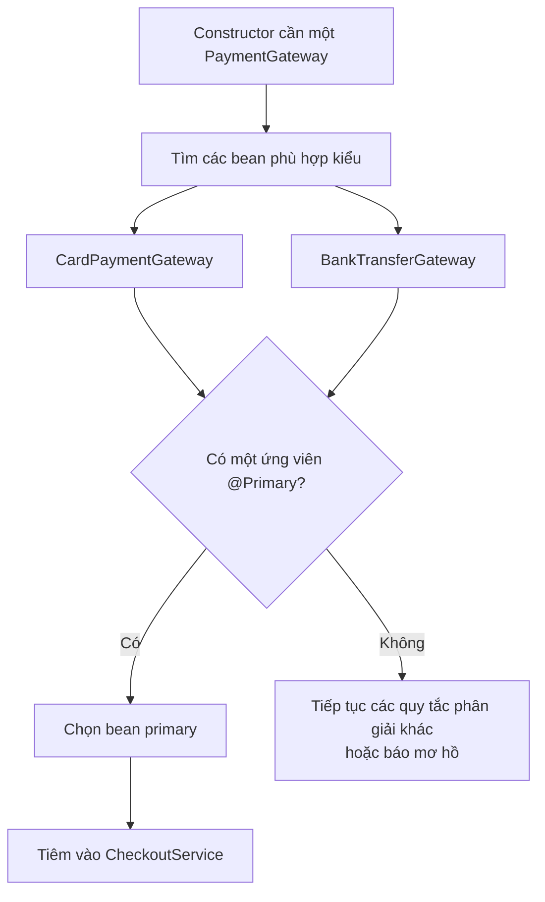
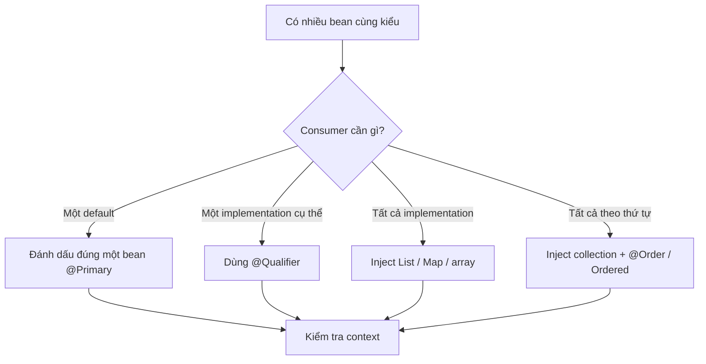

# @Primary và ứng viên ưu tiên

Khi một class cần một dependency theo interface, Spring thường tìm bean có kiểu phù hợp trong `ApplicationContext`. Nếu chỉ có một bean phù hợp, việc tiêm rất đơn giản. Nhưng khi có nhiều implementation cùng kiểu, chẳng hạn ứng dụng có cả cổng thanh toán bằng thẻ và cổng chuyển khoản, Spring cần biết nên chọn bean nào cho một dependency đơn trị.

`@Primary` cho phép đánh dấu **một bean là ứng viên ưu tiên** trong nhóm bean phù hợp. Nhờ đó, những nơi chỉ yêu cầu một dependency có thể nhận implementation mặc định mà bạn lựa chọn. Các bean còn lại vẫn tồn tại và vẫn có thể được dùng khi cần chỉ định rõ bằng `@Qualifier` hoặc khi inject một tập hợp.

Bài học thuộc chương **Chọn bean** của *Spring Boot Fundamentals*. Ta sẽ tìm hiểu cách Spring giải quyết nhiều ứng viên, sử dụng `@Primary` trên component và `@Bean` method, kết hợp với `@Qualifier`, phân biệt với `@Order`, và kiểm thử lựa chọn bean bằng ứng dụng nhỏ.

Ví dụ dùng Java 21 và Spring Boot 3.x. Các ví dụ giả định ứng dụng đã có Spring context và dependency Spring Boot nền tảng.

## 1. Bài toán: một interface, nhiều implementation

Giả sử ứng dụng có một interface để thực hiện thanh toán:

```java
package com.example.demo.payment;

public interface PaymentGateway {
    String pay(long amount);
}
```

Ứng dụng có hai cách thanh toán:

```java
package com.example.demo.payment;

import org.springframework.stereotype.Component;

@Component
public class CardPaymentGateway implements PaymentGateway {

    @Override
    public String pay(long amount) {
        return "Đã thanh toán " + amount + " bằng thẻ";
    }
}
```

```java
package com.example.demo.payment;

import org.springframework.stereotype.Component;

@Component
public class BankTransferGateway implements PaymentGateway {

    @Override
    public String pay(long amount) {
        return "Đã thanh toán " + amount + " bằng chuyển khoản";
    }
}
```

Giả sử một service cần một `PaymentGateway`:

```java
package com.example.demo.payment;

import org.springframework.stereotype.Service;

@Service
public class CheckoutService {

    private final PaymentGateway paymentGateway;

    public CheckoutService(PaymentGateway paymentGateway) {
        this.paymentGateway = paymentGateway;
    }

    public String checkout(long amount) {
        return paymentGateway.pay(amount);
    }
}
```

Nếu cả hai gateway đều được component scan phát hiện, Spring có hai bean có thể gán cho tham số constructor kiểu `PaymentGateway`. Không có thêm thông tin lựa chọn, Spring không thể tự suy ra nghiệp vụ nào phù hợp hơn. Khi khởi tạo `CheckoutService`, ứng dụng thường thất bại với lỗi dạng:

```text
NoUniqueBeanDefinitionException:
No qualifying bean of type 'PaymentGateway' available:
expected single matching bean but found 2
```

Thông báo cụ thể thay đổi theo phiên bản và vị trí phát sinh lỗi, nhưng ý nghĩa là: **có nhiều bean phù hợp cho một dependency cần đúng một bean**.

Đây không phải lỗi component scan. Ngược lại, cả hai implementation đã được phát hiện thành công. Vấn đề xuất hiện ở bước **resolve dependency**, khi Spring phải chọn một ứng viên trong số các bean cùng kiểu.

## 2. `@Primary` giải quyết việc chọn ứng viên như thế nào?

`@Primary` là annotation của Spring Framework, thường được import từ:

```java
import org.springframework.context.annotation.Primary;
```

Đặt annotation trên class component mà bạn muốn làm lựa chọn mặc định:

```java
package com.example.demo.payment;

import org.springframework.context.annotation.Primary;
import org.springframework.stereotype.Component;

@Primary
@Component
public class CardPaymentGateway implements PaymentGateway {

    @Override
    public String pay(long amount) {
        return "Đã thanh toán " + amount + " bằng thẻ";
    }
}
```

Giờ Spring vẫn nhìn thấy hai bean:

- `cardPaymentGateway` có kiểu `PaymentGateway` và được đánh dấu primary.
- `bankTransferGateway` cũng có kiểu `PaymentGateway` nhưng không phải primary.

Khi giải quyết dependency đơn trị kiểu `PaymentGateway` của `CheckoutService`, Spring ưu tiên bean primary. Vì vậy constructor nhận `CardPaymentGateway` mà không cần đổi chữ ký constructor.



### `@Primary` không xóa các bean còn lại

Sau khi đánh dấu `CardPaymentGateway` là primary, `BankTransferGateway` vẫn là một Spring bean bình thường. Nó không bị bỏ qua khi component scan, không bị xóa khỏi context và không bị thay thế bằng card gateway.

Bạn vẫn có thể yêu cầu rõ bank gateway bằng `@Qualifier`:

```java
package com.example.demo.payment;

import org.springframework.beans.factory.annotation.Qualifier;
import org.springframework.stereotype.Service;

@Service
public class BankTransferCheckoutService {

    private final PaymentGateway paymentGateway;

    public BankTransferCheckoutService(
            @Qualifier("bankTransferGateway")
            PaymentGateway paymentGateway) {
        this.paymentGateway = paymentGateway;
    }

    public String checkout(long amount) {
        return paymentGateway.pay(amount);
    }
}
```

Trong ví dụ này, `@Qualifier("bankTransferGateway")` giới hạn nhóm ứng viên theo qualifier/tên tương ứng; bean bank transfer được chọn dù card gateway được đánh dấu `@Primary`. Đây là cách diễn đạt rõ ràng rằng service này cần một phương thức thanh toán cụ thể.

**Mô hình cần nhớ:** `@Primary` đặt lựa chọn mặc định ở phía bean; `@Qualifier` thể hiện lựa chọn cụ thể ở điểm tiêm dependency.

## 3. `@Primary` tác động đến dependency đơn trị

`@Primary` chủ yếu giải quyết trường hợp Spring cần **một bean** cho một điểm tiêm. Các ví dụ phổ biến:

- Constructor có tham số kiểu interface.
- Field hoặc setter injection yêu cầu một bean theo kiểu.
- Tham số method `@Bean` cần một dependency đơn trị.
- Một số API của container yêu cầu resolve một bean duy nhất theo kiểu.

Ví dụ:

```java
@Service
public class ReceiptService {
    private final PaymentGateway gateway;

    public ReceiptService(PaymentGateway gateway) {
        this.gateway = gateway;
    }
}
```

Nếu có đúng một primary candidate trong nhóm `PaymentGateway` phù hợp, Spring có thể dùng nó để thỏa mãn tham số `gateway`.

`@Primary` **không phải quy tắc xếp hạng toàn cục cho mọi lần truy cập bean**. Nó không đổi tên bean, không đổi kiểu bean, không đổi scope, không làm bean primary được tạo trước, và không quyết định thứ tự gọi method trong ứng dụng.

### Primary không thay thế component scan

Để `@Primary` có ý nghĩa, bean phải được đăng ký trong context trước. Nếu class không nằm trong vùng component scan, không được khai báo bằng `@Bean`, không được import hoặc đăng ký bằng cơ chế khác, thì chỉ thêm `@Primary` không tự làm nó trở thành bean.

Ví dụ class:

```java
@Primary
public class CardPaymentGateway implements PaymentGateway {
    // ...
}
```

Nếu không có `@Component` và cũng không có cấu hình `@Bean` tương ứng, Spring không tự tạo bean chỉ vì class mang `@Primary`. Annotation này mô tả **mức ưu tiên của bean definition**, không phải cơ chế tự phát hiện component.

## 4. Có thể đặt `@Primary` trên method `@Bean`

Không phải lúc nào bạn cũng sở hữu source code của implementation để thêm annotation vào class. Với thư viện ngoài, hoặc khi muốn kiểm soát cách tạo object, hãy khai báo bean trong class cấu hình:

```java
package com.example.demo.config;

import com.example.demo.payment.BankTransferGateway;
import com.example.demo.payment.CardPaymentGateway;
import com.example.demo.payment.PaymentGateway;
import org.springframework.context.annotation.Bean;
import org.springframework.context.annotation.Configuration;
import org.springframework.context.annotation.Primary;

@Configuration(proxyBeanMethods = false)
public class PaymentConfiguration {

    @Bean
    @Primary
    PaymentGateway cardPaymentGateway() {
        return new CardPaymentGateway();
    }

    @Bean
    PaymentGateway bankTransferGateway() {
        return new BankTransferGateway();
    }
}
```

Trong cấu hình này:

- `PaymentConfiguration` phải được Spring đăng ký như một configuration class.
- Method `cardPaymentGateway()` trả về object được đăng ký thành bean.
- `@Primary` trên method đánh dấu bean do method đó cung cấp là ứng viên primary.
- `bankTransferGateway()` vẫn đăng ký một bean khác cùng kiểu.

Tên bean mặc định của các method `@Bean` thường là tên method: `cardPaymentGateway` và `bankTransferGateway`. Bạn có thể dùng `@Bean("cardGateway")` nếu muốn tên tường minh khác.

**Chỉ chọn một cách đăng ký cho mỗi implementation trong ví dụ.** Nếu đồng thời để class có `@Component` và thêm method `@Bean` trả về một instance cùng loại, bạn có thể tạo ra hai bean cùng kiểu ngoài dự định. Khi đó cần hiểu rõ số bean thực sự trong context và tên của chúng.

## 5. `@Primary` và `@Qualifier` khác nhau thế nào?

Cả hai đều giúp Spring chọn bean, nhưng thể hiện ý định ở hai nơi khác nhau.

| Tiêu chí | `@Primary` | `@Qualifier` |
|---|---|---|
| Đặt ở đâu? | Trên class component hoặc method `@Bean` | Thường ở injection point; cũng có thể là metadata qualifier trên bean |
| Ý nghĩa | Đánh dấu ứng viên ưu tiên mặc định trong nhóm phù hợp | Thu hẹp nhóm bean được phép chọn theo qualifier |
| Phạm vi tác động | Có thể ảnh hưởng nhiều điểm tiêm đơn trị cùng kiểu | Chỉ ảnh hưởng điểm tiêm có qualifier tương ứng |
| Khi có nhiều implementation | Chọn một mặc định nếu có một primary phù hợp | Chọn implementation cụ thể theo yêu cầu |
| Có loại bỏ bean khác không? | Không | Không |

### 5.1. Chọn mặc định bằng `@Primary`

Giả sử hầu hết luồng checkout của ứng dụng sử dụng card:

```java
@Primary
@Component
public class CardPaymentGateway implements PaymentGateway {
    // ...
}
```

Các service chỉ yêu cầu `PaymentGateway` sẽ nhận card gateway theo quy tắc primary, nếu không có qualifier hoặc quy tắc chọn khác cụ thể hơn.

### 5.2. Chọn rõ ràng bằng `@Qualifier`

Một service dành riêng cho đối soát chuyển khoản có thể khai báo:

```java
public BankReconciliationService(
        @Qualifier("bankTransferGateway")
        PaymentGateway gateway) {
    this.gateway = gateway;
}
```

Ở đây, yêu cầu nghiệp vụ không phải “hãy dùng mặc định”, mà là “hãy dùng bank transfer”. `@Qualifier` truyền đạt ý định đó ngay tại điểm sử dụng.

### 5.3. Kết hợp cả hai

Một bean có thể được đánh dấu `@Primary` và một điểm tiêm vẫn có thể dùng `@Qualifier` để yêu cầu bean khác. Qualifier giúp xác định tập ứng viên trước; primary có tác dụng chọn trong nhóm ứng viên còn lại nếu cần.

Ví dụ:

```java
@Component
@Primary
public class CardPaymentGateway implements PaymentGateway {
    // ...
}

@Component
public class BankTransferGateway implements PaymentGateway {
    // ...
}

@Service
public class BankReportService {
    private final PaymentGateway gateway;

    public BankReportService(
            @Qualifier("bankTransferGateway")
            PaymentGateway gateway) {
        this.gateway = gateway;
    }
}
```

`BankReportService` nhận bank gateway vì qualifier của nó yêu cầu cụ thể bean đó. Primary không có nghĩa là qualifier bị bỏ qua.

### 5.4. Qualifier không nhất thiết chỉ là tên bean

Bạn có thể tạo qualifier riêng để diễn đạt ý nghĩa nghiệp vụ:

```java
package com.example.demo.payment;

import java.lang.annotation.Documented;
import java.lang.annotation.Retention;
import java.lang.annotation.RetentionPolicy;
import java.lang.annotation.Target;
import java.lang.annotation.ElementType;
import org.springframework.beans.factory.annotation.Qualifier;

@Target({ElementType.FIELD, ElementType.PARAMETER, ElementType.TYPE, ElementType.METHOD})
@Retention(RetentionPolicy.RUNTIME)
@Documented
@Qualifier
public @interface BankTransfer {
}
```

Đặt qualifier trên implementation:

```java
@Component
@BankTransfer
public class BankTransferGateway implements PaymentGateway {
    // ...
}
```

Và tại điểm tiêm:

```java
public BankReportService(@BankTransfer PaymentGateway gateway) {
    this.gateway = gateway;
}
```

Qualifier tùy chỉnh hữu ích khi tên class/bean có thể thay đổi nhưng vai trò nghiệp vụ cần giữ ổn định. Ví dụ này yêu cầu import các annotation Java và Spring tương ứng như trong đoạn khai báo.

## 6. Điều gì xảy ra nếu không có bean primary?

Nếu có nhiều bean phù hợp và không có primary candidate, Spring áp dụng những quy tắc resolve dependency khác. Tùy trường hợp, tên dependency có thể tham gia lựa chọn nếu khớp tên bean; qualifier, priority và các metadata khác cũng có vai trò theo quy tắc của container.

Tuy nhiên, bạn không nên dựa vào việc “đặt tên biến giống tên class” để thay thế một lựa chọn có chủ đích. Khi có nhiều implementation và nghiệp vụ yêu cầu một implementation cụ thể, dùng `@Qualifier` giúp code dễ đọc và ổn định hơn.

Nếu sau khi xét các quy tắc lựa chọn vẫn còn nhiều bean phù hợp ngang nhau cho một dependency đơn trị, Spring báo `NoUniqueBeanDefinitionException`.

### Có nhiều bean cùng được đánh dấu `@Primary` thì sao?

`@Primary` không có nghĩa “bean nào được đánh dấu thì luôn thắng bean khác”. Với một tập candidate có **nhiều primary bean cùng phù hợp**, Spring vẫn không có một lựa chọn duy nhất và có thể báo lỗi không xác định được candidate.

Ví dụ:

```java
@Primary
@Component
class CardPaymentGateway implements PaymentGateway {
    // ...
}

@Primary
@Component
class WalletPaymentGateway implements PaymentGateway {
    // ...
}
```

Nếu cả hai đều được đăng ký, cùng đáp ứng kiểu `PaymentGateway` và không có qualifier hoặc quy tắc khác phân giải được, một điểm tiêm chỉ yêu cầu `PaymentGateway` vẫn bị mơ hồ.

**Thông thường, mỗi nhóm bean cùng kiểu chỉ nên có một primary candidate** trong context cho mục đích mặc định đó. Nếu nhiều bean cần tồn tại và các consumer cần lựa chọn khác nhau, dùng qualifier theo nghiệp vụ thay vì đánh dấu tất cả là primary.

## 7. `@Primary` có ảnh hưởng đến danh sách hoặc collection bean không?

Đây là điểm rất quan trọng: `@Primary` được dùng để chọn **một ứng viên cho dependency đơn trị**. Khi consumer yêu cầu một tập hợp, Spring cung cấp các bean phù hợp trong tập hợp đó; primary không loại bỏ các bean còn lại.

Ví dụ:

```java
package com.example.demo.payment;

import java.util.List;
import org.springframework.stereotype.Service;

@Service
public class PaymentGatewayRegistry {

    private final List<PaymentGateway> gateways;

    public PaymentGatewayRegistry(List<PaymentGateway> gateways) {
        this.gateways = gateways;
    }

    public int gatewayCount() {
        return gateways.size();
    }
}
```

Nếu context có card và bank transfer, `List<PaymentGateway>` có thể nhận cả hai bean, kể cả khi card được đánh dấu `@Primary`. Điều tương tự áp dụng cho các kiểu inject nhiều ứng viên như mảng, map theo tên bean hoặc stream/provider của các candidate, theo API cụ thể được sử dụng.

| Kiểu dependency | Vai trò của `@Primary` |
|---|---|
| `PaymentGateway` | Chọn primary khi cần một bean và có một primary phù hợp. |
| `List<PaymentGateway>` | Tập hợp các bean phù hợp; primary không loại bean khác khỏi danh sách. |
| `PaymentGateway[]` | Tập hợp các bean phù hợp; primary không biến mảng thành một bean duy nhất. |
| `Map<String, PaymentGateway>` | Các bean phù hợp được đưa vào map theo tên bean. |
| `ObjectProvider<PaymentGateway>` | API provider cho phép truy xuất candidate; các phương thức yêu cầu một bean có thể áp dụng quy tắc resolve đơn trị. |

Đừng đánh dấu primary với mong muốn bean đó luôn đứng đầu trong mọi collection. Nếu cần sắp xếp các bean khi inject collection, hãy tìm hiểu `@Order` hoặc `Ordered`.

## 8. `@Primary` khác `@Order` như thế nào?

Hai annotation dễ bị nhầm vì đều liên quan đến từ “ưu tiên”, nhưng mục đích khác nhau:

- `@Primary` chọn bean mặc định khi Spring cần **một bean** từ nhiều candidate phù hợp.
- `@Order` hoặc interface `Ordered` thường điều khiển **thứ tự** các bean trong một số collection/array hoặc quá trình xử lý có hỗ trợ ordering.

Ví dụ:

```java
import org.springframework.core.annotation.Order;
import org.springframework.stereotype.Component;

@Component
@Order(1)
public class CardPaymentGateway implements PaymentGateway {
    // ...
}
```

```java
import org.springframework.core.annotation.Order;
import org.springframework.stereotype.Component;

@Component
@Order(2)
public class BankTransferGateway implements PaymentGateway {
    // ...
}
```

Khi inject `List<PaymentGateway>` trong tình huống Spring hỗ trợ ordering, thứ tự có thể theo giá trị `@Order`: giá trị thấp hơn có độ ưu tiên thứ tự cao hơn. Nhưng `@Order(1)` **không tự làm card gateway trở thành bean được chọn cho một constructor chỉ nhận `PaymentGateway`**. Nếu cần mặc định cho dependency đơn trị, dùng `@Primary` hoặc qualifier phù hợp.

### Bảng so sánh nhanh

| Annotation/interface | Trả lời câu hỏi nào? | Tác dụng tiêu biểu |
|---|---|---|
| `@Primary` | “Nếu cần một bean, bean nào là mặc định?” | Chọn candidate cho dependency đơn trị. |
| `@Qualifier` | “Điểm tiêm này cần bean thuộc nhóm/nhãn nào?” | Thu hẹp candidate tại điểm sử dụng. |
| `@Order` | “Các bean trong một danh sách nên xếp thứ tự thế nào?” | Ordering trong các cơ chế hỗ trợ sắp xếp. |
| `Ordered` | “Bean này khai báo thứ tự bằng API nào?” | Cung cấp order value qua code. |

Không nên dùng `@Order` để thay thế `@Primary` hoặc dùng `@Primary` để sắp xếp danh sách.

## 9. Một ví dụ đầy đủ với ba lựa chọn thanh toán

Ta mở rộng ví dụ để có ba implementation:

```java
public interface PaymentGateway {
    String pay(long amount);
}
```

```java
@Component
@Primary
public class CardPaymentGateway implements PaymentGateway {
    @Override
    public String pay(long amount) {
        return "CARD:" + amount;
    }
}
```

```java
@Component
public class BankTransferGateway implements PaymentGateway {
    @Override
    public String pay(long amount) {
        return "BANK:" + amount;
    }
}
```

```java
@Component
public class WalletPaymentGateway implements PaymentGateway {
    @Override
    public String pay(long amount) {
        return "WALLET:" + amount;
    }
}
```

Một service dùng lựa chọn mặc định:

```java
@Service
public class DefaultCheckoutService {
    private final PaymentGateway gateway;

    public DefaultCheckoutService(PaymentGateway gateway) {
        this.gateway = gateway;
    }

    public String checkout(long amount) {
        return gateway.pay(amount);
    }
}
```

Một service cần wallet cụ thể:

```java
@Service
public class WalletCheckoutService {
    private final PaymentGateway gateway;

    public WalletCheckoutService(
            @Qualifier("walletPaymentGateway")
            PaymentGateway gateway) {
        this.gateway = gateway;
    }

    public String checkout(long amount) {
        return gateway.pay(amount);
    }
}
```

Và một service cần toàn bộ gateway:

```java
@Service
public class PaymentOptionsService {
    private final List<PaymentGateway> gateways;

    public PaymentOptionsService(List<PaymentGateway> gateways) {
        this.gateways = gateways;
    }

    public List<String> payWithEveryGateway(long amount) {
        return gateways.stream()
                .map(gateway -> gateway.pay(amount))
                .toList();
    }
}
```

Ba yêu cầu cho ba điểm tiêm:

| Consumer | Kiểu yêu cầu | Bean nhận được |
|---|---|---|
| `DefaultCheckoutService` | Một `PaymentGateway` | `CardPaymentGateway` vì primary. |
| `WalletCheckoutService` | Một `PaymentGateway` có qualifier wallet | `WalletPaymentGateway`. |
| `PaymentOptionsService` | `List<PaymentGateway>` | Cả card, bank transfer và wallet. |

Đây là cách kết hợp hợp lý: primary cung cấp default, qualifier thể hiện yêu cầu riêng, collection cho phép consumer điều phối nhiều implementation.

## 10. Dùng `@Primary` với cấu hình môi trường và bean do thư viện cung cấp

Một ứng dụng có thể có bean mặc định từ thư viện hoặc auto-configuration và bean do chính ứng dụng định nghĩa. Trong những trường hợp đó, `@Primary` là một trong các cách đánh dấu ứng viên mặc định khi cả hai cùng phù hợp kiểu.

Ví dụ một cấu hình tạo gateway mặc định:

```java
@Configuration(proxyBeanMethods = false)
public class DefaultPaymentConfiguration {

    @Bean
    @Primary
    PaymentGateway defaultPaymentGateway() {
        return new CardPaymentGateway();
    }
}
```

Nếu còn một bean `PaymentGateway` khác trong context, bean do method này cung cấp là primary candidate cho injection đơn trị phù hợp.

Trong ứng dụng thật, cần hiểu bean nào đã được auto-configuration cung cấp, có điều kiện nào như `@ConditionalOnMissingBean` hay không, và có đang vô tình đăng ký trùng cùng implementation hay không. `@Primary` **không phải công tắc bật/tắt auto-configuration**; nó chỉ ảnh hưởng việc lựa chọn trong số bean đã được đăng ký.

Nếu thư viện cung cấp bean mặc định có `@ConditionalOnMissingBean(PaymentGateway.class)`, việc ứng dụng khai báo một bean khác có thể làm cấu hình mặc định back off trước khi xét đến primary. Đây là cơ chế conditional registration riêng, không nên nhầm với việc primary chọn bean.

## 11. Kiểm thử lựa chọn bean trong Spring context

Để chứng minh `@Primary` hoạt động, ta cần kiểm tra **bean mà Spring thực sự inject vào consumer**, không chỉ kiểm tra class có annotation.

Giả sử project có ba component gateway và `DefaultCheckoutService` như mục 9. Một integration test:

```java
package com.example.demo.payment;

import static org.assertj.core.api.Assertions.assertThat;

import org.junit.jupiter.api.Test;
import org.springframework.beans.factory.annotation.Autowired;
import org.springframework.boot.test.context.SpringBootTest;
import org.springframework.context.ApplicationContext;

@SpringBootTest
class PrimaryPaymentGatewayTest {

    @Autowired
    DefaultCheckoutService checkoutService;

    @Autowired
    WalletCheckoutService walletCheckoutService;

    @Autowired
    PaymentOptionsService optionsService;

    @Autowired
    ApplicationContext context;

    @Test
    void primaryIsUsedForSingleValuedDependency() {
        assertThat(checkoutService.checkout(100))
                .isEqualTo("CARD:100");
    }

    @Test
    void qualifierCanSelectAnotherImplementation() {
        assertThat(walletCheckoutService.checkout(100))
                .isEqualTo("WALLET:100");
    }

    @Test
    void collectionContainsAllCandidates() {
        assertThat(optionsService.payWithEveryGateway(100))
                .containsExactlyInAnyOrder(
                        "CARD:100",
                        "BANK:100",
                        "WALLET:100");
    }

    @Test
    void allGatewayBeansRemainRegistered() {
        assertThat(context.getBeansOfType(PaymentGateway.class))
                .hasSize(3);
    }
}
```

Test giả định ba gateway đã được component scan, `@Primary` chỉ có trên card, qualifier wallet khớp tên bean mặc định, và không có cấu hình test thay thế chúng. `containsExactlyInAnyOrder` được dùng cho collection vì thứ tự không phải nội dung mà test này cần chứng minh.

Test đầu xác nhận default service nhận card. Test thứ hai chứng minh qualifier có thể yêu cầu wallet. Test thứ ba và thứ tư chứng minh primary không xóa hai implementation còn lại.

### Unit test không cần Spring cho business logic

Nếu chỉ kiểm tra logic của `DefaultCheckoutService`, bạn có thể tạo object trực tiếp:

```java
class DefaultCheckoutServiceTest {

    @Test
    void delegatesPaymentToProvidedGateway() {
        PaymentGateway fakeGateway = amount -> "FAKE:" + amount;
        DefaultCheckoutService service =
                new DefaultCheckoutService(fakeGateway);

        assertThat(service.checkout(50)).isEqualTo("FAKE:50");
    }
}
```

Unit test này không kiểm tra `@Primary` vì nó không khởi động Spring container. Nó kiểm tra service sử dụng dependency được truyền vào đúng cách. Để xác nhận quy tắc chọn bean của Spring, cần context test như phần trên.

## 12. Kiểm tra các bean candidate khi cần chẩn đoán

Khi gặp lỗi nhiều bean cùng kiểu, hãy quan sát những bean thực sự có trong context:

```java
Map<String, PaymentGateway> gateways =
        context.getBeansOfType(PaymentGateway.class);

gateways.forEach((name, gateway) ->
        System.out.println(name + " -> " + gateway.getClass().getSimpleName()));
```

Ví dụ có thể in:

```text
cardPaymentGateway -> CardPaymentGateway
bankTransferGateway -> BankTransferGateway
walletPaymentGateway -> WalletPaymentGateway
```

Tên và thứ tự in có thể khác theo cấu hình. Điều cần xác nhận là **có bao nhiêu bean phù hợp**, tên nào tương ứng với implementation nào, và điểm tiêm đang yêu cầu một bean hay một collection.

Nếu có Spring Boot Actuator và endpoint `beans` được expose trong môi trường phù hợp, bạn cũng có thể xem danh sách bean qua endpoint đó. Không cần bật Actuator chỉ để giải quyết bài thực hành này.

### Những câu hỏi nên đặt khi gặp `NoUniqueBeanDefinitionException`

1. Kiểu dependency đang yêu cầu là gì?
2. Spring tìm thấy những bean nào có thể gán cho kiểu đó?
3. Có qualifier tại điểm tiêm không?
4. Trong nhóm ứng viên còn lại có đúng một primary bean không?
5. Có bean bị đăng ký hai lần do vừa component scan vừa `@Bean` không?
6. Điểm tiêm thực sự cần một bean hay cần danh sách tất cả bean?

Không nên giải quyết mọi lỗi mơ hồ bằng cách gắn `@Primary` tùy tiện. Nếu một service cần bank transfer vì nghiệp vụ của nó, đánh dấu card primary không phải lời giải tốt; service nên khai báo qualifier rõ ràng.

## 13. Một số tình huống dễ nhầm

| Tình huống | Kết quả/ý nghĩa |
|---|---|
| Có hai bean cùng kiểu, không có primary và không có quy tắc phân giải khác | Dependency đơn trị có thể bị mơ hồ. |
| Có đúng một primary candidate phù hợp | Candidate primary được ưu tiên cho dependency đơn trị. |
| Có hai primary candidate cùng kiểu | Vẫn có thể mơ hồ; primary không tạo ra thứ hạng giữa các primary. |
| Điểm tiêm có qualifier chỉ rõ bean bank | Qualifier thu hẹp candidate; bean primary khác không tự thắng qualifier đó. |
| Inject `List<PaymentGateway>` | Nhận các candidate phù hợp, không chỉ primary. |
| Chỉ thêm `@Primary` vào class chưa được đăng ký bean | Không tự tạo bean; vẫn cần component scan hoặc cơ chế đăng ký khác. |
| Có bean primary nhưng kiểu không tương thích với dependency | Không phải candidate phù hợp, nên không giải quyết được dependency đó. |
| Bean primary là lazy | Primary không có nghĩa được tạo sớm hơn; việc khởi tạo còn tùy scope và lazy semantics. |
| Có `@Order(1)` nhưng không có `@Primary` | Order không thay thế lựa chọn primary cho dependency đơn trị. |

### `@Primary` không phải ưu tiên theo thời gian

Từ “primary” có thể khiến bạn nghĩ Spring tạo bean đó trước hoặc gọi nó trước. Thực tế annotation này liên quan đến **candidate resolution**. Thời điểm tạo instance chịu ảnh hưởng bởi scope, lazy initialization và quá trình khởi tạo context.

### `@Primary` không phải cấu hình default cho mọi interface trong ứng dụng

Primary được xét trong nhóm bean tương thích với dependency đang được resolve. Đánh dấu primary trên `PaymentGateway` không làm bean đó trở thành lựa chọn mặc định cho `NotificationSender` hoặc một kiểu khác.

### `@Primary` không tự xử lý lỗi constructor cycle

Nếu bean A cần B và B cần A, việc đánh dấu một implementation là primary không tự giải quyết chu trình dependency. Hãy phân tích lại đồ thị phụ thuộc và tách trách nhiệm nếu cần.

## 14. Chọn `@Primary` hay `@Qualifier` trong thiết kế ứng dụng?

Hãy dùng `@Primary` khi có một implementation thực sự là **mặc định hợp lý** cho phần lớn consumer của một kiểu dependency. Ví dụ ứng dụng có một clock hệ thống mặc định, một encoder chuẩn hoặc một implementation mặc định do ứng dụng chọn.

Hãy dùng `@Qualifier` khi một consumer cần implementation theo yêu cầu cụ thể. Ví dụ:

- Báo cáo đối soát phải dùng gateway chuyển khoản.
- Luồng hoàn tiền phải dùng gateway hỗ trợ refund.
- Một service gửi email giao dịch phải dùng nhà cung cấp có cấu hình tương ứng.
- Một consumer cần implementation đọc dữ liệu từ nguồn legacy.

Nếu có nhiều implementation và mỗi consumer cần lựa chọn khác nhau, qualifier thường làm ý định rõ hơn việc thay đổi primary toàn cục.

### Cân nhắc tên bean hay custom qualifier?

| Lựa chọn | Nên dùng khi |
|---|---|
| `@Qualifier("bankTransferGateway")` | Ứng dụng nhỏ, tên bean rõ ràng và ổn định. |
| Qualifier annotation tùy chỉnh như `@BankTransfer` | Vai trò nghiệp vụ cần một nhãn độc lập với tên class/bean. |
| `@Primary` | Có một default candidate hợp lý cho các dependency đơn trị thông thường. |
| `@Order` / `Ordered` | Consumer cần duyệt một tập hợp theo thứ tự xác định. |

Đừng dùng tên bean như một chuỗi tùy ý ở nhiều nơi nếu có thể dùng qualifier nghiệp vụ rõ ràng. Khi tên implementation thay đổi, chuỗi qualifier theo tên cũng cần được cập nhật.

## 15. Bài thực hành: quan sát primary và qualifier

Tạo interface `PaymentGateway` và ba implementation card, bank, wallet như phần 9. Tất cả component đặt trong package được Spring Boot quét.

**Bước A — Không có primary.** Tạo `DefaultCheckoutService` chỉ yêu cầu `PaymentGateway`. Khởi động context và quan sát lỗi nhiều bean phù hợp. Giải thích vì sao scan thành công nhưng injection thất bại.

**Bước B — Đánh dấu một primary.** Thêm `@Primary` vào `CardPaymentGateway`. Khởi động lại và kiểm tra default service trả về kết quả có prefix `CARD:`.

**Bước C — Chọn implementation cụ thể.** Tạo `WalletCheckoutService` với `@Qualifier("walletPaymentGateway")`. Xác nhận service nhận wallet dù card là primary.

**Bước D — Inject collection.** Tạo `PaymentOptionsService(List<PaymentGateway> gateways)`. Xác nhận collection có đủ ba implementation.

**Bước E — Tạo primary thứ hai.** Tạm thêm `@Primary` lên `BankTransferGateway`. Quan sát context có thể báo mơ hồ ở dependency đơn trị. Khôi phục chỉ một primary.

**Bước F — So sánh với order.** Bỏ primary, thêm `@Order` khác nhau cho hai implementation rồi inject một `List<PaymentGateway>`. Quan sát thứ tự collection. Sau đó thử một constructor chỉ yêu cầu `PaymentGateway` và giải thích tại sao `@Order` không thay `@Primary`.

**Bước G — Đăng ký bằng `@Bean`.** Chuyển một implementation sang factory method trong `@Configuration`, đặt `@Primary` trên method và bỏ cách component registration cũ của cùng implementation. Xác nhận quy tắc chọn bean vẫn hoạt động vì primary gắn với bean definition, không phụ thuộc bean đến từ component scan hay factory method.

## 16. Quy trình xử lý khi có nhiều bean cùng kiểu

Khi gặp lỗi resolve dependency, làm theo trình tự:

1. **Xác định kiểu cần tiêm.** Ví dụ `PaymentGateway` hay `List<PaymentGateway>`?
2. **Liệt kê candidate.** Dùng log, `ApplicationContext` hoặc Actuator nếu có để xem bean nào đã được đăng ký.
3. **Xác định ý định nghiệp vụ.** Consumer cần default, cần implementation cụ thể hay cần toàn bộ implementation?
4. **Chọn cơ chế phù hợp.** Default đơn trị dùng `@Primary`; yêu cầu cụ thể dùng `@Qualifier`; nhiều implementation dùng collection; cần thứ tự dùng `@Order`/`Ordered`.
5. **Kiểm tra số primary.** Với một dependency đơn trị, bảo đảm không có nhiều primary candidate phù hợp.
6. **Kiểm tra đăng ký trùng.** Đừng để cùng implementation được đăng ký qua cả component scan và `@Bean` nếu không chủ ý.
7. **Viết test đúng phạm vi.** Unit test kiểm tra logic consumer; context test kiểm tra quy tắc chọn bean của Spring.



## 17. Câu hỏi tự đánh giá

1. Vì sao Spring báo lỗi khi một constructor yêu cầu `PaymentGateway` nhưng có hai bean cùng kiểu?
2. `@Primary` được đặt ở class component hoặc method `@Bean` nhằm thể hiện điều gì?
3. Sau khi đánh dấu card gateway primary, bank gateway có bị xóa khỏi `ApplicationContext` không?
4. Vì sao `@Qualifier("bankTransferGateway")` vẫn có thể chọn bank dù card là primary?
5. Nếu có hai primary candidate cùng phù hợp, Spring có tự chọn class nào được khai báo trước không?
6. `@Primary` có làm bean primary xuất hiện đầu tiên trong `List<PaymentGateway>` không?
7. `@Order` và `@Primary` khác nhau thế nào?
8. Nếu một class có `@Primary` nhưng chưa được đăng ký thành bean, annotation có tự tạo bean không?
9. Khi nào nên chọn một primary mặc định, khi nào consumer nên dùng qualifier?
10. Vì sao unit test tạo service bằng constructor không kiểm chứng được quy tắc `@Primary` của Spring?

### Mẫu giải thích hoàn chỉnh

> Khi một dependency đơn trị có nhiều bean cùng kiểu, Spring cần một quy tắc để chọn candidate. `@Primary` đánh dấu một bean là lựa chọn ưu tiên mặc định trong nhóm bean phù hợp, vì vậy constructor chỉ yêu cầu kiểu interface có thể nhận implementation primary. Annotation này không xóa các bean khác và không tự đăng ký class thành bean. Nếu một consumer cần implementation cụ thể, `@Qualifier` thu hẹp candidate tại điểm tiêm. Nếu consumer cần tất cả implementation, hãy inject collection; primary không loại các bean khác khỏi danh sách. `@Order` điều khiển thứ tự trong các collection/cơ chế hỗ trợ ordering, chứ không thay thế primary khi cần một bean duy nhất.

Khi bạn có thể giải thích vì sao một dependency đơn trị được chọn, tại sao qualifier có thể yêu cầu bean khác, và vì sao collection vẫn chứa mọi implementation, bạn đã hiểu đúng vai trò của **ứng viên ưu tiên** trong Spring dependency injection.
