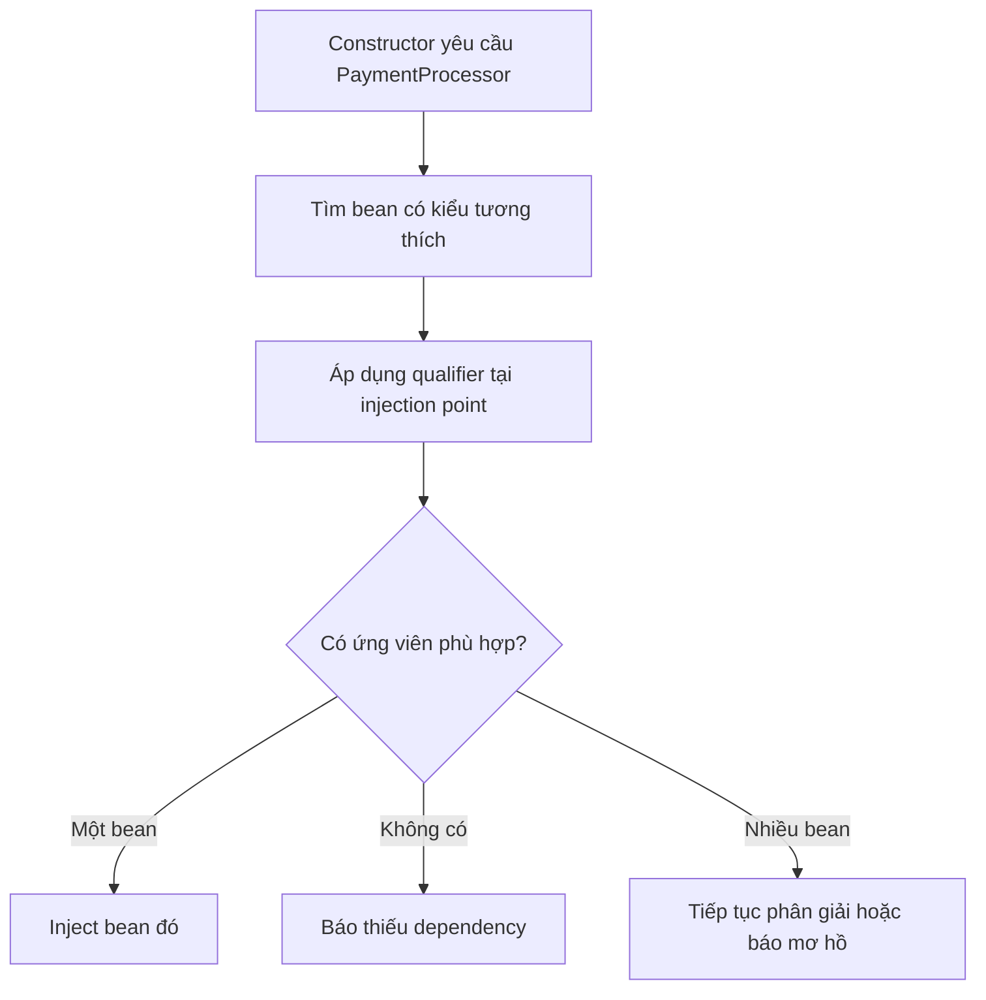

# Custom qualifier annotation để mô tả ý nghĩa nghiệp vụ

Trong Spring, một interface có thể có nhiều bean cùng kiểu. Ví dụ ứng dụng có nhiều cổng thanh toán, nhiều bộ gửi thông báo, nhiều nguồn dữ liệu hoặc nhiều implementation dành cho từng khu vực. Khi một constructor yêu cầu interface đó, Spring cần xác định bean nào phù hợp để inject.

`@Qualifier` cho phép thu hẹp tập bean ứng viên theo một dấu hiệu. Spring cũng cho phép tạo **custom qualifier annotation**: annotation do ứng dụng định nghĩa, được gắn meta-annotation `@Qualifier` và mang ý nghĩa gần với ngôn ngữ nghiệp vụ. Nhờ vậy, code có thể nói rõ “hãy dùng cổng thanh toán thẻ”, “hãy dùng kho dữ liệu cho báo cáo” hoặc “hãy dùng adapter của khu vực APAC”, thay vì phụ thuộc vào tên bean khó hiểu.

Bài học trình bày cơ chế qualifier, cách định nghĩa annotation tùy biến, cách gắn qualifier lên bean và injection point, cách phối hợp nhiều qualifier, sự khác nhau giữa qualifier và `@Primary`, cùng cách kiểm thử và xử lý lỗi thường gặp.

## 1. Vì sao cần qualifier?

Giả sử ứng dụng có một hợp đồng dùng chung cho việc xử lý thanh toán:

```java
public interface PaymentProcessor {
    void charge(String orderId, long amountInCents);
}
```

Ứng dụng có hai implementation:

```java
@Component
public class CardPaymentProcessor implements PaymentProcessor {
    @Override
    public void charge(String orderId, long amountInCents) {
        // Gửi yêu cầu tới cổng thanh toán thẻ.
    }
}

@Component
public class BankTransferProcessor implements PaymentProcessor {
    @Override
    public void charge(String orderId, long amountInCents) {
        // Tạo yêu cầu chuyển khoản ngân hàng.
    }
}
```

Nếu service chỉ khai báo:

```java
@Service
public class CheckoutService {
    private final PaymentProcessor processor;

    public CheckoutService(PaymentProcessor processor) {
        this.processor = processor;
    }
}
```

Spring tìm thấy hai bean cùng tương thích với `PaymentProcessor`. Container không thể tự suy ra nghiệp vụ cần dùng phương thức thanh toán nào. Kết quả thường là lỗi không thể chọn duy nhất một bean, ví dụ `NoUniqueBeanDefinitionException` được bọc trong `UnsatisfiedDependencyException` khi khởi tạo service.

Có thể giải quyết bằng cách chỉ định qualifier tại injection point. Cách dùng chuỗi đơn giản:

```java
@Service
public class CheckoutService {
    private final PaymentProcessor processor;

    public CheckoutService(
            @Qualifier("cardPaymentProcessor") PaymentProcessor processor) {
        this.processor = processor;
    }
}
```

Cách này hoạt động khi bean có qualifier value phù hợp hoặc tên bean khớp theo quy tắc fallback của Spring. Tuy nhiên, chuỗi `"cardPaymentProcessor"` là tên kỹ thuật. Nó không thể hiện trực tiếp ý nghĩa nghiệp vụ và có thể khiến code phụ thuộc vào quy ước đặt tên bean.

Custom qualifier cho phép biểu diễn ý nghĩa đó bằng một kiểu annotation riêng, chẳng hạn `@PaymentRoute(PaymentRouteKind.CARD)`.

## 2. Qualifier hoạt động như thế nào?

Autowiring của Spring thường bắt đầu bằng việc tìm các bean có kiểu tương thích với dependency. Qualifier tiếp tục **lọc các ứng viên theo metadata** để chọn bean phù hợp.

Có thể hình dung quy trình:



Qualifier không làm thay đổi kiểu Java của dependency. Một bean được đánh dấu `@PaymentRoute(CARD)` vẫn phải implement `PaymentProcessor` nếu constructor yêu cầu `PaymentProcessor`. Qualifier không thể khiến một object sai kiểu trở thành dependency hợp lệ.

Điểm quan trọng khác: qualifier là **dấu hiệu phân loại bean**, không nhất thiết là định danh duy nhất của bean. Nhiều bean có thể cùng mang một qualifier nếu chúng cùng thuộc một nhóm nghiệp vụ. Nếu injection point yêu cầu qualifier đó và vẫn có nhiều bean phù hợp, Spring có thể tiếp tục báo mơ hồ.

## 3. Định nghĩa custom qualifier annotation

Để tạo custom qualifier, định nghĩa annotation và gắn `@Qualifier` của Spring lên chính annotation đó. Đây là một dạng *meta-annotation*: annotation của ứng dụng được Spring nhận diện như qualifier.

Ví dụ, ứng dụng cần phân biệt các tuyến thanh toán theo phương thức:

```java
package com.example.payment;

public enum PaymentRouteKind {
    CARD,
    BANK_TRANSFER
}
```

Định nghĩa annotation:

```java
package com.example.payment;

import java.lang.annotation.Documented;
import java.lang.annotation.ElementType;
import java.lang.annotation.Retention;
import java.lang.annotation.RetentionPolicy;
import java.lang.annotation.Target;
import org.springframework.beans.factory.annotation.Qualifier;

@Target({
        ElementType.TYPE,
        ElementType.METHOD,
        ElementType.FIELD,
        ElementType.PARAMETER,
        ElementType.ANNOTATION_TYPE
})
@Retention(RetentionPolicy.RUNTIME)
@Documented
@Qualifier
public @interface PaymentRoute {
    PaymentRouteKind value();
}
```

Giải thích từng thành phần:

- `@Qualifier`: đánh dấu annotation này là một qualifier mà Spring có thể dùng khi giải quyết dependency.
- `@Target`: cho phép annotation xuất hiện trên class/interface, phương thức, field, tham số và annotation khác.
- `ElementType.TYPE`: dùng để gắn qualifier lên class implementation.
- `ElementType.METHOD`: dùng để gắn qualifier lên phương thức `@Bean` trong cấu hình Java.
- `ElementType.PARAMETER`: dùng để gắn qualifier lên tham số constructor hoặc phương thức injection.
- `ElementType.FIELD`: hỗ trợ field injection khi code cần dùng kiểu này.
- `ElementType.ANNOTATION_TYPE`: cho phép custom qualifier được kết hợp trong một annotation tổng hợp khác.
- `@Retention(RetentionPolicy.RUNTIME)`: giữ metadata ở runtime để Spring có thể đọc.
- `@Documented`: đưa annotation vào tài liệu Javadoc của phần tử sử dụng nó.
- `PaymentRouteKind value()`: thuộc tính mang giá trị phân loại nghiệp vụ.

Dùng enum thay cho chuỗi tự do giúp compiler phát hiện giá trị không hợp lệ và hỗ trợ IDE gợi ý. Nếu miền giá trị thường xuyên thay đổi hoặc đến từ cấu hình động, một chuỗi có kiểm soát cũng có thể phù hợp, nhưng cần thống nhất quy ước.

## 4. Gắn custom qualifier lên bean

Có thể gắn qualifier lên class implementation cùng với stereotype annotation:

```java
package com.example.payment;

import org.springframework.stereotype.Component;

@Component
@PaymentRoute(PaymentRouteKind.CARD)
public class CardPaymentProcessor implements PaymentProcessor {
    @Override
    public void charge(String orderId, long amountInCents) {
        // Xử lý thanh toán thẻ.
    }
}
```

Implementation khác mang qualifier khác:

```java
package com.example.payment;

import org.springframework.stereotype.Component;

@Component
@PaymentRoute(PaymentRouteKind.BANK_TRANSFER)
public class BankTransferProcessor implements PaymentProcessor {
    @Override
    public void charge(String orderId, long amountInCents) {
        // Xử lý thanh toán chuyển khoản.
    }
}
```

Khi component scan tìm thấy các class trên, Spring đăng ký chúng thành bean và ghi nhận qualifier metadata từ annotation. Bean name mặc định vẫn được suy ra từ tên class, nhưng việc chọn bean ở ví dụ này dựa vào qualifier nghiệp vụ.

Lưu ý: class phải nằm trong phạm vi component scan hoặc được đăng ký bằng cơ chế cấu hình khác. Chỉ thêm `@PaymentRoute` lên một class không tự đưa class đó vào context nếu nó chưa được Spring phát hiện.

## 5. Dùng custom qualifier tại constructor injection point

Bây giờ có thể khai báo service:

```java
package com.example.checkout;

import com.example.payment.PaymentProcessor;
import com.example.payment.PaymentRoute;
import com.example.payment.PaymentRouteKind;
import org.springframework.stereotype.Service;

@Service
public class CheckoutService {
    private final PaymentProcessor processor;

    public CheckoutService(
            @PaymentRoute(PaymentRouteKind.CARD)
            PaymentProcessor processor) {
        this.processor = processor;
    }

    public void checkout(String orderId, long amountInCents) {
        processor.charge(orderId, amountInCents);
    }
}
```

Spring xử lý dependency theo hai bước khái quát:

1. Tìm bean tương thích với kiểu `PaymentProcessor`.
2. Chỉ giữ bean có qualifier `@PaymentRoute(PaymentRouteKind.CARD)` tương ứng với metadata trên injection point.

Do đó `CardPaymentProcessor` được chọn. Bean chuyển khoản không phù hợp với qualifier yêu cầu, dù nó cũng implement cùng interface.

Không cần gắn thêm `@Autowired` trên constructor này nếu class chỉ có một constructor. Quy tắc constructor duy nhất của Spring Framework 4.3+ vẫn áp dụng; custom qualifier chỉ làm rõ **bean nào** được inject.

### 5.1. Qualifier trên field hoặc setter

Custom qualifier cũng có thể dùng ở field:

```java
@Autowired
@PaymentRoute(PaymentRouteKind.CARD)
private PaymentProcessor processor;
```

Hoặc tham số setter:

```java
@Autowired
public void setProcessor(
        @PaymentRoute(PaymentRouteKind.CARD)
        PaymentProcessor processor) {
    this.processor = processor;
}
```

Các ví dụ này minh họa khả năng của annotation. Với dependency bắt buộc trong service, constructor injection thường vẫn là lựa chọn rõ ràng hơn vì dependency được khai báo ngay lúc tạo object.

## 6. Dùng qualifier trên phương thức @Bean

Không phải mọi bean đều được tạo từ class có `@Component`. Một bean có thể được tạo qua phương thức `@Bean` trong `@Configuration`. Custom qualifier có thể được đặt trên phương thức đó nhờ `ElementType.METHOD`.

```java
package com.example.payment;

import org.springframework.context.annotation.Bean;
import org.springframework.context.annotation.Configuration;

@Configuration(proxyBeanMethods = false)
public class PaymentConfiguration {

    @Bean
    @PaymentRoute(PaymentRouteKind.CARD)
    PaymentProcessor cardProcessor(CardClient cardClient) {
        return new CardPaymentProcessor(cardClient);
    }

    @Bean
    @PaymentRoute(PaymentRouteKind.BANK_TRANSFER)
    PaymentProcessor bankTransferProcessor(BankClient bankClient) {
        return new BankTransferProcessor(bankClient);
    }
}
```

`CardClient`, `BankClient` và các constructor nhận client trong ví dụ là kiểu minh họa; ứng dụng thật cần định nghĩa và đăng ký chúng. Điểm chính là qualifier metadata được gắn với bean definition do factory method tạo ra.

Nếu bean được tạo bằng `@Bean`, qualifier đặt trên factory method là cách thể hiện rõ phân loại bean. Không nhất thiết phải gắn qualifier lên class implementation được trả về, đặc biệt khi implementation không do ứng dụng kiểm soát.

Có thể kết hợp `@Bean` với `@Primary` hoặc các condition khác khi cần, nhưng hãy xác định một nơi chịu trách nhiệm phân loại bean để tránh cấu hình khó hiểu.

## 7. Custom qualifier có nhiều thuộc tính

Một annotation có thể có nhiều thuộc tính để mô tả nhiều chiều nghiệp vụ. Ví dụ hệ thống gửi thông báo có thể chọn theo kênh và khu vực:

```java
public enum NotificationChannel {
    EMAIL,
    SMS
}

public enum RegionCode {
    APAC,
    EMEA,
    AMERICAS
}
```

Định nghĩa qualifier:

```java
@Target({
        ElementType.TYPE,
        ElementType.METHOD,
        ElementType.FIELD,
        ElementType.PARAMETER,
        ElementType.ANNOTATION_TYPE
})
@Retention(RetentionPolicy.RUNTIME)
@Documented
@Qualifier
public @interface NotificationRoute {
    NotificationChannel channel();

    RegionCode region();
}
```

Gắn metadata cho bean:

```java
@Component
@NotificationRoute(
        channel = NotificationChannel.EMAIL,
        region = RegionCode.APAC
)
public class ApacEmailSender implements NotificationSender {
    // ...
}
```

Tại injection point:

```java
@Service
public class CustomerNotifier {
    private final NotificationSender sender;

    public CustomerNotifier(
            @NotificationRoute(
                    channel = NotificationChannel.EMAIL,
                    region = RegionCode.APAC
            )
            NotificationSender sender) {
        this.sender = sender;
    }
}
```

Spring so sánh metadata qualifier ở bean candidate với metadata yêu cầu tại injection point. Các thuộc tính của custom qualifier giúp phân biệt những ứng viên theo nhiều tiêu chí.

Thiết kế nhiều thuộc tính nên phản ánh các chiều lựa chọn thực sự có ý nghĩa. Nếu một annotation trở thành tập hợp rất nhiều cờ, khó hiểu hoặc thay đổi độc lập, hãy xem xét tách thành các qualifier riêng.

## 8. Kết hợp nhiều custom qualifier

Thay vì tạo một annotation chứa tất cả thông tin, có thể định nghĩa hai qualifier độc lập: một cho khu vực, một cho kênh.

```java
@Target({
        ElementType.TYPE,
        ElementType.METHOD,
        ElementType.FIELD,
        ElementType.PARAMETER,
        ElementType.ANNOTATION_TYPE
})
@Retention(RetentionPolicy.RUNTIME)
@Documented
@Qualifier
public @interface Region {
    RegionCode value();
}
```

```java
@Target({
        ElementType.TYPE,
        ElementType.METHOD,
        ElementType.FIELD,
        ElementType.PARAMETER,
        ElementType.ANNOTATION_TYPE
})
@Retention(RetentionPolicy.RUNTIME)
@Documented
@Qualifier
public @interface Channel {
    NotificationChannel value();
}
```

Bean có thể mang cả hai qualifier:

```java
@Component
@Region(RegionCode.APAC)
@Channel(NotificationChannel.EMAIL)
public class ApacEmailSender implements NotificationSender {
    // ...
}
```

Injection point yêu cầu cả hai:

```java
public CustomerNotifier(
        @Region(RegionCode.APAC)
        @Channel(NotificationChannel.EMAIL)
        NotificationSender sender) {
    this.sender = sender;
}
```

Nhiều qualifier tại cùng một injection point được dùng để thu hẹp tập ứng viên đồng thời: bean cần thỏa mãn tất cả dấu hiệu được yêu cầu. Đây là cách diễn đạt điều kiện kết hợp kiểu “khu vực APAC **và** kênh EMAIL”.

Nếu ứng dụng có rất nhiều tổ hợp cố định, có thể tạo composed qualifier như `@ApacEmail` để code consumer ngắn hơn. Tuy nhiên, chỉ nên tạo khi tổ hợp có ý nghĩa ổn định trong ngôn ngữ nghiệp vụ.

## 9. Composed qualifier: tạo annotation giàu ngữ nghĩa hơn

Custom qualifier có thể trở thành meta-annotation của một annotation khác. Ví dụ, hệ thống thường xuyên cần chọn bộ gửi email ở APAC:

```java
@Target({
        ElementType.TYPE,
        ElementType.METHOD,
        ElementType.FIELD,
        ElementType.PARAMETER,
        ElementType.ANNOTATION_TYPE
})
@Retention(RetentionPolicy.RUNTIME)
@Documented
@Region(RegionCode.APAC)
@Channel(NotificationChannel.EMAIL)
public @interface ApacEmail {
}
```

Có thể dùng annotation tổng hợp ở bean:

```java
@Component
@ApacEmail
public class ApacEmailSender implements NotificationSender {
    // ...
}
```

Và injection point:

```java
public CustomerNotifier(@ApacEmail NotificationSender sender) {
    this.sender = sender;
}
```

Trong ví dụ, `@ApacEmail` biểu đạt một tổ hợp qualifier đã được định nghĩa: region APAC và channel EMAIL. Để Spring nhận diện đúng, các annotation nền phải được thiết kế với retention và target thích hợp, bao gồm `ANNOTATION_TYPE` nếu chúng được gắn lên annotation khác.

Composed qualifier hữu ích khi một tổ hợp được lặp lại nhiều nơi. Nếu chỉ xuất hiện một lần, hai qualifier tách biệt đôi khi dễ đọc và dễ mở rộng hơn.

### 9.1. Phân biệt composed qualifier với alias attribute

Có thể muốn annotation tổng hợp cho phép tùy biến một thuộc tính thay vì cố định mọi giá trị. Khi đó cần tìm hiểu `@AliasFor` và cách Spring tổng hợp annotation attributes. Đây là cơ chế nâng cao: alias phải trỏ tới attribute hợp lệ của annotation meta tương ứng và có kiểu tương thích.

Không nên thêm `@AliasFor` chỉ để làm annotation trông linh hoạt. Nếu consumer chỉ cần chọn một trong vài route cố định, enum hoặc qualifier độc lập thường dễ hiểu hơn.

## 10. Qualifier và @Primary khác nhau thế nào?

Cả qualifier và `@Primary` đều tham gia giải quyết trường hợp có nhiều bean cùng kiểu, nhưng vai trò khác nhau.

| Tiêu chí | Custom qualifier / `@Qualifier` | `@Primary` |
| --- | --- | --- |
| Mục đích | Chọn theo ý nghĩa hoặc tiêu chí cụ thể | Đánh dấu bean ưu tiên mặc định |
| Phạm vi quyết định | Tại injection point, lọc ứng viên theo qualifier | Trên bean definition, ưu tiên khi có nhiều ứng viên |
| Có thể mô tả nhiều chiều | Có, qua nhiều annotation/attribute | Không; chỉ biểu thị ưu tiên |
| Nhiều bean cùng qualifier | Có thể, nếu cùng nhóm | Có thể có nhiều bean primary dẫn đến mơ hồ |
| Consumer thể hiện ý định nghiệp vụ | Rõ ràng | Không thể hiện tiêu chí cụ thể |

Ví dụ, ứng dụng có nhiều cổng thanh toán nhưng phần lớn use case mặc định dùng thẻ. Có thể đánh dấu implementation thẻ là primary:

```java
@Component
@Primary
public class CardPaymentProcessor implements PaymentProcessor {
    // ...
}
```

Khi một consumer chỉ yêu cầu `PaymentProcessor`, bean primary được ưu tiên. Nhưng một use case cần chuyển khoản vẫn nên nói rõ:

```java
public RefundService(
        @PaymentRoute(PaymentRouteKind.BANK_TRANSFER)
        PaymentProcessor processor) {
    this.processor = processor;
}
```

Qualifier diễn đạt yêu cầu của consumer; primary đặt mặc định ở phía provider. Qualifier cụ thể ở injection point thường là cách tốt hơn khi lựa chọn có ý nghĩa nghiệp vụ rõ ràng.

## 11. Qualifier không phải bean name

Một nhầm lẫn phổ biến là xem `@Qualifier("x")` như cú pháp tìm bean theo tên tương đương `getBean("x")`.

Trong autowiring theo kiểu, qualifier được dùng để lọc các bean candidate theo metadata. Giá trị qualifier đôi khi có thể khớp với tên bean như một fallback, nhưng ý nghĩa thiết kế của qualifier là **phân loại ứng viên**, không phải thay thế cơ chế truy xuất bean theo tên.

So sánh:

```java
// Chọn theo qualifier metadata:
public ReportService(@Region(RegionCode.EMEA) ReportStore store) {
    this.store = store;
}

// Dùng qualifier dạng chuỗi:
public ReportService(@Qualifier("regionalStore") ReportStore store) {
    this.store = store;
}
```

Nếu tên bean đổi từ `regionalStore` sang `emeaReportStore`, code consumer dùng qualifier nghiệp vụ `@Region(EMEA)` không cần thay đổi miễn metadata vẫn được giữ nguyên.

Dùng bean name trực tiếp có thể hợp lý khi tên chính là hợp đồng cấu hình được chủ đích quản lý, nhưng không nên đặt tên bean ngẫu nhiên rồi dùng tên đó như ngôn ngữ nghiệp vụ ở khắp nơi.

## 12. Qualifier phải đi cùng bean candidate hợp lệ

Custom qualifier không tự đăng ký bean. Ví dụ:

```java
@PaymentRoute(PaymentRouteKind.CARD)
public class CardPaymentProcessor implements PaymentProcessor {
    // ...
}
```

Nếu class không có stereotype và cũng không được đăng ký bằng `@Bean`, `@Import` hoặc cơ chế khác, Spring không có bean candidate để chọn.

Một class có thể được đăng ký qua component scan:

```java
@Component
@PaymentRoute(PaymentRouteKind.CARD)
public class CardPaymentProcessor implements PaymentProcessor {
    // ...
}
```

Hoặc factory method:

```java
@Configuration(proxyBeanMethods = false)
class PaymentConfiguration {
    @Bean
    @PaymentRoute(PaymentRouteKind.CARD)
    PaymentProcessor cardProcessor() {
        return new CardPaymentProcessor();
    }
}
```

Hai cách trên là hai phương án đăng ký bean. Không cần đồng thời scan và khai báo bean method cho cùng implementation, nếu làm vậy có thể tạo hai bean candidate ngoài ý muốn.

Cũng cần bảo đảm component nằm trong package được scan, hoặc cấu hình được import. Nếu bean không xuất hiện trong context, qualifier không thể khắc phục lỗi đăng ký.

## 13. Điều gì xảy ra nếu qualifier không khớp?

Một số tình huống thường gặp:

| Tình huống | Kết quả có thể xảy ra | Hướng xử lý |
| --- | --- | --- |
| Không có bean cùng kiểu | Không có dependency candidate | Đăng ký implementation |
| Có bean cùng kiểu nhưng không mang qualifier yêu cầu | Không có candidate thỏa mãn qualifier | Kiểm tra metadata trên bean |
| Qualifier value khác nhau | Candidate bị loại | Đồng bộ enum/attribute ở provider và consumer |
| Nhiều bean cùng kiểu và cùng qualifier | Vẫn còn nhiều candidate | Thêm tiêu chí qualifier hoặc chọn primary phù hợp |
| Bean có qualifier nhưng không được scan/import | Bean không tồn tại trong context | Kiểm tra cơ chế đăng ký |
| Injection point dùng qualifier sai kiểu | Không có qualifier phù hợp | Dùng đúng annotation và giá trị |

Ví dụ sai giá trị:

```java
@Component
@PaymentRoute(PaymentRouteKind.CARD)
class CardPaymentProcessor implements PaymentProcessor {}

// Không khớp bean trên:
CheckoutService(
        @PaymentRoute(PaymentRouteKind.BANK_TRANSFER)
        PaymentProcessor processor) {
    // ...
}
```

Nếu không có implementation chuyển khoản nào được đăng ký, Spring không thể đáp ứng constructor. Đừng sửa bằng cách bỏ qualifier một cách tùy tiện; hãy xác định use case thực sự cần route nào và đăng ký bean tương ứng.

### 13.1. Nhiều bean cùng qualifier không phải lỗi annotation

Qualifier có thể dùng để mô tả nhóm. Ví dụ nhiều adapter đều mang `@Region(APAC)` vì tất cả phục vụ khu vực APAC. Khi inject một bean duy nhất theo `@Region(APAC)`, Spring vẫn có thể thấy nhiều candidate.

Nếu consumer cần tất cả adapter, inject `List<RegionalAdapter>`. Nếu cần một adapter cụ thể hơn, bổ sung qualifier khác như channel, data purpose hoặc tenant class. Nếu cần một bean mặc định, cân nhắc `@Primary`.

### 13.2. Qualifier không thay thế validation nghiệp vụ

Spring chỉ dùng metadata để chọn bean. Nó không chứng minh implementation được chọn thực sự có khả năng xử lý giao dịch, tuân thủ quy định khu vực hoặc đáp ứng SLA. Các quy tắc nghiệp vụ và kiểm tra cấu hình cần được thể hiện trong code, validation hoặc integration test phù hợp.

## 14. Kiểm thử custom qualifier

Một custom qualifier quan trọng vì nó quyết định wiring. Unit test của service có thể truyền dependency trực tiếp, nhưng cần thêm test context để xác nhận Spring chọn đúng bean.

Có thể dùng `AnnotationConfigApplicationContext` trong một ví dụ nhỏ:

```java
import org.springframework.context.annotation.AnnotationConfigApplicationContext;
import org.springframework.context.annotation.Bean;
import org.springframework.context.annotation.Configuration;
import org.springframework.beans.factory.annotation.Qualifier;

@Configuration(proxyBeanMethods = false)
class PaymentTestConfiguration {

    @Bean
    @PaymentRoute(PaymentRouteKind.CARD)
    PaymentProcessor cardProcessor() {
        return new CardPaymentProcessor();
    }

    @Bean
    @PaymentRoute(PaymentRouteKind.BANK_TRANSFER)
    PaymentProcessor bankTransferProcessor() {
        return new BankTransferProcessor();
    }

    @Bean
    CheckoutService checkoutService(
            @PaymentRoute(PaymentRouteKind.CARD)
            PaymentProcessor processor) {
        return new CheckoutService(processor);
    }
}
```

Có thể khởi tạo context và kiểm tra:

```java
try (var context =
        new AnnotationConfigApplicationContext(PaymentTestConfiguration.class)) {

    CheckoutService service = context.getBean(CheckoutService.class);
    PaymentProcessor selected =
            context.getBean("cardProcessor", PaymentProcessor.class);

    // Có thể kiểm tra service được xây với implementation thẻ
    // thông qua hành vi quan sát được của service.
}
```

Ví dụ trên minh họa việc nạp Java configuration và để Spring resolve tham số bean method. Trong test thực tế, các processor cần có hành vi quan sát được (ví dụ ghi lại route được gọi) để assertion xác nhận lựa chọn một cách rõ ràng; không nên chỉ kiểm tra context có bean service.

Nếu dùng JUnit 5 và Spring Test, có thể viết test với `@SpringJUnitConfig(PaymentTestConfiguration.class)` rồi inject service. Nếu đang xây auto-configuration, `ApplicationContextRunner` là lựa chọn hữu ích để kiểm tra nhiều tổ hợp bean và property trong context nhỏ.

Các tình huống nên kiểm thử:

1. Chỉ có một bean mang qualifier được yêu cầu: injection thành công.
2. Không có bean mang qualifier: context không tạo được bean phụ thuộc.
3. Hai bean cùng mang qualifier: injection đơn lẻ báo mơ hồ.
4. Bean được đánh dấu `@Primary` nhưng injection yêu cầu qualifier khác: qualifier vẫn giới hạn candidate theo yêu cầu cụ thể.
5. Bean được đăng ký bằng `@Bean` method: qualifier trên method được nhận diện.
6. Composed qualifier: metadata tổng hợp được resolve như mong đợi.

## 15. Thiết kế custom qualifier dễ hiểu và dễ bảo trì

Một custom qualifier tốt nên thể hiện một chiều phân loại ổn định trong nghiệp vụ. Hãy ưu tiên những tên như:

- `@PaymentRoute(CARD)`: tuyến thanh toán.
- `@Region(APAC)`: khu vực xử lý.
- `@DataPurpose(REPORTING)`: mục đích sử dụng dữ liệu.
- `@NotificationChannel(EMAIL)`: kênh thông báo.

Tránh tên mơ hồ như `@Bean1`, `@DefaultImpl` hoặc `@Special` nếu chúng không giải thích được vì sao bean được chọn.

### 15.1. Chọn enum hay chuỗi?

| Kiểu thuộc tính | Ưu điểm | Hạn chế |
| --- | --- | --- |
| Enum | Giá trị hữu hạn, compiler kiểm tra, IDE hỗ trợ | Thêm giá trị cần thay đổi enum và biên dịch lại |
| String | Linh hoạt, phù hợp giá trị mở hoặc cấu hình | Dễ sai chính tả, cần quy ước |
| Marker annotation không thuộc tính | Rất ngắn cho một nhóm cố định | Không biểu diễn được nhiều biến thể |
| Nhiều thuộc tính | Biểu diễn nhiều chiều lựa chọn | Có thể làm annotation phức tạp |

Nếu miền lựa chọn được xác định bởi code và có số lượng hữu hạn, enum thường là lựa chọn an toàn. Nếu giá trị được mở rộng bởi plugin hoặc cấu hình bên ngoài, chuỗi có kiểm soát có thể phù hợp hơn.

### 15.2. Không đưa mọi thông tin cấu hình vào qualifier

Qualifier dành cho **lựa chọn bean**, không phải nơi chứa toàn bộ cấu hình runtime. Ví dụ không nên dùng annotation để lưu API key, URL thay đổi theo môi trường, timeout động hoặc credential.

Những dữ liệu đó nên được cấu hình qua `@ConfigurationProperties`, environment variables hoặc secret management. Qualifier có thể chọn bean adapter theo vai trò, còn properties cung cấp thông tin để cấu hình adapter đó.

### 15.3. Tách trách nhiệm giữa qualifier và factory

Nếu việc lựa chọn phụ thuộc vào dữ liệu runtime, ví dụ mỗi request có một tenant hoặc mỗi đơn hàng có một phương thức thanh toán do người dùng chọn, constructor injection một bean cố định có thể không đủ. Khi đó hãy inject một registry hoặc factory:

```java
public interface PaymentProcessorRegistry {
    PaymentProcessor forRoute(PaymentRouteKind route);
}
```

Registry được Spring xây dựng từ tập bean đã đăng ký và qualifier metadata hoặc từ cấu hình rõ ràng. Service có thể chọn implementation theo tham số nghiệp vụ runtime.

Không nên cố dùng qualifier annotation để thay thế lựa chọn động theo từng request: qualifier chủ yếu được xử lý trong quá trình resolve dependency của container, không phải biểu thức được đánh giá lại cho mỗi lần gọi method.

## 16. Một ví dụ tổng hợp: chọn kho dữ liệu theo mục đích

Giả sử một hệ thống có hai nơi lưu dữ liệu khách hàng: một kho tối ưu cho giao dịch và một kho tối ưu cho báo cáo. Cùng một interface:

```java
public interface CustomerStore {
    Optional<Customer> findById(String id);
}
```

Định nghĩa qualifier:

```java
public enum DataPurpose {
    TRANSACTION,
    REPORTING
}

@Target({
        ElementType.TYPE,
        ElementType.METHOD,
        ElementType.FIELD,
        ElementType.PARAMETER,
        ElementType.ANNOTATION_TYPE
})
@Retention(RetentionPolicy.RUNTIME)
@Documented
@Qualifier
public @interface ForPurpose {
    DataPurpose value();
}
```

Hai adapter:

```java
@Repository
@ForPurpose(DataPurpose.TRANSACTION)
public class TransactionCustomerStore implements CustomerStore {
    @Override
    public Optional<Customer> findById(String id) {
        // Truy vấn kho giao dịch.
        return Optional.empty();
    }
}
```

```java
@Repository
@ForPurpose(DataPurpose.REPORTING)
public class ReportingCustomerStore implements CustomerStore {
    @Override
    public Optional<Customer> findById(String id) {
        // Truy vấn kho báo cáo.
        return Optional.empty();
    }
}
```

Service nghiệp vụ giao dịch:

```java
@Service
public class CustomerCheckoutService {
    private final CustomerStore store;

    public CustomerCheckoutService(
            @ForPurpose(DataPurpose.TRANSACTION) CustomerStore store) {
        this.store = store;
    }

    public Customer requireCustomer(String id) {
        return store.findById(id)
                .orElseThrow(() ->
                        new IllegalArgumentException("Customer not found"));
    }
}
```

Service báo cáo:

```java
@Service
public class CustomerReportService {
    private final CustomerStore store;

    public CustomerReportService(
            @ForPurpose(DataPurpose.REPORTING) CustomerStore store) {
        this.store = store;
    }

    public Optional<Customer> findCustomer(String id) {
        return store.findById(id);
    }
}
```

Trong ứng dụng thật, hai adapter phải có triển khai truy vấn tương ứng và kiểu `Customer` phải được định nghĩa. Ví dụ cho thấy hai service phụ thuộc cùng interface nhưng yêu cầu hai vai trò lưu trữ khác nhau. Custom qualifier làm cho lựa chọn thể hiện ngay tại constructor, giúp người đọc hiểu mục đích của dependency mà không phải lần theo bean name.

## 17. Bài tập thực hành

### Bài tập 1 — Chọn cổng thanh toán

Tạo interface `PaymentProcessor` với hai implementation cho thẻ và chuyển khoản. Định nghĩa `@PaymentRoute` có thuộc tính enum. Gắn qualifier lên từng implementation và inject route thẻ vào `CheckoutService`.

Yêu cầu: khi có hai implementation cùng trên classpath, ứng dụng vẫn khởi động và chọn đúng bean.

### Bài tập 2 — Tạo qualifier có nhiều thuộc tính

Định nghĩa `@NotificationRoute` có `channel` và `region`. Tạo ít nhất ba bean gửi thông báo với các tổ hợp khác nhau. Viết một service yêu cầu email ở APAC và giải thích vì sao bean khác bị loại.

### Bài tập 3 — Phân biệt qualifier và primary

Đánh dấu một implementation là `@Primary`, sau đó tạo một consumer không có qualifier và một consumer yêu cầu qualifier cụ thể. Quan sát hai consumer chọn bean thế nào. Giải thích vì sao primary không thay thế qualifier nghiệp vụ.

### Bài tập 4 — Tạo composed qualifier

Tạo `@ApacEmail` dựa trên hai qualifier khu vực và kênh. Sử dụng annotation tổng hợp ở cả bean implementation và injection point. Xác nhận các meta-annotation có target và retention phù hợp.

### Bài tập 5 — Kiểm tra lỗi ambiguity

Đăng ký hai bean cùng interface và cùng custom qualifier. Inject một bean đơn theo qualifier đó. Quan sát lỗi và giải quyết bằng cách thêm tiêu chí lựa chọn, thay đổi cách đăng ký hoặc inject collection nếu use case cần tất cả implementation.

## 18. Ghi nhớ

Custom qualifier annotation giúp biến lựa chọn bean thành một phần dễ đọc của ngôn ngữ nghiệp vụ. Thay vì để consumer phụ thuộc vào tên bean hoặc một chuỗi tùy ý, bạn có thể định nghĩa annotation có ý nghĩa như `@PaymentRoute(CARD)` hoặc `@ForPurpose(REPORTING)`, gắn nó lên bean và yêu cầu cùng qualifier tại constructor injection point.

Một custom qualifier phải được meta-annotate bằng `@Qualifier` của Spring, có retention runtime và target phù hợp với vị trí sử dụng. Spring vẫn kiểm tra kiểu dependency trước, sau đó dùng qualifier metadata để thu hẹp ứng viên. Nếu không có ứng viên hoặc còn nhiều ứng viên cùng phù hợp, việc khởi tạo vẫn có thể thất bại.

Dùng qualifier cho lựa chọn theo ý nghĩa, `@Primary` cho mặc định ưu tiên, `@Bean` hoặc stereotype để đăng ký bean, và `@ConfigurationProperties` cho cấu hình runtime. Khi các cơ chế này được phân định rõ, bean graph sẽ diễn đạt đúng ý định nghiệp vụ và dễ kiểm thử, bảo trì hơn.
