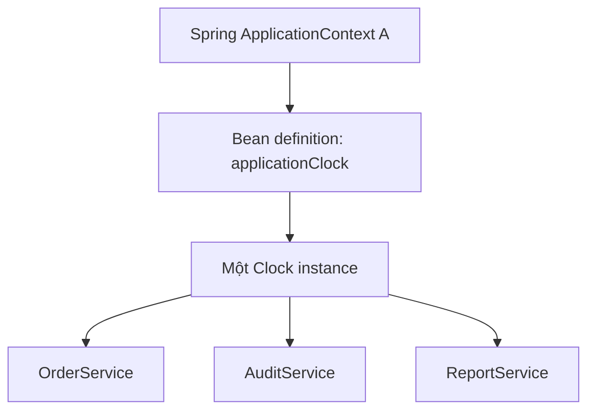
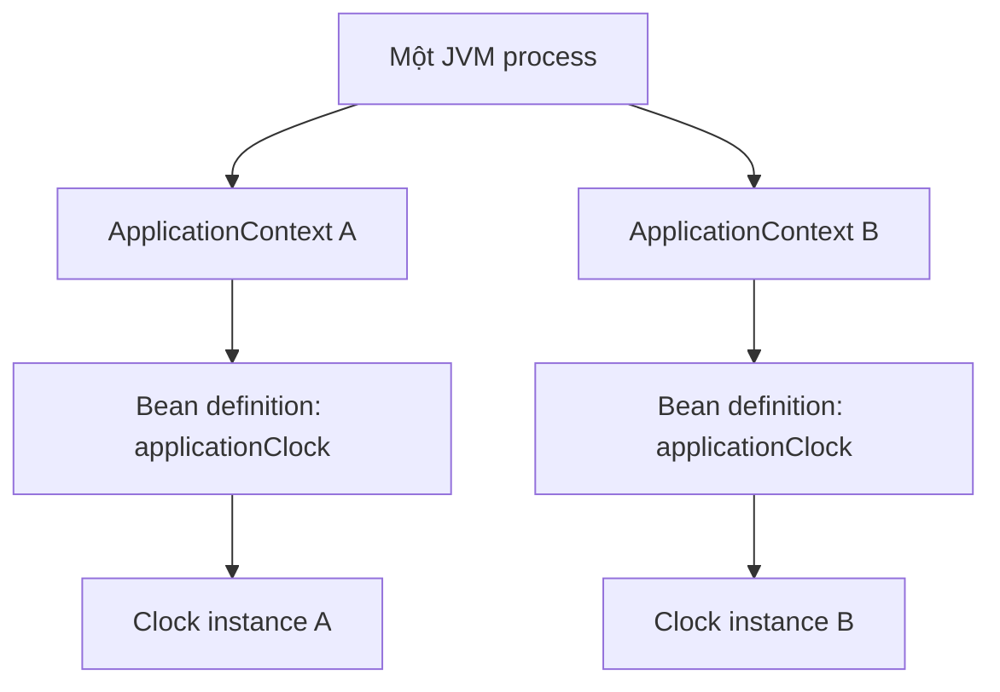
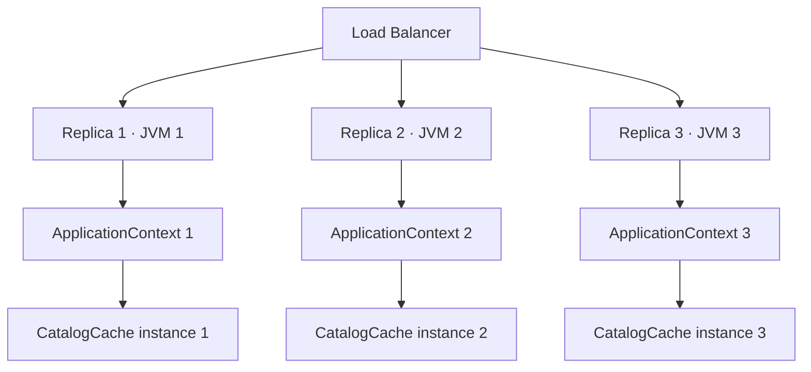
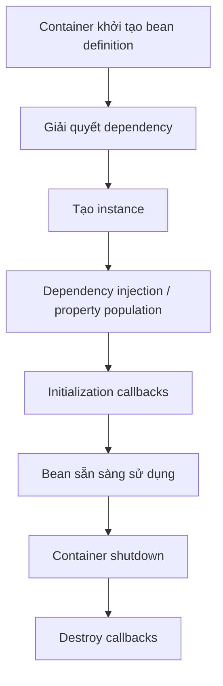

# `Singleton` theo container và khác biệt với một đối tượng dùng chung toàn JVM

> **Spring Boot Fundamentals · Phạm vi bean**  
> Trong Spring, `singleton` là scope mặc định của bean. Điều này có nghĩa container quản lý một instance cho một bean definition trong phạm vi container đó. Nó **không đồng nghĩa** với việc class chỉ có một object trên toàn bộ JVM, toàn bộ ứng dụng đang chạy, hoặc mọi replica của hệ thống. Hiểu đúng ranh giới này giúp tránh nhầm Spring scope với Singleton design pattern, đồng thời thiết kế state, concurrency và kiểm thử phù hợp.

## 1. Singleton trong Spring có nghĩa gì?

Khi Spring tạo một bean với scope `singleton`, container giữ và tái sử dụng cùng một instance cho những lần yêu cầu bean definition đó trong **cùng một container**.

Ví dụ:

```java
package com.example.catalog.config;

import java.time.Clock;
import org.springframework.context.annotation.Bean;
import org.springframework.context.annotation.Configuration;

@Configuration(proxyBeanMethods = false)
public class TimeConfiguration {

    @Bean
    Clock applicationClock() {
        return Clock.systemUTC();
    }
}
```

Nếu cấu hình được nạp vào một Spring ApplicationContext, bean `applicationClock` được tạo và quản lý theo singleton scope mặc định. Nhiều service inject `Clock` phù hợp trong context đó sẽ nhận cùng bean instance.

```java
@Service
public class OrderService {

    private final Clock clock;

    public OrderService(Clock clock) {
        this.clock = clock;
    }
}

@Service
public class AuditService {

    private final Clock clock;

    public AuditService(Clock clock) {
        this.clock = clock;
    }
}
```

Nếu cả hai service được tạo trong cùng context và cùng resolve đến bean `applicationClock`, chúng dùng chung object `Clock` đó.



Đây là ý nghĩa cốt lõi của singleton scope: **một instance cho một bean definition trong phạm vi container**.

### 1.1. Singleton là scope mặc định

Nếu không chỉ định scope khác, bean Spring thường là singleton:

```java
@Component
public class CatalogService {
    // Singleton scope mặc định.
}
```

Viết tường minh cũng được:

```java
@Component
@Scope(ConfigurableBeanFactory.SCOPE_SINGLETON)
public class CatalogService {
}
```

Hoặc với phương thức factory:

```java
@Bean
@Scope("singleton")
CatalogService catalogService() {
    return new CatalogService();
}
```

Trong đa số trường hợp không cần khai báo `@Scope("singleton")` vì đó đã là mặc định. Annotation `@Scope` hữu ích khi muốn thay đổi sang prototype hoặc scope khác.

### 1.2. Container tái sử dụng bean, không gọi constructor mỗi lần inject

Giả sử mười bean khác nhau đều yêu cầu `CatalogService` qua constructor. Spring không tạo mười object `CatalogService` cho mười điểm injection đó. Với một bean definition singleton, container tạo instance theo quy trình khởi tạo rồi cung cấp tham chiếu tới instance đã quản lý.

Điều này giúp:

- Chia sẻ một client hoặc service dùng chung.
- Tập trung cấu hình và quản lý lifecycle.
- Tránh khởi tạo lặp lại các object hạ tầng tốn kém.
- Có thể inject cùng dependency vào nhiều consumer.

Tuy nhiên, dùng chung object cũng có nghĩa trạng thái mutable bên trong nó có thể được nhiều luồng truy cập. Singleton **không tự bảo đảm thread safety**; phần này sẽ được phân tích riêng.

## 2. Ranh giới quan trọng: bean definition và container

Câu nói “Spring chỉ tạo một object cho mỗi class” là không chính xác. Spring quản lý singleton theo **bean definition**, không phải một object duy nhất cho mỗi Java class.

Một bean definition mô tả cách container tạo và quản lý một bean: kiểu, tên, scope, factory method, dependency, lifecycle callback và các metadata liên quan.

### 2.1. Một class có thể tạo nhiều singleton bean

Ví dụ một class client được dùng cho hai dịch vụ đối tác:

```java
public class PartnerClient {

    private final String partnerName;

    public PartnerClient(String partnerName) {
        this.partnerName = partnerName;
    }

    public String partnerName() {
        return partnerName;
    }
}
```

Cấu hình:

```java
@Configuration(proxyBeanMethods = false)
public class PartnerConfiguration {

    @Bean("shippingClient")
    PartnerClient shippingClient() {
        return new PartnerClient("shipping");
    }

    @Bean("billingClient")
    PartnerClient billingClient() {
        return new PartnerClient("billing");
    }
}
```

Trong cùng một ApplicationContext có hai bean definition khác nhau:

| Bean name | Kiểu Java | Instance |
| --- | --- | --- |
| `shippingClient` | `PartnerClient` | Instance A |
| `billingClient` | `PartnerClient` | Instance B |

Cả hai đều singleton theo scope, nhưng **không phải cùng một object**. Mỗi bean definition có instance riêng.

Consumer phải chỉ rõ bean cần dùng:

```java
@Service
public class ShipmentService {

    private final PartnerClient client;

    public ShipmentService(
            @Qualifier("shippingClient") PartnerClient client) {
        this.client = client;
    }
}
```

Nếu inject chỉ theo kiểu `PartnerClient` mà có nhiều bean cùng kiểu, Spring cần quy tắc chọn candidate như `@Qualifier` hoặc `@Primary`.

### 2.2. Alias không tạo thêm instance

Một bean có thể có nhiều tên:

```java
@Bean(name = {"applicationClock", "systemClock"})
Clock clock() {
    return Clock.systemUTC();
}
```

`applicationClock` và `systemClock` là các tên tham chiếu cùng một bean definition/instance, không phải hai bean độc lập.

Phân biệt:

- Hai bean definition khác nhau, dù cùng kiểu: có thể có hai instance.
- Hai alias của cùng một bean: vẫn là một instance.
- Hai container độc lập cùng nạp một configuration: thường có một instance ở mỗi container.

### 2.3. Đặt tên bean không làm thay đổi scope

Ví dụ `@Bean("primaryClient")` chỉ định danh bean. Nó không biến bean thành singleton toàn JVM hoặc thành object static.

Tương tự, `@Primary` chỉ ảnh hưởng cách Spring chọn bean khi có nhiều ứng viên phù hợp. Nó không hợp nhất các bean thành một object.

## 3. Singleton theo container: cùng JVM vẫn có thể có nhiều instance

Một Spring ApplicationContext thường chứa một BeanFactory quản lý các bean definition và singleton của nó. Scope singleton gắn với **container/BeanFactory quản lý bean**, không gắn với toàn bộ JVM.

Ta có thể tạo hai context trong cùng một process:

```java
AnnotationConfigApplicationContext contextA =
        new AnnotationConfigApplicationContext(AppConfiguration.class);

AnnotationConfigApplicationContext contextB =
        new AnnotationConfigApplicationContext(AppConfiguration.class);
```

Nếu cả hai context đều nạp cùng bean definition `applicationClock`, mỗi context quản lý singleton riêng:



Vì vậy, hai context có thể cùng chạy trong một JVM mà vẫn có hai instance cho bean cùng tên và cùng kiểu. Chúng là singleton **trong từng container**, không phải singleton trên toàn process.

### 3.1. Ví dụ kiểm chứng bằng object identity

Tạo một class đơn giản:

```java
public class InstanceMarker {
}
```

Cấu hình:

```java
@Configuration(proxyBeanMethods = false)
public class MarkerConfiguration {

    @Bean
    InstanceMarker instanceMarker() {
        return new InstanceMarker();
    }
}
```

Test hai context:

```java
import static org.junit.jupiter.api.Assertions.assertNotSame;
import static org.junit.jupiter.api.Assertions.assertSame;

import org.junit.jupiter.api.Test;
import org.springframework.context.annotation.AnnotationConfigApplicationContext;

class SingletonScopeTest {

    @Test
    void singletonIsScopedToEachContainer() {
        try (var contextA =
                     new AnnotationConfigApplicationContext(MarkerConfiguration.class);
             var contextB =
                     new AnnotationConfigApplicationContext(MarkerConfiguration.class)) {

            InstanceMarker firstA =
                    contextA.getBean(InstanceMarker.class);
            InstanceMarker secondA =
                    contextA.getBean(InstanceMarker.class);
            InstanceMarker firstB =
                    contextB.getBean(InstanceMarker.class);

            assertSame(firstA, secondA);
            assertNotSame(firstA, firstB);
        }
    }
}
```

Hai lần lookup trong context A trả về cùng object; lookup trong context B trả về object khác. Cả hai context đều nằm trong cùng tiến trình test/JVM.

Đây là một cách quan sát trực tiếp scope, không dựa vào suy đoán từ tên class hoặc bean.

### 3.2. Parent-child ApplicationContext

Một số ứng dụng dùng context phân cấp. Child context có thể tra cứu bean từ parent thông qua cơ chế phân cấp, nhưng bean được định nghĩa trong parent vẫn do parent quản lý.

Ví dụ khái niệm:

```text
Parent ApplicationContext
└── sharedClient (singleton do parent sở hữu)

Child ApplicationContext
├── webController (singleton do child sở hữu)
└── có thể lookup sharedClient từ parent
```

Nếu child không định nghĩa lại `sharedClient`, nó có thể nhìn thấy bean của parent và nhận đúng instance do parent quản lý. Nếu child tự định nghĩa một bean cùng tên/kiểu theo quy tắc hierarchy phù hợp, đó là bean definition khác và có thể có instance riêng.

Do đó, nói “mỗi context luôn tạo một instance cho tất cả bean mà nó nhìn thấy” cũng chưa chính xác: cần phân biệt bean **được sở hữu/định nghĩa ở context nào** với bean chỉ được child lookup từ parent.

### 3.3. Tại sao một ứng dụng có thể có nhiều context?

Một số tình huống:

- Ứng dụng có context gốc và context web con trong kiến trúc cũ hoặc cấu hình chuyên biệt.
- Test tạo các context độc lập với cấu hình khác nhau.
- Một ứng dụng nhúng nhiều Spring context cho các module tách biệt.
- Công cụ hoặc thư viện khởi tạo context riêng để cô lập cấu hình.
- Nhiều ứng dụng Spring chạy trong cùng JVM container theo cách triển khai đặc biệt.

Trong ứng dụng Spring Boot thông thường, bạn thường chỉ làm việc với một ApplicationContext chính. Tuy vậy, hiểu phạm vi container giúp tránh giả định sai khi test, tích hợp hoặc mở rộng kiến trúc.

## 4. Khác với Singleton design pattern của GoF

Từ `singleton` cũng xuất hiện trong thiết kế hướng đối tượng. **Singleton design pattern** thường đảm bảo một class chỉ có một instance thông qua cơ chế ở cấp class, ví dụ constructor private và static accessor.

Ví dụ Java đơn giản:

```java
public final class GlobalSettings {

    private static final GlobalSettings INSTANCE = new GlobalSettings();

    private GlobalSettings() {
    }

    public static GlobalSettings getInstance() {
        return INSTANCE;
    }
}
```

Đối tượng này được truy cập qua `GlobalSettings.getInstance()`. Instance được giữ trong static field của class.

Spring singleton khác:

```java
@Component
public class CatalogSettingsService {
}
```

Không cần private constructor, static field hay `getInstance()`. Container tạo và quản lý bean; consumer nhận dependency qua injection.

| Tiêu chí | Spring singleton scope | Singleton design pattern |
| --- | --- | --- |
| Ai quản lý instance? | Spring container/BeanFactory | Class hoặc cơ chế static do lập trình viên viết |
| Phạm vi uniqueness | Một instance cho bean definition trong container | Thường một instance cho class trong phạm vi classloader |
| Cách lấy object | Dependency injection hoặc lookup qua container | Static accessor như `getInstance()` |
| Lifecycle | Container hỗ trợ init/destroy callback và scope | Do code của pattern tự quản lý |
| Thay thế khi test | Có thể dùng context/test configuration hoặc dependency khác | Thường khó thay nếu code gọi static accessor trực tiếp |
| Nhiều container | Mỗi container có thể có instance riêng | Static field có thể được chia sẻ giữa container nếu cùng classloader |
| Dependency | Spring có thể inject các bean khác | Class tự giải quyết hoặc được thiết kế bổ sung |

### 4.1. Static singleton thường gắn với classloader

Trong Java, static field thuộc về class được nạp bởi một **ClassLoader** cụ thể. Trong một classloader, class được nạp một lần theo định danh class tương ứng, nên static field thường dùng chung cho những nơi truy cập class đó.

Nhưng nếu hai classloader độc lập nạp cùng tên class, mỗi classloader có thể có bản class và static field riêng. Vì vậy, ngay cả Singleton pattern dùng static cũng không nên diễn đạt đơn giản là “một object duy nhất tuyệt đối cho toàn bộ JVM trong mọi kiến trúc”.

Spring singleton lại có ranh giới container riêng, nên hai ApplicationContext trong cùng classloader vẫn có thể quản lý hai bean instance khác nhau.

### 4.2. Có nên kết hợp Spring bean với static singleton không?

Thông thường không cần. Nếu đã dùng Spring, hãy để container quản lý object và dùng constructor injection. Tự viết static singleton bên trong một Spring bean có thể:

- Tạo hai tầng quản lý instance khó hiểu.
- Làm test khó cô lập trạng thái.
- Giữ tham chiếu lâu hơn lifecycle của context.
- Làm dependency ẩn, khó thay implementation.
- Tạo vấn đề khi chạy nhiều context hoặc test song song.

Có thể có trường hợp thư viện legacy yêu cầu static access, nhưng đó là tích hợp đặc biệt. Với code ứng dụng mới, Spring bean thường là abstraction phù hợp hơn.

## 5. Spring singleton không phải singleton toàn JVM

Một JVM process có thể chứa:

- Nhiều ApplicationContext.
- Nhiều bean definition cùng kiểu.
- Nhiều instance của một class được tạo bằng `new` ngoài Spring.
- Nhiều classloader.
- Nhiều instance của cùng ứng dụng ở các process khác nhau.

Hơn nữa, một ứng dụng triển khai trên nhiều máy/container thường có một JVM process ở mỗi replica.

Ví dụ có ba replica của dịch vụ catalog:



Mỗi replica có singleton riêng. Nếu `CatalogCache` là in-memory cache, dữ liệu trong cache ở replica 1 không tự xuất hiện ở replica 2 và 3.

### 5.1. Hệ quả với dữ liệu và trạng thái

Giả sử bean giữ bộ đếm:

```java
@Component
public class RequestCounter {

    private long count;

    public void increment() {
        count++;
    }

    public long current() {
        return count;
    }
}
```

Trong một replica, các request có thể nhìn thấy cùng một bộ đếm vì bean là singleton trong context đó. Nhưng khi request tiếp theo được load balancer gửi sang replica khác, bộ đếm ở đó có thể có giá trị khác.

Không thể dùng biến instance của Spring singleton làm cơ chế đồng bộ trạng thái giữa các máy. Nếu cần dữ liệu dùng chung toàn hệ thống, cân nhắc database, Redis, message broker hoặc một hệ thống lưu trữ/chia sẻ trạng thái phù hợp.

### 5.2. Singleton scope không phải distributed singleton

Một distributed singleton cần cơ chế điều phối giữa nhiều process/máy, chẳng hạn leader election, distributed lock hoặc hệ thống điều phối có độ tin cậy phù hợp. Spring singleton scope không cung cấp các cơ chế đó.

Đừng dùng `@Scope("singleton")` rồi cho rằng một scheduled job chỉ chạy một lần trong toàn cluster. Nếu mỗi replica khởi động cùng ứng dụng, mỗi replica có thể tạo scheduled task riêng. Muốn chỉ một node thực hiện, cần thiết kế coordination ở tầng phân tán.

## 6. Singleton không có nghĩa là thread-safe

Một bean singleton có thể được nhiều thread sử dụng đồng thời. Trong ứng dụng Spring MVC, nhiều HTTP request thường được xử lý song song bởi các thread của server. Nếu các request cùng gọi một singleton service, chúng có thể cùng truy cập field của object.

Ví dụ không an toàn:

```java
@Service
public class InvoiceService {

    private String currentCustomer;

    public Invoice createInvoice(String customer) {
        currentCustomer = customer;

        // Xử lý khác có thể xen vào tại đây.
        return new Invoice(currentCustomer);
    }
}
```

Nếu hai request gọi đồng thời:

1. Thread A gán `currentCustomer = "Alice"`.
2. Thread B gán `currentCustomer = "Bob"`.
3. Thread A tiếp tục đọc field và có thể tạo hóa đơn cho Bob.

Đây là race condition do mutable shared state. Việc Spring chỉ tạo một instance không tự bảo vệ field khỏi truy cập đồng thời.

### 6.1. Ưu tiên bean stateless và immutable

Service thường nên giữ dependency ở field `final`, còn dữ liệu của mỗi lần xử lý nằm trong biến local hoặc tham số method:

```java
@Service
public class InvoiceService {

    private final InvoiceRepository repository;

    public InvoiceService(InvoiceRepository repository) {
        this.repository = repository;
    }

    public Invoice createInvoice(String customer) {
        Invoice invoice = new Invoice(customer);
        return repository.save(invoice);
    }
}
```

Trong ví dụ này, `customer` và `invoice` là dữ liệu theo lần gọi. Service không lưu “khách hàng hiện tại” vào field dùng chung.

Đây là thiết kế thường phù hợp với singleton service: object dùng chung nhưng không giữ trạng thái thay đổi theo request.

### 6.2. Khi cần trạng thái mutable, phải bảo vệ nó

Nếu một object thực sự cần đếm số lần gọi trong một process, có thể dùng cấu trúc đồng bộ phù hợp:

```java
@Component
public class RequestCounter {

    private final AtomicLong count = new AtomicLong();

    public long incrementAndGet() {
        return count.incrementAndGet();
    }

    public long current() {
        return count.get();
    }
}
```

`AtomicLong` hỗ trợ thao tác nguyên tử cho bộ đếm trong một JVM. Nó không làm bộ đếm trở thành distributed counter và không thay thế database/Redis khi cần tổng hợp qua nhiều replica.

Các lựa chọn khác tùy yêu cầu có thể gồm `synchronized`, lock, concurrent collection hoặc loại bỏ trạng thái chia sẻ. Mỗi cách có chi phí và semantics riêng; chọn theo workload và invariant cần bảo vệ.

### 6.3. Immutable object là lựa chọn tốt cho bean dùng chung

Object không thay đổi sau khi tạo thường dễ chia sẻ giữa nhiều thread hơn. Ví dụ `Clock.systemUTC()` trả về một clock có thể dùng chung. Các cấu hình, formatter hoặc client được thư viện thiết kế thread-safe cũng thường phù hợp làm singleton bean.

Tuy vậy, không được suy luận mọi class thư viện đều thread-safe. Hãy xem tài liệu và contract của class cụ thể. Spring không tự biến object mutable thành immutable.

### 6.4. Singleton bean có thể chứa cache không?

Có, nếu cache implementation an toàn khi nhiều thread truy cập và semantics phù hợp. Ví dụ Caffeine cache được thiết kế cho truy cập đồng thời. Nhưng vẫn cần xác định:

- Cache local hay distributed?
- Dữ liệu có thể stale trong bao lâu?
- Nhiều replica có cần đồng bộ invalidation?
- Key/value có mutable không?
- Giới hạn dung lượng và expiry được cấu hình thế nào?

Scope singleton chỉ nói về **instance cache được chia sẻ trong context**, không giải quyết chiến lược cache toàn hệ thống.

## 7. Phân biệt singleton với prototype và các scope khác

Spring có nhiều bean scope. Singleton là mặc định, nhưng không phải object nào cũng nên dùng scope này.

| Scope | Quy tắc tạo và tái sử dụng | Ví dụ nhu cầu |
| --- | --- | --- |
| `singleton` | Một instance cho bean definition trong container | Service stateless, configuration, client dùng chung |
| `prototype` | Container tạo instance mới mỗi lần bean được yêu cầu từ container | Object có trạng thái riêng, cần factory tạo mới |
| `request` | Một instance cho mỗi HTTP request trong web-aware context | Dữ liệu gắn với một request |
| `session` | Một instance cho mỗi HTTP session | Trạng thái theo phiên người dùng khi kiến trúc cần |
| `application` | Một instance theo ServletContext của web application | Object dùng chung trong phạm vi servlet application |
| `websocket` | Một instance theo WebSocket session | Trạng thái gắn với một WebSocket session |

Một số scope web chỉ hoạt động khi có web-aware ApplicationContext và đúng môi trường runtime. Không dùng request/session scope trong một ứng dụng command-line thuần túy mà không có cơ chế hỗ trợ.

### 7.1. Khai báo prototype

Ví dụ:

```java
@Component
@Scope(ConfigurableBeanFactory.SCOPE_PROTOTYPE)
public class ImportJobContext {

    private final UUID id = UUID.randomUUID();

    public UUID id() {
        return id;
    }
}
```

Mỗi lần yêu cầu bean prototype từ container, Spring tạo một instance mới:

```java
ImportJobContext first = context.getBean(ImportJobContext.class);
ImportJobContext second = context.getBean(ImportJobContext.class);

// first và second là hai instance khác nhau.
```

Container thường quản lý quá trình khởi tạo prototype nhưng không tự gọi đầy đủ destroy callback cho từng prototype như singleton. Nếu prototype giữ resource, consumer cần có trách nhiệm giải phóng phù hợp.

### 7.2. Inject prototype vào singleton có gì đặc biệt?

Ví dụ:

```java
@Service
public class ImportService {

    private final ImportJobContext jobContext;

    public ImportService(ImportJobContext jobContext) {
        this.jobContext = jobContext;
    }
}
```

Nếu `ImportService` là singleton, dependency `ImportJobContext` được resolve khi tạo service. Service thường giữ một prototype instance đã được inject; mỗi lần gọi method của service **không tự động nhận prototype mới**.

Nếu muốn lấy một instance mới cho mỗi thao tác, dùng `ObjectProvider`:

```java
@Service
public class ImportService {

    private final ObjectProvider<ImportJobContext> jobContextProvider;

    public ImportService(
            ObjectProvider<ImportJobContext> jobContextProvider) {
        this.jobContextProvider = jobContextProvider;
    }

    public UUID startImport() {
        ImportJobContext context = jobContextProvider.getObject();
        return context.id();
    }
}
```

Với prototype bean, mỗi lần `getObject()` có thể yêu cầu container tạo instance mới. Cần thiết kế lifecycle/cleanup nếu object giữ tài nguyên.

### 7.3. Request scope khác singleton như thế nào?

Ví dụ một object lưu thông tin request:

```java
@Component
@RequestScope
public class RequestMetadata {

    private String correlationId;

    public String getCorrelationId() {
        return correlationId;
    }

    public void setCorrelationId(String correlationId) {
        this.correlationId = correlationId;
    }
}
```

Mỗi HTTP request có một instance `RequestMetadata` riêng theo request scope. Đây không phải singleton của toàn ứng dụng. Khi inject request-scoped bean vào singleton, Spring thường sử dụng scoped proxy để consumer có thể truy cập instance tương ứng với request hiện tại.

Request scope cần web-aware context. Không truy cập request-scoped bean ngoài request đang hoạt động nếu không có cơ chế phù hợp; nếu không, có thể phát sinh lỗi scope chưa active.

## 8. Spring singleton và static field: không nên nhầm lẫn

Một class có static field:

```java
public class LegacyRegistry {

    public static final Map<String, String> VALUES =
            new ConcurrentHashMap<>();
}
```

có thể được nhiều object trong cùng classloader truy cập, kể cả code không chạy trong Spring. Nhưng static field không tự có:

- Dependency injection.
- Bean lifecycle callback.
- Scope theo ApplicationContext.
- Cấu hình thay thế theo profile.
- Cơ chế test context để thay implementation.

Nếu đặt một static registry trong một Spring bean, Spring quản lý instance bean nhưng **không quản lý riêng vòng đời static field**. Static state tồn tại theo classloader và có thể giữ dữ liệu qua nhiều test context, gây rò rỉ trạng thái giữa test.

### 8.1. Ví dụ test dễ bị ảnh hưởng bởi static state

```java
public class GlobalCounter {
    public static int count = 0;
}
```

Nếu một test tăng `GlobalCounter.count` lên 5, test khác trong cùng classloader có thể nhìn thấy 5. Việc tạo một ApplicationContext mới không reset static field.

Ngược lại, với bean singleton instance field, hai context có thể có hai instance và trạng thái tách biệt. Khi context đóng, singleton instance thuộc context đó được giải phóng theo lifecycle của container, nhưng static field không tự bị xóa vì context đóng.

Đây là một lý do nên tránh static mutable state trong ứng dụng Spring, đặc biệt khi test cần cô lập.

### 8.2. Không dùng static accessor để lấy Spring bean

Một số code legacy tạo `ApplicationContextHolder` rồi lưu context vào static field để class bất kỳ gọi `getBean()`. Cách này làm dependency ẩn và gắn code vào Spring container toàn cục.

Ưu tiên constructor injection:

```java
@Service
public class PricingService {

    private final TaxCalculator taxCalculator;

    public PricingService(TaxCalculator taxCalculator) {
        this.taxCalculator = taxCalculator;
    }
}
```

Dependency được khai báo rõ ràng, dễ test và dễ thay implementation. Static access có thể cần trong tích hợp legacy đặc biệt, nhưng không nên là cách mặc định để lấy bean.

## 9. Lifecycle của singleton bean

Spring singleton được quản lý qua các bước khởi tạo và hủy. Một luồng đơn giản:



Các callback cụ thể có thể gồm `@PostConstruct`, `InitializingBean`, init method, `@PreDestroy`, `DisposableBean` hoặc destroy method được cấu hình. Thứ tự và cơ chế phụ thuộc loại callback và phiên bản framework.

Ví dụ:

```java
@Component
public class SearchClientLifecycle {

    @PostConstruct
    void initialize() {
        // Kiểm tra hoặc chuẩn bị tài nguyên sau khi dependency đã được inject.
    }

    @PreDestroy
    void shutdown() {
        // Đóng tài nguyên khi context dừng bình thường.
    }
}
```

Nếu bean singleton giữ thread pool, client hoặc resource có close method, hãy khai báo cleanup đúng cách. Không giả định mọi thư viện tự đóng resource chỉ vì instance nằm trong Spring context.

### 9.1. Eager initialization và lazy initialization

Singleton bean thường được khởi tạo sớm khi ApplicationContext refresh hoàn tất. Điều này giúp lỗi cấu hình được phát hiện lúc startup. Có thể trì hoãn một bean:

```java
@Bean
@Lazy
ExpensiveReportClient reportClient() {
    return new ExpensiveReportClient();
}
```

Ví dụ giả định class `ExpensiveReportClient` có constructor phù hợp. `@Lazy` làm chậm thời điểm tạo trong các trường hợp hỗ trợ, nhưng nếu một bean eager khác cần inject nó ngay khi khởi tạo, bean có thể vẫn được tạo sớm.

Lazy initialization không thay đổi scope: bean vẫn là singleton trong container sau khi được tạo.

### 9.2. Context đóng không đồng nghĩa JVM luôn thoát

Đóng ApplicationContext giải phóng bean singleton do context quản lý và gọi lifecycle callback thích hợp. Nhưng JVM có thể tiếp tục chạy nếu còn thread hoặc tài nguyên khác; static field cũng không tự bị xóa.

Ngược lại, JVM/process kết thúc thì toàn bộ heap của process được thu hồi, nhưng điều đó không thay thế cleanup cần thiết với tài nguyên bên ngoài như message broker, database, file hoặc remote service.

## 10. Singleton trong Spring Test

Spring Test có cơ chế **context caching**: các ApplicationContext có cấu hình tương thích có thể được tái sử dụng giữa nhiều test class để tăng tốc. Vì vậy, một singleton bean có thể giữ trạng thái giữa các test nếu context được cache và bean có mutable state.

Điều này giải thích một số test “chạy riêng thì qua, chạy cả suite thì fail”.

### 10.1. Trạng thái bean có thể rò rỉ giữa test

Ví dụ bean:

```java
@Component
public class TestSequence {

    private final AtomicInteger sequence = new AtomicInteger();

    public int next() {
        return sequence.incrementAndGet();
    }

    public void reset() {
        sequence.set(0);
    }
}
```

Hai test dùng cùng context có thể nhìn thấy sequence tiếp tục tăng. Nếu test giả định mỗi test bắt đầu từ 1, chúng có thể phụ thuộc thứ tự chạy.

Cách xử lý:

- Thiết kế bean stateless khi có thể.
- Reset state qua fixture/setup nếu trạng thái thực sự cần.
- Dùng test configuration riêng khi cần context độc lập.
- Cân nhắc `@DirtiesContext` khi test thực sự làm bẩn context và cần loại context khỏi cache, nhưng annotation này có chi phí tạo context mới.
- Không dùng `@DirtiesContext` như biện pháp mặc định cho mọi test.

### 10.2. Hai test context không nhất thiết dùng cùng singleton

Nếu cấu hình test khác nhau khiến Spring Test tạo hai context riêng, mỗi context có singleton instance riêng. Nếu context được tái sử dụng, bean instance có thể được chia sẻ giữa test class sử dụng context đó.

Đừng suy ra rằng “mỗi test method luôn có một Spring singleton mới”. Spring singleton scope không phải JUnit test-instance lifecycle. Hai cơ chế có phạm vi khác nhau.

### 10.3. Test logic bằng object thuần khi không cần container

Nếu chỉ cần kiểm tra một service, có thể tạo object trực tiếp và truyền dependency fake:

```java
@Test
void calculatesPrice() {
    TaxCalculator calculator = new FixedTaxCalculator();
    PricingService service = new PricingService(calculator);

    // Gọi method và assert kết quả.
}
```

Cách này không tạo ApplicationContext; do đó không liên quan đến Spring singleton registry. Unit test kiểm tra hành vi class, còn context test kiểm tra wiring/scope/conditional khi thật sự cần.

## 11. Các hiểu lầm thường gặp

| Nhận định | Đúng hay sai? | Giải thích |
| --- | --- | --- |
| “Spring singleton chỉ có một object cho mỗi class trong JVM.” | Sai | Là một instance cho bean definition trong container; cùng class có thể có nhiều bean definition hoặc nhiều container. |
| “Hai service inject cùng bean singleton trong một context sẽ nhận cùng object.” | Đúng trong trường hợp cùng resolve đến một bean definition | Qualifier/primary và bean definition quyết định candidate. |
| “Hai ApplicationContext trong cùng JVM dùng chung singleton.” | Sai nếu mỗi context tự sở hữu bean definition tương ứng | Mỗi container quản lý singleton riêng; child có thể lookup bean do parent sở hữu. |
| “Singleton bean luôn thread-safe.” | Sai | Nhiều thread có thể gọi cùng object; thread safety phụ thuộc implementation và state. |
| “Singleton scope giống GoF Singleton pattern.” | Không giống nhau | Một bên do container quản lý, một bên thường do class/static code quản lý. |
| “Có ba replica thì có một Spring singleton dùng chung.” | Sai | Mỗi replica/process thường có ApplicationContext và singleton instance riêng. |
| `@Primary` gộp nhiều bean thành một. | Sai | Nó giúp chọn ứng viên khi autowire, không hợp nhất object. |
| Hai `@Bean` cùng trả về một class sẽ luôn là cùng object. | Sai | Hai factory method/bean definition có thể tạo hai instance khác nhau. |
| “Prototype inject vào singleton tự tạo object mới mỗi lần gọi method.” | Sai | Thường chỉ resolve một lần khi tạo singleton; dùng provider/factory để lấy mới theo lần cần. |
| “Đóng context reset static field.” | Sai | Static field gắn với classloader, không thuộc lifecycle bean. |

## 12. Khi nào singleton là lựa chọn phù hợp?

Singleton thường phù hợp cho những object:

- Không giữ trạng thái thay đổi theo request, hoặc có state được bảo vệ đúng cách.
- Có thể chia sẻ giữa nhiều consumer.
- Chi phí khởi tạo đáng kể và cần tái sử dụng.
- Có lifecycle gắn với ApplicationContext.
- Là service, repository, client, configuration hoặc adapter dùng chung.

Ví dụ:

| Loại object | Singleton có thường phù hợp? | Lưu ý |
| --- | --- | --- |
| Service stateless | Có | Dependency nên immutable/final khi có thể |
| Repository Spring Data | Có | Hạ tầng persistence được quản lý bởi Spring |
| HTTP client thread-safe | Thường có | Kiểm tra contract, timeout và lifecycle |
| Cấu hình bất biến | Có | Dùng typed configuration khi phù hợp |
| Cache local thread-safe | Có | Dữ liệu không tự chia sẻ giữa replica |
| DTO cho một request | Thường không cần bean | Tạo theo từng lần xử lý |
| Object giữ trạng thái riêng của một job | Có thể không | Prototype hoặc factory có thể phù hợp |
| Request metadata | Request scope có thể phù hợp | Cần web-aware context |
| Mutable collection dùng chung | Cần cân nhắc | Phải xác định concurrency, consistency và lifecycle |

### 12.1. Service singleton nên stateless tới mức nào?

Không cần biến mọi field thành immutable bằng mọi giá. Service có thể giữ dependency như repository, client hoặc cache. Điều cần tránh là lưu dữ liệu tạm của một thao tác vào field instance mà nhiều request cùng dùng.

Ví dụ tốt:

```java
@Service
public class OrderService {

    private final OrderRepository repository;
    private final Clock clock;

    public OrderService(OrderRepository repository, Clock clock) {
        this.repository = repository;
        this.clock = clock;
    }

    public Order create(CreateOrderCommand command) {
        Instant createdAt = clock.instant();
        Order order = Order.create(command, createdAt);
        return repository.save(order);
    }
}
```

`repository` và `clock` là dependency dùng chung. `command`, `createdAt` và `order` là dữ liệu theo lần gọi. Thiết kế này thường phù hợp với singleton scope nếu các dependency được dùng an toàn.

## 13. Bài thực hành: quan sát singleton ở ba cấp độ

Bài tập dùng Java 17 và Spring Framework/Spring Boot có hỗ trợ annotation tương ứng. Có thể thực hiện trong một test module.

### Bước 1 — Tạo bean singleton

```java
public class InstanceMarker {
}
```

```java
@Configuration(proxyBeanMethods = false)
class MarkerConfiguration {

    @Bean
    InstanceMarker instanceMarker() {
        return new InstanceMarker();
    }
}
```

### Bước 2 — Lookup nhiều lần trong một context

```java
try (var context =
        new AnnotationConfigApplicationContext(MarkerConfiguration.class)) {

    Object first = context.getBean(InstanceMarker.class);
    Object second = context.getBean(InstanceMarker.class);

    System.out.println(first == second); // true
}
```

Giải thích: cả hai lần lookup đều đi tới cùng bean definition trong cùng container.

### Bước 3 — Tạo context thứ hai

```java
try (var contextA =
             new AnnotationConfigApplicationContext(MarkerConfiguration.class);
     var contextB =
             new AnnotationConfigApplicationContext(MarkerConfiguration.class)) {

    Object fromA = contextA.getBean(InstanceMarker.class);
    Object fromB = contextB.getBean(InstanceMarker.class);

    System.out.println(fromA == fromB); // false
}
```

Cả hai context nằm trong cùng JVM, nhưng mỗi context tạo và quản lý bean instance riêng.

### Bước 4 — Tạo hai bean definition cùng kiểu

Thêm hai `@Bean` method trả về `InstanceMarker` với tên khác nhau. Lookup theo tên rồi so sánh identity. Kết quả sẽ là hai object khác nhau dù cùng context và cùng class.

### Bước 5 — So sánh với static singleton

Tạo class có static field instance và gọi từ hai context. Nếu cả hai context dùng cùng classloader, chúng có thể nhìn thấy cùng static instance, trong khi bean singleton của từng context vẫn khác nhau.

Quan sát này giúp phân biệt **container scope** với **classloader-level static state**.

### Bước 6 — Quan sát concurrency

Tạo một singleton service được gọi đồng thời từ nhiều thread. Thử phiên bản lưu dữ liệu request trong mutable instance field và phiên bản dùng biến local. Quan sát race condition trong bản mutable và giải thích vì sao singleton không tự bảo vệ trạng thái.

Không dùng test race condition làm kiểm tra xác định tuyệt đối nếu không có đồng bộ/điều khiển thread phù hợp; mục tiêu là hiểu nguy cơ chia sẻ mutable state.

### Câu hỏi tự kiểm tra

1. Singleton scope của Spring gắn với class, bean definition hay container?
2. Hai lần gọi `getBean` cùng tên trong một context trả về điều gì?
3. Hai phương thức `@Bean` khác nhau cùng trả về một kiểu có nhất thiết trả cùng instance không?
4. Hai ApplicationContext trong cùng JVM có thể quản lý hai bean singleton cùng kiểu không?
5. Nếu child context lookup bean do parent sở hữu, context nào quản lý lifecycle bean đó?
6. GoF Singleton pattern khác Spring singleton scope ở điểm nào?
7. Static field có được reset khi ApplicationContext đóng không?
8. Tại sao singleton service có thể gặp race condition khi nhiều HTTP request chạy đồng thời?
9. Có ba replica của ứng dụng thì có bao nhiêu local singleton instance của cùng bean definition, xét mỗi replica một context?
10. Prototype bean được inject vào singleton có tự tạo instance mới ở mỗi lần gọi method không?
11. Khi nào dùng `ObjectProvider<T>` để lấy prototype mới?
12. Spring Test context cache có thể khiến mutable singleton state tồn tại qua nhiều test class như thế nào?

## 14. Bảng phân biệt phạm vi

| Phạm vi | Điều gì được dùng chung? | Điều gì không được bảo đảm? |
| --- | --- | --- |
| Một bean definition trong một Spring container | Instance singleton của definition đó | Không áp dụng cho definition khác hoặc container khác |
| Một ApplicationContext | Các singleton bean do context sở hữu, được inject/lookup qua context | Không phải một object duy nhất cho mọi class cùng kiểu |
| Một JVM/classloader | Static state của class được classloader đó nạp | Không đồng nhất với Spring bean scope |
| Một JVM process có nhiều context | Có thể có nhiều Spring singleton instance | Không tự hợp nhất các context |
| Nhiều JVM/replica | Mỗi process có object và heap riêng | Không có state sharing tự động |
| Toàn cluster | Chỉ có state được chia sẻ qua hệ thống phân tán phù hợp | Spring singleton không cung cấp distributed coordination |

Điểm quan trọng nhất của bài học là: **Spring singleton có phạm vi theo container, cụ thể là bean definition được container quản lý**. Nó khác singleton pattern dựa trên static/class, khác một object toàn JVM, và càng không phải một instance dùng chung giữa các máy. Khi dùng singleton, hãy đồng thời nghĩ đến số lượng container/replica, bean definition, thread safety và lifecycle để chọn đúng cách chia sẻ object.
