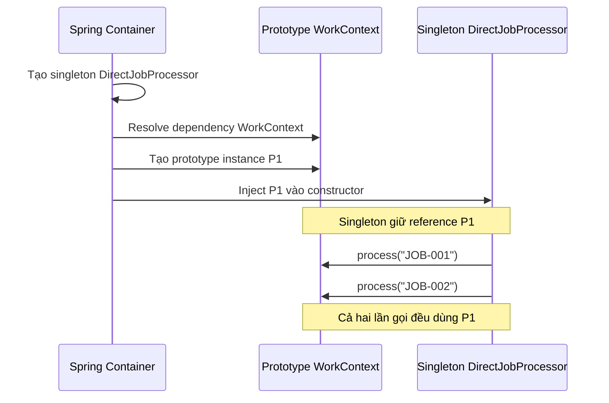
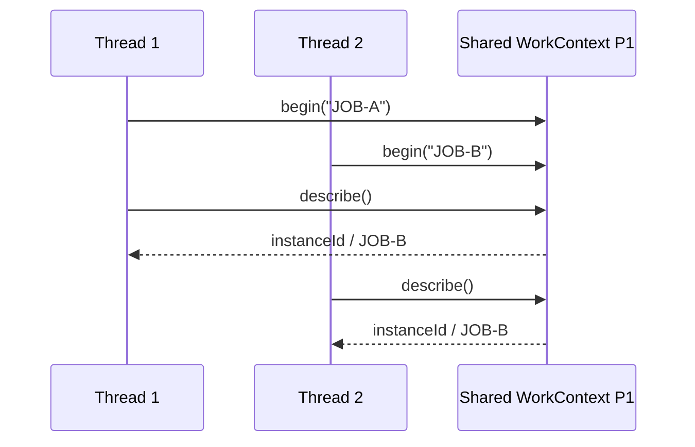
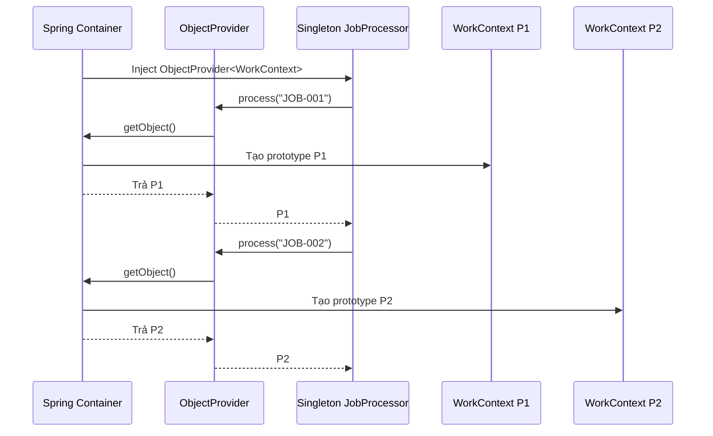

# Tiêm prototype vào singleton và hệ quả của việc chỉ tiêm một lần

Trong Spring, mỗi bean có một **scope** quyết định cách container tạo và chia sẻ instance. Hai scope thường được học đầu tiên là `singleton` và `prototype`. Singleton là scope mặc định: Spring quản lý một instance cho mỗi bean definition trong một application context. Prototype yêu cầu container tạo một instance mới mỗi khi bean được lấy từ container.

Tuy nhiên, một tình huống dễ gây hiểu nhầm xuất hiện khi **một singleton nhận một prototype qua constructor hoặc field injection**. Người mới có thể nghĩ rằng mỗi lần gọi method của singleton, Spring sẽ tự tạo một prototype mới. Thực tế, dependency được giải quyết khi singleton được tạo. Prototype lúc đó được tạo và inject **một lần**; singleton giữ reference tới đúng instance ấy trong suốt thời gian tồn tại của nó.

Bài học này giải thích cơ chế đó, hệ quả với trạng thái và xử lý đồng thời, cách yêu cầu prototype mới theo từng lần xử lý bằng `ObjectProvider` hoặc method injection, và trách nhiệm quản lý vòng đời của prototype.

## 1. Nhắc lại singleton và prototype

Spring bean có scope. Scope trả lời câu hỏi: **khi container cần cung cấp bean, instance nào sẽ được dùng hoặc tạo ra?**

### 1.1. Singleton

Với scope `singleton`, Spring duy trì một instance cho mỗi bean definition trong một container. Đây là scope mặc định của bean Spring nếu không khai báo scope khác.

```java
@Component
public class PricingService {
}
```

Hai thành phần cùng inject bean `PricingService` theo type trong cùng context thông thường sẽ nhận cùng một instance. Singleton scope không có nghĩa cả JVM chỉ tồn tại một object thuộc class này: code khác vẫn có thể gọi `new PricingService()` để tạo object ngoài container, và một class có thể có nhiều bean definition riêng biệt.

### 1.2. Prototype

Với scope `prototype`, mỗi lần yêu cầu bean từ container, Spring tạo một instance mới. Ví dụ:

```java
@Component
@Scope(ConfigurableBeanFactory.SCOPE_PROTOTYPE)
public class WorkContext {
}
```

Khi code trực tiếp lấy bean từ context hai lần:

```java
WorkContext first = applicationContext.getBean(WorkContext.class);
WorkContext second = applicationContext.getBean(WorkContext.class);
```

hai lần lấy bean sẽ nhận hai instance prototype khác nhau, miễn là chúng được resolve thành hai lần yêu cầu độc lập tới container.

### 1.3. So sánh

| Đặc điểm | Singleton | Prototype |
| --- | --- | --- |
| Hành vi khi container resolve bean | Dùng instance singleton của bean definition | Tạo instance mới cho mỗi lần resolve |
| Số instance | Thường một instance cho bean definition trong context | Có thể nhiều instance trong cùng context |
| Trạng thái mutable | Có thể được nhiều thành phần và thread chia sẻ | Từng instance có trạng thái riêng, nhưng vẫn có thể bị chia sẻ sau khi tạo |
| Quản lý vòng đời | Container quản lý khởi tạo và hủy theo lifecycle | Container khởi tạo và cấu hình; người dùng thường chịu trách nhiệm cleanup sau khi nhận |
| Tình huống thường gặp | Service stateless, repository, cấu hình dùng chung | Object có trạng thái ngắn hạn, context cho một lần xử lý |

Prototype không có nghĩa “mỗi HTTP request một instance”, “mỗi thread một instance” hay “mỗi lần gọi method một instance”. Nó có nghĩa **mỗi lần bean được yêu cầu từ container**. Ai yêu cầu, yêu cầu vào thời điểm nào và giữ reference bao lâu là vấn đề của cách wiring và code sử dụng.

## 2. Điều gì xảy ra khi inject prototype trực tiếp vào singleton?

Giả sử có một class giữ trạng thái cho một công việc:

```java
package com.example.jobs;

import java.util.UUID;
import org.springframework.context.annotation.Scope;
import org.springframework.beans.factory.config.ConfigurableBeanFactory;
import org.springframework.stereotype.Component;

@Component
@Scope(ConfigurableBeanFactory.SCOPE_PROTOTYPE)
public class WorkContext {

    private final UUID instanceId = UUID.randomUUID();
    private String jobId;

    public void begin(String jobId) {
        this.jobId = jobId;
    }

    public String describe() {
        return instanceId + " / " + jobId;
    }

    public void clear() {
        jobId = null;
    }
}
```

`WorkContext` có scope prototype. Mỗi lần container tạo bean này, nó có một `instanceId` khác. Trạng thái `jobId` được thay đổi trong quá trình xử lý.

Bây giờ một singleton service inject nó trực tiếp:

```java
package com.example.jobs;

import org.springframework.stereotype.Service;

@Service
public class DirectJobProcessor {

    private final WorkContext workContext;

    public DirectJobProcessor(WorkContext workContext) {
        this.workContext = workContext;
    }

    public String process(String jobId) {
        workContext.begin(jobId);
        return workContext.describe();
    }
}
```

Vì `DirectJobProcessor` không khai báo scope khác, nó là singleton theo mặc định. Khi Spring tạo singleton này, container cần cung cấp tham số `WorkContext` cho constructor. Tại thời điểm đó, Spring tạo một prototype instance và inject vào constructor.

Sau khi constructor chạy xong, field `workContext` giữ reference tới instance đó. Mỗi lần gọi `process`, code dùng lại cùng reference. **Spring không quay lại constructor và không tự resolve lại dependency prototype cho mỗi lần gọi method.**

### 2.1. Trình tự tạo bean



Điểm cần ghi nhớ:

1. Prototype scope được áp dụng khi container resolve bean.
2. Constructor injection của singleton xảy ra trong quá trình tạo singleton.
3. Dependency được resolve tại thời điểm ấy là một prototype instance cụ thể.
4. Singleton giữ instance đó; việc gọi lại method không tự kích hoạt quá trình resolve bean mới.

## 3. Quan sát hệ quả bằng mã chạy

Ta có thể thêm một runner để gọi singleton hai lần:

```java
@Bean
CommandLineRunner directPrototypeDemo(DirectJobProcessor processor) {
    return args -> {
        System.out.println(processor.process("JOB-001"));
        System.out.println(processor.process("JOB-002"));
    };
}
```

Kết quả có dạng:

```text
8a1... / JOB-001
8a1... / JOB-002
```

Hai giá trị `instanceId` giống nhau vì hai lần xử lý sử dụng cùng một `WorkContext` đã inject lúc khởi tạo singleton. Phần UUID chỉ mang tính minh họa; giá trị thực tế thay đổi theo mỗi lần chạy.

Nếu mong muốn mỗi job có một context riêng, kết quả mong muốn sẽ có dạng:

```text
8a1... / JOB-001
7b2... / JOB-002
```

Nhưng scope prototype một mình không tạo ra kết quả đó khi dependency được inject trực tiếp vào singleton. Cần thay cách lấy prototype.

## 4. Hệ quả 1: trạng thái của prototype bị giữ lâu hơn dự kiến

Tên `prototype` dễ làm người đọc nghĩ object chỉ sống trong một lần xử lý. Nhưng khi prototype được inject trực tiếp vào singleton, **thời gian tham chiếu thực tế phụ thuộc vào singleton giữ nó**, không phải tự kết thúc sau một lần gọi method.

Trong ví dụ:

```java
public String process(String jobId) {
    workContext.begin(jobId);
    return workContext.describe();
}
```

`workContext` là field của singleton. Nó không bị thay thế sau khi `process` trả về. Lần xử lý tiếp theo thay đổi `jobId` trên cùng object.

Điều này có thể dẫn tới:

- Trạng thái cũ vẫn còn nếu method không reset đầy đủ.
- Một lần xử lý đọc phải dữ liệu do lần trước để lại.
- Một lỗi giữa chừng khiến object ở trạng thái không hoàn chỉnh.
- Một singleton vô tình tích lũy dữ liệu theo thời gian.
- Code khó kiểm thử vì trạng thái của dependency phụ thuộc thứ tự gọi method.

Nếu object thực sự được thiết kế như một context cho mỗi job, việc tái sử dụng cùng một instance sẽ làm sai ý nghĩa của thiết kế.

## 5. Hệ quả 2: nguy cơ race condition khi singleton xử lý đồng thời

Singleton thường được nhiều request hoặc nhiều thread sử dụng. Nếu singleton giữ một prototype mutable duy nhất, các lời gọi đồng thời có thể ghi đè trạng thái của nhau.

Ví dụ:

```java
public String process(String jobId) {
    workContext.begin(jobId);
    // Giả sử tại đây có thêm các bước xử lý mất thời gian.
    return workContext.describe();
}
```

Hai thread có thể diễn ra như sau:



Thread 1 có thể nhận dữ liệu của job B vì Thread 2 đã thay đổi field `jobId` trên cùng instance. Đây là race condition do trạng thái mutable được chia sẻ.

Prototype được inject một lần vào singleton **không tự tạo tính cô lập giữa các lần gọi**. Dù class mang annotation `@Scope("prototype")`, instance cụ thể đang được giữ vẫn được chia sẻ như một field bình thường.

### 5.1. Prototype không tự đồng nghĩa thread-safe

Ngay cả khi lấy prototype mới bằng `ObjectProvider` cho mỗi lần xử lý, object vẫn có thể bị chia sẻ nếu code lưu nó vào một field singleton, đưa cùng reference cho nhiều thread hoặc dùng nó trong một tác vụ bất đồng bộ mà không kiểm soát quyền sở hữu.

Nguyên tắc:

- Lấy một instance riêng cho một đơn vị công việc.
- Giữ reference trong biến cục bộ của lần xử lý.
- Không lưu instance đó vào field dùng chung của singleton.
- Không truyền cùng object mutable cho nhiều thread nếu không có thiết kế đồng bộ phù hợp.

## 6. Cách khuyến nghị: inject ObjectProvider<T>

Spring cung cấp `ObjectProvider<T>` để bean có thể yêu cầu một dependency từ container **khi cần**, thay vì nhận trực tiếp instance prototype lúc singleton được khởi tạo.

Viết lại service:

```java
package com.example.jobs;

import org.springframework.beans.factory.ObjectProvider;
import org.springframework.stereotype.Service;

@Service
public class JobProcessor {

    private final ObjectProvider<WorkContext> contextProvider;

    public JobProcessor(ObjectProvider<WorkContext> contextProvider) {
        this.contextProvider = contextProvider;
    }

    public String process(String jobId) {
        WorkContext context = contextProvider.getObject();
        context.begin(jobId);
        return context.describe();
    }
}
```

Ở đây, singleton chỉ giữ một đối tượng `ObjectProvider<WorkContext>`. Provider là một cơ chế truy xuất bean do Spring hỗ trợ. Mỗi lần gọi `getObject()`, provider yêu cầu container resolve `WorkContext`. Vì bean `WorkContext` có scope prototype, container tạo instance mới cho lần yêu cầu đó.

Luồng xử lý:



Kết quả kỳ vọng:

```text
instance-A / JOB-001
instance-B / JOB-002
```

Hai lần gọi `getObject()` là hai lần resolve độc lập; với scope prototype, mỗi lần nhận một instance mới.

### 6.1. ObjectProvider là dependency gì?

`ObjectProvider` không phải bean nghiệp vụ do ta phải tự tạo. Spring có cơ chế hỗ trợ inject provider như một dependency đặc biệt để truy cập bean theo nhu cầu. Singleton nhận provider lúc khởi tạo, nhưng **prototype chỉ được lấy khi code gọi `getObject()`**.

Đây là khác biệt quan trọng:

| Constructor của singleton nhận | Khi prototype được resolve? | Các lần gọi method singleton |
| --- | --- | --- |
| `WorkContext` | Lúc tạo singleton | Dùng lại instance đã inject |
| `ObjectProvider<WorkContext>` | Mỗi lần gọi `getObject()` | Có thể lấy instance mới mỗi lần |

### 6.2. Dùng provider trong một lần xử lý hoàn chỉnh

Có thể viết rõ phạm vi sử dụng bằng biến cục bộ:

```java
@Service
public class JobProcessor {

    private final ObjectProvider<WorkContext> contextProvider;

    public JobProcessor(ObjectProvider<WorkContext> contextProvider) {
        this.contextProvider = contextProvider;
    }

    public String process(String jobId) {
        WorkContext context = contextProvider.getObject();
        context.begin(jobId);
        try {
            return context.describe();
        } finally {
            context.clear();
        }
    }
}
```

Trong ví dụ, `clear()` chỉ minh họa việc dọn trạng thái do code ứng dụng kiểm soát. Nếu prototype quản lý tài nguyên thật như file handle, stream hoặc kết nối do chính nó mở, caller cần đóng/giải phóng đúng hợp đồng. Không nên giả định Spring sẽ tự gọi destruction callback cho prototype khi method kết thúc.

## 7. ObjectFactory<T> và Provider<T>

Ngoài `ObjectProvider<T>`, có những abstraction tương tự cho việc lấy object theo nhu cầu.

### 7.1. ObjectFactory<T>

`ObjectFactory<T>` là một abstraction đơn giản của Spring:

```java
import org.springframework.beans.factory.ObjectFactory;

@Service
public class JobProcessor {

    private final ObjectFactory<WorkContext> contextFactory;

    public JobProcessor(ObjectFactory<WorkContext> contextFactory) {
        this.contextFactory = contextFactory;
    }

    public String process(String jobId) {
        WorkContext context = contextFactory.getObject();
        context.begin(jobId);
        return context.describe();
    }
}
```

Khi `WorkContext` là prototype, mỗi lần gọi `getObject()` sẽ resolve bean mới. `ObjectProvider` mở rộng khả năng của `ObjectFactory` với các thao tác tiện ích khác như kiểm tra bean có sẵn hoặc duyệt các ứng viên trong những tình huống hỗ trợ.

### 7.2. jakarta.inject.Provider<T>

Nếu ứng dụng dùng Jakarta Dependency Injection API phù hợp, có thể dùng `jakarta.inject.Provider<T>`:

```java
import jakarta.inject.Provider;

@Service
public class JobProcessor {

    private final Provider<WorkContext> contextProvider;

    public JobProcessor(Provider<WorkContext> contextProvider) {
        this.contextProvider = contextProvider;
    }

    public String process(String jobId) {
        WorkContext context = contextProvider.get();
        context.begin(jobId);
        return context.describe();
    }
}
```

Cách này cần API/provider implementation tương thích có mặt trong dependency của ứng dụng và được Spring hỗ trợ trong cấu hình đang dùng. Với một ứng dụng Spring thuần, `ObjectProvider` thường là lựa chọn dễ đọc và có nhiều khả năng tích hợp Spring hơn.

### 7.3. Chọn abstraction nào?

| Cơ chế | Phương thức lấy instance | Khi nào cân nhắc |
| --- | --- | --- |
| `ObjectProvider<T>` | `getObject()` | Ứng dụng Spring cần provider với các tiện ích của Spring |
| `ObjectFactory<T>` | `getObject()` | Chỉ cần abstraction factory đơn giản của Spring |
| `jakarta.inject.Provider<T>` | `get()` | Muốn dùng abstraction Jakarta DI và dependency hỗ trợ tương thích |
| `ApplicationContext.getBean(...)` | `getBean()` | Truy cập container trực tiếp; thường nên tránh trong business service thông thường |

Điểm cốt lõi không phải tên provider mà là **thời điểm resolve bean**. Singleton giữ provider; mỗi lần yêu cầu instance prototype mới, code gọi provider ở đúng phạm vi xử lý.

## 8. Một cách khác: method injection với @Lookup

Spring hỗ trợ *lookup method injection*. Một method được đánh dấu `@Lookup` sẽ được container override bằng cơ chế subclass để mỗi lần method được gọi, container tra cứu bean tương ứng.

Ví dụ:

```java
package com.example.jobs;

import org.springframework.beans.factory.annotation.Lookup;
import org.springframework.stereotype.Service;

@Service
public class LookupJobProcessor {

    public String process(String jobId) {
        WorkContext context = newWorkContext();
        context.begin(jobId);
        return context.describe();
    }

    @Lookup
    protected WorkContext newWorkContext() {
        // Spring override method này khi tạo bean.
        return null;
    }
}
```

Khi `LookupJobProcessor` là bean do Spring quản lý, container tạo subclass ghi đè `newWorkContext()` để lấy `WorkContext` từ context. Vì `WorkContext` là prototype, mỗi lần method được gọi sẽ nhận một instance mới.

### 8.1. Giới hạn của @Lookup

- Bean chứa lookup method phải được Spring quản lý và có thể được subclass bằng cơ chế phù hợp.
- Class không thể là `final`; method được override cũng không thể là `private` hoặc `final`.
- Lookup method injection dựa trên subclassing, nên không hoạt động như mong muốn nếu ta tự tạo instance bằng `new`.
- Cơ chế này không phù hợp với bean instance được trả về từ phương thức `@Bean` theo cách thông thường, vì container không tạo subclass cho object đã được factory method tạo ra.
- Method có body trả về `null` trong ví dụ chỉ là placeholder cho trường hợp Spring override; nếu gọi trên object được tạo thủ công, nó sẽ trả `null`.

`@Lookup` hữu ích khi muốn diễn đạt “mỗi lần gọi method này, hãy lấy một bean mới”. Tuy nhiên, nó có tính ma thuật hơn `ObjectProvider` và khó kiểm thử thuần Java hơn. Với phần lớn service hiện đại, **inject provider thường minh bạch và linh hoạt hơn**.

## 9. Vì sao không gọi ApplicationContext.getBean() trực tiếp?

Một cách có thể làm prototype mới là inject `ApplicationContext` rồi gọi:

```java
@Service
public class ServiceLocatorJobProcessor {

    private final ApplicationContext context;

    public ServiceLocatorJobProcessor(ApplicationContext context) {
        this.context = context;
    }

    public String process(String jobId) {
        WorkContext workContext = context.getBean(WorkContext.class);
        workContext.begin(jobId);
        return workContext.describe();
    }
}
```

Đoạn code này có thể lấy prototype mới ở mỗi lần gọi `getBean`. Nhưng service giờ phụ thuộc trực tiếp vào container và tự thực hiện việc tra cứu bean.

Hệ quả:

- Dependency `WorkContext` không còn hiển thị trực tiếp trong API constructor.
- Unit test cần xử lý `ApplicationContext` hoặc mock service locator thay vì truyền một factory rõ ràng.
- Business/application service biết chi tiết framework Spring.
- Việc đọc class khó biết chính xác những dependency nào được sử dụng.

`ObjectProvider<WorkContext>` cũng cho phép lấy bean theo nhu cầu, nhưng thể hiện rõ loại dependency được yêu cầu. Đây là abstraction hẹp hơn container toàn cục và phù hợp hơn khi cần prototype trong Spring.

Không phải mọi lời gọi `getBean` đều sai: code hạ tầng, plugin registry hoặc nơi tích hợp framework có thể có lý do. Tuy nhiên, trong business service thông thường, nên ưu tiên constructor injection cho dependency bắt buộc và provider cho nhu cầu lấy instance nhiều lần.

## 10. Prototype mới theo mỗi lần gọi hay theo mỗi đơn vị công việc?

Khi dùng provider, lập trình viên quyết định thời điểm tạo prototype. Điều đó có nghĩa phải xác định đúng **ranh giới của một lần xử lý**.

Ví dụ một batch processor xử lý danh sách 100 job:

```java
public void processAll(List<String> jobIds) {
    for (String jobId : jobIds) {
        WorkContext context = contextProvider.getObject();
        context.begin(jobId);
        processOne(context);
    }
}
```

Trong ví dụ, mỗi job nhận một prototype vì provider được gọi trong vòng lặp. Nếu đặt lời gọi provider ở ngoài vòng lặp:

```java
public void processAll(List<String> jobIds) {
    WorkContext context = contextProvider.getObject();
    for (String jobId : jobIds) {
        context.begin(jobId);
        processOne(context);
    }
}
```

thì toàn bộ danh sách lại dùng một instance. Cả hai đều hợp lệ về mặt scope; chỉ một trong hai phù hợp với yêu cầu nghiệp vụ cụ thể.

Hãy phân biệt:

| Ranh giới mong muốn | Vị trí gọi `getObject()` |
| --- | --- |
| Một instance cho mỗi job | Bên trong vòng lặp xử lý job |
| Một instance cho toàn bộ batch | Trước vòng lặp |
| Một instance cho mỗi lần gọi service method | Đầu method |
| Một instance cho từng request | Trong luồng xử lý request, nếu request thực sự là ranh giới mong muốn |
| Một instance cho mỗi thread | Cần thiết kế thread scope hoặc truyền instance riêng theo thread; prototype không tự đảm bảo điều này |

**Prototype là cơ chế tạo object theo lần resolve, không phải một chính sách xác định đơn vị công việc.** Chính code ứng dụng chọn đơn vị công việc bằng vị trí gọi provider.

## 11. Prototype và request scope không giống nhau

Một số người chọn prototype vì nghĩ nó có nghĩa “mỗi request HTTP một instance”. Hai ý nghĩa này khác nhau.

- Prototype: mỗi lần container resolve bean sẽ tạo một instance mới.
- Request scope: một instance gắn với vòng đời của một HTTP request trong web application context phù hợp.

Nếu muốn dữ liệu chỉ tồn tại trong một HTTP request, request scope có thể diễn đạt ý định chính xác hơn. Tuy nhiên, request-scoped bean được inject vào singleton thường cần scoped proxy hoặc provider phù hợp để tham chiếu được giải quyết theo request hiện hành.

Prototype không tự gắn với HTTP request. Nếu singleton gọi `getObject()` ba lần trong cùng một request, nó có thể nhận ba prototype khác nhau. Nếu hai request cùng gọi một singleton nhưng singleton giữ trực tiếp một prototype đã inject từ startup, cả hai request có thể dùng chung một instance đó.

Chọn scope theo **vòng đời logic của dữ liệu**:

| Nhu cầu | Cơ chế có thể phù hợp |
| --- | --- |
| Dịch vụ stateless dùng chung | Singleton |
| Object mới mỗi lần được yêu cầu từ container | Prototype |
| Trạng thái riêng trong một HTTP request | Request scope |
| Trạng thái riêng theo phiên HTTP | Session scope, khi phù hợp |
| Trạng thái theo một tác vụ do ứng dụng điều phối | Prototype qua provider hoặc object được tạo/đóng rõ ràng |

## 12. Prototype và vòng đời hủy bean

Đây là một khác biệt quan trọng giữa prototype và singleton.

Với singleton, Spring quản lý phần lớn vòng đời của bean trong context, bao gồm gọi các callback hủy phù hợp khi context đóng. Với prototype, Spring tạo object, inject dependency và áp dụng các bước khởi tạo; sau khi giao instance cho client, container **không tiếp tục theo dõi đầy đủ vòng đời để tự gọi destruction callbacks khi object không còn được sử dụng**.

Ví dụ:

```java
@Component
@Scope(ConfigurableBeanFactory.SCOPE_PROTOTYPE)
public class FileWorkContext {

    private InputStream inputStream;

    public void open(Path path) throws IOException {
        inputStream = Files.newInputStream(path);
    }

    @PreDestroy
    public void close() throws IOException {
        if (inputStream != null) {
            inputStream.close();
        }
    }
}
```

Đoạn ví dụ cần các import Java phù hợp và `jakarta.annotation.PreDestroy` nếu dùng nền tảng Spring Boot hiện đại. Tuy nhiên, **không nên trông chờ `@PreDestroy` của prototype tự được gọi khi mỗi lần xử lý kết thúc**. Spring không quản lý destruction của prototype instance theo cách nó quản lý singleton.

Nếu prototype mở tài nguyên, caller cần đóng tài nguyên bằng một API rõ ràng, ví dụ:

```java
WorkContext context = contextProvider.getObject();
try {
    context.begin(jobId);
    context.execute();
} finally {
    context.close();
}
```

Nếu class thực hiện `AutoCloseable`, có thể thiết kế hợp đồng để dùng `try-with-resources`:

```java
try (WorkContext context = contextProvider.getObject()) {
    context.begin(jobId);
    context.execute();
}
```

Điều này yêu cầu `WorkContext implements AutoCloseable` và phương thức `close()` giải phóng tài nguyên. Cách đóng phải được thiết kế rõ; không phải mọi prototype đều cần cleanup tường minh nếu chúng chỉ chứa dữ liệu Java thông thường.

### 12.1. Dependency của prototype vẫn có thể là singleton

Giả sử `WorkContext` prototype nhận `Clock` singleton qua constructor. Mỗi prototype mới vẫn nhận cùng một bean `Clock` nếu `Clock` có scope singleton. Scope của một bean không tự lan sang dependency của nó.

```java
@Configuration
class WorkConfiguration {

    @Bean
    Clock clock() {
        return Clock.systemUTC();
    }

    @Bean
    @Scope(ConfigurableBeanFactory.SCOPE_PROTOTYPE)
    WorkContext workContext(Clock clock) {
        return new WorkContext(clock);
    }
}
```

Trong ví dụ, mỗi lần resolve `WorkContext` tạo một context mới, nhưng dependency `Clock` được tái sử dụng theo scope singleton mặc định. Đây thường là điều mong muốn đối với một dependency stateless.

## 13. Kiểm chứng hành vi scope bằng test

Có thể kiểm tra trực tiếp bằng một Spring context nhỏ:

```java
import static org.junit.jupiter.api.Assertions.assertNotSame;
import static org.junit.jupiter.api.Assertions.assertSame;

import org.junit.jupiter.api.Test;
import org.springframework.beans.factory.config.ConfigurableBeanFactory;
import org.springframework.context.annotation.AnnotationConfigApplicationContext;
import org.springframework.context.annotation.Bean;
import org.springframework.context.annotation.Configuration;
import org.springframework.context.annotation.Scope;

class BeanScopeTest {

    @Configuration
    static class TestConfiguration {

        @Bean
        @Scope(ConfigurableBeanFactory.SCOPE_PROTOTYPE)
        WorkContext workContext() {
            return new WorkContext();
        }

        @Bean
        ObjectHolder singletonHolder(WorkContext context) {
            return new ObjectHolder(context);
        }
    }

    @Test
    void prototypeLookupReturnsDifferentInstances() {
        try (var context =
                     new AnnotationConfigApplicationContext(TestConfiguration.class)) {
            WorkContext first = context.getBean(WorkContext.class);
            WorkContext second = context.getBean(WorkContext.class);

            assertNotSame(first, second);
        }
    }

    @Test
    void prototypeInjectedDirectlyIntoSingletonIsResolvedOnce() {
        try (var context =
                     new AnnotationConfigApplicationContext(TestConfiguration.class)) {
            ObjectHolder holder =
                    context.getBean(ObjectHolder.class);

            assertSame(holder.context(), holder.context());
        }
    }

    record ObjectHolder(WorkContext context) {
    }
}
```

Ví dụ test này dùng `AnnotationConfigApplicationContext` để minh họa scope mà không cần khởi chạy toàn bộ ứng dụng web. `WorkContext` trong test là một class có constructor phù hợp; trong project thật có thể dùng class prototype ở ví dụ trước.

Test thứ nhất xác nhận hai lần gọi `getBean` trực tiếp nhận hai instance khác nhau. Test thứ hai xác nhận singleton holder chỉ giữ một reference đã được inject. Việc gọi accessor `context()` hai lần không thực hiện thêm lần resolve bean nào.

Để kiểm tra giải pháp provider, có thể thêm một bean singleton nhận `ObjectProvider<WorkContext>` và gọi `getObject()` hai lần, sau đó assert rằng hai kết quả không phải cùng object.

## 14. Những cách giải quyết thường được chọn

| Cách làm | Hành vi | Khi nên dùng |
| --- | --- | --- |
| Inject trực tiếp prototype vào singleton | Một prototype được resolve lúc singleton tạo và giữ lại | Chỉ khi thực sự muốn singleton giữ một instance đó |
| Inject `ObjectProvider<T>` | Resolve khi gọi `getObject()` | Cần instance mới theo từng đơn vị công việc |
| Inject `ObjectFactory<T>` | Resolve khi gọi `getObject()` | Cần factory abstraction đơn giản của Spring |
| Inject `Provider<T>` | Resolve khi gọi `get()` | Khi dùng Jakarta DI abstraction phù hợp |
| `@Lookup` | Spring override method để lookup mỗi lần gọi | Khi muốn method injection và chấp nhận cơ chế subclass |
| Inject `ApplicationContext` rồi gọi `getBean` | Tự truy xuất container mỗi lần | Chỉ cân nhắc ở code hạ tầng/registry có lý do rõ |
| Tạo object thuần bằng factory Java | Code ứng dụng/factory tự tạo object | Khi object không cần container quản lý |

Không có cách nào tốt nhất cho mọi trường hợp. Câu hỏi quyết định là: **ai chịu trách nhiệm tạo instance, và instance cần sống trong phạm vi nào?**

## 15. Một số hiểu lầm thường gặp

| Hiểu lầm | Thực tế |
| --- | --- |
| “Prototype inject vào singleton sẽ mới ở mỗi method call.” | Dependency được resolve khi tạo singleton; field giữ cùng prototype instance. |
| “Prototype nghĩa là mỗi request một object.” | Prototype tạo mới mỗi lần container resolve; request scope mới gắn với HTTP request. |
| “Prototype tự thread-safe.” | Instance riêng chỉ giúp cô lập nếu không chia sẻ lại; mutable object vẫn có thể bị nhiều thread dùng chung. |
| “Spring sẽ gọi @PreDestroy khi prototype không còn dùng.” | Container không tự theo dõi đầy đủ destruction callbacks của prototype sau khi giao object cho client. |
| “Inject ObjectProvider nghĩa là provider tạo object bằng new.” | Provider yêu cầu container resolve bean theo scope và cấu hình đã đăng ký. |
| “Gọi getObject() một lần ở constructor là đủ.” | Làm vậy chỉ resolve một lần; muốn instance mới theo từng lần xử lý, gọi provider ở đúng ranh giới xử lý. |
| “Mọi prototype phải dùng ObjectProvider.” | Chỉ cần provider khi cần nhiều lần resolve; direct injection có thể đúng nếu muốn giữ một instance. |
| “Có thể dùng @Lookup ở mọi class.” | Method injection có giới hạn subclassing và phụ thuộc bean được Spring quản lý. |

## 16. Bài tập thực hành

### Bài tập 1 – Dự đoán instance ID

Một `@Service` singleton inject `@Scope("prototype") WorkContext` qua constructor. Service có method:

```java
public UUID currentId() {
    return context.getInstanceId();
}
```

Gọi `currentId()` ba lần sẽ trả về bao nhiêu ID khác nhau? Giải thích dựa trên thời điểm Spring resolve dependency.

**Gợi ý:** cả ba lần dùng cùng reference đã inject khi singleton được tạo, nên thường chỉ có một ID.

### Bài tập 2 – Chuyển sang ObjectProvider

Sửa service để nhận `ObjectProvider<WorkContext>`. Mỗi lần `process(jobId)` phải gọi `getObject()` một lần và giữ kết quả trong biến cục bộ. Gọi method hai lần rồi quan sát hai ID.

**Gợi ý:** không lưu prototype mới vào field singleton nếu mục tiêu là tách instance cho từng job.

### Bài tập 3 – Xác định ranh giới resolve

Một batch gồm 50 job. So sánh hai đoạn:

```java
WorkContext context = provider.getObject();
for (String jobId : jobIds) {
    processOne(context, jobId);
}
```

và:

```java
for (String jobId : jobIds) {
    WorkContext context = provider.getObject();
    processOne(context, jobId);
}
```

Đoạn nào tạo một context cho toàn batch? Đoạn nào tạo một context cho mỗi job? Có cần đóng hoặc reset context sau mỗi lần xử lý không?

### Bài tập 4 – Phát hiện race condition

Cho một singleton service giữ prototype mutable trong field. Hai thread đồng thời gọi method và thay đổi `jobId`. Hãy vẽ timeline, chỉ ra điểm ghi đè và đề xuất cách lấy instance riêng cho mỗi lần xử lý.

**Gợi ý:** inject provider, gọi `getObject()` trong method và giữ object ở biến cục bộ. Nếu công việc được chuyển sang thread khác, bảo đảm instance không bị chia sẻ ngoài ý muốn.

### Bài tập 5 – Quản lý tài nguyên prototype

Một prototype mở file trong method `open()` và giữ `InputStream`. Hãy thiết kế class triển khai `AutoCloseable`, rồi dùng provider và `try-with-resources` để bảo đảm stream được đóng sau khi job kết thúc.

Giải thích vì sao không nên dựa vào `@PreDestroy` để Spring tự đóng prototype sau mỗi lần xử lý.

### Bài tập 6 – Chọn scope phù hợp

Phân loại các nhu cầu:

1. Một service tính toán không giữ trạng thái theo request.
2. Một object tích lũy dữ liệu tạm trong một job.
3. Một context chỉ tồn tại trong một HTTP request.
4. Một object được yêu cầu mới mỗi lần code gọi container.

**Gợi ý:** lần lượt xem xét singleton, prototype qua provider, request scope và prototype. Nêu rõ ai tạo instance và ai chịu trách nhiệm kết thúc vòng đời.

## 17. Những điều cần nhớ

Khi một singleton nhận một prototype trực tiếp qua constructor, Spring tạo prototype trong lúc giải quyết dependency cho singleton. Sau đó singleton giữ reference tới instance ấy. **Prototype scope không tự biến dependency thành một instance mới ở mỗi lần gọi method.**

Nếu cần một prototype mới theo mỗi lần xử lý, hãy inject `ObjectProvider<T>`, `ObjectFactory<T>` hoặc một provider phù hợp, rồi gọi phương thức lấy bean ở đúng ranh giới công việc. `@Lookup` là một lựa chọn khác nhưng phụ thuộc subclassing và có giới hạn riêng.

Đồng thời, hãy nhớ ba hệ quả quan trọng:

- **Vòng đời tham chiếu:** prototype inject trực tiếp có thể được singleton giữ rất lâu, khiến trạng thái cũ tồn tại ngoài dự kiến.
- **Đồng thời:** một prototype mutable được giữ trong singleton có thể bị nhiều request/thread dùng chung và tạo race condition.
- **Cleanup:** Spring không tự quản lý đầy đủ destruction callback của prototype sau khi giao instance cho client; nếu object sở hữu tài nguyên, code sử dụng phải đóng hoặc giải phóng theo hợp đồng.

Khi chọn scope, hãy bắt đầu từ câu hỏi **một instance cần thuộc về một bean, một lần resolve, một request hay một đơn vị công việc?** Sau đó chọn cách inject và vị trí lấy object tương ứng. Đây là cách hiểu đúng mối quan hệ giữa scope và dependency injection trong Spring Boot.
