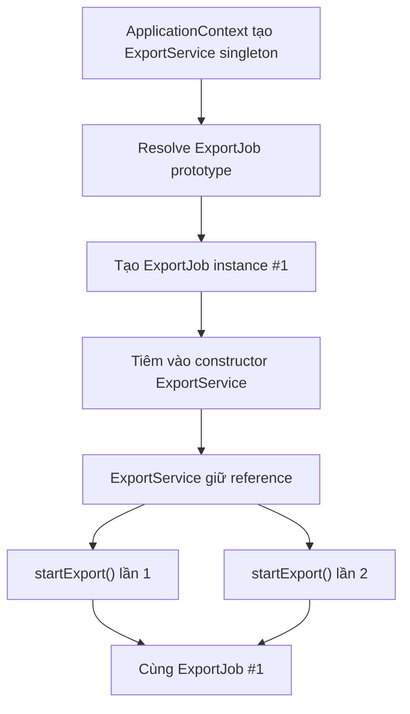
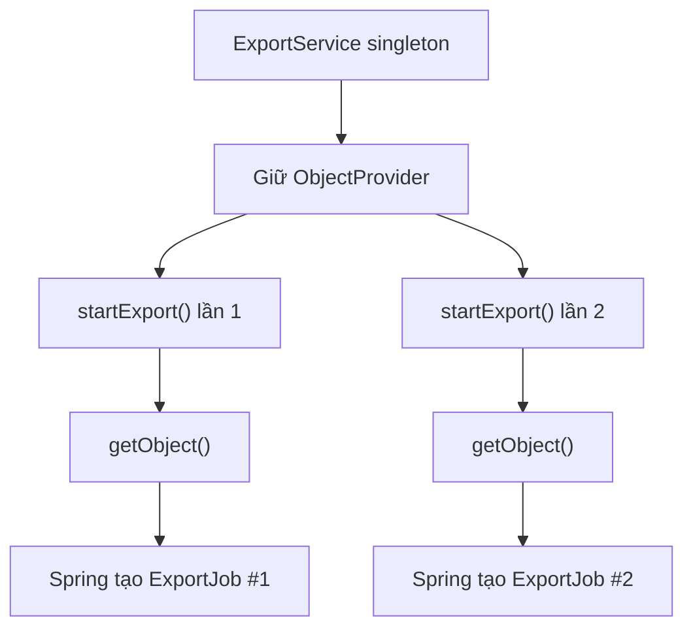
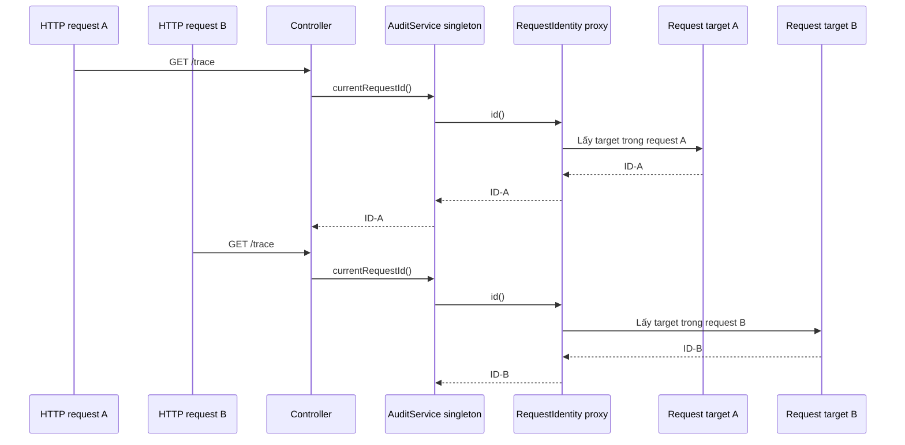

# ObjectProvider hoặc scoped proxy để lấy instance đúng phạm vi

Trong Spring, một bean không phải lúc nào cũng có cùng một vòng đời. Service thường là singleton, một đối tượng công việc có thể là prototype, còn dữ liệu gắn với một HTTP request nên tồn tại trong phạm vi request đó. Khi một bean có vòng đời dài hơn cần sử dụng bean có vòng đời ngắn hơn, cách tiêm trực tiếp có thể khiến ứng dụng giữ lại một instance quá lâu.

Spring cung cấp hai cách thường dùng để giải quyết tình huống này:

- **`ObjectProvider<T>`**: cho phép yêu cầu bean từ container tại thời điểm cần dùng. Container trả về instance theo scope đã khai báo.
- **Scoped proxy**: đưa một proxy vào bean tiêu thụ; proxy chuyển lời gọi tới instance thực tế thuộc scope hiện hành.

Bài học thuộc chương **Phạm vi bean** của *Spring Boot Fundamentals*. Ta sẽ bắt đầu từ singleton/prototype, thấy vấn đề khi tiêm prototype trực tiếp vào singleton, rồi dùng `ObjectProvider` và scoped proxy cho những nhu cầu khác nhau. Phần web minh họa request scope và session scope trong ứng dụng Spring Boot 3.x.

Ví dụ sử dụng Java 21 và Spring Boot 3.x. Các đoạn code là phần minh họa cho dự án có cấu hình Spring phù hợp; ví dụ request/session scope cần web application context và một HTTP request/session đang hoạt động.

## 1. Ôn lại scope: một bean sống trong bao lâu?

**Bean scope** quy định cách Spring cung cấp instance của một bean. Một vài scope quan trọng:

| Scope | Cách cung cấp instance | Trường hợp sử dụng thường gặp |
|---|---|---|
| `singleton` | Một instance cho mỗi bean definition trong một Spring container | Service, repository, component stateless |
| `prototype` | Tạo một instance mới mỗi khi container được yêu cầu cung cấp bean | Đối tượng công việc ngắn hạn, có trạng thái riêng |
| `request` | Một instance trong mỗi HTTP request | Dữ liệu chỉ thuộc về một request |
| `session` | Một instance trong mỗi HTTP session | Dữ liệu cần tồn tại xuyên nhiều request của một session |
| `application` | Một instance trong phạm vi `ServletContext` của ứng dụng web | Trạng thái chia sẻ ở mức web application |
| `websocket` | Một instance trong phạm vi WebSocket session | Dữ liệu gắn với một kết nối WebSocket |

Nếu không khai báo scope, bean Spring thông thường mặc định là `singleton`.

### Singleton và prototype

Một singleton:

```java
import org.springframework.stereotype.Component;

@Component
public class ApplicationClock {
    public long currentTimeMillis() {
        return System.currentTimeMillis();
    }
}
```

Khi nhiều bean cùng yêu cầu `ApplicationClock`, Spring thường cung cấp cùng một instance singleton trong container đó.

Một prototype:

```java
import java.util.UUID;
import org.springframework.beans.factory.config.ConfigurableBeanFactory;
import org.springframework.context.annotation.Scope;
import org.springframework.stereotype.Component;

@Component
@Scope(ConfigurableBeanFactory.SCOPE_PROTOTYPE)
public class ExportJob {

    private final String jobId = UUID.randomUUID().toString();

    public String getJobId() {
        return jobId;
    }
}
```

Khi container được yêu cầu lấy `ExportJob` nhiều lần, nó tạo một instance mới mỗi lần. Mỗi instance có `jobId` riêng.

Điều cần ghi nhớ: scope quy định **cách container cung cấp instance**, chứ không tự quyết định lúc nào nghiệp vụ gọi method. Nếu bạn giữ reference tới một prototype object, reference đó vẫn trỏ tới chính instance đã nhận.

## 2. Vấn đề: tiêm prototype trực tiếp vào singleton

Giả sử một service singleton cần tạo nhiều công việc xuất dữ liệu:

```java
import org.springframework.stereotype.Service;

@Service
public class ExportService {

    private final ExportJob exportJob;

    public ExportService(ExportJob exportJob) {
        this.exportJob = exportJob;
    }

    public String startExport() {
        return exportJob.getJobId();
    }
}
```

`ExportService` mặc định là singleton. `ExportJob` có scope prototype. Nhiều người kỳ vọng mỗi lần gọi `startExport()` sẽ có một `ExportJob` mới, nhưng điều đó **không tự xảy ra**.

Quá trình thực tế:

1. Spring tạo singleton `ExportService` trong lúc khởi tạo context.
2. Khi tạo `ExportService`, Spring resolve dependency `ExportJob` và tạo một prototype instance.
3. Instance đó được truyền vào constructor và lưu trong field `exportJob`.
4. `ExportService` giữ reference này suốt vòng đời singleton.
5. Mỗi lần gọi `startExport()`, service lại gọi cùng instance `ExportJob` đã được tiêm ban đầu.



Đây là khác biệt giữa **scope của bean được container cung cấp** và **vòng đời của reference mà consumer đang giữ**. Prototype scope không biến một field trong singleton thành lời gọi lấy object mới ở mỗi lần truy cập.

## 3. Dùng `ObjectProvider<T>` để lấy instance đúng lúc cần

`ObjectProvider<T>` là abstraction của Spring để truy vấn bean từ container theo yêu cầu. Thay vì tiêm trực tiếp `ExportJob`, ta tiêm `ObjectProvider<ExportJob>`:

```java
import org.springframework.beans.factory.ObjectProvider;
import org.springframework.stereotype.Service;

@Service
public class ExportService {

    private final ObjectProvider<ExportJob> exportJobs;

    public ExportService(ObjectProvider<ExportJob> exportJobs) {
        this.exportJobs = exportJobs;
    }

    public String startExport() {
        ExportJob job = exportJobs.getObject();
        return job.getJobId();
    }
}
```

Mỗi lần gọi `exportJobs.getObject()`, provider yêu cầu Spring resolve bean `ExportJob`. Vì `ExportJob` có scope prototype, container tạo instance mới cho mỗi lần gọi. Singleton `ExportService` chỉ giữ provider, không giữ một prototype instance duy nhất.



Đây là cách phù hợp khi consumer muốn **chủ động lấy instance tại thời điểm sử dụng**.

### 3.1. Provider không tự tạo prototype nếu scope là singleton

`ObjectProvider` không ép bean trở thành prototype. Nó chỉ yêu cầu container cung cấp bean theo cấu hình scope hiện có:

| Scope của dependency | Kết quả khi gọi `getObject()` nhiều lần |
|---|---|
| `singleton` | Trả về cùng instance singleton của bean definition đó. |
| `prototype` | Mỗi lần yêu cầu tạo một instance mới. |
| `request` | Trong cùng request đang hoạt động, trả về instance của request đó; request khác có instance khác. |
| `session` | Trong cùng session, trả về instance gắn với session; session khác có instance khác. |

Do vậy, nếu muốn nhiều `ExportJob` độc lập, **scope prototype phải được khai báo đúng**. Thay field thành `ObjectProvider<ExportJob>` nhưng giữ `ExportJob` là singleton thì các lần `getObject()` vẫn nhận cùng bean singleton.

### 3.2. Các method hữu ích của `ObjectProvider`

`ObjectProvider<T>` mở rộng cơ chế provider của Spring và cung cấp nhiều cách truy xuất:

| Method | Ý nghĩa |
|---|---|
| `getObject()` | Lấy một bean; nếu không có hoặc không phân giải được duy nhất, có thể phát sinh exception. |
| `getObject(args...)` | Yêu cầu bean với đối số tạo instance, trong những trường hợp bean factory hỗ trợ explicit arguments. |
| `getIfAvailable()` | Lấy bean nếu có; trả về `null` nếu không có candidate, nhưng tình huống mơ hồ vẫn có thể báo lỗi. |
| `getIfUnique()` | Lấy bean khi có một lựa chọn duy nhất theo quy tắc resolve; nếu không có lựa chọn duy nhất, trả về `null`. |
| `ifAvailable(consumer)` | Thực hiện consumer nếu bean có thể được cung cấp. |
| `ifUnique(consumer)` | Thực hiện consumer nếu có candidate duy nhất. |
| `stream()` | Truy cập stream các bean candidate phù hợp. |
| `orderedStream()` | Truy cập stream theo thứ tự mà container hỗ trợ. |

Ví dụ dependency tùy chọn:

```java
import org.springframework.beans.factory.ObjectProvider;
import org.springframework.stereotype.Service;

@Service
public class ReportService {

    private final ObjectProvider<ReportExporter> exporters;

    public ReportService(ObjectProvider<ReportExporter> exporters) {
        this.exporters = exporters;
    }

    public void export(Report report) {
        exporters.ifAvailable(exporter -> exporter.export(report));
    }
}
```

Ví dụ này diễn đạt rằng exporter có thể không tồn tại. Nếu exporter là dependency bắt buộc, hãy dùng constructor injection trực tiếp để Spring báo lỗi sớm khi thiếu bean. Không nên dùng provider chỉ để che một cấu hình thiếu.

### 3.3. `getIfAvailable` và `getIfUnique` khác nhau ra sao?

Hai method này giải quyết hai điều kiện khác nhau:

- `getIfAvailable()` quan tâm có bean phù hợp hay không. Nếu có nhiều bean nhưng có quy tắc lựa chọn hợp lệ (ví dụ primary/qualifier), bean có thể được trả về.
- `getIfUnique()` chỉ trả về bean khi container xác định được một candidate duy nhất theo quy tắc resolve; nếu không có candidate duy nhất, method trả về `null`.

Nếu ứng dụng có nhiều implementation và cần chọn một cách cụ thể, kết hợp provider với qualifier:

```java
@Service
public class BankExportService {

    private final ObjectProvider<ReportExporter> exporters;

    public BankExportService(
            @Qualifier("csvReportExporter")
            ObjectProvider<ReportExporter> exporters) {
        this.exporters = exporters;
    }

    public void export(Report report) {
        exporters.getObject().export(report);
    }
}
```

Tên qualifier ở đây là ví dụ, giả định ứng dụng có bean tương ứng. Qualifier xác định candidate mà provider sẽ yêu cầu; provider vẫn tuân theo scope của bean được chọn.

## 4. `ObjectProvider` khác `ObjectFactory` hoặc `Provider` thế nào?

Spring có một số abstraction cho việc lấy dependency theo yêu cầu:

| API | Đặc điểm |
|---|---|
| `ObjectFactory<T>` | API nhỏ của Spring với method `getObject()` để lấy object từ factory. |
| `ObjectProvider<T>` | Mở rộng `ObjectFactory<T>`, có thêm các method xử lý optional/unique candidate và stream. |
| `jakarta.inject.Provider<T>` | API chuẩn Jakarta Inject với `get()` để lấy instance. Spring hỗ trợ trong môi trường phù hợp. |

Khi cần khả năng lựa chọn và xử lý bean theo các quy tắc của Spring, `ObjectProvider` thường tiện hơn. Nếu chỉ cần abstraction provider tối thiểu hoặc muốn phụ thuộc API chuẩn, có thể cân nhắc `ObjectFactory` hoặc Jakarta `Provider` tùy ngữ cảnh.

Đừng nhầm provider với một object tự tạo instance bằng `new`. Provider yêu cầu Spring container resolve bean, vì vậy bean vẫn được tạo theo bean definition, scope, qualifier và cơ chế quản lý dependency của container.

## 5. Scoped proxy là gì?

Scoped proxy là một **đối tượng proxy đại diện cho bean thuộc scope khác**. Thay vì tiêm instance thật trực tiếp vào consumer, Spring tiêm proxy. Khi consumer gọi method trên proxy, proxy tìm target instance đúng với scope hiện tại rồi chuyển tiếp lời gọi.

Điều này đặc biệt hữu ích khi một bean singleton cần sử dụng bean theo HTTP request hoặc HTTP session.

Ví dụ, một service singleton cần biết ID của request hiện tại. Ta không muốn service giữ dữ liệu request cũ và dùng nhầm cho request sau.

### 5.1. Khai báo request-scoped bean

Định nghĩa interface:

```java
package com.example.demo.web;

public interface RequestIdentity {
    String id();
}
```

Implementation:

```java
package com.example.demo.web;

import java.util.UUID;
import org.springframework.context.annotation.ScopedProxyMode;
import org.springframework.stereotype.Component;
import org.springframework.web.context.annotation.RequestScope;

@Component
@RequestScope(proxyMode = ScopedProxyMode.INTERFACES)
public class DefaultRequestIdentity implements RequestIdentity {

    private final String requestId = UUID.randomUUID().toString();

    @Override
    public String id() {
        return requestId;
    }
}
```

`@RequestScope` là annotation chuyên biệt cho request scope. Nó tương đương một cấu hình scope request với scoped proxy mặc định; ở ví dụ này ta chỉ rõ `proxyMode = ScopedProxyMode.INTERFACES` để Spring tạo proxy theo interface `RequestIdentity`.

Implementation có field `requestId` được khởi tạo một lần cho mỗi request-scoped target instance. Hai HTTP request khác nhau nhận hai target khác nhau và do đó có ID khác nhau. Nhiều lần gọi trong cùng một request dùng target của request ấy.

### 5.2. Tiêm vào singleton service

```java
package com.example.demo.service;

import com.example.demo.web.RequestIdentity;
import org.springframework.stereotype.Service;

@Service
public class AuditService {

    private final RequestIdentity requestIdentity;

    public AuditService(RequestIdentity requestIdentity) {
        this.requestIdentity = requestIdentity;
    }

    public String currentRequestId() {
        return requestIdentity.id();
    }
}
```

`AuditService` là singleton. Constructor nhận một reference `RequestIdentity`, nhưng reference đó là **scoped proxy**, không phải một request target cố định.

Khi `currentRequestId()` được gọi trong HTTP request đang hoạt động:

1. `AuditService` gọi `id()` trên proxy.
2. Proxy hỏi Spring request scope hiện tại để lấy target `DefaultRequestIdentity`.
3. Nếu target của request hiện tại chưa được tạo, Spring tạo nó.
4. Method `id()` được chuyển tiếp tới target đó.
5. Request tiếp theo sử dụng target khác.



Đây là ưu điểm của scoped proxy: singleton có thể phụ thuộc vào một abstraction có vòng đời ngắn hơn mà không giữ trực tiếp target của request đầu tiên.

## 6. Vì sao request scope cần proxy khi tiêm vào singleton?

Nếu cố tiêm trực tiếp request-scoped object vào singleton, có một vấn đề về vòng đời:

- Singleton được tạo một lần trong lúc ứng dụng khởi động.
- HTTP request chưa tồn tại tại thời điểm đó.
- Request-scoped bean chỉ có instance khi một request đang hoạt động.
- Singleton giữ reference trực tiếp sẽ không thể tự chuyển sang target của request mới.

Scoped proxy giải quyết bằng cách tách **reference ổn định** khỏi **target theo scope**. Singleton giữ proxy; proxy tìm target tương ứng khi method được gọi trong request hiện hành.

Không nên hiểu rằng proxy biến request scope thành singleton. Proxy chỉ là điểm truy cập. Target vẫn được quản lý theo request.

### Khi nào proxy chưa có target?

Nếu gọi method của request-scoped proxy khi không có HTTP request đang hoạt động, Spring không thể xác định target phù hợp và thường phát sinh lỗi kiểu:

```text
Scope 'request' is not active for the current thread
```

Điều này có thể xảy ra nếu một singleton gọi request-scoped dependency trong:

- Constructor hoặc giai đoạn khởi tạo lúc application startup.
- Một scheduled task không gắn với HTTP request.
- Một background thread không có request scope được thiết lập.
- Một unit test không mở request context tương ứng.

Vì vậy, chỉ gọi request-scoped dependency trong luồng có request scope hợp lệ. Nếu nghiệp vụ nền cần dữ liệu của request đã nhận, hãy truyền dữ liệu cần thiết như một tham số hoặc tạo một context riêng cho tác vụ, thay vì giữ proxy request trong công việc chạy độc lập.

## 7. Dùng `ObjectProvider` cho request scope cũng được không?

Được. Thay vì inject scoped proxy, singleton có thể inject `ObjectProvider<RequestIdentity>`:

```java
@Service
public class AuditService {

    private final ObjectProvider<RequestIdentity> requestIdentities;

    public AuditService(ObjectProvider<RequestIdentity> requestIdentities) {
        this.requestIdentities = requestIdentities;
    }

    public String currentRequestId() {
        return requestIdentities.getObject().id();
    }
}
```

Nếu `RequestIdentity` là request-scoped bean và request hiện tại đang hoạt động, `getObject()` yêu cầu Spring trả về target của request đó. Vì vậy cả provider và scoped proxy đều có thể giải quyết sự khác biệt vòng đời.

Khác biệt nằm ở cách consumer sử dụng:

| `ObjectProvider` | Scoped proxy |
|---|---|
| Consumer chủ động gọi `getObject()` tại thời điểm cần instance. | Consumer gọi method trực tiếp trên proxy như một dependency thông thường. |
| Thể hiện rõ việc truy xuất bean theo yêu cầu trong code. | Ẩn thao tác tra target sau proxy. |
| Hữu ích khi dependency có thể không tồn tại hoặc cần tạo nhiều prototype instance. | Hữu ích khi cần dùng một bean scoped như dependency bình thường trong bean scope dài hơn. |
| Consumer có thể quyết định lúc gọi provider. | Mỗi lần gọi method trên proxy sẽ resolve target theo scope đã cấu hình. |
| Cần xử lý rõ trường hợp không có active scope khi gọi provider. | Cũng cần active scope khi proxy cần target. |

Chọn cách nào tùy mục đích. Với prototype job cần instance mới theo từng thao tác, `ObjectProvider` thường rất trực quan. Với request/session context mà service sử dụng như một collaborator bình thường, scoped proxy thường giúp code consumer gọn hơn.

## 8. Scoped proxy với request và session

Spring cung cấp annotation ngắn gọn cho các web scope:

### 8.1. `@RequestScope`

Một bean được tạo theo từng HTTP request:

```java
@Component
@RequestScope
public class RequestMetadata {
    private final String traceId = UUID.randomUUID().toString();

    public String getTraceId() {
        return traceId;
    }
}
```

`@RequestScope` mặc định sử dụng scoped proxy theo class trong cấu hình thông dụng. Nếu cần proxy theo interface, bạn có thể chỉ rõ `proxyMode = ScopedProxyMode.INTERFACES` như mục 5.

### 8.2. `@SessionScope`

Một bean được tạo và duy trì trong HTTP session:

```java
package com.example.demo.web;

import java.util.ArrayList;
import java.util.List;
import org.springframework.stereotype.Component;
import org.springframework.web.context.annotation.SessionScope;

@Component
@SessionScope
public class ShoppingSession {

    private final List<Long> productIds = new ArrayList<>();

    public void addProduct(long productId) {
        productIds.add(productId);
    }

    public List<Long> getProductIds() {
        return List.copyOf(productIds);
    }
}
```

Bean này giữ dữ liệu trong phạm vi session: các request thuộc cùng session có thể thấy cùng danh sách sản phẩm. Session khác có instance khác.

Không nên dùng session scope để thay thế database cho dữ liệu cần lưu bền vững. Session có thể hết hạn, bị xóa hoặc được lưu trữ theo cấu hình server; dữ liệu nghiệp vụ cần lưu bền phải được quản lý bởi persistence layer.

### 8.3. Request scope và session scope khác nhau

| Đặc điểm | Request | Session |
|---|---|---|
| Thời gian tồn tại | Trong một HTTP request | Trong vòng đời HTTP session |
| Request kế tiếp | Nhận target mới | Có thể nhận lại target của cùng session |
| Dữ liệu phù hợp | Trace ID, request metadata, dữ liệu tính toán riêng request | Trạng thái tương tác tạm thời của người dùng trong session |
| Rủi ro | Không thể truy cập khi không có request active | Trạng thái có thể tồn tại lâu, cần quản lý dung lượng và dữ liệu nhạy cảm |

Nếu một bean singleton cần session bean, scoped proxy giúp singleton gọi bean đúng session hiện tại. Tuy nhiên, hãy tránh giữ dữ liệu nhạy cảm hoặc khối lượng lớn trong session mà không có chiến lược quản lý phù hợp.

## 9. Ví dụ web hoàn chỉnh: trả về request ID

Để chạy ví dụ request scope, dự án cần web starter:

```groovy
dependencies {
    implementation 'org.springframework.boot:spring-boot-starter-web'
    testImplementation 'org.springframework.boot:spring-boot-starter-test'
}
```

Đây là block dependency minh họa trong dự án Gradle đã được cấu hình Spring Boot plugin và dependency management phù hợp.

Giả sử đã có:

- `RequestIdentity` và `DefaultRequestIdentity` như mục 5.
- `AuditService` inject `RequestIdentity` qua constructor.

Controller:

```java
package com.example.demo.web;

import com.example.demo.service.AuditService;
import org.springframework.web.bind.annotation.GetMapping;
import org.springframework.web.bind.annotation.RestController;

@RestController
public class TraceController {

    private final AuditService auditService;

    public TraceController(AuditService auditService) {
        this.auditService = auditService;
    }

    @GetMapping("/trace")
    public TraceResponse trace() {
        return new TraceResponse(auditService.currentRequestId());
    }

    public record TraceResponse(String requestId) {
    }
}
```

Chạy ứng dụng rồi gửi hai request:

```bash
curl http://localhost:8080/trace
curl http://localhost:8080/trace
```

Mỗi response có dạng:

```json
{"requestId":"một-uuid"}
```

Hai request độc lập thường nhận hai UUID khác nhau. Nếu gửi nhiều lần trong cùng một request execution, target request scope vẫn là một instance trong phạm vi request đó.

### Một lưu ý khi dùng trình duyệt hoặc session

Request scope không đồng nghĩa browser session. Mỗi HTTP request đều có request scope riêng, kể cả khi các request thuộc cùng một người dùng hoặc cùng một session cookie. Session scope mới gắn với HTTP session được server nhận diện.

## 10. Prototype bean và giới hạn vòng đời sau khi lấy instance

Khi dùng `ObjectProvider<ExportJob>`, mỗi lần `getObject()` có thể tạo một prototype instance. Nhưng Spring **không quản lý đầy đủ vòng đời sau khi đã giao prototype instance cho client** như cách quản lý singleton.

Container chịu trách nhiệm tạo prototype và thực hiện các bước khởi tạo cần thiết. Tuy nhiên, các callback hủy như `@PreDestroy` không được Spring tự gọi cho prototype instance sau khi giao nó cho client, bởi container không giữ một danh sách để theo dõi và hủy tất cả prototype object được tạo ra.

Nếu prototype có tài nguyên cần đóng (file handle, stream, connection do object tự sở hữu), code lấy instance phải có chiến lược giải phóng phù hợp:

```java
try {
    ExportJob job = exportJobs.getObject();
    job.execute();
} finally {
    // Đóng tài nguyên mà ExportJob tự sở hữu nếu có.
}
```

Đoạn trên chỉ minh họa vị trí cần cleanup; API đóng tài nguyên cụ thể tùy class. Nếu đối tượng quản lý tài nguyên, có thể thiết kế nó implement `AutoCloseable` rồi dùng try-with-resources nếu quyền sở hữu và quy trình cleanup phù hợp. Đừng giả định Spring sẽ tự hủy mọi prototype instance ngay sau method gọi.

Với request/session scope, việc kết thúc scope được gắn với vòng đời web context tương ứng. Tuy nhiên, nếu bean giữ tài nguyên ngoài bộ nhớ, vẫn cần thiết kế cleanup và timeout phù hợp với công nghệ đang sử dụng.

## 11. `ObjectProvider` và scoped proxy trong kiểm thử

### 11.1. Kiểm tra prototype được tạo nhiều lần

Một context test có thể chứng minh provider nhận instance mới:

```java
package com.example.demo.export;

import static org.assertj.core.api.Assertions.assertThat;

import org.junit.jupiter.api.Test;
import org.springframework.beans.factory.ObjectProvider;
import org.springframework.beans.factory.annotation.Autowired;
import org.springframework.boot.test.context.SpringBootTest;

@SpringBootTest
class ExportJobProviderTest {

    @Autowired
    ObjectProvider<ExportJob> exportJobs;

    @Test
    void eachLookupGetsANewPrototypeInstance() {
        ExportJob first = exportJobs.getObject();
        ExportJob second = exportJobs.getObject();

        assertThat(first).isNotSameAs(second);
        assertThat(first.getJobId()).isNotEqualTo(second.getJobId());
    }
}
```

Test giả định `ExportJob` được đăng ký thành prototype bean như mục 1. Nó khởi tạo Spring context để kiểm tra hành vi của scope/container; đây là context test chứ không chỉ là unit test thuần.

### 11.2. Kiểm tra request scope với MockMvc

Trong ứng dụng web, có thể dùng MockMvc để tạo request qua Spring MVC test infrastructure. Ví dụ dưới đây kiểm tra hai request nhận hai ID khác nhau:

```java
package com.example.demo.web;

import static org.springframework.test.web.servlet.request.MockMvcRequestBuilders.get;
import static org.springframework.test.web.servlet.result.MockMvcResultMatchers.jsonPath;
import static org.springframework.test.web.servlet.result.MockMvcResultMatchers.status;

import org.junit.jupiter.api.Test;
import org.springframework.beans.factory.annotation.Autowired;
import org.springframework.boot.test.autoconfigure.web.servlet.AutoConfigureMockMvc;
import org.springframework.boot.test.context.SpringBootTest;
import org.springframework.test.web.servlet.MockMvc;
import org.springframework.test.web.servlet.MvcResult;

@SpringBootTest
@AutoConfigureMockMvc
class RequestScopeTest {

    @Autowired
    MockMvc mockMvc;

    @Test
    void eachRequestHasItsOwnIdentity() throws Exception {
        MvcResult first = mockMvc.perform(get("/trace"))
                .andExpect(status().isOk())
                .andReturn();

        MvcResult second = mockMvc.perform(get("/trace"))
                .andExpect(status().isOk())
                .andReturn();

        assertThat(first.getResponse().getContentAsString())
                .isNotEqualTo(second.getResponse().getContentAsString());
    }
}
```

Đoạn test cần import AssertJ `assertThat`, hoặc bạn có thể parse JSON và so sánh trường `requestId`. Mỗi lần `mockMvc.perform(get("/trace"))` tạo một request test riêng, nên request scope cung cấp target riêng. Test này giả định controller, service, request-scoped bean và web dependencies đã được cấu hình như mục 9.

Không dùng test này để chứng minh session scope. Muốn kiểm tra session scope, cần gửi các request với cùng session (ví dụ giữ MockHttpSession) rồi so sánh với request sử dụng session khác.

### 11.3. Kiểm tra service singleton dùng request-scoped proxy

Bạn có thể xác nhận service singleton không giữ target request cố định bằng cách gửi nhiều request như test trên. Trong mỗi lần gọi, service vẫn là singleton nhưng proxy resolve request target khác nhau. Không nên kiểm tra identity của proxy như thể nó phải bằng identity của target.

## 12. Chọn `ObjectProvider` hay scoped proxy?

Hai cơ chế có mục tiêu giao nhau nhưng cách diễn đạt trong code khác nhau.

| Nhu cầu | Lựa chọn thường phù hợp | Vì sao |
|---|---|---|
| Singleton cần prototype mới cho mỗi lần tạo job | `ObjectProvider<PrototypeBean>` | Consumer gọi `getObject()` đúng thời điểm cần instance mới. |
| Singleton cần dùng request-scoped context như dependency bình thường | Scoped proxy hoặc `ObjectProvider` | Proxy chuyển method call đến target của request hiện tại; provider cho phép resolve tường minh. |
| Singleton cần dùng session-scoped object | Scoped proxy thường tiện | Proxy trỏ tới target theo session hiện tại. |
| Dependency có thể không tồn tại | `ObjectProvider` | Có `getIfAvailable()`, `ifAvailable()` và quy tắc lựa chọn candidate. |
| Cần truy cập tất cả bean cùng kiểu | `ObjectProvider.stream()` hoặc inject collection | Lấy nhiều candidate thay vì chọn một bean. |
| Consumer muốn thể hiện rõ thời điểm lấy instance | `ObjectProvider` | Lệnh `getObject()` cho thấy lúc nào container được hỏi. |
| Consumer muốn gọi dependency như object thông thường | Scoped proxy | Không phải gọi `getObject()` trước mỗi lần sử dụng. |

### Đừng dùng proxy chỉ để né thiết kế dependency

Nếu một singleton cần tạo prototype theo một thao tác nghiệp vụ rõ ràng, `ObjectProvider` thường dễ đọc. Nếu một bean cần request context trong suốt thời gian xử lý request, scoped proxy thể hiện đúng semantics của scope.

Nếu một background job cần dữ liệu người dùng từ HTTP request trước đó, hãy truyền dữ liệu cần thiết vào job một cách tường minh. Đừng để background job giữ request-scoped proxy rồi gọi nó sau khi request đã kết thúc.

## 13. Những lỗi thường gặp

| Hiện tượng | Nguyên nhân thường gặp | Hướng xử lý |
|---|---|---|
| Prototype chỉ có một instance khi dùng trong singleton | Prototype được tiêm trực tiếp một lần vào singleton | Dùng `ObjectProvider<T>` hoặc scoped proxy phù hợp. |
| Gọi request-scoped bean lúc startup bị lỗi | Chưa có HTTP request active để tạo target | Chỉ truy cập trong request, hoặc truyền dữ liệu cần thiết vào tác vụ. |
| Request-scoped proxy báo scope không active | Gọi từ scheduler/background thread hoặc test không có request context | Thiết kế lại ranh giới request; dùng mock/web test hoặc dữ liệu tường minh. |
| `ObjectProvider.getObject()` báo không có bean | Bean chưa đăng ký hoặc condition/profile không cho phép | Kiểm tra bean definition, component scan và điều kiện. |
| `getObject()` báo nhiều bean | Có nhiều candidate và không có quy tắc chọn duy nhất | Dùng qualifier, primary hoặc chọn collection. |
| Dùng `ObjectProvider` nhưng instance không đổi | Bean thực tế vẫn là singleton | Kiểm tra scope khai báo của dependency. |
| Scoped proxy không thể tạo | Proxy mode không tương thích kiểu/class, ví dụ class final với class-based proxy | Dùng interface proxy hoặc class có thể proxy; kiểm tra kiểu được inject. |
| Request khác nhau nhưng cùng session lại có dữ liệu khác | Đã dùng request scope thay vì session scope | Chọn `@SessionScope` nếu dữ liệu thực sự thuộc session. |
| Prototype tài nguyên không được cleanup | Nghĩ rằng Spring tự gọi destroy callback cho mọi prototype | Caller quản lý cleanup sau khi nhận prototype instance. |

### Proxy theo class và proxy theo interface

Scoped proxy có thể dựa trên interface hoặc class tùy `proxyMode`. Với `ScopedProxyMode.INTERFACES`, bean cần cung cấp interface phù hợp để consumer inject. Với class-based proxy, Spring thường dùng cơ chế subclass; class/method final hoặc các giới hạn proxy có thể gây vấn đề.

Trong ví dụ `RequestIdentity`, dùng interface giúp consumer phụ thuộc vào abstraction. Nếu dùng `TARGET_CLASS`, có thể inject class cụ thể nhưng cần lưu ý giới hạn kế thừa/proxy.

### Không gọi request scope trong background thread tùy tiện

Request scope gắn với context của HTTP request hiện tại. Việc chuyển xử lý sang executor hoặc thread khác không tự bảo đảm context request được truyền sang thread đó. Hãy truyền dữ liệu cần thiết qua tham số của tác vụ hoặc dùng cơ chế context propagation được thiết kế riêng cho hệ thống, thay vì giả định proxy luôn tìm được request.

## 14. Một bài thực hành kết hợp prototype và request scope

Tạo ứng dụng web nhỏ với hai nhu cầu:

1. Mỗi lần người dùng yêu cầu tạo bản export, ứng dụng cần một `ExportJob` prototype mới.
2. Mỗi request HTTP có một `RequestIdentity` riêng để gắn ID vào log hoặc response.

Các thành phần:

- `ExportJob`: `@Component` và `@Scope("prototype")`, giữ một job ID.
- `ExportService`: singleton, inject `ObjectProvider<ExportJob>` và gọi `getObject()` trong method tạo job.
- `RequestIdentity`: interface cho request context.
- `DefaultRequestIdentity`: `@Component` và `@RequestScope`, tạo request ID.
- `AuditService`: singleton, inject scoped proxy `RequestIdentity`.
- `ExportController`: controller nhận request, gọi `ExportService` và `AuditService`.

Controller minh họa:

```java
package com.example.demo.web;

import com.example.demo.service.AuditService;
import com.example.demo.service.ExportService;
import org.springframework.web.bind.annotation.PostMapping;
import org.springframework.web.bind.annotation.RestController;

@RestController
public class ExportController {

    private final ExportService exportService;
    private final AuditService auditService;

    public ExportController(
            ExportService exportService,
            AuditService auditService) {
        this.exportService = exportService;
        this.auditService = auditService;
    }

    @PostMapping("/exports")
    public ExportResponse start() {
        String jobId = exportService.startExport();
        String requestId = auditService.currentRequestId();
        return new ExportResponse(jobId, requestId);
    }

    public record ExportResponse(String jobId, String requestId) {
    }
}
```

Mỗi lần gọi endpoint `POST /exports`:

- `ExportService` yêu cầu một prototype job mới qua provider.
- `AuditService` vẫn là singleton nhưng đọc request ID từ target thuộc request hiện hành qua proxy.
- Response chứa hai loại định danh với hai phạm vi khác nhau: job ID thuộc instance công việc; request ID thuộc HTTP request.

Đây là ví dụ về cách chọn cơ chế theo vòng đời thực tế của dữ liệu, thay vì cố dùng một scope cho mọi bean.

## 15. Bài tập tự đánh giá

Không nhìn lại code, hãy giải thích các tình huống sau:

1. Vì sao tiêm trực tiếp prototype bean vào singleton không tạo prototype mới mỗi lần gọi method?
2. `ObjectProvider<ExportJob>` thay đổi điều gì trong cách singleton lấy prototype?
3. Nếu bean được provider lấy có scope singleton, `getObject()` nhiều lần có tạo object mới không?
4. Scoped proxy khác provider ở cách consumer sử dụng và thời điểm resolve target như thế nào?
5. Vì sao request-scoped bean cần proxy khi được inject vào singleton?
6. Điều gì xảy ra khi gọi request-scoped proxy ngoài HTTP request đang hoạt động?
7. Request scope khác session scope ra sao?
8. `@Primary` hoặc `@Qualifier` có thể ảnh hưởng việc provider resolve bean như thế nào khi có nhiều candidate?
9. Vì sao Spring không tự gọi destroy callback cho prototype bean sau khi giao instance cho consumer?
10. Tại sao background task không nên phụ thuộc trực tiếp vào request-scoped context sau khi request kết thúc?

### Mẫu giải thích hoàn chỉnh

> Scope quyết định container cung cấp instance theo vòng đời nào. Nếu một singleton tiêm trực tiếp prototype vào constructor, Spring chỉ resolve prototype khi tạo singleton; singleton sau đó giữ reference tới cùng instance. Dùng `ObjectProvider<T>` giúp singleton yêu cầu bean vào thời điểm sử dụng, nên mỗi `getObject()` sẽ tuân theo scope thực tế của bean; với prototype, mỗi lần yêu cầu tạo instance mới. Với request hoặc session scope, scoped proxy cung cấp một reference ổn định nhưng chuyển lời gọi tới target thuộc request/session hiện tại. Vì vậy singleton không giữ target của request đầu tiên. Proxy chỉ hoạt động khi scope tương ứng đang active; request-scoped bean không thể được truy cập tùy tiện từ startup hoặc background thread. Chọn provider khi cần lấy instance tường minh hoặc nhiều prototype; chọn scoped proxy khi muốn sử dụng một bean web-scoped như dependency thông thường.

Khi bạn giải thích được **scope của bean**, **thời điểm lấy instance** và **reference mà consumer đang giữ**, bạn có thể lựa chọn `ObjectProvider` hoặc scoped proxy đúng với vòng đời dữ liệu của ứng dụng.
