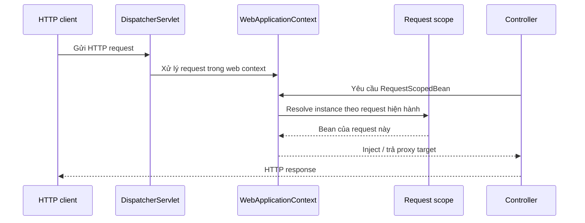
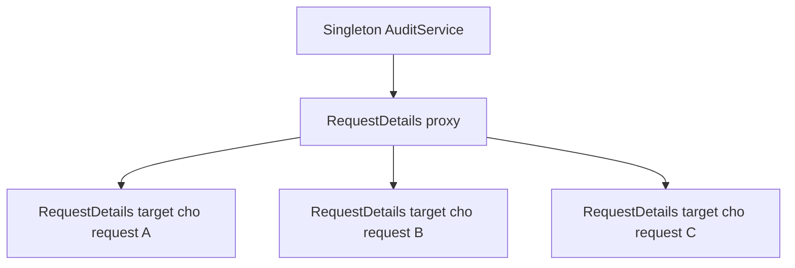

# Scope web chỉ hoạt động khi có ngữ cảnh tương ứng

Spring quản lý vòng đời bean theo nhiều loại scope. Bên cạnh `singleton` và `prototype`, ứng dụng web còn có những scope gắn với vòng đời HTTP như `request`, `session` và `application`. Chúng rất hữu ích khi một thành phần cần dữ liệu hoặc trạng thái chỉ có ý nghĩa trong một request, một phiên người dùng hoặc một web application.

Điểm cần hiểu rõ là **web scope không phải scope Java thuần có thể sử dụng ở mọi nơi**. Spring chỉ có thể tạo và phân giải bean thuộc web scope khi bean được quản lý trong ngữ cảnh web phù hợp và vòng đời tương ứng đang tồn tại. Nếu truy cập request-scoped bean từ một tiến trình nền không có HTTP request hiện hành, Spring không thể tự đoán request nào cần dùng.

Bài học tập trung vào điều kiện để web scope hoạt động, vòng đời từng scope, cách inject bean ngắn hạn vào singleton, scoped proxy, các lỗi thường gặp và cách kiểm thử trong Spring Boot.

## 1. Bean scope là gì?

Scope xác định **vòng đời và phạm vi chia sẻ của một bean instance**. Nó trả lời câu hỏi: Spring sẽ tạo instance khi nào, tái sử dụng trong phạm vi nào và kết thúc vòng đời khi nào?

Một class được đăng ký thành bean chưa có nghĩa mỗi lần inject hoặc gọi đều tạo object mới. Hành vi đó phụ thuộc scope của bean definition.

Các scope thường gặp:

| Scope | Phạm vi chia sẻ | Thời điểm tạo instance |
| --- | --- | --- |
| `singleton` | Một instance cho mỗi bean definition trong một `ApplicationContext` | Thường được tạo khi context khởi tạo nếu là singleton eager |
| `prototype` | Mỗi lần container yêu cầu bean thường tạo instance mới | Khi bean được yêu cầu |
| `request` | Một instance cho mỗi HTTP request | Khi bean được resolve lần đầu trong request |
| `session` | Một instance cho mỗi HTTP session | Khi bean được resolve lần đầu trong session |
| `application` | Một instance cho mỗi `ServletContext` | Khi bean được resolve lần đầu trong application scope |
| `websocket` | Một instance cho mỗi WebSocket session trong môi trường hỗ trợ scope này | Khi bean được resolve trong WebSocket session |

`singleton` và `prototype` là các scope lõi thường dùng trong Spring container. `request`, `session`, `application` và `websocket` là các scope gắn với môi trường web/messaging tương ứng. Không phải mọi `ApplicationContext` đều có những scope này.

### 1.1. Singleton không có nghĩa là một object cho toàn bộ JVM

Trong Spring, singleton có nghĩa là một instance cho một bean definition trong một `ApplicationContext`. Nếu ứng dụng có nhiều context, mỗi context có thể có instance riêng. Nếu có ba replica của ứng dụng chạy trên ba JVM hoặc container, mỗi tiến trình cũng có bộ bean riêng.

### 1.2. Prototype cũng không giống request scope

Prototype tạo instance mới mỗi khi container được yêu cầu resolve bean prototype. Spring quản lý quá trình khởi tạo và các callback khởi tạo, nhưng không theo dõi đầy đủ vòng đời sau đó để tự gọi mọi destruction callback khi object không còn được dùng.

Request scope lại gắn instance với một HTTP request cụ thể. Các lần truy cập cùng bean trong một request dùng chung instance; request tiếp theo nhận instance khác.

## 2. Web scope cần ngữ cảnh web

Spring định nghĩa web scope dựa trên những đối tượng vòng đời của môi trường web. Với ứng dụng Spring MVC trên Servlet stack, các scope như request, session và application dựa trên request hiện hành, HTTP session và ServletContext.

Một ứng dụng Boot Web MVC thông thường có một web-aware `ApplicationContext` và `DispatcherServlet`. Trong quá trình xử lý request, Spring MVC cung cấp thông tin request hiện hành để các scope tương ứng có thể tìm đúng instance.

Luồng khái quát:



Hai điều kiện cần phân biệt:

1. **Web-aware context:** Spring phải biết các web scope tương ứng và có cơ chế quản lý chúng.
2. **Scope đang hoạt động:** tại thời điểm truy cập target bean, request/session/application context tương ứng phải hiện hữu.

Một class có `@RequestScope` không tự tạo ra HTTP request. Annotation chỉ khai báo vòng đời mong muốn; môi trường web phải cung cấp context để Spring thực thi.

### 2.1. Vai trò của WebApplicationContext

`WebApplicationContext` là một loại `ApplicationContext` được thiết kế cho môi trường web. Nó có liên hệ với `ServletContext` và cung cấp hạ tầng để tích hợp bean với môi trường Servlet.

Trong ứng dụng Spring Boot MVC, auto-configuration và `DispatcherServlet` thường thiết lập các thành phần này. Bạn thường không phải tự tạo `WebApplicationContext` bằng tay.

Ngược lại, một `AnnotationConfigApplicationContext` thuần Java không tự có request scope. Nếu đăng ký một bean dùng `@RequestScope` trong context này rồi yêu cầu tạo target, Spring không có web scope phù hợp để resolve bean.

### 2.2. Request context được gắn với luồng xử lý thế nào?

Trong Servlet stack, `RequestContextHolder` cung cấp quyền truy cập request attributes hiện hành thông qua cơ chế gắn context vào thread. `DispatcherServlet` của Spring MVC tự expose request context trong quá trình xử lý. Nếu ứng dụng dùng một Servlet khác ngoài `DispatcherServlet` nhưng vẫn cần Spring request context, có thể cấu hình `RequestContextListener` hoặc `RequestContextFilter` theo kiến trúc triển khai.

Ví dụ listener trong cấu hình Servlet thuần:

```java
import org.springframework.web.context.request.RequestContextListener;

public class WebInitializer {
    // Đăng ký RequestContextListener trong Servlet container
    // theo cơ chế initializer/registration của ứng dụng.
}
```

Đoạn trên chỉ minh họa loại listener; một ứng dụng Boot MVC thông thường đã có request context qua DispatcherServlet. Không nên đăng ký listener/filter thêm chỉ vì thấy request scope được sử dụng, nếu cơ chế hiện tại đã cung cấp context.

## 3. Request scope: một instance cho mỗi HTTP request

`request` scope phù hợp với dữ liệu chỉ có ý nghĩa trong một lần trao đổi HTTP. Ví dụ:

- Correlation ID hoặc request ID.
- Metadata đã trích xuất từ request.
- Một đối tượng hỗ trợ ghi log theo request.
- Dữ liệu tạm phục vụ nhiều tầng trong cùng request.
- Một bộ ngữ cảnh trình bày chỉ dùng trong lần xử lý hiện tại.

`@RequestScope` là annotation tiện dụng của Spring, tương đương khai báo scope request và mặc định sử dụng scoped proxy kiểu class.

### 3.1. Khai báo request-scoped bean

Ví dụ một bean đọc request ID từ header:

```java
package com.example.web.context;

import jakarta.servlet.http.HttpServletRequest;
import org.springframework.stereotype.Component;
import org.springframework.web.context.annotation.RequestScope;

@Component
@RequestScope
public class RequestDetails {
    private final String requestId;

    public RequestDetails(HttpServletRequest request) {
        String header = request.getHeader("X-Request-Id");
        this.requestId = (header == null || header.isBlank())
                ? "generated-by-server"
                : header;
    }

    public String requestId() {
        return requestId;
    }
}
```

Khi request đầu tiên truy cập `RequestDetails`, Spring tạo target bean trong phạm vi request đó. Những lần truy cập tiếp theo trong cùng request dùng lại target. Request kế tiếp sẽ có target riêng.

Trong ví dụ này, chuỗi mặc định chỉ để minh họa. Ứng dụng thật nên tạo request ID duy nhất ở một thành phần đáng tin cậy, xác thực/chuẩn hóa header nếu nhận từ bên ngoài và tránh dùng giá trị client gửi làm bằng chứng xác thực.

### 3.2. Inject request-scoped bean vào singleton service

Một service mặc định là singleton có thể cần đọc request ID:

```java
package com.example.audit;

import com.example.web.context.RequestDetails;
import org.springframework.stereotype.Service;

@Service
public class AuditService {
    private final RequestDetails requestDetails;

    public AuditService(RequestDetails requestDetails) {
        this.requestDetails = requestDetails;
    }

    public void record(String action) {
        String requestId = requestDetails.requestId();
        // Ghi action cùng requestId vào log/audit sink.
    }
}
```

Điều này có thể hoạt động nhờ `@RequestScope` mặc định tạo scoped proxy. Spring inject proxy vào singleton `AuditService`. Khi gọi `requestDetails.requestId()` trong một request đang hoạt động, proxy tìm target instance tương ứng với request hiện tại rồi chuyển lời gọi đến target đó.

Sơ đồ:



Mỗi request nhận đúng target của nó dù singleton service giữ cùng một proxy reference.

**Không có nghĩa singleton service chứa một request object dùng chung.** Nó giữ proxy ổn định; proxy tra cứu target theo context hiện hành tại thời điểm gọi.

### 3.3. Vì sao không inject target request bean trực tiếp vào singleton?

Một singleton sống lâu hơn request. Nếu singleton giữ trực tiếp một target request instance, instance đó có thể hết vòng đời ngay sau request đầu tiên, hoặc không xác định được request cần dùng khi singleton được tạo.

Scoped proxy giải quyết sự khác nhau về vòng đời bằng một object trung gian. Đây là lý do annotation `@RequestScope` mặc định dùng proxy mode.

Nếu tắt proxy mode và inject trực tiếp request-scoped target vào singleton, Spring có thể phát hiện scope mismatch hoặc việc tạo bean thất bại khi không có request hiện hành. Với dependency có vòng đời ngắn hơn bean consumer, cần một cơ chế tra cứu/lazy phù hợp.

## 4. Session scope: một instance cho mỗi HTTP session

`session` scope lưu một bean instance theo HTTP session. Những request khác nhau thuộc cùng session sẽ truy cập cùng target instance. Khi session kết thúc hoặc bị invalidated, bean session-scoped tương ứng kết thúc vòng đời theo cơ chế quản lý session.

Các trường hợp có thể phù hợp:

- Trạng thái wizard nhiều bước.
- Lựa chọn tạm thời của người dùng trong một quy trình.
- Một giỏ hàng session nếu nghiệp vụ và kiến trúc cho phép lưu kiểu đó.
- Bộ lọc hoặc tùy chọn giao diện tồn tại giữa nhiều request.

Không nên lưu mọi dữ liệu người dùng vào session. Session là trạng thái phía server có chi phí bộ nhớ, có thể cần replication hoặc persistence khi chạy nhiều instance, và cần chính sách hết hạn rõ ràng.

### 4.1. Khai báo bằng @SessionScope

```java
package com.example.web.session;

import java.util.ArrayList;
import java.util.List;
import org.springframework.stereotype.Component;
import org.springframework.web.context.annotation.SessionScope;

@Component
@SessionScope
public class ShoppingSession {
    private final List<String> selectedProductIds = new ArrayList<>();

    public void select(String productId) {
        selectedProductIds.add(productId);
    }

    public List<String> selectedProductIds() {
        return List.copyOf(selectedProductIds);
    }
}
```

`@SessionScope` là annotation chuyên biệt cho scope session và mặc định dùng scoped proxy. Một controller hoặc service singleton có thể nhận proxy của `ShoppingSession`; khi truy cập trong request có session tương ứng, proxy resolve target session-scoped bean.

### 4.2. Session scope không phải nơi lưu trạng thái xác thực tùy tiện

Spring Security có cơ chế riêng cho SecurityContext và authentication. Không nên tự tạo một bean session-scoped để thay thế hệ thống xác thực, phân quyền hoặc quản lý session fixation. Dữ liệu session chỉ nên chứa thông tin cần thiết cho trải nghiệm hoặc quy trình, không lưu mật khẩu, token nhạy cảm hay thông tin xác thực theo cách thiếu kiểm soát.

### 4.3. Session có thể tồn tại qua nhiều request và node

Nếu ứng dụng chạy nhiều instance, session có thể được quản lý bằng session affinity hoặc cơ chế chia sẻ như Spring Session với Redis. Khi đó dữ liệu session phải phù hợp với cách serialize/deserialize và vòng đời phân tán.

Một object session-scoped trong bộ nhớ của một JVM không tự đồng bộ sang instance khác. Khi thiết kế hệ thống nhiều node, cần chọn giải pháp session cụ thể thay vì giả định web scope đã giải quyết phân tán.

## 5. Application scope: một instance cho mỗi ServletContext

`application` scope có vòng đời gắn với `ServletContext` của một web application. Nó thường được dùng cho dữ liệu hoặc thành phần dùng chung trong toàn bộ web application, qua nhiều HTTP session.

Có thể khai báo:

```java
package com.example.web.context;

import java.util.concurrent.atomic.AtomicLong;
import org.springframework.stereotype.Component;
import org.springframework.web.context.annotation.ApplicationScope;

@Component
@ApplicationScope
public class ApplicationRequestCounter {
    private final AtomicLong count = new AtomicLong();

    public long increment() {
        return count.incrementAndGet();
    }

    public long current() {
        return count.get();
    }
}
```

Mỗi request có thể gọi counter này và dùng chung instance trong cùng ServletContext.

Tuy nhiên, đây chỉ là bộ đếm trong bộ nhớ để minh họa scope. Nó sẽ reset khi web application khởi động lại, không chia sẻ giữa nhiều JVM/replica và cần dùng cấu trúc thread-safe vì nhiều request có thể gọi đồng thời. `AtomicLong` bảo vệ phép tăng/đọc đơn giản, nhưng không biến các thao tác nghiệp vụ phức tạp thành transaction.

### 5.1. Application scope khác singleton scope

Hai scope có thể trông giống nhau trong một ứng dụng Boot đơn giản, nhưng phạm vi quản lý khác nhau:

| Tiêu chí | Spring singleton | Web application scope |
| --- | --- | --- |
| Phạm vi | Một bean definition trong một `ApplicationContext` | Một bean instance cho một `ServletContext` |
| Phụ thuộc web | Không | Có |
| Số lượng context | Có instance theo từng context | Gắn với ServletContext tương ứng |
| Sử dụng ngoài web context | Có | Không |
| Vòng đời | Vòng đời bean trong context | Vòng đời web application |

Trong ứng dụng chỉ có một web application context gắn với một ServletContext, hai phạm vi thường có vẻ tương đương. Nhưng trong ứng dụng có nhiều context hoặc nhiều web application, chúng không thể xem là một khái niệm.

### 5.2. Không dùng application scope làm kho dữ liệu phân tán

Một bean application-scoped chỉ chia sẻ trong ServletContext tương ứng. Nếu có nhiều container, mỗi container có instance riêng. Với dữ liệu cần nhất quán giữa các node hoặc phải tồn tại sau khi deploy lại, dùng database, distributed cache hoặc dịch vụ lưu trữ phù hợp.

## 6. Khai báo scope bằng @Scope

Ngoài annotation tiện dụng, có thể khai báo scope trực tiếp bằng `@Scope`:

```java
import org.springframework.context.annotation.Scope;
import org.springframework.context.annotation.ScopedProxyMode;
import org.springframework.stereotype.Component;
import org.springframework.web.context.WebApplicationContext;

@Component
@Scope(
    value = WebApplicationContext.SCOPE_REQUEST,
    proxyMode = ScopedProxyMode.TARGET_CLASS
)
public class RequestTrace {
    // ...
}
```

Đoạn này tương đương về ý nghĩa với việc dùng `@RequestScope` trong ví dụ đơn giản. Các hằng scope web thường được lấy từ `WebApplicationContext`:

- `SCOPE_REQUEST`
- `SCOPE_SESSION`
- `SCOPE_APPLICATION`

Dùng annotation chuyên biệt thường dễ đọc hơn:

| Annotation | Scope tương ứng | Proxy mặc định |
| --- | --- | --- |
| `@RequestScope` | request | `TARGET_CLASS` |
| `@SessionScope` | session | `TARGET_CLASS` |
| `@ApplicationScope` | application | `TARGET_CLASS` |

Nếu dùng `@Scope` trực tiếp, cần chọn proxy mode theo cách bean được inject và kiểu bean. `ScopedProxyMode.NO` không tạo proxy; `INTERFACES` tạo proxy dựa trên interface; `TARGET_CLASS` tạo class-based proxy. Các proxy class-based thường cần class/method có thể được proxy, nên tránh đánh dấu class hoặc method cần proxy là `final`.

## 7. Scoped proxy giải quyết vòng đời khác nhau

Một tình huống phổ biến là singleton service cần request-scoped hoặc session-scoped dependency. Nếu Spring inject target trực tiếp, vòng đời bean consumer dài hơn vòng đời dependency.

Scoped proxy cho phép singleton giữ một reference ổn định nhưng resolve target theo scope mỗi lần sử dụng.

### 7.1. Request scope mặc định có proxy

`@RequestScope` tương đương một khai báo scope request với proxy mode target class. Vì vậy ví dụ sau hoạt động trong một request:

```java
@Component
@RequestScope
public class CurrentRequest {
    private final String path;

    public CurrentRequest(HttpServletRequest request) {
        this.path = request.getRequestURI();
    }

    public String path() {
        return path;
    }
}

@Service
public class RequestLogger {
    private final CurrentRequest currentRequest;

    public RequestLogger(CurrentRequest currentRequest) {
        this.currentRequest = currentRequest;
    }

    public void log() {
        System.out.println(currentRequest.path());
    }
}
```

`RequestLogger` là singleton mặc định. Nó không nhận một target `CurrentRequest` cố định mà nhận proxy. Khi `log()` chạy trong request, proxy resolve đúng target.

### 7.2. Proxy không tạo request giả

Nếu gọi `requestLogger.log()` từ một scheduled task không có HTTP request, proxy không thể tạo một request giả để đáp ứng lời gọi `currentRequest.path()`. Lúc đó Spring báo rằng request scope không hoạt động hoặc không có request gắn với thread/context hiện tại.

Scoped proxy chỉ giải quyết **cách tham chiếu tới bean ngắn hạn**. Nó không tạo ra lifecycle context cần thiết.

### 7.3. Dùng interface proxy khi phù hợp

Nếu bean có interface, có thể chọn `ScopedProxyMode.INTERFACES`:

```java
public interface RequestMetadata {
    String requestId();
}

@Component
@RequestScope(proxyMode = ScopedProxyMode.INTERFACES)
public class DefaultRequestMetadata implements RequestMetadata {
    // ...
}
```

Consumer nên inject qua interface `RequestMetadata`. Proxy dựa trên interface giảm yêu cầu subclass class cụ thể. Cần bảo đảm injection point dùng kiểu interface phù hợp; không inject implementation class nếu proxy chỉ expose interface.

## 8. Dùng ObjectProvider khi cần tra cứu bean theo thời điểm

Một lựa chọn khác là inject `ObjectProvider<T>` rồi yêu cầu bean tại nơi cần dùng:

```java
import org.springframework.beans.factory.ObjectProvider;
import org.springframework.stereotype.Service;

@Service
public class RequestAwareAuditService {
    private final ObjectProvider<RequestDetails> requestDetailsProvider;

    public RequestAwareAuditService(
            ObjectProvider<RequestDetails> requestDetailsProvider) {
        this.requestDetailsProvider = requestDetailsProvider;
    }

    public void record(String action) {
        RequestDetails details = requestDetailsProvider.getObject();
        // Dùng request-scoped bean trong request hiện hành.
    }
}
```

`ObjectProvider` trì hoãn việc resolve dependency tới lúc gọi `getObject()`. Tuy nhiên, lời gọi đó vẫn cần scope đang hoạt động. Nếu gọi trong scheduler hoặc worker thread không có request context, nó vẫn thất bại.

Dùng `ObjectProvider` khi cần lookup có chủ đích hoặc bean thực sự tùy chọn. Nếu chỉ muốn singleton service dùng một request-scoped collaborator trong request, scoped proxy thường làm code đơn giản hơn.

## 9. Điều gì xảy ra khi web scope được dùng ngoài ngữ cảnh phù hợp?

Đây là nội dung trọng tâm của bài học: **scope web chỉ hoạt động khi có ngữ cảnh tương ứng**.

Có hai nhóm lỗi cần phân biệt.

### 9.1. Không có web scope được đăng ký

Nếu tạo một generic context như `AnnotationConfigApplicationContext` và yêu cầu Spring khởi tạo bean thuộc request scope, context này không có sẵn scope web như một `WebApplicationContext`. Spring có thể báo lỗi tương tự:

```text
No Scope registered for scope name 'request'
```

Đây là vấn đề **loại ApplicationContext**. Context hiện tại không có scope request được đăng ký.

Ví dụ minh họa:

```java
var context = new AnnotationConfigApplicationContext();
context.register(RequestScopedConfiguration.class);
context.refresh();

// Nếu context cần tạo target request-scoped bean ở đây,
// việc resolve scope "request" không có web scope đăng ký.
```

Không nên dùng generic context để chạy một ứng dụng cần web scopes nếu chưa thiết lập hạ tầng web tương ứng.

### 9.2. Web scope có nhưng hiện không có request hoạt động

Trong một web-aware context, request scope có thể đã được đăng ký. Nhưng nếu gọi target bean khi không có request hiện hành, Spring có thể báo:

```text
Scope 'request' is not active for the current thread;
consider defining a scoped proxy for this bean if you intend
to refer to it from a singleton
```

Thông báo chính xác có thể khác theo phiên bản và đường gọi. Đây là vấn đề **scope lifecycle hiện tại**: container biết request scope là gì nhưng không có request gắn với execution hiện tại.

Ví dụ các trường hợp có thể gặp:

- Một `@Scheduled` method gọi service sử dụng request-scoped bean.
- Một `@Async` task truy cập request proxy sau khi được gửi sang executor thread.
- Một command-line runner gọi service web-aware khi ứng dụng khởi động.
- Một unit test trực tiếp gọi bean ngoài MockMvc hoặc request context đã thiết lập.
- Một message consumer xử lý message mà không có HTTP request.

### 9.3. Đừng nhầm lỗi scope với lỗi không tìm thấy bean

| Lỗi | Ý nghĩa |
| --- | --- |
| `NoSuchBeanDefinitionException` | Không tìm thấy bean definition/ứng viên tương thích |
| `NoUniqueBeanDefinitionException` | Có nhiều bean ứng viên không thể phân giải |
| `No Scope registered for scope name 'request'` | Context không có scope request được đăng ký |
| `Scope 'request' is not active` | Scope đã biết nhưng không có request hiện hành tại thời điểm resolve target |

Phân biệt nguyên nhân giúp chọn đúng hướng sửa: đăng ký bean, điều chỉnh context, hoặc thay đổi cách truyền dữ liệu qua boundary request.

## 10. Request scope và background task

Một lỗi thiết kế phổ biến là lấy dữ liệu từ request-scoped bean trong công việc chạy nền.

Ví dụ:

```java
@Service
public class ReportService {
    private final RequestDetails requestDetails;
    private final ReportWorker worker;

    public ReportService(RequestDetails requestDetails, ReportWorker worker) {
        this.requestDetails = requestDetails;
        this.worker = worker;
    }

    public void schedule(String reportId) {
        worker.generate(reportId, requestDetails.requestId());
    }
}
```

Nếu `schedule` được gọi trong request, đọc request ID ở thời điểm đó rồi truyền chuỗi vào worker là hợp lý. Nhưng nếu worker tự giữ `RequestDetails` và gọi nó sau trên executor thread, request scope có thể không còn hoạt động.

Cách thiết kế an toàn hơn là **đọc dữ liệu request khi đang ở request boundary, rồi truyền dữ liệu cần thiết như giá trị tường minh**:

```java
public record ReportCommand(String reportId, String requestedBy, String correlationId) {}

@Service
public class ReportService {
    private final RequestDetails requestDetails;
    private final ReportWorker worker;

    public ReportService(RequestDetails requestDetails, ReportWorker worker) {
        this.requestDetails = requestDetails;
        this.worker = worker;
    }

    public void schedule(String reportId, String userId) {
        ReportCommand command = new ReportCommand(
                reportId,
                userId,
                requestDetails.requestId()
        );
        worker.generate(command);
    }
}
```

`ReportWorker` nhận `ReportCommand` như dữ liệu độc lập, không cần biết Servlet request hoặc request-scoped bean. Khi job chạy sau khi HTTP response đã trả, nó vẫn có đủ dữ liệu cần thiết.

### 10.1. @Async không tự mang theo request context

`@Async` chuyển việc thực thi sang executor thread. Các context gắn với thread hiện tại không mặc nhiên xuất hiện ở thread khác. Đừng giả định request-scoped proxy sẽ tự hoạt động trong mọi tác vụ bất đồng bộ.

Spring MVC có hỗ trợ async request lifecycle riêng, trong đó framework phối hợp các lần dispatch và request context theo quy trình của nó. Điều đó khác với việc tự gửi một Runnable vào executor hoặc gọi một scheduled task độc lập. Phải xem rõ công việc là async response thuộc cùng HTTP request hay background job tách khỏi request.

### 10.2. Không giữ HttpServletRequest để dùng sau

Không nên lưu `HttpServletRequest` vào field singleton hoặc đưa reference đó sang background job. Request object có vòng đời gắn với Servlet request; dùng sau khi request kết thúc có thể gây lỗi hoặc hành vi không xác định.

Chỉ trích xuất các giá trị cần thiết như request ID, user ID đã xác thực, locale hoặc client metadata được phép sử dụng, rồi truyền chúng qua command/event immutable.

### 10.3. Request context propagation có giới hạn

Có thể cấu hình cơ chế truyền một số context qua executor (ví dụ security context hoặc tracing context) bằng integration phù hợp. Nhưng việc propagate không làm HTTP request sống mãi và không biến request-scoped bean thành dữ liệu có thể dùng an toàn vô thời hạn.

Với background job thực sự độc lập, payload tường minh và bền vững thường tốt hơn phụ thuộc vào thread-local web context.

## 11. Scope trong Spring MVC và Spring WebFlux

Ví dụ `HttpServletRequest` trong bài thuộc Servlet stack, thường dùng với `spring-boot-starter-web` và Spring MVC.

Spring WebFlux là reactive stack. Nó có mô hình xử lý request khác với Servlet và không nên áp dụng máy móc giả định rằng request context luôn nằm trong `ThreadLocal` của thread đang chạy. Reactive pipeline có thể đổi thread trong quá trình xử lý; dữ liệu context cần tuân theo cơ chế reactive context và hỗ trợ tương ứng của framework.

Khi phát triển WebFlux:

- Dùng các API và scope được hỗ trợ trong phiên bản Spring Framework/WebFlux cụ thể.
- Không dựa vào `RequestContextHolder` như một cách tổng quát để đọc request trong mọi reactive callback.
- Không chuyển Servlet API như `HttpServletRequest` vào reactive handler.
- Truyền metadata cần thiết qua reactive pipeline hoặc context abstraction phù hợp.
- Kiểm thử trong đúng web application type mà ứng dụng triển khai.

Không trộn hai starter web MVC và WebFlux chỉ để lấy annotation tiện dụng. Hãy chọn web stack phù hợp và hiểu cách stack đó quản lý request lifecycle.

## 12. Kiểm thử web-scoped bean

Kiểm thử request/session scope cần tạo ngữ cảnh tương ứng. Một unit test gọi trực tiếp service không tự có HTTP request.

### 12.1. Dùng MockMvc cho Spring MVC

Một cách phù hợp là dùng `@SpringBootTest` kết hợp `@AutoConfigureMockMvc` hoặc `@WebMvcTest` cho controller slice. Khi MockMvc gửi request qua `DispatcherServlet`, Spring MVC thiết lập request context để request-scoped bean được resolve trong quá trình xử lý.

Ví dụ kiểm thử tích hợp ở mức ý tưởng:

```java
@SpringBootTest
@AutoConfigureMockMvc
class RequestScopeIntegrationTest {
    @Autowired
    private MockMvc mockMvc;

    @Test
    void requestScopedValueIsAvailableDuringHttpRequest() throws Exception {
        mockMvc.perform(get("/request-info"))
                .andExpect(status().isOk());
    }
}
```

Đoạn test cần endpoint `/request-info` và các dependency tương ứng được định nghĩa trong ứng dụng. Mục tiêu là xác nhận request đi qua MVC infrastructure, không phải gọi request-scoped target ngoài request.

### 12.2. Kiểm tra hai request có hai target riêng

Có thể tạo một bean request-scoped có giá trị định danh được sinh khi khởi tạo và trả về qua endpoint. Gửi hai request độc lập rồi xác nhận hai ID khác nhau. Nếu muốn kiểm tra nhiều lần gọi trong cùng request, trả về cùng ID ở hai vị trí trong response để xác nhận target được dùng chung trong request đó.

Không nên kiểm tra bằng cách so sánh proxy reference từ singleton: proxy có thể là cùng một object trong mọi request, trong khi target phía sau proxy thay đổi theo request.

### 12.3. Kiểm thử session scope

Gửi request đầu tiên và giữ cookie/session tương ứng; request tiếp theo dùng cùng session để xác nhận state được giữ. Sau đó gửi request không dùng session đó để xác nhận state riêng.

MockMvc hỗ trợ thao tác với `MockHttpSession` trong test. Hãy phân biệt việc tái sử dụng session với việc gửi hai request hoàn toàn độc lập.

### 12.4. Thiết lập request context thủ công cho unit test

Trong một số unit test thấp tầng, có thể gắn `ServletRequestAttributes` vào `RequestContextHolder`:

```java
MockHttpServletRequest request = new MockHttpServletRequest();
ServletRequestAttributes attributes =
        new ServletRequestAttributes(request);

RequestContextHolder.setRequestAttributes(attributes);
try {
    // Gọi code cần request scope trong test này.
} finally {
    RequestContextHolder.resetRequestAttributes();
    attributes.requestCompleted();
}
```

Đây là kỹ thuật test cấp thấp. Phải reset trong `finally` để tránh rò rỉ context sang test khác hoặc làm test phụ thuộc thứ tự. Với kiểm thử MVC thông thường, MockMvc gần với luồng xử lý thật hơn và giảm thao tác thủ công.

## 13. Các lỗi thường gặp và cách chẩn đoán

| Triệu chứng | Nguyên nhân có thể | Hướng xử lý |
| --- | --- | --- |
| `No Scope registered for scope name 'request'` | Dùng generic context không đăng ký web scope | Chạy trong web-aware context hoặc cấu hình đúng môi trường web |
| `Scope 'request' is not active` | Gọi request-scoped target ngoài request | Chỉ truy cập trong request hoặc truyền dữ liệu cần thiết tường minh |
| Singleton không inject được request bean | Inject target ngắn hạn mà không có proxy/lazy resolution phù hợp | Dùng `@RequestScope` mặc định proxy hoặc provider |
| Request bean bị dùng lẫn giữa hai request | Tự giữ mutable request data trong singleton | Chuyển state vào request scope và không copy target vào singleton |
| Session state mất giữa request | Cookie/session không được gửi lại, session hết hạn hoặc session store khác | Kiểm tra cookie, session lifecycle và cấu hình lưu session |
| Request scope lỗi trong @Async | Executor thread không có request context | Đọc dữ liệu trong request rồi truyền command |
| Unit test lỗi scope | Test gọi bean trực tiếp mà không có request context | Dùng MockMvc hoặc gắn request attributes có cleanup |
| Application scope không chia sẻ giữa các replica | Scope chỉ theo ServletContext của từng web application | Dùng cache/database phân tán nếu cần chia sẻ giữa node |
| Proxy không tạo được | Class/method final hoặc kiểu injection không tương thích proxy mode | Dùng class có thể proxy hoặc interface proxy phù hợp |

### 13.1. Quy trình điều tra lỗi

Khi gặp lỗi web scope:

1. Xác định ứng dụng đang chạy Spring MVC/Servlet hay WebFlux.
2. Xác nhận bean definition có được đăng ký trong context không.
3. Xác định context có hỗ trợ web scope tương ứng không.
4. Xác định tại thời điểm gọi target có request/session hiện hành không.
5. Kiểm tra bean consumer có sống lâu hơn target scope không và cần scoped proxy hay provider.
6. Kiểm tra code có gọi proxy từ scheduler, listener, executor hoặc test ngoài request không.
7. Nếu là background task, xem có thể chuyển giá trị request thành dữ liệu command/event rõ ràng không.

Không nên chữa mọi lỗi bằng cách thêm `@Lazy`, bật session hoặc tự gắn request attributes vào thread. Trước hết phải hiểu bean được gọi ở lifecycle nào.

## 14. Chọn scope theo bản chất dữ liệu

Một số ví dụ lựa chọn:

| Dữ liệu/thành phần | Scope thường cân nhắc | Lý do |
| --- | --- | --- |
| Service xử lý nghiệp vụ stateless | singleton | Tái sử dụng một instance, không giữ request state |
| Repository/adapter stateless | singleton | Chia sẻ dependency hạ tầng theo context |
| Request ID, request metadata | request | Chỉ tồn tại trong một HTTP request |
| Trạng thái wizard của một người dùng | session | Cần tồn tại qua nhiều request cùng session |
| Counter tạm trong một ServletContext | application | Chia sẻ trong một web application |
| Dữ liệu cấu hình bất biến | singleton hoặc configuration properties | Không cần tạo lại theo request |
| Job nền xử lý sau response | Không dựa vào request scope | Nhận dữ liệu cần thiết qua command/event |
| Cache dùng chung nhiều replica | Không chỉ application scope | Cần hệ thống lưu trữ chia sẻ |

### 14.1. Đừng dùng request scope để né thiết kế stateless

Nếu service có field `currentUser` hoặc `currentRequestId` chỉ vì nhiều method cần dữ liệu đó, có thể cân nhắc truyền tham số rõ ràng thay vì chuyển toàn bộ service thành request scope. Request scope hữu ích khi một collaborator thực sự có lifecycle theo request và được nhiều thành phần trong request dùng chung.

Một singleton stateless thường đơn giản, dễ kiểm thử và ít tốn tài nguyên hơn việc tạo nhiều instance cho mỗi request.

### 14.2. Đừng dùng session scope cho dữ liệu có thể suy ra

Session lưu trạng thái phía server. Nếu dữ liệu có thể truy vấn từ database hoặc suy ra từ authentication context, lưu bản sao mutable trong session có thể gây dữ liệu cũ, xung đột cập nhật và tăng bộ nhớ. Chỉ lưu những gì cần duy trì giữa các request và có chính sách hết hạn/đồng bộ rõ ràng.

## 15. Ví dụ tổng hợp: request scope trong ứng dụng Boot MVC

Ví dụ dưới đây gồm request-scoped bean, singleton service và controller. Các class nằm dưới package gốc để component scan mặc định tìm thấy.

### 15.1. Request metadata

```java
package com.example.demo.request;

import jakarta.servlet.http.HttpServletRequest;
import org.springframework.stereotype.Component;
import org.springframework.web.context.annotation.RequestScope;

@Component
@RequestScope
public class RequestMetadata {
    private final String requestPath;
    private final String requestId;

    public RequestMetadata(HttpServletRequest request) {
        this.requestPath = request.getRequestURI();
        String id = request.getHeader("X-Request-Id");
        this.requestId = (id == null || id.isBlank())
                ? "not-provided"
                : id;
    }

    public String requestPath() {
        return requestPath;
    }

    public String requestId() {
        return requestId;
    }
}
```

### 15.2. Singleton service dùng proxy

```java
package com.example.demo.audit;

import com.example.demo.request.RequestMetadata;
import org.springframework.stereotype.Service;

@Service
public class RequestAuditService {
    private final RequestMetadata metadata;

    public RequestAuditService(RequestMetadata metadata) {
        this.metadata = metadata;
    }

    public String describe(String action) {
        return action
                + " path=" + metadata.requestPath()
                + " requestId=" + metadata.requestId();
    }
}
```

### 15.3. Controller gọi service trong request

```java
package com.example.demo.web;

import com.example.demo.audit.RequestAuditService;
import org.springframework.web.bind.annotation.GetMapping;
import org.springframework.web.bind.annotation.RequestParam;
import org.springframework.web.bind.annotation.RestController;

@RestController
public class RequestInfoController {
    private final RequestAuditService auditService;

    public RequestInfoController(RequestAuditService auditService) {
        this.auditService = auditService;
    }

    @GetMapping("/request-info")
    public String info(@RequestParam(defaultValue = "view") String action) {
        return auditService.describe(action);
    }
}
```

### 15.4. Application class

```java
package com.example.demo;

import org.springframework.boot.SpringApplication;
import org.springframework.boot.autoconfigure.SpringBootApplication;

@SpringBootApplication
public class DemoApplication {
    public static void main(String[] args) {
        SpringApplication.run(DemoApplication.class, args);
    }
}
```

Khi gửi:

```http
GET /request-info?action=inspect
X-Request-Id: req-100
```

Response body minh họa:

```text
inspect path=/request-info requestId=req-100
```

Request tiếp theo với header `X-Request-Id: req-200` sẽ resolve một target `RequestMetadata` khác. `RequestAuditService` vẫn là singleton và giữ cùng proxy, nhưng proxy trả về metadata của request hiện hành.

Ví dụ cần dependency web MVC phù hợp (thường là `spring-boot-starter-web`) và Servlet container. Nếu chuyển code sang generic Spring context hoặc gọi `RequestAuditService.describe()` từ job nền không có request, request-scoped target không thể được resolve.

## 16. Ghi nhớ

Web scope gắn với vòng đời của môi trường web. Request scope tạo một target cho mỗi HTTP request; session scope giữ target qua nhiều request trong cùng HTTP session; application scope chia sẻ target trong một ServletContext. Chúng không phải các scope có sẵn trong mọi Spring context và cũng không đồng nghĩa với singleton hoặc dữ liệu chia sẻ giữa các server.

Trong ứng dụng Spring MVC, web-aware context và DispatcherServlet cung cấp request context để Spring resolve các bean này. `@RequestScope`, `@SessionScope` và `@ApplicationScope` mặc định sử dụng scoped proxy, giúp bean singleton có thể tham chiếu bean có vòng đời ngắn hơn. Proxy chỉ định tuyến tới target khi scope tương ứng đang hoạt động; nó không tạo request/session thay thế.

Khi chạy scheduler, background executor, message listener hoặc unit test thuần, không giả định có HTTP request hiện hành. Hãy trích xuất dữ liệu cần thiết trong request và truyền qua command/event, hoặc thiết lập context test có cleanup khi thực sự cần kiểm tra web scope. Chọn scope theo vòng đời dữ liệu, giữ service stateless khi có thể và phân biệt rõ lỗi thiếu bean, thiếu scope registration với lỗi scope không hoạt động.
