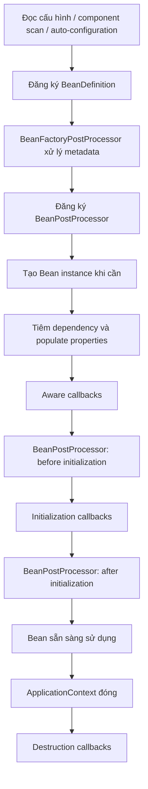
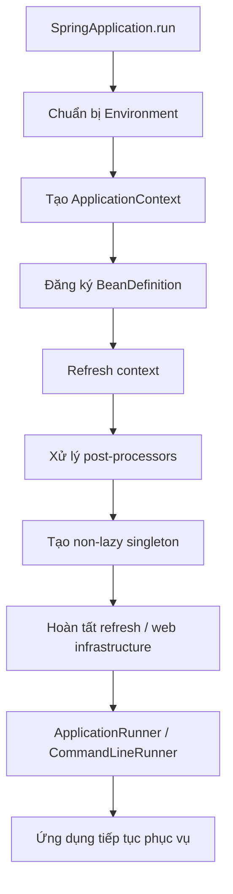
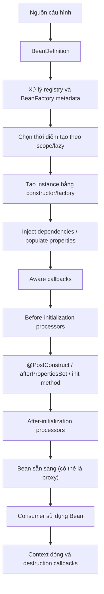

# Từ BeanDefinition đến đối tượng đã sẵn sàng sử dụng

Khi Spring Boot khởi động, container không đơn giản quét class rồi gọi `new` cho tất cả. Trước khi một Bean có thể phục vụ nghiệp vụ, Spring cần biết **cách tạo Bean**, chuẩn bị các dependency, gọi những callback trong vòng đời và có thể áp dụng thêm các xử lý như validation, proxy hoặc AOP.

Một khái niệm trung tâm của quá trình đó là **BeanDefinition**. BeanDefinition mô tả một Bean: class hoặc factory method dùng để tạo nó, scope, constructor arguments, property values, các dependency và metadata liên quan. Từ định nghĩa này, Spring tạo ra **Bean instance** (đối tượng thực tế), tiêm dependency và hoàn tất khởi tạo.

Hãy phân biệt hai trạng thái:

- **BeanDefinition đã đăng ký:** container biết Bean cần được tạo như thế nào. Điều này chưa có nghĩa object đã tồn tại.
- **Bean instance đã sẵn sàng:** object đã được tạo, dependency đã được cung cấp, các bước khởi tạo cần thiết đã chạy và Bean có thể được sử dụng theo hợp đồng của nó.

Với một singleton thông thường được khởi tạo sớm, hai giai đoạn này thường nối tiếp nhau trong lúc application context refresh. Với Bean lazy hoặc prototype, instance có thể chỉ được tạo khi có yêu cầu. Vì vậy, “đã có trong container” và “đã được khởi tạo” không phải lúc nào cũng đồng nghĩa.

## 1. Toàn cảnh vòng đời Bean

Ở mức khái quát, vòng đời của một Bean được quản lý có thể hình dung như sau:



Sơ đồ là mô hình dễ học của một Bean thông thường. Quá trình thật có các nhánh như factory method, `FactoryBean`, proxy tạo sớm, lazy initialization, scope khác singleton và các extension point chuyên biệt. Không phải mọi Bean đều đi qua mọi bước theo cùng một cách hoặc cùng thời điểm.

Các giai đoạn quan trọng:

1. Spring thu thập thông tin cấu hình và đăng ký BeanDefinition.
2. Các post-processor ở cấp BeanFactory có thể thay đổi metadata trước khi Bean thông thường được tạo.
3. Spring tạo instance theo constructor hoặc factory method.
4. Container phân giải và inject dependency, sau đó gọi các callback nhận biết môi trường/container.
5. Các callback khởi tạo được thực hiện theo thứ tự xác định.
6. BeanPostProcessor có thể bọc Bean bằng proxy; object cuối cùng được container công bố cho nơi sử dụng.
7. Khi container đóng, các callback hủy được gọi cho những scope mà container quản lý việc hủy.

## 2. BeanDefinition là gì?

`BeanDefinition` là metadata mà Spring dùng để mô tả cách tạo và quản lý một Bean. Nó có thể chứa những thông tin như:

| Thông tin | Ý nghĩa |
|---|---|
| Bean class hoặc factory method | Đối tượng được tạo từ class nào hoặc method nào |
| Scope | Singleton, prototype hoặc scope khác |
| Constructor arguments | Giá trị/dependency truyền vào constructor |
| Property values | Các giá trị được gán vào property/field theo cấu hình |
| Lazy initialization | Có trì hoãn khởi tạo instance hay không |
| Primary | Có được ưu tiên khi phân giải dependency cùng kiểu hay không |
| Depends-on | Bean nào cần được khởi tạo trước Bean này |
| Init/destroy method | Callback khởi tạo và hủy tùy chỉnh |
| Qualifier và metadata khác | Thông tin hỗ trợ lựa chọn Bean và xử lý container |

BeanDefinition không nhất thiết được viết trực tiếp thành một file riêng. Spring có thể tạo chúng từ nhiều nguồn:

- Class được phát hiện qua component scanning, ví dụ `@Component`, `@Service`, `@Repository`.
- Method `@Bean` bên trong class cấu hình.
- Auto-configuration của Spring Boot.
- XML hoặc các cơ chế đăng ký BeanDefinition bằng code trong những ứng dụng dùng cấu hình tương ứng.

### Class và BeanDefinition không giống nhau

Một class Java có thể tồn tại trên classpath nhưng không trở thành Bean nếu Spring không phát hiện hoặc đăng ký nó. Ngược lại, một Bean có thể được tạo từ factory method mà class implementation không mang annotation Spring nào.

Ví dụ:

```java
public class GreetingFormatter {
    public String format(String name) {
        return "Xin chào " + name;
    }
}
```

Class này tự nó chỉ là một class Java. Để container quản lý một instance, ta có thể khai báo:

```java
@Configuration(proxyBeanMethods = false)
public class GreetingConfiguration {

    @Bean
    GreetingFormatter greetingFormatter() {
        return new GreetingFormatter();
    }
}
```

Spring đăng ký BeanDefinition cho Bean do method `greetingFormatter()` cung cấp. Tên Bean mặc định là tên method, tức `greetingFormatter`.

### BeanDefinition và Bean instance

Hãy tưởng tượng:

```text
BeanDefinition: "greetingFormatter"
    beanClass / factory method: GreetingConfiguration.greetingFormatter()
    scope: singleton (mặc định)
    lazy: false (mặc định)
              |
              v
Bean instance: một đối tượng GreetingFormatter cụ thể
```

BeanDefinition có thể tồn tại lâu trước khi instance được tạo. Với singleton không lazy, Spring thường tạo instance trong lúc refresh context. Với `@Lazy`, container có thể giữ definition mà chưa tạo instance cho đến khi Bean được yêu cầu.

## 3. Từ đâu Spring có BeanDefinition?

### Component scanning

Ví dụ:

```java
@Service
public class OrderService {
}
```

Khi component scan đi qua package chứa class này, Spring phát hiện stereotype annotation và đăng ký BeanDefinition tương ứng. Tên mặc định thường là `orderService`, trừ khi được đặt tên khác hoặc có naming strategy tùy chỉnh.

### Java configuration và @Bean

```java
@Configuration(proxyBeanMethods = false)
public class PaymentConfiguration {

    @Bean
    PaymentGateway paymentGateway() {
        return new HttpPaymentGateway();
    }
}
```

Ở đây BeanDefinition mô tả Bean được tạo thông qua factory method. Spring có thể biết kiểu trả về là `PaymentGateway` và dùng metadata đó khi phân giải dependency.

### Auto-configuration

Spring Boot đưa thêm các cấu hình có điều kiện dựa trên classpath, property và Bean đã đăng ký. Ví dụ một auto-configuration có thể tạo Bean mặc định khi một thư viện tồn tại và ứng dụng chưa tự cung cấp Bean cùng vai trò.

Điểm quan trọng: auto-configuration cũng đóng góp BeanDefinition vào container. Khi instance được tạo, Bean đó vẫn trải qua cơ chế quản lý vòng đời của Spring.

### Đăng ký bằng code

Các thư viện/framework có thể dùng `BeanDefinitionRegistry` hoặc `ImportBeanDefinitionRegistrar` để đăng ký definition theo chương trình. Đây là cách xây dựng infrastructure hoặc framework mở rộng Spring; ứng dụng nghiệp vụ thông thường ít khi cần tự đăng ký BeanDefinition bằng tay.

## 4. Các bước trước khi tạo Bean instance

Sau khi các nguồn cấu hình được đọc, Spring có một tập BeanDefinition để sử dụng. Nhưng trước khi tạo các instance thông thường, container còn có những extension point quan trọng.

### BeanDefinitionRegistryPostProcessor

`BeanDefinitionRegistryPostProcessor` cho phép đăng ký thêm BeanDefinition hoặc điều chỉnh registry trong giai đoạn xử lý registry. Một số cơ chế cấu hình và scan của Spring được tổ chức qua các processor thuộc nhóm này.

Nó chạy ở cấp **registry/metadata**, trước khi các Bean nghiệp vụ thông thường được khởi tạo. Đây không phải callback dành cho từng instance.

### BeanFactoryPostProcessor

`BeanFactoryPostProcessor` có thể đọc hoặc sửa BeanDefinition đã được đăng ký trong BeanFactory trước khi các Bean thông thường được tạo.

Ví dụ, Spring có thể xử lý placeholder trong cấu hình hoặc điều chỉnh metadata. Một ứng dụng hiếm khi cần tự viết processor này; nếu viết, cần tránh gọi `getBean(...)` tùy tiện trong callback vì có thể khiến Bean được khởi tạo quá sớm, trước khi các post-processor khác đã được đăng ký đầy đủ.

### BeanPostProcessor

`BeanPostProcessor` xử lý **instance** trước và sau initialization. Đây là cơ chế khác với BeanFactoryPostProcessor:

| Extension point | Đối tượng xử lý | Thời điểm chính |
|---|---|---|
| BeanDefinitionRegistryPostProcessor | Registry của BeanDefinition | Trước BeanFactoryPostProcessor thông thường |
| BeanFactoryPostProcessor | BeanDefinition/metadata trong factory | Trước khi tạo các Bean thông thường |
| BeanPostProcessor | Bean instance | Trong quá trình khởi tạo từng Bean |

Sự khác nhau giữa metadata và instance là chìa khóa để hiểu vì sao Spring có thể thay đổi cấu hình trước khi object được tạo, rồi tiếp tục bọc hoặc điều chỉnh object sau khi tạo.

## 5. Tạo Bean instance: constructor hoặc factory method

Khi container quyết định tạo một Bean, nó cần tạo instance ban đầu.

### Constructor instantiation

Với một component:

```java
@Component
public class InventoryService {
    private final InventoryRepository repository;

    public InventoryService(InventoryRepository repository) {
        this.repository = repository;
    }
}
```

Spring chọn constructor phù hợp, phân giải `InventoryRepository` rồi gọi constructor để tạo instance. Với một constructor duy nhất, Spring tự sử dụng nó cho constructor injection.

### Factory method instantiation

Với Bean khai báo bằng `@Bean`:

```java
@Configuration(proxyBeanMethods = false)
public class ClientConfiguration {

    @Bean
    ApiClient apiClient(ClientProperties properties) {
        return new ApiClient(properties.baseUrl());
    }
}
```

Spring gọi factory method `apiClient(...)` sau khi phân giải tham số `ClientProperties`. Object trả về trở thành instance được quản lý theo BeanDefinition tương ứng.

### FactoryBean

`FactoryBean<T>` là một hợp đồng đặc biệt: chính một Bean factory tạo ra object sản phẩm khác. Khi lấy Bean theo tên thông thường, container thường trả về **sản phẩm** của FactoryBean. Tiền tố `&` cho phép lấy chính FactoryBean:

```java
Object product = context.getBean("clientFactory");
Object factory = context.getBean("&clientFactory");
```

Đây là cơ chế nâng cao; nó không giống factory method `@Bean`. Cả hai đều có thể tạo object thông qua một factory, nhưng FactoryBean là một loại Bean đặc biệt mà container hiểu quy ước riêng.

## 6. Dependency injection và populate properties

Sau khi có instance ban đầu, Spring cung cấp những dependency và giá trị được khai báo trong BeanDefinition hoặc annotation/configuration.

Ví dụ constructor injection:

```java
@Service
public class CheckoutService {
    private final PaymentGateway gateway;

    public CheckoutService(PaymentGateway gateway) {
        this.gateway = gateway;
    }
}
```

Dependency constructor được phân giải **trước khi constructor hoàn tất** vì Spring cần đối tượng đó để gọi constructor. Sau khi instance được tạo, container còn có giai đoạn populate property để xử lý những injection khác mà cấu hình yêu cầu, chẳng hạn setter/field injection hoặc property values.

Với constructor injection, các dependency bắt buộc đã được truyền vào ngay khi object hình thành. Đó là lý do cách này phù hợp với class cần có trạng thái hợp lệ ngay từ đầu.

### Phân giải dependency

Spring có thể xét:

- Kiểu tham số.
- Tên tham số/Bean và metadata liên quan khi cần phân giải.
- `@Qualifier` để thu hẹp ứng viên.
- `@Primary` để ưu tiên một Bean.
- Collection hoặc map khi cần nhiều Bean cùng kiểu.
- Các kiểu đặc biệt như `ObjectProvider<T>` hoặc `Optional<T>` cho dependency có thể vắng mặt hoặc phân giải muộn.

Nếu không có ứng viên bắt buộc hoặc có nhiều ứng viên không thể phân giải, quá trình tạo Bean thất bại. Container không thể đưa ra một object hoàn chỉnh theo yêu cầu constructor.

## 7. Aware callbacks: Bean nhận biết container và môi trường

Sau khi instance được tạo và dependency được populate, Spring có thể gọi các callback thuộc nhóm `Aware` nếu Bean implement interface tương ứng.

Một số interface:

| Interface | Thông tin Bean nhận được |
|---|---|
| `BeanNameAware` | Tên Bean mà container đăng ký |
| `BeanClassLoaderAware` | ClassLoader liên quan |
| `BeanFactoryAware` | BeanFactory đang quản lý Bean |
| `EnvironmentAware` | Environment chứa property/profile |
| `ApplicationContextAware` | ApplicationContext |
| `ResourceLoaderAware` | ResourceLoader |

Ví dụ:

```java
@Component
public class ContextAwareComponent implements BeanNameAware {
    private String beanName;

    @Override
    public void setBeanName(String name) {
        this.beanName = name;
    }

    public String getBeanName() {
        return beanName;
    }
}
```

Spring gọi `setBeanName(...)` trong quá trình khởi tạo, vì vậy Bean có thể biết tên mà container gán cho nó.

Không nên implement mọi interface Aware chỉ vì có thể. Đặc biệt, phụ thuộc trực tiếp vào `ApplicationContext` có thể làm class gắn chặt với Spring và khiến dependency bị ẩn. Chỉ dùng Aware khi component thật sự là infrastructure cần tích hợp với container hoặc cần thông tin đặc biệt mà DI thông thường không diễn đạt phù hợp.

## 8. BeanPostProcessor trước initialization

Sau các callback Aware, Spring gọi các BeanPostProcessor ở pha trước initialization:

```java
Object postProcessBeforeInitialization(
        Object bean, String beanName) throws BeansException;
```

Mỗi BeanPostProcessor có thể trả lại object ban đầu, một object đã điều chỉnh hoặc `null` theo hợp đồng xử lý. Nhiều cơ chế framework được cài đặt qua processor này.

Ví dụ, việc xử lý `@PostConstruct` được tích hợp thông qua một processor chuyên biệt. Vì vậy callback `@PostConstruct` diễn ra trong chuỗi xử lý before-initialization, trước `InitializingBean.afterPropertiesSet()` và custom init method.

Một điểm quan trọng: processor có thể được áp dụng cho nhiều Bean. BeanPostProcessor chính nó cũng phải được đăng ký trong container; khi khởi tạo processor, cần tránh phụ thuộc vòng hoặc kéo quá nhiều Bean nghiệp vụ lên quá sớm.

## 9. Initialization callbacks: khi Bean tự hoàn tất khởi tạo

Sau khi dependency đã được cung cấp và các bước before-initialization tương ứng đã chạy, Spring thực hiện những callback khởi tạo mà Bean khai báo.

Các cách thường gặp:

1. Annotation `@PostConstruct`.
2. Interface `InitializingBean` với method `afterPropertiesSet()`.
3. Custom init method khai báo trong `@Bean(initMethod = "...")` hoặc metadata tương ứng.

### @PostConstruct

Trong Spring Boot 3 / Spring Framework 6, annotation chuẩn được import từ `jakarta.annotation.PostConstruct`:

```java
import jakarta.annotation.PostConstruct;
import org.springframework.stereotype.Component;

@Component
public class CacheWarmup {

    @PostConstruct
    void initialize() {
        // Dependency đã được inject.
        // Có thể chuẩn bị trạng thái nội bộ cần thiết.
    }
}
```

Method này thường không nhận tham số và không nên được dùng như một điểm khởi chạy nghiệp vụ kéo dài. Tránh gọi các hệ thống bên ngoài theo cách có thể block lâu hoặc tạo side effect khó kiểm soát trong callback khởi tạo.

### InitializingBean

```java
import org.springframework.beans.factory.InitializingBean;
import org.springframework.stereotype.Component;

@Component
public class ClientRegistry implements InitializingBean {
    @Override
    public void afterPropertiesSet() {
        // Kiểm tra hoặc hoàn tất cấu hình sau khi dependency đã được gán.
    }
}
```

Interface này thuộc Spring. Nó hữu ích trong một số infrastructure component, nhưng class nghiệp vụ muốn giảm phụ thuộc API Spring thường có thể chọn `@PostConstruct` hoặc custom init method.

### Custom init method

```java
@Configuration(proxyBeanMethods = false)
public class SearchConfiguration {

    @Bean(initMethod = "start")
    SearchClient searchClient() {
        return new SearchClient();
    }
}
```

Giả sử `SearchClient` có method `start()` phù hợp. Cách này hữu ích khi class thuộc thư viện bên ngoài và bạn không thể thêm annotation hay implement interface Spring vào class đó.

### Thứ tự các callback khởi tạo

Đối với Bean được quản lý theo quy trình thông thường, thứ tự quan trọng là:

```text
Dependency injection / populate properties
        ↓
Aware callbacks
        ↓
BeanPostProcessor.postProcessBeforeInitialization(...)
        ↓
@PostConstruct
        ↓
InitializingBean.afterPropertiesSet()
        ↓
Custom init method
        ↓
BeanPostProcessor.postProcessAfterInitialization(...)
```

`@PostConstruct` được gọi bởi processor tương ứng trong pha before-initialization. Vì vậy không nên diễn giải rằng Spring luôn chạy tất cả BeanPostProcessor trước-init xong rồi mới gọi @PostConstruct như một giai đoạn hoàn toàn tách biệt; annotation này là một phần của chuỗi processor đó.

## 10. BeanPostProcessor sau initialization và proxy

Sau các callback initialization, Spring tiếp tục gọi:

```java
Object postProcessAfterInitialization(
        Object bean, String beanName) throws BeansException;
```

Đây là một điểm quan trọng vì processor có thể trả về một object khác, thường là **proxy** bọc quanh Bean gốc. Những cơ chế như AOP, transaction và một số tính năng framework dựa vào việc tạo proxy ở các bước post-processing.

Ví dụ:

```java
@Service
public class TransferService {
    @Transactional
    public void transfer() {
        // Thực hiện thao tác dữ liệu trong transaction.
    }
}
```

Khi transaction infrastructure được cấu hình và điều kiện phù hợp, Spring có thể cung cấp một proxy để áp dụng transaction interceptor khi method được gọi qua proxy. Vì thế object mà consumer nhận được có thể là proxy chứ không nhất thiết là instance target ban đầu.

Điều này giải thích một số hành vi:

- Kiểu instance runtime đôi khi không giống concrete class mà bạn mong đợi, nhất là với JDK dynamic proxy.
- Gọi method nội bộ từ một method khác trong cùng object (self-invocation) có thể không đi qua proxy, nên không kích hoạt advice theo cách bạn nghĩ.
- Tra cứu hoặc inject theo interface thường bền vững hơn khi Bean có thể được proxy theo interface.

Không phải Bean nào cũng bị proxy. Proxy chỉ xuất hiện khi có infrastructure hoặc post-processor cần áp dụng hành vi bổ sung.

## 11. Khi nào Bean được xem là sẵn sàng sử dụng?

Với Bean thông thường, sau khi:

- Instance đã được tạo.
- Dependency bắt buộc đã được phân giải và inject.
- Các callback Aware liên quan đã chạy.
- Chuỗi initialization hoàn tất.
- Các BeanPostProcessor sau initialization đã xử lý Bean.

container có thể công bố Bean cho các consumer theo cơ chế quản lý tương ứng. Với Bean bị proxy, object consumer thường nhận là object sau post-processing.

Tuy nhiên, “sẵn sàng” cần hiểu trong phạm vi lifecycle của Spring. Nó không bảo đảm mọi hệ thống bên ngoài đã hoạt động, mọi request đều thành công hoặc mọi công việc nền đã hoàn tất. Ví dụ:

- Một service có thể đã được tạo nhưng database bị ngắt kết nối sau đó.
- Một client có thể được khởi tạo nhưng credential không còn hợp lệ khi gọi API.
- Một Bean lazy có thể chưa được tạo dù application context đã refresh xong.
- Một runner của Spring Boot có thể thực hiện công việc sau khi context refresh, tùy vào loại ứng dụng và cách cấu hình.

Nếu cần thực hiện công việc sau khi context đã khởi tạo, hãy cân nhắc lifecycle/event phù hợp như `ApplicationRunner`, `CommandLineRunner` hoặc sự kiện application context. Đừng mặc định rằng `@PostConstruct` là thời điểm thích hợp cho mọi tác vụ startup.

## 12. Spring Boot kết nối lifecycle Bean với application startup

Lệnh thường thấy:

```java
public static void main(String[] args) {
    SpringApplication.run(ShopApplication.class, args);
}
```

khởi động quy trình Spring Boot. Ở mức tổng quát:

1. Boot chuẩn bị Environment, đọc cấu hình và xác định loại ứng dụng.
2. Boot tạo ApplicationContext thích hợp.
3. Các nguồn cấu hình được xử lý: component scan, import và auto-configuration đóng góp BeanDefinition.
4. Context refresh; các BeanFactoryPostProcessor/BeanPostProcessor được xử lý và các singleton không lazy thường được khởi tạo.
5. Với ứng dụng web, context và web server được chuẩn bị theo loại context; các thành phần web cần thiết được khởi tạo.
6. Sau khi context refresh, Spring Boot gọi các runner đã đăng ký theo lifecycle của ứng dụng.

Sơ đồ:



Đây là sơ đồ đơn giản hóa; chi tiết khởi tạo server và sự kiện có thể khác theo loại ứng dụng (Servlet, Reactive, non-web). Điều quan trọng là lifecycle Bean diễn ra bên trong lifecycle rộng hơn của ApplicationContext.

### @PostConstruct khác ApplicationRunner thế nào?

| | `@PostConstruct` | `ApplicationRunner` |
|---|---|---|
| Phạm vi | Một Bean cụ thể | Callback ở mức ứng dụng |
| Thời điểm | Trong initialization của Bean đó | Sau khi ApplicationContext đã refresh |
| Có nhận ApplicationArguments? | Không | Có |
| Hợp với | Kiểm tra trạng thái nội bộ, hoàn tất cấu hình cục bộ | Công việc startup cần context đã sẵn sàng |
| Nên làm tác vụ lâu? | Tránh | Có thể, nhưng cần cân nhắc thời gian startup và failure handling |

Nếu tác vụ cần tất cả Bean khác đã được khởi tạo, `@PostConstruct` của một Bean không nên được giả định là chạy sau khi mọi singleton trong ứng dụng đã sẵn sàng. Một runner hoặc hook lifecycle cấp context thường phù hợp hơn.

## 13. Singleton, lazy và prototype làm thay đổi thời điểm tạo instance

BeanDefinition có thể mô tả scope và chiến lược khởi tạo.

### Singleton mặc định

```java
@Component
public class CurrencyService {
}
```

Một Bean singleton thông thường được tạo sớm khi context refresh, trừ khi được lazy hoặc có điều kiện đặc biệt. Container giữ một instance cho Bean definition đó trong context.

### Lazy initialization

```java
@Lazy
@Component
public class ExpensiveReportClient {
    public ExpensiveReportClient() {
        System.out.println("Creating report client");
    }
}
```

BeanDefinition vẫn được đăng ký, nhưng instance có thể được tạo lần đầu khi có consumer yêu cầu. Nếu một Bean eager singleton phụ thuộc trực tiếp vào Bean lazy, dependency đó vẫn có thể khiến Bean lazy được tạo trong lúc khởi tạo consumer.

### Prototype

```java
@Scope(ConfigurableBeanFactory.SCOPE_PROTOTYPE)
@Component
public class WorkSession {
}
```

Mỗi lần container được yêu cầu lấy Bean prototype, nó thường tạo một instance mới. Container không quản lý đầy đủ lifecycle hủy prototype giống singleton; nếu object cần cleanup tài nguyên, phía sử dụng phải có chiến lược rõ ràng.

### So sánh

| Đặc điểm | Singleton | Lazy singleton | Prototype |
|---|---|---|---|
| BeanDefinition đăng ký | Có | Có | Có |
| Thời điểm tạo phổ biến | Trong context refresh | Lần đầu được yêu cầu | Mỗi lần yêu cầu |
| Số instance trong một context | Một instance cho definition | Một instance cho definition sau khi tạo | Có thể nhiều |
| Container quản lý hủy | Có với lifecycle singleton | Có sau khi instance được tạo | Không tự động quản lý cleanup đầy đủ |

## 14. Destruction callbacks: khi container đóng

Vòng đời không kết thúc ở lúc Bean sẵn sàng. Với singleton được quản lý, khi ApplicationContext đóng, Spring có thể gọi các callback hủy để giải phóng tài nguyên.

Các cách thường dùng:

- `@PreDestroy`.
- `DisposableBean.destroy()`.
- Custom destroy method qua `@Bean(destroyMethod = "...")`.

Ví dụ:

```java
import jakarta.annotation.PreDestroy;
import org.springframework.stereotype.Component;

@Component
public class BackgroundClient {

    @PreDestroy
    void close() {
        // Đóng tài nguyên do Bean sở hữu.
    }
}
```

Hoặc khai báo custom method:

```java
@Bean(destroyMethod = "close")
ExternalClient externalClient() {
    return new ExternalClient();
}
```

Ví dụ giả định `ExternalClient` có method `close()`. Với nhiều thư viện, Spring có thể tự nhận diện các phương thức cleanup theo quy ước; nếu cấu hình rõ, hãy đảm bảo không đóng cùng một tài nguyên hai lần ngoài ý muốn.

Thứ tự hủy tổng quát cho singleton thông thường là:

```text
ApplicationContext đóng
        ↓
@PreDestroy
        ↓
DisposableBean.destroy()
        ↓
Custom destroy method
        ↓
Hoàn tất cleanup Bean singleton
```

Các callback hủy có thứ tự chi tiết theo lifecycle contract và cơ chế đăng ký; không nên dựa vào thứ tự giữa những Bean độc lập nếu chúng không có quan hệ phụ thuộc được thể hiện rõ. Nếu một Bean cần Bean khác để cleanup, thiết kế quan hệ vòng đời/phụ thuộc cần được cân nhắc.

## 15. Ví dụ quan sát thứ tự callback

Ta có thể viết một component nhỏ để in log từng bước. Ví dụ này minh họa thứ tự cơ bản của một Bean thông thường:

```java
import jakarta.annotation.PostConstruct;
import jakarta.annotation.PreDestroy;
import org.springframework.beans.factory.BeanNameAware;
import org.springframework.beans.factory.InitializingBean;
import org.springframework.stereotype.Component;

@Component
public class LifecycleProbe
        implements BeanNameAware, InitializingBean {

    private String beanName;

    public LifecycleProbe() {
        System.out.println("1. Constructor");
    }

    @Override
    public void setBeanName(String name) {
        this.beanName = name;
        System.out.println("2. BeanNameAware: " + name);
    }

    @PostConstruct
    void postConstruct() {
        System.out.println("3. @PostConstruct: " + beanName);
    }

    @Override
    public void afterPropertiesSet() {
        System.out.println("4. afterPropertiesSet");
    }

    public void customInit() {
        System.out.println("5. custom init");
    }

    @PreDestroy
    void preDestroy() {
        System.out.println("6. @PreDestroy");
    }
}
```

Để dùng custom init method, có thể khai báo class bằng `@Bean(initMethod = "customInit")` thay vì `@Component`, hoặc cấu hình custom init method trên BeanDefinition tương ứng. Không nên vừa scan class như một Bean, vừa tạo thêm một Bean khác cùng class nếu không có ý định có hai Bean definition.

Một cấu hình hoàn chỉnh thay cho `@Component` trong ví dụ:

```java
@Configuration(proxyBeanMethods = false)
public class LifecycleConfiguration {
    @Bean(initMethod = "customInit")
    LifecycleProbe lifecycleProbe() {
        return new LifecycleProbe();
    }
}
```

Trong trường hợp này hãy bỏ `@Component` trên class `LifecycleProbe` để chỉ đăng ký một Bean. Log cho thấy constructor chạy trước, sau đó callback Aware, `@PostConstruct`, `afterPropertiesSet()` và custom init. Khi context đóng bình thường, `@PreDestroy` được gọi cho singleton.

Lưu ý ví dụ chỉ minh họa thứ tự callback của Bean này. Log của các Bean khác và infrastructure có thể xen kẽ, nên đừng suy ra thứ tự toàn ứng dụng chỉ từ một đoạn output.

## 16. BeanPostProcessor tự viết: quan sát trước và sau initialization

Để hiểu extension point, có thể tạo một processor đơn giản:

```java
import org.springframework.beans.BeansException;
import org.springframework.beans.factory.config.BeanPostProcessor;
import org.springframework.stereotype.Component;

@Component
public class LifecycleLoggingProcessor implements BeanPostProcessor {

    @Override
    public Object postProcessBeforeInitialization(
            Object bean, String beanName) throws BeansException {
        if (beanName.equals("lifecycleProbe")) {
            System.out.println("Before init: " + beanName);
        }
        return bean;
    }

    @Override
    public Object postProcessAfterInitialization(
            Object bean, String beanName) throws BeansException {
        if (beanName.equals("lifecycleProbe")) {
            System.out.println("After init: " + beanName);
        }
        return bean;
    }
}
```

Đây là processor minh họa. Trong ứng dụng thật, BeanPostProcessor thường ảnh hưởng tới nhiều Bean, vì vậy phải lọc đúng đối tượng và tránh tạo dependency vòng. Các Bean được tạo rất sớm để phục vụ việc đăng ký post-processor có thể không đi qua toàn bộ processor như Bean thông thường; Spring thường cảnh báo nếu một Bean được khởi tạo quá sớm và không được xử lý bởi tất cả BeanPostProcessor.

Nếu processor trả về một object proxy thay cho Bean ban đầu, các consumer sau đó có thể nhận proxy. Đừng thay instance tùy tiện nếu không hiểu các ràng buộc về kiểu, identity và lifecycle.

## 17. Các lỗi thường gặp trong vòng đời Bean

| Triệu chứng | Nguyên nhân có thể | Hướng xử lý |
|---|---|---|
| Không tìm thấy Bean | BeanDefinition chưa được đăng ký hoặc điều kiện cấu hình không thỏa | Kiểm tra package scan, import, @Bean và auto-configuration |
| Lỗi tạo Bean | Constructor/factory method ném exception hoặc dependency không phân giải được | Đọc nguyên nhân gốc trong stack trace |
| `@PostConstruct` không chạy | Bean chưa được tạo, callback không được phát hiện hoặc Bean không do Spring quản lý | Kiểm tra registration, annotation namespace và lifecycle |
| Dependency trong `@PostConstruct` chưa sẵn sàng theo kỳ vọng | Công việc phụ thuộc vào các Bean khác chưa hoàn tất hoặc có lazy/deferred behavior | Chọn hook ở cấp context phù hợp, ví dụ runner |
| Proxy không áp dụng khi gọi method nội bộ | Self-invocation không đi qua proxy | Tách method sang Bean khác hoặc thiết kế lại điểm gọi |
| `@PreDestroy` không chạy | Context không đóng bình thường, Bean không thuộc scope được quản lý cleanup | Đảm bảo context được đóng và xem scope |
| Bean được tạo sớm ngoài dự kiến | Có Bean eager phụ thuộc nó hoặc code gọi getBean trong post-processor | Xem dependency graph và thời điểm lookup |

Một lưu ý về lỗi trong callback khởi tạo: nếu constructor hoặc init callback ném exception, Spring không thể coi Bean đó là sẵn sàng. Việc tạo context có thể thất bại và kéo theo các Bean phụ thuộc cũng không thể tạo. Đọc exception lồng bên trong để tìm nguyên nhân gốc thay vì chỉ nhìn dòng `BeanCreationException` ngoài cùng.

## 18. Kiểm tra lifecycle bằng Spring Boot test

Để quan sát container trong test, có thể dùng `@SpringBootTest`:

```java
import static org.junit.jupiter.api.Assertions.assertNotNull;
import static org.junit.jupiter.api.Assertions.assertTrue;

import org.junit.jupiter.api.Test;
import org.springframework.beans.factory.annotation.Autowired;
import org.springframework.boot.test.context.SpringBootTest;
import org.springframework.context.ApplicationContext;

@SpringBootTest
class BeanLifecycleTest {

    @Autowired
    ApplicationContext context;

    @Test
    void lifecycleBeanIsAvailableAfterContextStarts() {
        LifecycleProbe probe = context.getBean(LifecycleProbe.class);

        assertNotNull(probe);
        assertTrue(context.containsBean("lifecycleProbe"));
    }
}
```

Test này kiểm tra rằng Bean có thể được tra cứu sau khi test context đã khởi động. Nó không kiểm tra mọi thứ tự callback của toàn ứng dụng; muốn xác minh thứ tự cụ thể, bạn cần thiết kế test ghi nhận sự kiện hoặc dùng test context được cô lập.

Đừng dùng unit test thuần để kết luận Spring đã inject dependency hay đã chạy lifecycle callback: khi tự gọi `new LifecycleProbe()`, không có container nào tự động thực hiện các bước đó.

## 19. Một số phân biệt cần ghi nhớ

**BeanDefinition không phải Bean instance.** Definition là mô tả; instance là object được tạo từ mô tả đó. Lazy Bean có thể đã được đăng ký nhưng chưa được tạo.

**BeanFactoryPostProcessor khác BeanPostProcessor.** Một bên xử lý metadata trước khi tạo Bean thông thường; bên còn lại xử lý instance trong lifecycle.

**Dependency injection xảy ra trước initialization callbacks.** Constructor dependency được phân giải để gọi constructor; property/setter/field injection được populate trước các callback init.

**Aware callback không phải dependency injection thông thường.** Nó là hợp đồng đặc biệt để Bean nhận thông tin về container/môi trường.

**@PostConstruct không phải ApplicationRunner.** Callback đầu tiên thuộc lifecycle một Bean; runner chạy ở mức ứng dụng sau khi context refresh.

**Bean sẵn sàng không có nghĩa toàn hệ thống luôn khỏe mạnh.** Nó chỉ nói các bước khởi tạo của Bean đã hoàn tất; hệ thống bên ngoài vẫn có thể thất bại về sau.

**Object sau initialization có thể là proxy.** BeanPostProcessor có thể thay object được công bố cho consumer bằng một wrapper/proxy để áp dụng hành vi framework.

## 20. Tự thực hành theo dòng thời gian

Với một Spring Boot project nhỏ, hãy thực hiện các bước sau:

1. Tạo một class `@Component` có constructor in log. Khởi động app và quan sát thời điểm constructor chạy.
2. Thêm một dependency bắt buộc vào constructor, đăng ký implementation của dependency thành Bean và quan sát thứ tự tạo.
3. Thêm `@PostConstruct` và implement `InitializingBean` để so sánh callback.
4. Đăng ký custom init method bằng `@Bean(initMethod = "...")` và quan sát vị trí của nó trong chuỗi initialization.
5. Viết một BeanPostProcessor in tên Bean trước/sau initialization. Lọc đúng Bean mục tiêu để log không quá nhiều.
6. Đánh dấu Bean là `@Lazy`. Kiểm tra definition trước, sau đó tra cứu instance để thấy thời điểm khởi tạo thay đổi.
7. Đổi Bean sang prototype, lấy hai lần và so sánh identity.
8. Đóng context trong test và quan sát `@PreDestroy` của singleton.

Khi thực hành, đừng chỉ nhìn log mà hãy hỏi **log đó thuộc cấp nào**: đăng ký definition, tạo instance, injection, callback khởi tạo hay hủy. Cùng một từ “khởi động” có thể nói đến refresh ApplicationContext, khởi tạo một Bean riêng lẻ hoặc chạy tác vụ ứng dụng sau refresh.

## 21. Ghép lại bức tranh từ definition đến object



Khi bạn nhìn thấy một Bean trong ứng dụng Spring Boot, hãy hỏi: **definition của nó đến từ đâu, instance được tạo lúc nào, dependency được cung cấp ra sao, callback nào chạy, và object cuối cùng có bị proxy không?** Các câu hỏi này giúp đọc được log khởi động, hiểu lỗi BeanCreation, thiết kế lifecycle hợp lý và tránh đặt công việc sai giai đoạn.

Một Bean chỉ trở thành đối tượng sẵn sàng sử dụng sau khi container hoàn thành các bước cần thiết trong lifecycle của nó. BeanDefinition là bản mô tả để bắt đầu; constructor/factory tạo instance; injection cung cấp dependency; initialization hoàn tất trạng thái; post-processing có thể bổ sung proxy; và container tiếp tục quản lý Bean cho tới khi scope/lifecycle tương ứng kết thúc.
