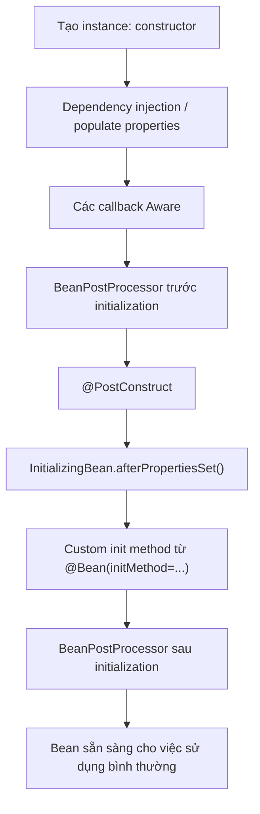
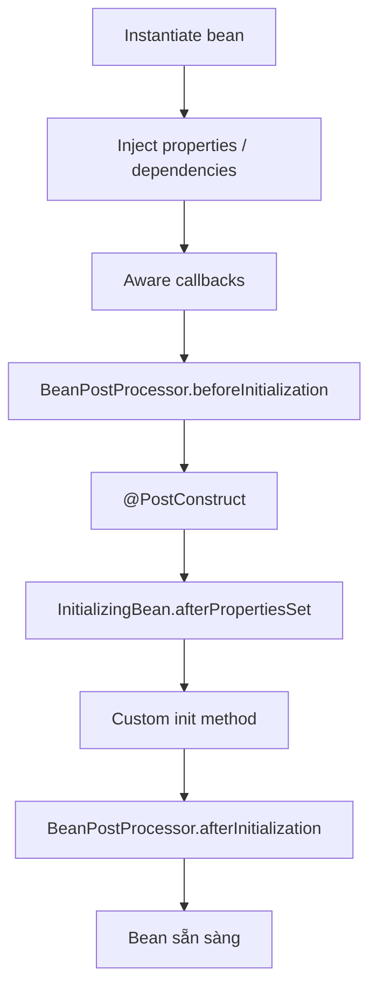

# InitializingBean và initMethod trên @Bean

Trong vòng đời bean của Spring, tạo được một object Java mới chỉ là bước đầu. Container còn phải đưa dependency vào, thực hiện các callback cần thiết và hoàn tất khởi tạo trước khi bean được sử dụng bình thường.

Spring cung cấp nhiều cách để một bean thực hiện công việc **sau khi dependency đã được thiết lập**. Hai cách quan trọng trong bài này là:

- **InitializingBean:** bean triển khai interface của Spring và định nghĩa phương thức afterPropertiesSet().
- **initMethod trên @Bean:** cấu hình tên một phương thức khởi tạo tùy chỉnh để Spring gọi sau khi thiết lập bean.

Cả hai đều thuộc giai đoạn **initialization callback** của lifecycle. Chúng không thay thế constructor, không phải nơi nhận dependency ban đầu, và cũng không có nghĩa Spring tự động gọi mọi phương thức có tên init.

## 1. Vị trí của initialization callback trong vòng đời bean

Giả sử một service cần cấu hình endpoint và một client để hoạt động. Khi Spring tạo bean, container phải hoàn tất các bước cơ bản trước khi bean sẵn sàng.

Luồng rút gọn của một bean thông thường:



Đây là thứ tự khái quát trong quá trình khởi tạo bean. Một số callback được thực hiện bởi BeanPostProcessor, vì vậy không nên hiểu tất cả là lời gọi trực tiếp từ constructor.

Các bước quan trọng:

1. **Instantiation:** Spring tạo object, thường gọi constructor.
2. **Populate properties:** Spring thiết lập dependency và property được cấu hình.
3. **Aware callbacks:** nếu bean triển khai các interface như BeanNameAware hoặc BeanFactoryAware, container gọi callback tương ứng.
4. **Before-initialization post-processors:** các BeanPostProcessor xử lý bean trước initialization; @PostConstruct được gọi trong giai đoạn này bởi processor tương ứng.
5. **InitializingBean.afterPropertiesSet():** Spring gọi callback của interface nếu bean triển khai.
6. **Custom init method:** Spring gọi phương thức được chỉ định bằng initMethod hoặc cấu hình init-method tương ứng.
7. **After-initialization post-processors:** các processor hoàn tất xử lý, trong đó có thể tạo proxy AOP.
8. Bean hoàn tất quá trình khởi tạo theo lifecycle của container.

**Điểm cần nhớ:** InitializingBean và initMethod chạy sau khi dependency đã được thiết lập, nhưng trước khi bean hoàn tất toàn bộ bước post-processing sau initialization.

## 2. InitializingBean là gì?

InitializingBean là interface trong Spring Framework:

```java
package org.springframework.beans.factory;

public interface InitializingBean {
    void afterPropertiesSet() throws Exception;
}
```

Một bean triển khai interface này phải định nghĩa afterPropertiesSet(). Spring gọi phương thức sau khi đã thiết lập các property/dependency mà container quản lý.

Ví dụ:

```java
package com.example.shop;

import org.springframework.beans.factory.InitializingBean;
import org.springframework.stereotype.Component;

@Component
public class SearchService implements InitializingBean {

    private final SearchClient searchClient;

    public SearchService(SearchClient searchClient) {
        this.searchClient = searchClient;
    }

    @Override
    public void afterPropertiesSet() {
        searchClient.verifyConfiguration();
    }
}
```

Giả sử SearchClient cũng là bean hợp lệ và có phương thức verifyConfiguration(). Khi Spring tạo SearchService:

- Container tìm và cung cấp SearchClient.
- Constructor của SearchService được gọi.
- Các bước thiết lập dependency hoàn tất.
- Spring gọi afterPropertiesSet().
- Nếu callback hoàn tất bình thường, quá trình initialization tiếp tục.

### 2.1. Vì sao có tên afterPropertiesSet?

Tên phương thức phản ánh thời điểm callback: các property mà container quản lý đã được thiết lập. Với constructor injection, dependency đã được truyền qua constructor trước khi object được khởi tạo xong. Với setter/field injection, callback diễn ra sau khi container thực hiện các bước injection tương ứng.

Tên phương thức không có nghĩa bạn phải dùng property setter. Bean dùng constructor injection vẫn có thể triển khai InitializingBean.

### 2.2. Callback có thể kiểm tra trạng thái sau khi inject

Ví dụ một bean cần kiểm tra cấu hình bắt buộc:

```java
@Component
public class PaymentSettings implements InitializingBean {

    private final PaymentGateway gateway;

    public PaymentSettings(PaymentGateway gateway) {
        this.gateway = gateway;
    }

    @Override
    public void afterPropertiesSet() {
        if (!gateway.isConfigured()) {
            throw new IllegalStateException(
                    "Payment gateway is not configured"
            );
        }
    }
}
```

Nếu cấu hình không hợp lệ, callback ném exception và bean không thể hoàn tất initialization. Trong quá trình khởi động ứng dụng, lỗi này thường làm Spring context thất bại khi tạo bean bắt buộc.

Chỉ nên kiểm tra những điều kiện thực sự thuộc trách nhiệm khởi tạo của bean. Không nên biến afterPropertiesSet() thành nơi chạy toàn bộ workflow nghiệp vụ.

## 3. initMethod trên @Bean là gì?

Khi tạo bean bằng Java configuration, annotation @Bean có thuộc tính initMethod. Thuộc tính này nhận **tên phương thức** mà Spring sẽ gọi sau khi tạo và thiết lập bean.

Ví dụ:

```java
package com.example.shop.config;

import org.springframework.context.annotation.Bean;
import org.springframework.context.annotation.Configuration;

@Configuration
public class SearchConfiguration {

    @Bean(initMethod = "initialize")
    public SearchIndex searchIndex() {
        return new SearchIndex();
    }
}
```

Lớp SearchIndex không cần triển khai InitializingBean:

```java
package com.example.shop;

public class SearchIndex {

    public void initialize() {
        System.out.println("Search index initialized");
    }

    public void rebuild() {
        // Logic cập nhật chỉ mục khi được yêu cầu
    }
}
```

Spring tạo SearchIndex từ phương thức @Bean, thiết lập dependency/property theo cấu hình, rồi gọi phương thức initialize() theo tên đã khai báo.

**initMethod = "initialize" không gọi phương thức ngay khi Java chạy đến dòng new SearchIndex().** Đây là metadata lifecycle của bean definition; container thực hiện callback ở giai đoạn initialization.

### 3.1. Vì sao dùng initMethod thay vì buộc class triển khai interface?

Có những class bạn không muốn hoặc không thể sửa:

- Class thư viện bên thứ ba.
- Class thuộc module khác và không nên phụ thuộc trực tiếp vào Spring.
- Một POJO có API khởi tạo riêng, ví dụ open(), connect() hoặc initialize().
- Class cần được đăng ký dưới một cấu hình Java cụ thể.

Bạn có thể cấu hình lifecycle ở bên ngoài class:

```java
@Bean(initMethod = "connect")
public ExternalClient externalClient() {
    return new ExternalClient();
}
```

Class ExternalClient không cần biết Spring tồn tại. @Configuration chịu trách nhiệm liên kết phương thức connect() với lifecycle của bean.

Đây là ưu điểm quan trọng của initMethod: **tách cách tạo và lifecycle integration khỏi mã của class được quản lý**.

### 3.2. Phương thức init phải có dạng phù hợp

Với @Bean(initMethod = "..."), hãy dùng phương thức không tham số:

```java
public void initialize() {
    // Chuẩn bị tài nguyên
}
```

Phương thức init không phải factory method để Spring lấy giá trị trả về làm bean. Nó là callback sau khi bean đã được tạo. Nên dùng void để thể hiện rõ mục đích; giá trị trả về của callback không phải đối tượng bean được đăng ký.

Tên phương thức phải khớp với method thực tế của instance được tạo. Nếu khai báo sai tên hoặc phương thức không thể được gọi phù hợp, quá trình tạo bean sẽ thất bại.

## 4. So sánh InitializingBean và initMethod

Hai cơ chế đều cho phép chạy logic sau khi bean được thiết lập, nhưng cách khai báo khác nhau.

| Tiêu chí | InitializingBean | @Bean(initMethod = "...") |
|---|---|---|
| Cách khai báo | Class implements InitializingBean | Cấu hình tên phương thức trên @Bean |
| Callback | afterPropertiesSet() | Phương thức tùy chỉnh, ví dụ initialize() |
| Phụ thuộc Spring API trong class | Có | Không bắt buộc |
| Phù hợp với | Class do bạn kiểm soát và chấp nhận tích hợp Spring | POJO hoặc class bên ngoài không muốn phụ thuộc Spring |
| Có thể dùng cùng nhau? | Có | Có |
| Thời điểm | Giai đoạn initialization | Giai đoạn initialization, sau afterPropertiesSet() nếu cả hai được dùng |

### 4.1. Dùng InitializingBean khi nào?

Dùng InitializingBean khi:

- Class thuộc ứng dụng và việc tích hợp với Spring là lựa chọn có chủ đích.
- Callback là phần tự nhiên trong contract lifecycle của class.
- Bạn muốn thể hiện qua kiểu Java rằng class có bước hoàn tất khởi tạo.
- Không cần giữ class hoàn toàn độc lập với Spring.

Ví dụ:

```java
@Component
public class LocalCache implements InitializingBean {

    private final CacheLoader loader;

    public LocalCache(CacheLoader loader) {
        this.loader = loader;
    }

    @Override
    public void afterPropertiesSet() {
        loader.loadInitialEntries();
    }
}
```

### 4.2. Dùng initMethod khi nào?

Dùng initMethod khi:

- Class không nên phụ thuộc Spring.
- Class thuộc thư viện bên thứ ba.
- Tên callback đã có trong API của class.
- Muốn đặt lifecycle wiring ở lớp cấu hình.

Ví dụ:

```java
@Configuration
public class ClientConfiguration {

    @Bean(initMethod = "open")
    public LegacyClient legacyClient() {
        return new LegacyClient();
    }
}
```

LegacyClient chỉ cần có phương thức open() phù hợp; nó không cần import InitializingBean.

### 4.3. Có nên dùng cả hai?

Có thể dùng cả hai. Khi một bean vừa triển khai InitializingBean, vừa được cấu hình initMethod, thứ tự callback trong giai đoạn initialization thông thường là:

1. @PostConstruct.
2. InitializingBean.afterPropertiesSet().
3. Custom init method được cấu hình bằng @Bean(initMethod = "...").

Ví dụ:

```java
public class CompositeClient implements InitializingBean {

    @PostConstruct
    public void postConstruct() {
        System.out.println("1. PostConstruct");
    }

    @Override
    public void afterPropertiesSet() {
        System.out.println("2. afterPropertiesSet");
    }

    public void initialize() {
        System.out.println("3. custom initMethod");
    }
}
```

Cấu hình:

```java
@Configuration
public class CompositeClientConfiguration {

    @Bean(initMethod = "initialize")
    public CompositeClient compositeClient() {
        return new CompositeClient();
    }
}
```

Khi bean được tạo theo lifecycle thông thường, thứ tự log minh họa:

```text
1. PostConstruct
2. afterPropertiesSet
3. custom initMethod
```

Không nên khai báo ba callback cùng làm một công việc. Nếu chúng cùng mở kết nối, nạp dữ liệu hoặc khởi tạo cùng tài nguyên, bạn có thể vô tình thực hiện thao tác nhiều lần.

## 5. So sánh với @PostConstruct

Trong ứng dụng Spring, @PostConstruct là một cách khác để khai báo callback sau khi dependency được thiết lập. Annotation này thuộc Jakarta Annotations; các phiên bản hiện đại dùng package jakarta.annotation.

Ví dụ:

```java
import jakarta.annotation.PostConstruct;
import org.springframework.stereotype.Component;

@Component
public class ReportService {

    private final ReportRepository repository;

    public ReportService(ReportRepository repository) {
        this.repository = repository;
    }

    @PostConstruct
    public void initialize() {
        repository.verifyAccess();
    }
}
```

So sánh ba cách:

| Cơ chế | Nơi khai báo | Đặc điểm |
|---|---|---|
| @PostConstruct | Annotation trên method của bean | Callback chuẩn Jakarta, không cần implements interface Spring |
| InitializingBean | Class implements interface Spring | Contract lifecycle rõ ràng nhưng class phụ thuộc Spring |
| @Bean(initMethod = "...") | Java configuration | Cấu hình callback bên ngoài class |

Trong một bean thông thường, có thể chọn một cơ chế phù hợp. Nếu class không nên phụ thuộc Spring, @PostConstruct hoặc cấu hình initMethod có thể phù hợp hơn InitializingBean; nếu muốn cấu hình hoàn toàn từ bên ngoài class, initMethod là lựa chọn trực tiếp.

**Lưu ý phiên bản:** dự án Spring Boot hiện đại dùng Jakarta namespace jakarta.annotation.PostConstruct. Tài liệu cũ có thể hiển thị javax.annotation.PostConstruct; đừng sao chép import cũ vào dự án mới nếu dependency hiện tại sử dụng Jakarta.

## 6. Ví dụ đầy đủ: Bean dùng InitializingBean

Giả sử ứng dụng cần một service giữ danh sách mã sản phẩm đã được chuẩn bị từ cấu hình. Ta muốn kiểm tra dữ liệu sau khi Spring inject dependency.

### 6.1. Dependency cung cấp dữ liệu

```java
package com.example.catalog;

import java.util.List;
import org.springframework.stereotype.Component;

@Component
public class ProductCatalogSource {

    public List<String> loadProductCodes() {
        return List.of("P-100", "P-200", "P-300");
    }
}
```

### 6.2. Bean triển khai InitializingBean

```java
package com.example.catalog;

import java.util.List;
import org.springframework.beans.factory.InitializingBean;
import org.springframework.stereotype.Service;

@Service
public class ProductCatalog implements InitializingBean {

    private final ProductCatalogSource source;
    private List<String> productCodes;

    public ProductCatalog(ProductCatalogSource source) {
        this.source = source;
    }

    @Override
    public void afterPropertiesSet() {
        this.productCodes = List.copyOf(source.loadProductCodes());

        if (productCodes.isEmpty()) {
            throw new IllegalStateException(
                    "Product catalog must not be empty"
            );
        }
    }

    public List<String> productCodes() {
        return productCodes;
    }
}
```

### 6.3. Dùng bean sau khi context khởi tạo

```java
package com.example.catalog;

import org.springframework.stereotype.Service;

@Service
public class CatalogQueryService {

    private final ProductCatalog catalog;

    public CatalogQueryService(ProductCatalog catalog) {
        this.catalog = catalog;
    }

    public boolean contains(String productCode) {
        return catalog.productCodes().contains(productCode);
    }
}
```

Khi CatalogQueryService được tạo, Spring cần ProductCatalog. Container hoàn tất initialization của ProductCatalog trước khi cung cấp bean đó cho dependency thông thường. Vì vậy danh sách đã được chuẩn bị khi service sử dụng bean sau khi context sẵn sàng.

Ví dụ này minh họa callback để **xác lập trạng thái nội bộ dựa trên dependency đã inject**. Nếu việc nạp danh sách thực tế là tác vụ chậm, cần gọi mạng hoặc có thể thất bại tạm thời, hãy cân nhắc thiết kế readiness, retry và quy trình vận hành thay vì làm startup kéo dài ngoài ý muốn.

## 7. Ví dụ đầy đủ: initMethod trên @Bean

Giả sử một thư viện cung cấp class ExternalIndex. Ta không sửa class này để triển khai InitializingBean, nhưng nó có phương thức start() để chuẩn bị tài nguyên.

### 7.1. Class POJO không phụ thuộc Spring

```java
package com.example.search;

public class ExternalIndex {

    private boolean started;

    public void start() {
        // Ví dụ: mở tài nguyên hoặc nạp metadata cần thiết.
        this.started = true;
        System.out.println("ExternalIndex started");
    }

    public boolean isStarted() {
        return started;
    }

    public void search(String query) {
        if (!started) {
            throw new IllegalStateException("Index is not started");
        }
        System.out.println("Searching: " + query);
    }

    public void stop() {
        this.started = false;
        System.out.println("ExternalIndex stopped");
    }
}
```

### 7.2. Đăng ký bean và khai báo lifecycle

```java
package com.example.search.config;

import com.example.search.ExternalIndex;
import org.springframework.context.annotation.Bean;
import org.springframework.context.annotation.Configuration;

@Configuration
public class SearchConfiguration {

    @Bean(initMethod = "start", destroyMethod = "stop")
    public ExternalIndex externalIndex() {
        return new ExternalIndex();
    }
}
```

Khi Spring tạo bean:

- Phương thức externalIndex() tạo object.
- Container hoàn tất các bước thiết lập bean.
- Spring gọi start() theo initMethod.
- Khi singleton context đóng bình thường, Spring gọi stop() theo destroyMethod.

destroyMethod xuất hiện trong ví dụ để minh họa cặp lifecycle khởi tạo/hủy. Trọng tâm của bài vẫn là initMethod; callback hủy thuộc giai đoạn khác.

### 7.3. Sử dụng bean

```java
@Service
public class SearchService {

    private final ExternalIndex index;

    public SearchService(ExternalIndex index) {
        this.index = index;
    }

    public void search(String query) {
        index.search(query);
    }
}
```

SearchService không cần tự gọi index.start() trong constructor. Spring đảm nhận callback đã khai báo trong bean definition.

## 8. Thứ tự callback khi kết hợp nhiều cơ chế

Một bean có thể dùng nhiều lifecycle callback. Thứ tự khái quát trước khi bean hoàn tất post-processing là:



Một số điểm cần lưu ý:

- @PostConstruct được thực thi bởi BeanPostProcessor phù hợp.
- afterPropertiesSet() được Spring gọi nếu bean triển khai InitializingBean.
- Custom init method được gọi sau afterPropertiesSet() nếu có khai báo.
- Các BeanPostProcessor sau initialization có thể bọc bean bằng proxy hoặc thực hiện xử lý khác.
- Thứ tự giữa các processor riêng của ứng dụng còn phụ thuộc cấu hình và thứ tự đăng ký.

### 8.1. Vì sao không nên gọi dependency của bean khác quá sớm?

Trong callback initialization, một bean có thể gọi dependency đã được inject. Nhưng đừng giả định **toàn bộ ApplicationContext đã hoàn tất startup**.

Ví dụ, nếu init callback của A gọi một service khác và service đó lại kỳ vọng một listener hoặc singleton khác đã hoàn tất mọi bước khởi tạo, có thể phát sinh tương tác quá sớm. Bean được tạo theo dependency order, nhưng không phải mọi singleton trong context đều đã được tạo tại thời điểm callback đó chạy.

Đối với công việc cần đợi toàn bộ context refresh xong, hãy xem xét lifecycle event phù hợp như ApplicationReadyEvent hoặc một cơ chế điều phối startup khác. Không nên dùng afterPropertiesSet() để thay thế sự kiện “ứng dụng đã sẵn sàng”.

### 8.2. AOP proxy chưa chắc đã sẵn sàng trong init callback

Một điểm kỹ thuật quan trọng: BeanPostProcessor tạo proxy AOP thường thực hiện bước bọc bean trong giai đoạn **after initialization**. Vì vậy, lời gọi phương thức nội bộ trong @PostConstruct, afterPropertiesSet() hoặc custom init method thường xảy ra trước khi proxy cuối cùng được cung cấp ra bên ngoài.

Do đó, không nên kỳ vọng các annotation AOP như @Transactional, @Async hoặc @Cacheable được áp dụng như khi gọi bean qua proxy sau khi context hoàn tất. Ví dụ, đặt @Transactional trên chính phương thức init không phải cách đáng tin cậy để mở transaction cho bước khởi tạo.

Nếu initialization cần transaction, hãy thiết kế một thành phần khác được gọi qua proxy đã sẵn sàng ở thời điểm phù hợp, hoặc dùng cách điều phối sau startup phù hợp.

## 9. Xử lý exception trong initialization callback

afterPropertiesSet() có thể khai báo throws Exception, vì interface quy định như vậy. Custom init method cũng có thể phát sinh lỗi trong quá trình thực thi.

Ví dụ:

```java
@Component
public class RequiredConfiguration implements InitializingBean {

    @Override
    public void afterPropertiesSet() {
        if (!configurationIsValid()) {
            throw new IllegalStateException(
                    "Required configuration is invalid"
            );
        }
    }

    private boolean configurationIsValid() {
        return false;
    }
}
```

Nếu callback thất bại, Spring không thể hoàn tất việc tạo bean như dự kiến. Exception thường được bao bọc trong lỗi tạo bean, chẳng hạn BeanCreationException, và có thể làm context startup thất bại nếu bean đó là dependency bắt buộc của ứng dụng.

### 9.1. Có nên bắt exception rồi bỏ qua?

Không nên nuốt exception một cách im lặng:

```java
@Override
public void afterPropertiesSet() {
    try {
        initializeRequiredResource();
    } catch (Exception ex) {
        // Không nên chỉ log rồi tiếp tục khi resource là bắt buộc.
    }
}
```

Nếu resource là bắt buộc để bean hoạt động, tiếp tục startup có thể tạo ra bean ở trạng thái không hợp lệ. Hãy để lỗi truyền ra hoặc chuyển thành exception có thông tin rõ ràng.

Nếu tác vụ thực sự tùy chọn, hãy thể hiện rõ trạng thái không sẵn sàng, khả năng retry hoặc fallback phù hợp. Đừng coi mọi lỗi khởi tạo là lỗi có thể bỏ qua.

### 9.2. Initialization có nên thực hiện công việc lâu?

Các callback này chạy trong quá trình tạo bean. Nếu callback tải dữ liệu lớn, gọi dịch vụ từ xa, chờ broker hoặc rebuild index trong thời gian dài, startup có thể kéo dài hoặc thất bại do hạ tầng chưa sẵn sàng.

Hãy phân biệt:

- **Khởi tạo nội bộ nhanh:** kiểm tra cấu hình, chuẩn bị cấu trúc dữ liệu nhỏ, xác lập invariant.
- **Khởi tạo cần tài nguyên bên ngoài:** mở kết nối, kiểm tra dependency, nạp dữ liệu.
- **Tác vụ nền hoặc tác vụ nghiệp vụ:** đồng bộ lớn, import dữ liệu, rebuild index, gửi thông báo.

Không phải mọi tác vụ đều nên chạy trong init callback. Với tác vụ dài hoặc cần retry, hãy cân nhắc lifecycle event, runner, job riêng hoặc cơ chế readiness/health phù hợp.

## 10. Phạm vi và số lần callback được gọi

Callback gắn với **mỗi lần container tạo một instance bean theo lifecycle tương ứng**, không phải một hàm “chạy đúng một lần cho toàn bộ JVM” trong mọi trường hợp.

| Scope / tình huống | Hành vi khái quát |
|---|---|
| Singleton | Một instance cho mỗi bean definition trong một container; init callback chạy khi instance được tạo |
| Prototype | Mỗi lần container tạo một instance mới, init callback chạy cho instance đó |
| Request/session scope | Callback gắn với instance được tạo trong scope tương ứng |
| Nhiều ApplicationContext | Mỗi context có thể tạo instance riêng và chạy callback riêng |

Với singleton eager, callback thường chạy trong startup của context. Với singleton lazy, callback có thể chỉ chạy khi bean được yêu cầu lần đầu. Vì vậy đừng giả định mọi bean lazy đều đã khởi tạo khi ứng dụng vừa in dòng startup hoàn tất.

**Lưu ý về prototype:** Spring gọi initialization callback khi tạo prototype bean, nhưng container không quản lý đầy đủ destruction lifecycle của prototype như singleton. Nếu prototype sở hữu tài nguyên cần đóng, bên sử dụng thường phải chịu trách nhiệm giải phóng phù hợp.

## 11. So sánh init callback với ApplicationRunner và ApplicationReadyEvent

Một nhầm lẫn phổ biến là dùng afterPropertiesSet() để thực hiện mọi việc cần chạy khi ứng dụng khởi động. Nhưng các cơ chế này có thời điểm khác nhau.

| Cơ chế | Thời điểm | Mục đích phù hợp |
|---|---|---|
| @PostConstruct | Trong initialization callback của bean | Khởi tạo nội bộ bean sau khi dependency được thiết lập |
| InitializingBean.afterPropertiesSet() | Sau @PostConstruct, trong initialization | Kiểm tra invariant hoặc hoàn tất trạng thái của bean |
| @Bean(initMethod = "...") | Sau afterPropertiesSet() nếu có | Gọi lifecycle method của class từ cấu hình |
| ApplicationRunner | Sau khi context refresh và trước khi ứng dụng báo ready | Chạy công việc startup nhận tham số ứng dụng |
| CommandLineRunner | Cùng giai đoạn runner sau refresh | Xử lý công việc startup từ tham số dòng lệnh |
| ApplicationReadyEvent | Khi ứng dụng đã sẵn sàng theo lifecycle Boot | Phản ứng với mốc ứng dụng ready |

Ví dụ ApplicationRunner:

```java
@Component
public class StartupDataLoader implements ApplicationRunner {

    @Override
    public void run(ApplicationArguments args) {
        System.out.println("Application startup task");
    }
}
```

Ví dụ ApplicationReadyEvent:

```java
@Component
public class ReadyListener {

    @EventListener
    public void onReady(ApplicationReadyEvent event) {
        System.out.println("Application is ready");
    }
}
```

Dùng callback bean để hoàn tất **chính bean đó**. Dùng runner/event khi công việc phụ thuộc vào việc **context hoặc ứng dụng đã tiến tới một mốc startup rộng hơn**.

## 12. Những lỗi thường gặp khi cấu hình initMethod

### 12.1. Sai tên phương thức

```java
@Bean(initMethod = "initialize")
public SearchIndex searchIndex() {
    return new SearchIndex();
}
```

Nhưng class chỉ có start() mà không có initialize(). Spring không thể gọi phương thức đã khai báo; quá trình tạo bean thất bại.

Hãy bảo đảm tên trong initMethod khớp với method trên object thực tế được trả về.

### 12.2. Phương thức cần tham số

Ví dụ không phù hợp:

```java
public void initialize(String path) {
}
```

initMethod là callback được container gọi theo tên; Spring không tự suy luận và truyền một tham số tùy ý cho method này. Nếu cần dữ liệu, hãy inject/configure dữ liệu vào bean trước rồi callback đọc trạng thái đã thiết lập, hoặc dùng factory method tạo object với constructor arguments phù hợp.

### 12.3. Gọi initialization thủ công thêm một lần

```java
@Bean(initMethod = "initialize")
public SearchIndex searchIndex() {
    SearchIndex index = new SearchIndex();
    index.initialize(); // Gọi thủ công
    return index;
}
```

Trong ví dụ này, Spring còn gọi initialize() theo initMethod sau khi tạo bean. Nếu method không idempotent, tài nguyên có thể bị mở hai lần hoặc dữ liệu bị nạp lặp.

Hãy chọn một nơi chịu trách nhiệm lifecycle. Không lặp cả hai cách cho cùng thao tác.

### 12.4. Đặt callback vào sai class

```java
@Configuration
public class ClientConfiguration {

    @Bean(initMethod = "initialize")
    public Client client() {
        return new Client();
    }

    public void initialize() {
        // Đây là method trên configuration class,
        // không phải method của Client instance.
    }
}
```

initMethod được áp dụng cho **bean instance trả về từ phương thức @Bean**, tức Client, không phải tự động gọi method initialize() trên lớp cấu hình ClientConfiguration.

Nếu muốn Client được khởi tạo, hãy bảo đảm method nằm trên class thực tế được trả về.

### 12.5. Gọi một service chưa sẵn sàng

Bean A có thể được tạo trước bean B không liên quan trong startup. Nếu init callback của A gọi B thông qua một đường phụ thuộc phức tạp, có thể tạo vòng dependency hoặc tương tác trước thời điểm thích hợp.

Hãy khai báo dependency thật sự qua constructor/bean method khi A cần B để khởi tạo. Nếu công việc cần đợi toàn bộ context, dùng cơ chế sau refresh phù hợp.

### 12.6. Đặt @Transactional trên init method và mong proxy áp dụng

Initialization method thường được gọi trước giai đoạn after-initialization post-processing tạo proxy AOP. Vì vậy không nên dựa vào @Transactional trên chính callback init để có transaction như một lời gọi service thông thường sau startup.

Hãy chuyển thao tác transactional sang bean/service khác và gọi qua proxy tại thời điểm phù hợp.

## 13. Kết hợp initMethod và destroyMethod

Dù bài tập tập trung vào initialization, khi bean mở tài nguyên thì cần nghĩ tới bước đóng tài nguyên.

Ví dụ:

```java
public class FileWatcher {

    private boolean running;

    public void start() {
        running = true;
        System.out.println("Watcher started");
    }

    public void stop() {
        running = false;
        System.out.println("Watcher stopped");
    }
}
```

Đăng ký:

```java
@Configuration
public class WatcherConfiguration {

    @Bean(initMethod = "start", destroyMethod = "stop")
    public FileWatcher fileWatcher() {
        return new FileWatcher();
    }
}
```

Trong lifecycle singleton thông thường:

```text
Context refresh
   |
   v
Create FileWatcher
   |
   v
Call start()
   |
   v
Bean used by application
   |
   v
Context close
   |
   v
Call stop()
```

Spring cũng có callback hủy thông qua DisposableBean và @PreDestroy. Thứ tự hủy là một phần lifecycle riêng, không nên nhầm với thứ tự initialization. Nếu một class đã là AutoCloseable hoặc có close()/shutdown() theo quy ước, Spring có thể áp dụng cơ chế suy luận destroy method tùy cách khai báo bean và cấu hình. Khi tài nguyên cần được giải phóng chính xác, cấu hình tường minh thường dễ đọc hơn.

Với prototype bean, container không tự quản lý destruction callback đầy đủ như singleton; bên sở hữu instance phải giải phóng tài nguyên theo thiết kế.

## 14. Nguyên tắc thiết kế initialization callback

Hãy dùng initialization callback cho những việc thuộc trách nhiệm chuẩn bị bean, ví dụ:

- Xác thực cấu hình bắt buộc.
- Xây dựng cache hoặc cấu trúc dữ liệu nội bộ nhỏ.
- Chuẩn bị client/resource cần có trước khi bean được dùng.
- Kiểm tra trạng thái dependency đã được inject.
- Thiết lập invariant để các phương thức nghiệp vụ có thể dựa vào.

Tránh:

- Chạy toàn bộ nghiệp vụ của ứng dụng trong callback.
- Gọi nhiều service theo một chuỗi phức tạp tạo dependency ngầm.
- Gửi email, thanh toán hoặc thực hiện side effect không thể đảo ngược chỉ vì context vừa tạo bean.
- Chạy tác vụ dài, retry vô hạn hoặc đợi hạ tầng không ổn định ngay trong callback.
- Nuốt exception khiến bean tiếp tục hoạt động ở trạng thái không hợp lệ.
- Dùng nhiều callback cùng làm một việc.
- Dựa vào AOP proxy đã hoàn chỉnh trong init callback.

Một callback tốt thường ngắn, có trách nhiệm rõ ràng, có thể kiểm thử và thất bại với thông báo đủ thông tin nếu bean không thể hoạt động đúng.

## 15. Bài thực hành: So sánh hai cách khởi tạo

Mục tiêu: quan sát Spring gọi afterPropertiesSet() và initMethod sau khi dependency đã được thiết lập.

### 15.1. Tạo dependency

```java
package com.example.lifecycle;

import org.springframework.stereotype.Component;

@Component
public class StartupSettings {

    public String environmentName() {
        return "development";
    }
}
```

### 15.2. Bean dùng InitializingBean

```java
package com.example.lifecycle;

import org.springframework.beans.factory.InitializingBean;
import org.springframework.stereotype.Component;

@Component
public class CacheService implements InitializingBean {

    private final StartupSettings settings;
    private boolean initialized;

    public CacheService(StartupSettings settings) {
        this.settings = settings;
    }

    @Override
    public void afterPropertiesSet() {
        if (settings.environmentName().isBlank()) {
            throw new IllegalStateException("Environment name is required");
        }

        initialized = true;
        System.out.println(
                "CacheService initialized for " + settings.environmentName()
        );
    }

    public boolean isInitialized() {
        return initialized;
    }
}
```

### 15.3. Bean dùng initMethod

```java
package com.example.lifecycle;

public class SearchClient {

    private final StartupSettings settings;
    private boolean connected;

    public SearchClient(StartupSettings settings) {
        this.settings = settings;
    }

    public void connect() {
        connected = true;
        System.out.println(
                "SearchClient connected for " + settings.environmentName()
        );
    }

    public boolean isConnected() {
        return connected;
    }
}
```

Đăng ký bean:

```java
package com.example.lifecycle;

import org.springframework.context.annotation.Bean;
import org.springframework.context.annotation.Configuration;

@Configuration
public class SearchClientConfiguration {

    @Bean(initMethod = "connect")
    public SearchClient searchClient(StartupSettings settings) {
        return new SearchClient(settings);
    }
}
```

Phương thức @Bean nhận StartupSettings như một dependency. Spring cung cấp bean đó cho factory method, tạo SearchClient, rồi gọi connect() theo cấu hình init method.

### 15.4. Kiểm tra sau khi context khởi tạo

```java
package com.example.lifecycle;

import org.springframework.boot.ApplicationRunner;
import org.springframework.context.annotation.Bean;
import org.springframework.context.annotation.Configuration;

@Configuration
public class LifecycleCheckConfiguration {

    @Bean
    ApplicationRunner lifecycleCheck(
            CacheService cacheService,
            SearchClient searchClient
    ) {
        return args -> {
            System.out.println(
                    "Cache initialized: " + cacheService.isInitialized()
            );
            System.out.println(
                    "Search connected: " + searchClient.isConnected()
            );
        };
    }
}
```

Khi ứng dụng chạy, bạn kỳ vọng thấy các thông báo initialization trước khi ApplicationRunner thực hiện kiểm tra. Thứ tự giữa những bean không có dependency với nhau có thể phụ thuộc quá trình tạo context; đừng viết test yêu cầu một thứ tự toàn cục không được đảm bảo.

### 15.5. Thử gây lỗi có kiểm soát

Đổi StartupSettings.environmentName() thành chuỗi rỗng. Khi đó CacheService.afterPropertiesSet() ném IllegalStateException. Quan sát startup thất bại và đọc Caused by để tìm nguyên nhân.

Sau khi quan sát, khôi phục giá trị hợp lệ. Thử đổi initMethod = "connect" thành một tên method không tồn tại trên SearchClient để thấy cấu hình lifecycle sai cũng làm bean creation thất bại.

Các thí nghiệm này giúp phân biệt:

- Lỗi do dependency không được cung cấp.
- Lỗi do callback init tự ném exception.
- Lỗi do tên init method không hợp lệ.
- Lỗi chỉ xảy ra khi ứng dụng thực thi nghiệp vụ sau startup.

## 16. Những hiểu lầm thường gặp

| Nhận định | Đúng hay sai? | Giải thích |
|---|---|---|
| InitializingBean được gọi trước constructor | **Sai** | Constructor tạo instance trước; callback chạy sau khi thiết lập dependency/property |
| Chỉ bean dùng setter injection mới dùng được afterPropertiesSet() | **Sai** | Bean constructor injection vẫn triển khai interface bình thường |
| @Bean(initMethod = "init") gọi method trên class @Configuration | **Sai** | Nó gọi method trên bean instance mà factory method trả về |
| Tên init method có thể tùy ý dù class không có method đó | **Sai** | Phương thức tương ứng phải tồn tại và có thể được gọi phù hợp |
| initMethod là factory method để trả về bean | **Sai** | Factory method là method @Bean; init method là callback trên bean đã tạo |
| InitializingBean và initMethod không thể cùng dùng | **Sai** | Có thể kết hợp; afterPropertiesSet() chạy trước custom init method |
| @PostConstruct chạy sau afterPropertiesSet() | **Sai** | Trong lifecycle thông thường, @PostConstruct chạy trước |
| Callback init đồng nghĩa toàn bộ ứng dụng đã ready | **Sai** | Callback gắn với một bean; context có thể còn đang tạo các bean khác |
| @Transactional trên init method luôn chạy qua AOP proxy | **Sai** | Callback thường xảy ra trước bước post-processing tạo proxy cuối cùng |
| Callback init chạy đúng một lần cho toàn JVM | **Sai** | Số lần phụ thuộc instance, scope và số ApplicationContext |
| InitializingBean tự đóng tài nguyên khi context dừng | **Sai** | Interface này chỉ là initialization callback; destruction có cơ chế riêng |
| Bật initMethod sẽ tự tạo dependency | **Sai** | Dependency vẫn phải được khai báo qua constructor, property hoặc cấu hình bean |

## 17. Câu hỏi tự kiểm tra

**Câu 1.** InitializingBean yêu cầu triển khai phương thức nào?

**Đáp án:** afterPropertiesSet(), được gọi trong giai đoạn initialization sau khi container đã thiết lập các property/dependency của bean.

**Câu 2.** Một class thư viện có phương thức open() nhưng không triển khai interface Spring. Có thể gọi open() sau khi Spring tạo bean không?

**Đáp án:** Có. Khai báo @Bean(initMethod = "open") trên factory method trả về instance đó.

**Câu 3.** Nếu bean vừa có @PostConstruct, vừa implements InitializingBean, vừa được cấu hình initMethod, thứ tự thông thường là gì?

**Đáp án:** @PostConstruct → afterPropertiesSet() → custom init method.

**Câu 4.** Vì sao không nên đặt @Transactional trên chính afterPropertiesSet() rồi kỳ vọng transaction interceptor chạy?

**Đáp án:** Initialization callback thường được gọi trước bước after-initialization post-processing tạo proxy AOP; lời gọi callback không nhất thiết đi qua proxy.

**Câu 5.** initMethod có thể nhận tham số từ Spring tự động như constructor không?

**Đáp án:** Không theo cách đó. Init method là callback không tham số; dependency nên được cung cấp cho bean qua constructor/property hoặc factory method trước khi callback chạy.

**Câu 6.** Nếu afterPropertiesSet() ném exception, điều gì có thể xảy ra?

**Đáp án:** Bean không hoàn tất initialization; lỗi thường được bọc trong exception tạo bean và có thể làm context startup thất bại nếu bean là thành phần bắt buộc.

**Câu 7.** Nếu cần chạy tác vụ sau khi toàn bộ ứng dụng đã sẵn sàng, nên mặc định dùng afterPropertiesSet() hay ApplicationReadyEvent?

**Đáp án:** ApplicationReadyEvent phù hợp với mốc ứng dụng ready hơn; afterPropertiesSet() chỉ phản ánh giai đoạn khởi tạo của một bean.

## 18. Ghi nhớ

- **InitializingBean** là contract của Spring với callback afterPropertiesSet().
- **@Bean(initMethod = "...")** khai báo phương thức khởi tạo tùy chỉnh trên instance được factory method trả về.
- Cả hai chạy sau khi dependency/property đã được thiết lập và trong giai đoạn initialization của bean.
- Khi kết hợp các callback thông dụng, thứ tự là **@PostConstruct → afterPropertiesSet() → custom init method**.
- initMethod phù hợp khi class không nên phụ thuộc trực tiếp vào Spring, đặc biệt với POJO hoặc thư viện bên ngoài.
- Initialization callback không có nghĩa toàn bộ ApplicationContext đã sẵn sàng; công việc sau startup nên dùng runner/event phù hợp.
- Không nên đặt nghiệp vụ dài, side effect khó đảo ngược hoặc logic phụ thuộc AOP proxy vào callback init.
- Khi bean mở tài nguyên, cần thiết kế cả bước giải phóng bằng destruction callback phù hợp.

Khi đọc một bean trong Spring Boot, hãy tự hỏi: **“Dependency đã được cung cấp ở đâu, bean cần hoàn tất điều gì trước khi được sử dụng, và callback nào thể hiện đúng trách nhiệm đó?”** Câu trả lời sẽ giúp bạn chọn giữa constructor, InitializingBean, @PostConstruct, initMethod và các cơ chế startup cấp ứng dụng một cách rõ ràng.
